# Polyglot Codebase Knowledge Graph

> Generated offline by **readmenator**. 159 files, 3110 symbols, 1363 imports. Supports C, C++, Python, Go, Rust, JS/TS, Java, C#, Shell, PHP, Dart, GDScript, Nim, ASM, Ruby, Swift, Kotlin, Scala, Lua, Elixir.
> No LLMs. No tokens. Pure static analysis. See more [here](https://github.com/grisuno/ReadMenator)

**Start here:** Statistics Dashboard for scope, God Nodes for blast radius, Architecture Reference for per-file API. Agents: prefer `readmenator-agent/INDEX.md` + `SYMBOLS.md`.

**Wiki:** prefer `readmenator-wiki/index.md` for progressive disclosure: one synthesis page per community, `connections.json` with EXTRACTED vs INFERRED confidence, `queries.md` log, `REPORT.md` audit.

**Confidence:** EXTRACTED = parsed from source, INFERRED = heuristic bridge, AMBIGUOUS = reported, never hidden. See `readmenator-wiki/REPORT.md`.

**Total Files Parsed:** 159 | **Total Symbols Extracted:** 3110 | **Total Imports:** 1363
 | **Resolved Imports:** 621

<!-- ranking_model: v1.0 | weights: {ppr:0.45,auth:0.2,test:0.15,doc:0.1,fresh:0.1} | alpha:0.85 | commit:3ee91a3 | date:2026-07-18 -->


## Table of Contents

1. [Statistics Dashboard](#statistics-dashboard)
2. [Architectural Layers](#architectural-layers)
3. [Architecture Overview](#architecture-overview)
4. [Execution Flows](#execution-flows)
5. [Ranked Context](#ranked-context)
6. [God Nodes](#god-nodes)
7. [Community Analysis](#community-analysis)
8. [Surprising Connections](#surprising-connections)
9. [Suggested Questions](#suggested-questions)
10. [Force-Graph Explorer](#force-graph-explorer)
11. [Corpus Analytics](#corpus-analytics)
12. [Taint Propagation Map](#taint-propagation-map)
13. [Hotspot Analysis](#hotspot-analysis)
14. [Change Impact Analysis](#change-impact-analysis)
15. [Architecture Violations](#architecture-violations)
16. [Suggested Linting Rules](#suggested-linting-rules)
17. [Concept Graph](#concept-graph)
18. [Orphans](#orphans)
19. [Query Recipes](#query-recipes)
20. [Structural Knowledge Map](#structural-knowledge-map)
21. [UML Class Diagram](#uml-class-diagram)
22. [Code Property Graph](#code-property-graph)
23. [Architecture Reference](#architecture-reference)
    - [JS (1 files)](#js-1-files)
    - [PY (157 files)](#py-157-files)
    - [SH (1 files)](#sh-1-files)

---

## Statistics Dashboard

| Metric | Value |
|--------|-------|
| Total Files | 159 |
| Total Symbols | 3110 |
| Total Imports | 1363 |
| Call Edges | 23034 |
| Inheritance Edges | 191 |
| Languages | 3 |
| Avg Symbols/File | 19.6 |
| Avg Imports/File | 8.6 |
| Resolved Imports | 621 |

### Top Files by Import Count (Fan-Out)

| File | Imports | Symbols | Language |
|------|---------|---------|----------|
| `_pipeline.py` | 45 | 53 | py |
| `_app.py` | 40 | 88 | py |
| `test_diagrams.py` | 34 | 73 | py |
| `_video.py` | 31 | 90 | py |
| `test_agent_friendliness.py` | 27 | 59 | py |
| `test_agent_output.py` | 27 | 45 | py |
| `test_interactive_graph.py` | 26 | 60 | py |
| `test_parsers_property.py` | 26 | 27 | py |
| `__init__.py` | 23 | 2 | py |
| `test_project_config.py` | 22 | 33 | py |

---

## Architectural Layers

Auto-detected from path patterns, naming conventions, and imported frameworks.

| Layer | Files |
|-------|-------|
| utility | 87 |
| testing | 56 |
| presentation | 6 |
| infrastructure | 5 |
| business_logic | 3 |
| data_access | 2 |

### utility

- `deploy.sh` (sh, 1 symbols)
- `readmenator.py` (py, 0 symbols)
- `__init__.py` (py, 0 symbols)
- `__main__.py` (py, 3 symbols)
- `_agent_output.py` (py, 33 symbols)
- `_analytics.py` (py, 9 symbols)
- `_analyzer.py` (py, 23 symbols)
- `_apidocs.py` (py, 52 symbols)
- `_app.py` (py, 88 symbols)
- `_bundlegraph.py` (py, 8 symbols)
- `_category.py` (py, 26 symbols)
- `_concepts.py` (py, 8 symbols)
- `_cpg.py` (py, 6 symbols)
- `_cursorrules_generator.py` (py, 8 symbols)
- `_dead_code.py` (py, 5 symbols)
- *... and 72 more*

### infrastructure

- `_agent_injector.py` (py, 14 symbols)
- `_cache.py` (py, 14 symbols)
- `_config.py` (py, 1 symbols)
- `_project_config.py` (py, 18 symbols)
- `_readme_injector.py` (py, 9 symbols)

### presentation

- `_apidocs_page.py` (py, 2 symbols)
- `_apidocs_render.py` (py, 45 symbols)
- `_bundlegraph_page.py` (py, 0 symbols)
- `_components.py` (py, 25 symbols)
- `_forcegraph_page.py` (py, 0 symbols)
- `_viewer_ui.py` (py, 7 symbols)

### data_access

- `_dataflow.py` (py, 21 symbols)
- `_query.py` (py, 17 symbols)

### business_logic

- `_layer_rules.py` (py, 4 symbols)
- `_models.py` (py, 23 symbols)
- `_rule_gen.py` (py, 9 symbols)

### testing

- `__init__.py` (py, 0 symbols)
- `test_agent_friendliness.py` (py, 59 symbols)
- `test_agent_injector.py` (py, 38 symbols)
- `test_agent_output.py` (py, 45 symbols)
- `test_analyzer.py` (py, 14 symbols)
- `test_apidocs.py` (py, 48 symbols)
- `test_bundlegraph.py` (py, 27 symbols)
- `test_cache.py` (py, 22 symbols)
- `test_components.py` (py, 36 symbols)
- `test_concepts.py` (py, 8 symbols)
- `test_config.py` (py, 6 symbols)
- `test_cpg.py` (py, 11 symbols)
- `test_cursorrules.py` (py, 12 symbols)
- `test_dataflow.py` (py, 47 symbols)
- `test_dead_code.py` (py, 15 symbols)
- *... and 41 more*

---

## Architecture Overview

8 components stacked in 6 dependency tiers (weighted Eades-Lin-Smyth ordering: arrows point from dependent to dependency, top to bottom). Labels are import counts, thick arrows the top quartile; 12 transitively implied edges are omitted. Dashed red arrows are upward dependencies: the smallest set of imports that closes every cycle and breaks the layering. Cyan components hold entry points. Interactive version: `readmenator-apidocs/index.html#/flows`.

Upward dependencies to fix first: `readmenator/parsers` -> `readmenator: _video` (6 imports); `readmenator: _video` -> `readmenator: _flowcharts` (6 imports); `readmenator: _diagrams` -> `readmenator: _video` (6 imports); `readmenator: _video` -> `readmenator: _graphrag` (5 imports); `readmenator: _video` -> `readmenator: _agent_output` (4 imports); `readmenator: _video` -> `readmenator: _pipeline` (3 imports); `readmenator: _diagrams` -> `readmenator: _agent_output` (3 imports); `readmenator: _graphrag` -> `readmenator: _pipeline` (2 imports); `readmenator/parsers` -> `readmenator: _graphrag` (1 imports); `readmenator: _diagrams` -> `readmenator: _graphrag` (1 imports)

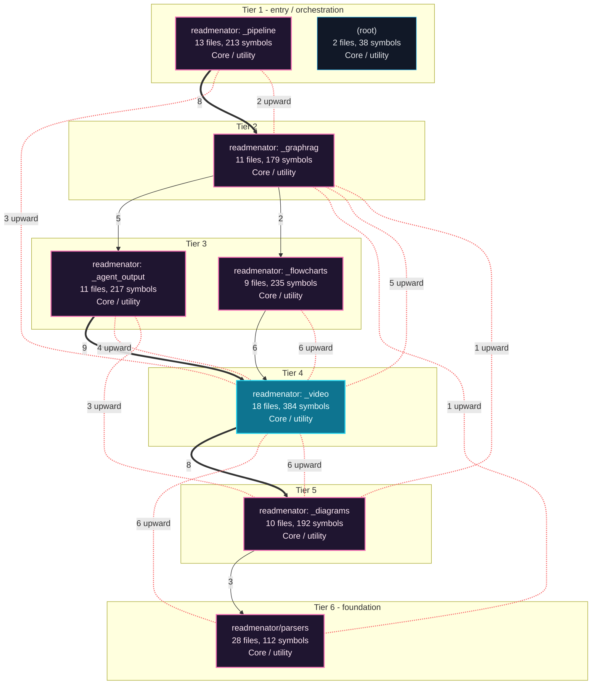

---

## Execution Flows

Entry points are scored from `__main__` guards, `main` functions, entry-style names and files, and call-graph sources. Each flow walks resolved calls in call-site order (depth <= 4, <= 40 steps); numbers give the call order, dashed arrows revisit an already expanded callee, red arrows are recursion. Interactive version with zoom and per-node docs: `readmenator-apidocs/index.html#/flows`.

### `__main__.main`

`readmenator/__main__.py:153`, score 9: entry-style name `main`; defined in entry file `__main__.py`; called from the `__main__` guard.

Control flow:

```mermaid
flowchart TB
    classDef decision fill:#1e1b4b,stroke:#a78bfa,color:#ede9fe;
    classDef default fill:#111827,stroke:#38bdf8,color:#e5e7eb;
    classDef entry fill:#0e7490,stroke:#22d3ee,color:#ecfeff,stroke-width:2px;
    classDef muted fill:#111827,stroke:#475569,color:#94a3b8;
    n_s1(["start __main__.main"]):::entry
    n_s2{"'--test' in sys.argv?"}:::decision
    n_s3(["return after _run_tests()"]):::entry
    n_s4{{"for (flag, lang) in uml_lang_flags.items()"}}:::decision
    n_s5{"flag in sys.argv?"}:::decision
    n_s6["break"]:::default
    n_s7{"uml_codegen_flag?"}:::decision
    n_s8(["return after build_parser(), readmenatorApplication(), ge..."]):::entry
    n_s9{"len(sys.argv) #gt; 2 and sys.argv[1] != '--rebuild' and (not..."}:::decision
    n_s10["readmenatorApplication()"]:::default
    n_s11{"command == 'query'?<br/>and len(sys.argv) #gt;= 4"}:::decision
    n_s12(["return after query()"]):::entry
    n_s13{"command == 'explain'?<br/>and len(sys.argv) #gt;= 4"}:::decision
    n_s14(["return after explain()"]):::entry
    n_s15{"command == 'path'?<br/>and len(sys.argv) #gt;= 5"}:::decision
    n_s16(["return after find_path()"]):::entry
    n_s17{"command in 'summary' / 'sum' / 'info'?"}:::decision
    n_s18(["return after summary()"]):::entry
    n_s19{"command == 'update'?"}:::decision
    n_s20(["return after update()"]):::entry
    n_s21{"command == 'export'?"}:::decision
    n_s22(["return after export()"]):::entry
    n_s23{"command == 'graphml'?"}:::decision
    n_s24(["return after export_graphml()"]):::entry
    n_s25{"command == 'cypher'?"}:::decision
    n_s26(["return after export_cypher()"]):::entry
    n_s27{"command == 'obsidian'?"}:::decision
    n_s28(["return after export_obsidian()"]):::entry
    n_s29{"command == 'wiki'?"}:::decision
    n_s30(["return after export_wiki()<br/>Generate the navigable agent wiki for the tar..."]):::entry
    n_s31{"command == 'lint-wiki'?"}:::decision
    n_s32(["return after lint_wiki()<br/>Check wiki health and log reported issues."]):::entry
    n_s33{"command == 'watch'?"}:::decision
    n_s34(["return after watch()"]):::entry
    n_s35{"command == 'layers'?"}:::decision
    n_s36(["return after detect_layers()"]):::entry
    n_s37{"command == 'analyze'?"}:::decision
    n_s38["analyze()"]:::default
    n_s39{{"for q in result.suggested_questions"}}:::decision
    n_s40(["return"]):::entry
    n_s41{"command == 'audit'?"}:::decision
    n_s42(["return after audit()"]):::entry
    n_s43{"command == 'audit-deep'?"}:::decision
    n_s44(["return after audit_deep()"]):::entry
    n_s45{"command == 'export-sarif'?"}:::decision
    n_s46(["return after export_sarif()"]):::entry
    n_s47{"command == 'export-rules'?"}:::decision
    n_s48(["return after export_rules()"]):::entry
    n_s49{"command == 'uml'?"}:::decision
    n_s50["_scan(), render_mermaid_class_diagram()"]:::default
    n_s51{"uml_diagram?"}:::decision
    n_s52(["return"]):::entry
    n_s53{"command == 'serve'?"}:::decision
    n_s54(["return"]):::entry
    n_s55{"command == 'lint'?"}:::decision
    n_s56(["return after lint()"]):::entry
    n_s57{"command == 'strip-dead-code'?"}:::decision
    n_s58["strip_dead_code()"]:::default
    n_s59{{"for r in reports"}}:::decision
    n_s60(["return"]):::entry
    n_s61{"command == 'generate-rules'?"}:::decision
    n_s62(["return after generate_cursorrules()"]):::entry
    n_s63{"command == 'refactor-monolith'?"}:::decision
    n_s64["refactor_monolith()"]:::default
    n_s65{{"for plan in plans"}}:::decision
    n_s66{{"for action in plan.actions"}}:::decision
    n_s67(["return"]):::entry
    n_s68{"command == 'diagrams'?"}:::decision
    n_s69["export_diagrams()<br/>Export all five interactive system maps plus..."]:::default
    n_s70{{"for (kind, path) in sorted(written.items())"}}:::decision
    n_s71(["return"]):::entry
    n_s72{"command == 'diagram'?<br/>and len(sys.argv) #gt;= 4"}:::decision
    n_s73(["return after export_diagram()<br/>Export a single interactive system map as sta..."]):::entry
    n_s74{"command == 'pages'?"}:::decision
    n_s75["export_pages()<br/>Publish all system maps plus a gallery index..."]:::default
    n_s76{{"for (kind, path) in sorted(written.items())"}}:::decision
    n_s77(["return"]):::entry
    n_s78{"command == 'video'?"}:::decision
    n_s79["export_video()<br/>Render the cinematic overview video for the t..."]:::default
    n_s80{"out?"}:::decision
    n_s81(["return"]):::entry
    n_s82{"command == 'fresh'?"}:::decision
    n_s83["check_freshness()<br/>Compare the MANIFEST source fingerprint again..."]:::default
    n_s84{"command == 'gh-wiki'?"}:::decision
    n_s85["publish_github_wiki()<br/>Mirror the generated wiki, agent docs, and kn..."]:::default
    n_s86{"not result.pushed and (not result.output_dir)?"}:::decision
    n_s87(["return"]):::entry
    n_s88{"command == 'explorer'?"}:::decision
    n_s89(["return after serve_explorer()<br/>Serve the local explorer UI until interrupted."]):::entry
    n_s90{"command == 'forcegraph'?"}:::decision
    n_s91(["return after export_forcegraph()<br/>Export the force-graph explorer HTML document."]):::entry
    n_s92{"command == 'bundles'?"}:::decision
    n_s93(["return after export_bundlegraph()<br/>Export the edge bundle explorer HTML document..."]):::entry
    n_s94{"command == 'flows'?"}:::decision
    n_s95(["return after export_flows()<br/>Write the standalone interactive architecture..."]):::entry
    n_s96{"command == 'config'?"}:::decision
    n_s97(["return after ensure_project_config(), load_project_config...<br/>Create #96;#96;readmenator.toml#96;#96; from the template..."]):::entry
    n_s98{"command == 'apidocs'?"}:::decision
    n_s99["export_apidocs()<br/>Generate the API reference tree (Markdown, ap..."]:::default
    n_s100{{"for rel in sorted(written)"}}:::decision
    n_s101(["return"]):::entry
    n_s102{"command == 'doc-coverage'?"}:::decision
    n_s103["build_api_reference()<br/>Scan *target_dir* and build its API reference..."]:::default
    n_s104{"'--fail-under' in sys.argv?"}:::decision
    n_s105[/"try"/]:::default
    n_s106{{"for warning in reference.warnings"}}:::decision
    n_s107{"command == 'components'?"}:::decision
    n_s108["export_components()<br/>Export component diagrams (analysis.json + gr..."]:::default
    n_s109{{"for (kind, path) in sorted(written.items())"}}:::decision
    n_s110(["return"]):::entry
    n_s111{"command == 'analytics'?"}:::decision
    n_s112(["return after analytics()<br/>Compute the corpus analytics payload."]):::entry
    n_s113{"command == 'near'?<br/>and len(sys.argv) #gt;= 4"}:::decision
    n_s114(["return after near()<br/>Find semantically similar files for a query f..."]):::entry
    n_s115{"command == 'scan-text'?"}:::decision
    n_s116["scan_texts()<br/>Build scan-text blobs for every file in the p..."]:::default
    n_s117{{"for file_id in sorted(texts)"}}:::decision
    n_s118(["return"]):::entry
    n_s119{"command == 'validate-rules'?"}:::decision
    n_s120(["return after validate_yaralite()<br/>Validate the project YARA-lite rules file."]):::entry
    n_s121{"command == 'graphrag'?"}:::decision
    n_s122(["return after build_graphrag()<br/>Scan, analyse, and write the GraphRAG index f..."]):::entry
    n_s123{"command == 'ask'?<br/>and len(sys.argv) #gt;= 4"}:::decision
    n_s124{"'--budget' in sys.argv?"}:::decision
    n_s125{"position + 1 #lt; len(sys.argv) and sys.argv[position + 1].i..."}:::decision
    n_s126(["return after graphrag_search()<br/>Answer a question with GraphRAG retrieval ove..."]):::entry
    n_s127{"command == 'memory'?"}:::decision
    n_s128(["return after memory()<br/>Return MEMORY.md, generating it first when mi..."]):::entry
    n_s129{"command == 'remember'?<br/>and len(sys.argv) #gt;= 4"}:::decision
    n_s130{"'--kind' in sys.argv?"}:::decision
    n_s131{"position + 1 #lt; len(sys.argv)?"}:::decision
    n_s132[/"try"/]:::default
    n_s133["remember()<br/>Append a note to the preserved MEMORY.md sess..."]:::default
    n_s134(["return"]):::entry
    n_s135{"command == 'skills'?"}:::decision
    n_s136{"'--target' in sys.argv?"}:::decision
    n_s137{"position + 1 #lt; len(sys.argv)?"}:::decision
    n_s138["install_skills()<br/>Install the packaged agent skills into the pr..."]:::default
    n_s139{{"for path in written"}}:::decision
    n_s140(["return after available()"]):::entry
    n_s141{"command == 'provenance'?"}:::decision
    n_s142{{"for item in app.audit_provenance(target)"}}:::decision
    n_s143(["return"]):::entry
    n_s144{"command == 'receipts'?"}:::decision
    n_s145(["return after ingest_receipts()<br/>Ingest deploynator release receipts into the..."]):::entry
    n_s146{"command == '--rebuild'?"}:::decision
    n_s147{"'--no-video' in argset?"}:::decision
    n_s148["readmenatorApplication(), Config()<br/>Single source of truth for all readmenator se..."]:::default
    n_s149(["return after rebuild()"]):::entry
    n_s150{"command.startswith('--')?"}:::decision
    n_s151["error()"]:::default
    n_s152{"has_export_flags?"}:::decision
    n_s153["build_parser(), readmenatorApplication()"]:::default
    n_s154{"args.export_all or (args.json and args.html and args.svg)?"}:::decision
    n_s155["export()"]:::default
    n_s156{"args.json?"}:::decision
    n_s157["export_json()"]:::default
    n_s158{"args.html?"}:::decision
    n_s159["export_html()"]:::default
    n_s160{"args.svg?"}:::decision
    n_s161(["end"]):::entry
    n_s162["truncated at FLOW_CFG_MAX_NODES=160"]:::muted
    n_s1 --> n_s2
    n_s2 -->|"yes"| n_s3
    n_s2 -->|"no"| n_s4
    n_s4 -->|"each"| n_s5
    n_s5 -->|"yes"| n_s6
    n_s5 -.->|"no"| n_s4
    n_s4 -->|"done"| n_s7
    n_s7 -->|"yes"| n_s8
    n_s7 -->|"no"| n_s9
    n_s9 -->|"yes"| n_s10
    n_s10 --> n_s11
    n_s11 -->|"yes"| n_s12
    n_s11 -->|"no"| n_s13
    n_s13 -->|"yes"| n_s14
    n_s13 -->|"no"| n_s15
    n_s15 -->|"yes"| n_s16
    n_s15 -->|"no"| n_s17
    n_s17 -->|"yes"| n_s18
    n_s17 -->|"no"| n_s19
    n_s19 -->|"yes"| n_s20
    n_s19 -->|"no"| n_s21
    n_s21 -->|"yes"| n_s22
    n_s21 -->|"no"| n_s23
    n_s23 -->|"yes"| n_s24
    n_s23 -->|"no"| n_s25
    n_s25 -->|"yes"| n_s26
    n_s25 -->|"no"| n_s27
    n_s27 -->|"yes"| n_s28
    n_s27 -->|"no"| n_s29
    n_s29 -->|"yes"| n_s30
    n_s29 -->|"no"| n_s31
    n_s31 -->|"yes"| n_s32
    n_s31 -->|"no"| n_s33
    n_s33 -->|"yes"| n_s34
    n_s33 -->|"no"| n_s35
    n_s35 -->|"yes"| n_s36
    n_s35 -->|"no"| n_s37
    n_s37 -->|"yes"| n_s38
    n_s38 --> n_s39
    n_s39 -.->|"each"| n_s39
    n_s39 -->|"done"| n_s40
    n_s37 -->|"no"| n_s41
    n_s41 -->|"yes"| n_s42
    n_s41 -->|"no"| n_s43
    n_s43 -->|"yes"| n_s44
    n_s43 -->|"no"| n_s45
    n_s45 -->|"yes"| n_s46
    n_s45 -->|"no"| n_s47
    n_s47 -->|"yes"| n_s48
    n_s47 -->|"no"| n_s49
    n_s49 -->|"yes"| n_s50
    n_s50 --> n_s51
    n_s51 -->|"yes"| n_s52
    n_s51 -->|"no"| n_s52
    n_s49 -->|"no"| n_s53
    n_s53 -->|"yes"| n_s54
    n_s53 -->|"no"| n_s55
    n_s55 -->|"yes"| n_s56
    n_s55 -->|"no"| n_s57
    n_s57 -->|"yes"| n_s58
    n_s58 --> n_s59
    n_s59 -.->|"each"| n_s59
    n_s59 -->|"done"| n_s60
    n_s57 -->|"no"| n_s61
    n_s61 -->|"yes"| n_s62
    n_s61 -->|"no"| n_s63
    n_s63 -->|"yes"| n_s64
    n_s64 --> n_s65
    n_s65 -->|"each"| n_s66
    n_s66 -.->|"each"| n_s66
    n_s66 -.->|"done"| n_s65
    n_s65 -->|"done"| n_s67
    n_s63 -->|"no"| n_s68
    n_s68 -->|"yes"| n_s69
    n_s69 --> n_s70
    n_s70 -.->|"each"| n_s70
    n_s70 -->|"done"| n_s71
    n_s68 -->|"no"| n_s72
    n_s72 -->|"yes"| n_s73
    n_s72 -->|"no"| n_s74
    n_s74 -->|"yes"| n_s75
    n_s75 --> n_s76
    n_s76 -.->|"each"| n_s76
    n_s76 -->|"done"| n_s77
    n_s74 -->|"no"| n_s78
    n_s78 -->|"yes"| n_s79
    n_s79 --> n_s80
    n_s80 -->|"yes"| n_s81
    n_s80 -->|"no"| n_s81
    n_s78 -->|"no"| n_s82
    n_s82 -->|"yes"| n_s83
    n_s82 -->|"no"| n_s84
    n_s84 -->|"yes"| n_s85
    n_s85 --> n_s86
    n_s86 -->|"yes"| n_s87
    n_s86 -->|"no"| n_s87
    n_s84 -->|"no"| n_s88
    n_s88 -->|"yes"| n_s89
    n_s88 -->|"no"| n_s90
    n_s90 -->|"yes"| n_s91
    n_s90 -->|"no"| n_s92
    n_s92 -->|"yes"| n_s93
    n_s92 -->|"no"| n_s94
    n_s94 -->|"yes"| n_s95
    n_s94 -->|"no"| n_s96
    n_s96 -->|"yes"| n_s97
    n_s96 -->|"no"| n_s98
    n_s98 -->|"yes"| n_s99
    n_s99 --> n_s100
    n_s100 -.->|"each"| n_s100
    n_s100 -->|"done"| n_s101
    n_s98 -->|"no"| n_s102
    n_s102 -->|"yes"| n_s103
    n_s103 --> n_s104
    n_s104 -->|"yes"| n_s105
    n_s105 --> n_s106
    n_s105 -->|"except (IndexError, ValueError)"| n_s106
    n_s104 -->|"no"| n_s106
    n_s106 -.->|"each"| n_s106
    n_s102 -->|"no"| n_s107
    n_s107 -->|"yes"| n_s108
    n_s108 --> n_s109
    n_s109 -.->|"each"| n_s109
    n_s109 -->|"done"| n_s110
    n_s107 -->|"no"| n_s111
    n_s111 -->|"yes"| n_s112
    n_s111 -->|"no"| n_s113
    n_s113 -->|"yes"| n_s114
    n_s113 -->|"no"| n_s115
    n_s115 -->|"yes"| n_s116
    n_s116 --> n_s117
    n_s117 -.->|"each"| n_s117
    n_s117 -->|"done"| n_s118
    n_s115 -->|"no"| n_s119
    n_s119 -->|"yes"| n_s120
    n_s119 -->|"no"| n_s121
    n_s121 -->|"yes"| n_s122
    n_s121 -->|"no"| n_s123
    n_s123 -->|"yes"| n_s124
    n_s124 -->|"yes"| n_s125
    n_s125 -->|"yes"| n_s126
    n_s125 -->|"no"| n_s126
    n_s124 -->|"no"| n_s126
    n_s123 -->|"no"| n_s127
    n_s127 -->|"yes"| n_s128
    n_s127 -->|"no"| n_s129
    n_s129 -->|"yes"| n_s130
    n_s130 -->|"yes"| n_s131
    n_s131 -->|"yes"| n_s132
    n_s131 -->|"no"| n_s132
    n_s130 -->|"no"| n_s132
    n_s132 --> n_s133
    n_s133 --> n_s134
    n_s132 -->|"except ValueError"| n_s134
    n_s129 -->|"no"| n_s135
    n_s135 -->|"yes"| n_s136
    n_s136 -->|"yes"| n_s137
    n_s137 -->|"yes"| n_s138
    n_s137 -->|"no"| n_s138
    n_s136 -->|"no"| n_s138
    n_s138 --> n_s139
    n_s139 -.->|"each"| n_s139
    n_s139 -->|"done"| n_s140
    n_s135 -->|"no"| n_s141
    n_s141 -->|"yes"| n_s142
    n_s142 -.->|"each"| n_s142
    n_s142 -->|"done"| n_s143
    n_s141 -->|"no"| n_s144
    n_s144 -->|"yes"| n_s145
    n_s144 -->|"no"| n_s146
    n_s146 -->|"yes"| n_s147
    n_s147 -->|"yes"| n_s148
    n_s148 --> n_s149
    n_s147 -->|"no"| n_s149
    n_s146 -->|"no"| n_s150
    n_s150 -->|"no"| n_s151
    n_s83 --> n_s152
    n_s106 -->|"done"| n_s152
    n_s150 -->|"yes"| n_s152
    n_s151 --> n_s152
    n_s9 -->|"no"| n_s152
    n_s152 -->|"yes"| n_s153
    n_s153 --> n_s154
    n_s154 -->|"yes"| n_s155
    n_s154 -->|"no"| n_s156
    n_s156 -->|"yes"| n_s157
    n_s157 --> n_s158
    n_s156 -->|"no"| n_s158
    n_s158 -->|"yes"| n_s159
    n_s159 --> n_s160
    n_s158 -->|"no"| n_s160
    n_s155 --> n_s161
    n_s160 -->|"yes"| n_s161
    n_s160 -->|"no"| n_s161
    n_s152 -->|"no"| n_s161
    n_s1 -.-> n_s162
    linkStyle 5,39,61,69,70,75,82,109,118,122,131,161,165 stroke:#f87171,stroke-width:2px;
```

Call tree:

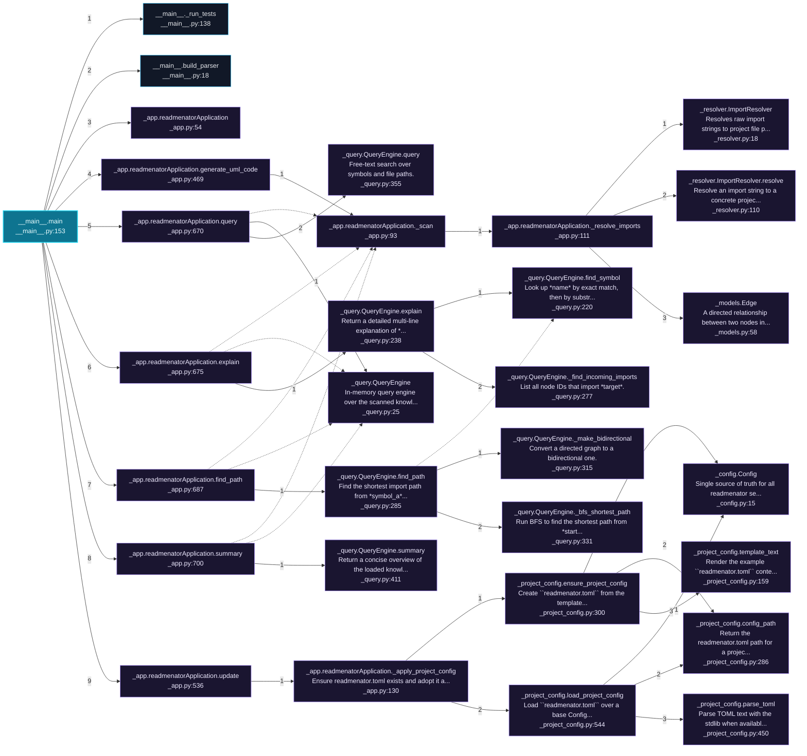

Cross-file sequence:

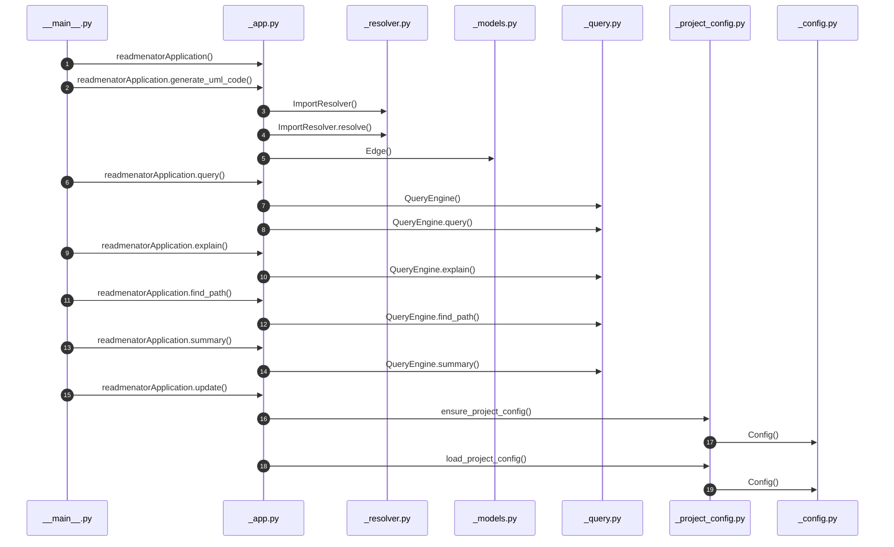

### `_mcp_server (__main__)`

`readmenator/_mcp_server.py:1090`, score 8: `if __name__ == "__main__"` guard.

Call tree:

```mermaid
flowchart LR
    classDef default fill:#111827,stroke:#38bdf8,color:#e5e7eb;
    classDef entry fill:#0e7490,stroke:#22d3ee,color:#ecfeff,stroke-width:2px;
    classDef external fill:#1a1530,stroke:#a78bfa,color:#ede9fe;
    n_readmenator__mcp_server_py___main_["_mcp_server (__main__)<br/>_mcp_server.py"]:::entry
    n_readmenator__mcp_server_py__main["_mcp_server.main<br/>CLI entry point for #96;readmenator serve #lt;path#gt;#96;.<br/>_mcp_server.py:1074"]:::default
    n_readmenator__config_py__Config["_config.Config<br/>Single source of truth for all readmenator se...<br/>_config.py:15"]:::external
    n_readmenator__app_py__readmenatorApplication["_app.readmenatorApplication<br/>_app.py:54"]:::external
    n_readmenator__app_py__run["_app.readmenatorApplication.run<br/>_app.py:179"]:::external
    n_readmenator__app_py___apply_project_config["_app.readmenatorApplication._apply_project_config<br/>Ensure readmenator.toml exists and adopt it a...<br/>_app.py:130"]:::external
    n_readmenator__project_config_py__ensure_project_config["_project_config.ensure_project_config<br/>Create #96;#96;readmenator.toml#96;#96; from the template...<br/>_project_config.py:300"]:::external
    n_readmenator__project_config_py__load_project_config["_project_config.load_project_config<br/>Load #96;#96;readmenator.toml#96;#96; over a base Config...<br/>_project_config.py:544"]:::external
    n_readmenator__pipeline_py__AnalyzerFactory["_pipeline.AnalyzerFactory<br/>Lazy factory for all readmenator analyzer and...<br/>_pipeline.py:67"]:::external
    n_readmenator__pipeline_py__DeepAnalysisRunner["_pipeline.DeepAnalysisRunner<br/>Orchestrates the extended V2 analysis pipeline.<br/>_pipeline.py:484"]:::external
    n_readmenator__app_py___resolve_imports["_app.readmenatorApplication._resolve_imports<br/>_app.py:111"]:::external
    n_readmenator__resolver_py__ImportResolver["_resolver.ImportResolver<br/>Resolves raw import strings to project file p...<br/>_resolver.py:18"]:::external
    n_readmenator__resolver_py__resolve["_resolver.ImportResolver.resolve<br/>Resolve an import string to a concrete projec...<br/>_resolver.py:110"]:::external
    n_readmenator__models_py__Edge["_models.Edge<br/>A directed relationship between two nodes in...<br/>_models.py:58"]:::external
    n_readmenator__layers_py__LayerDetector["_layers.LayerDetector<br/>Detects architectural layers in a codebase.<br/>_layers.py:17"]:::external
    n_readmenator__layers_py__detect["_layers.LayerDetector.detect<br/>Assign each file node to an architectural layer.<br/>_layers.py:83"]:::external
    n_readmenator__layers_py___classify_file["_layers.LayerDetector._classify_file<br/>Classify a single file into an architectural...<br/>_layers.py:138"]:::external
    n_readmenator__layers_py__layer_summary["_layers.LayerDetector.layer_summary<br/>Count files per layer.<br/>_layers.py:189"]:::external
    n_readmenator__pipeline_py__run["_pipeline.DeepAnalysisRunner.run<br/>_pipeline.py:496"]:::external
    n_readmenator__models_py__AnalysisResultV2["_models.AnalysisResultV2<br/>Extended analysis result combining all new an...<br/>_models.py:284"]:::external
    n_readmenator__pipeline_py__build_typed_graph["_pipeline.AnalyzerFactory.build_typed_graph<br/>_pipeline.py:449"]:::external
    n_readmenator__category_py__build_category_from_edges["_category.build_category_from_edges<br/>Build a Category from lists of Edge objects.<br/>_category.py:236"]:::external
    n_readmenator__category_py__TypedGraph["_category.TypedGraph<br/>Weighted directed graph for PageRank computat...<br/>_category.py:181"]:::external
    n_readmenator__pipeline_py__make_ranker["_pipeline.AnalyzerFactory.make_ranker<br/>Create a CompositeRanker for the given typed...<br/>_pipeline.py:459"]:::external
    n_readmenator__rank_py__RankConfig["_rank.RankConfig<br/>Tuneable parameters for the ranking system.<br/>_rank.py:32"]:::external
    n_readmenator__rank_py__CompositeRanker["_rank.CompositeRanker<br/>Combines PPR, authority, test/doc coverage, a...<br/>_rank.py:411"]:::external
    n_readmenator__query_py__QueryEngine["_query.QueryEngine<br/>In-memory query engine over the scanned knowl...<br/>_query.py:25"]:::external
    n_readmenator__query_py__ranked_query["_query.QueryEngine.ranked_query<br/>Answer *query* with a ranked list of relevant...<br/>_query.py:73"]:::external
    n_readmenator__query_py___init_default_ranker["_query.QueryEngine._init_default_ranker<br/>Build a default CompositeRanker from the load...<br/>_query.py:64"]:::external
    n_readmenator__rank_py__build_seeds_from_query["_rank.build_seeds_from_query<br/>Build a PPR seed vector from a natural-langua...<br/>_rank.py:274"]:::external
    n_readmenator__query_py___estimate_test_coverage["_query.QueryEngine._estimate_test_coverage<br/>Estimate test coverage per file.<br/>_query.py:124"]:::external
    n_readmenator__query_py___estimate_doc_coverage["_query.QueryEngine._estimate_doc_coverage<br/>Estimate documentation coverage per file.<br/>_query.py:150"]:::external
    n_readmenator__rank_py__rank["_rank.CompositeRanker.rank<br/>Compute composite ranking for a query.<br/>_rank.py:438"]:::external
    n_readmenator__cache_py__FileCache["_cache.FileCache<br/>SHA256-based cache for incremental file scann...<br/>_cache.py:20"]:::external
    n_readmenator__cache_py__compute_hashes["_cache.FileCache.compute_hashes<br/>_cache.py:64"]:::external
    n_readmenator__cache_py__compute_hash["_cache.FileCache.compute_hash<br/>_cache.py:55"]:::external
    n_readmenator__cache_py__save["_cache.FileCache.save<br/>_cache.py:49"]:::external
    n_readmenator__cache_py__save_analysis["_cache.FileCache.save_analysis<br/>Save an analysis result to the semantic cache.<br/>_cache.py:95"]:::external
    n_readmenator__app_py___write_sidecar_outputs["_app.readmenatorApplication._write_sidecar_outputs<br/>_app.py:412"]:::external
    n_readmenator__app_py___maybe_write_memory["_app.readmenatorApplication._maybe_write_memory<br/>Regenerate MEMORY.md (preserving the session...<br/>_app.py:1825"]:::external
    n_readmenator__mcp_server_py___main_ -->|"1"| n_readmenator__mcp_server_py__main
    n_readmenator__mcp_server_py__main -->|"1"| n_readmenator__config_py__Config
    n_readmenator__mcp_server_py__main -->|"2"| n_readmenator__app_py__readmenatorApplication
    n_readmenator__mcp_server_py__main -->|"3"| n_readmenator__app_py__run
    n_readmenator__app_py__run -->|"1"| n_readmenator__app_py___apply_project_config
    n_readmenator__app_py___apply_project_config -->|"1"| n_readmenator__project_config_py__ensure_project_config
    n_readmenator__app_py___apply_project_config -->|"2"| n_readmenator__project_config_py__load_project_config
    n_readmenator__app_py___apply_project_config -->|"3"| n_readmenator__pipeline_py__AnalyzerFactory
    n_readmenator__app_py___apply_project_config -->|"4"| n_readmenator__pipeline_py__DeepAnalysisRunner
    n_readmenator__app_py__run -->|"2"| n_readmenator__app_py___resolve_imports
    n_readmenator__app_py___resolve_imports -->|"1"| n_readmenator__resolver_py__ImportResolver
    n_readmenator__app_py___resolve_imports -->|"2"| n_readmenator__resolver_py__resolve
    n_readmenator__app_py___resolve_imports -->|"3"| n_readmenator__models_py__Edge
    n_readmenator__app_py__run -->|"3"| n_readmenator__layers_py__LayerDetector
    n_readmenator__app_py__run -->|"4"| n_readmenator__layers_py__detect
    n_readmenator__layers_py__detect -->|"1"| n_readmenator__layers_py___classify_file
    n_readmenator__app_py__run -->|"5"| n_readmenator__layers_py__layer_summary
    n_readmenator__app_py__run -->|"6"| n_readmenator__pipeline_py__run
    n_readmenator__pipeline_py__run -->|"1"| n_readmenator__models_py__AnalysisResultV2
    n_readmenator__app_py__run -->|"7"| n_readmenator__pipeline_py__build_typed_graph
    n_readmenator__pipeline_py__build_typed_graph -->|"1"| n_readmenator__category_py__build_category_from_edges
    n_readmenator__pipeline_py__build_typed_graph -->|"2"| n_readmenator__category_py__TypedGraph
    n_readmenator__app_py__run -->|"8"| n_readmenator__pipeline_py__make_ranker
    n_readmenator__pipeline_py__make_ranker -->|"1"| n_readmenator__rank_py__RankConfig
    n_readmenator__pipeline_py__make_ranker -->|"2"| n_readmenator__rank_py__CompositeRanker
    n_readmenator__app_py__run -->|"9"| n_readmenator__query_py__QueryEngine
    n_readmenator__app_py__run -->|"10"| n_readmenator__query_py__ranked_query
    n_readmenator__query_py__ranked_query -->|"1"| n_readmenator__query_py___init_default_ranker
    n_readmenator__query_py__ranked_query -->|"2"| n_readmenator__rank_py__build_seeds_from_query
    n_readmenator__query_py__ranked_query -->|"3"| n_readmenator__category_py__build_category_from_edges
    n_readmenator__query_py__ranked_query -->|"4"| n_readmenator__query_py___estimate_test_coverage
    n_readmenator__query_py__ranked_query -->|"5"| n_readmenator__query_py___estimate_doc_coverage
    n_readmenator__query_py__ranked_query -->|"6"| n_readmenator__rank_py__rank
    n_readmenator__app_py__run -->|"11"| n_readmenator__cache_py__FileCache
    n_readmenator__app_py__run -->|"12"| n_readmenator__cache_py__compute_hashes
    n_readmenator__cache_py__compute_hashes -->|"1"| n_readmenator__cache_py__compute_hash
    n_readmenator__app_py__run -->|"13"| n_readmenator__cache_py__save
    n_readmenator__app_py__run -->|"14"| n_readmenator__cache_py__save_analysis
    n_readmenator__app_py__run -->|"15"| n_readmenator__app_py___write_sidecar_outputs
    n_readmenator__app_py__run -->|"16"| n_readmenator__app_py___maybe_write_memory
```

Cross-file sequence:

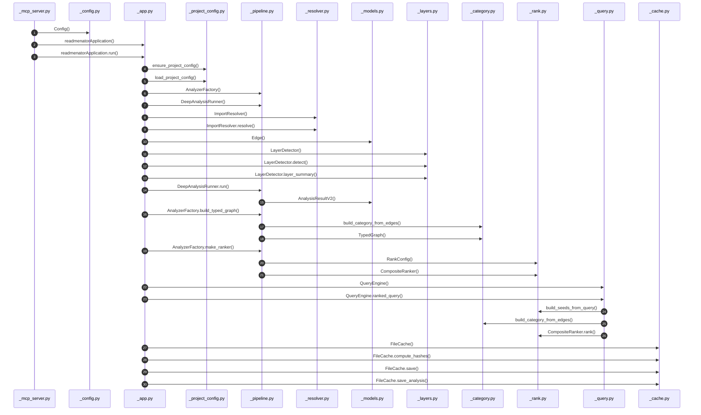

### `readmenator_orchestrator (__main__)`

`readmenator_orchestrator.py:516`, score 8: `if __name__ == "__main__"` guard.

Call tree:

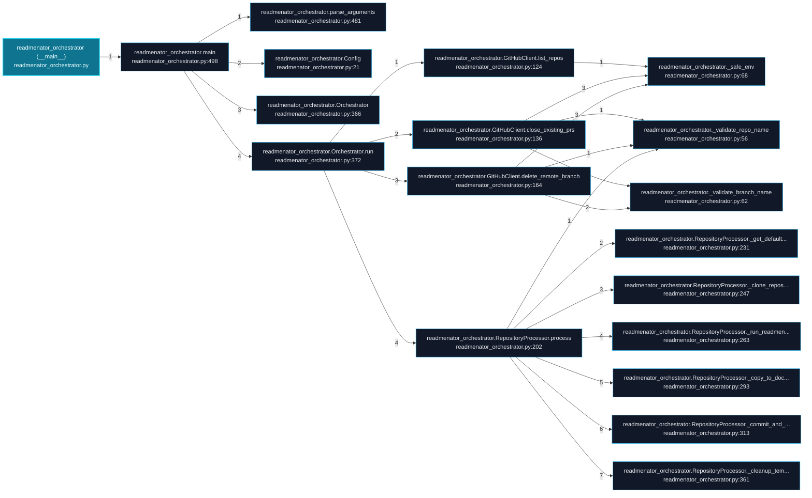

---

## Ranked Context

Files ranked by composite score for the current query context. The ranking combines Personalized PageRank (query relevance), global authority, test coverage, documentation coverage, and code freshness. Model: v1.0.

| Rank | File | Composite | PPR | Authority | Test | Doc |
|------|------|-----------|-----|-----------|------|-----|
| 1 | `_config.py` | 0.2829 | 0.1200 | 0.1448 | 0.00 | 2.00 |
| 2 | `deploy.sh` | 0.2000 | 0.0000 | 0.0000 | 0.00 | 2.00 |
| 3 | `_models.py` | 0.1875 | 0.1268 | 0.1303 | 0.00 | 1.04 |
| 4 | `_apidocs_page.py` | 0.1519 | 0.0026 | 0.0038 | 0.00 | 1.50 |
| 5 | `_flowpage.py` | 0.1360 | 0.0039 | 0.0047 | 0.00 | 1.33 |
| 6 | `_c.py` | 0.1340 | 0.0000 | 0.0031 | 0.00 | 1.33 |
| 7 | `_category.py` | 0.1323 | 0.1266 | 0.1266 | 0.00 | 0.50 |
| 8 | `_gitmeta.py` | 0.1286 | 0.0055 | 0.0054 | 0.00 | 1.25 |
| 9 | `_mermaid.py` | 0.1273 | 0.0032 | 0.0042 | 0.00 | 1.25 |
| 10 | `_scantext.py` | 0.1256 | 0.0000 | 0.0029 | 0.00 | 1.25 |

**Query anchors:** readmenator/_diagrams.py, readmenator/_rule_gen.py, tests/test_linter.py, tests/test_ranking.py, readmenator/_flowcharts.py, tests/test_agent_output.py, readmenator/_app.py, tests/test_documentation.py (+6 more)

**Top result justification paths:**

  `_diagrams.py -> _config.py`
  `_diagrams.py -> _folder_readme.py -> _config.py`

---

## God Nodes

Most architecturally central files ranked by combined import/export degree and symbol richness.

| File | Score | Connections | PageRank |
|------|-------|-------------|----------|
| `_models.py` | 206.3 | | 0.1303 |
| `_config.py` | 204.1 | | 0.1448 |
| `_app.py` | 96.8 | | 0.0000 |
| `_pipeline.py` | 93.3 | | 0.0000 |
| `__init__.py` | 48.2 | | 0.0000 |
| `_base.py` | 44.6 | | 0.0000 |
| `_forcegraph.py` | 44.3 | | 0.0000 |
| `test_parsers_property.py` | 42.7 | | 0.0000 |
| `_diagrams.py` | 39.7 | | 0.0000 |
| `test_interactive_graph.py` | 34.0 | | 0.0000 |

---

## Community Analysis

Files grouped by import-based community detection. Cohesion measures how tightly connected each community is internally.

### readmenator/parsers (Cohesion: 0.53)

**37 files** in this community:

- `_layer_rules.py` (py, 4 symbols)
- `_mermaid.py` (py, 4 symbols)
- `_models.py` (py, 23 symbols)
- `_rule_gen.py` (py, 9 symbols)
- `_sarif.py` (py, 5 symbols)
- `_scanner.py` (py, 14 symbols)
- `_taint.py` (py, 6 symbols)
- `__init__.py` (py, 2 symbols)
- `_assembly.py` (py, 2 symbols)
- `_base.py` (py, 6 symbols)
- `_c.py` (py, 3 symbols)
- `_csharp.py` (py, 2 symbols)
- `_dart.py` (py, 2 symbols)
- `_elixir.py` (py, 2 symbols)
- `_gdscript.py` (py, 2 symbols)
- `_go.py` (py, 2 symbols)
- `_java.py` (py, 2 symbols)
- `_javascript.py` (py, 2 symbols)
- `_kotlin.py` (py, 2 symbols)
- `_lua.py` (py, 2 symbols)
- ... and 17 more files

### readmenator: _video (Cohesion: 0.32)

**36 files** in this community:

- `readmenator.py` (py, 0 symbols)
- `__main__.py` (py, 3 symbols)
- `_app.py` (py, 88 symbols)
- `_config.py` (py, 1 symbols)
- `_cursorrules_generator.py` (py, 8 symbols)
- `_dataflow.py` (py, 21 symbols)
- `_dead_code.py` (py, 5 symbols)
- `_hotspots.py` (py, 7 symbols)
- `_hypotheses.py` (py, 10 symbols)
- `_layers.py` (py, 7 symbols)
- `_linter.py` (py, 8 symbols)
- `_mcp_server.py` (py, 64 symbols)
- `_receipts.py` (py, 24 symbols)
- `_refactorizer.py` (py, 9 symbols)
- `_uncertainty.py` (py, 14 symbols)
- `_video.py` (py, 90 symbols)
- `_watcher.py` (py, 5 symbols)
- `_yaralite.py` (py, 20 symbols)
- `test_config.py` (py, 6 symbols)
- `test_cpg.py` (py, 11 symbols)
- ... and 16 more files

### readmenator: _agent_output (Cohesion: 0.33)

**19 files** in this community:

- `_agent_output.py` (py, 33 symbols)
- `_analyzer.py` (py, 23 symbols)
- `_cache.py` (py, 14 symbols)
- `_folder_readme.py` (py, 7 symbols)
- `_gh_wiki.py` (py, 18 symbols)
- `_gitmeta.py` (py, 4 symbols)
- `_memory.py` (py, 30 symbols)
- `_purpose.py` (py, 7 symbols)
- `_resolver.py` (py, 17 symbols)
- `_security.py` (py, 32 symbols)
- `_wiki.py` (py, 32 symbols)
- `test_agent_friendliness.py` (py, 59 symbols)
- `test_analyzer.py` (py, 14 symbols)
- `test_cache.py` (py, 22 symbols)
- `test_folder_readme.py` (py, 20 symbols)
- `test_gh_wiki.py` (py, 17 symbols)
- `test_resolver.py` (py, 22 symbols)
- `test_security.py` (py, 68 symbols)
- `test_wiki.py` (py, 30 symbols)

### readmenator: _graphrag (Cohesion: 0.32)

**18 files** in this community:

- `__init__.py` (py, 0 symbols)
- `_category.py` (py, 26 symbols)
- `_components.py` (py, 25 symbols)
- `_concepts.py` (py, 8 symbols)
- `_explain.py` (py, 3 symbols)
- `_graphrag.py` (py, 53 symbols)
- `_ollama.py` (py, 7 symbols)
- `_projections.py` (py, 15 symbols)
- `_query.py` (py, 17 symbols)
- `_rank.py` (py, 18 symbols)
- `_skill_installer.py` (py, 7 symbols)
- `test_components.py` (py, 36 symbols)
- `test_concepts.py` (py, 8 symbols)
- `test_graphrag.py` (py, 28 symbols)
- `test_memory.py` (py, 17 symbols)
- `test_ollama.py` (py, 4 symbols)
- `test_query.py` (py, 18 symbols)
- `test_ranking.py` (py, 72 symbols)

### readmenator: _pipeline (Cohesion: 0.26)

**18 files** in this community:

- `_agent_injector.py` (py, 14 symbols)
- `_analytics.py` (py, 9 symbols)
- `_cpg.py` (py, 6 symbols)
- `_documentation.py` (py, 31 symbols)
- `_embed.py` (py, 11 symbols)
- `_exclusions.py` (py, 11 symbols)
- `_explorer.py` (py, 14 symbols)
- `_exporter.py` (py, 16 symbols)
- `_pipeline.py` (py, 53 symbols)
- `_provenance.py` (py, 10 symbols)
- `_readme_injector.py` (py, 9 symbols)
- `_scantext.py` (py, 4 symbols)
- `_uml.py` (py, 25 symbols)
- `test_agent_injector.py` (py, 38 symbols)
- `test_agent_output.py` (py, 45 symbols)
- `test_interactive_graph.py` (py, 60 symbols)
- `test_readme_injector.py` (py, 28 symbols)
- `test_uml.py` (py, 49 symbols)

### readmenator: _diagrams (Cohesion: 0.39)

**15 files** in this community:

- `_bundlegraph.py` (py, 8 symbols)
- `_bundlegraph_page.py` (py, 0 symbols)
- `_diagrams.py` (py, 97 symbols)
- `_forcegraph.py` (py, 23 symbols)
- `_forcegraph_page.py` (py, 0 symbols)
- `_graphlayout.py` (py, 26 symbols)
- `_htmlpack.py` (py, 5 symbols)
- `_project_config.py` (py, 18 symbols)
- `_sourceview.py` (py, 8 symbols)
- `_viewer_ui.py` (py, 7 symbols)
- `test_bundlegraph.py` (py, 27 symbols)
- `test_graphlayout.py` (py, 33 symbols)
- `test_layout_quality.py` (py, 16 symbols)
- `test_project_config.py` (py, 33 symbols)
- `test_sourceview.py` (py, 23 symbols)

### readmenator: _flowcharts (Cohesion: 0.44)

**12 files** in this community:

- `_apidocs.py` (py, 52 symbols)
- `_apidocs_page.py` (py, 2 symbols)
- `_apidocs_render.py` (py, 45 symbols)
- `_docstrings.py` (py, 30 symbols)
- `_flowcharts.py` (py, 54 symbols)
- `_flowlayout.py` (py, 11 symbols)
- `_flowpage.py` (py, 3 symbols)
- `_pytypes.py` (py, 16 symbols)
- `_symindex.py` (py, 22 symbols)
- `test_apidocs.py` (py, 48 symbols)
- `test_flowcharts.py` (py, 35 symbols)
- `test_symindex.py` (py, 10 symbols)

---

## Surprising Connections

Files in different communities connected through 3+ indirect hops.

- `_docstrings.py` <-> `test_graphlayout.py` (5 hops, across 3 communities)
- `_hypotheses.py` <-> `test_agent_injector.py` (5 hops, across 2 communities)
- `_hypotheses.py` <-> `test_graphlayout.py` (5 hops, across 2 communities)
- `_hypotheses.py` <-> `test_readme_injector.py` (5 hops, across 3 communities)
- `readmenator.py` <-> `test_agent_injector.py` (5 hops, across 2 communities)

---

## Suggested Questions

Auto-generated exploration prompts based on graph structure:

- What does _models.py depend on, and what depends on it? (102 connections)
- What does _config.py depend on, and what depends on it? (102 connections)
- What does _app.py depend on, and what depends on it? (44 connections)
- How are the 37 files in 'readmenator/parsers' related to each other?
- Why are _docstrings.py and test_graphlayout.py connected through 5 hops across 3 communities?

---

## Force-Graph Explorer

Heterogeneous explorer payload (files, communities, layers, externals) rendered with force-graph physics, stable family colors, log2 node sizing, and convex-hull community overlays. Open `readmenator-maps/graph-force.html` (linked from the maps gallery) or run `explorer`.

- Nodes: 223 (community: 7, external: 51, file: 159, layer: 6)
- Edges: 1677

---

## Corpus Analytics

Attribution funnel and distributions for the explorer dashboard.

- Files: 159 | With symbols: 154 | Attributed: 155 | God nodes: 10 | Symbols: 3110

- Layer `utility`: 87 files
- Layer `testing`: 56 files
- Layer `presentation`: 6 files
- Layer `infrastructure`: 5 files
- Layer `business_logic`: 3 files
- Layer `data_access`: 2 files

- Language `py`: 157 files
- Language `js`: 1 files
- Language `sh`: 1 files

---

## Taint Propagation Map

Taint analysis traces how dangerous imports propagate through the codebase via transitive dependencies. Source files import dangerous modules directly; sink files receive the danger indirectly.

**Taint Sources:** 3 | **Taint Sinks:** 26 | **Propagation Paths:** 20

- `_agent_injector.py` imports `subprocess` (0 hop to `_agent_injector.py`) [high]
  Path: _agent_injector.py
- `_diagrams.py` imports `subprocess` (0 hop to `_diagrams.py`) [high]
  Path: _diagrams.py
- `_diagrams.py` imports `subprocess` (1 hop to `_config.py`) [high]
  Path: _diagrams.py -> _config.py
- `_diagrams.py` imports `subprocess` (1 hop to `_viewer_ui.py`) [high]
  Path: _diagrams.py -> _viewer_ui.py
- `_diagrams.py` imports `subprocess` (1 hop to `_folder_readme.py`) [high]
  Path: _diagrams.py -> _folder_readme.py
- `_diagrams.py` imports `subprocess` (1 hop to `_project_config.py`) [high]
  Path: _diagrams.py -> _project_config.py
- `_diagrams.py` imports `subprocess` (1 hop to `_models.py`) [high]
  Path: _diagrams.py -> _models.py
- `_diagrams.py` imports `subprocess` (1 hop to `_htmlpack.py`) [high]
  Path: _diagrams.py -> _htmlpack.py
- `_diagrams.py` imports `subprocess` (2 hops to `_category.py`) [high]
  Path: _diagrams.py -> _models.py -> _category.py
- `_documentation.py` imports `subprocess` (0 hop to `_documentation.py`) [high]
  Path: _documentation.py
- `_documentation.py` imports `subprocess` (1 hop to `_rank.py`) [high]
  Path: _documentation.py -> _rank.py
- `_documentation.py` imports `subprocess` (1 hop to `_config.py`) [high]
  Path: _documentation.py -> _config.py
- `_documentation.py` imports `subprocess` (1 hop to `_forcegraph.py`) [high]
  Path: _documentation.py -> _forcegraph.py
- `_documentation.py` imports `subprocess` (1 hop to `_flowcharts.py`) [high]
  Path: _documentation.py -> _flowcharts.py
- `_documentation.py` imports `subprocess` (1 hop to `_cpg.py`) [high]
  Path: _documentation.py -> _cpg.py
- `_documentation.py` imports `subprocess` (1 hop to `_analytics.py`) [high]
  Path: _documentation.py -> _analytics.py
- `_documentation.py` imports `subprocess` (1 hop to `_uml.py`) [high]
  Path: _documentation.py -> _uml.py
- `_documentation.py` imports `subprocess` (1 hop to `_models.py`) [high]
  Path: _documentation.py -> _models.py
- `_documentation.py` imports `subprocess` (1 hop to `_mermaid.py`) [high]
  Path: _documentation.py -> _mermaid.py
- `_documentation.py` imports `subprocess` (2 hops to `_category.py`) [high]
  Path: _documentation.py -> _rank.py -> _category.py

---

## Hotspot Analysis

Files ranked by combined complexity (symbol count) and centrality (connection count). High-scoring files are architecturally critical and may need refactoring attention.

| File | Complexity | Centrality | Combined | Symbols | Connections |
|------|-----------|------------|----------|---------|-------------|
| `_config.py` | 0.010 | 0.062 | 0.041 | 1 | 107 |
| `deploy.sh` | 0.010 | 0.000 | 0.004 | 1 | 0 |
| `_models.py` | 0.237 | 0.069 | 0.136 | 23 | 119 |
| `_apidocs_page.py` | 0.021 | 0.010 | 0.015 | 2 | 18 |
| `_flowpage.py` | 0.031 | 0.012 | 0.020 | 3 | 21 |
| `_c.py` | 0.031 | 0.005 | 0.015 | 3 | 8 |
| `_category.py` | 0.268 | 0.007 | 0.112 | 26 | 13 |
| `_gitmeta.py` | 0.041 | 0.005 | 0.019 | 4 | 8 |
| `_mermaid.py` | 0.041 | 0.004 | 0.019 | 4 | 7 |
| `_scantext.py` | 0.041 | 0.005 | 0.019 | 4 | 8 |
| `force-graph.min.js` | 0.361 | 1.000 | 0.744 | 35 | 1732 |
| `_diagrams.py` | 1.000 | 0.025 | 0.415 | 97 | 43 |
| `_app.py` | 0.907 | 0.057 | 0.397 | 88 | 98 |
| `_video.py` | 0.928 | 0.022 | 0.385 | 90 | 39 |
| `test_parsers.py` | 0.897 | 0.004 | 0.361 | 87 | 6 |

---

## Concept Graph

Semantic second-brain layer: nouns are concept nodes, verbs are edges. Each noun maps atomically to a file set (EXTRACTED); each verb aggregates structural imports, calls, and inherits into consumes, invokes, extends, depends_on, or bridges (INFERRED).

**50 concepts, 100 relations.**

| Concept | Files | Mentions |
|---------|-------|----------|
| `readmenator` | 107 | 204 |
| `returns` | 100 | 499 |
| `file` | 92 | 653 |
| `graph` | 74 | 356 |
| `when` | 68 | 234 |
| `node` | 67 | 267 |
| `files` | 66 | 209 |
| `edges` | 63 | 321 |
| `args` | 62 | 372 |
| `empty` | 61 | 133 |
| `symbols` | 61 | 100 |
| `project` | 60 | 297 |
| `return` | 59 | 287 |
| `contract` | 56 | 230 |
| `config` | 56 | 160 |
| `imports` | 56 | 87 |
| `nodes` | 55 | 222 |
| `every` | 55 | 136 |
| `build` | 54 | 256 |
| `symbol` | 54 | 159 |
| `set` | 54 | 113 |
| `one` | 53 | 190 |
| `all` | 53 | 91 |
| `text` | 51 | 241 |
| `import` | 51 | 188 |
| `content` | 51 | 108 |
| `edge` | 50 | 152 |
| `path` | 49 | 198 |
| `source` | 49 | 180 |
| `map` | 47 | 198 |

### Verb Edges

| Source | Verb | Target | Strength | Evidence |
|--------|------|--------|----------|----------|
| `graph` | `depends_on` | `readmenator` | 1.00 | 10 |
| `file` | `depends_on` | `readmenator` | 0.99 | 10 |
| `readmenator` | `depends_on` | `file` | 0.93 | 10 |
| `returns` | `depends_on` | `readmenator` | 0.93 | 10 |
| `graph` | `depends_on` | `file` | 0.92 | 10 |
| `project` | `depends_on` | `readmenator` | 0.87 | 10 |
| `build` | `depends_on` | `readmenator` | 0.85 | 10 |
| `project` | `depends_on` | `file` | 0.80 | 10 |
| `returns` | `depends_on` | `file` | 0.80 | 10 |
| `map` | `depends_on` | `readmenator` | 0.79 | 10 |
| `return` | `depends_on` | `readmenator` | 0.79 | 10 |
| `text` | `depends_on` | `readmenator` | 0.79 | 10 |
| `build` | `depends_on` | `file` | 0.78 | 10 |
| `edge` | `depends_on` | `readmenator` | 0.77 | 10 |
| `files` | `depends_on` | `readmenator` | 0.77 | 10 |
| `graph` | `depends_on` | `every` | 0.77 | 10 |
| `node` | `depends_on` | `readmenator` | 0.77 | 10 |
| `readmenator` | `depends_on` | `every` | 0.76 | 10 |
| `file` | `depends_on` | `graph` | 0.75 | 10 |
| `readmenator` | `depends_on` | `source` | 0.75 | 10 |
| `edges` | `depends_on` | `readmenator` | 0.74 | 10 |
| `file` | `depends_on` | `every` | 0.74 | 10 |
| `readmenator` | `depends_on` | `graph` | 0.74 | 10 |
| `symbol` | `depends_on` | `readmenator` | 0.73 | 10 |
| `file` | `depends_on` | `source` | 0.72 | 10 |
| `files` | `depends_on` | `file` | 0.72 | 10 |
| `graph` | `depends_on` | `source` | 0.72 | 10 |
| `node` | `depends_on` | `file` | 0.72 | 10 |
| `source` | `depends_on` | `readmenator` | 0.72 | 10 |
| `all` | `depends_on` | `readmenator` | 0.71 | 10 |

### Dialectic Prompts

- Thesis: `all` centralizes 53 files; Antithesis: `build` pulls 54 files with 28 shared (Jaccard 0.35); Synthesis: should they merge, split by layer, or keep `bridges` explicit?
- Thesis: `all` centralizes 53 files; Antithesis: `content` pulls 51 files with 24 shared (Jaccard 0.30); Synthesis: should they merge, split by layer, or keep `bridges` explicit?
- Thesis: `all` centralizes 53 files; Antithesis: `directory` pulls 38 files with 22 shared (Jaccard 0.32); Synthesis: should they merge, split by layer, or keep `bridges` explicit?
- Thesis: `all` centralizes 53 files; Antithesis: `every` pulls 55 files with 27 shared (Jaccard 0.33); Synthesis: should they merge, split by layer, or keep `bridges` explicit?
- Thesis: `all` centralizes 53 files; Antithesis: `file` pulls 92 files with 43 shared (Jaccard 0.42); Synthesis: should they merge, split by layer, or keep `depends_on` explicit?
- Thesis: `all` centralizes 53 files; Antithesis: `files` pulls 66 files with 34 shared (Jaccard 0.40); Synthesis: should they merge, split by layer, or keep `bridges` explicit?
- Thesis: `all` centralizes 53 files; Antithesis: `graph` pulls 74 files with 33 shared (Jaccard 0.35); Synthesis: should they merge, split by layer, or keep `depends_on` explicit?
- Thesis: `all` centralizes 53 files; Antithesis: `list` pulls 41 files with 27 shared (Jaccard 0.40); Synthesis: should they merge, split by layer, or keep `bridges` explicit?
- Thesis: `all` centralizes 53 files; Antithesis: `map` pulls 47 files with 24 shared (Jaccard 0.32); Synthesis: should they merge, split by layer, or keep `bridges` explicit?
- Thesis: `all` centralizes 53 files; Antithesis: `nodes` pulls 55 files with 28 shared (Jaccard 0.35); Synthesis: should they merge, split by layer, or keep `bridges` explicit?

---

## Change Impact Analysis

Files sorted by how many other files would be affected if they changed. High-impact files should be changed with caution.

| File | Direct Dependents | Transitive Dependents | Total Impact |
|------|------------------|----------------------|--------------|
| `_category.py` | 9 | 50 | 105 |
| `_config.py` | 50 | 0 | 102 |
| `_models.py` | 50 | 0 | 101 |
| `_base.py` | 20 | 25 | 45 |
| `_purpose.py` | 7 | 31 | 38 |
| `_rank.py` | 11 | 27 | 38 |
| `_resolver.py` | 7 | 29 | 36 |
| `_project_config.py` | 9 | 25 | 34 |
| `_htmlpack.py` | 8 | 25 | 33 |
| `_viewer_ui.py` | 5 | 28 | 33 |
| `_graphlayout.py` | 5 | 26 | 31 |
| `_symindex.py` | 7 | 24 | 31 |
| `_forcegraph_page.py` | 3 | 26 | 29 |
| `_sourceview.py` | 4 | 25 | 29 |
| `_flowlayout.py` | 6 | 22 | 28 |

---

## Architecture Violations

Violations of architectural layer rules detected in the import graph. **11 strict violations, 0 warnings.**

| Source | Source Layer | Target | Target Layer | Description | Severity |
|--------|-------------|--------|-------------|-------------|----------|
| `test_apidocs.py` | testing | `_apidocs_page.py` | presentation | testing must not import presentation | strict |
| `test_apidocs.py` | testing | `_apidocs_render.py` | presentation | testing must not import presentation | strict |
| `test_components.py` | testing | `_components.py` | presentation | testing must not import presentation | strict |
| `test_flowcharts.py` | testing | `_apidocs_page.py` | presentation | testing must not import presentation | strict |
| `test_folder_readme.py` | testing | `_components.py` | presentation | testing must not import presentation | strict |
| `test_layout_quality.py` | testing | `_forcegraph_page.py` | presentation | testing must not import presentation | strict |
| `test_project_config.py` | testing | `_viewer_ui.py` | presentation | testing must not import presentation | strict |
| `test_project_config.py` | testing | `_viewer_ui.py` | presentation | testing must not import presentation | strict |
| `test_project_config.py` | testing | `_viewer_ui.py` | presentation | testing must not import presentation | strict |
| `test_project_config.py` | testing | `_forcegraph_page.py` | presentation | testing must not import presentation | strict |
| `test_project_config.py` | testing | `_bundlegraph_page.py` | presentation | testing must not import presentation | strict |

---

## Suggested Linting Rules

Automatically suggested linting and security rules based on patterns detected in the codebase. These can be exported as Semgrep rules using the `--export-rules` flag.

| Rule ID | Severity | Description | Language | Matches |
|---------|----------|-------------|----------|---------|
| `RM001` | info | Large number of functions in py: 2701 total | py | 2701 |
| `RM002` | info | Large number of functions in js: 30 total | js | 30 |
| `RM003` | info | Print statement found (consider logging instead) | python | 40 |

---

## Orphans

Files with no documentation or low connectivity. These are candidates for documentation investment or cleanup.

- `__init__.py` (0 symbols, no doc)
- `test_agent_output.py` (45 symbols, no doc)
- `test_config.py` (6 symbols, no doc)
- `test_dataflow.py` (47 symbols, no doc)
- `test_documentation.py` (29 symbols, no doc)
- `test_integration.py` (16 symbols, no doc)
- `test_models.py` (11 symbols, no doc)
- `test_parsers.py` (87 symbols, no doc)
- `test_query.py` (18 symbols, no doc)
- `test_receipts.py` (32 symbols, no doc)
- `test_scanner.py` (21 symbols, no doc)
- `test_wiki.py` (30 symbols, no doc)

---

## Query Recipes

Example queries you can run against this knowledge base using the ranking engine:

```
# Find files most relevant to a concept
readmenator query "Where is the import resolver implemented?"

# Rank files by relevance to a topic
readmenator query "How does documentation generation work?"

# Explain why a file ranks highly
readmenator query "explain readmenator/_documentation.py"

# Trace dependency paths with ranked context
readmenator query "path from CLI to exporter"
```

The ranking model uses the following signals:

- **Personalized PageRank** (45% weight): query-specific relevance via seed propagation
- **Global Authority** (20% weight): structural importance via standard PageRank
- **Test Coverage** (15% weight): fraction of symbols referenced in test files
- **Doc Coverage** (10% weight): presence of docstrings and file-level docs
- **Freshness** (10% weight): recent modification activity

Results include score decomposition and justification paths for each ranked item.

---

## Structural Knowledge Map

> **Note:** The visual graph below has been intelligently pruned to the top 300 most relevant nodes to prevent rendering crashes. Full details of all files are documented in the Architecture Reference.

```mermaid
graph LR
    classDef mod fill:#1e1e1e,stroke:#ff6666,stroke-width:2px,color:#fff;
    classDef cls fill:#2d2d2d,stroke:#4ec9b0,stroke-width:2px,color:#fff;
    classDef fn fill:#333,stroke:#dcdcaa,stroke-width:1px,color:#dcdcaa;
    classDef ext fill:#111,stroke:#666,stroke-dasharray:5 5,color:#aaa;
    readmenator__vendor_force_graph_min_js["force-graph.min.js (js)"]
    class readmenator__vendor_force_graph_min_js mod;
    readmenator__vendor_force_graph_min_js_t["t"]
    class readmenator__vendor_force_graph_min_js_t fn;
    readmenator__vendor_force_graph_min_js --> readmenator__vendor_force_graph_min_js_t
    readmenator__vendor_force_graph_min_js_n["n"]
    class readmenator__vendor_force_graph_min_js_n fn;
    readmenator__vendor_force_graph_min_js --> readmenator__vendor_force_graph_min_js_n
    readmenator__vendor_force_graph_min_js_e["e"]
    class readmenator__vendor_force_graph_min_js_e fn;
    readmenator__vendor_force_graph_min_js --> readmenator__vendor_force_graph_min_js_e
    readmenator__vendor_force_graph_min_js_h["h"]
    class readmenator__vendor_force_graph_min_js_h fn;
    readmenator__vendor_force_graph_min_js --> readmenator__vendor_force_graph_min_js_h
    readmenator__vendor_force_graph_min_js_s["s"]
    class readmenator__vendor_force_graph_min_js_s fn;
    readmenator__vendor_force_graph_min_js --> readmenator__vendor_force_graph_min_js_s
    subgraph community_4 ["readmenator: _pipeline"]
    readmenator__pipeline_py["_pipeline.py (py)"]
    class readmenator__pipeline_py mod;
    end
    subgraph community_1 ["readmenator: _video"]
    readmenator__app_py["_app.py (py)"]
    class readmenator__app_py mod;
    end
    subgraph community_2 ["readmenator: _agent_output"]
    tests_test_agent_friendliness_py["test_agent_friendliness.py (py)"]
    class tests_test_agent_friendliness_py mod;
    end
    subgraph community_0 ["readmenator/parsers"]
    tests_test_parsers_property_py["test_parsers_property.py (py)"]
    class tests_test_parsers_property_py mod;
    readmenator_parsers___init___py["__init__.py (py)"]
    class readmenator_parsers___init___py mod;
    tests_test_diagrams_py["test_diagrams.py (py)"]
    class tests_test_diagrams_py mod;
    tests_test_interactive_graph_py["test_interactive_graph.py (py)"]
    class tests_test_interactive_graph_py mod;
    end
    subgraph community_5 ["readmenator: _diagrams"]
    tests_test_project_config_py["test_project_config.py (py)"]
    class tests_test_project_config_py mod;
    tests_test_agent_output_py["test_agent_output.py (py)"]
    class tests_test_agent_output_py mod;
    readmenator__video_py["_video.py (py)"]
    class readmenator__video_py mod;
    readmenator__diagrams_py["_diagrams.py (py)"]
    class readmenator__diagrams_py mod;
    readmenator__forcegraph_py["_forcegraph.py (py)"]
    class readmenator__forcegraph_py mod;
    end
    subgraph community_3 ["readmenator: _graphrag"]
    readmenator___init___py["__init__.py (py)"]
    class readmenator___init___py mod;
    readmenator__agent_output_py["_agent_output.py (py)"]
    class readmenator__agent_output_py mod;
    tests_test_bundlegraph_py["test_bundlegraph.py (py)"]
    class tests_test_bundlegraph_py mod;
    readmenator__components_py["_components.py (py)"]
    class readmenator__components_py mod;
    end
    subgraph community_6 ["readmenator: _flowcharts"]
    tests_test_apidocs_py["test_apidocs.py (py)"]
    class tests_test_apidocs_py mod;
    tests_test_components_py["test_components.py (py)"]
    class tests_test_components_py mod;
    tests_test_flowcharts_py["test_flowcharts.py (py)"]
    class tests_test_flowcharts_py mod;
    readmenator__wiki_py["_wiki.py (py)"]
    class readmenator__wiki_py mod;
    readmenator__graphrag_py["_graphrag.py (py)"]
    class readmenator__graphrag_py mod;
    readmenator__documentation_py["_documentation.py (py)"]
    class readmenator__documentation_py mod;
    readmenator__bundlegraph_py["_bundlegraph.py (py)"]
    class readmenator__bundlegraph_py mod;
    tests_test_folder_readme_py["test_folder_readme.py (py)"]
    class tests_test_folder_readme_py mod;
    readmenator__flowcharts_py["_flowcharts.py (py)"]
    class readmenator__flowcharts_py mod;
    readmenator__apidocs_render_py["_apidocs_render.py (py)"]
    class readmenator__apidocs_render_py mod;
    readmenator__explorer_py["_explorer.py (py)"]
    class readmenator__explorer_py mod;
    tests_test_wiki_py["test_wiki.py (py)"]
    class tests_test_wiki_py mod;
    tests_test_htmlpack_py["test_htmlpack.py (py)"]
    class tests_test_htmlpack_py mod;
    readmenator___main___py["__main__.py (py)"]
    class readmenator___main___py mod;
    readmenator__apidocs_py["_apidocs.py (py)"]
    class readmenator__apidocs_py mod;
    tests_test_sourceview_py["test_sourceview.py (py)"]
    class tests_test_sourceview_py mod;
    tests_test_layout_quality_py["test_layout_quality.py (py)"]
    class tests_test_layout_quality_py mod;
    tests_test_documentation_py["test_documentation.py (py)"]
    class tests_test_documentation_py mod;
    tests_test_taint_bdd_py["test_taint_bdd.py (py)"]
    class tests_test_taint_bdd_py mod;
    readmenator__gh_wiki_py["_gh_wiki.py (py)"]
    class readmenator__gh_wiki_py mod;
    tests_test_gh_wiki_py["test_gh_wiki.py (py)"]
    class tests_test_gh_wiki_py mod;
    tests_test_refactorizer_py["test_refactorizer.py (py)"]
    class tests_test_refactorizer_py mod;
    readmenator__exporter_py["_exporter.py (py)"]
    class readmenator__exporter_py mod;
    readmenator_orchestrator_py["readmenator_orchestrator.py (py)"]
    class readmenator_orchestrator_py mod;
    readmenator__memory_py["_memory.py (py)"]
    class readmenator__memory_py mod;
    tests_test_memory_py["test_memory.py (py)"]
    class tests_test_memory_py mod;
    readmenator__flowpage_py["_flowpage.py (py)"]
    class readmenator__flowpage_py mod;
    readmenator__apidocs_page_py["_apidocs_page.py (py)"]
    class readmenator__apidocs_page_py mod;
    readmenator__mcp_server_py["_mcp_server.py (py)"]
    class readmenator__mcp_server_py mod;
    tests_test_ranking_py["test_ranking.py (py)"]
    class tests_test_ranking_py mod;
    tests_test_dataflow_py["test_dataflow.py (py)"]
    class tests_test_dataflow_py mod;
    tests_test_receipts_py["test_receipts.py (py)"]
    class tests_test_receipts_py mod;
    tests_test_graphrag_py["test_graphrag.py (py)"]
    class tests_test_graphrag_py mod;
    tests_test_mcp_server_py["test_mcp_server.py (py)"]
    class tests_test_mcp_server_py mod;
    tests_test_scanner_py["test_scanner.py (py)"]
    class tests_test_scanner_py mod;
    tests_test_video_py["test_video.py (py)"]
    class tests_test_video_py mod;
    readmenator__project_config_py["_project_config.py (py)"]
    class readmenator__project_config_py mod;
    readmenator__viewer_ui_py["_viewer_ui.py (py)"]
    class readmenator__viewer_ui_py mod;
    tests_test_security_py["test_security.py (py)"]
    class tests_test_security_py mod;
    readmenator__scanner_py["_scanner.py (py)"]
    class readmenator__scanner_py mod;
    readmenator__linter_py["_linter.py (py)"]
    class readmenator__linter_py mod;
    tests_test_readme_injector_py["test_readme_injector.py (py)"]
    class tests_test_readme_injector_py mod;
    readmenator__analyzer_py["_analyzer.py (py)"]
    class readmenator__analyzer_py mod;
    readmenator__symindex_py["_symindex.py (py)"]
    class readmenator__symindex_py mod;
    tests_test_cache_py["test_cache.py (py)"]
    class tests_test_cache_py mod;
    readmenator__uncertainty_py["_uncertainty.py (py)"]
    class readmenator__uncertainty_py mod;
    tests_test_analyzer_py["test_analyzer.py (py)"]
    class tests_test_analyzer_py mod;
    tests_test_cursorrules_py["test_cursorrules.py (py)"]
    class tests_test_cursorrules_py mod;
    tests_test_rule_gen_py["test_rule_gen.py (py)"]
    class tests_test_rule_gen_py mod;
    readmenator__rule_gen_py["_rule_gen.py (py)"]
    class readmenator__rule_gen_py mod;
    readmenator__security_py["_security.py (py)"]
    class readmenator__security_py mod;
    readmenator__query_py["_query.py (py)"]
    class readmenator__query_py mod;
    tests_test_exporter_py["test_exporter.py (py)"]
    class tests_test_exporter_py mod;
    tests_test_cpg_py["test_cpg.py (py)"]
    class tests_test_cpg_py mod;
    tests_test_sarif_py["test_sarif.py (py)"]
    class tests_test_sarif_py mod;
    readmenator__concepts_py["_concepts.py (py)"]
    class readmenator__concepts_py mod;
    readmenator__cursorrules_generator_py["_cursorrules_generator.py (py)"]
    class readmenator__cursorrules_generator_py mod;
    readmenator__htmlpack_py["_htmlpack.py (py)"]
    class readmenator__htmlpack_py mod;
    tests_test_uml_py["test_uml.py (py)"]
    class tests_test_uml_py mod;
    tests_test_agent_injector_py["test_agent_injector.py (py)"]
    class tests_test_agent_injector_py mod;
    readmenator__uml_py["_uml.py (py)"]
    class readmenator__uml_py mod;
    readmenator__receipts_py["_receipts.py (py)"]
    class readmenator__receipts_py mod;
    readmenator__dataflow_py["_dataflow.py (py)"]
    class readmenator__dataflow_py mod;
    tests_test_integration_py["test_integration.py (py)"]
    class tests_test_integration_py mod;
    tests_test_dead_code_py["test_dead_code.py (py)"]
    class tests_test_dead_code_py mod;
    readmenator__agent_injector_py["_agent_injector.py (py)"]
    class readmenator__agent_injector_py mod;
    readmenator__cache_py["_cache.py (py)"]
    class readmenator__cache_py mod;
    tests_test_linter_py["test_linter.py (py)"]
    class tests_test_linter_py mod;
    tests_test_layer_rules_py["test_layer_rules.py (py)"]
    class tests_test_layer_rules_py mod;
    readmenator__embed_py["_embed.py (py)"]
    class readmenator__embed_py mod;
    tests_test_hotspots_py["test_hotspots.py (py)"]
    class tests_test_hotspots_py mod;
    tests_test_symindex_py["test_symindex.py (py)"]
    class tests_test_symindex_py mod;
    tests_test_taint_py["test_taint.py (py)"]
    class tests_test_taint_py mod;
    readmenator__refactorizer_py["_refactorizer.py (py)"]
    class readmenator__refactorizer_py mod;
    readmenator__watcher_py["_watcher.py (py)"]
    class readmenator__watcher_py mod;
    readmenator__graphlayout_py["_graphlayout.py (py)"]
    class readmenator__graphlayout_py mod;
    readmenator__resolver_py["_resolver.py (py)"]
    class readmenator__resolver_py mod;
    readmenator__exclusions_py["_exclusions.py (py)"]
    class readmenator__exclusions_py mod;
    readmenator__provenance_py["_provenance.py (py)"]
    class readmenator__provenance_py mod;
    readmenator__analytics_py["_analytics.py (py)"]
    class readmenator__analytics_py mod;
    readmenator__sourceview_py["_sourceview.py (py)"]
    class readmenator__sourceview_py mod;
    tests_test_concepts_py["test_concepts.py (py)"]
    class tests_test_concepts_py mod;
    readmenator__folder_readme_py["_folder_readme.py (py)"]
    class readmenator__folder_readme_py mod;
    readmenator__hotspots_py["_hotspots.py (py)"]
    class readmenator__hotspots_py mod;
    readmenator__ollama_py["_ollama.py (py)"]
    class readmenator__ollama_py mod;
    readmenator__taint_py["_taint.py (py)"]
    class readmenator__taint_py mod;
    readmenator_parsers__base_py["_base.py (py)"]
    class readmenator_parsers__base_py mod;
    readmenator__dead_code_py["_dead_code.py (py)"]
    class readmenator__dead_code_py mod;
    readmenator_parsers__python_py["_python.py (py)"]
    class readmenator_parsers__python_py mod;
    tests_test_parsers_py["test_parsers.py (py)"]
    class tests_test_parsers_py mod;
    tests_test_parsers_new_py["test_parsers_new.py (py)"]
    class tests_test_parsers_new_py mod;
    readmenator__rank_py["_rank.py (py)"]
    class readmenator__rank_py mod;
    readmenator__projections_py["_projections.py (py)"]
    class readmenator__projections_py mod;
    readmenator__hypotheses_py["_hypotheses.py (py)"]
    class readmenator__hypotheses_py mod;
    readmenator__layers_py["_layers.py (py)"]
    class readmenator__layers_py mod;
    readmenator__skill_installer_py["_skill_installer.py (py)"]
    class readmenator__skill_installer_py mod;
    readmenator__cpg_py["_cpg.py (py)"]
    class readmenator__cpg_py mod;
    readmenator__layer_rules_py["_layer_rules.py (py)"]
    class readmenator__layer_rules_py mod;
    readmenator__scantext_py["_scantext.py (py)"]
    class readmenator__scantext_py mod;
    tests_test_ollama_py["test_ollama.py (py)"]
    class tests_test_ollama_py mod;
    readmenator__explain_py["_explain.py (py)"]
    class readmenator__explain_py mod;
    readmenator_parsers__c_py["_c.py (py)"]
    class readmenator_parsers__c_py mod;
    readmenator_parsers__assembly_py["_assembly.py (py)"]
    class readmenator_parsers__assembly_py mod;
    readmenator_parsers__csharp_py["_csharp.py (py)"]
    class readmenator_parsers__csharp_py mod;
    readmenator_parsers__dart_py["_dart.py (py)"]
    class readmenator_parsers__dart_py mod;
    readmenator_parsers__elixir_py["_elixir.py (py)"]
    class readmenator_parsers__elixir_py mod;
    readmenator_parsers__gdscript_py["_gdscript.py (py)"]
    class readmenator_parsers__gdscript_py mod;
    readmenator_parsers__go_py["_go.py (py)"]
    class readmenator_parsers__go_py mod;
    readmenator_parsers__java_py["_java.py (py)"]
    class readmenator_parsers__java_py mod;
    readmenator_parsers__javascript_py["_javascript.py (py)"]
    class readmenator_parsers__javascript_py mod;
    readmenator_parsers__kotlin_py["_kotlin.py (py)"]
    class readmenator_parsers__kotlin_py mod;
    readmenator_parsers__lua_py["_lua.py (py)"]
    class readmenator_parsers__lua_py mod;
    readmenator_parsers__nim_py["_nim.py (py)"]
    class readmenator_parsers__nim_py mod;
    readmenator_parsers__php_py["_php.py (py)"]
    class readmenator_parsers__php_py mod;
    readmenator_parsers__ruby_py["_ruby.py (py)"]
    class readmenator_parsers__ruby_py mod;
    readmenator_parsers__rust_py["_rust.py (py)"]
    class readmenator_parsers__rust_py mod;
    readmenator_parsers__scala_py["_scala.py (py)"]
    class readmenator_parsers__scala_py mod;
    readmenator_parsers__shell_py["_shell.py (py)"]
    class readmenator_parsers__shell_py mod;
    readmenator_parsers__swift_py["_swift.py (py)"]
    class readmenator_parsers__swift_py mod;
    tests_test_graphlayout_py["test_graphlayout.py (py)"]
    class tests_test_graphlayout_py mod;
    readmenator__models_py["_models.py (py)"]
    class readmenator__models_py mod;
    tests_test_query_py["test_query.py (py)"]
    class tests_test_query_py mod;
    readmenator__pytypes_py["_pytypes.py (py)"]
    class readmenator__pytypes_py mod;
    tests_test_mermaid_py["test_mermaid.py (py)"]
    class tests_test_mermaid_py mod;
    readmenator__purpose_py["_purpose.py (py)"]
    class readmenator__purpose_py mod;
    readmenator__sarif_py["_sarif.py (py)"]
    class readmenator__sarif_py mod;
    readmenator__mermaid_py["_mermaid.py (py)"]
    class readmenator__mermaid_py mod;
    readmenator__docstrings_py["_docstrings.py (py)"]
    class readmenator__docstrings_py mod;
    readmenator__category_py["_category.py (py)"]
    class readmenator__category_py mod;
    tests_test_resolver_py["test_resolver.py (py)"]
    class tests_test_resolver_py mod;
    readmenator__yaralite_py["_yaralite.py (py)"]
    class readmenator__yaralite_py mod;
    readmenator__flowlayout_py["_flowlayout.py (py)"]
    class readmenator__flowlayout_py mod;
    readmenator__readme_injector_py["_readme_injector.py (py)"]
    class readmenator__readme_injector_py mod;
    tests_test_config_py["test_config.py (py)"]
    class tests_test_config_py mod;
    readmenator_py["readmenator.py (py)"]
    class readmenator_py mod;
    tests_test_models_py["test_models.py (py)"]
    class tests_test_models_py mod;
    readmenator__gitmeta_py["_gitmeta.py (py)"]
    class readmenator__gitmeta_py mod;
    readmenator__config_py["_config.py (py)"]
    class readmenator__config_py mod;
    readmenator__bundlegraph_page_py["_bundlegraph_page.py (py)"]
    class readmenator__bundlegraph_page_py mod;
    readmenator__forcegraph_page_py["_forcegraph_page.py (py)"]
    class readmenator__forcegraph_page_py mod;
    deploy_sh["deploy.sh (sh)"]
    class deploy_sh mod;
    tests___init___py["__init__.py (py)"]
    class tests___init___py mod;
    end
    readmenator__pipeline_py ~~~ tests_test_readme_injector_py
    tests_test_interactive_graph_py ~~~ tests_test_uml_py
    tests_test_agent_output_py ~~~ tests_test_agent_injector_py
    readmenator__documentation_py ~~~ readmenator__uml_py
    readmenator__explorer_py ~~~ readmenator__agent_injector_py
    readmenator__exporter_py ~~~ readmenator__embed_py
    tests_test_readme_injector_py ~~~ readmenator__exclusions_py
    tests_test_uml_py ~~~ readmenator__provenance_py
    tests_test_agent_injector_py ~~~ readmenator__analytics_py
    readmenator__uml_py ~~~ readmenator__cpg_py
    readmenator__agent_injector_py ~~~ readmenator__scantext_py
    readmenator__embed_py ~~~ readmenator__readme_injector_py
    readmenator__app_py ~~~ tests_test_refactorizer_py
    tests_test_diagrams_py ~~~ readmenator__mcp_server_py
    readmenator__video_py ~~~ tests_test_dataflow_py
    tests_test_htmlpack_py ~~~ tests_test_receipts_py
    readmenator___main___py ~~~ tests_test_mcp_server_py
    tests_test_documentation_py ~~~ tests_test_video_py
    tests_test_refactorizer_py ~~~ readmenator__linter_py
    readmenator__mcp_server_py ~~~ readmenator__uncertainty_py
    tests_test_dataflow_py ~~~ tests_test_cursorrules_py
    tests_test_receipts_py ~~~ tests_test_exporter_py
    tests_test_mcp_server_py ~~~ tests_test_cpg_py
    tests_test_video_py ~~~ readmenator__cursorrules_generator_py
    readmenator__linter_py ~~~ readmenator__receipts_py
    readmenator__uncertainty_py ~~~ readmenator__dataflow_py
    tests_test_cursorrules_py ~~~ tests_test_integration_py
    tests_test_exporter_py ~~~ tests_test_dead_code_py
    tests_test_cpg_py ~~~ tests_test_linter_py
    readmenator__cursorrules_generator_py ~~~ tests_test_hotspots_py
    readmenator__receipts_py ~~~ readmenator__refactorizer_py
    readmenator__dataflow_py ~~~ readmenator__watcher_py
    tests_test_integration_py ~~~ readmenator__hotspots_py
    tests_test_dead_code_py ~~~ readmenator__dead_code_py
    tests_test_linter_py ~~~ tests_test_parsers_py
    tests_test_hotspots_py ~~~ tests_test_parsers_new_py
    readmenator__refactorizer_py ~~~ readmenator__hypotheses_py
    readmenator__watcher_py ~~~ readmenator__layers_py
    readmenator__hotspots_py ~~~ readmenator__yaralite_py
    readmenator__dead_code_py ~~~ tests_test_config_py
    tests_test_parsers_py ~~~ readmenator_py
    tests_test_parsers_new_py ~~~ readmenator__config_py
    tests_test_agent_friendliness_py ~~~ tests_test_gh_wiki_py
    readmenator__agent_output_py ~~~ readmenator__memory_py
    readmenator__wiki_py ~~~ tests_test_security_py
    tests_test_folder_readme_py ~~~ readmenator__analyzer_py
    tests_test_wiki_py ~~~ tests_test_cache_py
    readmenator__gh_wiki_py ~~~ tests_test_analyzer_py
    tests_test_gh_wiki_py ~~~ readmenator__security_py
    readmenator__memory_py ~~~ readmenator__cache_py
    tests_test_security_py ~~~ readmenator__resolver_py
    readmenator__analyzer_py ~~~ readmenator__folder_readme_py
    tests_test_cache_py ~~~ readmenator__purpose_py
    tests_test_analyzer_py ~~~ tests_test_resolver_py
    readmenator__security_py ~~~ readmenator__gitmeta_py
    tests_test_parsers_property_py ~~~ readmenator__rule_gen_py
    readmenator_parsers___init___py ~~~ tests_test_sarif_py
    tests_test_taint_bdd_py ~~~ tests_test_layer_rules_py
    tests_test_scanner_py ~~~ tests_test_taint_py
    readmenator__scanner_py ~~~ readmenator__taint_py
    tests_test_rule_gen_py ~~~ readmenator_parsers__base_py
    readmenator__rule_gen_py ~~~ readmenator_parsers__python_py
    tests_test_sarif_py ~~~ readmenator__layer_rules_py
    tests_test_layer_rules_py ~~~ readmenator_parsers__c_py
    tests_test_taint_py ~~~ readmenator_parsers__assembly_py
    readmenator__taint_py ~~~ readmenator_parsers__csharp_py
    readmenator_parsers__base_py ~~~ readmenator_parsers__dart_py
    readmenator_parsers__python_py ~~~ readmenator_parsers__elixir_py
    readmenator__layer_rules_py ~~~ readmenator_parsers__gdscript_py
    readmenator_parsers__c_py ~~~ readmenator_parsers__go_py
    readmenator_parsers__assembly_py ~~~ readmenator_parsers__java_py
    readmenator_parsers__csharp_py ~~~ readmenator_parsers__javascript_py
    readmenator_parsers__dart_py ~~~ readmenator_parsers__kotlin_py
    readmenator_parsers__elixir_py ~~~ readmenator_parsers__lua_py
    readmenator_parsers__gdscript_py ~~~ readmenator_parsers__nim_py
    readmenator_parsers__go_py ~~~ readmenator_parsers__php_py
    readmenator_parsers__java_py ~~~ readmenator_parsers__ruby_py
    readmenator_parsers__javascript_py ~~~ readmenator_parsers__rust_py
    readmenator_parsers__kotlin_py ~~~ readmenator_parsers__scala_py
    readmenator_parsers__lua_py ~~~ readmenator_parsers__shell_py
    readmenator_parsers__nim_py ~~~ readmenator_parsers__swift_py
    readmenator_parsers__php_py ~~~ readmenator__models_py
    readmenator_parsers__ruby_py ~~~ tests_test_mermaid_py
    readmenator_parsers__rust_py ~~~ readmenator__sarif_py
    readmenator_parsers__scala_py ~~~ readmenator__mermaid_py
    readmenator_parsers__shell_py ~~~ tests_test_models_py
    tests_test_project_config_py ~~~ tests_test_layout_quality_py
    readmenator__diagrams_py ~~~ readmenator__project_config_py
    readmenator__forcegraph_py ~~~ readmenator__viewer_ui_py
    tests_test_bundlegraph_py ~~~ readmenator__htmlpack_py
    readmenator__bundlegraph_py ~~~ readmenator__graphlayout_py
    tests_test_sourceview_py ~~~ readmenator__sourceview_py
    tests_test_layout_quality_py ~~~ tests_test_graphlayout_py
    readmenator__project_config_py ~~~ readmenator__bundlegraph_page_py
    readmenator__viewer_ui_py ~~~ readmenator__forcegraph_page_py
    readmenator___init___py ~~~ tests_test_graphrag_py
    readmenator__components_py ~~~ readmenator__query_py
    tests_test_components_py ~~~ readmenator__concepts_py
    readmenator__graphrag_py ~~~ tests_test_concepts_py
    tests_test_memory_py ~~~ readmenator__ollama_py
    tests_test_ranking_py ~~~ readmenator__rank_py
    tests_test_graphrag_py ~~~ readmenator__projections_py
    readmenator__query_py ~~~ readmenator__skill_installer_py
    readmenator__concepts_py ~~~ tests_test_ollama_py
    tests_test_concepts_py ~~~ readmenator__explain_py
    readmenator__ollama_py ~~~ tests_test_query_py
    readmenator__rank_py ~~~ readmenator__category_py
    tests_test_apidocs_py ~~~ readmenator__apidocs_page_py
    tests_test_flowcharts_py ~~~ readmenator__symindex_py
    readmenator__flowcharts_py ~~~ tests_test_symindex_py
    readmenator__apidocs_render_py ~~~ readmenator__pytypes_py
    readmenator__apidocs_py ~~~ readmenator__docstrings_py
    readmenator__flowpage_py ~~~ readmenator__flowlayout_py
    readmenator___init___py -- resolved_imports --> readmenator__app_py
    readmenator___init___py -- resolved_imports --> readmenator__category_py
    readmenator___init___py -- resolved_imports --> readmenator__config_py
    readmenator___init___py -- resolved_imports --> readmenator__project_config_py
    readmenator___init___py -- resolved_imports --> readmenator__diagrams_py
    readmenator___init___py -- resolved_imports --> readmenator__mcp_server_py
    readmenator___init___py -- resolved_imports --> readmenator__components_py
    readmenator___init___py -- resolved_imports --> readmenator__ollama_py
    readmenator___init___py -- resolved_imports --> readmenator__symindex_py
    readmenator___init___py -- resolved_imports --> readmenator__concepts_py
    readmenator___init___py -- resolved_imports --> readmenator__models_py
    readmenator___init___py -- resolved_imports --> readmenator__rank_py
    readmenator___init___py -- resolved_imports --> readmenator__readme_injector_py
    readmenator___init___py -- resolved_imports --> readmenator__uml_py
    readmenator___main___py -- resolved_imports --> readmenator__app_py
    readmenator___main___py -- resolved_imports --> readmenator__config_py
    readmenator___main___py -- resolved_imports --> readmenator__mcp_server_py
    readmenator___main___py -- resolved_imports --> readmenator__project_config_py
    readmenator__agent_output_py -- resolved_imports --> readmenator__cache_py
    readmenator__agent_output_py -- resolved_imports --> readmenator__config_py
    readmenator__agent_output_py -- resolved_imports --> readmenator__folder_readme_py
    readmenator__agent_output_py -- resolved_imports --> readmenator__gitmeta_py
    readmenator__agent_output_py -- resolved_imports --> readmenator__models_py
    readmenator__agent_output_py -- resolved_imports --> readmenator__purpose_py
    readmenator__agent_output_py -- resolved_imports --> readmenator__resolver_py
    readmenator__agent_output_py -- resolved_imports --> readmenator__security_py
    readmenator__analytics_py -- resolved_imports --> readmenator__config_py
    readmenator__analytics_py -- resolved_imports --> readmenator__models_py
    readmenator__analyzer_py -- resolved_imports --> readmenator__config_py
    readmenator__analyzer_py -- resolved_imports --> readmenator__models_py
    readmenator__apidocs_py -- resolved_imports --> readmenator__config_py
    readmenator__apidocs_py -- resolved_imports --> readmenator__docstrings_py
    readmenator__apidocs_py -- resolved_imports --> readmenator__models_py
    readmenator__apidocs_py -- resolved_imports --> readmenator__pytypes_py
    readmenator__apidocs_py -- resolved_imports --> readmenator__symindex_py
    readmenator__apidocs_page_py -- resolved_imports --> readmenator__apidocs_py
    readmenator__apidocs_page_py -- resolved_imports --> readmenator__config_py
    readmenator__apidocs_page_py -- resolved_imports --> readmenator__flowlayout_py
    readmenator__apidocs_page_py -- resolved_imports --> readmenator__flowpage_py
    readmenator__apidocs_page_py -- resolved_imports --> readmenator__htmlpack_py
    readmenator__apidocs_render_py -- resolved_imports --> readmenator__apidocs_py
    readmenator__apidocs_render_py -- resolved_imports --> readmenator__apidocs_page_py
    readmenator__apidocs_render_py -- resolved_imports --> readmenator__config_py
    readmenator__apidocs_render_py -- resolved_imports --> readmenator__flowlayout_py
    readmenator__apidocs_render_py -- resolved_imports --> readmenator__flowpage_py
    readmenator__apidocs_render_py -- resolved_imports --> readmenator__docstrings_py
    readmenator__app_py -- resolved_imports --> readmenator__apidocs_py
    readmenator__app_py -- resolved_imports --> readmenator__bundlegraph_py
    readmenator__app_py -- resolved_imports --> readmenator__cache_py
    readmenator__app_py -- resolved_imports --> readmenator__config_py
    readmenator__app_py -- resolved_imports --> readmenator__cursorrules_generator_py
    readmenator__app_py -- resolved_imports --> readmenator__dead_code_py
    readmenator__app_py -- resolved_imports --> readmenator__diagrams_py
    readmenator__app_py -- resolved_imports --> readmenator__explorer_py
    readmenator__app_py -- resolved_imports --> readmenator__flowcharts_py
    readmenator__app_py -- resolved_imports --> readmenator__flowlayout_py
    readmenator__app_py -- resolved_imports --> readmenator__flowpage_py
    readmenator__app_py -- resolved_imports --> readmenator__explorer_py
    readmenator__app_py -- resolved_imports --> readmenator__gh_wiki_py
    readmenator__app_py -- resolved_imports --> readmenator__gitmeta_py
    readmenator__app_py -- resolved_imports --> readmenator__graphrag_py
    readmenator__app_py -- resolved_imports --> readmenator__layers_py
    readmenator__app_py -- resolved_imports --> readmenator__linter_py
    readmenator__app_py -- resolved_imports --> readmenator__models_py
    readmenator__app_py -- resolved_imports --> readmenator__pipeline_py
    readmenator__app_py -- resolved_imports --> readmenator__query_py
    readmenator__app_py -- resolved_imports --> readmenator__rank_py
    readmenator__app_py -- resolved_imports --> readmenator__refactorizer_py
    readmenator__app_py -- resolved_imports --> readmenator__resolver_py
    readmenator__app_py -- resolved_imports --> readmenator__yaralite_py
    readmenator__app_py -- resolved_imports --> readmenator__receipts_py
    readmenator__app_py -- resolved_imports --> readmenator__uncertainty_py
    readmenator__app_py -- resolved_imports --> readmenator__watcher_py
    readmenator__app_py -- resolved_imports --> readmenator__project_config_py
    readmenator__app_py -- resolved_imports --> readmenator__project_config_py
    readmenator__app_py -- resolved_imports --> readmenator__project_config_py
    readmenator__app_py -- resolved_imports --> readmenator__project_config_py
    readmenator__app_py -- resolved_imports --> readmenator__video_py
    readmenator__bundlegraph_py -- resolved_imports --> readmenator__bundlegraph_page_py
    readmenator__bundlegraph_py -- resolved_imports --> readmenator__config_py
    readmenator__bundlegraph_py -- resolved_imports --> readmenator__forcegraph_py
    readmenator__bundlegraph_py -- resolved_imports --> readmenator__graphlayout_py
    readmenator__bundlegraph_py -- resolved_imports --> readmenator__htmlpack_py
    readmenator__bundlegraph_py -- resolved_imports --> readmenator__project_config_py
    readmenator__bundlegraph_py -- resolved_imports --> readmenator__viewer_ui_py
    readmenator__cache_py -- resolved_imports --> readmenator__config_py
    readmenator__components_py -- resolved_imports --> readmenator__cache_py
    readmenator__components_py -- resolved_imports --> readmenator__config_py
    readmenator__components_py -- resolved_imports --> readmenator__layers_py
    readmenator__components_py -- resolved_imports --> readmenator__models_py
    readmenator__components_py -- resolved_imports --> readmenator__ollama_py
    readmenator__components_py -- resolved_imports --> readmenator__purpose_py
    readmenator__components_py -- resolved_imports --> readmenator__rank_py
    readmenator__components_py -- resolved_imports --> readmenator__symindex_py
    readmenator__concepts_py -- resolved_imports --> readmenator__config_py
    readmenator__concepts_py -- resolved_imports --> readmenator__models_py
    readmenator__cpg_py -- resolved_imports --> readmenator__models_py
    readmenator__cursorrules_generator_py -- resolved_imports --> readmenator__config_py
    readmenator__cursorrules_generator_py -- resolved_imports --> readmenator__layers_py
    readmenator__cursorrules_generator_py -- resolved_imports --> readmenator__models_py
    ext_readmenator__app["readmenator._app"]
    class ext_readmenator__app ext;
    readmenator___init___py -.->|imports| ext_readmenator__app
    ext_readmenator__category["readmenator._category"]
    class ext_readmenator__category ext;
    readmenator___init___py -.->|imports| ext_readmenator__category
    ext_readmenator__config["readmenator._config"]
    class ext_readmenator__config ext;
    readmenator___init___py -.->|imports| ext_readmenator__config
    ext_readmenator__project_config["readmenator._project_config"]
    class ext_readmenator__project_config ext;
    readmenator___init___py -.->|imports| ext_readmenator__project_config
    ext_readmenator__diagrams["readmenator._diagrams"]
    class ext_readmenator__diagrams ext;
    readmenator___init___py -.->|imports| ext_readmenator__diagrams
    ext_readmenator__mcp_server["readmenator._mcp_server"]
    class ext_readmenator__mcp_server ext;
    readmenator___init___py -.->|imports| ext_readmenator__mcp_server
    ext_readmenator__components["readmenator._components"]
    class ext_readmenator__components ext;
    readmenator___init___py -.->|imports| ext_readmenator__components
    ext_readmenator__ollama["readmenator._ollama"]
    class ext_readmenator__ollama ext;
    readmenator___init___py -.->|imports| ext_readmenator__ollama
    ext_readmenator__symindex["readmenator._symindex"]
    class ext_readmenator__symindex ext;
    readmenator___init___py -.->|imports| ext_readmenator__symindex
    ext_readmenator__concepts["readmenator._concepts"]
    class ext_readmenator__concepts ext;
    readmenator___init___py -.->|imports| ext_readmenator__concepts
    ext_readmenator__models["readmenator._models"]
    class ext_readmenator__models ext;
    readmenator___init___py -.->|imports| ext_readmenator__models
    ext_readmenator__rank["readmenator._rank"]
    class ext_readmenator__rank ext;
    readmenator___init___py -.->|imports| ext_readmenator__rank
    ext_readmenator__readme_injector["readmenator._readme_injector"]
    class ext_readmenator__readme_injector ext;
    readmenator___init___py -.->|imports| ext_readmenator__readme_injector
    ext_readmenator__uml["readmenator._uml"]
    class ext_readmenator__uml ext;
    readmenator___init___py -.->|imports| ext_readmenator__uml
    ext___future__["__future__"]
    class ext___future__ ext;
    readmenator___main___py -.->|imports| ext___future__
    ext_argparse["argparse"]
    class ext_argparse ext;
    readmenator___main___py -.->|imports| ext_argparse
    ext_logging["logging"]
    class ext_logging ext;
    readmenator___main___py -.->|imports| ext_logging
    ext_sys["sys"]
    class ext_sys ext;
    readmenator___main___py -.->|imports| ext_sys
    ext_unittest["unittest"]
    class ext_unittest ext;
    readmenator___main___py -.->|imports| ext_unittest
    ext_pathlib["pathlib"]
    class ext_pathlib ext;
    readmenator___main___py -.->|imports| ext_pathlib
    readmenator___main___py -.->|imports| ext_readmenator__app
    readmenator___main___py -.->|imports| ext_readmenator__config
    readmenator___main___py -.->|imports| ext_readmenator__mcp_server
    readmenator___main___py -.->|imports| ext_readmenator__project_config
    ext_json["json"]
    class ext_json ext;
    readmenator___main___py -.->|imports| ext_json
    readmenator___main___py -.->|imports| ext_json
    readmenator___main___py -.->|imports| ext_json
    readmenator___main___py -.->|imports| ext_json
    readmenator__agent_injector_py -.->|imports| ext___future__
    ext_glob["glob"]
    class ext_glob ext;
    readmenator__agent_injector_py -.->|imports| ext_glob
    ext_importlib_util["importlib.util"]
    class ext_importlib_util ext;
    readmenator__agent_injector_py -.->|imports| ext_importlib_util
    readmenator__agent_injector_py -.->|imports| ext_logging
    ext_subprocess["subprocess"]
    class ext_subprocess ext;
    readmenator__agent_injector_py -.->|imports| ext_subprocess
    readmenator__agent_injector_py -.->|imports| ext_sys
    readmenator__agent_injector_py -.->|imports| ext_pathlib
```

---

## UML Class Diagram

Auto-generated Mermaid class diagrams from parsed class-level symbols, split into groups of at most 6 classes so each diagram stays readable. Per-module class diagrams with exact members live in `readmenator-apidocs/modules/`.

#### `readmenator/_agent_injector.py`, `readmenator/_agent_output.py`, `readmenator/_analytics.py`, `readmenator/_analyzer.py`

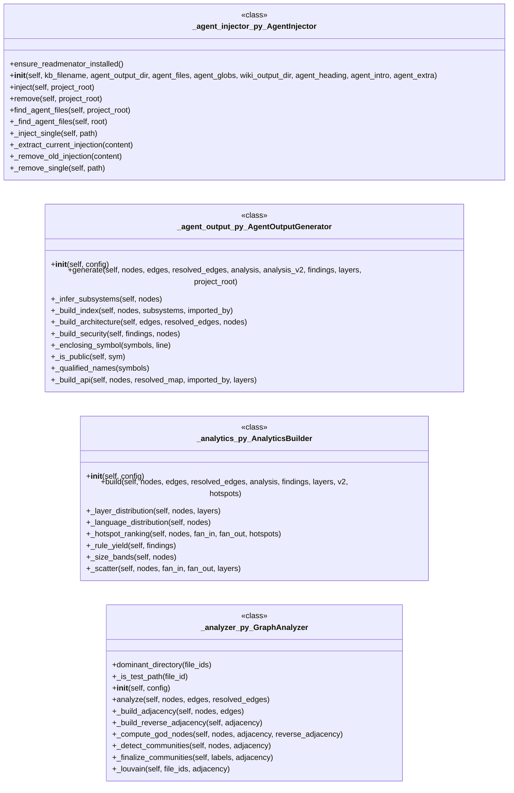

#### `readmenator/_apidocs.py`

```mermaid
classDiagram
  direction LR
  class _apidocs_py_ApiParam {
    <<class>>
    +_unparse(node)
    +_matching_close(lines, start, scan_limit)
    +_indent_end(lines, start)
    +_split_top_level(text, sep)
    +_param_span(signature, name)
    +parse_signature_params(signature, name, language)
    +is_vendored_path(file_id, config)
    +to_dict(self)
    +is_documented(self)
    +to_dict(self)
  }
  class _apidocs_py_ApiEntity {
    <<class>>
    +_unparse(node)
    +_matching_close(lines, start, scan_limit)
    +_indent_end(lines, start)
    +_split_top_level(text, sep)
    +_param_span(signature, name)
    +parse_signature_params(signature, name, language)
    +is_vendored_path(file_id, config)
    +to_dict(self)
    +is_documented(self)
    +to_dict(self)
  }
  class _apidocs_py_DocWarning {
    <<class>>
    +_unparse(node)
    +_matching_close(lines, start, scan_limit)
    +_indent_end(lines, start)
    +_split_top_level(text, sep)
    +_param_span(signature, name)
    +parse_signature_params(signature, name, language)
    +is_vendored_path(file_id, config)
    +to_dict(self)
    +is_documented(self)
    +to_dict(self)
  }
  class _apidocs_py_ApiReference {
    <<class>>
    +_unparse(node)
    +_matching_close(lines, start, scan_limit)
    +_indent_end(lines, start)
    +_split_top_level(text, sep)
    +_param_span(signature, name)
    +parse_signature_params(signature, name, language)
    +is_vendored_path(file_id, config)
    +to_dict(self)
    +is_documented(self)
    +to_dict(self)
  }
  class _apidocs_py__PythonExtractor {
    <<class>>
    +_unparse(node)
    +_matching_close(lines, start, scan_limit)
    +_indent_end(lines, start)
    +_split_top_level(text, sep)
    +_param_span(signature, name)
    +parse_signature_params(signature, name, language)
    +is_vendored_path(file_id, config)
    +to_dict(self)
    +is_documented(self)
    +to_dict(self)
  }
  class _apidocs_py_ApiReferenceBuilder {
    <<class>>
    +_unparse(node)
    +_matching_close(lines, start, scan_limit)
    +_indent_end(lines, start)
    +_split_top_level(text, sep)
    +_param_span(signature, name)
    +parse_signature_params(signature, name, language)
    +is_vendored_path(file_id, config)
    +to_dict(self)
    +is_documented(self)
    +to_dict(self)
  }
```

#### `readmenator/_apidocs_render.py`, `readmenator/_app.py`, `readmenator/_bundlegraph.py`, `readmenator/_cache.py`

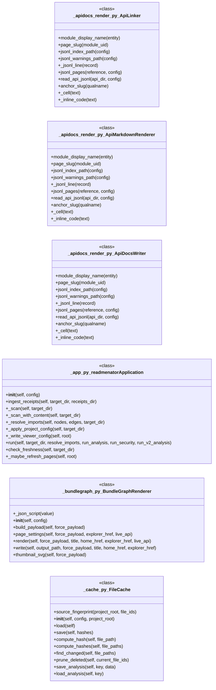

#### `readmenator/_category.py`, `readmenator/_components.py`, `readmenator/_concepts.py`

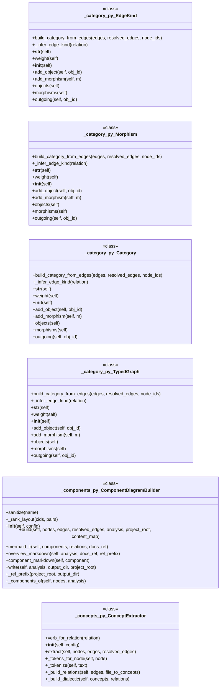

#### `readmenator/_config.py`, `readmenator/_cpg.py`, `readmenator/_cursorrules_generator.py`, `readmenator/_dataflow.py`, `readmenator/_dead_code.py`

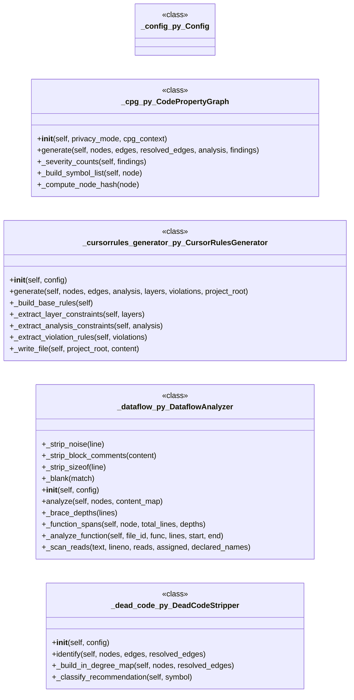

#### `readmenator/_diagrams.py`

```mermaid
classDiagram
  direction LR
  class _diagrams_py_MapNode {
    <<class>>
    +_escape_markup(value)
    +_json_payload(payload)
    +_fill_template(template, values)
    +_role_color(role, config)
    +__init__(self, config)
    +_effective_canvas(self, system_map)
    +validate(self, system_map)
    +__init__(self, config)
    +supported_kinds(self)
    +_is_full(self, full)
  }
  class _diagrams_py_MapEdge {
    <<class>>
    +_escape_markup(value)
    +_json_payload(payload)
    +_fill_template(template, values)
    +_role_color(role, config)
    +__init__(self, config)
    +_effective_canvas(self, system_map)
    +validate(self, system_map)
    +__init__(self, config)
    +supported_kinds(self)
    +_is_full(self, full)
  }
  class _diagrams_py_MapView {
    <<class>>
    +_escape_markup(value)
    +_json_payload(payload)
    +_fill_template(template, values)
    +_role_color(role, config)
    +__init__(self, config)
    +_effective_canvas(self, system_map)
    +validate(self, system_map)
    +__init__(self, config)
    +supported_kinds(self)
    +_is_full(self, full)
  }
  class _diagrams_py_SystemMap {
    <<class>>
    +_escape_markup(value)
    +_json_payload(payload)
    +_fill_template(template, values)
    +_role_color(role, config)
    +__init__(self, config)
    +_effective_canvas(self, system_map)
    +validate(self, system_map)
    +__init__(self, config)
    +supported_kinds(self)
    +_is_full(self, full)
  }
  class _diagrams_py_MapDiagnostic {
    <<class>>
    +_escape_markup(value)
    +_json_payload(payload)
    +_fill_template(template, values)
    +_role_color(role, config)
    +__init__(self, config)
    +_effective_canvas(self, system_map)
    +validate(self, system_map)
    +__init__(self, config)
    +supported_kinds(self)
    +_is_full(self, full)
  }
  class _diagrams_py_MapReceipt {
    <<class>>
    +_escape_markup(value)
    +_json_payload(payload)
    +_fill_template(template, values)
    +_role_color(role, config)
    +__init__(self, config)
    +_effective_canvas(self, system_map)
    +validate(self, system_map)
    +__init__(self, config)
    +supported_kinds(self)
    +_is_full(self, full)
  }
  class _diagrams_py_MapDelta {
    <<class>>
    +_escape_markup(value)
    +_json_payload(payload)
    +_fill_template(template, values)
    +_role_color(role, config)
    +__init__(self, config)
    +_effective_canvas(self, system_map)
    +validate(self, system_map)
    +__init__(self, config)
    +supported_kinds(self)
    +_is_full(self, full)
  }
  class _diagrams_py_SystemMapValidator {
    <<class>>
    +_escape_markup(value)
    +_json_payload(payload)
    +_fill_template(template, values)
    +_role_color(role, config)
    +__init__(self, config)
    +_effective_canvas(self, system_map)
    +validate(self, system_map)
    +__init__(self, config)
    +supported_kinds(self)
    +_is_full(self, full)
  }
  class _diagrams_py_SystemMapBuilder {
    <<class>>
    +_escape_markup(value)
    +_json_payload(payload)
    +_fill_template(template, values)
    +_role_color(role, config)
    +__init__(self, config)
    +_effective_canvas(self, system_map)
    +validate(self, system_map)
    +__init__(self, config)
    +supported_kinds(self)
    +_is_full(self, full)
  }
  class _diagrams_py_InteractiveMapRenderer {
    <<class>>
    +_escape_markup(value)
    +_json_payload(payload)
    +_fill_template(template, values)
    +_role_color(role, config)
    +__init__(self, config)
    +_effective_canvas(self, system_map)
    +validate(self, system_map)
    +__init__(self, config)
    +supported_kinds(self)
    +_is_full(self, full)
  }
  class _diagrams_py_VisNetworkRenderer {
    <<class>>
    +_escape_markup(value)
    +_json_payload(payload)
    +_fill_template(template, values)
    +_role_color(role, config)
    +__init__(self, config)
    +_effective_canvas(self, system_map)
    +validate(self, system_map)
    +__init__(self, config)
    +supported_kinds(self)
    +_is_full(self, full)
  }
  class _diagrams_py_DocsSitePublisher {
    <<class>>
    +_escape_markup(value)
    +_json_payload(payload)
    +_fill_template(template, values)
    +_role_color(role, config)
    +__init__(self, config)
    +_effective_canvas(self, system_map)
    +validate(self, system_map)
    +__init__(self, config)
    +supported_kinds(self)
    +_is_full(self, full)
  }
```

#### `readmenator/_docstrings.py`, `readmenator/_documentation.py`, `readmenator/_embed.py`, `readmenator/_exclusions.py`

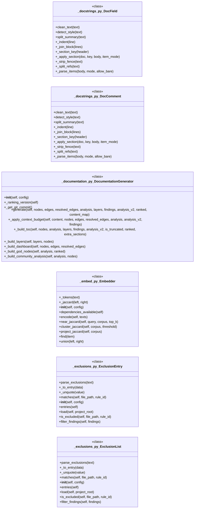

#### `readmenator/_explorer.py`, `readmenator/_exporter.py`

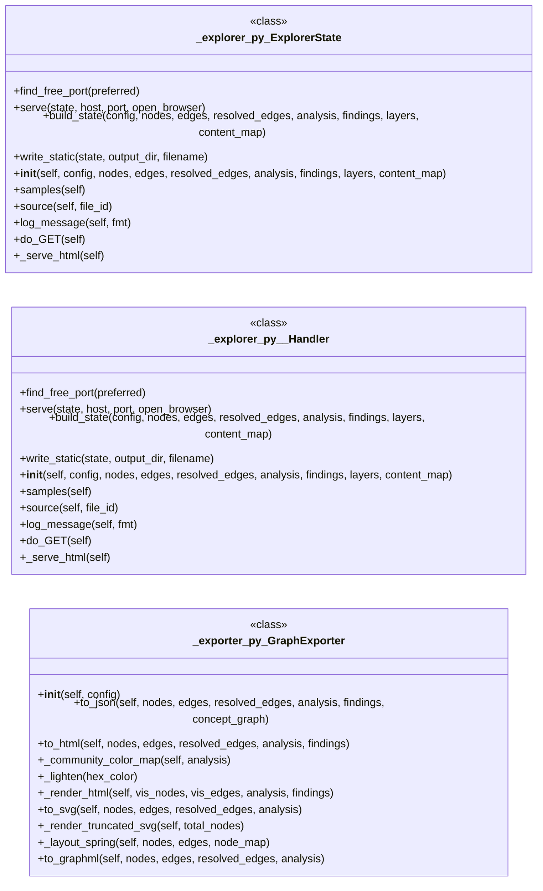

#### `readmenator/_flowcharts.py`

```mermaid
classDiagram
  direction LR
  class _flowcharts_py_Component {
    <<class>>
    +mermaid_id(text, prefix)
    +mermaid_text(text, limit)
    +tarjan_scc(vertices, adjacency)
    +transitive_reduction(adjacency)
    +eades_lin_smyth(vertices, weight)
    +_first_sentence(text)
    +to_mermaid(graph, direction)
    +build_flow_graphs(config, nodes, edges, resolved_edges, content_map, analysis, layers)
    +render_architecture_section(config, nodes, resolved_edges, analysis, layers)
    +render_flows_section(config, nodes, edges, resolved_edges, content_map)
  }
  class _flowcharts_py_ArchitectureDiagramBuilder {
    <<class>>
    +mermaid_id(text, prefix)
    +mermaid_text(text, limit)
    +tarjan_scc(vertices, adjacency)
    +transitive_reduction(adjacency)
    +eades_lin_smyth(vertices, weight)
    +_first_sentence(text)
    +to_mermaid(graph, direction)
    +build_flow_graphs(config, nodes, edges, resolved_edges, content_map, analysis, layers)
    +render_architecture_section(config, nodes, resolved_edges, analysis, layers)
    +render_flows_section(config, nodes, edges, resolved_edges, content_map)
  }
  class _flowcharts_py_EntryPoint {
    <<class>>
    +mermaid_id(text, prefix)
    +mermaid_text(text, limit)
    +tarjan_scc(vertices, adjacency)
    +transitive_reduction(adjacency)
    +eades_lin_smyth(vertices, weight)
    +_first_sentence(text)
    +to_mermaid(graph, direction)
    +build_flow_graphs(config, nodes, edges, resolved_edges, content_map, analysis, layers)
    +render_architecture_section(config, nodes, resolved_edges, analysis, layers)
    +render_flows_section(config, nodes, edges, resolved_edges, content_map)
  }
  class _flowcharts_py_FlowStep {
    <<class>>
    +mermaid_id(text, prefix)
    +mermaid_text(text, limit)
    +tarjan_scc(vertices, adjacency)
    +transitive_reduction(adjacency)
    +eades_lin_smyth(vertices, weight)
    +_first_sentence(text)
    +to_mermaid(graph, direction)
    +build_flow_graphs(config, nodes, edges, resolved_edges, content_map, analysis, layers)
    +render_architecture_section(config, nodes, resolved_edges, analysis, layers)
    +render_flows_section(config, nodes, edges, resolved_edges, content_map)
  }
  class _flowcharts_py_ExecutionFlowBuilder {
    <<class>>
    +mermaid_id(text, prefix)
    +mermaid_text(text, limit)
    +tarjan_scc(vertices, adjacency)
    +transitive_reduction(adjacency)
    +eades_lin_smyth(vertices, weight)
    +_first_sentence(text)
    +to_mermaid(graph, direction)
    +build_flow_graphs(config, nodes, edges, resolved_edges, content_map, analysis, layers)
    +render_architecture_section(config, nodes, resolved_edges, analysis, layers)
    +render_flows_section(config, nodes, edges, resolved_edges, content_map)
  }
  class _flowcharts_py__ControlFlowBuilder {
    <<class>>
    +mermaid_id(text, prefix)
    +mermaid_text(text, limit)
    +tarjan_scc(vertices, adjacency)
    +transitive_reduction(adjacency)
    +eades_lin_smyth(vertices, weight)
    +_first_sentence(text)
    +to_mermaid(graph, direction)
    +build_flow_graphs(config, nodes, edges, resolved_edges, content_map, analysis, layers)
    +render_architecture_section(config, nodes, resolved_edges, analysis, layers)
    +render_flows_section(config, nodes, edges, resolved_edges, content_map)
  }
```

---

## Code Property Graph

Machine-readable Code Property Graph (CPG) in JSON-LD format. This block allows AI agents to parse the full structural graph without additional file reads. Compatible with GraphRAG pipelines.

```json
{"@context": "https://schema.org", "analysis": {"communities": [{"cohesion": 0.529, "id": 0, "label": "readmenator/parsers", "size": 37}, {"cohesion": 0.32, "id": 1, "label": "readmenator: _video", "size": 36}, {"cohesion": 0.329, "id": 2, "label": "readmenator: _agent_output", "size": 19}, {"cohesion": 0.317, "id": 3, "label": "readmenator: _graphrag", "size": 18}, {"cohesion": 0.264, "id": 4, "label": "readmenator: _pipeline", "size": 18}, {"cohesion": 0.391, "id": 5, "label": "readmenator: _diagrams", "size": 15}, {"cohesion": 0.443, "id": 6, "label": "readmenator: _flowcharts", "size": 12}], "god_nodes": [{"node_id": "readmenator/_models.py", "score": 206.3}, {"node_id": "readmenator/_config.py", "score": 204.1}, {"node_id": "readmenator/_app.py", "score": 96.8}, {"node_id": "readmenator/_pipeline.py", "score": 93.3}, {"node_id": "readmenator/parsers/__init__.py", "score": 48.2}, {"node_id": "readmenator/parsers/_base.py", "score": 44.6}, {"node_id": "readmenator/_forcegraph.py", "score": 44.3}, {"node_id": "tests/test_parsers_property.py", "score": 42.7}, {"node_id": "readmenator/_diagrams.py", "score": 39.7}, {"node_id": "tests/test_interactive_graph.py", "score": 34.0}], "surprising_connections": [{"hops": 5, "source": "readmenator/_docstrings.py", "target": "tests/test_graphlayout.py"}, {"hops": 5, "source": "readmenator/_hypotheses.py", "target": "tests/test_agent_injector.py"}, {"hops": 5, "source": "readmenator/_hypotheses.py", "target": "tests/test_graphlayout.py"}, {"hops": 5, "source": "readmenator/_hypotheses.py", "target": "tests/test_readme_injector.py"}, {"hops": 5, "source": "readmenator.py", "target": "tests/test_agent_injector.py"}]}, "edges": [{"confidence": "EXTRACTED", "relation": "imports", "source": "readmenator/__init__.py", "target": "readmenator._app"}, {"confidence": "EXTRACTED", "relation": "imports", "source": "readmenator/__init__.py", "target": "readmenator._category"}, {"confidence": "EXTRACTED", "relation": "imports", "source": "readmenator/__init__.py", "target": "readmenator._config"}, {"confidence": "EXTRACTED", "relation": "imports", "source": "readmenator/__init__.py", "target": "readmenator._project_config"}, {"confidence": "EXTRACTED", "relation": "imports", "source": "readmenator/__init__.py", "target": "readmenator._diagrams"}, {"confidence": "EXTRACTED", "relation": "imports", "source": "readmenator/__init__.py", "target": "readmenator._mcp_server"}, {"confidence": "EXTRACTED", "relation": "imports", "source": "readmenator/__init__.py", "target": "readmenator._components"}, {"confidence": "EXTRACTED", "relation": "imports", "source": "readmenator/__init__.py", "target": "readmenator._ollama"}, {"confidence": "EXTRACTED", "relation": "imports", "source": "readmenator/__init__.py", "target": "readmenator._symindex"}, {"confidence": "EXTRACTED", "relation": "imports", "source": "readmenator/__init__.py", "target": "readmenator._concepts"}, {"confidence": "EXTRACTED", "relation": "imports", "source": "readmenator/__init__.py", "target": "readmenator._models"}, {"confidence": "EXTRACTED", "relation": "imports", "source": "readmenator/__init__.py", "target": "readmenator._rank"}, {"confidence": "EXTRACTED", "relation": "imports", "source": "readmenator/__init__.py", "target": "readmenator._readme_injector"}, {"confidence": "EXTRACTED", "relation": "imports", "source": "readmenator/__init__.py", "target": "readmenator._uml"}, {"confidence": "EXTRACTED", "relation": "imports", "source": "readmenator/__main__.py", "target": "__future__"}, {"confidence": "EXTRACTED", "relation": "imports", "source": "readmenator/__main__.py", "target": "argparse"}, {"confidence": "EXTRACTED", "relation": "imports", "source": "readmenator/__main__.py", "target": "logging"}, {"confidence": "EXTRACTED", "relation": "imports", "source": "readmenator/__main__.py", "target": "sys"}, {"confidence": "EXTRACTED", "relation": "imports", "source": "readmenator/__main__.py", "target": "unittest"}, {"confidence": "EXTRACTED", "relation": "imports", "source": "readmenator/__main__.py", "target": "pathlib"}, {"confidence": "EXTRACTED", "relation": "imports", "source": "readmenator/__main__.py", "target": "readmenator._app"}, {"confidence": "EXTRACTED", "relation": "imports", "source": "readmenator/__main__.py", "target": "readmenator._config"}, {"confidence": "EXTRACTED", "relation": "imports", "source": "readmenator/__main__.py", "target": "readmenator._mcp_server"}, {"confidence": "EXTRACTED", "relation": "imports", "source": "readmenator/__main__.py", "target": "readmenator._project_config"}, {"confidence": "EXTRACTED", "relation": "imports", "source": "readmenator/__main__.py", "target": "json"}, {"confidence": "EXTRACTED", "relation": "imports", "source": "readmenator/__main__.py", "target": "json"}, {"confidence": "EXTRACTED", "relation": "imports", "source": "readmenator/__main__.py", "target": "json"}, {"confidence": "EXTRACTED", "relation": "imports", "source": "readmenator/__main__.py", "target": "json"}, {"confidence": "EXTRACTED", "relation": "imports", "source": "readmenator/_agent_injector.py", "target": "__future__"}, {"confidence": "EXTRACTED", "relation": "imports", "source": "readmenator/_agent_injector.py", "target": "glob"}, {"confidence": "EXTRACTED", "relation": "imports", "source": "readmenator/_agent_injector.py", "target": "importlib.util"}, {"confidence": "EXTRACTED", "relation": "imports", "source": "readmenator/_agent_injector.py", "target": "logging"}, {"confidence": "EXTRACTED", "relation": "imports", "source": "readmenator/_agent_injector.py", "target": "subprocess"}, {"confidence": "EXTRACTED", "relation": "imports", "source": "readmenator/_agent_injector.py", "target": "sys"}, {"confidence": "EXTRACTED", "relation": "imports", "source": "readmenator/_agent_injector.py", "target": "pathlib"}, {"confidence": "EXTRACTED", "relation": "imports", "source": "readmenator/_agent_injector.py", "target": "typing"}, {"confidence": "EXTRACTED", "relation": "imports", "source": "readmenator/_agent_output.py", "target": "__future__"}, {"confidence": "EXTRACTED", "relation": "imports", "source": "readmenator/_agent_output.py", "target": "json"}, {"confidence": "EXTRACTED", "relation": "imports", "source": "readmenator/_agent_output.py", "target": "logging"}, {"confidence": "EXTRACTED", "relation": "imports", "source": "readmenator/_agent_output.py", "target": "os"}, {"confidence": "EXTRACTED", "relation": "imports", "source": "readmenator/_agent_output.py", "target": "re"}, {"confidence": "EXTRACTED", "relation": "imports", "source": "readmenator/_agent_output.py", "target": "time"}, {"confidence": "EXTRACTED", "relation": "imports", "source": "readmenator/_agent_output.py", "target": "collections"}, {"confidence": "EXTRACTED", "relation": "imports", "source": "readmenator/_agent_output.py", "target": "pathlib"}, {"confidence": "EXTRACTED", "relation": "imports", "source": "readmenator/_agent_output.py", "target": "typing"}, {"confidence": "EXTRACTED", "relation": "imports", "source": "readmenator/_agent_output.py", "target": "readmenator._cache"}, {"confidence": "EXTRACTED", "relation": "imports", "source": "readmenator/_agent_output.py", "target": "readmenator._config"}, {"confidence": "EXTRACTED", "relation": "imports", "source": "readmenator/_agent_output.py", "target": "readmenator._folder_readme"}, {"confidence": "EXTRACTED", "relation": "imports", "source": "readmenator/_agent_output.py", "target": "readmenator._gitmeta"}, {"confidence": "EXTRACTED", "relation": "imports", "source": "readmenator/_agent_output.py", "target": "readmenator._models"}, {"confidence": "EXTRACTED", "relation": "imports", "source": "readmenator/_agent_output.py", "target": "readmenator._purpose"}, {"confidence": "EXTRACTED", "relation": "imports", "source": "readmenator/_agent_output.py", "target": "readmenator._resolver"}, {"confidence": "EXTRACTED", "relation": "imports", "source": "readmenator/_agent_output.py", "target": "readmenator._security"}, {"confidence": "EXTRACTED", "relation": "imports", "source": "readmenator/_analytics.py", "target": "__future__"}, {"confidence": "EXTRACTED", "relation": "imports", "source": "readmenator/_analytics.py", "target": "collections"}, {"confidence": "EXTRACTED", "relation": "imports", "source": "readmenator/_analytics.py", "target": "typing"}, {"confidence": "EXTRACTED", "relation": "imports", "source": "readmenator/_analytics.py", "target": "readmenator._config"}, {"confidence": "EXTRACTED", "relation": "imports", "source": "readmenator/_analytics.py", "target": "readmenator._models"}, {"confidence": "EXTRACTED", "relation": "imports", "source": "readmenator/_analyzer.py", "target": "__future__"}, {"confidence": "EXTRACTED", "relation": "imports", "source": "readmenator/_analyzer.py", "target": "hashlib"}, {"confidence": "EXTRACTED", "relation": "imports", "source": "readmenator/_analyzer.py", "target": "math"}, {"confidence": "EXTRACTED", "relation": "imports", "source": "readmenator/_analyzer.py", "target": "random"}, {"confidence": "EXTRACTED", "relation": "imports", "source": "readmenator/_analyzer.py", "target": "collections"}, {"confidence": "EXTRACTED", "relation": "imports", "source": "readmenator/_analyzer.py", "target": "typing"}, {"confidence": "EXTRACTED", "relation": "imports", "source": "readmenator/_analyzer.py", "target": "readmenator._config"}, {"confidence": "EXTRACTED", "relation": "imports", "source": "readmenator/_analyzer.py", "target": "readmenator._models"}, {"confidence": "EXTRACTED", "relation": "imports", "source": "readmenator/_apidocs.py", "target": "__future__"}, {"confidence": "EXTRACTED", "relation": "imports", "source": "readmenator/_apidocs.py", "target": "ast"}, {"confidence": "EXTRACTED", "relation": "imports", "source": "readmenator/_apidocs.py", "target": "re"}, {"confidence": "EXTRACTED", "relation": "imports", "source": "readmenator/_apidocs.py", "target": "warnings"}, {"confidence": "EXTRACTED", "relation": "imports", "source": "readmenator/_apidocs.py", "target": "dataclasses"}, {"confidence": "EXTRACTED", "relation": "imports", "source": "readmenator/_apidocs.py", "target": "pathlib"}, {"confidence": "EXTRACTED", "relation": "imports", "source": "readmenator/_apidocs.py", "target": "typing"}, {"confidence": "EXTRACTED", "relation": "imports", "source": "readmenator/_apidocs.py", "target": "readmenator._config"}, {"confidence": "EXTRACTED", "relation": "imports", "source": "readmenator/_apidocs.py", "target": "readmenator._docstrings"}, {"confidence": "EXTRACTED", "relation": "imports", "source": "readmenator/_apidocs.py", "target": "readmenator._models"}, {"confidence": "EXTRACTED", "relation": "imports", "source": "readmenator/_apidocs.py", "target": "readmenator._pytypes"}, {"confidence": "EXTRACTED", "relation": "imports", "source": "readmenator/_apidocs.py", "target": "readmenator._symindex"}, {"confidence": "EXTRACTED", "relation": "imports", "source": "readmenator/_apidocs_page.py", "target": "__future__"}, {"confidence": "EXTRACTED", "relation": "imports", "source": "readmenator/_apidocs_page.py", "target": "html"}, {"confidence": "EXTRACTED", "relation": "imports", "source": "readmenator/_apidocs_page.py", "target": "re"}, {"confidence": "EXTRACTED", "relation": "imports", "source": "readmenator/_apidocs_page.py", "target": "pathlib"}, {"confidence": "EXTRACTED", "relation": "imports", "source": "readmenator/_apidocs_page.py", "target": "typing"}, {"confidence": "EXTRACTED", "relation": "imports", "source": "readmenator/_apidocs_page.py", "target": "readmenator._apidocs"}, {"confidence": "EXTRACTED", "relation": "imports", "source": "readmenator/_apidocs_page.py", "target": "readmenator._config"}, {"confidence": "EXTRACTED", "relation": "imports", "source": "readmenator/_apidocs_page.py", "target": "readmenator._flowlayout"}, {"confidence": "EXTRACTED", "relation": "imports", "source": "readmenator/_apidocs_page.py", "target": "readmenator._flowpage"}, {"confidence": "EXTRACTED", "relation": "imports", "source": "readmenator/_apidocs_page.py", "target": "readmenator._htmlpack"}, {"confidence": "EXTRACTED", "relation": "imports", "source": "readmenator/_apidocs_render.py", "target": "__future__"}, {"confidence": "EXTRACTED", "relation": "imports", "source": "readmenator/_apidocs_render.py", "target": "json"}, {"confidence": "EXTRACTED", "relation": "imports", "source": "readmenator/_apidocs_render.py", "target": "logging"}, {"confidence": "EXTRACTED", "relation": "imports", "source": "readmenator/_apidocs_render.py", "target": "os"}, {"confidence": "EXTRACTED", "relation": "imports", "source": "readmenator/_apidocs_render.py", "target": "re"}, {"confidence": "EXTRACTED", "relation": "imports", "source": "readmenator/_apidocs_render.py", "target": "pathlib"}, {"confidence": "EXTRACTED", "relation": "imports", "source": "readmenator/_apidocs_render.py", "target": "typing"}, {"confidence": "EXTRACTED", "relation": "imports", "source": "readmenator/_apidocs_render.py", "target": "readmenator._apidocs"}, {"confidence": "EXTRACTED", "relation": "imports", "source": "readmenator/_apidocs_render.py", "target": "readmenator._apidocs_page"}, {"confidence": "EXTRACTED", "relation": "imports", "source": "readmenator/_apidocs_render.py", "target": "readmenator._config"}, {"confidence": "EXTRACTED", "relation": "imports", "source": "readmenator/_apidocs_render.py", "target": "readmenator._flowlayout"}, {"confidence": "EXTRACTED", "relation": "imports", "source": "readmenator/_apidocs_render.py", "target": "readmenator._flowpage"}, {"confidence": "EXTRACTED", "relation": "imports", "source": "readmenator/_apidocs_render.py", "target": "readmenator._docstrings"}, {"confidence": "EXTRACTED", "relation": "imports", "source": "readmenator/_app.py", "target": "__future__"}, {"confidence": "EXTRACTED", "relation": "imports", "source": "readmenator/_app.py", "target": "json"}, {"confidence": "EXTRACTED", "relation": "imports", "source": "readmenator/_app.py", "target": "logging"}, {"confidence": "EXTRACTED", "relation": "imports", "source": "readmenator/_app.py", "target": "os"}, {"confidence": "EXTRACTED", "relation": "imports", "source": "readmenator/_app.py", "target": "dataclasses"}, {"confidence": "EXTRACTED", "relation": "imports", "source": "readmenator/_app.py", "target": "pathlib"}, {"confidence": "EXTRACTED", "relation": "imports", "source": "readmenator/_app.py", "target": "typing"}, {"confidence": "EXTRACTED", "relation": "imports", "source": "readmenator/_app.py", "target": "readmenator._apidocs"}, {"confidence": "EXTRACTED", "relation": "imports", "source": "readmenator/_app.py", "target": "readmenator._bundlegraph"}, {"confidence": "EXTRACTED", "relation": "imports", "source": "readmenator/_app.py", "target": "readmenator._cache"}, {"confidence": "EXTRACTED", "relation": "imports", "source": "readmenator/_app.py", "target": "readmenator._config"}, {"confidence": "EXTRACTED", "relation": "imports", "source": "readmenator/_app.py", "target": "readmenator._cursorrules_generator"}, {"confidence": "EXTRACTED", "relation": "imports", "source": "readmenator/_app.py", "target": "readmenator._dead_code"}, {"confidence": "EXTRACTED", "relation": "imports", "source": "readmenator/_app.py", "target": "readmenator._diagrams"}, {"confidence": "EXTRACTED", "relation": "imports", "source": "readmenator/_app.py", "target": "readmenator._explorer"}, {"confidence": "EXTRACTED", "relation": "imports", "source": "readmenator/_app.py", "target": "readmenator._flowcharts"}, {"confidence": "EXTRACTED", "relation": "imports", "source": "readmenator/_app.py", "target": "readmenator._flowlayout"}, {"confidence": "EXTRACTED", "relation": "imports", "source": "readmenator/_app.py", "target": "readmenator._flowpage"}, {"confidence": "EXTRACTED", "relation": "imports", "source": "readmenator/_app.py", "target": "readmenator._explorer"}, {"confidence": "EXTRACTED", "relation": "imports", "source": "readmenator/_app.py", "target": "readmenator._gh_wiki"}, {"confidence": "EXTRACTED", "relation": "imports", "source": "readmenator/_app.py", "target": "readmenator._gitmeta"}, {"confidence": "EXTRACTED", "relation": "imports", "source": "readmenator/_app.py", "target": "readmenator._graphrag"}, {"confidence": "EXTRACTED", "relation": "imports", "source": "readmenator/_app.py", "target": "readmenator._layers"}, {"confidence": "EXTRACTED", "relation": "imports", "source": "readmenator/_app.py", "target": "readmenator._linter"}, {"confidence": "EXTRACTED", "relation": "imports", "source": "readmenator/_app.py", "target": "readmenator._models"}, {"confidence": "EXTRACTED", "relation": "imports", "source": "readmenator/_app.py", "target": "readmenator._pipeline"}, {"confidence": "EXTRACTED", "relation": "imports", "source": "readmenator/_app.py", "target": "readmenator._query"}, {"confidence": "EXTRACTED", "relation": "imports", "source": "readmenator/_app.py", "target": "readmenator._rank"}, {"confidence": "EXTRACTED", "relation": "imports", "source": "readmenator/_app.py", "target": "readmenator._refactorizer"}, {"confidence": "EXTRACTED", "relation": "imports", "source": "readmenator/_app.py", "target": "readmenator._resolver"}, {"confidence": "EXTRACTED", "relation": "imports", "source": "readmenator/_app.py", "target": "readmenator._yaralite"}, {"confidence": "EXTRACTED", "relation": "imports", "source": "readmenator/_app.py", "target": "os"}, {"confidence": "EXTRACTED", "relation": "imports", "source": "readmenator/_app.py", "target": "readmenator._receipts"}, {"confidence": "EXTRACTED", "relation": "imports", "source": "readmenator/_app.py", "target": "readmenator._uncertainty"}, {"confidence": "EXTRACTED", "relation": "imports", "source": "readmenator/_app.py", "target": "readmenator._watcher"}, {"confidence": "EXTRACTED", "relation": "imports", "source": "readmenator/_app.py", "target": "readmenator._project_config"}, {"confidence": "EXTRACTED", "relation": "imports", "source": "readmenator/_app.py", "target": "readmenator._project_config"}, {"confidence": "EXTRACTED", "relation": "imports", "source": "readmenator/_app.py", "target": "readmenator._project_config"}, {"confidence": "EXTRACTED", "relation": "imports", "source": "readmenator/_app.py", "target": "readmenator._project_config"}, {"confidence": "EXTRACTED", "relation": "imports", "source": "readmenator/_app.py", "target": "readmenator._video"}, {"confidence": "EXTRACTED", "relation": "imports", "source": "readmenator/_bundlegraph.py", "target": "__future__"}, {"confidence": "EXTRACTED", "relation": "imports", "source": "readmenator/_bundlegraph.py", "target": "html"}, {"confidence": "EXTRACTED", "relation": "imports", "source": "readmenator/_bundlegraph.py", "target": "json"}, {"confidence": "EXTRACTED", "relation": "imports", "source": "readmenator/_bundlegraph.py", "target": "math"}, {"confidence": "EXTRACTED", "relation": "imports", "source": "readmenator/_bundlegraph.py", "target": "re"}, {"confidence": "EXTRACTED", "relation": "imports", "source": "readmenator/_bundlegraph.py", "target": "pathlib"}, {"confidence": "EXTRACTED", "relation": "imports", "source": "readmenator/_bundlegraph.py", "target": "typing"}, {"confidence": "EXTRACTED", "relation": "imports", "source": "readmenator/_bundlegraph.py", "target": "readmenator._bundlegraph_page"}, {"confidence": "EXTRACTED", "relation": "imports", "source": "readmenator/_bundlegraph.py", "target": "readmenator._config"}, {"confidence": "EXTRACTED", "relation": "imports", "source": "readmenator/_bundlegraph.py", "target": "readmenator._forcegraph"}, {"confidence": "EXTRACTED", "relation": "imports", "source": "readmenator/_bundlegraph.py", "target": "readmenator._graphlayout"}, {"confidence": "EXTRACTED", "relation": "imports", "source": "readmenator/_bundlegraph.py", "target": "readmenator._htmlpack"}, {"confidence": "EXTRACTED", "relation": "imports", "source": "readmenator/_bundlegraph.py", "target": "readmenator._project_config"}, {"confidence": "EXTRACTED", "relation": "imports", "source": "readmenator/_bundlegraph.py", "target": "readmenator._viewer_ui"}, {"confidence": "EXTRACTED", "relation": "imports", "source": "readmenator/_bundlegraph_page.py", "target": "__future__"}, {"confidence": "EXTRACTED", "relation": "imports", "source": "readmenator/_cache.py", "target": "__future__"}, {"confidence": "EXTRACTED", "relation": "imports", "source": "readmenator/_cache.py", "target": "hashlib"}, {"confidence": "EXTRACTED", "relation": "imports", "source": "readmenator/_cache.py", "target": "json"}, {"confidence": "EXTRACTED", "relation": "imports", "source": "readmenator/_cache.py", "target": "os"}, {"confidence": "EXTRACTED", "relation": "imports", "source": "readmenator/_cache.py", "target": "pathlib"}, {"confidence": "EXTRACTED", "relation": "imports", "source": "readmenator/_cache.py", "target": "typing"}, {"confidence": "EXTRACTED", "relation": "imports", "source": "readmenator/_cache.py", "target": "readmenator._config"}, {"confidence": "EXTRACTED", "relation": "imports", "source": "readmenator/_category.py", "target": "__future__"}, {"confidence": "EXTRACTED", "relation": "imports", "source": "readmenator/_category.py", "target": "dataclasses"}, {"confidence": "EXTRACTED", "relation": "imports", "source": "readmenator/_category.py", "target": "enum"}, {"confidence": "EXTRACTED", "relation": "imports", "source": "readmenator/_category.py", "target": "typing"}, {"confidence": "EXTRACTED", "relation": "imports", "source": "readmenator/_components.py", "target": "__future__"}, {"confidence": "EXTRACTED", "relation": "imports", "source": "readmenator/_components.py", "target": "html"}, {"confidence": "EXTRACTED", "relation": "imports", "source": "readmenator/_components.py", "target": "json"}, {"confidence": "EXTRACTED", "relation": "imports", "source": "readmenator/_components.py", "target": "math"}, {"confidence": "EXTRACTED", "relation": "imports", "source": "readmenator/_components.py", "target": "os"}, {"confidence": "EXTRACTED", "relation": "imports", "source": "readmenator/_components.py", "target": "re"}, {"confidence": "EXTRACTED", "relation": "imports", "source": "readmenator/_components.py", "target": "datetime"}, {"confidence": "EXTRACTED", "relation": "imports", "source": "readmenator/_components.py", "target": "pathlib"}, {"confidence": "EXTRACTED", "relation": "imports", "source": "readmenator/_components.py", "target": "typing"}, {"confidence": "EXTRACTED", "relation": "imports", "source": "readmenator/_components.py", "target": "readmenator._cache"}, {"confidence": "EXTRACTED", "relation": "imports", "source": "readmenator/_components.py", "target": "readmenator._config"}, {"confidence": "EXTRACTED", "relation": "imports", "source": "readmenator/_components.py", "target": "readmenator._layers"}, {"confidence": "EXTRACTED", "relation": "imports", "source": "readmenator/_components.py", "target": "readmenator._models"}, {"confidence": "EXTRACTED", "relation": "imports", "source": "readmenator/_components.py", "target": "readmenator._ollama"}, {"confidence": "EXTRACTED", "relation": "imports", "source": "readmenator/_components.py", "target": "readmenator._purpose"}, {"confidence": "EXTRACTED", "relation": "imports", "source": "readmenator/_components.py", "target": "readmenator._rank"}, {"confidence": "EXTRACTED", "relation": "imports", "source": "readmenator/_components.py", "target": "readmenator._symindex"}, {"confidence": "EXTRACTED", "relation": "imports", "source": "readmenator/_concepts.py", "target": "__future__"}, {"confidence": "EXTRACTED", "relation": "imports", "source": "readmenator/_concepts.py", "target": "logging"}, {"confidence": "EXTRACTED", "relation": "imports", "source": "readmenator/_concepts.py", "target": "re"}, {"confidence": "EXTRACTED", "relation": "imports", "source": "readmenator/_concepts.py", "target": "collections"}, {"confidence": "EXTRACTED", "relation": "imports", "source": "readmenator/_concepts.py", "target": "typing"}, {"confidence": "EXTRACTED", "relation": "imports", "source": "readmenator/_concepts.py", "target": "readmenator._config"}, {"confidence": "EXTRACTED", "relation": "imports", "source": "readmenator/_concepts.py", "target": "readmenator._models"}, {"confidence": "EXTRACTED", "relation": "imports", "source": "readmenator/_config.py", "target": "__future__"}, {"confidence": "EXTRACTED", "relation": "imports", "source": "readmenator/_config.py", "target": "dataclasses"}, {"confidence": "EXTRACTED", "relation": "imports", "source": "readmenator/_config.py", "target": "typing"}, {"confidence": "EXTRACTED", "relation": "imports", "source": "readmenator/_cpg.py", "target": "__future__"}, {"confidence": "EXTRACTED", "relation": "imports", "source": "readmenator/_cpg.py", "target": "hashlib"}, {"confidence": "EXTRACTED", "relation": "imports", "source": "readmenator/_cpg.py", "target": "json"}, {"confidence": "EXTRACTED", "relation": "imports", "source": "readmenator/_cpg.py", "target": "typing"}, {"confidence": "EXTRACTED", "relation": "imports", "source": "readmenator/_cpg.py", "target": "readmenator._models"}, {"confidence": "EXTRACTED", "relation": "imports", "source": "readmenator/_cursorrules_generator.py", "target": "__future__"}, {"confidence": "EXTRACTED", "relation": "imports", "source": "readmenator/_cursorrules_generator.py", "target": "pathlib"}, {"confidence": "EXTRACTED", "relation": "imports", "source": "readmenator/_cursorrules_generator.py", "target": "typing"}, {"confidence": "EXTRACTED", "relation": "imports", "source": "readmenator/_cursorrules_generator.py", "target": "readmenator._config"}, {"confidence": "EXTRACTED", "relation": "imports", "source": "readmenator/_cursorrules_generator.py", "target": "readmenator._layers"}, {"confidence": "EXTRACTED", "relation": "imports", "source": "readmenator/_cursorrules_generator.py", "target": "readmenator._models"}, {"confidence": "EXTRACTED", "relation": "imports", "source": "readmenator/_dataflow.py", "target": "__future__"}, {"confidence": "EXTRACTED", "relation": "imports", "source": "readmenator/_dataflow.py", "target": "logging"}, {"confidence": "EXTRACTED", "relation": "imports", "source": "readmenator/_dataflow.py", "target": "re"}, {"confidence": "EXTRACTED", "relation": "imports", "source": "readmenator/_dataflow.py", "target": "typing"}, {"confidence": "EXTRACTED", "relation": "imports", "source": "readmenator/_dataflow.py", "target": "readmenator._config"}, {"confidence": "EXTRACTED", "relation": "imports", "source": "readmenator/_dataflow.py", "target": "readmenator._models"}, {"confidence": "EXTRACTED", "relation": "imports", "source": "readmenator/_dead_code.py", "target": "__future__"}, {"confidence": "EXTRACTED", "relation": "imports", "source": "readmenator/_dead_code.py", "target": "collections"}, {"confidence": "EXTRACTED", "relation": "imports", "source": "readmenator/_dead_code.py", "target": "typing"}, {"confidence": "EXTRACTED", "relation": "imports", "source": "readmenator/_dead_code.py", "target": "readmenator._config"}, {"confidence": "EXTRACTED", "relation": "imports", "source": "readmenator/_dead_code.py", "target": "readmenator._models"}, {"confidence": "EXTRACTED", "relation": "imports", "source": "readmenator/_diagrams.py", "target": "__future__"}, {"confidence": "EXTRACTED", "relation": "imports", "source": "readmenator/_diagrams.py", "target": "html"}, {"confidence": "EXTRACTED", "relation": "imports", "source": "readmenator/_diagrams.py", "target": "json"}, {"confidence": "EXTRACTED", "relation": "imports", "source": "readmenator/_diagrams.py", "target": "re"}, {"confidence": "EXTRACTED", "relation": "imports", "source": "readmenator/_diagrams.py", "target": "shutil"}, {"confidence": "EXTRACTED", "relation": "imports", "source": "readmenator/_diagrams.py", "target": "subprocess"}, {"confidence": "EXTRACTED", "relation": "imports", "source": "readmenator/_diagrams.py", "target": "dataclasses"}, {"confidence": "EXTRACTED", "relation": "imports", "source": "readmenator/_diagrams.py", "target": "pathlib"}, {"confidence": "EXTRACTED", "relation": "imports", "source": "readmenator/_diagrams.py", "target": "typing"}, {"confidence": "EXTRACTED", "relation": "imports", "source": "readmenator/_diagrams.py", "target": "readmenator._config"}, {"confidence": "EXTRACTED", "relation": "imports", "source": "readmenator/_diagrams.py", "target": "readmenator._folder_readme"}, {"confidence": "EXTRACTED", "relation": "imports", "source": "readmenator/_diagrams.py", "target": "readmenator._htmlpack"}, {"confidence": "EXTRACTED", "relation": "imports", "source": "readmenator/_diagrams.py", "target": "readmenator._models"}, {"confidence": "EXTRACTED", "relation": "imports", "source": "readmenator/_diagrams.py", "target": "readmenator._project_config"}, {"confidence": "EXTRACTED", "relation": "imports", "source": "readmenator/_diagrams.py", "target": "readmenator._project_config"}, {"confidence": "EXTRACTED", "relation": "imports", "source": "readmenator/_diagrams.py", "target": "readmenator._viewer_ui"}, {"confidence": "EXTRACTED", "relation": "imports", "source": "readmenator/_diagrams.py", "target": "readmenator._viewer_ui"}, {"confidence": "EXTRACTED", "relation": "imports", "source": "readmenator/_diagrams.py", "target": "readmenator._viewer_ui"}, {"confidence": "EXTRACTED", "relation": "imports", "source": "readmenator/_diagrams.py", "target": "readmenator._project_config"}, {"confidence": "EXTRACTED", "relation": "imports", "source": "readmenator/_diagrams.py", "target": "readmenator._viewer_ui"}, {"confidence": "EXTRACTED", "relation": "imports", "source": "readmenator/_docstrings.py", "target": "__future__"}, {"confidence": "EXTRACTED", "relation": "imports", "source": "readmenator/_docstrings.py", "target": "re"}, {"confidence": "EXTRACTED", "relation": "imports", "source": "readmenator/_docstrings.py", "target": "dataclasses"}, {"confidence": "EXTRACTED", "relation": "imports", "source": "readmenator/_docstrings.py", "target": "typing"}, {"confidence": "EXTRACTED", "relation": "imports", "source": "readmenator/_documentation.py", "target": "__future__"}, {"confidence": "EXTRACTED", "relation": "imports", "source": "readmenator/_documentation.py", "target": "subprocess"}, {"confidence": "EXTRACTED", "relation": "imports", "source": "readmenator/_documentation.py", "target": "collections"}, {"confidence": "EXTRACTED", "relation": "imports", "source": "readmenator/_documentation.py", "target": "typing"}, {"confidence": "EXTRACTED", "relation": "imports", "source": "readmenator/_documentation.py", "target": "readmenator._analytics"}, {"confidence": "EXTRACTED", "relation": "imports", "source": "readmenator/_documentation.py", "target": "readmenator._config"}, {"confidence": "EXTRACTED", "relation": "imports", "source": "readmenator/_documentation.py", "target": "readmenator._cpg"}, {"confidence": "EXTRACTED", "relation": "imports", "source": "readmenator/_documentation.py", "target": "readmenator._forcegraph"}, {"confidence": "EXTRACTED", "relation": "imports", "source": "readmenator/_documentation.py", "target": "readmenator._flowcharts"}, {"confidence": "EXTRACTED", "relation": "imports", "source": "readmenator/_documentation.py", "target": "readmenator._mermaid"}, {"confidence": "EXTRACTED", "relation": "imports", "source": "readmenator/_documentation.py", "target": "readmenator._uml"}, {"confidence": "EXTRACTED", "relation": "imports", "source": "readmenator/_documentation.py", "target": "readmenator._models"}, {"confidence": "EXTRACTED", "relation": "imports", "source": "readmenator/_documentation.py", "target": "readmenator._rank"}, {"confidence": "EXTRACTED", "relation": "imports", "source": "readmenator/_embed.py", "target": "__future__"}, {"confidence": "EXTRACTED", "relation": "imports", "source": "readmenator/_embed.py", "target": "math"}, {"confidence": "EXTRACTED", "relation": "imports", "source": "readmenator/_embed.py", "target": "re"}, {"confidence": "EXTRACTED", "relation": "imports", "source": "readmenator/_embed.py", "target": "collections"}, {"confidence": "EXTRACTED", "relation": "imports", "source": "readmenator/_embed.py", "target": "typing"}, {"confidence": "EXTRACTED", "relation": "imports", "source": "readmenator/_embed.py", "target": "readmenator._config"}, {"confidence": "EXTRACTED", "relation": "imports", "source": "readmenator/_embed.py", "target": "sentence_transformers"}, {"confidence": "EXTRACTED", "relation": "imports", "source": "readmenator/_exclusions.py", "target": "__future__"}, {"confidence": "EXTRACTED", "relation": "imports", "source": "readmenator/_exclusions.py", "target": "fnmatch"}, {"confidence": "EXTRACTED", "relation": "imports", "source": "readmenator/_exclusions.py", "target": "dataclasses"}, {"confidence": "EXTRACTED", "relation": "imports", "source": "readmenator/_exclusions.py", "target": "pathlib"}, {"confidence": "EXTRACTED", "relation": "imports", "source": "readmenator/_exclusions.py", "target": "typing"}, {"confidence": "EXTRACTED", "relation": "imports", "source": "readmenator/_exclusions.py", "target": "readmenator._config"}, {"confidence": "EXTRACTED", "relation": "imports", "source": "readmenator/_explain.py", "target": "__future__"}, {"confidence": "EXTRACTED", "relation": "imports", "source": "readmenator/_explain.py", "target": "typing"}, {"confidence": "EXTRACTED", "relation": "imports", "source": "readmenator/_explain.py", "target": "readmenator._category"}, {"confidence": "EXTRACTED", "relation": "imports", "source": "readmenator/_explain.py", "target": "readmenator._rank"}, {"confidence": "EXTRACTED", "relation": "imports", "source": "readmenator/_explorer.py", "target": "__future__"}, {"confidence": "EXTRACTED", "relation": "imports", "source": "readmenator/_explorer.py", "target": "json"}, {"confidence": "EXTRACTED", "relation": "imports", "source": "readmenator/_explorer.py", "target": "socket"}, {"confidence": "EXTRACTED", "relation": "imports", "source": "readmenator/_explorer.py", "target": "http.server"}, {"confidence": "EXTRACTED", "relation": "imports", "source": "readmenator/_explorer.py", "target": "pathlib"}, {"confidence": "EXTRACTED", "relation": "imports", "source": "readmenator/_explorer.py", "target": "typing"}, {"confidence": "EXTRACTED", "relation": "imports", "source": "readmenator/_explorer.py", "target": "urllib.parse"}, {"confidence": "EXTRACTED", "relation": "imports", "source": "readmenator/_explorer.py", "target": "readmenator._analytics"}, {"confidence": "EXTRACTED", "relation": "imports", "source": "readmenator/_explorer.py", "target": "readmenator._config"}, {"confidence": "EXTRACTED", "relation": "imports", "source": "readmenator/_explorer.py", "target": "readmenator._forcegraph"}, {"confidence": "EXTRACTED", "relation": "imports", "source": "readmenator/_explorer.py", "target": "readmenator._models"}, {"confidence": "EXTRACTED", "relation": "imports", "source": "readmenator/_explorer.py", "target": "readmenator._sourceview"}, {"confidence": "EXTRACTED", "relation": "imports", "source": "readmenator/_explorer.py", "target": "urllib.parse"}, {"confidence": "EXTRACTED", "relation": "imports", "source": "readmenator/_explorer.py", "target": "webbrowser"}, {"confidence": "EXTRACTED", "relation": "imports", "source": "readmenator/_exporter.py", "target": "__future__"}, {"confidence": "EXTRACTED", "relation": "imports", "source": "readmenator/_exporter.py", "target": "json"}, {"confidence": "EXTRACTED", "relation": "imports", "source": "readmenator/_exporter.py", "target": "math"}, {"confidence": "EXTRACTED", "relation": "imports", "source": "readmenator/_exporter.py", "target": "os"}, {"confidence": "EXTRACTED", "relation": "imports", "source": "readmenator/_exporter.py", "target": "pathlib"}, {"confidence": "EXTRACTED", "relation": "imports", "source": "readmenator/_exporter.py", "target": "textwrap"}, {"confidence": "EXTRACTED", "relation": "imports", "source": "readmenator/_exporter.py", "target": "typing"}, {"confidence": "EXTRACTED", "relation": "imports", "source": "readmenator/_exporter.py", "target": "readmenator._analytics"}, {"confidence": "EXTRACTED", "relation": "imports", "source": "readmenator/_exporter.py", "target": "readmenator._config"}, {"confidence": "EXTRACTED", "relation": "imports", "source": "readmenator/_exporter.py", "target": "readmenator._forcegraph"}, {"confidence": "EXTRACTED", "relation": "imports", "source": "readmenator/_exporter.py", "target": "readmenator._models"}, {"confidence": "EXTRACTED", "relation": "imports", "source": "readmenator/_exporter.py", "target": "os"}, {"confidence": "EXTRACTED", "relation": "imports", "source": "readmenator/_flowcharts.py", "target": "__future__"}, {"confidence": "EXTRACTED", "relation": "imports", "source": "readmenator/_flowcharts.py", "target": "ast"}, {"confidence": "EXTRACTED", "relation": "imports", "source": "readmenator/_flowcharts.py", "target": "re"}, {"confidence": "EXTRACTED", "relation": "imports", "source": "readmenator/_flowcharts.py", "target": "warnings"}, {"confidence": "EXTRACTED", "relation": "imports", "source": "readmenator/_flowcharts.py", "target": "dataclasses"}, {"confidence": "EXTRACTED", "relation": "imports", "source": "readmenator/_flowcharts.py", "target": "pathlib"}, {"confidence": "EXTRACTED", "relation": "imports", "source": "readmenator/_flowcharts.py", "target": "typing"}, {"confidence": "EXTRACTED", "relation": "imports", "source": "readmenator/_flowcharts.py", "target": "readmenator._apidocs"}, {"confidence": "EXTRACTED", "relation": "imports", "source": "readmenator/_flowcharts.py", "target": "readmenator._config"}, {"confidence": "EXTRACTED", "relation": "imports", "source": "readmenator/_flowcharts.py", "target": "readmenator._flowlayout"}, {"confidence": "EXTRACTED", "relation": "imports", "source": "readmenator/_flowcharts.py", "target": "readmenator._models"}, {"confidence": "EXTRACTED", "relation": "imports", "source": "readmenator/_flowcharts.py", "target": "readmenator._pytypes"}, {"confidence": "EXTRACTED", "relation": "imports", "source": "readmenator/_flowcharts.py", "target": "readmenator._symindex"}, {"confidence": "EXTRACTED", "relation": "imports", "source": "readmenator/_flowlayout.py", "target": "__future__"}, {"confidence": "EXTRACTED", "relation": "imports", "source": "readmenator/_flowlayout.py", "target": "textwrap"}, {"confidence": "EXTRACTED", "relation": "imports", "source": "readmenator/_flowlayout.py", "target": "dataclasses"}, {"confidence": "EXTRACTED", "relation": "imports", "source": "readmenator/_flowlayout.py", "target": "typing"}, {"confidence": "EXTRACTED", "relation": "imports", "source": "readmenator/_flowpage.py", "target": "__future__"}, {"confidence": "EXTRACTED", "relation": "imports", "source": "readmenator/_flowpage.py", "target": "html"}, {"confidence": "EXTRACTED", "relation": "imports", "source": "readmenator/_flowpage.py", "target": "json"}, {"confidence": "EXTRACTED", "relation": "imports", "source": "readmenator/_flowpage.py", "target": "re"}, {"confidence": "EXTRACTED", "relation": "imports", "source": "readmenator/_flowpage.py", "target": "typing"}, {"confidence": "EXTRACTED", "relation": "imports", "source": "readmenator/_flowpage.py", "target": "readmenator._config"}, {"confidence": "EXTRACTED", "relation": "imports", "source": "readmenator/_flowpage.py", "target": "readmenator._flowlayout"}, {"confidence": "EXTRACTED", "relation": "imports", "source": "readmenator/_flowpage.py", "target": "readmenator._htmlpack"}, {"confidence": "EXTRACTED", "relation": "imports", "source": "readmenator/_flowpage.py", "target": "readmenator._project_config"}, {"confidence": "EXTRACTED", "relation": "imports", "source": "readmenator/_flowpage.py", "target": "readmenator._viewer_ui"}, {"confidence": "EXTRACTED", "relation": "imports", "source": "readmenator/_folder_readme.py", "target": "__future__"}, {"confidence": "EXTRACTED", "relation": "imports", "source": "readmenator/_folder_readme.py", "target": "logging"}, {"confidence": "EXTRACTED", "relation": "imports", "source": "readmenator/_folder_readme.py", "target": "dataclasses"}, {"confidence": "EXTRACTED", "relation": "imports", "source": "readmenator/_folder_readme.py", "target": "pathlib"}, {"confidence": "EXTRACTED", "relation": "imports", "source": "readmenator/_folder_readme.py", "target": "typing"}, {"confidence": "EXTRACTED", "relation": "imports", "source": "readmenator/_folder_readme.py", "target": "readmenator._config"}, {"confidence": "EXTRACTED", "relation": "imports", "source": "readmenator/_forcegraph.py", "target": "__future__"}, {"confidence": "EXTRACTED", "relation": "imports", "source": "readmenator/_forcegraph.py", "target": "html"}, {"confidence": "EXTRACTED", "relation": "imports", "source": "readmenator/_forcegraph.py", "target": "json"}, {"confidence": "EXTRACTED", "relation": "imports", "source": "readmenator/_forcegraph.py", "target": "logging"}, {"confidence": "EXTRACTED", "relation": "imports", "source": "readmenator/_forcegraph.py", "target": "math"}, {"confidence": "EXTRACTED", "relation": "imports", "source": "readmenator/_forcegraph.py", "target": "re"}, {"confidence": "EXTRACTED", "relation": "imports", "source": "readmenator/_forcegraph.py", "target": "shutil"}, {"confidence": "EXTRACTED", "relation": "imports", "source": "readmenator/_forcegraph.py", "target": "pathlib"}, {"confidence": "EXTRACTED", "relation": "imports", "source": "readmenator/_forcegraph.py", "target": "typing"}, {"confidence": "EXTRACTED", "relation": "imports", "source": "readmenator/_forcegraph.py", "target": "readmenator._config"}, {"confidence": "EXTRACTED", "relation": "imports", "source": "readmenator/_forcegraph.py", "target": "readmenator._forcegraph_page"}, {"confidence": "EXTRACTED", "relation": "imports", "source": "readmenator/_forcegraph.py", "target": "readmenator._graphlayout"}, {"confidence": "EXTRACTED", "relation": "imports", "source": "readmenator/_forcegraph.py", "target": "readmenator._htmlpack"}, {"confidence": "EXTRACTED", "relation": "imports", "source": "readmenator/_forcegraph.py", "target": "readmenator._models"}, {"confidence": "EXTRACTED", "relation": "imports", "source": "readmenator/_forcegraph.py", "target": "readmenator._purpose"}, {"confidence": "EXTRACTED", "relation": "imports", "source": "readmenator/_forcegraph.py", "target": "readmenator._rank"}, {"confidence": "EXTRACTED", "relation": "imports", "source": "readmenator/_forcegraph.py", "target": "readmenator._resolver"}, {"confidence": "EXTRACTED", "relation": "imports", "source": "readmenator/_forcegraph.py", "target": "readmenator._sourceview"}, {"confidence": "EXTRACTED", "relation": "imports", "source": "readmenator/_forcegraph.py", "target": "readmenator._project_config"}, {"confidence": "EXTRACTED", "relation": "imports", "source": "readmenator/_forcegraph.py", "target": "readmenator._viewer_ui"}, {"confidence": "EXTRACTED", "relation": "imports", "source": "readmenator/_forcegraph_page.py", "target": "__future__"}, {"confidence": "EXTRACTED", "relation": "imports", "source": "readmenator/_gh_wiki.py", "target": "__future__"}, {"confidence": "EXTRACTED", "relation": "imports", "source": "readmenator/_gh_wiki.py", "target": "logging"}, {"confidence": "EXTRACTED", "relation": "imports", "source": "readmenator/_gh_wiki.py", "target": "posixpath"}, {"confidence": "EXTRACTED", "relation": "imports", "source": "readmenator/_gh_wiki.py", "target": "re"}, {"confidence": "EXTRACTED", "relation": "imports", "source": "readmenator/_gh_wiki.py", "target": "shutil"}, {"confidence": "EXTRACTED", "relation": "imports", "source": "readmenator/_gh_wiki.py", "target": "subprocess"}, {"confidence": "EXTRACTED", "relation": "imports", "source": "readmenator/_gh_wiki.py", "target": "tempfile"}, {"confidence": "EXTRACTED", "relation": "imports", "source": "readmenator/_gh_wiki.py", "target": "dataclasses"}, {"confidence": "EXTRACTED", "relation": "imports", "source": "readmenator/_gh_wiki.py", "target": "pathlib"}, {"confidence": "EXTRACTED", "relation": "imports", "source": "readmenator/_gh_wiki.py", "target": "typing"}, {"confidence": "EXTRACTED", "relation": "imports", "source": "readmenator/_gh_wiki.py", "target": "readmenator._config"}, {"confidence": "EXTRACTED", "relation": "imports", "source": "readmenator/_gh_wiki.py", "target": "readmenator._folder_readme"}, {"confidence": "EXTRACTED", "relation": "imports", "source": "readmenator/_gh_wiki.py", "target": "readmenator._gitmeta"}, {"confidence": "EXTRACTED", "relation": "imports", "source": "readmenator/_gitmeta.py", "target": "__future__"}, {"confidence": "EXTRACTED", "relation": "imports", "source": "readmenator/_gitmeta.py", "target": "pathlib"}, {"confidence": "EXTRACTED", "relation": "imports", "source": "readmenator/_gitmeta.py", "target": "typing"}, {"confidence": "EXTRACTED", "relation": "imports", "source": "readmenator/_graphlayout.py", "target": "__future__"}, {"confidence": "EXTRACTED", "relation": "imports", "source": "readmenator/_graphlayout.py", "target": "math"}, {"confidence": "EXTRACTED", "relation": "imports", "source": "readmenator/_graphlayout.py", "target": "random"}, {"confidence": "EXTRACTED", "relation": "imports", "source": "readmenator/_graphlayout.py", "target": "dataclasses"}, {"confidence": "EXTRACTED", "relation": "imports", "source": "readmenator/_graphlayout.py", "target": "typing"}, {"confidence": "EXTRACTED", "relation": "imports", "source": "readmenator/_graphlayout.py", "target": "numpy"}, {"confidence": "EXTRACTED", "relation": "imports", "source": "readmenator/_graphlayout.py", "target": "numpy"}, {"confidence": "EXTRACTED", "relation": "imports", "source": "readmenator/_graphrag.py", "target": "__future__"}, {"confidence": "EXTRACTED", "relation": "imports", "source": "readmenator/_graphrag.py", "target": "json"}, {"confidence": "EXTRACTED", "relation": "imports", "source": "readmenator/_graphrag.py", "target": "logging"}, {"confidence": "EXTRACTED", "relation": "imports", "source": "readmenator/_graphrag.py", "target": "math"}, {"confidence": "EXTRACTED", "relation": "imports", "source": "readmenator/_graphrag.py", "target": "re"}, {"confidence": "EXTRACTED", "relation": "imports", "source": "readmenator/_graphrag.py", "target": "dataclasses"}, {"confidence": "EXTRACTED", "relation": "imports", "source": "readmenator/_graphrag.py", "target": "pathlib"}, {"confidence": "EXTRACTED", "relation": "imports", "source": "readmenator/_graphrag.py", "target": "typing"}, {"confidence": "EXTRACTED", "relation": "imports", "source": "readmenator/_graphrag.py", "target": "readmenator._analyzer"}, {"confidence": "EXTRACTED", "relation": "imports", "source": "readmenator/_graphrag.py", "target": "readmenator._category"}, {"confidence": "EXTRACTED", "relation": "imports", "source": "readmenator/_graphrag.py", "target": "readmenator._config"}, {"confidence": "EXTRACTED", "relation": "imports", "source": "readmenator/_graphrag.py", "target": "readmenator._models"}, {"confidence": "EXTRACTED", "relation": "imports", "source": "readmenator/_graphrag.py", "target": "readmenator._purpose"}, {"confidence": "EXTRACTED", "relation": "imports", "source": "readmenator/_graphrag.py", "target": "readmenator._rank"}, {"confidence": "EXTRACTED", "relation": "imports", "source": "readmenator/_graphrag.py", "target": "readmenator._resolver"}, {"confidence": "EXTRACTED", "relation": "imports", "source": "readmenator/_hotspots.py", "target": "__future__"}, {"confidence": "EXTRACTED", "relation": "imports", "source": "readmenator/_hotspots.py", "target": "collections"}, {"confidence": "EXTRACTED", "relation": "imports", "source": "readmenator/_hotspots.py", "target": "typing"}, {"confidence": "EXTRACTED", "relation": "imports", "source": "readmenator/_hotspots.py", "target": "readmenator._config"}, {"confidence": "EXTRACTED", "relation": "imports", "source": "readmenator/_hotspots.py", "target": "readmenator._models"}, {"confidence": "EXTRACTED", "relation": "imports", "source": "readmenator/_htmlpack.py", "target": "__future__"}, {"confidence": "EXTRACTED", "relation": "imports", "source": "readmenator/_htmlpack.py", "target": "base64"}, {"confidence": "EXTRACTED", "relation": "imports", "source": "readmenator/_htmlpack.py", "target": "gzip"}, {"confidence": "EXTRACTED", "relation": "imports", "source": "readmenator/_htmlpack.py", "target": "html"}, {"confidence": "EXTRACTED", "relation": "imports", "source": "readmenator/_htmlpack.py", "target": "json"}, {"confidence": "EXTRACTED", "relation": "imports", "source": "readmenator/_htmlpack.py", "target": "re"}, {"confidence": "EXTRACTED", "relation": "imports", "source": "readmenator/_htmlpack.py", "target": "typing"}, {"confidence": "EXTRACTED", "relation": "imports", "source": "readmenator/_htmlpack.py", "target": "readmenator._config"}, {"confidence": "EXTRACTED", "relation": "imports", "source": "readmenator/_hypotheses.py", "target": "__future__"}, {"confidence": "EXTRACTED", "relation": "imports", "source": "readmenator/_hypotheses.py", "target": "json"}, {"confidence": "EXTRACTED", "relation": "imports", "source": "readmenator/_hypotheses.py", "target": "dataclasses"}, {"confidence": "EXTRACTED", "relation": "imports", "source": "readmenator/_hypotheses.py", "target": "typing"}, {"confidence": "EXTRACTED", "relation": "imports", "source": "readmenator/_hypotheses.py", "target": "readmenator._receipts"}, {"confidence": "EXTRACTED", "relation": "imports", "source": "readmenator/_layer_rules.py", "target": "__future__"}, {"confidence": "EXTRACTED", "relation": "imports", "source": "readmenator/_layer_rules.py", "target": "typing"}, {"confidence": "EXTRACTED", "relation": "imports", "source": "readmenator/_layer_rules.py", "target": "readmenator._config"}, {"confidence": "EXTRACTED", "relation": "imports", "source": "readmenator/_layer_rules.py", "target": "readmenator._models"}, {"confidence": "EXTRACTED", "relation": "imports", "source": "readmenator/_layers.py", "target": "__future__"}, {"confidence": "EXTRACTED", "relation": "imports", "source": "readmenator/_layers.py", "target": "re"}, {"confidence": "EXTRACTED", "relation": "imports", "source": "readmenator/_layers.py", "target": "collections"}, {"confidence": "EXTRACTED", "relation": "imports", "source": "readmenator/_layers.py", "target": "typing"}, {"confidence": "EXTRACTED", "relation": "imports", "source": "readmenator/_layers.py", "target": "readmenator._models"}, {"confidence": "EXTRACTED", "relation": "imports", "source": "readmenator/_linter.py", "target": "__future__"}, {"confidence": "EXTRACTED", "relation": "imports", "source": "readmenator/_linter.py", "target": "pathlib"}, {"confidence": "EXTRACTED", "relation": "imports", "source": "readmenator/_linter.py", "target": "typing"}, {"confidence": "EXTRACTED", "relation": "imports", "source": "readmenator/_linter.py", "target": "readmenator._config"}, {"confidence": "EXTRACTED", "relation": "imports", "source": "readmenator/_linter.py", "target": "readmenator._layers"}, {"confidence": "EXTRACTED", "relation": "imports", "source": "readmenator/_linter.py", "target": "readmenator._models"}, {"confidence": "EXTRACTED", "relation": "imports", "source": "readmenator/_linter.py", "target": "readmenator._symindex"}, {"confidence": "EXTRACTED", "relation": "imports", "source": "readmenator/_mcp_server.py", "target": "__future__"}, {"confidence": "EXTRACTED", "relation": "imports", "source": "readmenator/_mcp_server.py", "target": "json"}, {"confidence": "EXTRACTED", "relation": "imports", "source": "readmenator/_mcp_server.py", "target": "logging"}, {"confidence": "EXTRACTED", "relation": "imports", "source": "readmenator/_mcp_server.py", "target": "sys"}, {"confidence": "EXTRACTED", "relation": "imports", "source": "readmenator/_mcp_server.py", "target": "pathlib"}, {"confidence": "EXTRACTED", "relation": "imports", "source": "readmenator/_mcp_server.py", "target": "typing"}, {"confidence": "EXTRACTED", "relation": "imports", "source": "readmenator/_mcp_server.py", "target": "readmenator._app"}, {"confidence": "EXTRACTED", "relation": "imports", "source": "readmenator/_mcp_server.py", "target": "readmenator._config"}, {"confidence": "EXTRACTED", "relation": "imports", "source": "readmenator/_mcp_server.py", "target": "readmenator._layers"}, {"confidence": "EXTRACTED", "relation": "imports", "source": "readmenator/_mcp_server.py", "target": "readmenator._query"}, {"confidence": "EXTRACTED", "relation": "imports", "source": "readmenator/_memory.py", "target": "__future__"}, {"confidence": "EXTRACTED", "relation": "imports", "source": "readmenator/_memory.py", "target": "datetime"}, {"confidence": "EXTRACTED", "relation": "imports", "source": "readmenator/_memory.py", "target": "json"}, {"confidence": "EXTRACTED", "relation": "imports", "source": "readmenator/_memory.py", "target": "re"}, {"confidence": "EXTRACTED", "relation": "imports", "source": "readmenator/_memory.py", "target": "dataclasses"}, {"confidence": "EXTRACTED", "relation": "imports", "source": "readmenator/_memory.py", "target": "pathlib"}, {"confidence": "EXTRACTED", "relation": "imports", "source": "readmenator/_memory.py", "target": "typing"}, {"confidence": "EXTRACTED", "relation": "imports", "source": "readmenator/_memory.py", "target": "readmenator._config"}, {"confidence": "EXTRACTED", "relation": "imports", "source": "readmenator/_memory.py", "target": "readmenator._gitmeta"}, {"confidence": "EXTRACTED", "relation": "imports", "source": "readmenator/_memory.py", "target": "readmenator._models"}, {"confidence": "EXTRACTED", "relation": "imports", "source": "readmenator/_memory.py", "target": "readmenator._purpose"}, {"confidence": "EXTRACTED", "relation": "imports", "source": "readmenator/_mermaid.py", "target": "__future__"}, {"confidence": "EXTRACTED", "relation": "imports", "source": "readmenator/_mermaid.py", "target": "re"}, {"confidence": "EXTRACTED", "relation": "imports", "source": "readmenator/_mermaid.py", "target": "typing"}, {"confidence": "EXTRACTED", "relation": "imports", "source": "readmenator/_mermaid.py", "target": "readmenator._models"}, {"confidence": "EXTRACTED", "relation": "imports", "source": "readmenator/_models.py", "target": "__future__"}, {"confidence": "EXTRACTED", "relation": "imports", "source": "readmenator/_models.py", "target": "dataclasses"}, {"confidence": "EXTRACTED", "relation": "imports", "source": "readmenator/_models.py", "target": "typing"}, {"confidence": "EXTRACTED", "relation": "imports", "source": "readmenator/_models.py", "target": "readmenator._category"}, {"confidence": "EXTRACTED", "relation": "imports", "source": "readmenator/_ollama.py", "target": "__future__"}, {"confidence": "EXTRACTED", "relation": "imports", "source": "readmenator/_ollama.py", "target": "json"}, {"confidence": "EXTRACTED", "relation": "imports", "source": "readmenator/_ollama.py", "target": "re"}, {"confidence": "EXTRACTED", "relation": "imports", "source": "readmenator/_ollama.py", "target": "urllib.request"}, {"confidence": "EXTRACTED", "relation": "imports", "source": "readmenator/_ollama.py", "target": "typing"}, {"confidence": "EXTRACTED", "relation": "imports", "source": "readmenator/_ollama.py", "target": "readmenator._config"}, {"confidence": "EXTRACTED", "relation": "imports", "source": "readmenator/_pipeline.py", "target": "__future__"}, {"confidence": "EXTRACTED", "relation": "imports", "source": "readmenator/_pipeline.py", "target": "typing"}, {"confidence": "EXTRACTED", "relation": "imports", "source": "readmenator/_pipeline.py", "target": "readmenator._agent_injector"}, {"confidence": "EXTRACTED", "relation": "imports", "source": "readmenator/_pipeline.py", "target": "readmenator._agent_output"}, {"confidence": "EXTRACTED", "relation": "imports", "source": "readmenator/_pipeline.py", "target": "readmenator._analytics"}, {"confidence": "EXTRACTED", "relation": "imports", "source": "readmenator/_pipeline.py", "target": "readmenator._apidocs"}, {"confidence": "EXTRACTED", "relation": "imports", "source": "readmenator/_pipeline.py", "target": "readmenator._apidocs_render"}, {"confidence": "EXTRACTED", "relation": "imports", "source": "readmenator/_pipeline.py", "target": "readmenator._analyzer"}, {"confidence": "EXTRACTED", "relation": "imports", "source": "readmenator/_pipeline.py", "target": "readmenator._components"}, {"confidence": "EXTRACTED", "relation": "imports", "source": "readmenator/_pipeline.py", "target": "readmenator._folder_readme"}, {"confidence": "EXTRACTED", "relation": "imports", "source": "readmenator/_pipeline.py", "target": "readmenator._category"}, {"confidence": "EXTRACTED", "relation": "imports", "source": "readmenator/_pipeline.py", "target": "readmenator._concepts"}, {"confidence": "EXTRACTED", "relation": "imports", "source": "readmenator/_pipeline.py", "target": "readmenator._config"}, {"confidence": "EXTRACTED", "relation": "imports", "source": "readmenator/_pipeline.py", "target": "readmenator._cpg"}, {"confidence": "EXTRACTED", "relation": "imports", "source": "readmenator/_pipeline.py", "target": "readmenator._dataflow"}, {"confidence": "EXTRACTED", "relation": "imports", "source": "readmenator/_pipeline.py", "target": "readmenator._bundlegraph"}, {"confidence": "EXTRACTED", "relation": "imports", "source": "readmenator/_pipeline.py", "target": "readmenator._diagrams"}, {"confidence": "EXTRACTED", "relation": "imports", "source": "readmenator/_pipeline.py", "target": "readmenator._documentation"}, {"confidence": "EXTRACTED", "relation": "imports", "source": "readmenator/_pipeline.py", "target": "readmenator._embed"}, {"confidence": "EXTRACTED", "relation": "imports", "source": "readmenator/_pipeline.py", "target": "readmenator._exclusions"}, {"confidence": "EXTRACTED", "relation": "imports", "source": "readmenator/_pipeline.py", "target": "readmenator._exporter"}, {"confidence": "EXTRACTED", "relation": "imports", "source": "readmenator/_pipeline.py", "target": "readmenator._forcegraph"}, {"confidence": "EXTRACTED", "relation": "imports", "source": "readmenator/_pipeline.py", "target": "readmenator._provenance"}, {"confidence": "EXTRACTED", "relation": "imports", "source": "readmenator/_pipeline.py", "target": "readmenator._scantext"}, {"confidence": "EXTRACTED", "relation": "imports", "source": "readmenator/_pipeline.py", "target": "readmenator._gh_wiki"}, {"confidence": "EXTRACTED", "relation": "imports", "source": "readmenator/_pipeline.py", "target": "readmenator._graphrag"}, {"confidence": "EXTRACTED", "relation": "imports", "source": "readmenator/_pipeline.py", "target": "readmenator._memory"}, {"confidence": "EXTRACTED", "relation": "imports", "source": "readmenator/_pipeline.py", "target": "readmenator._ollama"}, {"confidence": "EXTRACTED", "relation": "imports", "source": "readmenator/_pipeline.py", "target": "readmenator._skill_installer"}, {"confidence": "EXTRACTED", "relation": "imports", "source": "readmenator/_pipeline.py", "target": "readmenator._hotspots"}, {"confidence": "EXTRACTED", "relation": "imports", "source": "readmenator/_pipeline.py", "target": "readmenator._layer_rules"}, {"confidence": "EXTRACTED", "relation": "imports", "source": "readmenator/_pipeline.py", "target": "readmenator._layers"}, {"confidence": "EXTRACTED", "relation": "imports", "source": "readmenator/_pipeline.py", "target": "readmenator._models"}, {"confidence": "EXTRACTED", "relation": "imports", "source": "readmenator/_pipeline.py", "target": "readmenator._rank"}, {"confidence": "EXTRACTED", "relation": "imports", "source": "readmenator/_pipeline.py", "target": "readmenator._readme_injector"}, {"confidence": "EXTRACTED", "relation": "imports", "source": "readmenator/_pipeline.py", "target": "readmenator._rule_gen"}, {"confidence": "EXTRACTED", "relation": "imports", "source": "readmenator/_pipeline.py", "target": "readmenator._sarif"}, {"confidence": "EXTRACTED", "relation": "imports", "source": "readmenator/_pipeline.py", "target": "readmenator._scanner"}, {"confidence": "EXTRACTED", "relation": "imports", "source": "readmenator/_pipeline.py", "target": "readmenator._security"}, {"confidence": "EXTRACTED", "relation": "imports", "source": "readmenator/_pipeline.py", "target": "readmenator._sourceview"}, {"confidence": "EXTRACTED", "relation": "imports", "source": "readmenator/_pipeline.py", "target": "readmenator._symindex"}, {"confidence": "EXTRACTED", "relation": "imports", "source": "readmenator/_pipeline.py", "target": "readmenator._taint"}, {"confidence": "EXTRACTED", "relation": "imports", "source": "readmenator/_pipeline.py", "target": "readmenator._uml"}, {"confidence": "EXTRACTED", "relation": "imports", "source": "readmenator/_pipeline.py", "target": "readmenator._video"}, {"confidence": "EXTRACTED", "relation": "imports", "source": "readmenator/_pipeline.py", "target": "readmenator._wiki"}, {"confidence": "EXTRACTED", "relation": "imports", "source": "readmenator/_project_config.py", "target": "__future__"}, {"confidence": "EXTRACTED", "relation": "imports", "source": "readmenator/_project_config.py", "target": "json"}, {"confidence": "EXTRACTED", "relation": "imports", "source": "readmenator/_project_config.py", "target": "logging"}, {"confidence": "EXTRACTED", "relation": "imports", "source": "readmenator/_project_config.py", "target": "time"}, {"confidence": "EXTRACTED", "relation": "imports", "source": "readmenator/_project_config.py", "target": "dataclasses"}, {"confidence": "EXTRACTED", "relation": "imports", "source": "readmenator/_project_config.py", "target": "pathlib"}, {"confidence": "EXTRACTED", "relation": "imports", "source": "readmenator/_project_config.py", "target": "typing"}, {"confidence": "EXTRACTED", "relation": "imports", "source": "readmenator/_project_config.py", "target": "readmenator._config"}, {"confidence": "EXTRACTED", "relation": "imports", "source": "readmenator/_project_config.py", "target": "re"}, {"confidence": "EXTRACTED", "relation": "imports", "source": "readmenator/_project_config.py", "target": "tomllib"}, {"confidence": "EXTRACTED", "relation": "imports", "source": "readmenator/_project_config.py", "target": "tomli"}, {"confidence": "EXTRACTED", "relation": "imports", "source": "readmenator/_projections.py", "target": "__future__"}, {"confidence": "EXTRACTED", "relation": "imports", "source": "readmenator/_projections.py", "target": "typing"}, {"confidence": "EXTRACTED", "relation": "imports", "source": "readmenator/_projections.py", "target": "readmenator._category"}, {"confidence": "EXTRACTED", "relation": "imports", "source": "readmenator/_projections.py", "target": "readmenator._models"}, {"confidence": "EXTRACTED", "relation": "imports", "source": "readmenator/_provenance.py", "target": "__future__"}, {"confidence": "EXTRACTED", "relation": "imports", "source": "readmenator/_provenance.py", "target": "dataclasses"}, {"confidence": "EXTRACTED", "relation": "imports", "source": "readmenator/_provenance.py", "target": "typing"}, {"confidence": "EXTRACTED", "relation": "imports", "source": "readmenator/_provenance.py", "target": "readmenator._config"}, {"confidence": "EXTRACTED", "relation": "imports", "source": "readmenator/_provenance.py", "target": "readmenator._models"}, {"confidence": "EXTRACTED", "relation": "imports", "source": "readmenator/_purpose.py", "target": "__future__"}, {"confidence": "EXTRACTED", "relation": "imports", "source": "readmenator/_purpose.py", "target": "re"}, {"confidence": "EXTRACTED", "relation": "imports", "source": "readmenator/_purpose.py", "target": "typing"}, {"confidence": "EXTRACTED", "relation": "imports", "source": "readmenator/_purpose.py", "target": "readmenator._models"}, {"confidence": "EXTRACTED", "relation": "imports", "source": "readmenator/_pytypes.py", "target": "__future__"}, {"confidence": "EXTRACTED", "relation": "imports", "source": "readmenator/_pytypes.py", "target": "ast"}, {"confidence": "EXTRACTED", "relation": "imports", "source": "readmenator/_pytypes.py", "target": "warnings"}, {"confidence": "EXTRACTED", "relation": "imports", "source": "readmenator/_pytypes.py", "target": "dataclasses"}, {"confidence": "EXTRACTED", "relation": "imports", "source": "readmenator/_pytypes.py", "target": "typing"}, {"confidence": "EXTRACTED", "relation": "imports", "source": "readmenator/_query.py", "target": "__future__"}, {"confidence": "EXTRACTED", "relation": "imports", "source": "readmenator/_query.py", "target": "collections"}, {"confidence": "EXTRACTED", "relation": "imports", "source": "readmenator/_query.py", "target": "typing"}, {"confidence": "EXTRACTED", "relation": "imports", "source": "readmenator/_query.py", "target": "readmenator._category"}, {"confidence": "EXTRACTED", "relation": "imports", "source": "readmenator/_query.py", "target": "readmenator._models"}, {"confidence": "EXTRACTED", "relation": "imports", "source": "readmenator/_query.py", "target": "readmenator._rank"}, {"confidence": "EXTRACTED", "relation": "imports", "source": "readmenator/_rank.py", "target": "__future__"}, {"confidence": "EXTRACTED", "relation": "imports", "source": "readmenator/_rank.py", "target": "math"}, {"confidence": "EXTRACTED", "relation": "imports", "source": "readmenator/_rank.py", "target": "dataclasses"}, {"confidence": "EXTRACTED", "relation": "imports", "source": "readmenator/_rank.py", "target": "typing"}, {"confidence": "EXTRACTED", "relation": "imports", "source": "readmenator/_rank.py", "target": "readmenator._category"}, {"confidence": "EXTRACTED", "relation": "imports", "source": "readmenator/_readme_injector.py", "target": "__future__"}, {"confidence": "EXTRACTED", "relation": "imports", "source": "readmenator/_readme_injector.py", "target": "logging"}, {"confidence": "EXTRACTED", "relation": "imports", "source": "readmenator/_readme_injector.py", "target": "pathlib"}, {"confidence": "EXTRACTED", "relation": "imports", "source": "readmenator/_readme_injector.py", "target": "typing"}, {"confidence": "EXTRACTED", "relation": "imports", "source": "readmenator/_receipts.py", "target": "__future__"}, {"confidence": "EXTRACTED", "relation": "imports", "source": "readmenator/_receipts.py", "target": "json"}, {"confidence": "EXTRACTED", "relation": "imports", "source": "readmenator/_receipts.py", "target": "os"}, {"confidence": "EXTRACTED", "relation": "imports", "source": "readmenator/_receipts.py", "target": "dataclasses"}, {"confidence": "EXTRACTED", "relation": "imports", "source": "readmenator/_receipts.py", "target": "datetime"}, {"confidence": "EXTRACTED", "relation": "imports", "source": "readmenator/_receipts.py", "target": "typing"}, {"confidence": "EXTRACTED", "relation": "imports", "source": "readmenator/_receipts.py", "target": "readmenator._config"}, {"confidence": "EXTRACTED", "relation": "imports", "source": "readmenator/_refactorizer.py", "target": "__future__"}, {"confidence": "EXTRACTED", "relation": "imports", "source": "readmenator/_refactorizer.py", "target": "re"}, {"confidence": "EXTRACTED", "relation": "imports", "source": "readmenator/_refactorizer.py", "target": "pathlib"}, {"confidence": "EXTRACTED", "relation": "imports", "source": "readmenator/_refactorizer.py", "target": "typing"}, {"confidence": "EXTRACTED", "relation": "imports", "source": "readmenator/_refactorizer.py", "target": "readmenator._config"}, {"confidence": "EXTRACTED", "relation": "imports", "source": "readmenator/_refactorizer.py", "target": "readmenator._models"}, {"confidence": "EXTRACTED", "relation": "imports", "source": "readmenator/_resolver.py", "target": "__future__"}, {"confidence": "EXTRACTED", "relation": "imports", "source": "readmenator/_resolver.py", "target": "posixpath"}, {"confidence": "EXTRACTED", "relation": "imports", "source": "readmenator/_resolver.py", "target": "re"}, {"confidence": "EXTRACTED", "relation": "imports", "source": "readmenator/_resolver.py", "target": "pathlib"}, {"confidence": "EXTRACTED", "relation": "imports", "source": "readmenator/_resolver.py", "target": "typing"}, {"confidence": "EXTRACTED", "relation": "imports", "source": "readmenator/_resolver.py", "target": "readmenator._config"}, {"confidence": "EXTRACTED", "relation": "imports", "source": "readmenator/_rule_gen.py", "target": "__future__"}, {"confidence": "EXTRACTED", "relation": "imports", "source": "readmenator/_rule_gen.py", "target": "os"}, {"confidence": "EXTRACTED", "relation": "imports", "source": "readmenator/_rule_gen.py", "target": "collections"}, {"confidence": "EXTRACTED", "relation": "imports", "source": "readmenator/_rule_gen.py", "target": "pathlib"}, {"confidence": "EXTRACTED", "relation": "imports", "source": "readmenator/_rule_gen.py", "target": "typing"}, {"confidence": "EXTRACTED", "relation": "imports", "source": "readmenator/_rule_gen.py", "target": "readmenator._config"}, {"confidence": "EXTRACTED", "relation": "imports", "source": "readmenator/_rule_gen.py", "target": "readmenator._models"}, {"confidence": "EXTRACTED", "relation": "imports", "source": "readmenator/_rule_gen.py", "target": "re"}, {"confidence": "EXTRACTED", "relation": "imports", "source": "readmenator/_sarif.py", "target": "__future__"}, {"confidence": "EXTRACTED", "relation": "imports", "source": "readmenator/_sarif.py", "target": "json"}, {"confidence": "EXTRACTED", "relation": "imports", "source": "readmenator/_sarif.py", "target": "typing"}, {"confidence": "EXTRACTED", "relation": "imports", "source": "readmenator/_sarif.py", "target": "readmenator._models"}, {"confidence": "EXTRACTED", "relation": "imports", "source": "readmenator/_scanner.py", "target": "__future__"}, {"confidence": "EXTRACTED", "relation": "imports", "source": "readmenator/_scanner.py", "target": "logging"}, {"confidence": "EXTRACTED", "relation": "imports", "source": "readmenator/_scanner.py", "target": "re"}, {"confidence": "EXTRACTED", "relation": "imports", "source": "readmenator/_scanner.py", "target": "pathlib"}, {"confidence": "EXTRACTED", "relation": "imports", "source": "readmenator/_scanner.py", "target": "typing"}, {"confidence": "EXTRACTED", "relation": "imports", "source": "readmenator/_scanner.py", "target": "readmenator._config"}, {"confidence": "EXTRACTED", "relation": "imports", "source": "readmenator/_scanner.py", "target": "readmenator._models"}, {"confidence": "EXTRACTED", "relation": "imports", "source": "readmenator/_scanner.py", "target": "readmenator.parsers"}, {"confidence": "EXTRACTED", "relation": "imports", "source": "readmenator/_scantext.py", "target": "__future__"}, {"confidence": "EXTRACTED", "relation": "imports", "source": "readmenator/_scantext.py", "target": "typing"}, {"confidence": "EXTRACTED", "relation": "imports", "source": "readmenator/_scantext.py", "target": "readmenator._config"}, {"confidence": "EXTRACTED", "relation": "imports", "source": "readmenator/_scantext.py", "target": "readmenator._models"}, {"confidence": "EXTRACTED", "relation": "imports", "source": "readmenator/_security.py", "target": "__future__"}, {"confidence": "EXTRACTED", "relation": "imports", "source": "readmenator/_security.py", "target": "re"}, {"confidence": "EXTRACTED", "relation": "imports", "source": "readmenator/_security.py", "target": "dataclasses"}, {"confidence": "EXTRACTED", "relation": "imports", "source": "readmenator/_security.py", "target": "pathlib"}, {"confidence": "EXTRACTED", "relation": "imports", "source": "readmenator/_security.py", "target": "typing"}, {"confidence": "EXTRACTED", "relation": "imports", "source": "readmenator/_security.py", "target": "readmenator._config"}, {"confidence": "EXTRACTED", "relation": "imports", "source": "readmenator/_security.py", "target": "readmenator._models"}, {"confidence": "EXTRACTED", "relation": "imports", "source": "readmenator/_skill_installer.py", "target": "__future__"}, {"confidence": "EXTRACTED", "relation": "imports", "source": "readmenator/_skill_installer.py", "target": "logging"}, {"confidence": "EXTRACTED", "relation": "imports", "source": "readmenator/_skill_installer.py", "target": "pathlib"}, {"confidence": "EXTRACTED", "relation": "imports", "source": "readmenator/_skill_installer.py", "target": "typing"}, {"confidence": "EXTRACTED", "relation": "imports", "source": "readmenator/_skill_installer.py", "target": "readmenator._config"}, {"confidence": "EXTRACTED", "relation": "imports", "source": "readmenator/_sourceview.py", "target": "__future__"}, {"confidence": "EXTRACTED", "relation": "imports", "source": "readmenator/_sourceview.py", "target": "dataclasses"}, {"confidence": "EXTRACTED", "relation": "imports", "source": "readmenator/_sourceview.py", "target": "typing"}, {"confidence": "EXTRACTED", "relation": "imports", "source": "readmenator/_sourceview.py", "target": "readmenator._config"}, {"confidence": "EXTRACTED", "relation": "imports", "source": "readmenator/_sourceview.py", "target": "readmenator._models"}, {"confidence": "EXTRACTED", "relation": "imports", "source": "readmenator/_symindex.py", "target": "__future__"}, {"confidence": "EXTRACTED", "relation": "imports", "source": "readmenator/_symindex.py", "target": "ast"}, {"confidence": "EXTRACTED", "relation": "imports", "source": "readmenator/_symindex.py", "target": "hashlib"}, {"confidence": "EXTRACTED", "relation": "imports", "source": "readmenator/_symindex.py", "target": "re"}, {"confidence": "EXTRACTED", "relation": "imports", "source": "readmenator/_symindex.py", "target": "dataclasses"}, {"confidence": "EXTRACTED", "relation": "imports", "source": "readmenator/_symindex.py", "target": "typing"}, {"confidence": "EXTRACTED", "relation": "imports", "source": "readmenator/_symindex.py", "target": "readmenator._config"}, {"confidence": "EXTRACTED", "relation": "imports", "source": "readmenator/_symindex.py", "target": "readmenator._models"}, {"confidence": "EXTRACTED", "relation": "imports", "source": "readmenator/_taint.py", "target": "__future__"}, {"confidence": "EXTRACTED", "relation": "imports", "source": "readmenator/_taint.py", "target": "collections"}, {"confidence": "EXTRACTED", "relation": "imports", "source": "readmenator/_taint.py", "target": "typing"}, {"confidence": "EXTRACTED", "relation": "imports", "source": "readmenator/_taint.py", "target": "readmenator._config"}, {"confidence": "EXTRACTED", "relation": "imports", "source": "readmenator/_taint.py", "target": "readmenator._models"}, {"confidence": "EXTRACTED", "relation": "imports", "source": "readmenator/_uml.py", "target": "__future__"}, {"confidence": "EXTRACTED", "relation": "imports", "source": "readmenator/_uml.py", "target": "collections"}, {"confidence": "EXTRACTED", "relation": "imports", "source": "readmenator/_uml.py", "target": "typing"}, {"confidence": "EXTRACTED", "relation": "imports", "source": "readmenator/_uml.py", "target": "readmenator._config"}, {"confidence": "EXTRACTED", "relation": "imports", "source": "readmenator/_uml.py", "target": "readmenator._models"}, {"confidence": "EXTRACTED", "relation": "imports", "source": "readmenator/_uml.py", "target": "enum"}, {"confidence": "EXTRACTED", "relation": "imports", "source": "readmenator/_uncertainty.py", "target": "__future__"}, {"confidence": "EXTRACTED", "relation": "imports", "source": "readmenator/_uncertainty.py", "target": "math"}, {"confidence": "EXTRACTED", "relation": "imports", "source": "readmenator/_uncertainty.py", "target": "dataclasses"}, {"confidence": "EXTRACTED", "relation": "imports", "source": "readmenator/_uncertainty.py", "target": "typing"}, {"confidence": "EXTRACTED", "relation": "imports", "source": "readmenator/_uncertainty.py", "target": "readmenator._config"}, {"confidence": "EXTRACTED", "relation": "imports", "source": "readmenator/_uncertainty.py", "target": "readmenator._receipts"}, {"confidence": "EXTRACTED", "relation": "imports", "source": "readmenator/_uncertainty.py", "target": "sklearn"}, {"confidence": "EXTRACTED", "relation": "imports", "source": "readmenator/_uncertainty.py", "target": "sklearn.ensemble"}, {"confidence": "EXTRACTED", "relation": "calls", "source": "readmenator/_vendor/force-graph.min.js", "target": "define"}, {"confidence": "EXTRACTED", "relation": "calls", "source": "readmenator/_vendor/force-graph.min.js", "target": "getElementsByTagName"}, {"confidence": "EXTRACTED", "relation": "calls", "source": "readmenator/_vendor/force-graph.min.js", "target": "createElement"}, {"confidence": "EXTRACTED", "relation": "calls", "source": "readmenator/_vendor/force-graph.min.js", "target": "insertBefore"}, {"confidence": "EXTRACTED", "relation": "calls", "source": "readmenator/_vendor/force-graph.min.js", "target": "appendChild"}, {"confidence": "EXTRACTED", "relation": "calls", "source": "readmenator/_vendor/force-graph.min.js", "target": "appendChild"}, {"confidence": "EXTRACTED", "relation": "calls", "source": "readmenator/_vendor/force-graph.min.js", "target": "indexOf"}, {"confidence": "EXTRACTED", "relation": "calls", "source": "readmenator/_vendor/force-graph.min.js", "target": "slice"}, {"confidence": "EXTRACTED", "relation": "calls", "source": "readmenator/_vendor/force-graph.min.js", "target": "slice"}, {"confidence": "EXTRACTED", "relation": "calls", "source": "readmenator/_vendor/force-graph.min.js", "target": "hasOwnProperty"}, {"confidence": "EXTRACTED", "relation": "calls", "source": "readmenator/_vendor/force-graph.min.js", "target": "createElement"}, {"confidence": "EXTRACTED", "relation": "calls", "source": "readmenator/_vendor/force-graph.min.js", "target": "createElementNS"}, {"confidence": "EXTRACTED", "relation": "calls", "source": "readmenator/_vendor/force-graph.min.js", "target": "createElementNS"}, {"confidence": "EXTRACTED", "relation": "calls", "source": "readmenator/_vendor/force-graph.min.js", "target": "querySelector"}, {"confidence": "EXTRACTED", "relation": "calls", "source": "readmenator/_vendor/force-graph.min.js", "target": "querySelectorAll"}, {"confidence": "EXTRACTED", "relation": "calls", "source": "readmenator/_vendor/force-graph.min.js", "target": "isArray"}, {"confidence": "EXTRACTED", "relation": "calls", "source": "readmenator/_vendor/force-graph.min.js", "target": "from"}, {"confidence": "EXTRACTED", "relation": "calls", "source": "readmenator/_vendor/force-graph.min.js", "target": "apply"}, {"confidence": "EXTRACTED", "relation": "calls", "source": "readmenator/_vendor/force-graph.min.js", "target": "matches"}, {"confidence": "EXTRACTED", "relation": "calls", "source": "readmenator/_vendor/force-graph.min.js", "target": "matches"}, {"confidence": "EXTRACTED", "relation": "calls", "source": "readmenator/_vendor/force-graph.min.js", "target": "from"}, {"confidence": "EXTRACTED", "relation": "calls", "source": "readmenator/_vendor/force-graph.min.js", "target": "call"}, {"confidence": "EXTRACTED", "relation": "calls", "source": "readmenator/_vendor/force-graph.min.js", "target": "has"}, {"confidence": "EXTRACTED", "relation": "calls", "source": "readmenator/_vendor/force-graph.min.js", "target": "set"}, {"confidence": "EXTRACTED", "relation": "calls", "source": "readmenator/_vendor/force-graph.min.js", "target": "call"}, {"confidence": "EXTRACTED", "relation": "calls", "source": "readmenator/_vendor/force-graph.min.js", "target": "get"}, {"confidence": "EXTRACTED", "relation": "calls", "source": "readmenator/_vendor/force-graph.min.js", "target": "delete"}, {"confidence": "EXTRACTED", "relation": "calls", "source": "readmenator/_vendor/force-graph.min.js", "target": "get"}, {"confidence": "EXTRACTED", "relation": "calls", "source": "readmenator/_vendor/force-graph.min.js", "target": "from"}, {"confidence": "EXTRACTED", "relation": "calls", "source": "readmenator/_vendor/force-graph.min.js", "target": "removeAttribute"}, {"confidence": "EXTRACTED", "relation": "calls", "source": "readmenator/_vendor/force-graph.min.js", "target": "removeAttributeNS"}, {"confidence": "EXTRACTED", "relation": "calls", "source": "readmenator/_vendor/force-graph.min.js", "target": "setAttribute"}, {"confidence": "EXTRACTED", "relation": "calls", "source": "readmenator/_vendor/force-graph.min.js", "target": "setAttributeNS"}, {"confidence": "EXTRACTED", "relation": "calls", "source": "readmenator/_vendor/force-graph.min.js", "target": "apply"}, {"confidence": "EXTRACTED", "relation": "calls", "source": "readmenator/_vendor/force-graph.min.js", "target": "removeAttribute"}, {"confidence": "EXTRACTED", "relation": "calls", "source": "readmenator/_vendor/force-graph.min.js", "target": "setAttribute"}, {"confidence": "EXTRACTED", "relation": "calls", "source": "readmenator/_vendor/force-graph.min.js", "target": "apply"}, {"confidence": "EXTRACTED", "relation": "calls", "source": "readmenator/_vendor/force-graph.min.js", "target": "removeAttributeNS"}, {"confidence": "EXTRACTED", "relation": "calls", "source": "readmenator/_vendor/force-graph.min.js", "target": "setAttributeNS"}, {"confidence": "EXTRACTED", "relation": "calls", "source": "readmenator/_vendor/force-graph.min.js", "target": "removeProperty"}, {"confidence": "EXTRACTED", "relation": "calls", "source": "readmenator/_vendor/force-graph.min.js", "target": "setProperty"}, {"confidence": "EXTRACTED", "relation": "calls", "source": "readmenator/_vendor/force-graph.min.js", "target": "apply"}, {"confidence": "EXTRACTED", "relation": "calls", "source": "readmenator/_vendor/force-graph.min.js", "target": "removeProperty"}, {"confidence": "EXTRACTED", "relation": "calls", "source": "readmenator/_vendor/force-graph.min.js", "target": "setProperty"}, {"confidence": "EXTRACTED", "relation": "calls", "source": "readmenator/_vendor/force-graph.min.js", "target": "getPropertyValue"}, {"confidence": "EXTRACTED", "relation": "calls", "source": "readmenator/_vendor/force-graph.min.js", "target": "getComputedStyle"}, {"confidence": "EXTRACTED", "relation": "calls", "source": "readmenator/_vendor/force-graph.min.js", "target": "getPropertyValue"}, {"confidence": "EXTRACTED", "relation": "calls", "source": "readmenator/_vendor/force-graph.min.js", "target": "apply"}, {"confidence": "EXTRACTED", "relation": "calls", "source": "readmenator/_vendor/force-graph.min.js", "target": "trim"}, {"confidence": "EXTRACTED", "relation": "calls", "source": "readmenator/_vendor/force-graph.min.js", "target": "split"}, {"confidence": "EXTRACTED", "relation": "calls", "source": "readmenator/_vendor/force-graph.min.js", "target": "add"}, {"confidence": "EXTRACTED", "relation": "calls", "source": "readmenator/_vendor/force-graph.min.js", "target": "remove"}, {"confidence": "EXTRACTED", "relation": "calls", "source": "readmenator/_vendor/force-graph.min.js", "target": "apply"}, {"confidence": "EXTRACTED", "relation": "calls", "source": "readmenator/_vendor/force-graph.min.js", "target": "apply"}, {"confidence": "EXTRACTED", "relation": "calls", "source": "readmenator/_vendor/force-graph.min.js", "target": "apply"}, {"confidence": "EXTRACTED", "relation": "calls", "source": "readmenator/_vendor/force-graph.min.js", "target": "appendChild"}, {"confidence": "EXTRACTED", "relation": "calls", "source": "readmenator/_vendor/force-graph.min.js", "target": "insertBefore"}, {"confidence": "EXTRACTED", "relation": "calls", "source": "readmenator/_vendor/force-graph.min.js", "target": "removeChild"}, {"confidence": "EXTRACTED", "relation": "calls", "source": "readmenator/_vendor/force-graph.min.js", "target": "cloneNode"}, {"confidence": "EXTRACTED", "relation": "calls", "source": "readmenator/_vendor/force-graph.min.js", "target": "insertBefore"}, {"confidence": "EXTRACTED", "relation": "calls", "source": "readmenator/_vendor/force-graph.min.js", "target": "cloneNode"}, {"confidence": "EXTRACTED", "relation": "calls", "source": "readmenator/_vendor/force-graph.min.js", "target": "insertBefore"}, {"confidence": "EXTRACTED", "relation": "calls", "source": "readmenator/_vendor/force-graph.min.js", "target": "removeEventListener"}, {"confidence": "EXTRACTED", "relation": "calls", "source": "readmenator/_vendor/force-graph.min.js", "target": "call"}, {"confidence": "EXTRACTED", "relation": "calls", "source": "readmenator/_vendor/force-graph.min.js", "target": "removeEventListener"}, {"confidence": "EXTRACTED", "relation": "calls", "source": "readmenator/_vendor/force-graph.min.js", "target": "addEventListener"}, {"confidence": "EXTRACTED", "relation": "calls", "source": "readmenator/_vendor/force-graph.min.js", "target": "void"}, {"confidence": "EXTRACTED", "relation": "calls", "source": "readmenator/_vendor/force-graph.min.js", "target": "addEventListener"}, {"confidence": "EXTRACTED", "relation": "calls", "source": "readmenator/_vendor/force-graph.min.js", "target": "push"}, {"confidence": "EXTRACTED", "relation": "calls", "source": "readmenator/_vendor/force-graph.min.js", "target": "createEvent"}, {"confidence": "EXTRACTED", "relation": "calls", "source": "readmenator/_vendor/force-graph.min.js", "target": "initEvent"}, {"confidence": "EXTRACTED", "relation": "calls", "source": "readmenator/_vendor/force-graph.min.js", "target": "initEvent"}, {"confidence": "EXTRACTED", "relation": "calls", "source": "readmenator/_vendor/force-graph.min.js", "target": "dispatchEvent"}, {"confidence": "EXTRACTED", "relation": "calls", "source": "readmenator/_vendor/force-graph.min.js", "target": "insertBefore"}, {"confidence": "EXTRACTED", "relation": "calls", "source": "readmenator/_vendor/force-graph.min.js", "target": "insertBefore"}, {"confidence": "EXTRACTED", "relation": "calls", "source": "readmenator/_vendor/force-graph.min.js", "target": "querySelector"}, {"confidence": "EXTRACTED", "relation": "calls", "source": "readmenator/_vendor/force-graph.min.js", "target": "querySelectorAll"}, {"confidence": "EXTRACTED", "relation": "calls", "source": "readmenator/_vendor/force-graph.min.js", "target": "indexOf"}, {"confidence": "EXTRACTED", "relation": "calls", "source": "readmenator/_vendor/force-graph.min.js", "target": "push"}, {"confidence": "EXTRACTED", "relation": "calls", "source": "readmenator/_vendor/force-graph.min.js", "target": "setAttribute"}, {"confidence": "EXTRACTED", "relation": "calls", "source": "readmenator/_vendor/force-graph.min.js", "target": "indexOf"}, {"confidence": "EXTRACTED", "relation": "calls", "source": "readmenator/_vendor/force-graph.min.js", "target": "splice"}, {"confidence": "EXTRACTED", "relation": "calls", "source": "readmenator/_vendor/force-graph.min.js", "target": "setAttribute"}, {"confidence": "EXTRACTED", "relation": "calls", "source": "readmenator/_vendor/force-graph.min.js", "target": "indexOf"}, {"confidence": "EXTRACTED", "relation": "calls", "source": "readmenator/_vendor/force-graph.min.js", "target": "createSVGPoint"}, {"confidence": "EXTRACTED", "relation": "calls", "source": "readmenator/_vendor/force-graph.min.js", "target": "matrixTransform"}, {"confidence": "EXTRACTED", "relation": "calls", "source": "readmenator/_vendor/force-graph.min.js", "target": "inverse"}, {"confidence": "EXTRACTED", "relation": "calls", "source": "readmenator/_vendor/force-graph.min.js", "target": "getBoundingClientRect"}, {"confidence": "EXTRACTED", "relation": "calls", "source": "readmenator/_vendor/force-graph.min.js", "target": "call"}, {"confidence": "EXTRACTED", "relation": "calls", "source": "readmenator/_vendor/force-graph.min.js", "target": "push"}, {"confidence": "EXTRACTED", "relation": "calls", "source": "readmenator/_vendor/force-graph.min.js", "target": "push"}, {"confidence": "EXTRACTED", "relation": "calls", "source": "readmenator/_vendor/force-graph.min.js", "target": "select"}, {"confidence": "EXTRACTED", "relation": "calls", "source": "readmenator/_vendor/force-graph.min.js", "target": "call"}, {"confidence": "EXTRACTED", "relation": "calls", "source": "readmenator/_vendor/force-graph.min.js", "target": "selectAll"}, {"confidence": "EXTRACTED", "relation": "calls", "source": "readmenator/_vendor/force-graph.min.js", "target": "call"}, {"confidence": "EXTRACTED", "relation": "calls", "source": "readmenator/_vendor/force-graph.min.js", "target": "call"}, {"confidence": "EXTRACTED", "relation": "calls", "source": "readmenator/_vendor/force-graph.min.js", "target": "push"}, {"confidence": "EXTRACTED", "relation": "calls", "source": "readmenator/_vendor/force-graph.min.js", "target": "from"}, {"confidence": "EXTRACTED", "relation": "calls", "source": "readmenator/_vendor/force-graph.min.js", "target": "enter"}, {"confidence": "EXTRACTED", "relation": "calls", "source": "readmenator/_vendor/force-graph.min.js", "target": "exit"}, {"confidence": "EXTRACTED", "relation": "calls", "source": "readmenator/_vendor/force-graph.min.js", "target": "selection"}, {"confidence": "EXTRACTED", "relation": "calls", "source": "readmenator/_vendor/force-graph.min.js", "target": "append"}, {"confidence": "EXTRACTED", "relation": "calls", "source": "readmenator/_vendor/force-graph.min.js", "target": "selection"}, {"confidence": "EXTRACTED", "relation": "calls", "source": "readmenator/_vendor/force-graph.min.js", "target": "remove"}, {"confidence": "EXTRACTED", "relation": "calls", "source": "readmenator/_vendor/force-graph.min.js", "target": "merge"}, {"confidence": "EXTRACTED", "relation": "calls", "source": "readmenator/_vendor/force-graph.min.js", "target": "order"}, {"confidence": "EXTRACTED", "relation": "calls", "source": "readmenator/_vendor/force-graph.min.js", "target": "min"}, {"confidence": "EXTRACTED", "relation": "calls", "source": "readmenator/_vendor/force-graph.min.js", "target": "compareDocumentPosition"}, {"confidence": "EXTRACTED", "relation": "calls", "source": "readmenator/_vendor/force-graph.min.js", "target": "insertBefore"}, {"confidence": "EXTRACTED", "relation": "calls", "source": "readmenator/_vendor/force-graph.min.js", "target": "sort"}, {"confidence": "EXTRACTED", "relation": "calls", "source": "readmenator/_vendor/force-graph.min.js", "target": "order"}, {"confidence": "EXTRACTED", "relation": "calls", "source": "readmenator/_vendor/force-graph.min.js", "target": "apply"}, {"confidence": "EXTRACTED", "relation": "calls", "source": "readmenator/_vendor/force-graph.min.js", "target": "from"}, {"confidence": "EXTRACTED", "relation": "calls", "source": "readmenator/_vendor/force-graph.min.js", "target": "node"}, {"confidence": "EXTRACTED", "relation": "calls", "source": "readmenator/_vendor/force-graph.min.js", "target": "call"}, {"confidence": "EXTRACTED", "relation": "calls", "source": "readmenator/_vendor/force-graph.min.js", "target": "node"}, {"confidence": "EXTRACTED", "relation": "calls", "source": "readmenator/_vendor/force-graph.min.js", "target": "getAttributeNS"}, {"confidence": "EXTRACTED", "relation": "calls", "source": "readmenator/_vendor/force-graph.min.js", "target": "getAttribute"}, {"confidence": "EXTRACTED", "relation": "calls", "source": "readmenator/_vendor/force-graph.min.js", "target": "each"}, {"confidence": "EXTRACTED", "relation": "calls", "source": "readmenator/_vendor/force-graph.min.js", "target": "each"}, {"confidence": "EXTRACTED", "relation": "calls", "source": "readmenator/_vendor/force-graph.min.js", "target": "each"}, {"confidence": "EXTRACTED", "relation": "calls", "source": "readmenator/_vendor/force-graph.min.js", "target": "node"}, {"confidence": "EXTRACTED", "relation": "calls", "source": "readmenator/_vendor/force-graph.min.js", "target": "each"}, {"confidence": "EXTRACTED", "relation": "calls", "source": "readmenator/_vendor/force-graph.min.js", "target": "each"}, {"confidence": "EXTRACTED", "relation": "calls", "source": "readmenator/_vendor/force-graph.min.js", "target": "node"}, {"confidence": "EXTRACTED", "relation": "calls", "source": "readmenator/_vendor/force-graph.min.js", "target": "each"}, {"confidence": "EXTRACTED", "relation": "calls", "source": "readmenator/_vendor/force-graph.min.js", "target": "node"}, {"confidence": "EXTRACTED", "relation": "calls", "source": "readmenator/_vendor/force-graph.min.js", "target": "each"}, {"confidence": "EXTRACTED", "relation": "calls", "source": "readmenator/_vendor/force-graph.min.js", "target": "each"}, {"confidence": "EXTRACTED", "relation": "calls", "source": "readmenator/_vendor/force-graph.min.js", "target": "select"}, {"confidence": "EXTRACTED", "relation": "calls", "source": "readmenator/_vendor/force-graph.min.js", "target": "appendChild"}, {"confidence": "EXTRACTED", "relation": "calls", "source": "readmenator/_vendor/force-graph.min.js", "target": "select"}, {"confidence": "EXTRACTED", "relation": "calls", "source": "readmenator/_vendor/force-graph.min.js", "target": "insertBefore"}, {"confidence": "EXTRACTED", "relation": "calls", "source": "readmenator/_vendor/force-graph.min.js", "target": "apply"}, {"confidence": "EXTRACTED", "relation": "calls", "source": "readmenator/_vendor/force-graph.min.js", "target": "each"}, {"confidence": "EXTRACTED", "relation": "calls", "source": "readmenator/_vendor/force-graph.min.js", "target": "select"}, {"confidence": "EXTRACTED", "relation": "calls", "source": "readmenator/_vendor/force-graph.min.js", "target": "property"}, {"confidence": "EXTRACTED", "relation": "calls", "source": "readmenator/_vendor/force-graph.min.js", "target": "node"}, {"confidence": "EXTRACTED", "relation": "calls", "source": "readmenator/_vendor/force-graph.min.js", "target": "trim"}, {"confidence": "EXTRACTED", "relation": "calls", "source": "readmenator/_vendor/force-graph.min.js", "target": "split"}, {"confidence": "EXTRACTED", "relation": "calls", "source": "readmenator/_vendor/force-graph.min.js", "target": "map"}, {"confidence": "EXTRACTED", "relation": "calls", "source": "readmenator/_vendor/force-graph.min.js", "target": "indexOf"}, {"confidence": "EXTRACTED", "relation": "calls", "source": "readmenator/_vendor/force-graph.min.js", "target": "slice"}, {"confidence": "EXTRACTED", "relation": "calls", "source": "readmenator/_vendor/force-graph.min.js", "target": "slice"}, {"confidence": "EXTRACTED", "relation": "calls", "source": "readmenator/_vendor/force-graph.min.js", "target": "each"}, {"confidence": "EXTRACTED", "relation": "calls", "source": "readmenator/_vendor/force-graph.min.js", "target": "node"}, {"confidence": "EXTRACTED", "relation": "calls", "source": "readmenator/_vendor/force-graph.min.js", "target": "each"}, {"confidence": "EXTRACTED", "relation": "calls", "source": "readmenator/_vendor/force-graph.min.js", "target": "test"}, {"confidence": "EXTRACTED", "relation": "calls", "source": "readmenator/_vendor/force-graph.min.js", "target": "slice"}, {"confidence": "EXTRACTED", "relation": "calls", "source": "readmenator/_vendor/force-graph.min.js", "target": "concat"}, {"confidence": "EXTRACTED", "relation": "calls", "source": "readmenator/_vendor/force-graph.min.js", "target": "push"}, {"confidence": "EXTRACTED", "relation": "calls", "source": "readmenator/_vendor/force-graph.min.js", "target": "trim"}, {"confidence": "EXTRACTED", "relation": "calls", "source": "readmenator/_vendor/force-graph.min.js", "target": "split"}, {"confidence": "EXTRACTED", "relation": "calls", "source": "readmenator/_vendor/force-graph.min.js", "target": "map"}, {"confidence": "EXTRACTED", "relation": "calls", "source": "readmenator/_vendor/force-graph.min.js", "target": "indexOf"}, {"confidence": "EXTRACTED", "relation": "calls", "source": "readmenator/_vendor/force-graph.min.js", "target": "slice"}, {"confidence": "EXTRACTED", "relation": "calls", "source": "readmenator/_vendor/force-graph.min.js", "target": "hasOwnProperty"}, {"confidence": "EXTRACTED", "relation": "calls", "source": "readmenator/_vendor/force-graph.min.js", "target": "slice"}, {"confidence": "EXTRACTED", "relation": "calls", "source": "readmenator/_vendor/force-graph.min.js", "target": "apply"}, {"confidence": "EXTRACTED", "relation": "calls", "source": "readmenator/_vendor/force-graph.min.js", "target": "apply"}, {"confidence": "EXTRACTED", "relation": "calls", "source": "readmenator/_vendor/force-graph.min.js", "target": "stopImmediatePropagation"}, {"confidence": "EXTRACTED", "relation": "calls", "source": "readmenator/_vendor/force-graph.min.js", "target": "preventDefault"}, {"confidence": "EXTRACTED", "relation": "calls", "source": "readmenator/_vendor/force-graph.min.js", "target": "stopImmediatePropagation"}, {"confidence": "EXTRACTED", "relation": "calls", "source": "readmenator/_vendor/force-graph.min.js", "target": "setTimeout"}, {"confidence": "EXTRACTED", "relation": "calls", "source": "readmenator/_vendor/force-graph.min.js", "target": "defineProperties"}, {"confidence": "EXTRACTED", "relation": "calls", "source": "readmenator/_vendor/force-graph.min.js", "target": "create"}, {"confidence": "EXTRACTED", "relation": "calls", "source": "readmenator/_vendor/force-graph.min.js", "target": "apply"}, {"confidence": "EXTRACTED", "relation": "calls", "source": "readmenator/_vendor/force-graph.min.js", "target": "rgb"}, {"confidence": "EXTRACTED", "relation": "calls", "source": "readmenator/_vendor/force-graph.min.js", "target": "formatHex"}, {"confidence": "EXTRACTED", "relation": "calls", "source": "readmenator/_vendor/force-graph.min.js", "target": "rgb"}, {"confidence": "EXTRACTED", "relation": "calls", "source": "readmenator/_vendor/force-graph.min.js", "target": "formatRgb"}, {"confidence": "EXTRACTED", "relation": "calls", "source": "readmenator/_vendor/force-graph.min.js", "target": "trim"}, {"confidence": "EXTRACTED", "relation": "calls", "source": "readmenator/_vendor/force-graph.min.js", "target": "toLowerCase"}, {"confidence": "EXTRACTED", "relation": "calls", "source": "readmenator/_vendor/force-graph.min.js", "target": "exec"}, {"confidence": "EXTRACTED", "relation": "calls", "source": "readmenator/_vendor/force-graph.min.js", "target": "parseInt"}, {"confidence": "EXTRACTED", "relation": "calls", "source": "readmenator/_vendor/force-graph.min.js", "target": "exec"}, {"confidence": "EXTRACTED", "relation": "calls", "source": "readmenator/_vendor/force-graph.min.js", "target": "exec"}, {"confidence": "EXTRACTED", "relation": "calls", "source": "readmenator/_vendor/force-graph.min.js", "target": "exec"}, {"confidence": "EXTRACTED", "relation": "calls", "source": "readmenator/_vendor/force-graph.min.js", "target": "exec"}, {"confidence": "EXTRACTED", "relation": "calls", "source": "readmenator/_vendor/force-graph.min.js", "target": "exec"}, {"confidence": "EXTRACTED", "relation": "calls", "source": "readmenator/_vendor/force-graph.min.js", "target": "exec"}, {"confidence": "EXTRACTED", "relation": "calls", "source": "readmenator/_vendor/force-graph.min.js", "target": "hasOwnProperty"}, {"confidence": "EXTRACTED", "relation": "calls", "source": "readmenator/_vendor/force-graph.min.js", "target": "rgb"}, {"confidence": "EXTRACTED", "relation": "calls", "source": "readmenator/_vendor/force-graph.min.js", "target": "isNaN"}, {"confidence": "EXTRACTED", "relation": "calls", "source": "readmenator/_vendor/force-graph.min.js", "target": "max"}, {"confidence": "EXTRACTED", "relation": "calls", "source": "readmenator/_vendor/force-graph.min.js", "target": "max"}, {"confidence": "EXTRACTED", "relation": "calls", "source": "readmenator/_vendor/force-graph.min.js", "target": "toString"}, {"confidence": "EXTRACTED", "relation": "calls", "source": "readmenator/_vendor/force-graph.min.js", "target": "rgb"}, {"confidence": "EXTRACTED", "relation": "calls", "source": "readmenator/_vendor/force-graph.min.js", "target": "min"}, {"confidence": "EXTRACTED", "relation": "calls", "source": "readmenator/_vendor/force-graph.min.js", "target": "max"}, {"confidence": "EXTRACTED", "relation": "calls", "source": "readmenator/_vendor/force-graph.min.js", "target": "max"}, {"confidence": "EXTRACTED", "relation": "calls", "source": "readmenator/_vendor/force-graph.min.js", "target": "assign"}, {"confidence": "EXTRACTED", "relation": "calls", "source": "readmenator/_vendor/force-graph.min.js", "target": "displayable"}, {"confidence": "EXTRACTED", "relation": "calls", "source": "readmenator/_vendor/force-graph.min.js", "target": "rgb"}, {"confidence": "EXTRACTED", "relation": "calls", "source": "readmenator/_vendor/force-graph.min.js", "target": "displayable"}, {"confidence": "EXTRACTED", "relation": "calls", "source": "readmenator/_vendor/force-graph.min.js", "target": "rgb"}, {"confidence": "EXTRACTED", "relation": "calls", "source": "readmenator/_vendor/force-graph.min.js", "target": "formatHex8"}, {"confidence": "EXTRACTED", "relation": "calls", "source": "readmenator/_vendor/force-graph.min.js", "target": "formatHsl"}, {"confidence": "EXTRACTED", "relation": "calls", "source": "readmenator/_vendor/force-graph.min.js", "target": "pow"}, {"confidence": "EXTRACTED", "relation": "calls", "source": "readmenator/_vendor/force-graph.min.js", "target": "darker"}, {"confidence": "EXTRACTED", "relation": "calls", "source": "readmenator/_vendor/force-graph.min.js", "target": "pow"}, {"confidence": "EXTRACTED", "relation": "calls", "source": "readmenator/_vendor/force-graph.min.js", "target": "rgb"}, {"confidence": "EXTRACTED", "relation": "calls", "source": "readmenator/_vendor/force-graph.min.js", "target": "clamp"}, {"confidence": "EXTRACTED", "relation": "calls", "source": "readmenator/_vendor/force-graph.min.js", "target": "displayable"}, {"confidence": "EXTRACTED", "relation": "calls", "source": "readmenator/_vendor/force-graph.min.js", "target": "pow"}, {"confidence": "EXTRACTED", "relation": "calls", "source": "readmenator/_vendor/force-graph.min.js", "target": "darker"}, {"confidence": "EXTRACTED", "relation": "calls", "source": "readmenator/_vendor/force-graph.min.js", "target": "pow"}, {"confidence": "EXTRACTED", "relation": "calls", "source": "readmenator/_vendor/force-graph.min.js", "target": "rgb"}, {"confidence": "EXTRACTED", "relation": "calls", "source": "readmenator/_vendor/force-graph.min.js", "target": "isNaN"}, {"confidence": "EXTRACTED", "relation": "calls", "source": "readmenator/_vendor/force-graph.min.js", "target": "isNaN"}, {"confidence": "EXTRACTED", "relation": "calls", "source": "readmenator/_vendor/force-graph.min.js", "target": "clamp"}, {"confidence": "EXTRACTED", "relation": "calls", "source": "readmenator/_vendor/force-graph.min.js", "target": "displayable"}, {"confidence": "EXTRACTED", "relation": "calls", "source": "readmenator/_vendor/force-graph.min.js", "target": "formatHsl"}, {"confidence": "EXTRACTED", "relation": "calls", "source": "readmenator/_vendor/force-graph.min.js", "target": "hsl"}, {"confidence": "EXTRACTED", "relation": "calls", "source": "readmenator/_vendor/force-graph.min.js", "target": "pow"}, {"confidence": "EXTRACTED", "relation": "calls", "source": "readmenator/_vendor/force-graph.min.js", "target": "pow"}, {"confidence": "EXTRACTED", "relation": "calls", "source": "readmenator/_vendor/force-graph.min.js", "target": "pow"}, {"confidence": "EXTRACTED", "relation": "calls", "source": "readmenator/_vendor/force-graph.min.js", "target": "exec"}, {"confidence": "EXTRACTED", "relation": "calls", "source": "readmenator/_vendor/force-graph.min.js", "target": "slice"}, {"confidence": "EXTRACTED", "relation": "calls", "source": "readmenator/_vendor/force-graph.min.js", "target": "push"}, {"confidence": "EXTRACTED", "relation": "calls", "source": "readmenator/_vendor/force-graph.min.js", "target": "slice"}, {"confidence": "EXTRACTED", "relation": "calls", "source": "readmenator/_vendor/force-graph.min.js", "target": "join"}, {"confidence": "EXTRACTED", "relation": "calls", "source": "readmenator/_vendor/force-graph.min.js", "target": "sqrt"}, {"confidence": "EXTRACTED", "relation": "calls", "source": "readmenator/_vendor/force-graph.min.js", "target": "atan2"}, {"confidence": "EXTRACTED", "relation": "calls", "source": "readmenator/_vendor/force-graph.min.js", "target": "atan"}, {"confidence": "EXTRACTED", "relation": "calls", "source": "readmenator/_vendor/force-graph.min.js", "target": "pop"}, {"confidence": "EXTRACTED", "relation": "calls", "source": "readmenator/_vendor/force-graph.min.js", "target": "push"}, {"confidence": "EXTRACTED", "relation": "calls", "source": "readmenator/_vendor/force-graph.min.js", "target": "push"}, {"confidence": "EXTRACTED", "relation": "calls", "source": "readmenator/_vendor/force-graph.min.js", "target": "push"}, {"confidence": "EXTRACTED", "relation": "calls", "source": "readmenator/_vendor/force-graph.min.js", "target": "push"}, {"confidence": "EXTRACTED", "relation": "calls", "source": "readmenator/_vendor/force-graph.min.js", "target": "rotate"}, {"confidence": "EXTRACTED", "relation": "calls", "source": "readmenator/_vendor/force-graph.min.js", "target": "push"}, {"confidence": "EXTRACTED", "relation": "calls", "source": "readmenator/_vendor/force-graph.min.js", "target": "rotate"}, {"confidence": "EXTRACTED", "relation": "calls", "source": "readmenator/_vendor/force-graph.min.js", "target": "push"}, {"confidence": "EXTRACTED", "relation": "calls", "source": "readmenator/_vendor/force-graph.min.js", "target": "skewX"}, {"confidence": "EXTRACTED", "relation": "calls", "source": "readmenator/_vendor/force-graph.min.js", "target": "push"}, {"confidence": "EXTRACTED", "relation": "calls", "source": "readmenator/_vendor/force-graph.min.js", "target": "skewX"}, {"confidence": "EXTRACTED", "relation": "calls", "source": "readmenator/_vendor/force-graph.min.js", "target": "push"}, {"confidence": "EXTRACTED", "relation": "calls", "source": "readmenator/_vendor/force-graph.min.js", "target": "scale"}, {"confidence": "EXTRACTED", "relation": "calls", "source": "readmenator/_vendor/force-graph.min.js", "target": "push"}, {"confidence": "EXTRACTED", "relation": "calls", "source": "readmenator/_vendor/force-graph.min.js", "target": "push"}, {"confidence": "EXTRACTED", "relation": "calls", "source": "readmenator/_vendor/force-graph.min.js", "target": "scale"}, {"confidence": "EXTRACTED", "relation": "calls", "source": "readmenator/_vendor/force-graph.min.js", "target": "join"}, {"confidence": "EXTRACTED", "relation": "calls", "source": "readmenator/_vendor/force-graph.min.js", "target": "createElementNS"}, {"confidence": "EXTRACTED", "relation": "calls", "source": "readmenator/_vendor/force-graph.min.js", "target": "setAttribute"}, {"confidence": "EXTRACTED", "relation": "calls", "source": "readmenator/_vendor/force-graph.min.js", "target": "consolidate"}, {"confidence": "EXTRACTED", "relation": "calls", "source": "readmenator/_vendor/force-graph.min.js", "target": "log"}, {"confidence": "EXTRACTED", "relation": "calls", "source": "readmenator/_vendor/force-graph.min.js", "target": "exp"}, {"confidence": "EXTRACTED", "relation": "calls", "source": "readmenator/_vendor/force-graph.min.js", "target": "sqrt"}, {"confidence": "EXTRACTED", "relation": "calls", "source": "readmenator/_vendor/force-graph.min.js", "target": "log"}, {"confidence": "EXTRACTED", "relation": "calls", "source": "readmenator/_vendor/force-graph.min.js", "target": "log"}, {"confidence": "EXTRACTED", "relation": "calls", "source": "readmenator/_vendor/force-graph.min.js", "target": "max"}, {"confidence": "EXTRACTED", "relation": "calls", "source": "readmenator/_vendor/force-graph.min.js", "target": "bind"}, {"confidence": "EXTRACTED", "relation": "calls", "source": "readmenator/_vendor/force-graph.min.js", "target": "setTimeout"}, {"confidence": "EXTRACTED", "relation": "calls", "source": "readmenator/_vendor/force-graph.min.js", "target": "now"}, {"confidence": "EXTRACTED", "relation": "calls", "source": "readmenator/_vendor/force-graph.min.js", "target": "restart"}, {"confidence": "EXTRACTED", "relation": "calls", "source": "readmenator/_vendor/force-graph.min.js", "target": "now"}, {"confidence": "EXTRACTED", "relation": "calls", "source": "readmenator/_vendor/force-graph.min.js", "target": "call"}, {"confidence": "EXTRACTED", "relation": "calls", "source": "readmenator/_vendor/force-graph.min.js", "target": "now"}, {"confidence": "EXTRACTED", "relation": "calls", "source": "readmenator/_vendor/force-graph.min.js", "target": "clearTimeout"}, {"confidence": "EXTRACTED", "relation": "calls", "source": "readmenator/_vendor/force-graph.min.js", "target": "setTimeout"}, {"confidence": "EXTRACTED", "relation": "calls", "source": "readmenator/_vendor/force-graph.min.js", "target": "clearInterval"}, {"confidence": "EXTRACTED", "relation": "calls", "source": "readmenator/_vendor/force-graph.min.js", "target": "now"}, {"confidence": "EXTRACTED", "relation": "calls", "source": "readmenator/_vendor/force-graph.min.js", "target": "setInterval"}, {"confidence": "EXTRACTED", "relation": "calls", "source": "readmenator/_vendor/force-graph.min.js", "target": "restart"}, {"confidence": "EXTRACTED", "relation": "calls", "source": "readmenator/_vendor/force-graph.min.js", "target": "restart"}, {"confidence": "EXTRACTED", "relation": "calls", "source": "readmenator/_vendor/force-graph.min.js", "target": "stop"}, {"confidence": "EXTRACTED", "relation": "calls", "source": "readmenator/_vendor/force-graph.min.js", "target": "call"}, {"confidence": "EXTRACTED", "relation": "calls", "source": "readmenator/_vendor/force-graph.min.js", "target": "stop"}, {"confidence": "EXTRACTED", "relation": "calls", "source": "readmenator/_vendor/force-graph.min.js", "target": "call"}, {"confidence": "EXTRACTED", "relation": "calls", "source": "readmenator/_vendor/force-graph.min.js", "target": "restart"}, {"confidence": "EXTRACTED", "relation": "calls", "source": "readmenator/_vendor/force-graph.min.js", "target": "call"}, {"confidence": "EXTRACTED", "relation": "calls", "source": "readmenator/_vendor/force-graph.min.js", "target": "call"}, {"confidence": "EXTRACTED", "relation": "calls", "source": "readmenator/_vendor/force-graph.min.js", "target": "restart"}, {"confidence": "EXTRACTED", "relation": "calls", "source": "readmenator/_vendor/force-graph.min.js", "target": "call"}, {"confidence": "EXTRACTED", "relation": "calls", "source": "readmenator/_vendor/force-graph.min.js", "target": "call"}, {"confidence": "EXTRACTED", "relation": "calls", "source": "readmenator/_vendor/force-graph.min.js", "target": "stop"}, {"confidence": "EXTRACTED", "relation": "calls", "source": "readmenator/_vendor/force-graph.min.js", "target": "call"}, {"confidence": "EXTRACTED", "relation": "calls", "source": "readmenator/_vendor/force-graph.min.js", "target": "slice"}, {"confidence": "EXTRACTED", "relation": "calls", "source": "readmenator/_vendor/force-graph.min.js", "target": "splice"}, {"confidence": "EXTRACTED", "relation": "calls", "source": "readmenator/_vendor/force-graph.min.js", "target": "slice"}, {"confidence": "EXTRACTED", "relation": "calls", "source": "readmenator/_vendor/force-graph.min.js", "target": "push"}, {"confidence": "EXTRACTED", "relation": "calls", "source": "readmenator/_vendor/force-graph.min.js", "target": "each"}, {"confidence": "EXTRACTED", "relation": "calls", "source": "readmenator/_vendor/force-graph.min.js", "target": "apply"}, {"confidence": "EXTRACTED", "relation": "calls", "source": "readmenator/_vendor/force-graph.min.js", "target": "removeAttribute"}, {"confidence": "EXTRACTED", "relation": "calls", "source": "readmenator/_vendor/force-graph.min.js", "target": "removeAttributeNS"}, {"confidence": "EXTRACTED", "relation": "calls", "source": "readmenator/_vendor/force-graph.min.js", "target": "getAttribute"}, {"confidence": "EXTRACTED", "relation": "calls", "source": "readmenator/_vendor/force-graph.min.js", "target": "getAttributeNS"}, {"confidence": "EXTRACTED", "relation": "calls", "source": "readmenator/_vendor/force-graph.min.js", "target": "removeAttribute"}, {"confidence": "EXTRACTED", "relation": "calls", "source": "readmenator/_vendor/force-graph.min.js", "target": "removeAttributeNS"}, {"confidence": "EXTRACTED", "relation": "calls", "source": "readmenator/_vendor/force-graph.min.js", "target": "apply"}, {"confidence": "EXTRACTED", "relation": "calls", "source": "readmenator/_vendor/force-graph.min.js", "target": "setAttributeNS"}, {"confidence": "EXTRACTED", "relation": "calls", "source": "readmenator/_vendor/force-graph.min.js", "target": "apply"}, {"confidence": "EXTRACTED", "relation": "calls", "source": "readmenator/_vendor/force-graph.min.js", "target": "setAttribute"}, {"confidence": "EXTRACTED", "relation": "calls", "source": "readmenator/_vendor/force-graph.min.js", "target": "apply"}, {"confidence": "EXTRACTED", "relation": "calls", "source": "readmenator/_vendor/force-graph.min.js", "target": "apply"}, {"confidence": "EXTRACTED", "relation": "calls", "source": "readmenator/_vendor/force-graph.min.js", "target": "removeProperty"}, {"confidence": "EXTRACTED", "relation": "calls", "source": "readmenator/_vendor/force-graph.min.js", "target": "call"}, {"confidence": "EXTRACTED", "relation": "calls", "source": "readmenator/_vendor/force-graph.min.js", "target": "push"}, {"confidence": "EXTRACTED", "relation": "calls", "source": "readmenator/_vendor/force-graph.min.js", "target": "push"}, {"confidence": "EXTRACTED", "relation": "calls", "source": "readmenator/_vendor/force-graph.min.js", "target": "call"}, {"confidence": "EXTRACTED", "relation": "calls", "source": "readmenator/_vendor/force-graph.min.js", "target": "push"}, {"confidence": "EXTRACTED", "relation": "calls", "source": "readmenator/_vendor/force-graph.min.js", "target": "each"}, {"confidence": "EXTRACTED", "relation": "calls", "source": "readmenator/_vendor/force-graph.min.js", "target": "trim"}, {"confidence": "EXTRACTED", "relation": "calls", "source": "readmenator/_vendor/force-graph.min.js", "target": "split"}, {"confidence": "EXTRACTED", "relation": "calls", "source": "readmenator/_vendor/force-graph.min.js", "target": "every"}, {"confidence": "EXTRACTED", "relation": "calls", "source": "readmenator/_vendor/force-graph.min.js", "target": "indexOf"}, {"confidence": "EXTRACTED", "relation": "calls", "source": "readmenator/_vendor/force-graph.min.js", "target": "slice"}, {"confidence": "EXTRACTED", "relation": "calls", "source": "readmenator/_vendor/force-graph.min.js", "target": "copy"}, {"confidence": "EXTRACTED", "relation": "calls", "source": "readmenator/_vendor/force-graph.min.js", "target": "attrTween"}, {"confidence": "EXTRACTED", "relation": "calls", "source": "readmenator/_vendor/force-graph.min.js", "target": "tween"}, {"confidence": "EXTRACTED", "relation": "calls", "source": "readmenator/_vendor/force-graph.min.js", "target": "tween"}, {"confidence": "EXTRACTED", "relation": "calls", "source": "readmenator/_vendor/force-graph.min.js", "target": "styleTween"}, {"confidence": "EXTRACTED", "relation": "calls", "source": "readmenator/_vendor/force-graph.min.js", "target": "removeProperty"}, {"confidence": "EXTRACTED", "relation": "calls", "source": "readmenator/_vendor/force-graph.min.js", "target": "styleTween"}, {"confidence": "EXTRACTED", "relation": "calls", "source": "readmenator/_vendor/force-graph.min.js", "target": "removeProperty"}, {"confidence": "EXTRACTED", "relation": "calls", "source": "readmenator/_vendor/force-graph.min.js", "target": "each"}, {"confidence": "EXTRACTED", "relation": "calls", "source": "readmenator/_vendor/force-graph.min.js", "target": "copy"}, {"confidence": "EXTRACTED", "relation": "calls", "source": "readmenator/_vendor/force-graph.min.js", "target": "styleTween"}, {"confidence": "EXTRACTED", "relation": "calls", "source": "readmenator/_vendor/force-graph.min.js", "target": "tween"}, {"confidence": "EXTRACTED", "relation": "calls", "source": "readmenator/_vendor/force-graph.min.js", "target": "tween"}, {"confidence": "EXTRACTED", "relation": "calls", "source": "readmenator/_vendor/force-graph.min.js", "target": "apply"}, {"confidence": "EXTRACTED", "relation": "calls", "source": "readmenator/_vendor/force-graph.min.js", "target": "setProperty"}, {"confidence": "EXTRACTED", "relation": "calls", "source": "readmenator/_vendor/force-graph.min.js", "target": "tween"}, {"confidence": "EXTRACTED", "relation": "calls", "source": "readmenator/_vendor/force-graph.min.js", "target": "tween"}, {"confidence": "EXTRACTED", "relation": "calls", "source": "readmenator/_vendor/force-graph.min.js", "target": "tween"}, {"confidence": "EXTRACTED", "relation": "calls", "source": "readmenator/_vendor/force-graph.min.js", "target": "apply"}, {"confidence": "EXTRACTED", "relation": "calls", "source": "readmenator/_vendor/force-graph.min.js", "target": "call"}, {"confidence": "EXTRACTED", "relation": "calls", "source": "readmenator/_vendor/force-graph.min.js", "target": "removeChild"}, {"confidence": "EXTRACTED", "relation": "calls", "source": "readmenator/_vendor/force-graph.min.js", "target": "each"}, {"confidence": "EXTRACTED", "relation": "calls", "source": "readmenator/_vendor/force-graph.min.js", "target": "each"}, {"confidence": "EXTRACTED", "relation": "calls", "source": "readmenator/_vendor/force-graph.min.js", "target": "each"}, {"confidence": "EXTRACTED", "relation": "calls", "source": "readmenator/_vendor/force-graph.min.js", "target": "each"}, {"confidence": "EXTRACTED", "relation": "calls", "source": "readmenator/_vendor/force-graph.min.js", "target": "each"}, {"confidence": "EXTRACTED", "relation": "calls", "source": "readmenator/_vendor/force-graph.min.js", "target": "apply"}, {"confidence": "EXTRACTED", "relation": "calls", "source": "readmenator/_vendor/force-graph.min.js", "target": "size"}, {"confidence": "EXTRACTED", "relation": "calls", "source": "readmenator/_vendor/force-graph.min.js", "target": "each"}, {"confidence": "EXTRACTED", "relation": "calls", "source": "readmenator/_vendor/force-graph.min.js", "target": "copy"}, {"confidence": "EXTRACTED", "relation": "calls", "source": "readmenator/_vendor/force-graph.min.js", "target": "push"}, {"confidence": "EXTRACTED", "relation": "calls", "source": "readmenator/_vendor/force-graph.min.js", "target": "push"}, {"confidence": "EXTRACTED", "relation": "calls", "source": "readmenator/_vendor/force-graph.min.js", "target": "push"}, {"confidence": "EXTRACTED", "relation": "calls", "source": "readmenator/_vendor/force-graph.min.js", "target": "each"}, {"confidence": "EXTRACTED", "relation": "calls", "source": "readmenator/_vendor/force-graph.min.js", "target": "defineProperties"}, {"confidence": "EXTRACTED", "relation": "calls", "source": "readmenator/_vendor/force-graph.min.js", "target": "copy"}, {"confidence": "EXTRACTED", "relation": "calls", "source": "readmenator/_vendor/force-graph.min.js", "target": "domain"}, {"confidence": "EXTRACTED", "relation": "calls", "source": "readmenator/_vendor/force-graph.min.js", "target": "map"}, {"confidence": "EXTRACTED", "relation": "calls", "source": "readmenator/_vendor/force-graph.min.js", "target": "map"}, {"confidence": "EXTRACTED", "relation": "calls", "source": "readmenator/_vendor/force-graph.min.js", "target": "copy"}, {"confidence": "EXTRACTED", "relation": "calls", "source": "readmenator/_vendor/force-graph.min.js", "target": "domain"}, {"confidence": "EXTRACTED", "relation": "calls", "source": "readmenator/_vendor/force-graph.min.js", "target": "map"}, {"confidence": "EXTRACTED", "relation": "calls", "source": "readmenator/_vendor/force-graph.min.js", "target": "map"}, {"confidence": "EXTRACTED", "relation": "calls", "source": "readmenator/_vendor/force-graph.min.js", "target": "translate"}, {"confidence": "EXTRACTED", "relation": "calls", "source": "readmenator/_vendor/force-graph.min.js", "target": "scale"}, {"confidence": "EXTRACTED", "relation": "calls", "source": "readmenator/_vendor/force-graph.min.js", "target": "stopImmediatePropagation"}, {"confidence": "EXTRACTED", "relation": "calls", "source": "readmenator/_vendor/force-graph.min.js", "target": "preventDefault"}, {"confidence": "EXTRACTED", "relation": "calls", "source": "readmenator/_vendor/force-graph.min.js", "target": "stopImmediatePropagation"}, {"confidence": "EXTRACTED", "relation": "calls", "source": "readmenator/_vendor/force-graph.min.js", "target": "hasAttribute"}, {"confidence": "EXTRACTED", "relation": "calls", "source": "readmenator/_vendor/force-graph.min.js", "target": "invertX"}, {"confidence": "EXTRACTED", "relation": "calls", "source": "readmenator/_vendor/force-graph.min.js", "target": "invertX"}, {"confidence": "EXTRACTED", "relation": "calls", "source": "readmenator/_vendor/force-graph.min.js", "target": "invertY"}, {"confidence": "EXTRACTED", "relation": "calls", "source": "readmenator/_vendor/force-graph.min.js", "target": "invertY"}, {"confidence": "EXTRACTED", "relation": "calls", "source": "readmenator/_vendor/force-graph.min.js", "target": "translate"}, {"confidence": "EXTRACTED", "relation": "calls", "source": "readmenator/_vendor/force-graph.min.js", "target": "min"}, {"confidence": "EXTRACTED", "relation": "calls", "source": "readmenator/_vendor/force-graph.min.js", "target": "max"}, {"confidence": "EXTRACTED", "relation": "calls", "source": "readmenator/_vendor/force-graph.min.js", "target": "min"}, {"confidence": "EXTRACTED", "relation": "calls", "source": "readmenator/_vendor/force-graph.min.js", "target": "max"}, {"confidence": "EXTRACTED", "relation": "calls", "source": "readmenator/_vendor/force-graph.min.js", "target": "property"}, {"confidence": "EXTRACTED", "relation": "calls", "source": "readmenator/_vendor/force-graph.min.js", "target": "filter"}, {"confidence": "EXTRACTED", "relation": "calls", "source": "readmenator/_vendor/force-graph.min.js", "target": "style"}, {"confidence": "EXTRACTED", "relation": "calls", "source": "readmenator/_vendor/force-graph.min.js", "target": "event"}, {"confidence": "EXTRACTED", "relation": "calls", "source": "readmenator/_vendor/force-graph.min.js", "target": "start"}, {"confidence": "EXTRACTED", "relation": "calls", "source": "readmenator/_vendor/force-graph.min.js", "target": "event"}, {"confidence": "EXTRACTED", "relation": "calls", "source": "readmenator/_vendor/force-graph.min.js", "target": "end"}, {"confidence": "EXTRACTED", "relation": "calls", "source": "readmenator/_vendor/force-graph.min.js", "target": "tween"}, {"confidence": "EXTRACTED", "relation": "calls", "source": "readmenator/_vendor/force-graph.min.js", "target": "event"}, {"confidence": "EXTRACTED", "relation": "calls", "source": "readmenator/_vendor/force-graph.min.js", "target": "apply"}, {"confidence": "EXTRACTED", "relation": "calls", "source": "readmenator/_vendor/force-graph.min.js", "target": "apply"}, {"confidence": "EXTRACTED", "relation": "calls", "source": "readmenator/_vendor/force-graph.min.js", "target": "max"}, {"confidence": "EXTRACTED", "relation": "calls", "source": "readmenator/_vendor/force-graph.min.js", "target": "apply"}, {"confidence": "EXTRACTED", "relation": "calls", "source": "readmenator/_vendor/force-graph.min.js", "target": "concat"}, {"confidence": "EXTRACTED", "relation": "calls", "source": "readmenator/_vendor/force-graph.min.js", "target": "invert"}, {"confidence": "EXTRACTED", "relation": "calls", "source": "readmenator/_vendor/force-graph.min.js", "target": "concat"}, {"confidence": "EXTRACTED", "relation": "calls", "source": "readmenator/_vendor/force-graph.min.js", "target": "zoom"}, {"confidence": "EXTRACTED", "relation": "calls", "source": "readmenator/_vendor/force-graph.min.js", "target": "apply"}, {"confidence": "EXTRACTED", "relation": "calls", "source": "readmenator/_vendor/force-graph.min.js", "target": "event"}, {"confidence": "EXTRACTED", "relation": "calls", "source": "readmenator/_vendor/force-graph.min.js", "target": "max"}, {"confidence": "EXTRACTED", "relation": "calls", "source": "readmenator/_vendor/force-graph.min.js", "target": "invert"}, {"confidence": "EXTRACTED", "relation": "calls", "source": "readmenator/_vendor/force-graph.min.js", "target": "clearTimeout"}, {"confidence": "EXTRACTED", "relation": "calls", "source": "readmenator/_vendor/force-graph.min.js", "target": "invert"}, {"confidence": "EXTRACTED", "relation": "calls", "source": "readmenator/_vendor/force-graph.min.js", "target": "start"}, {"confidence": "EXTRACTED", "relation": "calls", "source": "readmenator/_vendor/force-graph.min.js", "target": "setTimeout"}, {"confidence": "EXTRACTED", "relation": "calls", "source": "readmenator/_vendor/force-graph.min.js", "target": "end"}, {"confidence": "EXTRACTED", "relation": "calls", "source": "readmenator/_vendor/force-graph.min.js", "target": "zoom"}, {"confidence": "EXTRACTED", "relation": "calls", "source": "readmenator/_vendor/force-graph.min.js", "target": "event"}, {"confidence": "EXTRACTED", "relation": "calls", "source": "readmenator/_vendor/force-graph.min.js", "target": "event"}, {"confidence": "EXTRACTED", "relation": "calls", "source": "readmenator/_vendor/force-graph.min.js", "target": "zoom"}, {"confidence": "EXTRACTED", "relation": "calls", "source": "readmenator/_vendor/force-graph.min.js", "target": "event"}, {"confidence": "EXTRACTED", "relation": "calls", "source": "readmenator/_vendor/force-graph.min.js", "target": "end"}, {"confidence": "EXTRACTED", "relation": "calls", "source": "readmenator/_vendor/force-graph.min.js", "target": "invert"}, {"confidence": "EXTRACTED", "relation": "calls", "source": "readmenator/_vendor/force-graph.min.js", "target": "start"}, {"confidence": "EXTRACTED", "relation": "calls", "source": "readmenator/_vendor/force-graph.min.js", "target": "invert"}, {"confidence": "EXTRACTED", "relation": "calls", "source": "readmenator/_vendor/force-graph.min.js", "target": "apply"}, {"confidence": "EXTRACTED", "relation": "calls", "source": "readmenator/_vendor/force-graph.min.js", "target": "transition"}, {"confidence": "EXTRACTED", "relation": "calls", "source": "readmenator/_vendor/force-graph.min.js", "target": "duration"}, {"confidence": "EXTRACTED", "relation": "calls", "source": "readmenator/_vendor/force-graph.min.js", "target": "call"}, {"confidence": "EXTRACTED", "relation": "calls", "source": "readmenator/_vendor/force-graph.min.js", "target": "call"}, {"confidence": "EXTRACTED", "relation": "calls", "source": "readmenator/_vendor/force-graph.min.js", "target": "event"}, {"confidence": "EXTRACTED", "relation": "calls", "source": "readmenator/_vendor/force-graph.min.js", "target": "invert"}, {"confidence": "EXTRACTED", "relation": "calls", "source": "readmenator/_vendor/force-graph.min.js", "target": "clearTimeout"}, {"confidence": "EXTRACTED", "relation": "calls", "source": "readmenator/_vendor/force-graph.min.js", "target": "setTimeout"}, {"confidence": "EXTRACTED", "relation": "calls", "source": "readmenator/_vendor/force-graph.min.js", "target": "start"}, {"confidence": "EXTRACTED", "relation": "calls", "source": "readmenator/_vendor/force-graph.min.js", "target": "event"}, {"confidence": "EXTRACTED", "relation": "calls", "source": "readmenator/_vendor/force-graph.min.js", "target": "zoom"}, {"confidence": "EXTRACTED", "relation": "calls", "source": "readmenator/_vendor/force-graph.min.js", "target": "event"}, {"confidence": "EXTRACTED", "relation": "calls", "source": "readmenator/_vendor/force-graph.min.js", "target": "clearTimeout"}, {"confidence": "EXTRACTED", "relation": "calls", "source": "readmenator/_vendor/force-graph.min.js", "target": "setTimeout"}, {"confidence": "EXTRACTED", "relation": "calls", "source": "readmenator/_vendor/force-graph.min.js", "target": "invert"}, {"confidence": "EXTRACTED", "relation": "calls", "source": "readmenator/_vendor/force-graph.min.js", "target": "hypot"}, {"confidence": "EXTRACTED", "relation": "calls", "source": "readmenator/_vendor/force-graph.min.js", "target": "apply"}, {"confidence": "EXTRACTED", "relation": "calls", "source": "readmenator/_vendor/force-graph.min.js", "target": "selection"}, {"confidence": "EXTRACTED", "relation": "calls", "source": "readmenator/_vendor/force-graph.min.js", "target": "property"}, {"confidence": "EXTRACTED", "relation": "calls", "source": "readmenator/_vendor/force-graph.min.js", "target": "interrupt"}, {"confidence": "EXTRACTED", "relation": "calls", "source": "readmenator/_vendor/force-graph.min.js", "target": "each"}, {"confidence": "EXTRACTED", "relation": "calls", "source": "readmenator/_vendor/force-graph.min.js", "target": "event"}, {"confidence": "EXTRACTED", "relation": "calls", "source": "readmenator/_vendor/force-graph.min.js", "target": "start"}, {"confidence": "EXTRACTED", "relation": "calls", "source": "readmenator/_vendor/force-graph.min.js", "target": "zoom"}, {"confidence": "EXTRACTED", "relation": "calls", "source": "readmenator/_vendor/force-graph.min.js", "target": "end"}, {"confidence": "EXTRACTED", "relation": "calls", "source": "readmenator/_vendor/force-graph.min.js", "target": "scaleTo"}, {"confidence": "EXTRACTED", "relation": "calls", "source": "readmenator/_vendor/force-graph.min.js", "target": "apply"}, {"confidence": "EXTRACTED", "relation": "calls", "source": "readmenator/_vendor/force-graph.min.js", "target": "transform"}, {"confidence": "EXTRACTED", "relation": "calls", "source": "readmenator/_vendor/force-graph.min.js", "target": "apply"}, {"confidence": "EXTRACTED", "relation": "calls", "source": "readmenator/_vendor/force-graph.min.js", "target": "apply"}, {"confidence": "EXTRACTED", "relation": "calls", "source": "readmenator/_vendor/force-graph.min.js", "target": "invert"}, {"confidence": "EXTRACTED", "relation": "calls", "source": "readmenator/_vendor/force-graph.min.js", "target": "apply"}, {"confidence": "EXTRACTED", "relation": "calls", "source": "readmenator/_vendor/force-graph.min.js", "target": "transform"}, {"confidence": "EXTRACTED", "relation": "calls", "source": "readmenator/_vendor/force-graph.min.js", "target": "apply"}, {"confidence": "EXTRACTED", "relation": "calls", "source": "readmenator/_vendor/force-graph.min.js", "target": "apply"}, {"confidence": "EXTRACTED", "relation": "calls", "source": "readmenator/_vendor/force-graph.min.js", "target": "transform"}, {"confidence": "EXTRACTED", "relation": "calls", "source": "readmenator/_vendor/force-graph.min.js", "target": "apply"}, {"confidence": "EXTRACTED", "relation": "calls", "source": "readmenator/_vendor/force-graph.min.js", "target": "apply"}, {"confidence": "EXTRACTED", "relation": "calls", "source": "readmenator/_vendor/force-graph.min.js", "target": "scale"}, {"confidence": "EXTRACTED", "relation": "calls", "source": "readmenator/_vendor/force-graph.min.js", "target": "translate"}, {"confidence": "EXTRACTED", "relation": "calls", "source": "readmenator/_vendor/force-graph.min.js", "target": "apply"}, {"confidence": "EXTRACTED", "relation": "calls", "source": "readmenator/_vendor/force-graph.min.js", "target": "emit"}, {"confidence": "EXTRACTED", "relation": "calls", "source": "readmenator/_vendor/force-graph.min.js", "target": "invert"}, {"confidence": "EXTRACTED", "relation": "calls", "source": "readmenator/_vendor/force-graph.min.js", "target": "invert"}, {"confidence": "EXTRACTED", "relation": "calls", "source": "readmenator/_vendor/force-graph.min.js", "target": "invert"}, {"confidence": "EXTRACTED", "relation": "calls", "source": "readmenator/_vendor/force-graph.min.js", "target": "emit"}, {"confidence": "EXTRACTED", "relation": "calls", "source": "readmenator/_vendor/force-graph.min.js", "target": "emit"}, {"confidence": "EXTRACTED", "relation": "calls", "source": "readmenator/_vendor/force-graph.min.js", "target": "datum"}, {"confidence": "EXTRACTED", "relation": "calls", "source": "readmenator/_vendor/force-graph.min.js", "target": "call"}, {"confidence": "EXTRACTED", "relation": "calls", "source": "readmenator/_vendor/force-graph.min.js", "target": "apply"}, {"confidence": "EXTRACTED", "relation": "calls", "source": "readmenator/_vendor/force-graph.min.js", "target": "sqrt"}, {"confidence": "EXTRACTED", "relation": "calls", "source": "readmenator/_vendor/force-graph.min.js", "target": "constructor"}, {"confidence": "EXTRACTED", "relation": "calls", "source": "readmenator/_vendor/force-graph.min.js", "target": "defineProperties"}, {"confidence": "EXTRACTED", "relation": "calls", "source": "readmenator/_vendor/force-graph.min.js", "target": "set"}, {"confidence": "EXTRACTED", "relation": "calls", "source": "readmenator/_vendor/force-graph.min.js", "target": "get"}, {"confidence": "EXTRACTED", "relation": "calls", "source": "readmenator/_vendor/force-graph.min.js", "target": "get"}, {"confidence": "EXTRACTED", "relation": "calls", "source": "readmenator/_vendor/force-graph.min.js", "target": "has"}, {"confidence": "EXTRACTED", "relation": "calls", "source": "readmenator/_vendor/force-graph.min.js", "target": "has"}, {"confidence": "EXTRACTED", "relation": "calls", "source": "readmenator/_vendor/force-graph.min.js", "target": "set"}, {"confidence": "EXTRACTED", "relation": "calls", "source": "readmenator/_vendor/force-graph.min.js", "target": "set"}, {"confidence": "EXTRACTED", "relation": "calls", "source": "readmenator/_vendor/force-graph.min.js", "target": "has"}, {"confidence": "EXTRACTED", "relation": "calls", "source": "readmenator/_vendor/force-graph.min.js", "target": "get"}, {"confidence": "EXTRACTED", "relation": "calls", "source": "readmenator/_vendor/force-graph.min.js", "target": "set"}, {"confidence": "EXTRACTED", "relation": "calls", "source": "readmenator/_vendor/force-graph.min.js", "target": "delete"}, {"confidence": "EXTRACTED", "relation": "calls", "source": "readmenator/_vendor/force-graph.min.js", "target": "delete"}, {"confidence": "EXTRACTED", "relation": "calls", "source": "readmenator/_vendor/force-graph.min.js", "target": "has"}, {"confidence": "EXTRACTED", "relation": "calls", "source": "readmenator/_vendor/force-graph.min.js", "target": "get"}, {"confidence": "EXTRACTED", "relation": "calls", "source": "readmenator/_vendor/force-graph.min.js", "target": "delete"}, {"confidence": "EXTRACTED", "relation": "calls", "source": "readmenator/_vendor/force-graph.min.js", "target": "has"}, {"confidence": "EXTRACTED", "relation": "calls", "source": "readmenator/_vendor/force-graph.min.js", "target": "get"}, {"confidence": "EXTRACTED", "relation": "calls", "source": "readmenator/_vendor/force-graph.min.js", "target": "valueOf"}, {"confidence": "EXTRACTED", "relation": "calls", "source": "readmenator/_vendor/force-graph.min.js", "target": "call"}, {"confidence": "EXTRACTED", "relation": "calls", "source": "readmenator/_vendor/force-graph.min.js", "target": "call"}, {"confidence": "EXTRACTED", "relation": "calls", "source": "readmenator/_vendor/force-graph.min.js", "target": "call"}, {"confidence": "EXTRACTED", "relation": "calls", "source": "readmenator/_vendor/force-graph.min.js", "target": "slice"}, {"confidence": "EXTRACTED", "relation": "calls", "source": "readmenator/_vendor/force-graph.min.js", "target": "replace"}, {"confidence": "EXTRACTED", "relation": "calls", "source": "readmenator/_vendor/force-graph.min.js", "target": "valueOf"}, {"confidence": "EXTRACTED", "relation": "calls", "source": "readmenator/_vendor/force-graph.min.js", "target": "test"}, {"confidence": "EXTRACTED", "relation": "calls", "source": "readmenator/_vendor/force-graph.min.js", "target": "test"}, {"confidence": "EXTRACTED", "relation": "calls", "source": "readmenator/_vendor/force-graph.min.js", "target": "test"}, {"confidence": "EXTRACTED", "relation": "calls", "source": "readmenator/_vendor/force-graph.min.js", "target": "now"}, {"confidence": "EXTRACTED", "relation": "calls", "source": "readmenator/_vendor/force-graph.min.js", "target": "apply"}, {"confidence": "EXTRACTED", "relation": "calls", "source": "readmenator/_vendor/force-graph.min.js", "target": "setTimeout"}, {"confidence": "EXTRACTED", "relation": "calls", "source": "readmenator/_vendor/force-graph.min.js", "target": "setTimeout"}, {"confidence": "EXTRACTED", "relation": "calls", "source": "readmenator/_vendor/force-graph.min.js", "target": "clearTimeout"}, {"confidence": "EXTRACTED", "relation": "calls", "source": "readmenator/_vendor/force-graph.min.js", "target": "setTimeout"}, {"confidence": "EXTRACTED", "relation": "calls", "source": "readmenator/_vendor/force-graph.min.js", "target": "setTimeout"}, {"confidence": "EXTRACTED", "relation": "calls", "source": "readmenator/_vendor/force-graph.min.js", "target": "clearTimeout"}, {"confidence": "EXTRACTED", "relation": "calls", "source": "readmenator/_vendor/force-graph.min.js", "target": "freeze"}, {"confidence": "EXTRACTED", "relation": "calls", "source": "readmenator/_vendor/force-graph.min.js", "target": "freeze"}, {"confidence": "EXTRACTED", "relation": "calls", "source": "readmenator/_vendor/force-graph.min.js", "target": "freeze"}, {"confidence": "EXTRACTED", "relation": "calls", "source": "readmenator/_vendor/force-graph.min.js", "target": "freeze"}, {"confidence": "EXTRACTED", "relation": "calls", "source": "readmenator/_vendor/force-graph.min.js", "target": "freeze"}, {"confidence": "EXTRACTED", "relation": "calls", "source": "readmenator/_vendor/force-graph.min.js", "target": "freeze"}, {"confidence": "EXTRACTED", "relation": "calls", "source": "readmenator/_vendor/force-graph.min.js", "target": "sin"}, {"confidence": "EXTRACTED", "relation": "calls", "source": "readmenator/_vendor/force-graph.min.js", "target": "sin"}, {"confidence": "EXTRACTED", "relation": "calls", "source": "readmenator/_vendor/force-graph.min.js", "target": "sin"}, {"confidence": "EXTRACTED", "relation": "calls", "source": "readmenator/_vendor/force-graph.min.js", "target": "freeze"}, {"confidence": "EXTRACTED", "relation": "calls", "source": "readmenator/_vendor/force-graph.min.js", "target": "pow"}, {"confidence": "EXTRACTED", "relation": "calls", "source": "readmenator/_vendor/force-graph.min.js", "target": "pow"}, {"confidence": "EXTRACTED", "relation": "calls", "source": "readmenator/_vendor/force-graph.min.js", "target": "pow"}, {"confidence": "EXTRACTED", "relation": "calls", "source": "readmenator/_vendor/force-graph.min.js", "target": "pow"}, {"confidence": "EXTRACTED", "relation": "calls", "source": "readmenator/_vendor/force-graph.min.js", "target": "freeze"}, {"confidence": "EXTRACTED", "relation": "calls", "source": "readmenator/_vendor/force-graph.min.js", "target": "sqrt"}, {"confidence": "EXTRACTED", "relation": "calls", "source": "readmenator/_vendor/force-graph.min.js", "target": "sqrt"}, {"confidence": "EXTRACTED", "relation": "calls", "source": "readmenator/_vendor/force-graph.min.js", "target": "sqrt"}, {"confidence": "EXTRACTED", "relation": "calls", "source": "readmenator/_vendor/force-graph.min.js", "target": "sqrt"}, {"confidence": "EXTRACTED", "relation": "calls", "source": "readmenator/_vendor/force-graph.min.js", "target": "freeze"}, {"confidence": "EXTRACTED", "relation": "calls", "source": "readmenator/_vendor/force-graph.min.js", "target": "pow"}, {"confidence": "EXTRACTED", "relation": "calls", "source": "readmenator/_vendor/force-graph.min.js", "target": "sin"}, {"confidence": "EXTRACTED", "relation": "calls", "source": "readmenator/_vendor/force-graph.min.js", "target": "pow"}, {"confidence": "EXTRACTED", "relation": "calls", "source": "readmenator/_vendor/force-graph.min.js", "target": "sin"}, {"confidence": "EXTRACTED", "relation": "calls", "source": "readmenator/_vendor/force-graph.min.js", "target": "pow"}, {"confidence": "EXTRACTED", "relation": "calls", "source": "readmenator/_vendor/force-graph.min.js", "target": "sin"}, {"confidence": "EXTRACTED", "relation": "calls", "source": "readmenator/_vendor/force-graph.min.js", "target": "pow"}, {"confidence": "EXTRACTED", "relation": "calls", "source": "readmenator/_vendor/force-graph.min.js", "target": "sin"}, {"confidence": "EXTRACTED", "relation": "calls", "source": "readmenator/_vendor/force-graph.min.js", "target": "freeze"}, {"confidence": "EXTRACTED", "relation": "calls", "source": "readmenator/_vendor/force-graph.min.js", "target": "freeze"}, {"confidence": "EXTRACTED", "relation": "calls", "source": "readmenator/_vendor/force-graph.min.js", "target": "pow"}, {"confidence": "EXTRACTED", "relation": "calls", "source": "readmenator/_vendor/force-graph.min.js", "target": "pow"}, {"confidence": "EXTRACTED", "relation": "calls", "source": "readmenator/_vendor/force-graph.min.js", "target": "pow"}, {"confidence": "EXTRACTED", "relation": "calls", "source": "readmenator/_vendor/force-graph.min.js", "target": "pow"}, {"confidence": "EXTRACTED", "relation": "calls", "source": "readmenator/_vendor/force-graph.min.js", "target": "now"}, {"confidence": "EXTRACTED", "relation": "calls", "source": "readmenator/_vendor/force-graph.min.js", "target": "apply"}, {"confidence": "EXTRACTED", "relation": "calls", "source": "readmenator/_vendor/force-graph.min.js", "target": "keys"}, {"confidence": "EXTRACTED", "relation": "calls", "source": "readmenator/_vendor/force-graph.min.js", "target": "map"}, {"confidence": "EXTRACTED", "relation": "calls", "source": "readmenator/_vendor/force-graph.min.js", "target": "remove"}, {"confidence": "EXTRACTED", "relation": "calls", "source": "readmenator/_vendor/force-graph.min.js", "target": "getId"}, {"confidence": "EXTRACTED", "relation": "calls", "source": "readmenator/_vendor/force-graph.min.js", "target": "getId"}, {"confidence": "EXTRACTED", "relation": "calls", "source": "readmenator/_vendor/force-graph.min.js", "target": "getId"}, {"confidence": "EXTRACTED", "relation": "calls", "source": "readmenator/_vendor/force-graph.min.js", "target": "getId"}, {"confidence": "EXTRACTED", "relation": "calls", "source": "readmenator/_vendor/force-graph.min.js", "target": "getAll"}, {"confidence": "EXTRACTED", "relation": "calls", "source": "readmenator/_vendor/force-graph.min.js", "target": "every"}, {"confidence": "EXTRACTED", "relation": "calls", "source": "readmenator/_vendor/force-graph.min.js", "target": "isPlaying"}, {"confidence": "EXTRACTED", "relation": "calls", "source": "readmenator/_vendor/force-graph.min.js", "target": "keys"}, {"confidence": "EXTRACTED", "relation": "calls", "source": "readmenator/_vendor/force-graph.min.js", "target": "update"}, {"confidence": "EXTRACTED", "relation": "calls", "source": "readmenator/_vendor/force-graph.min.js", "target": "remove"}, {"confidence": "EXTRACTED", "relation": "calls", "source": "readmenator/_vendor/force-graph.min.js", "target": "keys"}, {"confidence": "EXTRACTED", "relation": "calls", "source": "readmenator/_vendor/force-graph.min.js", "target": "floor"}, {"confidence": "EXTRACTED", "relation": "calls", "source": "readmenator/_vendor/force-graph.min.js", "target": "nextId"}, {"confidence": "EXTRACTED", "relation": "calls", "source": "readmenator/_vendor/force-graph.min.js", "target": "add"}, {"confidence": "EXTRACTED", "relation": "calls", "source": "readmenator/_vendor/force-graph.min.js", "target": "add"}, {"confidence": "EXTRACTED", "relation": "calls", "source": "readmenator/_vendor/force-graph.min.js", "target": "_swapEndStartRepeatValues"}, {"confidence": "EXTRACTED", "relation": "calls", "source": "readmenator/_vendor/force-graph.min.js", "target": "_setupProperties"}, {"confidence": "EXTRACTED", "relation": "calls", "source": "readmenator/_vendor/force-graph.min.js", "target": "start"}, {"confidence": "EXTRACTED", "relation": "calls", "source": "readmenator/_vendor/force-graph.min.js", "target": "isArray"}, {"confidence": "EXTRACTED", "relation": "calls", "source": "readmenator/_vendor/force-graph.min.js", "target": "isArray"}, {"confidence": "EXTRACTED", "relation": "calls", "source": "readmenator/_vendor/force-graph.min.js", "target": "_handleRelativeValue"}, {"confidence": "EXTRACTED", "relation": "calls", "source": "readmenator/_vendor/force-graph.min.js", "target": "warn"}, {"confidence": "EXTRACTED", "relation": "calls", "source": "readmenator/_vendor/force-graph.min.js", "target": "push"}, {"confidence": "EXTRACTED", "relation": "calls", "source": "readmenator/_vendor/force-graph.min.js", "target": "slice"}, {"confidence": "EXTRACTED", "relation": "calls", "source": "readmenator/_vendor/force-graph.min.js", "target": "reverse"}, {"confidence": "EXTRACTED", "relation": "calls", "source": "readmenator/_vendor/force-graph.min.js", "target": "_setupProperties"}, {"confidence": "EXTRACTED", "relation": "calls", "source": "readmenator/_vendor/force-graph.min.js", "target": "stopChainedTweens"}, {"confidence": "EXTRACTED", "relation": "calls", "source": "readmenator/_vendor/force-graph.min.js", "target": "_onStopCallback"}, {"confidence": "EXTRACTED", "relation": "calls", "source": "readmenator/_vendor/force-graph.min.js", "target": "update"}, {"confidence": "EXTRACTED", "relation": "calls", "source": "readmenator/_vendor/force-graph.min.js", "target": "stop"}, {"confidence": "EXTRACTED", "relation": "calls", "source": "readmenator/_vendor/force-graph.min.js", "target": "add"}, {"confidence": "EXTRACTED", "relation": "calls", "source": "readmenator/_vendor/force-graph.min.js", "target": "warn"}, {"confidence": "EXTRACTED", "relation": "calls", "source": "readmenator/_vendor/force-graph.min.js", "target": "add"}, {"confidence": "EXTRACTED", "relation": "calls", "source": "readmenator/_vendor/force-graph.min.js", "target": "remove"}, {"confidence": "EXTRACTED", "relation": "calls", "source": "readmenator/_vendor/force-graph.min.js", "target": "start"}, {"confidence": "EXTRACTED", "relation": "calls", "source": "readmenator/_vendor/force-graph.min.js", "target": "_onStartCallback"}, {"confidence": "EXTRACTED", "relation": "calls", "source": "readmenator/_vendor/force-graph.min.js", "target": "_onEveryStartCallback"}, {"confidence": "EXTRACTED", "relation": "calls", "source": "readmenator/_vendor/force-graph.min.js", "target": "trunc"}, {"confidence": "EXTRACTED", "relation": "calls", "source": "readmenator/_vendor/force-graph.min.js", "target": "min"}, {"confidence": "EXTRACTED", "relation": "calls", "source": "readmenator/_vendor/force-graph.min.js", "target": "_easingFunction"}, {"confidence": "EXTRACTED", "relation": "calls", "source": "readmenator/_vendor/force-graph.min.js", "target": "_onUpdateCallback"}, {"confidence": "EXTRACTED", "relation": "calls", "source": "readmenator/_vendor/force-graph.min.js", "target": "min"}, {"confidence": "EXTRACTED", "relation": "calls", "source": "readmenator/_vendor/force-graph.min.js", "target": "parseFloat"}, {"confidence": "EXTRACTED", "relation": "calls", "source": "readmenator/_vendor/force-graph.min.js", "target": "_swapEndStartRepeatValues"}, {"confidence": "EXTRACTED", "relation": "calls", "source": "readmenator/_vendor/force-graph.min.js", "target": "_onRepeatCallback"}, {"confidence": "EXTRACTED", "relation": "calls", "source": "readmenator/_vendor/force-graph.min.js", "target": "_onCompleteCallback"}, {"confidence": "EXTRACTED", "relation": "calls", "source": "readmenator/_vendor/force-graph.min.js", "target": "start"}, {"confidence": "EXTRACTED", "relation": "calls", "source": "readmenator/_vendor/force-graph.min.js", "target": "isArray"}, {"confidence": "EXTRACTED", "relation": "calls", "source": "readmenator/_vendor/force-graph.min.js", "target": "isArray"}, {"confidence": "EXTRACTED", "relation": "calls", "source": "readmenator/_vendor/force-graph.min.js", "target": "_interpolationFunction"}, {"confidence": "EXTRACTED", "relation": "calls", "source": "readmenator/_vendor/force-graph.min.js", "target": "_updateProperties"}, {"confidence": "EXTRACTED", "relation": "calls", "source": "readmenator/_vendor/force-graph.min.js", "target": "charAt"}, {"confidence": "EXTRACTED", "relation": "calls", "source": "readmenator/_vendor/force-graph.min.js", "target": "charAt"}, {"confidence": "EXTRACTED", "relation": "calls", "source": "readmenator/_vendor/force-graph.min.js", "target": "parseFloat"}, {"confidence": "EXTRACTED", "relation": "calls", "source": "readmenator/_vendor/force-graph.min.js", "target": "parseFloat"}, {"confidence": "EXTRACTED", "relation": "calls", "source": "readmenator/_vendor/force-graph.min.js", "target": "parseFloat"}, {"confidence": "EXTRACTED", "relation": "calls", "source": "readmenator/_vendor/force-graph.min.js", "target": "defineProperty"}, {"confidence": "EXTRACTED", "relation": "calls", "source": "readmenator/_vendor/force-graph.min.js", "target": "push"}, {"confidence": "EXTRACTED", "relation": "calls", "source": "readmenator/_vendor/force-graph.min.js", "target": "call"}, {"confidence": "EXTRACTED", "relation": "calls", "source": "readmenator/_vendor/force-graph.min.js", "target": "slice"}, {"confidence": "EXTRACTED", "relation": "calls", "source": "readmenator/_vendor/force-graph.min.js", "target": "from"}, {"confidence": "EXTRACTED", "relation": "calls", "source": "readmenator/_vendor/force-graph.min.js", "target": "test"}, {"confidence": "EXTRACTED", "relation": "calls", "source": "readmenator/_vendor/force-graph.min.js", "target": "bind"}, {"confidence": "EXTRACTED", "relation": "calls", "source": "readmenator/_vendor/force-graph.min.js", "target": "bind"}, {"confidence": "EXTRACTED", "relation": "calls", "source": "readmenator/_vendor/force-graph.min.js", "target": "bind"}, {"confidence": "EXTRACTED", "relation": "calls", "source": "readmenator/_vendor/force-graph.min.js", "target": "bind"}, {"confidence": "EXTRACTED", "relation": "calls", "source": "readmenator/_vendor/force-graph.min.js", "target": "bind"}, {"confidence": "EXTRACTED", "relation": "calls", "source": "readmenator/_vendor/force-graph.min.js", "target": "keys"}, {"confidence": "EXTRACTED", "relation": "calls", "source": "readmenator/_vendor/force-graph.min.js", "target": "map"}, {"confidence": "EXTRACTED", "relation": "calls", "source": "readmenator/_vendor/force-graph.min.js", "target": "shift"}, {"confidence": "EXTRACTED", "relation": "calls", "source": "readmenator/_vendor/force-graph.min.js", "target": "assign"}, {"confidence": "EXTRACTED", "relation": "calls", "source": "readmenator/_vendor/force-graph.min.js", "target": "call"}, {"confidence": "EXTRACTED", "relation": "calls", "source": "readmenator/_vendor/force-graph.min.js", "target": "call"}, {"confidence": "EXTRACTED", "relation": "calls", "source": "readmenator/_vendor/force-graph.min.js", "target": "forEach"}, {"confidence": "EXTRACTED", "relation": "calls", "source": "readmenator/_vendor/force-graph.min.js", "target": "call"}, {"confidence": "EXTRACTED", "relation": "calls", "source": "readmenator/_vendor/force-graph.min.js", "target": "hasOwnProperty"}, {"confidence": "EXTRACTED", "relation": "calls", "source": "readmenator/_vendor/force-graph.min.js", "target": "keys"}, {"confidence": "EXTRACTED", "relation": "calls", "source": "readmenator/_vendor/force-graph.min.js", "target": "forEach"}, {"confidence": "EXTRACTED", "relation": "calls", "source": "readmenator/_vendor/force-graph.min.js", "target": "apply"}, {"confidence": "EXTRACTED", "relation": "calls", "source": "readmenator/_vendor/force-graph.min.js", "target": "entries"}, {"confidence": "EXTRACTED", "relation": "calls", "source": "readmenator/_vendor/force-graph.min.js", "target": "forEach"}, {"confidence": "EXTRACTED", "relation": "calls", "source": "readmenator/_vendor/force-graph.min.js", "target": "forEach"}, {"confidence": "EXTRACTED", "relation": "calls", "source": "readmenator/_vendor/force-graph.min.js", "target": "resetProps"}, {"confidence": "EXTRACTED", "relation": "calls", "source": "readmenator/_vendor/force-graph.min.js", "target": "replace"}, {"confidence": "EXTRACTED", "relation": "calls", "source": "readmenator/_vendor/force-graph.min.js", "target": "replace"}, {"confidence": "EXTRACTED", "relation": "calls", "source": "readmenator/_vendor/force-graph.min.js", "target": "toLowerCase"}, {"confidence": "EXTRACTED", "relation": "calls", "source": "readmenator/_vendor/force-graph.min.js", "target": "substr"}, {"confidence": "EXTRACTED", "relation": "calls", "source": "readmenator/_vendor/force-graph.min.js", "target": "floor"}, {"confidence": "EXTRACTED", "relation": "calls", "source": "readmenator/_vendor/force-graph.min.js", "target": "hasOwnProperty"}, {"confidence": "EXTRACTED", "relation": "calls", "source": "readmenator/_vendor/force-graph.min.js", "target": "min"}, {"confidence": "EXTRACTED", "relation": "calls", "source": "readmenator/_vendor/force-graph.min.js", "target": "min"}, {"confidence": "EXTRACTED", "relation": "calls", "source": "readmenator/_vendor/force-graph.min.js", "target": "min"}, {"confidence": "EXTRACTED", "relation": "calls", "source": "readmenator/_vendor/force-graph.min.js", "target": "round"}, {"confidence": "EXTRACTED", "relation": "calls", "source": "readmenator/_vendor/force-graph.min.js", "target": "round"}, {"confidence": "EXTRACTED", "relation": "calls", "source": "readmenator/_vendor/force-graph.min.js", "target": "round"}, {"confidence": "EXTRACTED", "relation": "calls", "source": "readmenator/_vendor/force-graph.min.js", "target": "round"}, {"confidence": "EXTRACTED", "relation": "calls", "source": "readmenator/_vendor/force-graph.min.js", "target": "max"}, {"confidence": "EXTRACTED", "relation": "calls", "source": "readmenator/_vendor/force-graph.min.js", "target": "min"}, {"confidence": "EXTRACTED", "relation": "calls", "source": "readmenator/_vendor/force-graph.min.js", "target": "max"}, {"confidence": "EXTRACTED", "relation": "calls", "source": "readmenator/_vendor/force-graph.min.js", "target": "min"}, {"confidence": "EXTRACTED", "relation": "calls", "source": "readmenator/_vendor/force-graph.min.js", "target": "toString"}, {"confidence": "EXTRACTED", "relation": "calls", "source": "readmenator/_vendor/force-graph.min.js", "target": "toString"}, {"confidence": "EXTRACTED", "relation": "calls", "source": "readmenator/_vendor/force-graph.min.js", "target": "toString"}, {"confidence": "EXTRACTED", "relation": "calls", "source": "readmenator/_vendor/force-graph.min.js", "target": "charAt"}, {"confidence": "EXTRACTED", "relation": "calls", "source": "readmenator/_vendor/force-graph.min.js", "target": "charAt"}, {"confidence": "EXTRACTED", "relation": "calls", "source": "readmenator/_vendor/force-graph.min.js", "target": "charAt"}, {"confidence": "EXTRACTED", "relation": "calls", "source": "readmenator/_vendor/force-graph.min.js", "target": "charAt"}, {"confidence": "EXTRACTED", "relation": "calls", "source": "readmenator/_vendor/force-graph.min.js", "target": "charAt"}, {"confidence": "EXTRACTED", "relation": "calls", "source": "readmenator/_vendor/force-graph.min.js", "target": "charAt"}, {"confidence": "EXTRACTED", "relation": "calls", "source": "readmenator/_vendor/force-graph.min.js", "target": "charAt"}, {"confidence": "EXTRACTED", "relation": "calls", "source": "readmenator/_vendor/force-graph.min.js", "target": "charAt"}, {"confidence": "EXTRACTED", "relation": "calls", "source": "readmenator/_vendor/force-graph.min.js", "target": "charAt"}, {"confidence": "EXTRACTED", "relation": "calls", "source": "readmenator/_vendor/force-graph.min.js", "target": "join"}, {"confidence": "EXTRACTED", "relation": "calls", "source": "readmenator/_vendor/force-graph.min.js", "target": "toString"}, {"confidence": "EXTRACTED", "relation": "calls", "source": "readmenator/_vendor/force-graph.min.js", "target": "toString"}, {"confidence": "EXTRACTED", "relation": "calls", "source": "readmenator/_vendor/force-graph.min.js", "target": "toString"}, {"confidence": "EXTRACTED", "relation": "calls", "source": "readmenator/_vendor/force-graph.min.js", "target": "join"}, {"confidence": "EXTRACTED", "relation": "calls", "source": "readmenator/_vendor/force-graph.min.js", "target": "toHsl"}, {"confidence": "EXTRACTED", "relation": "calls", "source": "readmenator/_vendor/force-graph.min.js", "target": "toHsl"}, {"confidence": "EXTRACTED", "relation": "calls", "source": "readmenator/_vendor/force-graph.min.js", "target": "desaturate"}, {"confidence": "EXTRACTED", "relation": "calls", "source": "readmenator/_vendor/force-graph.min.js", "target": "toHsl"}, {"confidence": "EXTRACTED", "relation": "calls", "source": "readmenator/_vendor/force-graph.min.js", "target": "toRgb"}, {"confidence": "EXTRACTED", "relation": "calls", "source": "readmenator/_vendor/force-graph.min.js", "target": "max"}, {"confidence": "EXTRACTED", "relation": "calls", "source": "readmenator/_vendor/force-graph.min.js", "target": "max"}, {"confidence": "EXTRACTED", "relation": "calls", "source": "readmenator/_vendor/force-graph.min.js", "target": "max"}, {"confidence": "EXTRACTED", "relation": "calls", "source": "readmenator/_vendor/force-graph.min.js", "target": "toHsl"}, {"confidence": "EXTRACTED", "relation": "calls", "source": "readmenator/_vendor/force-graph.min.js", "target": "toHsl"}, {"confidence": "EXTRACTED", "relation": "calls", "source": "readmenator/_vendor/force-graph.min.js", "target": "toHsl"}, {"confidence": "EXTRACTED", "relation": "calls", "source": "readmenator/_vendor/force-graph.min.js", "target": "toHsl"}, {"confidence": "EXTRACTED", "relation": "calls", "source": "readmenator/_vendor/force-graph.min.js", "target": "push"}, {"confidence": "EXTRACTED", "relation": "calls", "source": "readmenator/_vendor/force-graph.min.js", "target": "toHsl"}, {"confidence": "EXTRACTED", "relation": "calls", "source": "readmenator/_vendor/force-graph.min.js", "target": "toHsl"}, {"confidence": "EXTRACTED", "relation": "calls", "source": "readmenator/_vendor/force-graph.min.js", "target": "push"}, {"confidence": "EXTRACTED", "relation": "calls", "source": "readmenator/_vendor/force-graph.min.js", "target": "toHsv"}, {"confidence": "EXTRACTED", "relation": "calls", "source": "readmenator/_vendor/force-graph.min.js", "target": "push"}, {"confidence": "EXTRACTED", "relation": "calls", "source": "readmenator/_vendor/force-graph.min.js", "target": "getBrightness"}, {"confidence": "EXTRACTED", "relation": "calls", "source": "readmenator/_vendor/force-graph.min.js", "target": "isDark"}, {"confidence": "EXTRACTED", "relation": "calls", "source": "readmenator/_vendor/force-graph.min.js", "target": "toRgb"}, {"confidence": "EXTRACTED", "relation": "calls", "source": "readmenator/_vendor/force-graph.min.js", "target": "toRgb"}, {"confidence": "EXTRACTED", "relation": "calls", "source": "readmenator/_vendor/force-graph.min.js", "target": "pow"}, {"confidence": "EXTRACTED", "relation": "calls", "source": "readmenator/_vendor/force-graph.min.js", "target": "pow"}, {"confidence": "EXTRACTED", "relation": "calls", "source": "readmenator/_vendor/force-graph.min.js", "target": "pow"}, {"confidence": "EXTRACTED", "relation": "calls", "source": "readmenator/_vendor/force-graph.min.js", "target": "round"}, {"confidence": "EXTRACTED", "relation": "calls", "source": "readmenator/_vendor/force-graph.min.js", "target": "round"}, {"confidence": "EXTRACTED", "relation": "calls", "source": "readmenator/_vendor/force-graph.min.js", "target": "round"}, {"confidence": "EXTRACTED", "relation": "calls", "source": "readmenator/_vendor/force-graph.min.js", "target": "round"}, {"confidence": "EXTRACTED", "relation": "calls", "source": "readmenator/_vendor/force-graph.min.js", "target": "hsv"}, {"confidence": "EXTRACTED", "relation": "calls", "source": "readmenator/_vendor/force-graph.min.js", "target": "hsva"}, {"confidence": "EXTRACTED", "relation": "calls", "source": "readmenator/_vendor/force-graph.min.js", "target": "round"}, {"confidence": "EXTRACTED", "relation": "calls", "source": "readmenator/_vendor/force-graph.min.js", "target": "round"}, {"confidence": "EXTRACTED", "relation": "calls", "source": "readmenator/_vendor/force-graph.min.js", "target": "round"}, {"confidence": "EXTRACTED", "relation": "calls", "source": "readmenator/_vendor/force-graph.min.js", "target": "hsl"}, {"confidence": "EXTRACTED", "relation": "calls", "source": "readmenator/_vendor/force-graph.min.js", "target": "hsla"}, {"confidence": "EXTRACTED", "relation": "calls", "source": "readmenator/_vendor/force-graph.min.js", "target": "toHex"}, {"confidence": "EXTRACTED", "relation": "calls", "source": "readmenator/_vendor/force-graph.min.js", "target": "toString"}, {"confidence": "EXTRACTED", "relation": "calls", "source": "readmenator/_vendor/force-graph.min.js", "target": "toString"}, {"confidence": "EXTRACTED", "relation": "calls", "source": "readmenator/_vendor/force-graph.min.js", "target": "toString"}, {"confidence": "EXTRACTED", "relation": "calls", "source": "readmenator/_vendor/force-graph.min.js", "target": "charAt"}, {"confidence": "EXTRACTED", "relation": "calls", "source": "readmenator/_vendor/force-graph.min.js", "target": "charAt"}, {"confidence": "EXTRACTED", "relation": "calls", "source": "readmenator/_vendor/force-graph.min.js", "target": "charAt"}, {"confidence": "EXTRACTED", "relation": "calls", "source": "readmenator/_vendor/force-graph.min.js", "target": "charAt"}, {"confidence": "EXTRACTED", "relation": "calls", "source": "readmenator/_vendor/force-graph.min.js", "target": "charAt"}, {"confidence": "EXTRACTED", "relation": "calls", "source": "readmenator/_vendor/force-graph.min.js", "target": "charAt"}, {"confidence": "EXTRACTED", "relation": "calls", "source": "readmenator/_vendor/force-graph.min.js", "target": "charAt"}, {"confidence": "EXTRACTED", "relation": "calls", "source": "readmenator/_vendor/force-graph.min.js", "target": "charAt"}, {"confidence": "EXTRACTED", "relation": "calls", "source": "readmenator/_vendor/force-graph.min.js", "target": "charAt"}, {"confidence": "EXTRACTED", "relation": "calls", "source": "readmenator/_vendor/force-graph.min.js", "target": "charAt"}, {"confidence": "EXTRACTED", "relation": "calls", "source": "readmenator/_vendor/force-graph.min.js", "target": "charAt"}, {"confidence": "EXTRACTED", "relation": "calls", "source": "readmenator/_vendor/force-graph.min.js", "target": "join"}, {"confidence": "EXTRACTED", "relation": "calls", "source": "readmenator/_vendor/force-graph.min.js", "target": "toHex8"}, {"confidence": "EXTRACTED", "relation": "calls", "source": "readmenator/_vendor/force-graph.min.js", "target": "round"}, {"confidence": "EXTRACTED", "relation": "calls", "source": "readmenator/_vendor/force-graph.min.js", "target": "round"}, {"confidence": "EXTRACTED", "relation": "calls", "source": "readmenator/_vendor/force-graph.min.js", "target": "round"}, {"confidence": "EXTRACTED", "relation": "calls", "source": "readmenator/_vendor/force-graph.min.js", "target": "rgb"}, {"confidence": "EXTRACTED", "relation": "calls", "source": "readmenator/_vendor/force-graph.min.js", "target": "round"}, {"confidence": "EXTRACTED", "relation": "calls", "source": "readmenator/_vendor/force-graph.min.js", "target": "round"}, {"confidence": "EXTRACTED", "relation": "calls", "source": "readmenator/_vendor/force-graph.min.js", "target": "rgba"}, {"confidence": "EXTRACTED", "relation": "calls", "source": "readmenator/_vendor/force-graph.min.js", "target": "round"}, {"confidence": "EXTRACTED", "relation": "calls", "source": "readmenator/_vendor/force-graph.min.js", "target": "round"}, {"confidence": "EXTRACTED", "relation": "calls", "source": "readmenator/_vendor/force-graph.min.js", "target": "round"}, {"confidence": "EXTRACTED", "relation": "calls", "source": "readmenator/_vendor/force-graph.min.js", "target": "round"}, {"confidence": "EXTRACTED", "relation": "calls", "source": "readmenator/_vendor/force-graph.min.js", "target": "round"}, {"confidence": "EXTRACTED", "relation": "calls", "source": "readmenator/_vendor/force-graph.min.js", "target": "rgb"}, {"confidence": "EXTRACTED", "relation": "calls", "source": "readmenator/_vendor/force-graph.min.js", "target": "round"}, {"confidence": "EXTRACTED", "relation": "calls", "source": "readmenator/_vendor/force-graph.min.js", "target": "round"}, {"confidence": "EXTRACTED", "relation": "calls", "source": "readmenator/_vendor/force-graph.min.js", "target": "rgba"}, {"confidence": "EXTRACTED", "relation": "calls", "source": "readmenator/_vendor/force-graph.min.js", "target": "round"}, {"confidence": "EXTRACTED", "relation": "calls", "source": "readmenator/_vendor/force-graph.min.js", "target": "round"}, {"confidence": "EXTRACTED", "relation": "calls", "source": "readmenator/_vendor/force-graph.min.js", "target": "gradient"}, {"confidence": "EXTRACTED", "relation": "calls", "source": "readmenator/_vendor/force-graph.min.js", "target": "toRgbString"}, {"confidence": "EXTRACTED", "relation": "calls", "source": "readmenator/_vendor/force-graph.min.js", "target": "toPercentageRgbString"}, {"confidence": "EXTRACTED", "relation": "calls", "source": "readmenator/_vendor/force-graph.min.js", "target": "toHexString"}, {"confidence": "EXTRACTED", "relation": "calls", "source": "readmenator/_vendor/force-graph.min.js", "target": "toHexString"}, {"confidence": "EXTRACTED", "relation": "calls", "source": "readmenator/_vendor/force-graph.min.js", "target": "toHex8String"}, {"confidence": "EXTRACTED", "relation": "calls", "source": "readmenator/_vendor/force-graph.min.js", "target": "toHex8String"}, {"confidence": "EXTRACTED", "relation": "calls", "source": "readmenator/_vendor/force-graph.min.js", "target": "toName"}, {"confidence": "EXTRACTED", "relation": "calls", "source": "readmenator/_vendor/force-graph.min.js", "target": "toHslString"}, {"confidence": "EXTRACTED", "relation": "calls", "source": "readmenator/_vendor/force-graph.min.js", "target": "toHsvString"}, {"confidence": "EXTRACTED", "relation": "calls", "source": "readmenator/_vendor/force-graph.min.js", "target": "toHexString"}, {"confidence": "EXTRACTED", "relation": "calls", "source": "readmenator/_vendor/force-graph.min.js", "target": "toName"}, {"confidence": "EXTRACTED", "relation": "calls", "source": "readmenator/_vendor/force-graph.min.js", "target": "toRgbString"}, {"confidence": "EXTRACTED", "relation": "calls", "source": "readmenator/_vendor/force-graph.min.js", "target": "apply"}, {"confidence": "EXTRACTED", "relation": "calls", "source": "readmenator/_vendor/force-graph.min.js", "target": "setAlpha"}, {"confidence": "EXTRACTED", "relation": "calls", "source": "readmenator/_vendor/force-graph.min.js", "target": "_applyModification"}, {"confidence": "EXTRACTED", "relation": "calls", "source": "readmenator/_vendor/force-graph.min.js", "target": "_applyModification"}, {"confidence": "EXTRACTED", "relation": "calls", "source": "readmenator/_vendor/force-graph.min.js", "target": "_applyModification"}, {"confidence": "EXTRACTED", "relation": "calls", "source": "readmenator/_vendor/force-graph.min.js", "target": "_applyModification"}, {"confidence": "EXTRACTED", "relation": "calls", "source": "readmenator/_vendor/force-graph.min.js", "target": "_applyModification"}, {"confidence": "EXTRACTED", "relation": "calls", "source": "readmenator/_vendor/force-graph.min.js", "target": "_applyModification"}, {"confidence": "EXTRACTED", "relation": "calls", "source": "readmenator/_vendor/force-graph.min.js", "target": "_applyModification"}, {"confidence": "EXTRACTED", "relation": "calls", "source": "readmenator/_vendor/force-graph.min.js", "target": "apply"}, {"confidence": "EXTRACTED", "relation": "calls", "source": "readmenator/_vendor/force-graph.min.js", "target": "_applyCombination"}, {"confidence": "EXTRACTED", "relation": "calls", "source": "readmenator/_vendor/force-graph.min.js", "target": "_applyCombination"}, {"confidence": "EXTRACTED", "relation": "calls", "source": "readmenator/_vendor/force-graph.min.js", "target": "_applyCombination"}, {"confidence": "EXTRACTED", "relation": "calls", "source": "readmenator/_vendor/force-graph.min.js", "target": "_applyCombination"}, {"confidence": "EXTRACTED", "relation": "calls", "source": "readmenator/_vendor/force-graph.min.js", "target": "_applyCombination"}, {"confidence": "EXTRACTED", "relation": "calls", "source": "readmenator/_vendor/force-graph.min.js", "target": "_applyCombination"}, {"confidence": "EXTRACTED", "relation": "calls", "source": "readmenator/_vendor/force-graph.min.js", "target": "hasOwnProperty"}, {"confidence": "EXTRACTED", "relation": "calls", "source": "readmenator/_vendor/force-graph.min.js", "target": "toRgbString"}, {"confidence": "EXTRACTED", "relation": "calls", "source": "readmenator/_vendor/force-graph.min.js", "target": "toRgbString"}, {"confidence": "EXTRACTED", "relation": "calls", "source": "readmenator/_vendor/force-graph.min.js", "target": "fromRatio"}, {"confidence": "EXTRACTED", "relation": "calls", "source": "readmenator/_vendor/force-graph.min.js", "target": "random"}, {"confidence": "EXTRACTED", "relation": "calls", "source": "readmenator/_vendor/force-graph.min.js", "target": "random"}, {"confidence": "EXTRACTED", "relation": "calls", "source": "readmenator/_vendor/force-graph.min.js", "target": "toRgb"}, {"confidence": "EXTRACTED", "relation": "calls", "source": "readmenator/_vendor/force-graph.min.js", "target": "toRgb"}, {"confidence": "EXTRACTED", "relation": "calls", "source": "readmenator/_vendor/force-graph.min.js", "target": "ratiodef"}, {"confidence": "EXTRACTED", "relation": "calls", "source": "readmenator/_vendor/force-graph.min.js", "target": "getLuminance"}, {"confidence": "EXTRACTED", "relation": "calls", "source": "readmenator/_vendor/force-graph.min.js", "target": "min"}, {"confidence": "EXTRACTED", "relation": "calls", "source": "readmenator/_vendor/force-graph.min.js", "target": "getLuminance"}, {"confidence": "EXTRACTED", "relation": "calls", "source": "readmenator/_vendor/force-graph.min.js", "target": "readability"}, {"confidence": "EXTRACTED", "relation": "calls", "source": "readmenator/_vendor/force-graph.min.js", "target": "toUpperCase"}, {"confidence": "EXTRACTED", "relation": "calls", "source": "readmenator/_vendor/force-graph.min.js", "target": "toLowerCase"}, {"confidence": "EXTRACTED", "relation": "calls", "source": "readmenator/_vendor/force-graph.min.js", "target": "readability"}, {"confidence": "EXTRACTED", "relation": "calls", "source": "readmenator/_vendor/force-graph.min.js", "target": "isReadable"}, {"confidence": "EXTRACTED", "relation": "calls", "source": "readmenator/_vendor/force-graph.min.js", "target": "mostReadable"}, {"confidence": "EXTRACTED", "relation": "calls", "source": "readmenator/_vendor/force-graph.min.js", "target": "hasOwnProperty"}, {"confidence": "EXTRACTED", "relation": "calls", "source": "readmenator/_vendor/force-graph.min.js", "target": "parseFloat"}, {"confidence": "EXTRACTED", "relation": "calls", "source": "readmenator/_vendor/force-graph.min.js", "target": "isNaN"}, {"confidence": "EXTRACTED", "relation": "calls", "source": "readmenator/_vendor/force-graph.min.js", "target": "indexOf"}, {"confidence": "EXTRACTED", "relation": "calls", "source": "readmenator/_vendor/force-graph.min.js", "target": "parseFloat"}, {"confidence": "EXTRACTED", "relation": "calls", "source": "readmenator/_vendor/force-graph.min.js", "target": "indexOf"}, {"confidence": "EXTRACTED", "relation": "calls", "source": "readmenator/_vendor/force-graph.min.js", "target": "min"}, {"confidence": "EXTRACTED", "relation": "calls", "source": "readmenator/_vendor/force-graph.min.js", "target": "parseInt"}, {"confidence": "EXTRACTED", "relation": "calls", "source": "readmenator/_vendor/force-graph.min.js", "target": "abs"}, {"confidence": "EXTRACTED", "relation": "calls", "source": "readmenator/_vendor/force-graph.min.js", "target": "parseFloat"}, {"confidence": "EXTRACTED", "relation": "calls", "source": "readmenator/_vendor/force-graph.min.js", "target": "min"}, {"confidence": "EXTRACTED", "relation": "calls", "source": "readmenator/_vendor/force-graph.min.js", "target": "parseInt"}, {"confidence": "EXTRACTED", "relation": "calls", "source": "readmenator/_vendor/force-graph.min.js", "target": "round"}, {"confidence": "EXTRACTED", "relation": "calls", "source": "readmenator/_vendor/force-graph.min.js", "target": "toString"}, {"confidence": "EXTRACTED", "relation": "calls", "source": "readmenator/_vendor/force-graph.min.js", "target": "exec"}, {"confidence": "EXTRACTED", "relation": "calls", "source": "readmenator/_vendor/force-graph.min.js", "target": "get"}, {"confidence": "EXTRACTED", "relation": "calls", "source": "readmenator/_vendor/force-graph.min.js", "target": "set"}, {"confidence": "EXTRACTED", "relation": "calls", "source": "readmenator/_vendor/force-graph.min.js", "target": "set"}, {"confidence": "EXTRACTED", "relation": "calls", "source": "readmenator/_vendor/force-graph.min.js", "target": "defineProperty"}, {"confidence": "EXTRACTED", "relation": "calls", "source": "readmenator/_vendor/force-graph.min.js", "target": "defineProperty"}, {"confidence": "EXTRACTED", "relation": "calls", "source": "readmenator/_vendor/force-graph.min.js", "target": "from"}, {"confidence": "EXTRACTED", "relation": "calls", "source": "readmenator/_vendor/force-graph.min.js", "target": "call"}, {"confidence": "EXTRACTED", "relation": "calls", "source": "readmenator/_vendor/force-graph.min.js", "target": "slice"}, {"confidence": "EXTRACTED", "relation": "calls", "source": "readmenator/_vendor/force-graph.min.js", "target": "from"}, {"confidence": "EXTRACTED", "relation": "calls", "source": "readmenator/_vendor/force-graph.min.js", "target": "test"}, {"confidence": "EXTRACTED", "relation": "calls", "source": "readmenator/_vendor/force-graph.min.js", "target": "call"}, {"confidence": "EXTRACTED", "relation": "calls", "source": "readmenator/_vendor/force-graph.min.js", "target": "pow"}, {"confidence": "EXTRACTED", "relation": "calls", "source": "readmenator/_vendor/force-graph.min.js", "target": "reset"}, {"confidence": "EXTRACTED", "relation": "calls", "source": "readmenator/_vendor/force-graph.min.js", "target": "pow"}, {"confidence": "EXTRACTED", "relation": "calls", "source": "readmenator/_vendor/force-graph.min.js", "target": "concat"}, {"confidence": "EXTRACTED", "relation": "calls", "source": "readmenator/_vendor/force-graph.min.js", "target": "toString"}, {"confidence": "EXTRACTED", "relation": "calls", "source": "readmenator/_vendor/force-graph.min.js", "target": "padStart"}, {"confidence": "EXTRACTED", "relation": "calls", "source": "readmenator/_vendor/force-graph.min.js", "target": "push"}, {"confidence": "EXTRACTED", "relation": "calls", "source": "readmenator/_vendor/force-graph.min.js", "target": "toRgb"}, {"confidence": "EXTRACTED", "relation": "calls", "source": "readmenator/_vendor/force-graph.min.js", "target": "apply"}, {"confidence": "EXTRACTED", "relation": "calls", "source": "readmenator/_vendor/force-graph.min.js", "target": "pow"}, {"confidence": "EXTRACTED", "relation": "calls", "source": "readmenator/_vendor/force-graph.min.js", "target": "pow"}, {"confidence": "EXTRACTED", "relation": "calls", "source": "readmenator/_vendor/force-graph.min.js", "target": "removeChild"}, {"confidence": "EXTRACTED", "relation": "calls", "source": "readmenator/_vendor/force-graph.min.js", "target": "vnode"}, {"confidence": "EXTRACTED", "relation": "calls", "source": "readmenator/_vendor/force-graph.min.js", "target": "vnode"}, {"confidence": "EXTRACTED", "relation": "calls", "source": "readmenator/_vendor/force-graph.min.js", "target": "some"}, {"confidence": "EXTRACTED", "relation": "calls", "source": "readmenator/_vendor/force-graph.min.js", "target": "push"}, {"confidence": "EXTRACTED", "relation": "calls", "source": "readmenator/_vendor/force-graph.min.js", "target": "sort"}, {"confidence": "EXTRACTED", "relation": "calls", "source": "readmenator/_vendor/force-graph.min.js", "target": "shift"}, {"confidence": "EXTRACTED", "relation": "calls", "source": "readmenator/_vendor/force-graph.min.js", "target": "push"}, {"confidence": "EXTRACTED", "relation": "calls", "source": "readmenator/_vendor/force-graph.min.js", "target": "insertBefore"}, {"confidence": "EXTRACTED", "relation": "calls", "source": "readmenator/_vendor/force-graph.min.js", "target": "setProperty"}, {"confidence": "EXTRACTED", "relation": "calls", "source": "readmenator/_vendor/force-graph.min.js", "target": "test"}, {"confidence": "EXTRACTED", "relation": "calls", "source": "readmenator/_vendor/force-graph.min.js", "target": "replace"}, {"confidence": "EXTRACTED", "relation": "calls", "source": "readmenator/_vendor/force-graph.min.js", "target": "toLowerCase"}, {"confidence": "EXTRACTED", "relation": "calls", "source": "readmenator/_vendor/force-graph.min.js", "target": "slice"}, {"confidence": "EXTRACTED", "relation": "calls", "source": "readmenator/_vendor/force-graph.min.js", "target": "slice"}, {"confidence": "EXTRACTED", "relation": "calls", "source": "readmenator/_vendor/force-graph.min.js", "target": "addEventListener"}, {"confidence": "EXTRACTED", "relation": "calls", "source": "readmenator/_vendor/force-graph.min.js", "target": "removeEventListener"}, {"confidence": "EXTRACTED", "relation": "calls", "source": "readmenator/_vendor/force-graph.min.js", "target": "replace"}, {"confidence": "EXTRACTED", "relation": "calls", "source": "readmenator/_vendor/force-graph.min.js", "target": "replace"}, {"confidence": "EXTRACTED", "relation": "calls", "source": "readmenator/_vendor/force-graph.min.js", "target": "removeAttribute"}, {"confidence": "EXTRACTED", "relation": "calls", "source": "readmenator/_vendor/force-graph.min.js", "target": "setAttribute"}, {"confidence": "EXTRACTED", "relation": "calls", "source": "readmenator/_vendor/force-graph.min.js", "target": "sub"}, {"confidence": "EXTRACTED", "relation": "calls", "source": "readmenator/_vendor/force-graph.min.js", "target": "componentWillMount"}, {"confidence": "EXTRACTED", "relation": "calls", "source": "readmenator/_vendor/force-graph.min.js", "target": "push"}, {"confidence": "EXTRACTED", "relation": "calls", "source": "readmenator/_vendor/force-graph.min.js", "target": "shouldComponentUpdate"}, {"confidence": "EXTRACTED", "relation": "calls", "source": "readmenator/_vendor/force-graph.min.js", "target": "some"}, {"confidence": "EXTRACTED", "relation": "calls", "source": "readmenator/_vendor/force-graph.min.js", "target": "apply"}, {"confidence": "EXTRACTED", "relation": "calls", "source": "readmenator/_vendor/force-graph.min.js", "target": "push"}, {"confidence": "EXTRACTED", "relation": "calls", "source": "readmenator/_vendor/force-graph.min.js", "target": "componentWillUpdate"}, {"confidence": "EXTRACTED", "relation": "calls", "source": "readmenator/_vendor/force-graph.min.js", "target": "push"}, {"confidence": "EXTRACTED", "relation": "calls", "source": "readmenator/_vendor/force-graph.min.js", "target": "componentDidUpdate"}, {"confidence": "EXTRACTED", "relation": "calls", "source": "readmenator/_vendor/force-graph.min.js", "target": "render"}, {"confidence": "EXTRACTED", "relation": "calls", "source": "readmenator/_vendor/force-graph.min.js", "target": "apply"}, {"confidence": "EXTRACTED", "relation": "calls", "source": "readmenator/_vendor/force-graph.min.js", "target": "render"}, {"confidence": "EXTRACTED", "relation": "calls", "source": "readmenator/_vendor/force-graph.min.js", "target": "getChildContext"}, {"confidence": "EXTRACTED", "relation": "calls", "source": "readmenator/_vendor/force-graph.min.js", "target": "getSnapshotBeforeUpdate"}, {"confidence": "EXTRACTED", "relation": "calls", "source": "readmenator/_vendor/force-graph.min.js", "target": "push"}, {"confidence": "EXTRACTED", "relation": "calls", "source": "readmenator/_vendor/force-graph.min.js", "target": "indexOf"}, {"confidence": "EXTRACTED", "relation": "calls", "source": "readmenator/_vendor/force-graph.min.js", "target": "__e"}, {"confidence": "EXTRACTED", "relation": "calls", "source": "readmenator/_vendor/force-graph.min.js", "target": "some"}, {"confidence": "EXTRACTED", "relation": "calls", "source": "readmenator/_vendor/force-graph.min.js", "target": "__c"}, {"confidence": "EXTRACTED", "relation": "calls", "source": "readmenator/_vendor/force-graph.min.js", "target": "some"}, {"confidence": "EXTRACTED", "relation": "calls", "source": "readmenator/_vendor/force-graph.min.js", "target": "some"}, {"confidence": "EXTRACTED", "relation": "calls", "source": "readmenator/_vendor/force-graph.min.js", "target": "call"}, {"confidence": "EXTRACTED", "relation": "calls", "source": "readmenator/_vendor/force-graph.min.js", "target": "__e"}, {"confidence": "EXTRACTED", "relation": "calls", "source": "readmenator/_vendor/force-graph.min.js", "target": "map"}, {"confidence": "EXTRACTED", "relation": "calls", "source": "readmenator/_vendor/force-graph.min.js", "target": "createTextNode"}, {"confidence": "EXTRACTED", "relation": "calls", "source": "readmenator/_vendor/force-graph.min.js", "target": "createElementNS"}, {"confidence": "EXTRACTED", "relation": "calls", "source": "readmenator/_vendor/force-graph.min.js", "target": "__m"}, {"confidence": "EXTRACTED", "relation": "calls", "source": "readmenator/_vendor/force-graph.min.js", "target": "removeAttribute"}, {"confidence": "EXTRACTED", "relation": "calls", "source": "readmenator/_vendor/force-graph.min.js", "target": "__u"}, {"confidence": "EXTRACTED", "relation": "calls", "source": "readmenator/_vendor/force-graph.min.js", "target": "__e"}, {"confidence": "EXTRACTED", "relation": "calls", "source": "readmenator/_vendor/force-graph.min.js", "target": "componentWillUnmount"}, {"confidence": "EXTRACTED", "relation": "calls", "source": "readmenator/_vendor/force-graph.min.js", "target": "__e"}, {"confidence": "EXTRACTED", "relation": "calls", "source": "readmenator/_vendor/force-graph.min.js", "target": "constructor"}, {"confidence": "EXTRACTED", "relation": "calls", "source": "readmenator/_vendor/force-graph.min.js", "target": "call"}, {"confidence": "EXTRACTED", "relation": "calls", "source": "readmenator/_vendor/force-graph.min.js", "target": "call"}, {"confidence": "EXTRACTED", "relation": "calls", "source": "readmenator/_vendor/force-graph.min.js", "target": "call"}, {"confidence": "EXTRACTED", "relation": "calls", "source": "readmenator/_vendor/force-graph.min.js", "target": "defineProperty"}, {"confidence": "EXTRACTED", "relation": "calls", "source": "readmenator/_vendor/force-graph.min.js", "target": "keys"}, {"confidence": "EXTRACTED", "relation": "calls", "source": "readmenator/_vendor/force-graph.min.js", "target": "getOwnPropertySymbols"}, {"confidence": "EXTRACTED", "relation": "calls", "source": "readmenator/_vendor/force-graph.min.js", "target": "filter"}, {"confidence": "EXTRACTED", "relation": "calls", "source": "readmenator/_vendor/force-graph.min.js", "target": "getOwnPropertyDescriptor"}, {"confidence": "EXTRACTED", "relation": "calls", "source": "readmenator/_vendor/force-graph.min.js", "target": "apply"}, {"confidence": "EXTRACTED", "relation": "calls", "source": "readmenator/_vendor/force-graph.min.js", "target": "push"}, {"confidence": "EXTRACTED", "relation": "calls", "source": "readmenator/_vendor/force-graph.min.js", "target": "call"}, {"confidence": "EXTRACTED", "relation": "calls", "source": "readmenator/_vendor/force-graph.min.js", "target": "slice"}, {"confidence": "EXTRACTED", "relation": "calls", "source": "readmenator/_vendor/force-graph.min.js", "target": "from"}, {"confidence": "EXTRACTED", "relation": "calls", "source": "readmenator/_vendor/force-graph.min.js", "target": "test"}, {"confidence": "EXTRACTED", "relation": "calls", "source": "readmenator/_vendor/force-graph.min.js", "target": "setState"}, {"confidence": "EXTRACTED", "relation": "calls", "source": "readmenator/_vendor/force-graph.min.js", "target": "componentDidCatch"}, {"confidence": "EXTRACTED", "relation": "calls", "source": "readmenator/_vendor/force-graph.min.js", "target": "push"}, {"confidence": "EXTRACTED", "relation": "calls", "source": "readmenator/_vendor/force-graph.min.js", "target": "push"}, {"confidence": "EXTRACTED", "relation": "calls", "source": "readmenator/_vendor/force-graph.min.js", "target": "bind"}, {"confidence": "EXTRACTED", "relation": "calls", "source": "readmenator/_vendor/force-graph.min.js", "target": "random"}, {"confidence": "EXTRACTED", "relation": "calls", "source": "readmenator/_vendor/force-graph.min.js", "target": "toString"}, {"confidence": "EXTRACTED", "relation": "calls", "source": "readmenator/_vendor/force-graph.min.js", "target": "forEach"}, {"confidence": "EXTRACTED", "relation": "calls", "source": "readmenator/_vendor/force-graph.min.js", "target": "defineProperties"}, {"confidence": "EXTRACTED", "relation": "calls", "source": "readmenator/_vendor/force-graph.min.js", "target": "forEach"}, {"confidence": "EXTRACTED", "relation": "calls", "source": "readmenator/_vendor/force-graph.min.js", "target": "defineProperty"}, {"confidence": "EXTRACTED", "relation": "calls", "source": "readmenator/_vendor/force-graph.min.js", "target": "isArray"}, {"confidence": "EXTRACTED", "relation": "calls", "source": "readmenator/_vendor/force-graph.min.js", "target": "map"}, {"confidence": "EXTRACTED", "relation": "calls", "source": "readmenator/_vendor/force-graph.min.js", "target": "getElementsByTagName"}, {"confidence": "EXTRACTED", "relation": "calls", "source": "readmenator/_vendor/force-graph.min.js", "target": "createElement"}, {"confidence": "EXTRACTED", "relation": "calls", "source": "readmenator/_vendor/force-graph.min.js", "target": "insertBefore"}, {"confidence": "EXTRACTED", "relation": "calls", "source": "readmenator/_vendor/force-graph.min.js", "target": "appendChild"}, {"confidence": "EXTRACTED", "relation": "calls", "source": "readmenator/_vendor/force-graph.min.js", "target": "appendChild"}, {"confidence": "EXTRACTED", "relation": "calls", "source": "readmenator/_vendor/force-graph.min.js", "target": "max"}, {"confidence": "EXTRACTED", "relation": "calls", "source": "readmenator/_vendor/force-graph.min.js", "target": "rgba"}, {"confidence": "EXTRACTED", "relation": "calls", "source": "readmenator/_vendor/force-graph.min.js", "target": "node"}, {"confidence": "EXTRACTED", "relation": "calls", "source": "readmenator/_vendor/force-graph.min.js", "target": "style"}, {"confidence": "EXTRACTED", "relation": "calls", "source": "readmenator/_vendor/force-graph.min.js", "target": "style"}, {"confidence": "EXTRACTED", "relation": "calls", "source": "readmenator/_vendor/force-graph.min.js", "target": "append"}, {"confidence": "EXTRACTED", "relation": "calls", "source": "readmenator/_vendor/force-graph.min.js", "target": "attr"}, {"confidence": "EXTRACTED", "relation": "calls", "source": "readmenator/_vendor/force-graph.min.js", "target": "entries"}, {"confidence": "EXTRACTED", "relation": "calls", "source": "readmenator/_vendor/force-graph.min.js", "target": "forEach"}, {"confidence": "EXTRACTED", "relation": "calls", "source": "readmenator/_vendor/force-graph.min.js", "target": "style"}, {"confidence": "EXTRACTED", "relation": "calls", "source": "readmenator/_vendor/force-graph.min.js", "target": "style"}, {"confidence": "EXTRACTED", "relation": "calls", "source": "readmenator/_vendor/force-graph.min.js", "target": "style"}, {"confidence": "EXTRACTED", "relation": "calls", "source": "readmenator/_vendor/force-graph.min.js", "target": "concat"}, {"confidence": "EXTRACTED", "relation": "calls", "source": "readmenator/_vendor/force-graph.min.js", "target": "node"}, {"confidence": "EXTRACTED", "relation": "calls", "source": "readmenator/_vendor/force-graph.min.js", "target": "concat"}, {"confidence": "EXTRACTED", "relation": "calls", "source": "readmenator/_vendor/force-graph.min.js", "target": "calc"}, {"confidence": "EXTRACTED", "relation": "calls", "source": "readmenator/_vendor/force-graph.min.js", "target": "calc"}, {"confidence": "EXTRACTED", "relation": "calls", "source": "readmenator/_vendor/force-graph.min.js", "target": "calc"}, {"confidence": "EXTRACTED", "relation": "calls", "source": "readmenator/_vendor/force-graph.min.js", "target": "concat"}, {"confidence": "EXTRACTED", "relation": "calls", "source": "readmenator/_vendor/force-graph.min.js", "target": "style"}, {"confidence": "EXTRACTED", "relation": "calls", "source": "readmenator/_vendor/force-graph.min.js", "target": "style"}, {"confidence": "EXTRACTED", "relation": "calls", "source": "readmenator/_vendor/force-graph.min.js", "target": "style"}, {"confidence": "EXTRACTED", "relation": "calls", "source": "readmenator/_vendor/force-graph.min.js", "target": "style"}, {"confidence": "EXTRACTED", "relation": "calls", "source": "readmenator/_vendor/force-graph.min.js", "target": "style"}, {"confidence": "EXTRACTED", "relation": "calls", "source": "readmenator/_vendor/force-graph.min.js", "target": "style"}, {"confidence": "EXTRACTED", "relation": "calls", "source": "readmenator/_vendor/force-graph.min.js", "target": "style"}, {"confidence": "EXTRACTED", "relation": "calls", "source": "readmenator/_vendor/force-graph.min.js", "target": "text"}, {"confidence": "EXTRACTED", "relation": "calls", "source": "readmenator/_vendor/force-graph.min.js", "target": "append"}, {"confidence": "EXTRACTED", "relation": "calls", "source": "readmenator/_vendor/force-graph.min.js", "target": "html"}, {"confidence": "EXTRACTED", "relation": "calls", "source": "readmenator/_vendor/force-graph.min.js", "target": "style"}, {"confidence": "EXTRACTED", "relation": "calls", "source": "readmenator/_vendor/force-graph.min.js", "target": "warn"}, {"confidence": "EXTRACTED", "relation": "calls", "source": "readmenator/_vendor/force-graph.min.js", "target": "text"}, {"confidence": "EXTRACTED", "relation": "calls", "source": "readmenator/_vendor/force-graph.min.js", "target": "delete"}, {"confidence": "EXTRACTED", "relation": "calls", "source": "readmenator/_vendor/force-graph.min.js", "target": "text"}, {"confidence": "EXTRACTED", "relation": "calls", "source": "readmenator/_vendor/force-graph.min.js", "target": "addAll"}, {"confidence": "EXTRACTED", "relation": "calls", "source": "readmenator/_vendor/force-graph.min.js", "target": "isNaN"}, {"confidence": "EXTRACTED", "relation": "calls", "source": "readmenator/_vendor/force-graph.min.js", "target": "call"}, {"confidence": "EXTRACTED", "relation": "calls", "source": "readmenator/_vendor/force-graph.min.js", "target": "addAll"}, {"confidence": "EXTRACTED", "relation": "calls", "source": "readmenator/_vendor/force-graph.min.js", "target": "pop"}, {"confidence": "EXTRACTED", "relation": "calls", "source": "readmenator/_vendor/force-graph.min.js", "target": "push"}, {"confidence": "EXTRACTED", "relation": "calls", "source": "readmenator/_vendor/force-graph.min.js", "target": "call"}, {"confidence": "EXTRACTED", "relation": "calls", "source": "readmenator/_vendor/force-graph.min.js", "target": "isArray"}, {"confidence": "EXTRACTED", "relation": "calls", "source": "readmenator/_vendor/force-graph.min.js", "target": "from"}, {"confidence": "EXTRACTED", "relation": "calls", "source": "readmenator/_vendor/force-graph.min.js", "target": "isNaN"}, {"confidence": "EXTRACTED", "relation": "calls", "source": "readmenator/_vendor/force-graph.min.js", "target": "cover"}, {"confidence": "EXTRACTED", "relation": "calls", "source": "readmenator/_vendor/force-graph.min.js", "target": "cover"}, {"confidence": "EXTRACTED", "relation": "calls", "source": "readmenator/_vendor/force-graph.min.js", "target": "floor"}, {"confidence": "EXTRACTED", "relation": "calls", "source": "readmenator/_vendor/force-graph.min.js", "target": "visit"}, {"confidence": "EXTRACTED", "relation": "calls", "source": "readmenator/_vendor/force-graph.min.js", "target": "push"}, {"confidence": "EXTRACTED", "relation": "calls", "source": "readmenator/_vendor/force-graph.min.js", "target": "cover"}, {"confidence": "EXTRACTED", "relation": "calls", "source": "readmenator/_vendor/force-graph.min.js", "target": "cover"}, {"confidence": "EXTRACTED", "relation": "calls", "source": "readmenator/_vendor/force-graph.min.js", "target": "isNaN"}, {"confidence": "EXTRACTED", "relation": "calls", "source": "readmenator/_vendor/force-graph.min.js", "target": "pop"}, {"confidence": "EXTRACTED", "relation": "calls", "source": "readmenator/_vendor/force-graph.min.js", "target": "push"}, {"confidence": "EXTRACTED", "relation": "calls", "source": "readmenator/_vendor/force-graph.min.js", "target": "abs"}, {"confidence": "EXTRACTED", "relation": "calls", "source": "readmenator/_vendor/force-graph.min.js", "target": "remove"}, {"confidence": "EXTRACTED", "relation": "calls", "source": "readmenator/_vendor/force-graph.min.js", "target": "visit"}, {"confidence": "EXTRACTED", "relation": "calls", "source": "readmenator/_vendor/force-graph.min.js", "target": "pop"}, {"confidence": "EXTRACTED", "relation": "calls", "source": "readmenator/_vendor/force-graph.min.js", "target": "push"}, {"confidence": "EXTRACTED", "relation": "calls", "source": "readmenator/_vendor/force-graph.min.js", "target": "push"}, {"confidence": "EXTRACTED", "relation": "calls", "source": "readmenator/_vendor/force-graph.min.js", "target": "pop"}, {"confidence": "EXTRACTED", "relation": "calls", "source": "readmenator/_vendor/force-graph.min.js", "target": "push"}, {"confidence": "EXTRACTED", "relation": "calls", "source": "readmenator/_vendor/force-graph.min.js", "target": "push"}, {"confidence": "EXTRACTED", "relation": "calls", "source": "readmenator/_vendor/force-graph.min.js", "target": "push"}, {"confidence": "EXTRACTED", "relation": "calls", "source": "readmenator/_vendor/force-graph.min.js", "target": "isNaN"}, {"confidence": "EXTRACTED", "relation": "calls", "source": "readmenator/_vendor/force-graph.min.js", "target": "isNaN"}, {"confidence": "EXTRACTED", "relation": "calls", "source": "readmenator/_vendor/force-graph.min.js", "target": "call"}, {"confidence": "EXTRACTED", "relation": "calls", "source": "readmenator/_vendor/force-graph.min.js", "target": "call"}, {"confidence": "EXTRACTED", "relation": "calls", "source": "readmenator/_vendor/force-graph.min.js", "target": "pop"}, {"confidence": "EXTRACTED", "relation": "calls", "source": "readmenator/_vendor/force-graph.min.js", "target": "push"}, {"confidence": "EXTRACTED", "relation": "calls", "source": "readmenator/_vendor/force-graph.min.js", "target": "call"}, {"confidence": "EXTRACTED", "relation": "calls", "source": "readmenator/_vendor/force-graph.min.js", "target": "call"}, {"confidence": "EXTRACTED", "relation": "calls", "source": "readmenator/_vendor/force-graph.min.js", "target": "isNaN"}, {"confidence": "EXTRACTED", "relation": "calls", "source": "readmenator/_vendor/force-graph.min.js", "target": "isNaN"}, {"confidence": "EXTRACTED", "relation": "calls", "source": "readmenator/_vendor/force-graph.min.js", "target": "cover"}, {"confidence": "EXTRACTED", "relation": "calls", "source": "readmenator/_vendor/force-graph.min.js", "target": "isNaN"}, {"confidence": "EXTRACTED", "relation": "calls", "source": "readmenator/_vendor/force-graph.min.js", "target": "floor"}, {"confidence": "EXTRACTED", "relation": "calls", "source": "readmenator/_vendor/force-graph.min.js", "target": "floor"}, {"confidence": "EXTRACTED", "relation": "calls", "source": "readmenator/_vendor/force-graph.min.js", "target": "visit"}, {"confidence": "EXTRACTED", "relation": "calls", "source": "readmenator/_vendor/force-graph.min.js", "target": "push"}, {"confidence": "EXTRACTED", "relation": "calls", "source": "readmenator/_vendor/force-graph.min.js", "target": "cover"}, {"confidence": "EXTRACTED", "relation": "calls", "source": "readmenator/_vendor/force-graph.min.js", "target": "cover"}, {"confidence": "EXTRACTED", "relation": "calls", "source": "readmenator/_vendor/force-graph.min.js", "target": "isNaN"}, {"confidence": "EXTRACTED", "relation": "calls", "source": "readmenator/_vendor/force-graph.min.js", "target": "pop"}, {"confidence": "EXTRACTED", "relation": "calls", "source": "readmenator/_vendor/force-graph.min.js", "target": "push"}, {"confidence": "EXTRACTED", "relation": "calls", "source": "readmenator/_vendor/force-graph.min.js", "target": "call"}, {"confidence": "EXTRACTED", "relation": "calls", "source": "readmenator/_vendor/force-graph.min.js", "target": "call"}, {"confidence": "EXTRACTED", "relation": "calls", "source": "readmenator/_vendor/force-graph.min.js", "target": "sqrt"}, {"confidence": "EXTRACTED", "relation": "calls", "source": "readmenator/_vendor/force-graph.min.js", "target": "isNaN"}, {"confidence": "EXTRACTED", "relation": "calls", "source": "readmenator/_vendor/force-graph.min.js", "target": "remove"}, {"confidence": "EXTRACTED", "relation": "calls", "source": "readmenator/_vendor/force-graph.min.js", "target": "visit"}, {"confidence": "EXTRACTED", "relation": "calls", "source": "readmenator/_vendor/force-graph.min.js", "target": "pop"}, {"confidence": "EXTRACTED", "relation": "calls", "source": "readmenator/_vendor/force-graph.min.js", "target": "push"}, {"confidence": "EXTRACTED", "relation": "calls", "source": "readmenator/_vendor/force-graph.min.js", "target": "push"}, {"confidence": "EXTRACTED", "relation": "calls", "source": "readmenator/_vendor/force-graph.min.js", "target": "push"}, {"confidence": "EXTRACTED", "relation": "calls", "source": "readmenator/_vendor/force-graph.min.js", "target": "push"}, {"confidence": "EXTRACTED", "relation": "calls", "source": "readmenator/_vendor/force-graph.min.js", "target": "pop"}, {"confidence": "EXTRACTED", "relation": "calls", "source": "readmenator/_vendor/force-graph.min.js", "target": "push"}, {"confidence": "EXTRACTED", "relation": "calls", "source": "readmenator/_vendor/force-graph.min.js", "target": "push"}, {"confidence": "EXTRACTED", "relation": "calls", "source": "readmenator/_vendor/force-graph.min.js", "target": "push"}, {"confidence": "EXTRACTED", "relation": "calls", "source": "readmenator/_vendor/force-graph.min.js", "target": "push"}, {"confidence": "EXTRACTED", "relation": "calls", "source": "readmenator/_vendor/force-graph.min.js", "target": "push"}, {"confidence": "EXTRACTED", "relation": "calls", "source": "readmenator/_vendor/force-graph.min.js", "target": "sqrt"}, {"confidence": "EXTRACTED", "relation": "calls", "source": "readmenator/_vendor/force-graph.min.js", "target": "addAll"}, {"confidence": "EXTRACTED", "relation": "calls", "source": "readmenator/_vendor/force-graph.min.js", "target": "get"}, {"confidence": "EXTRACTED", "relation": "calls", "source": "readmenator/_vendor/force-graph.min.js", "target": "min"}, {"confidence": "EXTRACTED", "relation": "calls", "source": "readmenator/_vendor/force-graph.min.js", "target": "sqrt"}, {"confidence": "EXTRACTED", "relation": "calls", "source": "readmenator/_vendor/force-graph.min.js", "target": "find"}, {"confidence": "EXTRACTED", "relation": "calls", "source": "readmenator/_vendor/force-graph.min.js", "target": "find"}, {"confidence": "EXTRACTED", "relation": "calls", "source": "readmenator/_vendor/force-graph.min.js", "target": "pop"}, {"confidence": "EXTRACTED", "relation": "calls", "source": "readmenator/_vendor/force-graph.min.js", "target": "push"}, {"confidence": "EXTRACTED", "relation": "calls", "source": "readmenator/_vendor/force-graph.min.js", "target": "call"}, {"confidence": "EXTRACTED", "relation": "calls", "source": "readmenator/_vendor/force-graph.min.js", "target": "call"}, {"confidence": "EXTRACTED", "relation": "calls", "source": "readmenator/_vendor/force-graph.min.js", "target": "call"}, {"confidence": "EXTRACTED", "relation": "calls", "source": "readmenator/_vendor/force-graph.min.js", "target": "isArray"}, {"confidence": "EXTRACTED", "relation": "calls", "source": "readmenator/_vendor/force-graph.min.js", "target": "from"}, {"confidence": "EXTRACTED", "relation": "calls", "source": "readmenator/_vendor/force-graph.min.js", "target": "isNaN"}, {"confidence": "EXTRACTED", "relation": "calls", "source": "readmenator/_vendor/force-graph.min.js", "target": "isNaN"}, {"confidence": "EXTRACTED", "relation": "calls", "source": "readmenator/_vendor/force-graph.min.js", "target": "isNaN"}, {"confidence": "EXTRACTED", "relation": "calls", "source": "readmenator/_vendor/force-graph.min.js", "target": "cover"}, {"confidence": "EXTRACTED", "relation": "calls", "source": "readmenator/_vendor/force-graph.min.js", "target": "cover"}, {"confidence": "EXTRACTED", "relation": "calls", "source": "readmenator/_vendor/force-graph.min.js", "target": "isNaN"}, {"confidence": "EXTRACTED", "relation": "calls", "source": "readmenator/_vendor/force-graph.min.js", "target": "isNaN"}, {"confidence": "EXTRACTED", "relation": "calls", "source": "readmenator/_vendor/force-graph.min.js", "target": "floor"}, {"confidence": "EXTRACTED", "relation": "calls", "source": "readmenator/_vendor/force-graph.min.js", "target": "floor"}, {"confidence": "EXTRACTED", "relation": "calls", "source": "readmenator/_vendor/force-graph.min.js", "target": "floor"}, {"confidence": "EXTRACTED", "relation": "calls", "source": "readmenator/_vendor/force-graph.min.js", "target": "visit"}, {"confidence": "EXTRACTED", "relation": "calls", "source": "readmenator/_vendor/force-graph.min.js", "target": "push"}, {"confidence": "EXTRACTED", "relation": "calls", "source": "readmenator/_vendor/force-graph.min.js", "target": "cover"}, {"confidence": "EXTRACTED", "relation": "calls", "source": "readmenator/_vendor/force-graph.min.js", "target": "cover"}, {"confidence": "EXTRACTED", "relation": "calls", "source": "readmenator/_vendor/force-graph.min.js", "target": "isNaN"}, {"confidence": "EXTRACTED", "relation": "calls", "source": "readmenator/_vendor/force-graph.min.js", "target": "pop"}, {"confidence": "EXTRACTED", "relation": "calls", "source": "readmenator/_vendor/force-graph.min.js", "target": "push"}, {"confidence": "EXTRACTED", "relation": "calls", "source": "readmenator/_vendor/force-graph.min.js", "target": "call"}, {"confidence": "EXTRACTED", "relation": "calls", "source": "readmenator/_vendor/force-graph.min.js", "target": "call"}, {"confidence": "EXTRACTED", "relation": "calls", "source": "readmenator/_vendor/force-graph.min.js", "target": "call"}, {"confidence": "EXTRACTED", "relation": "calls", "source": "readmenator/_vendor/force-graph.min.js", "target": "sqrt"}, {"confidence": "EXTRACTED", "relation": "calls", "source": "readmenator/_vendor/force-graph.min.js", "target": "visit"}, {"confidence": "EXTRACTED", "relation": "calls", "source": "readmenator/_vendor/force-graph.min.js", "target": "push"}, {"confidence": "EXTRACTED", "relation": "calls", "source": "readmenator/_vendor/force-graph.min.js", "target": "isNaN"}, {"confidence": "EXTRACTED", "relation": "calls", "source": "readmenator/_vendor/force-graph.min.js", "target": "isNaN"}, {"confidence": "EXTRACTED", "relation": "calls", "source": "readmenator/_vendor/force-graph.min.js", "target": "remove"}, {"confidence": "EXTRACTED", "relation": "calls", "source": "readmenator/_vendor/force-graph.min.js", "target": "visit"}, {"confidence": "EXTRACTED", "relation": "calls", "source": "readmenator/_vendor/force-graph.min.js", "target": "pop"}, {"confidence": "EXTRACTED", "relation": "calls", "source": "readmenator/_vendor/force-graph.min.js", "target": "push"}, {"confidence": "EXTRACTED", "relation": "calls", "source": "readmenator/_vendor/force-graph.min.js", "target": "push"}, {"confidence": "EXTRACTED", "relation": "calls", "source": "readmenator/_vendor/force-graph.min.js", "target": "push"}, {"confidence": "EXTRACTED", "relation": "calls", "source": "readmenator/_vendor/force-graph.min.js", "target": "push"}, {"confidence": "EXTRACTED", "relation": "calls", "source": "readmenator/_vendor/force-graph.min.js", "target": "push"}, {"confidence": "EXTRACTED", "relation": "calls", "source": "readmenator/_vendor/force-graph.min.js", "target": "push"}, {"confidence": "EXTRACTED", "relation": "calls", "source": "readmenator/_vendor/force-graph.min.js", "target": "push"}, {"confidence": "EXTRACTED", "relation": "calls", "source": "readmenator/_vendor/force-graph.min.js", "target": "push"}, {"confidence": "EXTRACTED", "relation": "calls", "source": "readmenator/_vendor/force-graph.min.js", "target": "pop"}, {"confidence": "EXTRACTED", "relation": "calls", "source": "readmenator/_vendor/force-graph.min.js", "target": "push"}, {"confidence": "EXTRACTED", "relation": "calls", "source": "readmenator/_vendor/force-graph.min.js", "target": "push"}, {"confidence": "EXTRACTED", "relation": "calls", "source": "readmenator/_vendor/force-graph.min.js", "target": "push"}, {"confidence": "EXTRACTED", "relation": "calls", "source": "readmenator/_vendor/force-graph.min.js", "target": "push"}, {"confidence": "EXTRACTED", "relation": "calls", "source": "readmenator/_vendor/force-graph.min.js", "target": "push"}, {"confidence": "EXTRACTED", "relation": "calls", "source": "readmenator/_vendor/force-graph.min.js", "target": "push"}, {"confidence": "EXTRACTED", "relation": "calls", "source": "readmenator/_vendor/force-graph.min.js", "target": "push"}, {"confidence": "EXTRACTED", "relation": "calls", "source": "readmenator/_vendor/force-graph.min.js", "target": "push"}, {"confidence": "EXTRACTED", "relation": "calls", "source": "readmenator/_vendor/force-graph.min.js", "target": "push"}, {"confidence": "EXTRACTED", "relation": "calls", "source": "readmenator/_vendor/force-graph.min.js", "target": "sqrt"}, {"confidence": "EXTRACTED", "relation": "calls", "source": "readmenator/_vendor/force-graph.min.js", "target": "sqrt"}, {"confidence": "EXTRACTED", "relation": "calls", "source": "readmenator/_vendor/force-graph.min.js", "target": "min"}, {"confidence": "EXTRACTED", "relation": "calls", "source": "readmenator/_vendor/force-graph.min.js", "target": "pow"}, {"confidence": "EXTRACTED", "relation": "calls", "source": "readmenator/_vendor/force-graph.min.js", "target": "call"}, {"confidence": "EXTRACTED", "relation": "calls", "source": "readmenator/_vendor/force-graph.min.js", "target": "stop"}, {"confidence": "EXTRACTED", "relation": "calls", "source": "readmenator/_vendor/force-graph.min.js", "target": "call"}, {"confidence": "EXTRACTED", "relation": "calls", "source": "readmenator/_vendor/force-graph.min.js", "target": "forEach"}, {"confidence": "EXTRACTED", "relation": "calls", "source": "readmenator/_vendor/force-graph.min.js", "target": "isNaN"}, {"confidence": "EXTRACTED", "relation": "calls", "source": "readmenator/_vendor/force-graph.min.js", "target": "isNaN"}, {"confidence": "EXTRACTED", "relation": "calls", "source": "readmenator/_vendor/force-graph.min.js", "target": "isNaN"}, {"confidence": "EXTRACTED", "relation": "calls", "source": "readmenator/_vendor/force-graph.min.js", "target": "cbrt"}, {"confidence": "EXTRACTED", "relation": "calls", "source": "readmenator/_vendor/force-graph.min.js", "target": "sqrt"}, {"confidence": "EXTRACTED", "relation": "calls", "source": "readmenator/_vendor/force-graph.min.js", "target": "cos"}, {"confidence": "EXTRACTED", "relation": "calls", "source": "readmenator/_vendor/force-graph.min.js", "target": "sin"}, {"confidence": "EXTRACTED", "relation": "calls", "source": "readmenator/_vendor/force-graph.min.js", "target": "sin"}, {"confidence": "EXTRACTED", "relation": "calls", "source": "readmenator/_vendor/force-graph.min.js", "target": "cos"}, {"confidence": "EXTRACTED", "relation": "calls", "source": "readmenator/_vendor/force-graph.min.js", "target": "cos"}, {"confidence": "EXTRACTED", "relation": "calls", "source": "readmenator/_vendor/force-graph.min.js", "target": "sin"}, {"confidence": "EXTRACTED", "relation": "calls", "source": "readmenator/_vendor/force-graph.min.js", "target": "sin"}, {"confidence": "EXTRACTED", "relation": "calls", "source": "readmenator/_vendor/force-graph.min.js", "target": "isNaN"}, {"confidence": "EXTRACTED", "relation": "calls", "source": "readmenator/_vendor/force-graph.min.js", "target": "isNaN"}, {"confidence": "EXTRACTED", "relation": "calls", "source": "readmenator/_vendor/force-graph.min.js", "target": "isNaN"}, {"confidence": "EXTRACTED", "relation": "calls", "source": "readmenator/_vendor/force-graph.min.js", "target": "initialize"}, {"confidence": "EXTRACTED", "relation": "calls", "source": "readmenator/_vendor/force-graph.min.js", "target": "restart"}, {"confidence": "EXTRACTED", "relation": "calls", "source": "readmenator/_vendor/force-graph.min.js", "target": "stop"}, {"confidence": "EXTRACTED", "relation": "calls", "source": "readmenator/_vendor/force-graph.min.js", "target": "min"}, {"confidence": "EXTRACTED", "relation": "calls", "source": "readmenator/_vendor/force-graph.min.js", "target": "forEach"}, {"confidence": "EXTRACTED", "relation": "calls", "source": "readmenator/_vendor/force-graph.min.js", "target": "forEach"}, {"confidence": "EXTRACTED", "relation": "calls", "source": "readmenator/_vendor/force-graph.min.js", "target": "forEach"}, {"confidence": "EXTRACTED", "relation": "calls", "source": "readmenator/_vendor/force-graph.min.js", "target": "delete"}, {"confidence": "EXTRACTED", "relation": "calls", "source": "readmenator/_vendor/force-graph.min.js", "target": "set"}, {"confidence": "EXTRACTED", "relation": "calls", "source": "readmenator/_vendor/force-graph.min.js", "target": "get"}, {"confidence": "EXTRACTED", "relation": "calls", "source": "readmenator/_vendor/force-graph.min.js", "target": "call"}, {"confidence": "EXTRACTED", "relation": "calls", "source": "readmenator/_vendor/force-graph.min.js", "target": "shift"}, {"confidence": "EXTRACTED", "relation": "calls", "source": "readmenator/_vendor/force-graph.min.js", "target": "shift"}, {"confidence": "EXTRACTED", "relation": "calls", "source": "readmenator/_vendor/force-graph.min.js", "target": "shift"}, {"confidence": "EXTRACTED", "relation": "calls", "source": "readmenator/_vendor/force-graph.min.js", "target": "shift"}, {"confidence": "EXTRACTED", "relation": "calls", "source": "readmenator/_vendor/force-graph.min.js", "target": "visitAfter"}, {"confidence": "EXTRACTED", "relation": "calls", "source": "readmenator/_vendor/force-graph.min.js", "target": "visit"}, {"confidence": "EXTRACTED", "relation": "calls", "source": "readmenator/_vendor/force-graph.min.js", "target": "abs"}, {"confidence": "EXTRACTED", "relation": "calls", "source": "readmenator/_vendor/force-graph.min.js", "target": "sqrt"}, {"confidence": "EXTRACTED", "relation": "calls", "source": "readmenator/_vendor/force-graph.min.js", "target": "sqrt"}, {"confidence": "EXTRACTED", "relation": "calls", "source": "readmenator/_vendor/force-graph.min.js", "target": "sqrt"}, {"confidence": "EXTRACTED", "relation": "calls", "source": "readmenator/_vendor/force-graph.min.js", "target": "find"}, {"confidence": "EXTRACTED", "relation": "calls", "source": "readmenator/_vendor/force-graph.min.js", "target": "find"}, {"confidence": "EXTRACTED", "relation": "calls", "source": "readmenator/_vendor/force-graph.min.js", "target": "sqrt"}, {"confidence": "EXTRACTED", "relation": "calls", "source": "readmenator/_vendor/force-graph.min.js", "target": "sqrt"}, {"confidence": "EXTRACTED", "relation": "calls", "source": "readmenator/_vendor/force-graph.min.js", "target": "sqrt"}, {"confidence": "EXTRACTED", "relation": "calls", "source": "readmenator/_vendor/force-graph.min.js", "target": "parse"}, {"confidence": "EXTRACTED", "relation": "calls", "source": "readmenator/_vendor/force-graph.min.js", "target": "splice"}, {"confidence": "EXTRACTED", "relation": "calls", "source": "readmenator/_vendor/force-graph.min.js", "target": "push"}, {"confidence": "EXTRACTED", "relation": "calls", "source": "readmenator/_vendor/force-graph.min.js", "target": "push"}, {"confidence": "EXTRACTED", "relation": "calls", "source": "readmenator/_vendor/force-graph.min.js", "target": "approximately"}, {"confidence": "EXTRACTED", "relation": "calls", "source": "readmenator/_vendor/force-graph.min.js", "target": "approximately"}, {"confidence": "EXTRACTED", "relation": "calls", "source": "readmenator/_vendor/force-graph.min.js", "target": "arcfn"}, {"confidence": "EXTRACTED", "relation": "calls", "source": "readmenator/_vendor/force-graph.min.js", "target": "map"}, {"confidence": "EXTRACTED", "relation": "calls", "source": "readmenator/_vendor/force-graph.min.js", "target": "join"}, {"confidence": "EXTRACTED", "relation": "calls", "source": "readmenator/_vendor/force-graph.min.js", "target": "parse"}, {"confidence": "EXTRACTED", "relation": "calls", "source": "readmenator/_vendor/force-graph.min.js", "target": "indexOf"}, {"confidence": "EXTRACTED", "relation": "calls", "source": "readmenator/_vendor/force-graph.min.js", "target": "parseFloat"}, {"confidence": "EXTRACTED", "relation": "calls", "source": "readmenator/_vendor/force-graph.min.js", "target": "forEach"}, {"confidence": "EXTRACTED", "relation": "calls", "source": "readmenator/_vendor/force-graph.min.js", "target": "dist"}, {"confidence": "EXTRACTED", "relation": "calls", "source": "readmenator/_vendor/force-graph.min.js", "target": "lli8"}, {"confidence": "EXTRACTED", "relation": "calls", "source": "readmenator/_vendor/force-graph.min.js", "target": "lli4"}, {"confidence": "EXTRACTED", "relation": "calls", "source": "readmenator/_vendor/force-graph.min.js", "target": "forEach"}, {"confidence": "EXTRACTED", "relation": "calls", "source": "readmenator/_vendor/force-graph.min.js", "target": "bbox"}, {"confidence": "EXTRACTED", "relation": "calls", "source": "readmenator/_vendor/force-graph.min.js", "target": "forEach"}, {"confidence": "EXTRACTED", "relation": "calls", "source": "readmenator/_vendor/force-graph.min.js", "target": "forEach"}, {"confidence": "EXTRACTED", "relation": "calls", "source": "readmenator/_vendor/force-graph.min.js", "target": "intersects"}, {"confidence": "EXTRACTED", "relation": "calls", "source": "readmenator/_vendor/force-graph.min.js", "target": "push"}, {"confidence": "EXTRACTED", "relation": "calls", "source": "readmenator/_vendor/force-graph.min.js", "target": "makeline"}, {"confidence": "EXTRACTED", "relation": "calls", "source": "readmenator/_vendor/force-graph.min.js", "target": "makeline"}, {"confidence": "EXTRACTED", "relation": "calls", "source": "readmenator/_vendor/force-graph.min.js", "target": "findbbox"}, {"confidence": "EXTRACTED", "relation": "calls", "source": "readmenator/_vendor/force-graph.min.js", "target": "shapeintersections"}, {"confidence": "EXTRACTED", "relation": "calls", "source": "readmenator/_vendor/force-graph.min.js", "target": "indexOf"}, {"confidence": "EXTRACTED", "relation": "calls", "source": "readmenator/_vendor/force-graph.min.js", "target": "concat"}, {"confidence": "EXTRACTED", "relation": "calls", "source": "readmenator/_vendor/force-graph.min.js", "target": "indexOf"}, {"confidence": "EXTRACTED", "relation": "calls", "source": "readmenator/_vendor/force-graph.min.js", "target": "push"}, {"confidence": "EXTRACTED", "relation": "calls", "source": "readmenator/_vendor/force-graph.min.js", "target": "get"}, {"confidence": "EXTRACTED", "relation": "calls", "source": "readmenator/_vendor/force-graph.min.js", "target": "map"}, {"confidence": "EXTRACTED", "relation": "calls", "source": "readmenator/_vendor/force-graph.min.js", "target": "align"}, {"confidence": "EXTRACTED", "relation": "calls", "source": "readmenator/_vendor/force-graph.min.js", "target": "filter"}, {"confidence": "EXTRACTED", "relation": "calls", "source": "readmenator/_vendor/force-graph.min.js", "target": "filter"}, {"confidence": "EXTRACTED", "relation": "calls", "source": "readmenator/_vendor/force-graph.min.js", "target": "approximately"}, {"confidence": "EXTRACTED", "relation": "calls", "source": "readmenator/_vendor/force-graph.min.js", "target": "filter"}, {"confidence": "EXTRACTED", "relation": "calls", "source": "readmenator/_vendor/force-graph.min.js", "target": "filter"}, {"confidence": "EXTRACTED", "relation": "calls", "source": "readmenator/_vendor/force-graph.min.js", "target": "filter"}, {"confidence": "EXTRACTED", "relation": "calls", "source": "readmenator/_vendor/force-graph.min.js", "target": "filter"}, {"confidence": "EXTRACTED", "relation": "calls", "source": "readmenator/_vendor/force-graph.min.js", "target": "filter"}, {"confidence": "EXTRACTED", "relation": "calls", "source": "readmenator/_vendor/force-graph.min.js", "target": "compute"}, {"confidence": "EXTRACTED", "relation": "calls", "source": "readmenator/_vendor/force-graph.min.js", "target": "compute"}, {"confidence": "EXTRACTED", "relation": "calls", "source": "readmenator/_vendor/force-graph.min.js", "target": "curvature"}, {"confidence": "EXTRACTED", "relation": "calls", "source": "readmenator/_vendor/force-graph.min.js", "target": "curvature"}, {"confidence": "EXTRACTED", "relation": "calls", "source": "readmenator/_vendor/force-graph.min.js", "target": "align"}, {"confidence": "EXTRACTED", "relation": "calls", "source": "readmenator/_vendor/force-graph.min.js", "target": "sqrt"}, {"confidence": "EXTRACTED", "relation": "calls", "source": "readmenator/_vendor/force-graph.min.js", "target": "filter"}, {"confidence": "EXTRACTED", "relation": "calls", "source": "readmenator/_vendor/force-graph.min.js", "target": "bbox"}, {"confidence": "EXTRACTED", "relation": "calls", "source": "readmenator/_vendor/force-graph.min.js", "target": "bbox"}, {"confidence": "EXTRACTED", "relation": "calls", "source": "readmenator/_vendor/force-graph.min.js", "target": "split"}, {"confidence": "EXTRACTED", "relation": "calls", "source": "readmenator/_vendor/force-graph.min.js", "target": "split"}, {"confidence": "EXTRACTED", "relation": "calls", "source": "readmenator/_vendor/force-graph.min.js", "target": "filter"}, {"confidence": "EXTRACTED", "relation": "calls", "source": "readmenator/_vendor/force-graph.min.js", "target": "bboxoverlap"}, {"confidence": "EXTRACTED", "relation": "calls", "source": "readmenator/_vendor/force-graph.min.js", "target": "bbox"}, {"confidence": "EXTRACTED", "relation": "calls", "source": "readmenator/_vendor/force-graph.min.js", "target": "forEach"}, {"confidence": "EXTRACTED", "relation": "calls", "source": "readmenator/_vendor/force-graph.min.js", "target": "concat"}, {"confidence": "EXTRACTED", "relation": "calls", "source": "readmenator/_vendor/force-graph.min.js", "target": "filter"}, {"confidence": "EXTRACTED", "relation": "calls", "source": "readmenator/_vendor/force-graph.min.js", "target": "indexOf"}, {"confidence": "EXTRACTED", "relation": "calls", "source": "readmenator/_vendor/force-graph.min.js", "target": "lli8"}, {"confidence": "EXTRACTED", "relation": "calls", "source": "readmenator/_vendor/force-graph.min.js", "target": "dist"}, {"confidence": "EXTRACTED", "relation": "calls", "source": "readmenator/_vendor/force-graph.min.js", "target": "constructor"}, {"confidence": "EXTRACTED", "relation": "calls", "source": "readmenator/_vendor/force-graph.min.js", "target": "valueOf"}, {"confidence": "EXTRACTED", "relation": "calls", "source": "readmenator/_vendor/force-graph.min.js", "target": "toString"}, {"confidence": "EXTRACTED", "relation": "calls", "source": "readmenator/_vendor/force-graph.min.js", "target": "toString"}, {"confidence": "EXTRACTED", "relation": "calls", "source": "readmenator/_vendor/force-graph.min.js", "target": "map"}, {"confidence": "EXTRACTED", "relation": "calls", "source": "readmenator/_vendor/force-graph.min.js", "target": "pointsToString"}, {"confidence": "EXTRACTED", "relation": "calls", "source": "readmenator/_vendor/force-graph.min.js", "target": "join"}, {"confidence": "EXTRACTED", "relation": "calls", "source": "readmenator/_vendor/force-graph.min.js", "target": "addCurve"}, {"confidence": "EXTRACTED", "relation": "calls", "source": "readmenator/_vendor/force-graph.min.js", "target": "push"}, {"confidence": "EXTRACTED", "relation": "calls", "source": "readmenator/_vendor/force-graph.min.js", "target": "length"}, {"confidence": "EXTRACTED", "relation": "calls", "source": "readmenator/_vendor/force-graph.min.js", "target": "map"}, {"confidence": "EXTRACTED", "relation": "calls", "source": "readmenator/_vendor/force-graph.min.js", "target": "length"}, {"confidence": "EXTRACTED", "relation": "calls", "source": "readmenator/_vendor/force-graph.min.js", "target": "reduce"}, {"confidence": "EXTRACTED", "relation": "calls", "source": "readmenator/_vendor/force-graph.min.js", "target": "curve"}, {"confidence": "EXTRACTED", "relation": "calls", "source": "readmenator/_vendor/force-graph.min.js", "target": "bbox"}, {"confidence": "EXTRACTED", "relation": "calls", "source": "readmenator/_vendor/force-graph.min.js", "target": "expandbox"}, {"confidence": "EXTRACTED", "relation": "calls", "source": "readmenator/_vendor/force-graph.min.js", "target": "offset"}, {"confidence": "EXTRACTED", "relation": "calls", "source": "readmenator/_vendor/force-graph.min.js", "target": "forEach"}, {"confidence": "EXTRACTED", "relation": "calls", "source": "readmenator/_vendor/force-graph.min.js", "target": "push"}, {"confidence": "EXTRACTED", "relation": "calls", "source": "readmenator/_vendor/force-graph.min.js", "target": "constructor"}, {"confidence": "EXTRACTED", "relation": "calls", "source": "readmenator/_vendor/force-graph.min.js", "target": "from"}, {"confidence": "EXTRACTED", "relation": "calls", "source": "readmenator/_vendor/force-graph.min.js", "target": "slice"}, {"confidence": "EXTRACTED", "relation": "calls", "source": "readmenator/_vendor/force-graph.min.js", "target": "forEach"}, {"confidence": "EXTRACTED", "relation": "calls", "source": "readmenator/_vendor/force-graph.min.js", "target": "forEach"}, {"confidence": "EXTRACTED", "relation": "calls", "source": "readmenator/_vendor/force-graph.min.js", "target": "push"}, {"confidence": "EXTRACTED", "relation": "calls", "source": "readmenator/_vendor/force-graph.min.js", "target": "push"}, {"confidence": "EXTRACTED", "relation": "calls", "source": "readmenator/_vendor/force-graph.min.js", "target": "push"}, {"confidence": "EXTRACTED", "relation": "calls", "source": "readmenator/_vendor/force-graph.min.js", "target": "align"}, {"confidence": "EXTRACTED", "relation": "calls", "source": "readmenator/_vendor/force-graph.min.js", "target": "dist"}, {"confidence": "EXTRACTED", "relation": "calls", "source": "readmenator/_vendor/force-graph.min.js", "target": "reduce"}, {"confidence": "EXTRACTED", "relation": "calls", "source": "readmenator/_vendor/force-graph.min.js", "target": "update"}, {"confidence": "EXTRACTED", "relation": "calls", "source": "readmenator/_vendor/force-graph.min.js", "target": "quadraticFromPoints"}, {"confidence": "EXTRACTED", "relation": "calls", "source": "readmenator/_vendor/force-graph.min.js", "target": "getABC"}, {"confidence": "EXTRACTED", "relation": "calls", "source": "readmenator/_vendor/force-graph.min.js", "target": "cubicFromPoints"}, {"confidence": "EXTRACTED", "relation": "calls", "source": "readmenator/_vendor/force-graph.min.js", "target": "getABC"}, {"confidence": "EXTRACTED", "relation": "calls", "source": "readmenator/_vendor/force-graph.min.js", "target": "dist"}, {"confidence": "EXTRACTED", "relation": "calls", "source": "readmenator/_vendor/force-graph.min.js", "target": "dist"}, {"confidence": "EXTRACTED", "relation": "calls", "source": "readmenator/_vendor/force-graph.min.js", "target": "getUtils"}, {"confidence": "EXTRACTED", "relation": "calls", "source": "readmenator/_vendor/force-graph.min.js", "target": "getUtils"}, {"confidence": "EXTRACTED", "relation": "calls", "source": "readmenator/_vendor/force-graph.min.js", "target": "getUtils"}, {"confidence": "EXTRACTED", "relation": "calls", "source": "readmenator/_vendor/force-graph.min.js", "target": "valueOf"}, {"confidence": "EXTRACTED", "relation": "calls", "source": "readmenator/_vendor/force-graph.min.js", "target": "toString"}, {"confidence": "EXTRACTED", "relation": "calls", "source": "readmenator/_vendor/force-graph.min.js", "target": "toString"}, {"confidence": "EXTRACTED", "relation": "calls", "source": "readmenator/_vendor/force-graph.min.js", "target": "pointsToString"}, {"confidence": "EXTRACTED", "relation": "calls", "source": "readmenator/_vendor/force-graph.min.js", "target": "toSVG"}, {"confidence": "EXTRACTED", "relation": "calls", "source": "readmenator/_vendor/force-graph.min.js", "target": "push"}, {"confidence": "EXTRACTED", "relation": "calls", "source": "readmenator/_vendor/force-graph.min.js", "target": "push"}, {"confidence": "EXTRACTED", "relation": "calls", "source": "readmenator/_vendor/force-graph.min.js", "target": "join"}, {"confidence": "EXTRACTED", "relation": "calls", "source": "readmenator/_vendor/force-graph.min.js", "target": "setRatios"}, {"confidence": "EXTRACTED", "relation": "calls", "source": "readmenator/_vendor/force-graph.min.js", "target": "verify"}, {"confidence": "EXTRACTED", "relation": "calls", "source": "readmenator/_vendor/force-graph.min.js", "target": "coordDigest"}, {"confidence": "EXTRACTED", "relation": "calls", "source": "readmenator/_vendor/force-graph.min.js", "target": "update"}, {"confidence": "EXTRACTED", "relation": "calls", "source": "readmenator/_vendor/force-graph.min.js", "target": "coordDigest"}, {"confidence": "EXTRACTED", "relation": "calls", "source": "readmenator/_vendor/force-graph.min.js", "target": "map"}, {"confidence": "EXTRACTED", "relation": "calls", "source": "readmenator/_vendor/force-graph.min.js", "target": "join"}, {"confidence": "EXTRACTED", "relation": "calls", "source": "readmenator/_vendor/force-graph.min.js", "target": "update"}, {"confidence": "EXTRACTED", "relation": "calls", "source": "readmenator/_vendor/force-graph.min.js", "target": "derive"}, {"confidence": "EXTRACTED", "relation": "calls", "source": "readmenator/_vendor/force-graph.min.js", "target": "computedirection"}, {"confidence": "EXTRACTED", "relation": "calls", "source": "readmenator/_vendor/force-graph.min.js", "target": "computedirection"}, {"confidence": "EXTRACTED", "relation": "calls", "source": "readmenator/_vendor/force-graph.min.js", "target": "angle"}, {"confidence": "EXTRACTED", "relation": "calls", "source": "readmenator/_vendor/force-graph.min.js", "target": "length"}, {"confidence": "EXTRACTED", "relation": "calls", "source": "readmenator/_vendor/force-graph.min.js", "target": "length"}, {"confidence": "EXTRACTED", "relation": "calls", "source": "readmenator/_vendor/force-graph.min.js", "target": "getABC"}, {"confidence": "EXTRACTED", "relation": "calls", "source": "readmenator/_vendor/force-graph.min.js", "target": "projectionratio"}, {"confidence": "EXTRACTED", "relation": "calls", "source": "readmenator/_vendor/force-graph.min.js", "target": "abcratio"}, {"confidence": "EXTRACTED", "relation": "calls", "source": "readmenator/_vendor/force-graph.min.js", "target": "getABC"}, {"confidence": "EXTRACTED", "relation": "calls", "source": "readmenator/_vendor/force-graph.min.js", "target": "get"}, {"confidence": "EXTRACTED", "relation": "calls", "source": "readmenator/_vendor/force-graph.min.js", "target": "getABC"}, {"confidence": "EXTRACTED", "relation": "calls", "source": "readmenator/_vendor/force-graph.min.js", "target": "getLUT"}, {"confidence": "EXTRACTED", "relation": "calls", "source": "readmenator/_vendor/force-graph.min.js", "target": "compute"}, {"confidence": "EXTRACTED", "relation": "calls", "source": "readmenator/_vendor/force-graph.min.js", "target": "push"}, {"confidence": "EXTRACTED", "relation": "calls", "source": "readmenator/_vendor/force-graph.min.js", "target": "getLUT"}, {"confidence": "EXTRACTED", "relation": "calls", "source": "readmenator/_vendor/force-graph.min.js", "target": "dist"}, {"confidence": "EXTRACTED", "relation": "calls", "source": "readmenator/_vendor/force-graph.min.js", "target": "push"}, {"confidence": "EXTRACTED", "relation": "calls", "source": "readmenator/_vendor/force-graph.min.js", "target": "project"}, {"confidence": "EXTRACTED", "relation": "calls", "source": "readmenator/_vendor/force-graph.min.js", "target": "getLUT"}, {"confidence": "EXTRACTED", "relation": "calls", "source": "readmenator/_vendor/force-graph.min.js", "target": "closest"}, {"confidence": "EXTRACTED", "relation": "calls", "source": "readmenator/_vendor/force-graph.min.js", "target": "compute"}, {"confidence": "EXTRACTED", "relation": "calls", "source": "readmenator/_vendor/force-graph.min.js", "target": "dist"}, {"confidence": "EXTRACTED", "relation": "calls", "source": "readmenator/_vendor/force-graph.min.js", "target": "compute"}, {"confidence": "EXTRACTED", "relation": "calls", "source": "readmenator/_vendor/force-graph.min.js", "target": "get"}, {"confidence": "EXTRACTED", "relation": "calls", "source": "readmenator/_vendor/force-graph.min.js", "target": "compute"}, {"confidence": "EXTRACTED", "relation": "calls", "source": "readmenator/_vendor/force-graph.min.js", "target": "point"}, {"confidence": "EXTRACTED", "relation": "calls", "source": "readmenator/_vendor/force-graph.min.js", "target": "compute"}, {"confidence": "EXTRACTED", "relation": "calls", "source": "readmenator/_vendor/force-graph.min.js", "target": "computeWithRatios"}, {"confidence": "EXTRACTED", "relation": "calls", "source": "readmenator/_vendor/force-graph.min.js", "target": "compute"}, {"confidence": "EXTRACTED", "relation": "calls", "source": "readmenator/_vendor/force-graph.min.js", "target": "raise"}, {"confidence": "EXTRACTED", "relation": "calls", "source": "readmenator/_vendor/force-graph.min.js", "target": "derivative"}, {"confidence": "EXTRACTED", "relation": "calls", "source": "readmenator/_vendor/force-graph.min.js", "target": "compute"}, {"confidence": "EXTRACTED", "relation": "calls", "source": "readmenator/_vendor/force-graph.min.js", "target": "dderivative"}, {"confidence": "EXTRACTED", "relation": "calls", "source": "readmenator/_vendor/force-graph.min.js", "target": "compute"}, {"confidence": "EXTRACTED", "relation": "calls", "source": "readmenator/_vendor/force-graph.min.js", "target": "align"}, {"confidence": "EXTRACTED", "relation": "calls", "source": "readmenator/_vendor/force-graph.min.js", "target": "curvature"}, {"confidence": "EXTRACTED", "relation": "calls", "source": "readmenator/_vendor/force-graph.min.js", "target": "curvature"}, {"confidence": "EXTRACTED", "relation": "calls", "source": "readmenator/_vendor/force-graph.min.js", "target": "inflections"}, {"confidence": "EXTRACTED", "relation": "calls", "source": "readmenator/_vendor/force-graph.min.js", "target": "inflections"}, {"confidence": "EXTRACTED", "relation": "calls", "source": "readmenator/_vendor/force-graph.min.js", "target": "normal"}, {"confidence": "EXTRACTED", "relation": "calls", "source": "readmenator/_vendor/force-graph.min.js", "target": "__normal3"}, {"confidence": "EXTRACTED", "relation": "calls", "source": "readmenator/_vendor/force-graph.min.js", "target": "__normal2"}, {"confidence": "EXTRACTED", "relation": "calls", "source": "readmenator/_vendor/force-graph.min.js", "target": "__normal2"}, {"confidence": "EXTRACTED", "relation": "calls", "source": "readmenator/_vendor/force-graph.min.js", "target": "derivative"}, {"confidence": "EXTRACTED", "relation": "calls", "source": "readmenator/_vendor/force-graph.min.js", "target": "__normal3"}, {"confidence": "EXTRACTED", "relation": "calls", "source": "readmenator/_vendor/force-graph.min.js", "target": "derivative"}, {"confidence": "EXTRACTED", "relation": "calls", "source": "readmenator/_vendor/force-graph.min.js", "target": "derivative"}, {"confidence": "EXTRACTED", "relation": "calls", "source": "readmenator/_vendor/force-graph.min.js", "target": "hull"}, {"confidence": "EXTRACTED", "relation": "calls", "source": "readmenator/_vendor/force-graph.min.js", "target": "lerp"}, {"confidence": "EXTRACTED", "relation": "calls", "source": "readmenator/_vendor/force-graph.min.js", "target": "push"}, {"confidence": "EXTRACTED", "relation": "calls", "source": "readmenator/_vendor/force-graph.min.js", "target": "split"}, {"confidence": "EXTRACTED", "relation": "calls", "source": "readmenator/_vendor/force-graph.min.js", "target": "split"}, {"confidence": "EXTRACTED", "relation": "calls", "source": "readmenator/_vendor/force-graph.min.js", "target": "split"}, {"confidence": "EXTRACTED", "relation": "calls", "source": "readmenator/_vendor/force-graph.min.js", "target": "hull"}, {"confidence": "EXTRACTED", "relation": "calls", "source": "readmenator/_vendor/force-graph.min.js", "target": "map"}, {"confidence": "EXTRACTED", "relation": "calls", "source": "readmenator/_vendor/force-graph.min.js", "target": "map"}, {"confidence": "EXTRACTED", "relation": "calls", "source": "readmenator/_vendor/force-graph.min.js", "target": "map"}, {"confidence": "EXTRACTED", "relation": "calls", "source": "readmenator/_vendor/force-graph.min.js", "target": "map"}, {"confidence": "EXTRACTED", "relation": "calls", "source": "readmenator/_vendor/force-graph.min.js", "target": "map"}, {"confidence": "EXTRACTED", "relation": "calls", "source": "readmenator/_vendor/force-graph.min.js", "target": "split"}, {"confidence": "EXTRACTED", "relation": "calls", "source": "readmenator/_vendor/force-graph.min.js", "target": "extrema"}, {"confidence": "EXTRACTED", "relation": "calls", "source": "readmenator/_vendor/force-graph.min.js", "target": "forEach"}, {"confidence": "EXTRACTED", "relation": "calls", "source": "readmenator/_vendor/force-graph.min.js", "target": "map"}, {"confidence": "EXTRACTED", "relation": "calls", "source": "readmenator/_vendor/force-graph.min.js", "target": "droots"}, {"confidence": "EXTRACTED", "relation": "calls", "source": "readmenator/_vendor/force-graph.min.js", "target": "map"}, {"confidence": "EXTRACTED", "relation": "calls", "source": "readmenator/_vendor/force-graph.min.js", "target": "concat"}, {"confidence": "EXTRACTED", "relation": "calls", "source": "readmenator/_vendor/force-graph.min.js", "target": "filter"}, {"confidence": "EXTRACTED", "relation": "calls", "source": "readmenator/_vendor/force-graph.min.js", "target": "concat"}, {"confidence": "EXTRACTED", "relation": "calls", "source": "readmenator/_vendor/force-graph.min.js", "target": "bind"}, {"confidence": "EXTRACTED", "relation": "calls", "source": "readmenator/_vendor/force-graph.min.js", "target": "sort"}, {"confidence": "EXTRACTED", "relation": "calls", "source": "readmenator/_vendor/force-graph.min.js", "target": "filter"}, {"confidence": "EXTRACTED", "relation": "calls", "source": "readmenator/_vendor/force-graph.min.js", "target": "indexOf"}, {"confidence": "EXTRACTED", "relation": "calls", "source": "readmenator/_vendor/force-graph.min.js", "target": "bbox"}, {"confidence": "EXTRACTED", "relation": "calls", "source": "readmenator/_vendor/force-graph.min.js", "target": "extrema"}, {"confidence": "EXTRACTED", "relation": "calls", "source": "readmenator/_vendor/force-graph.min.js", "target": "forEach"}, {"confidence": "EXTRACTED", "relation": "calls", "source": "readmenator/_vendor/force-graph.min.js", "target": "getminmax"}, {"confidence": "EXTRACTED", "relation": "calls", "source": "readmenator/_vendor/force-graph.min.js", "target": "bind"}, {"confidence": "EXTRACTED", "relation": "calls", "source": "readmenator/_vendor/force-graph.min.js", "target": "overlaps"}, {"confidence": "EXTRACTED", "relation": "calls", "source": "readmenator/_vendor/force-graph.min.js", "target": "bbox"}, {"confidence": "EXTRACTED", "relation": "calls", "source": "readmenator/_vendor/force-graph.min.js", "target": "bbox"}, {"confidence": "EXTRACTED", "relation": "calls", "source": "readmenator/_vendor/force-graph.min.js", "target": "bboxoverlap"}, {"confidence": "EXTRACTED", "relation": "calls", "source": "readmenator/_vendor/force-graph.min.js", "target": "offset"}, {"confidence": "EXTRACTED", "relation": "calls", "source": "readmenator/_vendor/force-graph.min.js", "target": "get"}, {"confidence": "EXTRACTED", "relation": "calls", "source": "readmenator/_vendor/force-graph.min.js", "target": "normal"}, {"confidence": "EXTRACTED", "relation": "calls", "source": "readmenator/_vendor/force-graph.min.js", "target": "normal"}, {"confidence": "EXTRACTED", "relation": "calls", "source": "readmenator/_vendor/force-graph.min.js", "target": "map"}, {"confidence": "EXTRACTED", "relation": "calls", "source": "readmenator/_vendor/force-graph.min.js", "target": "reduce"}, {"confidence": "EXTRACTED", "relation": "calls", "source": "readmenator/_vendor/force-graph.min.js", "target": "map"}, {"confidence": "EXTRACTED", "relation": "calls", "source": "readmenator/_vendor/force-graph.min.js", "target": "offset"}, {"confidence": "EXTRACTED", "relation": "calls", "source": "readmenator/_vendor/force-graph.min.js", "target": "scale"}, {"confidence": "EXTRACTED", "relation": "calls", "source": "readmenator/_vendor/force-graph.min.js", "target": "simple"}, {"confidence": "EXTRACTED", "relation": "calls", "source": "readmenator/_vendor/force-graph.min.js", "target": "angle"}, {"confidence": "EXTRACTED", "relation": "calls", "source": "readmenator/_vendor/force-graph.min.js", "target": "angle"}, {"confidence": "EXTRACTED", "relation": "calls", "source": "readmenator/_vendor/force-graph.min.js", "target": "normal"}, {"confidence": "EXTRACTED", "relation": "calls", "source": "readmenator/_vendor/force-graph.min.js", "target": "normal"}, {"confidence": "EXTRACTED", "relation": "calls", "source": "readmenator/_vendor/force-graph.min.js", "target": "reduce"}, {"confidence": "EXTRACTED", "relation": "calls", "source": "readmenator/_vendor/force-graph.min.js", "target": "extrema"}, {"confidence": "EXTRACTED", "relation": "calls", "source": "readmenator/_vendor/force-graph.min.js", "target": "concat"}, {"confidence": "EXTRACTED", "relation": "calls", "source": "readmenator/_vendor/force-graph.min.js", "target": "indexOf"}, {"confidence": "EXTRACTED", "relation": "calls", "source": "readmenator/_vendor/force-graph.min.js", "target": "push"}, {"confidence": "EXTRACTED", "relation": "calls", "source": "readmenator/_vendor/force-graph.min.js", "target": "split"}, {"confidence": "EXTRACTED", "relation": "calls", "source": "readmenator/_vendor/force-graph.min.js", "target": "push"}, {"confidence": "EXTRACTED", "relation": "calls", "source": "readmenator/_vendor/force-graph.min.js", "target": "forEach"}, {"confidence": "EXTRACTED", "relation": "calls", "source": "readmenator/_vendor/force-graph.min.js", "target": "simple"}, {"confidence": "EXTRACTED", "relation": "calls", "source": "readmenator/_vendor/force-graph.min.js", "target": "split"}, {"confidence": "EXTRACTED", "relation": "calls", "source": "readmenator/_vendor/force-graph.min.js", "target": "map"}, {"confidence": "EXTRACTED", "relation": "calls", "source": "readmenator/_vendor/force-graph.min.js", "target": "map"}, {"confidence": "EXTRACTED", "relation": "calls", "source": "readmenator/_vendor/force-graph.min.js", "target": "push"}, {"confidence": "EXTRACTED", "relation": "calls", "source": "readmenator/_vendor/force-graph.min.js", "target": "split"}, {"confidence": "EXTRACTED", "relation": "calls", "source": "readmenator/_vendor/force-graph.min.js", "target": "map"}, {"confidence": "EXTRACTED", "relation": "calls", "source": "readmenator/_vendor/force-graph.min.js", "target": "push"}, {"confidence": "EXTRACTED", "relation": "calls", "source": "readmenator/_vendor/force-graph.min.js", "target": "translate"}, {"confidence": "EXTRACTED", "relation": "calls", "source": "readmenator/_vendor/force-graph.min.js", "target": "map"}, {"confidence": "EXTRACTED", "relation": "calls", "source": "readmenator/_vendor/force-graph.min.js", "target": "scale"}, {"confidence": "EXTRACTED", "relation": "calls", "source": "readmenator/_vendor/force-graph.min.js", "target": "raise"}, {"confidence": "EXTRACTED", "relation": "calls", "source": "readmenator/_vendor/force-graph.min.js", "target": "scale"}, {"confidence": "EXTRACTED", "relation": "calls", "source": "readmenator/_vendor/force-graph.min.js", "target": "translate"}, {"confidence": "EXTRACTED", "relation": "calls", "source": "readmenator/_vendor/force-graph.min.js", "target": "offset"}, {"confidence": "EXTRACTED", "relation": "calls", "source": "readmenator/_vendor/force-graph.min.js", "target": "offset"}, {"confidence": "EXTRACTED", "relation": "calls", "source": "readmenator/_vendor/force-graph.min.js", "target": "lli4"}, {"confidence": "EXTRACTED", "relation": "calls", "source": "readmenator/_vendor/force-graph.min.js", "target": "forEach"}, {"confidence": "EXTRACTED", "relation": "calls", "source": "readmenator/_vendor/force-graph.min.js", "target": "copy"}, {"confidence": "EXTRACTED", "relation": "calls", "source": "readmenator/_vendor/force-graph.min.js", "target": "forEach"}, {"confidence": "EXTRACTED", "relation": "calls", "source": "readmenator/_vendor/force-graph.min.js", "target": "forEach"}, {"confidence": "EXTRACTED", "relation": "calls", "source": "readmenator/_vendor/force-graph.min.js", "target": "derivative"}, {"confidence": "EXTRACTED", "relation": "calls", "source": "readmenator/_vendor/force-graph.min.js", "target": "lli4"}, {"confidence": "EXTRACTED", "relation": "calls", "source": "readmenator/_vendor/force-graph.min.js", "target": "outline"}, {"confidence": "EXTRACTED", "relation": "calls", "source": "readmenator/_vendor/force-graph.min.js", "target": "normal"}, {"confidence": "EXTRACTED", "relation": "calls", "source": "readmenator/_vendor/force-graph.min.js", "target": "makeline"}, {"confidence": "EXTRACTED", "relation": "calls", "source": "readmenator/_vendor/force-graph.min.js", "target": "makeline"}, {"confidence": "EXTRACTED", "relation": "calls", "source": "readmenator/_vendor/force-graph.min.js", "target": "reduce"}, {"confidence": "EXTRACTED", "relation": "calls", "source": "readmenator/_vendor/force-graph.min.js", "target": "length"}, {"confidence": "EXTRACTED", "relation": "calls", "source": "readmenator/_vendor/force-graph.min.js", "target": "map"}, {"confidence": "EXTRACTED", "relation": "calls", "source": "readmenator/_vendor/force-graph.min.js", "target": "forEach"}, {"confidence": "EXTRACTED", "relation": "calls", "source": "readmenator/_vendor/force-graph.min.js", "target": "length"}, {"confidence": "EXTRACTED", "relation": "calls", "source": "readmenator/_vendor/force-graph.min.js", "target": "push"}, {"confidence": "EXTRACTED", "relation": "calls", "source": "readmenator/_vendor/force-graph.min.js", "target": "push"}, {"confidence": "EXTRACTED", "relation": "calls", "source": "readmenator/_vendor/force-graph.min.js", "target": "push"}, {"confidence": "EXTRACTED", "relation": "calls", "source": "readmenator/_vendor/force-graph.min.js", "target": "push"}, {"confidence": "EXTRACTED", "relation": "calls", "source": "readmenator/_vendor/force-graph.min.js", "target": "map"}, {"confidence": "EXTRACTED", "relation": "calls", "source": "readmenator/_vendor/force-graph.min.js", "target": "reverse"}, {"confidence": "EXTRACTED", "relation": "calls", "source": "readmenator/_vendor/force-graph.min.js", "target": "makeline"}, {"confidence": "EXTRACTED", "relation": "calls", "source": "readmenator/_vendor/force-graph.min.js", "target": "makeline"}, {"confidence": "EXTRACTED", "relation": "calls", "source": "readmenator/_vendor/force-graph.min.js", "target": "concat"}, {"confidence": "EXTRACTED", "relation": "calls", "source": "readmenator/_vendor/force-graph.min.js", "target": "concat"}, {"confidence": "EXTRACTED", "relation": "calls", "source": "readmenator/_vendor/force-graph.min.js", "target": "concat"}, {"confidence": "EXTRACTED", "relation": "calls", "source": "readmenator/_vendor/force-graph.min.js", "target": "outlineshapes"}, {"confidence": "EXTRACTED", "relation": "calls", "source": "readmenator/_vendor/force-graph.min.js", "target": "outline"}, {"confidence": "EXTRACTED", "relation": "calls", "source": "readmenator/_vendor/force-graph.min.js", "target": "makeshape"}, {"confidence": "EXTRACTED", "relation": "calls", "source": "readmenator/_vendor/force-graph.min.js", "target": "push"}, {"confidence": "EXTRACTED", "relation": "calls", "source": "readmenator/_vendor/force-graph.min.js", "target": "intersects"}, {"confidence": "EXTRACTED", "relation": "calls", "source": "readmenator/_vendor/force-graph.min.js", "target": "lineIntersects"}, {"confidence": "EXTRACTED", "relation": "calls", "source": "readmenator/_vendor/force-graph.min.js", "target": "reduce"}, {"confidence": "EXTRACTED", "relation": "calls", "source": "readmenator/_vendor/force-graph.min.js", "target": "curveintersects"}, {"confidence": "EXTRACTED", "relation": "calls", "source": "readmenator/_vendor/force-graph.min.js", "target": "selfintersects"}, {"confidence": "EXTRACTED", "relation": "calls", "source": "readmenator/_vendor/force-graph.min.js", "target": "lineIntersects"}, {"confidence": "EXTRACTED", "relation": "calls", "source": "readmenator/_vendor/force-graph.min.js", "target": "roots"}, {"confidence": "EXTRACTED", "relation": "calls", "source": "readmenator/_vendor/force-graph.min.js", "target": "filter"}, {"confidence": "EXTRACTED", "relation": "calls", "source": "readmenator/_vendor/force-graph.min.js", "target": "between"}, {"confidence": "EXTRACTED", "relation": "calls", "source": "readmenator/_vendor/force-graph.min.js", "target": "between"}, {"confidence": "EXTRACTED", "relation": "calls", "source": "readmenator/_vendor/force-graph.min.js", "target": "selfintersects"}, {"confidence": "EXTRACTED", "relation": "calls", "source": "readmenator/_vendor/force-graph.min.js", "target": "reduce"}, {"confidence": "EXTRACTED", "relation": "calls", "source": "readmenator/_vendor/force-graph.min.js", "target": "slice"}, {"confidence": "EXTRACTED", "relation": "calls", "source": "readmenator/_vendor/force-graph.min.js", "target": "slice"}, {"confidence": "EXTRACTED", "relation": "calls", "source": "readmenator/_vendor/force-graph.min.js", "target": "curveintersects"}, {"confidence": "EXTRACTED", "relation": "calls", "source": "readmenator/_vendor/force-graph.min.js", "target": "push"}, {"confidence": "EXTRACTED", "relation": "calls", "source": "readmenator/_vendor/force-graph.min.js", "target": "curveintersects"}, {"confidence": "EXTRACTED", "relation": "calls", "source": "readmenator/_vendor/force-graph.min.js", "target": "forEach"}, {"confidence": "EXTRACTED", "relation": "calls", "source": "readmenator/_vendor/force-graph.min.js", "target": "forEach"}, {"confidence": "EXTRACTED", "relation": "calls", "source": "readmenator/_vendor/force-graph.min.js", "target": "overlaps"}, {"confidence": "EXTRACTED", "relation": "calls", "source": "readmenator/_vendor/force-graph.min.js", "target": "push"}, {"confidence": "EXTRACTED", "relation": "calls", "source": "readmenator/_vendor/force-graph.min.js", "target": "forEach"}, {"confidence": "EXTRACTED", "relation": "calls", "source": "readmenator/_vendor/force-graph.min.js", "target": "pairiteration"}, {"confidence": "EXTRACTED", "relation": "calls", "source": "readmenator/_vendor/force-graph.min.js", "target": "concat"}, {"confidence": "EXTRACTED", "relation": "calls", "source": "readmenator/_vendor/force-graph.min.js", "target": "arcs"}, {"confidence": "EXTRACTED", "relation": "calls", "source": "readmenator/_vendor/force-graph.min.js", "target": "_iterate"}, {"confidence": "EXTRACTED", "relation": "calls", "source": "readmenator/_vendor/force-graph.min.js", "target": "_error"}, {"confidence": "EXTRACTED", "relation": "calls", "source": "readmenator/_vendor/force-graph.min.js", "target": "get"}, {"confidence": "EXTRACTED", "relation": "calls", "source": "readmenator/_vendor/force-graph.min.js", "target": "get"}, {"confidence": "EXTRACTED", "relation": "calls", "source": "readmenator/_vendor/force-graph.min.js", "target": "dist"}, {"confidence": "EXTRACTED", "relation": "calls", "source": "readmenator/_vendor/force-graph.min.js", "target": "dist"}, {"confidence": "EXTRACTED", "relation": "calls", "source": "readmenator/_vendor/force-graph.min.js", "target": "dist"}, {"confidence": "EXTRACTED", "relation": "calls", "source": "readmenator/_vendor/force-graph.min.js", "target": "_iterate"}, {"confidence": "EXTRACTED", "relation": "calls", "source": "readmenator/_vendor/force-graph.min.js", "target": "get"}, {"confidence": "EXTRACTED", "relation": "calls", "source": "readmenator/_vendor/force-graph.min.js", "target": "get"}, {"confidence": "EXTRACTED", "relation": "calls", "source": "readmenator/_vendor/force-graph.min.js", "target": "get"}, {"confidence": "EXTRACTED", "relation": "calls", "source": "readmenator/_vendor/force-graph.min.js", "target": "getccenter"}, {"confidence": "EXTRACTED", "relation": "calls", "source": "readmenator/_vendor/force-graph.min.js", "target": "_error"}, {"confidence": "EXTRACTED", "relation": "calls", "source": "readmenator/_vendor/force-graph.min.js", "target": "angle"}, {"confidence": "EXTRACTED", "relation": "calls", "source": "readmenator/_vendor/force-graph.min.js", "target": "push"}, {"confidence": "EXTRACTED", "relation": "calls", "source": "readmenator/_vendor/force-graph.min.js", "target": "push"}, {"confidence": "EXTRACTED", "relation": "calls", "source": "readmenator/_vendor/force-graph.min.js", "target": "from"}, {"confidence": "EXTRACTED", "relation": "calls", "source": "readmenator/_vendor/force-graph.min.js", "target": "call"}, {"confidence": "EXTRACTED", "relation": "calls", "source": "readmenator/_vendor/force-graph.min.js", "target": "call"}, {"confidence": "EXTRACTED", "relation": "calls", "source": "readmenator/_vendor/force-graph.min.js", "target": "slice"}, {"confidence": "EXTRACTED", "relation": "calls", "source": "readmenator/_vendor/force-graph.min.js", "target": "from"}, {"confidence": "EXTRACTED", "relation": "calls", "source": "readmenator/_vendor/force-graph.min.js", "target": "test"}, {"confidence": "EXTRACTED", "relation": "calls", "source": "readmenator/_vendor/force-graph.min.js", "target": "map"}, {"confidence": "EXTRACTED", "relation": "calls", "source": "readmenator/_vendor/force-graph.min.js", "target": "reduce"}, {"confidence": "EXTRACTED", "relation": "calls", "source": "readmenator/_vendor/force-graph.min.js", "target": "forEach"}, {"confidence": "EXTRACTED", "relation": "calls", "source": "readmenator/_vendor/force-graph.min.js", "target": "getOwnPropertySymbols"}, {"confidence": "EXTRACTED", "relation": "calls", "source": "readmenator/_vendor/force-graph.min.js", "target": "includes"}, {"confidence": "EXTRACTED", "relation": "calls", "source": "readmenator/_vendor/force-graph.min.js", "target": "call"}, {"confidence": "EXTRACTED", "relation": "calls", "source": "readmenator/_vendor/force-graph.min.js", "target": "map"}, {"confidence": "EXTRACTED", "relation": "calls", "source": "readmenator/_vendor/force-graph.min.js", "target": "hasOwnProperty"}, {"confidence": "EXTRACTED", "relation": "calls", "source": "readmenator/_vendor/force-graph.min.js", "target": "hasOwnProperty"}, {"confidence": "EXTRACTED", "relation": "calls", "source": "readmenator/_vendor/force-graph.min.js", "target": "push"}, {"confidence": "EXTRACTED", "relation": "calls", "source": "readmenator/_vendor/force-graph.min.js", "target": "keys"}, {"confidence": "EXTRACTED", "relation": "calls", "source": "readmenator/_vendor/force-graph.min.js", "target": "forEach"}, {"confidence": "EXTRACTED", "relation": "calls", "source": "readmenator/_vendor/force-graph.min.js", "target": "values"}, {"confidence": "EXTRACTED", "relation": "calls", "source": "readmenator/_vendor/force-graph.min.js", "target": "forEach"}, {"confidence": "EXTRACTED", "relation": "calls", "source": "readmenator/_vendor/force-graph.min.js", "target": "push"}, {"confidence": "EXTRACTED", "relation": "calls", "source": "readmenator/_vendor/force-graph.min.js", "target": "entries"}, {"confidence": "EXTRACTED", "relation": "calls", "source": "readmenator/_vendor/force-graph.min.js", "target": "forEach"}, {"confidence": "EXTRACTED", "relation": "calls", "source": "readmenator/_vendor/force-graph.min.js", "target": "range"}, {"confidence": "EXTRACTED", "relation": "calls", "source": "readmenator/_vendor/force-graph.min.js", "target": "range"}, {"confidence": "EXTRACTED", "relation": "calls", "source": "readmenator/_vendor/force-graph.min.js", "target": "domain"}, {"confidence": "EXTRACTED", "relation": "calls", "source": "readmenator/_vendor/force-graph.min.js", "target": "slice"}, {"confidence": "EXTRACTED", "relation": "calls", "source": "readmenator/_vendor/force-graph.min.js", "target": "get"}, {"confidence": "EXTRACTED", "relation": "calls", "source": "readmenator/_vendor/force-graph.min.js", "target": "set"}, {"confidence": "EXTRACTED", "relation": "calls", "source": "readmenator/_vendor/force-graph.min.js", "target": "slice"}, {"confidence": "EXTRACTED", "relation": "calls", "source": "readmenator/_vendor/force-graph.min.js", "target": "has"}, {"confidence": "EXTRACTED", "relation": "calls", "source": "readmenator/_vendor/force-graph.min.js", "target": "set"}, {"confidence": "EXTRACTED", "relation": "calls", "source": "readmenator/_vendor/force-graph.min.js", "target": "from"}, {"confidence": "EXTRACTED", "relation": "calls", "source": "readmenator/_vendor/force-graph.min.js", "target": "slice"}, {"confidence": "EXTRACTED", "relation": "calls", "source": "readmenator/_vendor/force-graph.min.js", "target": "unknown"}, {"confidence": "EXTRACTED", "relation": "calls", "source": "readmenator/_vendor/force-graph.min.js", "target": "apply"}, {"confidence": "EXTRACTED", "relation": "calls", "source": "readmenator/_vendor/force-graph.min.js", "target": "filter"}, {"confidence": "EXTRACTED", "relation": "calls", "source": "readmenator/_vendor/force-graph.min.js", "target": "forEach"}, {"confidence": "EXTRACTED", "relation": "calls", "source": "readmenator/_vendor/force-graph.min.js", "target": "onNeedsRedraw"}, {"confidence": "EXTRACTED", "relation": "calls", "source": "readmenator/_vendor/force-graph.min.js", "target": "forEach"}, {"confidence": "EXTRACTED", "relation": "calls", "source": "readmenator/_vendor/force-graph.min.js", "target": "map"}, {"confidence": "EXTRACTED", "relation": "calls", "source": "readmenator/_vendor/force-graph.min.js", "target": "onChange"}, {"confidence": "EXTRACTED", "relation": "calls", "source": "readmenator/_vendor/force-graph.min.js", "target": "forEach"}, {"confidence": "EXTRACTED", "relation": "calls", "source": "readmenator/_vendor/force-graph.min.js", "target": "onChange"}, {"confidence": "EXTRACTED", "relation": "calls", "source": "readmenator/_vendor/force-graph.min.js", "target": "alphaDecay"}, {"confidence": "EXTRACTED", "relation": "calls", "source": "readmenator/_vendor/force-graph.min.js", "target": "onChange"}, {"confidence": "EXTRACTED", "relation": "calls", "source": "readmenator/_vendor/force-graph.min.js", "target": "alphaTarget"}, {"confidence": "EXTRACTED", "relation": "calls", "source": "readmenator/_vendor/force-graph.min.js", "target": "onChange"}, {"confidence": "EXTRACTED", "relation": "calls", "source": "readmenator/_vendor/force-graph.min.js", "target": "velocityDecay"}, {"confidence": "EXTRACTED", "relation": "calls", "source": "readmenator/_vendor/force-graph.min.js", "target": "force"}, {"confidence": "EXTRACTED", "relation": "calls", "source": "readmenator/_vendor/force-graph.min.js", "target": "force"}, {"confidence": "EXTRACTED", "relation": "calls", "source": "readmenator/_vendor/force-graph.min.js", "target": "alpha"}, {"confidence": "EXTRACTED", "relation": "calls", "source": "readmenator/_vendor/force-graph.min.js", "target": "resetCountdown"}, {"confidence": "EXTRACTED", "relation": "calls", "source": "readmenator/_vendor/force-graph.min.js", "target": "alpha"}, {"confidence": "EXTRACTED", "relation": "calls", "source": "readmenator/_vendor/force-graph.min.js", "target": "onEngineStop"}, {"confidence": "EXTRACTED", "relation": "calls", "source": "readmenator/_vendor/force-graph.min.js", "target": "tick"}, {"confidence": "EXTRACTED", "relation": "calls", "source": "readmenator/_vendor/force-graph.min.js", "target": "onEngineTick"}, {"confidence": "EXTRACTED", "relation": "calls", "source": "readmenator/_vendor/force-graph.min.js", "target": "filter"}, {"confidence": "EXTRACTED", "relation": "calls", "source": "readmenator/_vendor/force-graph.min.js", "target": "forEach"}, {"confidence": "EXTRACTED", "relation": "calls", "source": "readmenator/_vendor/force-graph.min.js", "target": "void"}, {"confidence": "EXTRACTED", "relation": "calls", "source": "readmenator/_vendor/force-graph.min.js", "target": "hasOwnProperty"}, {"confidence": "EXTRACTED", "relation": "calls", "source": "readmenator/_vendor/force-graph.min.js", "target": "sqrt"}, {"confidence": "EXTRACTED", "relation": "calls", "source": "readmenator/_vendor/force-graph.min.js", "target": "pow"}, {"confidence": "EXTRACTED", "relation": "calls", "source": "readmenator/_vendor/force-graph.min.js", "target": "atan2"}, {"confidence": "EXTRACTED", "relation": "calls", "source": "readmenator/_vendor/force-graph.min.js", "target": "cos"}, {"confidence": "EXTRACTED", "relation": "calls", "source": "readmenator/_vendor/force-graph.min.js", "target": "sin"}, {"confidence": "EXTRACTED", "relation": "calls", "source": "readmenator/_vendor/force-graph.min.js", "target": "cos"}, {"confidence": "EXTRACTED", "relation": "calls", "source": "readmenator/_vendor/force-graph.min.js", "target": "sin"}, {"confidence": "EXTRACTED", "relation": "calls", "source": "readmenator/_vendor/force-graph.min.js", "target": "cos"}, {"confidence": "EXTRACTED", "relation": "calls", "source": "readmenator/_vendor/force-graph.min.js", "target": "sin"}, {"confidence": "EXTRACTED", "relation": "calls", "source": "readmenator/_vendor/force-graph.min.js", "target": "forEach"}, {"confidence": "EXTRACTED", "relation": "calls", "source": "readmenator/_vendor/force-graph.min.js", "target": "push"}, {"confidence": "EXTRACTED", "relation": "calls", "source": "readmenator/_vendor/force-graph.min.js", "target": "concat"}, {"confidence": "EXTRACTED", "relation": "calls", "source": "readmenator/_vendor/force-graph.min.js", "target": "save"}, {"confidence": "EXTRACTED", "relation": "calls", "source": "readmenator/_vendor/force-graph.min.js", "target": "forEach"}, {"confidence": "EXTRACTED", "relation": "calls", "source": "readmenator/_vendor/force-graph.min.js", "target": "restore"}, {"confidence": "EXTRACTED", "relation": "calls", "source": "readmenator/_vendor/force-graph.min.js", "target": "save"}, {"confidence": "EXTRACTED", "relation": "calls", "source": "readmenator/_vendor/force-graph.min.js", "target": "entries"}, {"confidence": "EXTRACTED", "relation": "calls", "source": "readmenator/_vendor/force-graph.min.js", "target": "forEach"}, {"confidence": "EXTRACTED", "relation": "calls", "source": "readmenator/_vendor/force-graph.min.js", "target": "rgba"}, {"confidence": "EXTRACTED", "relation": "calls", "source": "readmenator/_vendor/force-graph.min.js", "target": "entries"}, {"confidence": "EXTRACTED", "relation": "calls", "source": "readmenator/_vendor/force-graph.min.js", "target": "forEach"}, {"confidence": "EXTRACTED", "relation": "calls", "source": "readmenator/_vendor/force-graph.min.js", "target": "entries"}, {"confidence": "EXTRACTED", "relation": "calls", "source": "readmenator/_vendor/force-graph.min.js", "target": "forEach"}, {"confidence": "EXTRACTED", "relation": "calls", "source": "readmenator/_vendor/force-graph.min.js", "target": "beginPath"}, {"confidence": "EXTRACTED", "relation": "calls", "source": "readmenator/_vendor/force-graph.min.js", "target": "forEach"}, {"confidence": "EXTRACTED", "relation": "calls", "source": "readmenator/_vendor/force-graph.min.js", "target": "hasOwnProperty"}, {"confidence": "EXTRACTED", "relation": "calls", "source": "readmenator/_vendor/force-graph.min.js", "target": "moveTo"}, {"confidence": "EXTRACTED", "relation": "calls", "source": "readmenator/_vendor/force-graph.min.js", "target": "lineTo"}, {"confidence": "EXTRACTED", "relation": "calls", "source": "readmenator/_vendor/force-graph.min.js", "target": "setLineDash"}, {"confidence": "EXTRACTED", "relation": "calls", "source": "readmenator/_vendor/force-graph.min.js", "target": "stroke"}, {"confidence": "EXTRACTED", "relation": "calls", "source": "readmenator/_vendor/force-graph.min.js", "target": "restore"}, {"confidence": "EXTRACTED", "relation": "calls", "source": "readmenator/_vendor/force-graph.min.js", "target": "save"}, {"confidence": "EXTRACTED", "relation": "calls", "source": "readmenator/_vendor/force-graph.min.js", "target": "forEach"}, {"confidence": "EXTRACTED", "relation": "calls", "source": "readmenator/_vendor/force-graph.min.js", "target": "restore"}, {"confidence": "EXTRACTED", "relation": "calls", "source": "readmenator/_vendor/force-graph.min.js", "target": "save"}, {"confidence": "EXTRACTED", "relation": "calls", "source": "readmenator/_vendor/force-graph.min.js", "target": "filter"}, {"confidence": "EXTRACTED", "relation": "calls", "source": "readmenator/_vendor/force-graph.min.js", "target": "forEach"}, {"confidence": "EXTRACTED", "relation": "calls", "source": "readmenator/_vendor/force-graph.min.js", "target": "hasOwnProperty"}, {"confidence": "EXTRACTED", "relation": "calls", "source": "readmenator/_vendor/force-graph.min.js", "target": "sqrt"}, {"confidence": "EXTRACTED", "relation": "calls", "source": "readmenator/_vendor/force-graph.min.js", "target": "sqrt"}, {"confidence": "EXTRACTED", "relation": "calls", "source": "readmenator/_vendor/force-graph.min.js", "target": "min"}, {"confidence": "EXTRACTED", "relation": "calls", "source": "readmenator/_vendor/force-graph.min.js", "target": "rgba"}, {"confidence": "EXTRACTED", "relation": "calls", "source": "readmenator/_vendor/force-graph.min.js", "target": "get"}, {"confidence": "EXTRACTED", "relation": "calls", "source": "readmenator/_vendor/force-graph.min.js", "target": "length"}, {"confidence": "EXTRACTED", "relation": "calls", "source": "readmenator/_vendor/force-graph.min.js", "target": "sqrt"}, {"confidence": "EXTRACTED", "relation": "calls", "source": "readmenator/_vendor/force-graph.min.js", "target": "pow"}, {"confidence": "EXTRACTED", "relation": "calls", "source": "readmenator/_vendor/force-graph.min.js", "target": "atan2"}, {"confidence": "EXTRACTED", "relation": "calls", "source": "readmenator/_vendor/force-graph.min.js", "target": "beginPath"}, {"confidence": "EXTRACTED", "relation": "calls", "source": "readmenator/_vendor/force-graph.min.js", "target": "moveTo"}, {"confidence": "EXTRACTED", "relation": "calls", "source": "readmenator/_vendor/force-graph.min.js", "target": "lineTo"}, {"confidence": "EXTRACTED", "relation": "calls", "source": "readmenator/_vendor/force-graph.min.js", "target": "sin"}, {"confidence": "EXTRACTED", "relation": "calls", "source": "readmenator/_vendor/force-graph.min.js", "target": "lineTo"}, {"confidence": "EXTRACTED", "relation": "calls", "source": "readmenator/_vendor/force-graph.min.js", "target": "lineTo"}, {"confidence": "EXTRACTED", "relation": "calls", "source": "readmenator/_vendor/force-graph.min.js", "target": "sin"}, {"confidence": "EXTRACTED", "relation": "calls", "source": "readmenator/_vendor/force-graph.min.js", "target": "fill"}, {"confidence": "EXTRACTED", "relation": "calls", "source": "readmenator/_vendor/force-graph.min.js", "target": "restore"}, {"confidence": "EXTRACTED", "relation": "calls", "source": "readmenator/_vendor/force-graph.min.js", "target": "save"}, {"confidence": "EXTRACTED", "relation": "calls", "source": "readmenator/_vendor/force-graph.min.js", "target": "filter"}, {"confidence": "EXTRACTED", "relation": "calls", "source": "readmenator/_vendor/force-graph.min.js", "target": "forEach"}, {"confidence": "EXTRACTED", "relation": "calls", "source": "readmenator/_vendor/force-graph.min.js", "target": "hasOwnProperty"}, {"confidence": "EXTRACTED", "relation": "calls", "source": "readmenator/_vendor/force-graph.min.js", "target": "abs"}, {"confidence": "EXTRACTED", "relation": "calls", "source": "readmenator/_vendor/force-graph.min.js", "target": "max"}, {"confidence": "EXTRACTED", "relation": "calls", "source": "readmenator/_vendor/force-graph.min.js", "target": "sqrt"}, {"confidence": "EXTRACTED", "relation": "calls", "source": "readmenator/_vendor/force-graph.min.js", "target": "rgba"}, {"confidence": "EXTRACTED", "relation": "calls", "source": "readmenator/_vendor/force-graph.min.js", "target": "forEach"}, {"confidence": "EXTRACTED", "relation": "calls", "source": "readmenator/_vendor/force-graph.min.js", "target": "void"}, {"confidence": "EXTRACTED", "relation": "calls", "source": "readmenator/_vendor/force-graph.min.js", "target": "get"}, {"confidence": "EXTRACTED", "relation": "calls", "source": "readmenator/_vendor/force-graph.min.js", "target": "linkDirectionalParticleCanvasObject"}, {"confidence": "EXTRACTED", "relation": "calls", "source": "readmenator/_vendor/force-graph.min.js", "target": "beginPath"}, {"confidence": "EXTRACTED", "relation": "calls", "source": "readmenator/_vendor/force-graph.min.js", "target": "arc"}, {"confidence": "EXTRACTED", "relation": "calls", "source": "readmenator/_vendor/force-graph.min.js", "target": "fill"}, {"confidence": "EXTRACTED", "relation": "calls", "source": "readmenator/_vendor/force-graph.min.js", "target": "filter"}, {"confidence": "EXTRACTED", "relation": "calls", "source": "readmenator/_vendor/force-graph.min.js", "target": "restore"}, {"confidence": "EXTRACTED", "relation": "calls", "source": "readmenator/_vendor/force-graph.min.js", "target": "filter"}, {"confidence": "EXTRACTED", "relation": "calls", "source": "readmenator/_vendor/force-graph.min.js", "target": "save"}, {"confidence": "EXTRACTED", "relation": "calls", "source": "readmenator/_vendor/force-graph.min.js", "target": "forEach"}, {"confidence": "EXTRACTED", "relation": "calls", "source": "readmenator/_vendor/force-graph.min.js", "target": "nodeCanvasObject"}, {"confidence": "EXTRACTED", "relation": "calls", "source": "readmenator/_vendor/force-graph.min.js", "target": "restore"}, {"confidence": "EXTRACTED", "relation": "calls", "source": "readmenator/_vendor/force-graph.min.js", "target": "sqrt"}, {"confidence": "EXTRACTED", "relation": "calls", "source": "readmenator/_vendor/force-graph.min.js", "target": "beginPath"}, {"confidence": "EXTRACTED", "relation": "calls", "source": "readmenator/_vendor/force-graph.min.js", "target": "arc"}, {"confidence": "EXTRACTED", "relation": "calls", "source": "readmenator/_vendor/force-graph.min.js", "target": "rgba"}, {"confidence": "EXTRACTED", "relation": "calls", "source": "readmenator/_vendor/force-graph.min.js", "target": "fill"}, {"confidence": "EXTRACTED", "relation": "calls", "source": "readmenator/_vendor/force-graph.min.js", "target": "nodeCanvasObject"}, {"confidence": "EXTRACTED", "relation": "calls", "source": "readmenator/_vendor/force-graph.min.js", "target": "restore"}, {"confidence": "EXTRACTED", "relation": "calls", "source": "readmenator/_vendor/force-graph.min.js", "target": "push"}, {"confidence": "EXTRACTED", "relation": "calls", "source": "readmenator/_vendor/force-graph.min.js", "target": "force"}, {"confidence": "EXTRACTED", "relation": "calls", "source": "readmenator/_vendor/force-graph.min.js", "target": "force"}, {"confidence": "EXTRACTED", "relation": "calls", "source": "readmenator/_vendor/force-graph.min.js", "target": "force"}, {"confidence": "EXTRACTED", "relation": "calls", "source": "readmenator/_vendor/force-graph.min.js", "target": "force"}, {"confidence": "EXTRACTED", "relation": "calls", "source": "readmenator/_vendor/force-graph.min.js", "target": "stop"}, {"confidence": "EXTRACTED", "relation": "calls", "source": "readmenator/_vendor/force-graph.min.js", "target": "init"}, {"confidence": "EXTRACTED", "relation": "calls", "source": "readmenator/_vendor/force-graph.min.js", "target": "update"}, {"confidence": "EXTRACTED", "relation": "calls", "source": "readmenator/_vendor/force-graph.min.js", "target": "onUpdate"}, {"confidence": "EXTRACTED", "relation": "calls", "source": "readmenator/_vendor/force-graph.min.js", "target": "forEach"}, {"confidence": "EXTRACTED", "relation": "calls", "source": "readmenator/_vendor/force-graph.min.js", "target": "stop"}, {"confidence": "EXTRACTED", "relation": "calls", "source": "readmenator/_vendor/force-graph.min.js", "target": "alpha"}, {"confidence": "EXTRACTED", "relation": "calls", "source": "readmenator/_vendor/force-graph.min.js", "target": "nodes"}, {"confidence": "EXTRACTED", "relation": "calls", "source": "readmenator/_vendor/force-graph.min.js", "target": "force"}, {"confidence": "EXTRACTED", "relation": "calls", "source": "readmenator/_vendor/force-graph.min.js", "target": "links"}, {"confidence": "EXTRACTED", "relation": "calls", "source": "readmenator/_vendor/force-graph.min.js", "target": "join"}, {"confidence": "EXTRACTED", "relation": "calls", "source": "readmenator/_vendor/force-graph.min.js", "target": "forEach"}, {"confidence": "EXTRACTED", "relation": "calls", "source": "readmenator/_vendor/force-graph.min.js", "target": "forEach"}, {"confidence": "EXTRACTED", "relation": "calls", "source": "readmenator/_vendor/force-graph.min.js", "target": "push"}, {"confidence": "EXTRACTED", "relation": "calls", "source": "readmenator/_vendor/force-graph.min.js", "target": "slice"}, {"confidence": "EXTRACTED", "relation": "calls", "source": "readmenator/_vendor/force-graph.min.js", "target": "map"}, {"confidence": "EXTRACTED", "relation": "calls", "source": "readmenator/_vendor/force-graph.min.js", "target": "some"}, {"confidence": "EXTRACTED", "relation": "calls", "source": "readmenator/_vendor/force-graph.min.js", "target": "push"}, {"confidence": "EXTRACTED", "relation": "calls", "source": "readmenator/_vendor/force-graph.min.js", "target": "values"}, {"confidence": "EXTRACTED", "relation": "calls", "source": "readmenator/_vendor/force-graph.min.js", "target": "assign"}, {"confidence": "EXTRACTED", "relation": "calls", "source": "readmenator/_vendor/force-graph.min.js", "target": "filter"}, {"confidence": "EXTRACTED", "relation": "calls", "source": "readmenator/_vendor/force-graph.min.js", "target": "map"}, {"confidence": "EXTRACTED", "relation": "calls", "source": "readmenator/_vendor/force-graph.min.js", "target": "max"}, {"confidence": "EXTRACTED", "relation": "calls", "source": "readmenator/_vendor/force-graph.min.js", "target": "indexOf"}, {"confidence": "EXTRACTED", "relation": "calls", "source": "readmenator/_vendor/force-graph.min.js", "target": "includes"}, {"confidence": "EXTRACTED", "relation": "calls", "source": "readmenator/_vendor/force-graph.min.js", "target": "filter"}, {"confidence": "EXTRACTED", "relation": "calls", "source": "readmenator/_vendor/force-graph.min.js", "target": "forEach"}, {"confidence": "EXTRACTED", "relation": "calls", "source": "readmenator/_vendor/force-graph.min.js", "target": "includes"}, {"confidence": "EXTRACTED", "relation": "calls", "source": "readmenator/_vendor/force-graph.min.js", "target": "includes"}, {"confidence": "EXTRACTED", "relation": "calls", "source": "readmenator/_vendor/force-graph.min.js", "target": "filter"}, {"confidence": "EXTRACTED", "relation": "calls", "source": "readmenator/_vendor/force-graph.min.js", "target": "forEach"}, {"confidence": "EXTRACTED", "relation": "calls", "source": "readmenator/_vendor/force-graph.min.js", "target": "force"}, {"confidence": "EXTRACTED", "relation": "calls", "source": "readmenator/_vendor/force-graph.min.js", "target": "sqrt"}, {"confidence": "EXTRACTED", "relation": "calls", "source": "readmenator/_vendor/force-graph.min.js", "target": "isNaN"}, {"confidence": "EXTRACTED", "relation": "calls", "source": "readmenator/_vendor/force-graph.min.js", "target": "find"}, {"confidence": "EXTRACTED", "relation": "calls", "source": "readmenator/_vendor/force-graph.min.js", "target": "strength"}, {"confidence": "EXTRACTED", "relation": "calls", "source": "readmenator/_vendor/force-graph.min.js", "target": "tick"}, {"confidence": "EXTRACTED", "relation": "calls", "source": "readmenator/_vendor/force-graph.min.js", "target": "resetCountdown"}, {"confidence": "EXTRACTED", "relation": "calls", "source": "readmenator/_vendor/force-graph.min.js", "target": "onFinishUpdate"}, {"confidence": "EXTRACTED", "relation": "calls", "source": "readmenator/_vendor/force-graph.min.js", "target": "_destructor"}, {"confidence": "EXTRACTED", "relation": "calls", "source": "readmenator/_vendor/force-graph.min.js", "target": "onChange"}, {"confidence": "EXTRACTED", "relation": "calls", "source": "readmenator/_vendor/force-graph.min.js", "target": "forEach"}, {"confidence": "EXTRACTED", "relation": "calls", "source": "readmenator/_vendor/force-graph.min.js", "target": "forEach"}, {"confidence": "EXTRACTED", "relation": "calls", "source": "readmenator/_vendor/force-graph.min.js", "target": "push"}, {"confidence": "EXTRACTED", "relation": "calls", "source": "readmenator/_vendor/force-graph.min.js", "target": "assign"}, {"confidence": "EXTRACTED", "relation": "calls", "source": "readmenator/_vendor/force-graph.min.js", "target": "map"}, {"confidence": "EXTRACTED", "relation": "calls", "source": "readmenator/_vendor/force-graph.min.js", "target": "assign"}, {"confidence": "EXTRACTED", "relation": "calls", "source": "readmenator/_vendor/force-graph.min.js", "target": "forEach"}, {"confidence": "EXTRACTED", "relation": "calls", "source": "readmenator/_vendor/force-graph.min.js", "target": "scale"}, {"confidence": "EXTRACTED", "relation": "calls", "source": "readmenator/_vendor/force-graph.min.js", "target": "translateBy"}, {"confidence": "EXTRACTED", "relation": "calls", "source": "readmenator/_vendor/force-graph.min.js", "target": "setTransform"}, {"confidence": "EXTRACTED", "relation": "calls", "source": "readmenator/_vendor/force-graph.min.js", "target": "save"}, {"confidence": "EXTRACTED", "relation": "calls", "source": "readmenator/_vendor/force-graph.min.js", "target": "clearRect"}, {"confidence": "EXTRACTED", "relation": "calls", "source": "readmenator/_vendor/force-graph.min.js", "target": "restore"}, {"confidence": "EXTRACTED", "relation": "calls", "source": "readmenator/_vendor/force-graph.min.js", "target": "every"}, {"confidence": "EXTRACTED", "relation": "calls", "source": "readmenator/_vendor/force-graph.min.js", "target": "every"}, {"confidence": "EXTRACTED", "relation": "calls", "source": "readmenator/_vendor/force-graph.min.js", "target": "reset"}, {"confidence": "EXTRACTED", "relation": "calls", "source": "readmenator/_vendor/force-graph.min.js", "target": "forEach"}, {"confidence": "EXTRACTED", "relation": "calls", "source": "readmenator/_vendor/force-graph.min.js", "target": "filter"}, {"confidence": "EXTRACTED", "relation": "calls", "source": "readmenator/_vendor/force-graph.min.js", "target": "lookup"}, {"confidence": "EXTRACTED", "relation": "calls", "source": "readmenator/_vendor/force-graph.min.js", "target": "hasOwnProperty"}, {"confidence": "EXTRACTED", "relation": "calls", "source": "readmenator/_vendor/force-graph.min.js", "target": "forEach"}, {"confidence": "EXTRACTED", "relation": "calls", "source": "readmenator/_vendor/force-graph.min.js", "target": "graphData"}, {"confidence": "EXTRACTED", "relation": "calls", "source": "readmenator/_vendor/force-graph.min.js", "target": "graphData"}, {"confidence": "EXTRACTED", "relation": "calls", "source": "readmenator/_vendor/force-graph.min.js", "target": "onChange"}, {"confidence": "EXTRACTED", "relation": "calls", "source": "readmenator/_vendor/force-graph.min.js", "target": "onChange"}, {"confidence": "EXTRACTED", "relation": "calls", "source": "readmenator/_vendor/force-graph.min.js", "target": "nodeCanvasObject"}, {"confidence": "EXTRACTED", "relation": "calls", "source": "readmenator/_vendor/force-graph.min.js", "target": "flushShadowCanvas"}, {"confidence": "EXTRACTED", "relation": "calls", "source": "readmenator/_vendor/force-graph.min.js", "target": "onChange"}, {"confidence": "EXTRACTED", "relation": "calls", "source": "readmenator/_vendor/force-graph.min.js", "target": "linkCanvasObject"}, {"confidence": "EXTRACTED", "relation": "calls", "source": "readmenator/_vendor/force-graph.min.js", "target": "flushShadowCanvas"}, {"confidence": "EXTRACTED", "relation": "calls", "source": "readmenator/_vendor/force-graph.min.js", "target": "onChange"}, {"confidence": "EXTRACTED", "relation": "calls", "source": "readmenator/_vendor/force-graph.min.js", "target": "scaleExtent"}, {"confidence": "EXTRACTED", "relation": "calls", "source": "readmenator/_vendor/force-graph.min.js", "target": "onChange"}, {"confidence": "EXTRACTED", "relation": "calls", "source": "readmenator/_vendor/force-graph.min.js", "target": "scaleExtent"}, {"confidence": "EXTRACTED", "relation": "calls", "source": "readmenator/_vendor/force-graph.min.js", "target": "onChange"}, {"confidence": "EXTRACTED", "relation": "calls", "source": "readmenator/_vendor/force-graph.min.js", "target": "assign"}, {"confidence": "EXTRACTED", "relation": "calls", "source": "readmenator/_vendor/force-graph.min.js", "target": "add"}, {"confidence": "EXTRACTED", "relation": "calls", "source": "readmenator/_vendor/force-graph.min.js", "target": "easing"}, {"confidence": "EXTRACTED", "relation": "calls", "source": "readmenator/_vendor/force-graph.min.js", "target": "onUpdate"}, {"confidence": "EXTRACTED", "relation": "calls", "source": "readmenator/_vendor/force-graph.min.js", "target": "onComplete"}, {"confidence": "EXTRACTED", "relation": "calls", "source": "readmenator/_vendor/force-graph.min.js", "target": "remove"}, {"confidence": "EXTRACTED", "relation": "calls", "source": "readmenator/_vendor/force-graph.min.js", "target": "start"}, {"confidence": "EXTRACTED", "relation": "calls", "source": "readmenator/_vendor/force-graph.min.js", "target": "translateTo"}, {"confidence": "EXTRACTED", "relation": "calls", "source": "readmenator/_vendor/force-graph.min.js", "target": "add"}, {"confidence": "EXTRACTED", "relation": "calls", "source": "readmenator/_vendor/force-graph.min.js", "target": "easing"}, {"confidence": "EXTRACTED", "relation": "calls", "source": "readmenator/_vendor/force-graph.min.js", "target": "onUpdate"}, {"confidence": "EXTRACTED", "relation": "calls", "source": "readmenator/_vendor/force-graph.min.js", "target": "onComplete"}, {"confidence": "EXTRACTED", "relation": "calls", "source": "readmenator/_vendor/force-graph.min.js", "target": "remove"}, {"confidence": "EXTRACTED", "relation": "calls", "source": "readmenator/_vendor/force-graph.min.js", "target": "start"}, {"confidence": "EXTRACTED", "relation": "calls", "source": "readmenator/_vendor/force-graph.min.js", "target": "scaleTo"}, {"confidence": "EXTRACTED", "relation": "calls", "source": "readmenator/_vendor/force-graph.min.js", "target": "getGraphBbox"}, {"confidence": "EXTRACTED", "relation": "calls", "source": "readmenator/_vendor/force-graph.min.js", "target": "max"}, {"confidence": "EXTRACTED", "relation": "calls", "source": "readmenator/_vendor/force-graph.min.js", "target": "centerAt"}, {"confidence": "EXTRACTED", "relation": "calls", "source": "readmenator/_vendor/force-graph.min.js", "target": "zoom"}, {"confidence": "EXTRACTED", "relation": "calls", "source": "readmenator/_vendor/force-graph.min.js", "target": "sqrt"}, {"confidence": "EXTRACTED", "relation": "calls", "source": "readmenator/_vendor/force-graph.min.js", "target": "filter"}, {"confidence": "EXTRACTED", "relation": "calls", "source": "readmenator/_vendor/force-graph.min.js", "target": "map"}, {"confidence": "EXTRACTED", "relation": "calls", "source": "readmenator/_vendor/force-graph.min.js", "target": "cancelAnimationFrame"}, {"confidence": "EXTRACTED", "relation": "calls", "source": "readmenator/_vendor/force-graph.min.js", "target": "_animationCycle"}, {"confidence": "EXTRACTED", "relation": "calls", "source": "readmenator/_vendor/force-graph.min.js", "target": "pauseAnimation"}, {"confidence": "EXTRACTED", "relation": "calls", "source": "readmenator/_vendor/force-graph.min.js", "target": "graphData"}, {"confidence": "EXTRACTED", "relation": "calls", "source": "readmenator/_vendor/force-graph.min.js", "target": "cooldownTicks"}, {"confidence": "EXTRACTED", "relation": "calls", "source": "readmenator/_vendor/force-graph.min.js", "target": "nodeColor"}, {"confidence": "EXTRACTED", "relation": "calls", "source": "readmenator/_vendor/force-graph.min.js", "target": "linkColor"}, {"confidence": "EXTRACTED", "relation": "calls", "source": "readmenator/_vendor/force-graph.min.js", "target": "isShadow"}, {"confidence": "EXTRACTED", "relation": "calls", "source": "readmenator/_vendor/force-graph.min.js", "target": "createElement"}, {"confidence": "EXTRACTED", "relation": "calls", "source": "readmenator/_vendor/force-graph.min.js", "target": "add"}, {"confidence": "EXTRACTED", "relation": "calls", "source": "readmenator/_vendor/force-graph.min.js", "target": "appendChild"}, {"confidence": "EXTRACTED", "relation": "calls", "source": "readmenator/_vendor/force-graph.min.js", "target": "createElement"}, {"confidence": "EXTRACTED", "relation": "calls", "source": "readmenator/_vendor/force-graph.min.js", "target": "appendChild"}, {"confidence": "EXTRACTED", "relation": "calls", "source": "readmenator/_vendor/force-graph.min.js", "target": "createElement"}, {"confidence": "EXTRACTED", "relation": "calls", "source": "readmenator/_vendor/force-graph.min.js", "target": "getContext"}, {"confidence": "EXTRACTED", "relation": "calls", "source": "readmenator/_vendor/force-graph.min.js", "target": "getContext"}, {"confidence": "EXTRACTED", "relation": "calls", "source": "readmenator/_vendor/force-graph.min.js", "target": "getImageData"}, {"confidence": "EXTRACTED", "relation": "calls", "source": "readmenator/_vendor/force-graph.min.js", "target": "lookup"}, {"confidence": "EXTRACTED", "relation": "calls", "source": "readmenator/_vendor/force-graph.min.js", "target": "call"}, {"confidence": "EXTRACTED", "relation": "calls", "source": "readmenator/_vendor/force-graph.min.js", "target": "filter"}, {"confidence": "EXTRACTED", "relation": "calls", "source": "readmenator/_vendor/force-graph.min.js", "target": "style"}, {"confidence": "EXTRACTED", "relation": "calls", "source": "readmenator/_vendor/force-graph.min.js", "target": "style"}, {"confidence": "EXTRACTED", "relation": "calls", "source": "readmenator/_vendor/force-graph.min.js", "target": "mouse"}, {"confidence": "EXTRACTED", "relation": "calls", "source": "readmenator/_vendor/force-graph.min.js", "target": "mouse"}, {"confidence": "EXTRACTED", "relation": "calls", "source": "readmenator/_vendor/force-graph.min.js", "target": "call"}, {"confidence": "EXTRACTED", "relation": "calls", "source": "readmenator/_vendor/force-graph.min.js", "target": "setTimeout"}, {"confidence": "EXTRACTED", "relation": "calls", "source": "readmenator/_vendor/force-graph.min.js", "target": "copy"}, {"confidence": "EXTRACTED", "relation": "calls", "source": "readmenator/_vendor/force-graph.min.js", "target": "call"}, {"confidence": "EXTRACTED", "relation": "calls", "source": "readmenator/_vendor/force-graph.min.js", "target": "apply"}, {"confidence": "EXTRACTED", "relation": "calls", "source": "readmenator/_vendor/force-graph.min.js", "target": "sqrt"}, {"confidence": "EXTRACTED", "relation": "calls", "source": "readmenator/_vendor/force-graph.min.js", "target": "subject"}, {"confidence": "EXTRACTED", "relation": "calls", "source": "readmenator/_vendor/force-graph.min.js", "target": "add"}, {"confidence": "EXTRACTED", "relation": "calls", "source": "readmenator/_vendor/force-graph.min.js", "target": "forEach"}, {"confidence": "EXTRACTED", "relation": "calls", "source": "readmenator/_vendor/force-graph.min.js", "target": "sqrt"}, {"confidence": "EXTRACTED", "relation": "calls", "source": "readmenator/_vendor/force-graph.min.js", "target": "map"}, {"confidence": "EXTRACTED", "relation": "calls", "source": "readmenator/_vendor/force-graph.min.js", "target": "d3AlphaTarget"}, {"confidence": "EXTRACTED", "relation": "calls", "source": "readmenator/_vendor/force-graph.min.js", "target": "resetCountdown"}, {"confidence": "EXTRACTED", "relation": "calls", "source": "readmenator/_vendor/force-graph.min.js", "target": "onNodeDrag"}, {"confidence": "EXTRACTED", "relation": "calls", "source": "readmenator/_vendor/force-graph.min.js", "target": "d3AlphaTarget"}, {"confidence": "EXTRACTED", "relation": "calls", "source": "readmenator/_vendor/force-graph.min.js", "target": "d3AlphaTarget"}, {"confidence": "EXTRACTED", "relation": "calls", "source": "readmenator/_vendor/force-graph.min.js", "target": "resetCountdown"}, {"confidence": "EXTRACTED", "relation": "calls", "source": "readmenator/_vendor/force-graph.min.js", "target": "remove"}, {"confidence": "EXTRACTED", "relation": "calls", "source": "readmenator/_vendor/force-graph.min.js", "target": "onNodeDragEnd"}, {"confidence": "EXTRACTED", "relation": "calls", "source": "readmenator/_vendor/force-graph.min.js", "target": "zoom"}, {"confidence": "EXTRACTED", "relation": "calls", "source": "readmenator/_vendor/force-graph.min.js", "target": "filter"}, {"confidence": "EXTRACTED", "relation": "calls", "source": "readmenator/_vendor/force-graph.min.js", "target": "translate"}, {"confidence": "EXTRACTED", "relation": "calls", "source": "readmenator/_vendor/force-graph.min.js", "target": "scale"}, {"confidence": "EXTRACTED", "relation": "calls", "source": "readmenator/_vendor/force-graph.min.js", "target": "onZoom"}, {"confidence": "EXTRACTED", "relation": "calls", "source": "readmenator/_vendor/force-graph.min.js", "target": "onNeedsRedraw"}, {"confidence": "EXTRACTED", "relation": "calls", "source": "readmenator/_vendor/force-graph.min.js", "target": "onFinishUpdate"}, {"confidence": "EXTRACTED", "relation": "calls", "source": "readmenator/_vendor/force-graph.min.js", "target": "scaleTo"}, {"confidence": "EXTRACTED", "relation": "calls", "source": "readmenator/_vendor/force-graph.min.js", "target": "forEach"}, {"confidence": "EXTRACTED", "relation": "calls", "source": "readmenator/_vendor/force-graph.min.js", "target": "some"}, {"confidence": "EXTRACTED", "relation": "calls", "source": "readmenator/_vendor/force-graph.min.js", "target": "getBoundingClientRect"}, {"confidence": "EXTRACTED", "relation": "calls", "source": "readmenator/_vendor/force-graph.min.js", "target": "addEventListener"}, {"confidence": "EXTRACTED", "relation": "calls", "source": "readmenator/_vendor/force-graph.min.js", "target": "void"}, {"confidence": "EXTRACTED", "relation": "calls", "source": "readmenator/_vendor/force-graph.min.js", "target": "requestAnimationFrame"}, {"confidence": "EXTRACTED", "relation": "calls", "source": "readmenator/_vendor/force-graph.min.js", "target": "onBackgroundClick"}, {"confidence": "EXTRACTED", "relation": "calls", "source": "readmenator/_vendor/force-graph.min.js", "target": "onBackgroundRightClick"}, {"confidence": "EXTRACTED", "relation": "calls", "source": "readmenator/_vendor/force-graph.min.js", "target": "addEventListener"}, {"confidence": "EXTRACTED", "relation": "calls", "source": "readmenator/_vendor/force-graph.min.js", "target": "preventDefault"}, {"confidence": "EXTRACTED", "relation": "calls", "source": "readmenator/_vendor/force-graph.min.js", "target": "forceGraph"}, {"confidence": "EXTRACTED", "relation": "calls", "source": "readmenator/_vendor/force-graph.min.js", "target": "shadowGraph"}, {"confidence": "EXTRACTED", "relation": "calls", "source": "readmenator/_vendor/force-graph.min.js", "target": "linkWidth"}, {"confidence": "EXTRACTED", "relation": "calls", "source": "readmenator/_vendor/force-graph.min.js", "target": "globalScale"}, {"confidence": "EXTRACTED", "relation": "calls", "source": "readmenator/_vendor/force-graph.min.js", "target": "tickFrame"}, {"confidence": "EXTRACTED", "relation": "calls", "source": "readmenator/_vendor/force-graph.min.js", "target": "isEngineRunning"}, {"confidence": "EXTRACTED", "relation": "calls", "source": "readmenator/_vendor/force-graph.min.js", "target": "some"}, {"confidence": "EXTRACTED", "relation": "calls", "source": "readmenator/_vendor/force-graph.min.js", "target": "content"}, {"confidence": "EXTRACTED", "relation": "calls", "source": "readmenator/_vendor/force-graph.min.js", "target": "onRenderFramePre"}, {"confidence": "EXTRACTED", "relation": "calls", "source": "readmenator/_vendor/force-graph.min.js", "target": "globalScale"}, {"confidence": "EXTRACTED", "relation": "calls", "source": "readmenator/_vendor/force-graph.min.js", "target": "tickFrame"}, {"confidence": "EXTRACTED", "relation": "calls", "source": "readmenator/_vendor/force-graph.min.js", "target": "onRenderFramePost"}, {"confidence": "EXTRACTED", "relation": "calls", "source": "readmenator/_vendor/force-graph.min.js", "target": "update"}, {"confidence": "EXTRACTED", "relation": "calls", "source": "readmenator/_vendor/force-graph.min.js", "target": "requestAnimationFrame"}, {"confidence": "EXTRACTED", "relation": "imports", "source": "readmenator/_video.py", "target": "__future__"}, {"confidence": "EXTRACTED", "relation": "imports", "source": "readmenator/_video.py", "target": "colorsys"}, {"confidence": "EXTRACTED", "relation": "imports", "source": "readmenator/_video.py", "target": "hashlib"}, {"confidence": "EXTRACTED", "relation": "imports", "source": "readmenator/_video.py", "target": "math"}, {"confidence": "EXTRACTED", "relation": "imports", "source": "readmenator/_video.py", "target": "multiprocessing"}, {"confidence": "EXTRACTED", "relation": "imports", "source": "readmenator/_video.py", "target": "os"}, {"confidence": "EXTRACTED", "relation": "imports", "source": "readmenator/_video.py", "target": "shutil"}, {"confidence": "EXTRACTED", "relation": "imports", "source": "readmenator/_video.py", "target": "subprocess"}, {"confidence": "EXTRACTED", "relation": "imports", "source": "readmenator/_video.py", "target": "textwrap"}, {"confidence": "EXTRACTED", "relation": "imports", "source": "readmenator/_video.py", "target": "dataclasses"}, {"confidence": "EXTRACTED", "relation": "imports", "source": "readmenator/_video.py", "target": "pathlib"}, {"confidence": "EXTRACTED", "relation": "imports", "source": "readmenator/_video.py", "target": "typing"}, {"confidence": "EXTRACTED", "relation": "imports", "source": "readmenator/_video.py", "target": "readmenator._config"}, {"confidence": "EXTRACTED", "relation": "imports", "source": "readmenator/_video.py", "target": "readmenator._flowcharts"}, {"confidence": "EXTRACTED", "relation": "imports", "source": "readmenator/_video.py", "target": "readmenator._graphlayout"}, {"confidence": "EXTRACTED", "relation": "imports", "source": "readmenator/_video.py", "target": "readmenator._models"}, {"confidence": "EXTRACTED", "relation": "imports", "source": "readmenator/_video.py", "target": "readmenator._rank"}, {"confidence": "EXTRACTED", "relation": "imports", "source": "readmenator/_video.py", "target": "PIL"}, {"confidence": "EXTRACTED", "relation": "imports", "source": "readmenator/_video.py", "target": "PIL"}, {"confidence": "EXTRACTED", "relation": "imports", "source": "readmenator/_video.py", "target": "PIL"}, {"confidence": "EXTRACTED", "relation": "imports", "source": "readmenator/_video.py", "target": "PIL"}, {"confidence": "EXTRACTED", "relation": "imports", "source": "readmenator/_video.py", "target": "PIL"}, {"confidence": "EXTRACTED", "relation": "imports", "source": "readmenator/_video.py", "target": "PIL"}, {"confidence": "EXTRACTED", "relation": "imports", "source": "readmenator/_video.py", "target": "PIL"}, {"confidence": "EXTRACTED", "relation": "imports", "source": "readmenator/_video.py", "target": "PIL"}, {"confidence": "EXTRACTED", "relation": "imports", "source": "readmenator/_video.py", "target": "PIL"}, {"confidence": "EXTRACTED", "relation": "imports", "source": "readmenator/_video.py", "target": "PIL"}, {"confidence": "EXTRACTED", "relation": "imports", "source": "readmenator/_video.py", "target": "PIL"}, {"confidence": "EXTRACTED", "relation": "imports", "source": "readmenator/_video.py", "target": "PIL"}, {"confidence": "EXTRACTED", "relation": "imports", "source": "readmenator/_video.py", "target": "networkx"}, {"confidence": "EXTRACTED", "relation": "imports", "source": "readmenator/_video.py", "target": "PIL"}, {"confidence": "EXTRACTED", "relation": "imports", "source": "readmenator/_viewer_ui.py", "target": "__future__"}, {"confidence": "EXTRACTED", "relation": "imports", "source": "readmenator/_viewer_ui.py", "target": "json"}, {"confidence": "EXTRACTED", "relation": "imports", "source": "readmenator/_viewer_ui.py", "target": "typing"}, {"confidence": "EXTRACTED", "relation": "imports", "source": "readmenator/_viewer_ui.py", "target": "readmenator._project_config"}, {"confidence": "EXTRACTED", "relation": "imports", "source": "readmenator/_viewer_ui.py", "target": "readmenator._project_config"}, {"confidence": "EXTRACTED", "relation": "imports", "source": "readmenator/_viewer_ui.py", "target": "html"}, {"confidence": "EXTRACTED", "relation": "imports", "source": "readmenator/_viewer_ui.py", "target": "readmenator._project_config"}, {"confidence": "EXTRACTED", "relation": "imports", "source": "readmenator/_viewer_ui.py", "target": "readmenator._project_config"}, {"confidence": "EXTRACTED", "relation": "imports", "source": "readmenator/_watcher.py", "target": "__future__"}, {"confidence": "EXTRACTED", "relation": "imports", "source": "readmenator/_watcher.py", "target": "hashlib"}, {"confidence": "EXTRACTED", "relation": "imports", "source": "readmenator/_watcher.py", "target": "logging"}, {"confidence": "EXTRACTED", "relation": "imports", "source": "readmenator/_watcher.py", "target": "time"}, {"confidence": "EXTRACTED", "relation": "imports", "source": "readmenator/_watcher.py", "target": "pathlib"}, {"confidence": "EXTRACTED", "relation": "imports", "source": "readmenator/_watcher.py", "target": "typing"}, {"confidence": "EXTRACTED", "relation": "imports", "source": "readmenator/_watcher.py", "target": "readmenator._config"}, {"confidence": "EXTRACTED", "relation": "imports", "source": "readmenator/_wiki.py", "target": "__future__"}, {"confidence": "EXTRACTED", "relation": "imports", "source": "readmenator/_wiki.py", "target": "json"}, {"confidence": "EXTRACTED", "relation": "imports", "source": "readmenator/_wiki.py", "target": "logging"}, {"confidence": "EXTRACTED", "relation": "imports", "source": "readmenator/_wiki.py", "target": "os"}, {"confidence": "EXTRACTED", "relation": "imports", "source": "readmenator/_wiki.py", "target": "re"}, {"confidence": "EXTRACTED", "relation": "imports", "source": "readmenator/_wiki.py", "target": "time"}, {"confidence": "EXTRACTED", "relation": "imports", "source": "readmenator/_wiki.py", "target": "collections"}, {"confidence": "EXTRACTED", "relation": "imports", "source": "readmenator/_wiki.py", "target": "pathlib"}, {"confidence": "EXTRACTED", "relation": "imports", "source": "readmenator/_wiki.py", "target": "typing"}, {"confidence": "EXTRACTED", "relation": "imports", "source": "readmenator/_wiki.py", "target": "readmenator._config"}, {"confidence": "EXTRACTED", "relation": "imports", "source": "readmenator/_wiki.py", "target": "readmenator._analyzer"}, {"confidence": "EXTRACTED", "relation": "imports", "source": "readmenator/_wiki.py", "target": "readmenator._models"}, {"confidence": "EXTRACTED", "relation": "imports", "source": "readmenator/_wiki.py", "target": "readmenator._purpose"}, {"confidence": "EXTRACTED", "relation": "imports", "source": "readmenator/_wiki.py", "target": "readmenator._purpose"}, {"confidence": "EXTRACTED", "relation": "imports", "source": "readmenator/_wiki.py", "target": "readmenator._purpose"}, {"confidence": "EXTRACTED", "relation": "imports", "source": "readmenator/_wiki.py", "target": "readmenator._security"}, {"confidence": "EXTRACTED", "relation": "imports", "source": "readmenator/_yaralite.py", "target": "__future__"}, {"confidence": "EXTRACTED", "relation": "imports", "source": "readmenator/_yaralite.py", "target": "re"}, {"confidence": "EXTRACTED", "relation": "imports", "source": "readmenator/_yaralite.py", "target": "dataclasses"}, {"confidence": "EXTRACTED", "relation": "imports", "source": "readmenator/_yaralite.py", "target": "typing"}, {"confidence": "EXTRACTED", "relation": "imports", "source": "readmenator/parsers/__init__.py", "target": "__future__"}, {"confidence": "EXTRACTED", "relation": "imports", "source": "readmenator/parsers/__init__.py", "target": "typing"}, {"confidence": "EXTRACTED", "relation": "imports", "source": "readmenator/parsers/__init__.py", "target": "readmenator._config"}, {"confidence": "EXTRACTED", "relation": "imports", "source": "readmenator/parsers/__init__.py", "target": "readmenator.parsers._base"}, {"confidence": "EXTRACTED", "relation": "imports", "source": "readmenator/parsers/__init__.py", "target": "readmenator.parsers._c"}, {"confidence": "EXTRACTED", "relation": "imports", "source": "readmenator/parsers/__init__.py", "target": "readmenator.parsers._python"}, {"confidence": "EXTRACTED", "relation": "imports", "source": "readmenator/parsers/__init__.py", "target": "readmenator.parsers._go"}, {"confidence": "EXTRACTED", "relation": "imports", "source": "readmenator/parsers/__init__.py", "target": "readmenator.parsers._rust"}, {"confidence": "EXTRACTED", "relation": "imports", "source": "readmenator/parsers/__init__.py", "target": "readmenator.parsers._javascript"}, {"confidence": "EXTRACTED", "relation": "imports", "source": "readmenator/parsers/__init__.py", "target": "readmenator.parsers._java"}, {"confidence": "EXTRACTED", "relation": "imports", "source": "readmenator/parsers/__init__.py", "target": "readmenator.parsers._csharp"}, {"confidence": "EXTRACTED", "relation": "imports", "source": "readmenator/parsers/__init__.py", "target": "readmenator.parsers._shell"}, {"confidence": "EXTRACTED", "relation": "imports", "source": "readmenator/parsers/__init__.py", "target": "readmenator.parsers._php"}, {"confidence": "EXTRACTED", "relation": "imports", "source": "readmenator/parsers/__init__.py", "target": "readmenator.parsers._dart"}, {"confidence": "EXTRACTED", "relation": "imports", "source": "readmenator/parsers/__init__.py", "target": "readmenator.parsers._gdscript"}, {"confidence": "EXTRACTED", "relation": "imports", "source": "readmenator/parsers/__init__.py", "target": "readmenator.parsers._nim"}, {"confidence": "EXTRACTED", "relation": "imports", "source": "readmenator/parsers/__init__.py", "target": "readmenator.parsers._assembly"}, {"confidence": "EXTRACTED", "relation": "imports", "source": "readmenator/parsers/__init__.py", "target": "readmenator.parsers._ruby"}, {"confidence": "EXTRACTED", "relation": "imports", "source": "readmenator/parsers/__init__.py", "target": "readmenator.parsers._swift"}, {"confidence": "EXTRACTED", "relation": "imports", "source": "readmenator/parsers/__init__.py", "target": "readmenator.parsers._kotlin"}, {"confidence": "EXTRACTED", "relation": "imports", "source": "readmenator/parsers/__init__.py", "target": "readmenator.parsers._scala"}, {"confidence": "EXTRACTED", "relation": "imports", "source": "readmenator/parsers/__init__.py", "target": "readmenator.parsers._lua"}, {"confidence": "EXTRACTED", "relation": "imports", "source": "readmenator/parsers/__init__.py", "target": "readmenator.parsers._elixir"}, {"confidence": "EXTRACTED", "relation": "imports", "source": "readmenator/parsers/_assembly.py", "target": "__future__"}, {"confidence": "EXTRACTED", "relation": "imports", "source": "readmenator/parsers/_assembly.py", "target": "readmenator.parsers._base"}, {"confidence": "EXTRACTED", "relation": "imports", "source": "readmenator/parsers/_assembly.py", "target": "readmenator._models"}, {"confidence": "EXTRACTED", "relation": "imports", "source": "readmenator/parsers/_assembly.py", "target": "re"}, {"confidence": "EXTRACTED", "relation": "imports", "source": "readmenator/parsers/_base.py", "target": "__future__"}, {"confidence": "EXTRACTED", "relation": "imports", "source": "readmenator/parsers/_base.py", "target": "re"}, {"confidence": "EXTRACTED", "relation": "imports", "source": "readmenator/parsers/_base.py", "target": "typing"}, {"confidence": "EXTRACTED", "relation": "imports", "source": "readmenator/parsers/_base.py", "target": "readmenator._config"}, {"confidence": "EXTRACTED", "relation": "imports", "source": "readmenator/parsers/_base.py", "target": "readmenator._models"}, {"confidence": "EXTRACTED", "relation": "imports", "source": "readmenator/parsers/_c.py", "target": "__future__"}, {"confidence": "EXTRACTED", "relation": "imports", "source": "readmenator/parsers/_c.py", "target": "readmenator.parsers._base"}, {"confidence": "EXTRACTED", "relation": "imports", "source": "readmenator/parsers/_c.py", "target": "readmenator._models"}, {"confidence": "EXTRACTED", "relation": "imports", "source": "readmenator/parsers/_c.py", "target": "re"}, {"confidence": "EXTRACTED", "relation": "imports", "source": "readmenator/parsers/_csharp.py", "target": "__future__"}, {"confidence": "EXTRACTED", "relation": "imports", "source": "readmenator/parsers/_csharp.py", "target": "readmenator.parsers._base"}, {"confidence": "EXTRACTED", "relation": "imports", "source": "readmenator/parsers/_csharp.py", "target": "readmenator._models"}, {"confidence": "EXTRACTED", "relation": "imports", "source": "readmenator/parsers/_csharp.py", "target": "re"}, {"confidence": "EXTRACTED", "relation": "imports", "source": "readmenator/parsers/_dart.py", "target": "__future__"}, {"confidence": "EXTRACTED", "relation": "imports", "source": "readmenator/parsers/_dart.py", "target": "readmenator.parsers._base"}, {"confidence": "EXTRACTED", "relation": "imports", "source": "readmenator/parsers/_dart.py", "target": "readmenator._models"}, {"confidence": "EXTRACTED", "relation": "imports", "source": "readmenator/parsers/_dart.py", "target": "re"}, {"confidence": "EXTRACTED", "relation": "imports", "source": "readmenator/parsers/_elixir.py", "target": "__future__"}, {"confidence": "EXTRACTED", "relation": "imports", "source": "readmenator/parsers/_elixir.py", "target": "readmenator.parsers._base"}, {"confidence": "EXTRACTED", "relation": "imports", "source": "readmenator/parsers/_elixir.py", "target": "readmenator._models"}, {"confidence": "EXTRACTED", "relation": "imports", "source": "readmenator/parsers/_elixir.py", "target": "re"}, {"confidence": "EXTRACTED", "relation": "imports", "source": "readmenator/parsers/_gdscript.py", "target": "__future__"}, {"confidence": "EXTRACTED", "relation": "imports", "source": "readmenator/parsers/_gdscript.py", "target": "readmenator.parsers._base"}, {"confidence": "EXTRACTED", "relation": "imports", "source": "readmenator/parsers/_gdscript.py", "target": "readmenator._models"}, {"confidence": "EXTRACTED", "relation": "imports", "source": "readmenator/parsers/_gdscript.py", "target": "re"}, {"confidence": "EXTRACTED", "relation": "imports", "source": "readmenator/parsers/_go.py", "target": "__future__"}, {"confidence": "EXTRACTED", "relation": "imports", "source": "readmenator/parsers/_go.py", "target": "readmenator.parsers._base"}, {"confidence": "EXTRACTED", "relation": "imports", "source": "readmenator/parsers/_go.py", "target": "readmenator._models"}, {"confidence": "EXTRACTED", "relation": "imports", "source": "readmenator/parsers/_go.py", "target": "re"}, {"confidence": "EXTRACTED", "relation": "imports", "source": "readmenator/parsers/_java.py", "target": "__future__"}, {"confidence": "EXTRACTED", "relation": "imports", "source": "readmenator/parsers/_java.py", "target": "readmenator.parsers._base"}, {"confidence": "EXTRACTED", "relation": "imports", "source": "readmenator/parsers/_java.py", "target": "readmenator._models"}, {"confidence": "EXTRACTED", "relation": "imports", "source": "readmenator/parsers/_java.py", "target": "re"}, {"confidence": "EXTRACTED", "relation": "imports", "source": "readmenator/parsers/_javascript.py", "target": "__future__"}, {"confidence": "EXTRACTED", "relation": "imports", "source": "readmenator/parsers/_javascript.py", "target": "readmenator.parsers._base"}, {"confidence": "EXTRACTED", "relation": "imports", "source": "readmenator/parsers/_javascript.py", "target": "readmenator._models"}, {"confidence": "EXTRACTED", "relation": "imports", "source": "readmenator/parsers/_javascript.py", "target": "re"}, {"confidence": "EXTRACTED", "relation": "imports", "source": "readmenator/parsers/_kotlin.py", "target": "__future__"}, {"confidence": "EXTRACTED", "relation": "imports", "source": "readmenator/parsers/_kotlin.py", "target": "readmenator.parsers._base"}, {"confidence": "EXTRACTED", "relation": "imports", "source": "readmenator/parsers/_kotlin.py", "target": "readmenator._models"}, {"confidence": "EXTRACTED", "relation": "imports", "source": "readmenator/parsers/_kotlin.py", "target": "re"}, {"confidence": "EXTRACTED", "relation": "imports", "source": "readmenator/parsers/_lua.py", "target": "__future__"}, {"confidence": "EXTRACTED", "relation": "imports", "source": "readmenator/parsers/_lua.py", "target": "readmenator.parsers._base"}, {"confidence": "EXTRACTED", "relation": "imports", "source": "readmenator/parsers/_lua.py", "target": "readmenator._models"}, {"confidence": "EXTRACTED", "relation": "imports", "source": "readmenator/parsers/_lua.py", "target": "re"}, {"confidence": "EXTRACTED", "relation": "imports", "source": "readmenator/parsers/_nim.py", "target": "__future__"}, {"confidence": "EXTRACTED", "relation": "imports", "source": "readmenator/parsers/_nim.py", "target": "readmenator.parsers._base"}, {"confidence": "EXTRACTED", "relation": "imports", "source": "readmenator/parsers/_nim.py", "target": "readmenator._models"}, {"confidence": "EXTRACTED", "relation": "imports", "source": "readmenator/parsers/_nim.py", "target": "re"}, {"confidence": "EXTRACTED", "relation": "imports", "source": "readmenator/parsers/_php.py", "target": "__future__"}, {"confidence": "EXTRACTED", "relation": "imports", "source": "readmenator/parsers/_php.py", "target": "readmenator.parsers._base"}, {"confidence": "EXTRACTED", "relation": "imports", "source": "readmenator/parsers/_php.py", "target": "readmenator._models"}, {"confidence": "EXTRACTED", "relation": "imports", "source": "readmenator/parsers/_php.py", "target": "re"}, {"confidence": "EXTRACTED", "relation": "imports", "source": "readmenator/parsers/_python.py", "target": "__future__"}, {"confidence": "EXTRACTED", "relation": "imports", "source": "readmenator/parsers/_python.py", "target": "ast"}, {"confidence": "EXTRACTED", "relation": "imports", "source": "readmenator/parsers/_python.py", "target": "warnings"}, {"confidence": "EXTRACTED", "relation": "imports", "source": "readmenator/parsers/_python.py", "target": "readmenator.parsers._base"}, {"confidence": "EXTRACTED", "relation": "imports", "source": "readmenator/parsers/_python.py", "target": "readmenator._models"}, {"confidence": "EXTRACTED", "relation": "imports", "source": "readmenator/parsers/_ruby.py", "target": "__future__"}, {"confidence": "EXTRACTED", "relation": "imports", "source": "readmenator/parsers/_ruby.py", "target": "readmenator.parsers._base"}, {"confidence": "EXTRACTED", "relation": "imports", "source": "readmenator/parsers/_ruby.py", "target": "readmenator._models"}, {"confidence": "EXTRACTED", "relation": "imports", "source": "readmenator/parsers/_ruby.py", "target": "re"}, {"confidence": "EXTRACTED", "relation": "imports", "source": "readmenator/parsers/_rust.py", "target": "__future__"}, {"confidence": "EXTRACTED", "relation": "imports", "source": "readmenator/parsers/_rust.py", "target": "readmenator.parsers._base"}, {"confidence": "EXTRACTED", "relation": "imports", "source": "readmenator/parsers/_rust.py", "target": "readmenator._models"}, {"confidence": "EXTRACTED", "relation": "imports", "source": "readmenator/parsers/_rust.py", "target": "re"}, {"confidence": "EXTRACTED", "relation": "imports", "source": "readmenator/parsers/_scala.py", "target": "__future__"}, {"confidence": "EXTRACTED", "relation": "imports", "source": "readmenator/parsers/_scala.py", "target": "readmenator.parsers._base"}, {"confidence": "EXTRACTED", "relation": "imports", "source": "readmenator/parsers/_scala.py", "target": "readmenator._models"}, {"confidence": "EXTRACTED", "relation": "imports", "source": "readmenator/parsers/_scala.py", "target": "re"}, {"confidence": "EXTRACTED", "relation": "imports", "source": "readmenator/parsers/_shell.py", "target": "__future__"}, {"confidence": "EXTRACTED", "relation": "imports", "source": "readmenator/parsers/_shell.py", "target": "readmenator.parsers._base"}, {"confidence": "EXTRACTED", "relation": "imports", "source": "readmenator/parsers/_shell.py", "target": "readmenator._models"}, {"confidence": "EXTRACTED", "relation": "imports", "source": "readmenator/parsers/_shell.py", "target": "re"}, {"confidence": "EXTRACTED", "relation": "imports", "source": "readmenator/parsers/_swift.py", "target": "__future__"}, {"confidence": "EXTRACTED", "relation": "imports", "source": "readmenator/parsers/_swift.py", "target": "readmenator.parsers._base"}, {"confidence": "EXTRACTED", "relation": "imports", "source": "readmenator/parsers/_swift.py", "target": "readmenator._models"}, {"confidence": "EXTRACTED", "relation": "imports", "source": "readmenator/parsers/_swift.py", "target": "re"}, {"confidence": "EXTRACTED", "relation": "imports", "source": "readmenator.py", "target": "sys"}, {"confidence": "EXTRACTED", "relation": "imports", "source": "readmenator.py", "target": "pathlib"}, {"confidence": "EXTRACTED", "relation": "imports", "source": "readmenator.py", "target": "readmenator.__main__"}, {"confidence": "EXTRACTED", "relation": "imports", "source": "readmenator_orchestrator.py", "target": "argparse"}, {"confidence": "EXTRACTED", "relation": "imports", "source": "readmenator_orchestrator.py", "target": "logging"}, {"confidence": "EXTRACTED", "relation": "imports", "source": "readmenator_orchestrator.py", "target": "os"}, {"confidence": "EXTRACTED", "relation": "imports", "source": "readmenator_orchestrator.py", "target": "re"}, {"confidence": "EXTRACTED", "relation": "imports", "source": "readmenator_orchestrator.py", "target": "shlex"}, {"confidence": "EXTRACTED", "relation": "imports", "source": "readmenator_orchestrator.py", "target": "shutil"}, {"confidence": "EXTRACTED", "relation": "imports", "source": "readmenator_orchestrator.py", "target": "subprocess"}, {"confidence": "EXTRACTED", "relation": "imports", "source": "readmenator_orchestrator.py", "target": "sys"}, {"confidence": "EXTRACTED", "relation": "imports", "source": "readmenator_orchestrator.py", "target": "tempfile"}, {"confidence": "EXTRACTED", "relation": "imports", "source": "readmenator_orchestrator.py", "target": "unittest"}, {"confidence": "EXTRACTED", "relation": "imports", "source": "readmenator_orchestrator.py", "target": "dataclasses"}, {"confidence": "EXTRACTED", "relation": "imports", "source": "readmenator_orchestrator.py", "target": "datetime"}, {"confidence": "EXTRACTED", "relation": "imports", "source": "readmenator_orchestrator.py", "target": "pathlib"}, {"confidence": "EXTRACTED", "relation": "imports", "source": "readmenator_orchestrator.py", "target": "typing"}, {"confidence": "EXTRACTED", "relation": "imports", "source": "readmenator_orchestrator.py", "target": "unittest.mock"}, {"confidence": "EXTRACTED", "relation": "imports", "source": "tests/test_agent_friendliness.py", "target": "json"}, {"confidence": "EXTRACTED", "relation": "imports", "source": "tests/test_agent_friendliness.py", "target": "os"}, {"confidence": "EXTRACTED", "relation": "imports", "source": "tests/test_agent_friendliness.py", "target": "tempfile"}, {"confidence": "EXTRACTED", "relation": "imports", "source": "tests/test_agent_friendliness.py", "target": "unittest"}, {"confidence": "EXTRACTED", "relation": "imports", "source": "tests/test_agent_friendliness.py", "target": "dataclasses"}, {"confidence": "EXTRACTED", "relation": "imports", "source": "tests/test_agent_friendliness.py", "target": "pathlib"}, {"confidence": "EXTRACTED", "relation": "imports", "source": "tests/test_agent_friendliness.py", "target": "readmenator._agent_output"}, {"confidence": "EXTRACTED", "relation": "imports", "source": "tests/test_agent_friendliness.py", "target": "readmenator._config"}, {"confidence": "EXTRACTED", "relation": "imports", "source": "tests/test_agent_friendliness.py", "target": "readmenator._diagrams"}, {"confidence": "EXTRACTED", "relation": "imports", "source": "tests/test_agent_friendliness.py", "target": "readmenator._gitmeta"}, {"confidence": "EXTRACTED", "relation": "imports", "source": "tests/test_agent_friendliness.py", "target": "readmenator._layers"}, {"confidence": "EXTRACTED", "relation": "imports", "source": "tests/test_agent_friendliness.py", "target": "readmenator._models"}, {"confidence": "EXTRACTED", "relation": "imports", "source": "tests/test_agent_friendliness.py", "target": "readmenator._purpose"}, {"confidence": "EXTRACTED", "relation": "imports", "source": "tests/test_agent_friendliness.py", "target": "readmenator._resolver"}, {"confidence": "EXTRACTED", "relation": "imports", "source": "tests/test_agent_friendliness.py", "target": "readmenator._scanner"}, {"confidence": "EXTRACTED", "relation": "imports", "source": "tests/test_agent_friendliness.py", "target": "readmenator._analyzer"}, {"confidence": "EXTRACTED", "relation": "imports", "source": "tests/test_agent_friendliness.py", "target": "readmenator._cache"}, {"confidence": "EXTRACTED", "relation": "imports", "source": "tests/test_agent_friendliness.py", "target": "readmenator._app"}, {"confidence": "EXTRACTED", "relation": "imports", "source": "tests/test_agent_friendliness.py", "target": "readmenator._analyzer"}, {"confidence": "EXTRACTED", "relation": "imports", "source": "tests/test_agent_friendliness.py", "target": "readmenator._analyzer"}, {"confidence": "EXTRACTED", "relation": "imports", "source": "tests/test_agent_friendliness.py", "target": "readmenator._analyzer"}, {"confidence": "EXTRACTED", "relation": "imports", "source": "tests/test_agent_friendliness.py", "target": "readmenator._analyzer"}, {"confidence": "EXTRACTED", "relation": "imports", "source": "tests/test_agent_friendliness.py", "target": "readmenator._analyzer"}, {"confidence": "EXTRACTED", "relation": "imports", "source": "tests/test_agent_friendliness.py", "target": "re"}, {"confidence": "EXTRACTED", "relation": "imports", "source": "tests/test_agent_friendliness.py", "target": "readmenator._analyzer"}, {"confidence": "EXTRACTED", "relation": "imports", "source": "tests/test_agent_friendliness.py", "target": "readmenator._diagrams"}, {"confidence": "EXTRACTED", "relation": "imports", "source": "tests/test_agent_friendliness.py", "target": "readmenator._diagrams"}, {"confidence": "EXTRACTED", "relation": "imports", "source": "tests/test_agent_injector.py", "target": "__future__"}, {"confidence": "EXTRACTED", "relation": "imports", "source": "tests/test_agent_injector.py", "target": "shutil"}, {"confidence": "EXTRACTED", "relation": "imports", "source": "tests/test_agent_injector.py", "target": "tempfile"}, {"confidence": "EXTRACTED", "relation": "imports", "source": "tests/test_agent_injector.py", "target": "unittest"}, {"confidence": "EXTRACTED", "relation": "imports", "source": "tests/test_agent_injector.py", "target": "pathlib"}, {"confidence": "EXTRACTED", "relation": "imports", "source": "tests/test_agent_injector.py", "target": "unittest.mock"}, {"confidence": "EXTRACTED", "relation": "imports", "source": "tests/test_agent_injector.py", "target": "readmenator._agent_injector"}, {"confidence": "EXTRACTED", "relation": "imports", "source": "tests/test_agent_output.py", "target": "os"}, {"confidence": "EXTRACTED", "relation": "imports", "source": "tests/test_agent_output.py", "target": "unittest"}, {"confidence": "EXTRACTED", "relation": "imports", "source": "tests/test_agent_output.py", "target": "pathlib"}, {"confidence": "EXTRACTED", "relation": "imports", "source": "tests/test_agent_output.py", "target": "unittest.mock"}, {"confidence": "EXTRACTED", "relation": "imports", "source": "tests/test_agent_output.py", "target": "readmenator._agent_output"}, {"confidence": "EXTRACTED", "relation": "imports", "source": "tests/test_agent_output.py", "target": "readmenator._config"}, {"confidence": "EXTRACTED", "relation": "imports", "source": "tests/test_agent_output.py", "target": "readmenator._models"}, {"confidence": "EXTRACTED", "relation": "imports", "source": "tests/test_agent_output.py", "target": "dataclasses"}, {"confidence": "EXTRACTED", "relation": "imports", "source": "tests/test_agent_output.py", "target": "readmenator._models"}, {"confidence": "EXTRACTED", "relation": "imports", "source": "tests/test_agent_output.py", "target": "readmenator._models"}, {"confidence": "EXTRACTED", "relation": "imports", "source": "tests/test_agent_output.py", "target": "tempfile"}, {"confidence": "EXTRACTED", "relation": "imports", "source": "tests/test_agent_output.py", "target": "tempfile"}, {"confidence": "EXTRACTED", "relation": "imports", "source": "tests/test_agent_output.py", "target": "tempfile"}, {"confidence": "EXTRACTED", "relation": "imports", "source": "tests/test_agent_output.py", "target": "readmenator._models"}, {"confidence": "EXTRACTED", "relation": "imports", "source": "tests/test_agent_output.py", "target": "tempfile"}, {"confidence": "EXTRACTED", "relation": "imports", "source": "tests/test_agent_output.py", "target": "tempfile"}, {"confidence": "EXTRACTED", "relation": "imports", "source": "tests/test_agent_output.py", "target": "tempfile"}, {"confidence": "EXTRACTED", "relation": "imports", "source": "tests/test_agent_output.py", "target": "json"}, {"confidence": "EXTRACTED", "relation": "imports", "source": "tests/test_agent_output.py", "target": "tempfile"}, {"confidence": "EXTRACTED", "relation": "imports", "source": "tests/test_agent_output.py", "target": "readmenator._agent_injector"}, {"confidence": "EXTRACTED", "relation": "imports", "source": "tests/test_agent_output.py", "target": "tempfile"}, {"confidence": "EXTRACTED", "relation": "imports", "source": "tests/test_agent_output.py", "target": "readmenator._agent_injector"}, {"confidence": "EXTRACTED", "relation": "imports", "source": "tests/test_agent_output.py", "target": "tempfile"}, {"confidence": "EXTRACTED", "relation": "imports", "source": "tests/test_agent_output.py", "target": "readmenator._readme_injector"}, {"confidence": "EXTRACTED", "relation": "imports", "source": "tests/test_agent_output.py", "target": "tempfile"}, {"confidence": "EXTRACTED", "relation": "imports", "source": "tests/test_agent_output.py", "target": "readmenator._readme_injector"}, {"confidence": "EXTRACTED", "relation": "imports", "source": "tests/test_agent_output.py", "target": "tempfile"}, {"confidence": "EXTRACTED", "relation": "imports", "source": "tests/test_analyzer.py", "target": "__future__"}, {"confidence": "EXTRACTED", "relation": "imports", "source": "tests/test_analyzer.py", "target": "unittest"}, {"confidence": "EXTRACTED", "relation": "imports", "source": "tests/test_analyzer.py", "target": "readmenator._analyzer"}, {"confidence": "EXTRACTED", "relation": "imports", "source": "tests/test_analyzer.py", "target": "readmenator._config"}, {"confidence": "EXTRACTED", "relation": "imports", "source": "tests/test_analyzer.py", "target": "readmenator._models"}, {"confidence": "EXTRACTED", "relation": "imports", "source": "tests/test_analyzer.py", "target": "readmenator._analyzer"}, {"confidence": "EXTRACTED", "relation": "imports", "source": "tests/test_apidocs.py", "target": "__future__"}, {"confidence": "EXTRACTED", "relation": "imports", "source": "tests/test_apidocs.py", "target": "base64"}, {"confidence": "EXTRACTED", "relation": "imports", "source": "tests/test_apidocs.py", "target": "gzip"}, {"confidence": "EXTRACTED", "relation": "imports", "source": "tests/test_apidocs.py", "target": "json"}, {"confidence": "EXTRACTED", "relation": "imports", "source": "tests/test_apidocs.py", "target": "re"}, {"confidence": "EXTRACTED", "relation": "imports", "source": "tests/test_apidocs.py", "target": "shutil"}, {"confidence": "EXTRACTED", "relation": "imports", "source": "tests/test_apidocs.py", "target": "tempfile"}, {"confidence": "EXTRACTED", "relation": "imports", "source": "tests/test_apidocs.py", "target": "unittest"}, {"confidence": "EXTRACTED", "relation": "imports", "source": "tests/test_apidocs.py", "target": "dataclasses"}, {"confidence": "EXTRACTED", "relation": "imports", "source": "tests/test_apidocs.py", "target": "pathlib"}, {"confidence": "EXTRACTED", "relation": "imports", "source": "tests/test_apidocs.py", "target": "readmenator._apidocs"}, {"confidence": "EXTRACTED", "relation": "imports", "source": "tests/test_apidocs.py", "target": "readmenator._apidocs_page"}, {"confidence": "EXTRACTED", "relation": "imports", "source": "tests/test_apidocs.py", "target": "readmenator._apidocs_render"}, {"confidence": "EXTRACTED", "relation": "imports", "source": "tests/test_apidocs.py", "target": "readmenator._app"}, {"confidence": "EXTRACTED", "relation": "imports", "source": "tests/test_apidocs.py", "target": "readmenator._config"}, {"confidence": "EXTRACTED", "relation": "imports", "source": "tests/test_apidocs.py", "target": "readmenator._docstrings"}, {"confidence": "EXTRACTED", "relation": "imports", "source": "tests/test_apidocs.py", "target": "readmenator._models"}, {"confidence": "EXTRACTED", "relation": "imports", "source": "tests/test_bundlegraph.py", "target": "__future__"}, {"confidence": "EXTRACTED", "relation": "imports", "source": "tests/test_bundlegraph.py", "target": "json"}, {"confidence": "EXTRACTED", "relation": "imports", "source": "tests/test_bundlegraph.py", "target": "math"}, {"confidence": "EXTRACTED", "relation": "imports", "source": "tests/test_bundlegraph.py", "target": "re"}, {"confidence": "EXTRACTED", "relation": "imports", "source": "tests/test_bundlegraph.py", "target": "tempfile"}, {"confidence": "EXTRACTED", "relation": "imports", "source": "tests/test_bundlegraph.py", "target": "unittest"}, {"confidence": "EXTRACTED", "relation": "imports", "source": "tests/test_bundlegraph.py", "target": "pathlib"}, {"confidence": "EXTRACTED", "relation": "imports", "source": "tests/test_bundlegraph.py", "target": "readmenator._bundlegraph"}, {"confidence": "EXTRACTED", "relation": "imports", "source": "tests/test_bundlegraph.py", "target": "readmenator._config"}, {"confidence": "EXTRACTED", "relation": "imports", "source": "tests/test_bundlegraph.py", "target": "readmenator._htmlpack"}, {"confidence": "EXTRACTED", "relation": "imports", "source": "tests/test_bundlegraph.py", "target": "readmenator._forcegraph"}, {"confidence": "EXTRACTED", "relation": "imports", "source": "tests/test_bundlegraph.py", "target": "readmenator._models"}, {"confidence": "EXTRACTED", "relation": "imports", "source": "tests/test_bundlegraph.py", "target": "readmenator._app"}, {"confidence": "EXTRACTED", "relation": "imports", "source": "tests/test_bundlegraph.py", "target": "readmenator._app"}, {"confidence": "EXTRACTED", "relation": "imports", "source": "tests/test_bundlegraph.py", "target": "readmenator._app"}, {"confidence": "EXTRACTED", "relation": "imports", "source": "tests/test_bundlegraph.py", "target": "readmenator._app"}, {"confidence": "EXTRACTED", "relation": "imports", "source": "tests/test_cache.py", "target": "__future__"}, {"confidence": "EXTRACTED", "relation": "imports", "source": "tests/test_cache.py", "target": "os"}, {"confidence": "EXTRACTED", "relation": "imports", "source": "tests/test_cache.py", "target": "tempfile"}, {"confidence": "EXTRACTED", "relation": "imports", "source": "tests/test_cache.py", "target": "unittest"}, {"confidence": "EXTRACTED", "relation": "imports", "source": "tests/test_cache.py", "target": "pathlib"}, {"confidence": "EXTRACTED", "relation": "imports", "source": "tests/test_cache.py", "target": "readmenator._cache"}, {"confidence": "EXTRACTED", "relation": "imports", "source": "tests/test_cache.py", "target": "readmenator._config"}, {"confidence": "EXTRACTED", "relation": "imports", "source": "tests/test_cache.py", "target": "shutil"}, {"confidence": "EXTRACTED", "relation": "imports", "source": "tests/test_components.py", "target": "__future__"}, {"confidence": "EXTRACTED", "relation": "imports", "source": "tests/test_components.py", "target": "json"}, {"confidence": "EXTRACTED", "relation": "imports", "source": "tests/test_components.py", "target": "shutil"}, {"confidence": "EXTRACTED", "relation": "imports", "source": "tests/test_components.py", "target": "subprocess"}, {"confidence": "EXTRACTED", "relation": "imports", "source": "tests/test_components.py", "target": "tempfile"}, {"confidence": "EXTRACTED", "relation": "imports", "source": "tests/test_components.py", "target": "unittest"}, {"confidence": "EXTRACTED", "relation": "imports", "source": "tests/test_components.py", "target": "pathlib"}, {"confidence": "EXTRACTED", "relation": "imports", "source": "tests/test_components.py", "target": "readmenator._components"}, {"confidence": "EXTRACTED", "relation": "imports", "source": "tests/test_components.py", "target": "readmenator._config"}, {"confidence": "EXTRACTED", "relation": "imports", "source": "tests/test_components.py", "target": "readmenator._models"}, {"confidence": "EXTRACTED", "relation": "imports", "source": "tests/test_components.py", "target": "readmenator._app"}, {"confidence": "EXTRACTED", "relation": "imports", "source": "tests/test_components.py", "target": "readmenator._app"}, {"confidence": "EXTRACTED", "relation": "imports", "source": "tests/test_components.py", "target": "readmenator._app"}, {"confidence": "EXTRACTED", "relation": "imports", "source": "tests/test_components.py", "target": "readmenator._app"}, {"confidence": "EXTRACTED", "relation": "imports", "source": "tests/test_components.py", "target": "readmenator._diagrams"}, {"confidence": "EXTRACTED", "relation": "imports", "source": "tests/test_concepts.py", "target": "unittest"}, {"confidence": "EXTRACTED", "relation": "imports", "source": "tests/test_concepts.py", "target": "readmenator._config"}, {"confidence": "EXTRACTED", "relation": "imports", "source": "tests/test_concepts.py", "target": "readmenator._concepts"}, {"confidence": "EXTRACTED", "relation": "imports", "source": "tests/test_concepts.py", "target": "readmenator._models"}, {"confidence": "EXTRACTED", "relation": "imports", "source": "tests/test_config.py", "target": "unittest"}, {"confidence": "EXTRACTED", "relation": "imports", "source": "tests/test_config.py", "target": "dataclasses"}, {"confidence": "EXTRACTED", "relation": "imports", "source": "tests/test_config.py", "target": "readmenator._config"}, {"confidence": "EXTRACTED", "relation": "imports", "source": "tests/test_cpg.py", "target": "__future__"}, {"confidence": "EXTRACTED", "relation": "imports", "source": "tests/test_cpg.py", "target": "json"}, {"confidence": "EXTRACTED", "relation": "imports", "source": "tests/test_cpg.py", "target": "unittest"}, {"confidence": "EXTRACTED", "relation": "imports", "source": "tests/test_cpg.py", "target": "readmenator._config"}, {"confidence": "EXTRACTED", "relation": "imports", "source": "tests/test_cpg.py", "target": "readmenator._cpg"}, {"confidence": "EXTRACTED", "relation": "imports", "source": "tests/test_cpg.py", "target": "readmenator._models"}, {"confidence": "EXTRACTED", "relation": "imports", "source": "tests/test_cursorrules.py", "target": "__future__"}, {"confidence": "EXTRACTED", "relation": "imports", "source": "tests/test_cursorrules.py", "target": "tempfile"}, {"confidence": "EXTRACTED", "relation": "imports", "source": "tests/test_cursorrules.py", "target": "unittest"}, {"confidence": "EXTRACTED", "relation": "imports", "source": "tests/test_cursorrules.py", "target": "pathlib"}, {"confidence": "EXTRACTED", "relation": "imports", "source": "tests/test_cursorrules.py", "target": "readmenator._config"}, {"confidence": "EXTRACTED", "relation": "imports", "source": "tests/test_cursorrules.py", "target": "readmenator._cursorrules_generator"}, {"confidence": "EXTRACTED", "relation": "imports", "source": "tests/test_cursorrules.py", "target": "readmenator._models"}, {"confidence": "EXTRACTED", "relation": "imports", "source": "tests/test_dataflow.py", "target": "unittest"}, {"confidence": "EXTRACTED", "relation": "imports", "source": "tests/test_dataflow.py", "target": "readmenator._config"}, {"confidence": "EXTRACTED", "relation": "imports", "source": "tests/test_dataflow.py", "target": "readmenator._dataflow"}, {"confidence": "EXTRACTED", "relation": "imports", "source": "tests/test_dataflow.py", "target": "readmenator._models"}, {"confidence": "EXTRACTED", "relation": "imports", "source": "tests/test_dataflow.py", "target": "dataclasses"}, {"confidence": "EXTRACTED", "relation": "imports", "source": "tests/test_dataflow.py", "target": "readmenator._models"}, {"confidence": "EXTRACTED", "relation": "imports", "source": "tests/test_dataflow.py", "target": "readmenator._models"}, {"confidence": "EXTRACTED", "relation": "imports", "source": "tests/test_dead_code.py", "target": "__future__"}, {"confidence": "EXTRACTED", "relation": "imports", "source": "tests/test_dead_code.py", "target": "unittest"}, {"confidence": "EXTRACTED", "relation": "imports", "source": "tests/test_dead_code.py", "target": "readmenator._config"}, {"confidence": "EXTRACTED", "relation": "imports", "source": "tests/test_dead_code.py", "target": "readmenator._dead_code"}, {"confidence": "EXTRACTED", "relation": "imports", "source": "tests/test_dead_code.py", "target": "readmenator._models"}, {"confidence": "EXTRACTED", "relation": "imports", "source": "tests/test_diagrams.py", "target": "__future__"}, {"confidence": "EXTRACTED", "relation": "imports", "source": "tests/test_diagrams.py", "target": "json"}, {"confidence": "EXTRACTED", "relation": "imports", "source": "tests/test_diagrams.py", "target": "re"}, {"confidence": "EXTRACTED", "relation": "imports", "source": "tests/test_diagrams.py", "target": "unittest"}, {"confidence": "EXTRACTED", "relation": "imports", "source": "tests/test_diagrams.py", "target": "pathlib"}, {"confidence": "EXTRACTED", "relation": "imports", "source": "tests/test_diagrams.py", "target": "readmenator._config"}, {"confidence": "EXTRACTED", "relation": "imports", "source": "tests/test_diagrams.py", "target": "readmenator._diagrams"}, {"confidence": "EXTRACTED", "relation": "imports", "source": "tests/test_diagrams.py", "target": "readmenator._models"}, {"confidence": "EXTRACTED", "relation": "imports", "source": "tests/test_diagrams.py", "target": "readmenator._diagrams"}, {"confidence": "EXTRACTED", "relation": "imports", "source": "tests/test_diagrams.py", "target": "re"}, {"confidence": "EXTRACTED", "relation": "imports", "source": "tests/test_diagrams.py", "target": "tempfile"}, {"confidence": "EXTRACTED", "relation": "imports", "source": "tests/test_diagrams.py", "target": "tempfile"}, {"confidence": "EXTRACTED", "relation": "imports", "source": "tests/test_diagrams.py", "target": "re"}, {"confidence": "EXTRACTED", "relation": "imports", "source": "tests/test_diagrams.py", "target": "tempfile"}, {"confidence": "EXTRACTED", "relation": "imports", "source": "tests/test_diagrams.py", "target": "readmenator._config"}, {"confidence": "EXTRACTED", "relation": "imports", "source": "tests/test_diagrams.py", "target": "tempfile"}, {"confidence": "EXTRACTED", "relation": "imports", "source": "tests/test_diagrams.py", "target": "readmenator._config"}, {"confidence": "EXTRACTED", "relation": "imports", "source": "tests/test_diagrams.py", "target": "tempfile"}, {"confidence": "EXTRACTED", "relation": "imports", "source": "tests/test_diagrams.py", "target": "tempfile"}, {"confidence": "EXTRACTED", "relation": "imports", "source": "tests/test_diagrams.py", "target": "tempfile"}, {"confidence": "EXTRACTED", "relation": "imports", "source": "tests/test_diagrams.py", "target": "tempfile"}, {"confidence": "EXTRACTED", "relation": "imports", "source": "tests/test_diagrams.py", "target": "tempfile"}, {"confidence": "EXTRACTED", "relation": "imports", "source": "tests/test_diagrams.py", "target": "tempfile"}, {"confidence": "EXTRACTED", "relation": "imports", "source": "tests/test_diagrams.py", "target": "tempfile"}, {"confidence": "EXTRACTED", "relation": "imports", "source": "tests/test_diagrams.py", "target": "dataclasses"}, {"confidence": "EXTRACTED", "relation": "imports", "source": "tests/test_diagrams.py", "target": "tempfile"}, {"confidence": "EXTRACTED", "relation": "imports", "source": "tests/test_diagrams.py", "target": "tempfile"}, {"confidence": "EXTRACTED", "relation": "imports", "source": "tests/test_diagrams.py", "target": "dataclasses"}, {"confidence": "EXTRACTED", "relation": "imports", "source": "tests/test_diagrams.py", "target": "dataclasses"}, {"confidence": "EXTRACTED", "relation": "imports", "source": "tests/test_diagrams.py", "target": "tempfile"}, {"confidence": "EXTRACTED", "relation": "imports", "source": "tests/test_diagrams.py", "target": "readmenator._app"}, {"confidence": "EXTRACTED", "relation": "imports", "source": "tests/test_diagrams.py", "target": "tempfile"}, {"confidence": "EXTRACTED", "relation": "imports", "source": "tests/test_diagrams.py", "target": "dataclasses"}, {"confidence": "EXTRACTED", "relation": "imports", "source": "tests/test_diagrams.py", "target": "readmenator._app"}, {"confidence": "EXTRACTED", "relation": "imports", "source": "tests/test_documentation.py", "target": "__future__"}, {"confidence": "EXTRACTED", "relation": "imports", "source": "tests/test_documentation.py", "target": "unittest"}, {"confidence": "EXTRACTED", "relation": "imports", "source": "tests/test_documentation.py", "target": "readmenator._config"}, {"confidence": "EXTRACTED", "relation": "imports", "source": "tests/test_documentation.py", "target": "readmenator._documentation"}, {"confidence": "EXTRACTED", "relation": "imports", "source": "tests/test_documentation.py", "target": "readmenator._models"}, {"confidence": "EXTRACTED", "relation": "imports", "source": "tests/test_documentation.py", "target": "readmenator._models"}, {"confidence": "EXTRACTED", "relation": "imports", "source": "tests/test_documentation.py", "target": "readmenator._models"}, {"confidence": "EXTRACTED", "relation": "imports", "source": "tests/test_documentation.py", "target": "readmenator._models"}, {"confidence": "EXTRACTED", "relation": "imports", "source": "tests/test_documentation.py", "target": "readmenator._models"}, {"confidence": "EXTRACTED", "relation": "imports", "source": "tests/test_exporter.py", "target": "__future__"}, {"confidence": "EXTRACTED", "relation": "imports", "source": "tests/test_exporter.py", "target": "json"}, {"confidence": "EXTRACTED", "relation": "imports", "source": "tests/test_exporter.py", "target": "unittest"}, {"confidence": "EXTRACTED", "relation": "imports", "source": "tests/test_exporter.py", "target": "readmenator._config"}, {"confidence": "EXTRACTED", "relation": "imports", "source": "tests/test_exporter.py", "target": "readmenator._exporter"}, {"confidence": "EXTRACTED", "relation": "imports", "source": "tests/test_exporter.py", "target": "readmenator._models"}, {"confidence": "EXTRACTED", "relation": "imports", "source": "tests/test_flowcharts.py", "target": "__future__"}, {"confidence": "EXTRACTED", "relation": "imports", "source": "tests/test_flowcharts.py", "target": "unittest"}, {"confidence": "EXTRACTED", "relation": "imports", "source": "tests/test_flowcharts.py", "target": "dataclasses"}, {"confidence": "EXTRACTED", "relation": "imports", "source": "tests/test_flowcharts.py", "target": "readmenator._config"}, {"confidence": "EXTRACTED", "relation": "imports", "source": "tests/test_flowcharts.py", "target": "readmenator._documentation"}, {"confidence": "EXTRACTED", "relation": "imports", "source": "tests/test_flowcharts.py", "target": "json"}, {"confidence": "EXTRACTED", "relation": "imports", "source": "tests/test_flowcharts.py", "target": "re"}, {"confidence": "EXTRACTED", "relation": "imports", "source": "tests/test_flowcharts.py", "target": "readmenator._flowcharts"}, {"confidence": "EXTRACTED", "relation": "imports", "source": "tests/test_flowcharts.py", "target": "readmenator._flowlayout"}, {"confidence": "EXTRACTED", "relation": "imports", "source": "tests/test_flowcharts.py", "target": "readmenator._flowpage"}, {"confidence": "EXTRACTED", "relation": "imports", "source": "tests/test_flowcharts.py", "target": "readmenator._models"}, {"confidence": "EXTRACTED", "relation": "imports", "source": "tests/test_flowcharts.py", "target": "readmenator._pytypes"}, {"confidence": "EXTRACTED", "relation": "imports", "source": "tests/test_flowcharts.py", "target": "readmenator._apidocs"}, {"confidence": "EXTRACTED", "relation": "imports", "source": "tests/test_flowcharts.py", "target": "readmenator._apidocs_page"}, {"confidence": "EXTRACTED", "relation": "imports", "source": "tests/test_folder_readme.py", "target": "__future__"}, {"confidence": "EXTRACTED", "relation": "imports", "source": "tests/test_folder_readme.py", "target": "shutil"}, {"confidence": "EXTRACTED", "relation": "imports", "source": "tests/test_folder_readme.py", "target": "tempfile"}, {"confidence": "EXTRACTED", "relation": "imports", "source": "tests/test_folder_readme.py", "target": "unittest"}, {"confidence": "EXTRACTED", "relation": "imports", "source": "tests/test_folder_readme.py", "target": "dataclasses"}, {"confidence": "EXTRACTED", "relation": "imports", "source": "tests/test_folder_readme.py", "target": "pathlib"}, {"confidence": "EXTRACTED", "relation": "imports", "source": "tests/test_folder_readme.py", "target": "readmenator._agent_output"}, {"confidence": "EXTRACTED", "relation": "imports", "source": "tests/test_folder_readme.py", "target": "readmenator._app"}, {"confidence": "EXTRACTED", "relation": "imports", "source": "tests/test_folder_readme.py", "target": "readmenator._components"}, {"confidence": "EXTRACTED", "relation": "imports", "source": "tests/test_folder_readme.py", "target": "readmenator._config"}, {"confidence": "EXTRACTED", "relation": "imports", "source": "tests/test_folder_readme.py", "target": "readmenator._diagrams"}, {"confidence": "EXTRACTED", "relation": "imports", "source": "tests/test_folder_readme.py", "target": "readmenator._folder_readme"}, {"confidence": "EXTRACTED", "relation": "imports", "source": "tests/test_folder_readme.py", "target": "readmenator._gh_wiki"}, {"confidence": "EXTRACTED", "relation": "imports", "source": "tests/test_gh_wiki.py", "target": "subprocess"}, {"confidence": "EXTRACTED", "relation": "imports", "source": "tests/test_gh_wiki.py", "target": "tempfile"}, {"confidence": "EXTRACTED", "relation": "imports", "source": "tests/test_gh_wiki.py", "target": "unittest"}, {"confidence": "EXTRACTED", "relation": "imports", "source": "tests/test_gh_wiki.py", "target": "dataclasses"}, {"confidence": "EXTRACTED", "relation": "imports", "source": "tests/test_gh_wiki.py", "target": "pathlib"}, {"confidence": "EXTRACTED", "relation": "imports", "source": "tests/test_gh_wiki.py", "target": "typing"}, {"confidence": "EXTRACTED", "relation": "imports", "source": "tests/test_gh_wiki.py", "target": "readmenator._config"}, {"confidence": "EXTRACTED", "relation": "imports", "source": "tests/test_gh_wiki.py", "target": "readmenator._gh_wiki"}, {"confidence": "EXTRACTED", "relation": "imports", "source": "tests/test_gh_wiki.py", "target": "unittest.mock"}, {"confidence": "EXTRACTED", "relation": "imports", "source": "tests/test_gh_wiki.py", "target": "readmenator._app"}, {"confidence": "EXTRACTED", "relation": "imports", "source": "tests/test_gh_wiki.py", "target": "unittest.mock"}, {"confidence": "EXTRACTED", "relation": "imports", "source": "tests/test_gh_wiki.py", "target": "readmenator._app"}, {"confidence": "EXTRACTED", "relation": "imports", "source": "tests/test_graphlayout.py", "target": "__future__"}, {"confidence": "EXTRACTED", "relation": "imports", "source": "tests/test_graphlayout.py", "target": "math"}, {"confidence": "EXTRACTED", "relation": "imports", "source": "tests/test_graphlayout.py", "target": "unittest"}, {"confidence": "EXTRACTED", "relation": "imports", "source": "tests/test_graphlayout.py", "target": "readmenator._graphlayout"}, {"confidence": "EXTRACTED", "relation": "imports", "source": "tests/test_graphrag.py", "target": "__future__"}, {"confidence": "EXTRACTED", "relation": "imports", "source": "tests/test_graphrag.py", "target": "json"}, {"confidence": "EXTRACTED", "relation": "imports", "source": "tests/test_graphrag.py", "target": "tempfile"}, {"confidence": "EXTRACTED", "relation": "imports", "source": "tests/test_graphrag.py", "target": "unittest"}, {"confidence": "EXTRACTED", "relation": "imports", "source": "tests/test_graphrag.py", "target": "dataclasses"}, {"confidence": "EXTRACTED", "relation": "imports", "source": "tests/test_graphrag.py", "target": "pathlib"}, {"confidence": "EXTRACTED", "relation": "imports", "source": "tests/test_graphrag.py", "target": "readmenator._config"}, {"confidence": "EXTRACTED", "relation": "imports", "source": "tests/test_graphrag.py", "target": "readmenator._graphrag"}, {"confidence": "EXTRACTED", "relation": "imports", "source": "tests/test_graphrag.py", "target": "readmenator._models"}, {"confidence": "EXTRACTED", "relation": "imports", "source": "tests/test_hotspots.py", "target": "__future__"}, {"confidence": "EXTRACTED", "relation": "imports", "source": "tests/test_hotspots.py", "target": "unittest"}, {"confidence": "EXTRACTED", "relation": "imports", "source": "tests/test_hotspots.py", "target": "readmenator._config"}, {"confidence": "EXTRACTED", "relation": "imports", "source": "tests/test_hotspots.py", "target": "readmenator._hotspots"}, {"confidence": "EXTRACTED", "relation": "imports", "source": "tests/test_hotspots.py", "target": "readmenator._models"}, {"confidence": "EXTRACTED", "relation": "imports", "source": "tests/test_htmlpack.py", "target": "__future__"}, {"confidence": "EXTRACTED", "relation": "imports", "source": "tests/test_htmlpack.py", "target": "base64"}, {"confidence": "EXTRACTED", "relation": "imports", "source": "tests/test_htmlpack.py", "target": "gzip"}, {"confidence": "EXTRACTED", "relation": "imports", "source": "tests/test_htmlpack.py", "target": "json"}, {"confidence": "EXTRACTED", "relation": "imports", "source": "tests/test_htmlpack.py", "target": "re"}, {"confidence": "EXTRACTED", "relation": "imports", "source": "tests/test_htmlpack.py", "target": "shutil"}, {"confidence": "EXTRACTED", "relation": "imports", "source": "tests/test_htmlpack.py", "target": "subprocess"}, {"confidence": "EXTRACTED", "relation": "imports", "source": "tests/test_htmlpack.py", "target": "tempfile"}, {"confidence": "EXTRACTED", "relation": "imports", "source": "tests/test_htmlpack.py", "target": "unittest"}, {"confidence": "EXTRACTED", "relation": "imports", "source": "tests/test_htmlpack.py", "target": "dataclasses"}, {"confidence": "EXTRACTED", "relation": "imports", "source": "tests/test_htmlpack.py", "target": "pathlib"}, {"confidence": "EXTRACTED", "relation": "imports", "source": "tests/test_htmlpack.py", "target": "typing"}, {"confidence": "EXTRACTED", "relation": "imports", "source": "tests/test_htmlpack.py", "target": "readmenator._app"}, {"confidence": "EXTRACTED", "relation": "imports", "source": "tests/test_htmlpack.py", "target": "readmenator._config"}, {"confidence": "EXTRACTED", "relation": "imports", "source": "tests/test_htmlpack.py", "target": "readmenator._htmlpack"}, {"confidence": "EXTRACTED", "relation": "imports", "source": "tests/test_integration.py", "target": "tempfile"}, {"confidence": "EXTRACTED", "relation": "imports", "source": "tests/test_integration.py", "target": "unittest"}, {"confidence": "EXTRACTED", "relation": "imports", "source": "tests/test_integration.py", "target": "pathlib"}, {"confidence": "EXTRACTED", "relation": "imports", "source": "tests/test_integration.py", "target": "readmenator._app"}, {"confidence": "EXTRACTED", "relation": "imports", "source": "tests/test_integration.py", "target": "readmenator._config"}, {"confidence": "EXTRACTED", "relation": "imports", "source": "tests/test_integration.py", "target": "shutil"}, {"confidence": "EXTRACTED", "relation": "imports", "source": "tests/test_interactive_graph.py", "target": "__future__"}, {"confidence": "EXTRACTED", "relation": "imports", "source": "tests/test_interactive_graph.py", "target": "json"}, {"confidence": "EXTRACTED", "relation": "imports", "source": "tests/test_interactive_graph.py", "target": "re"}, {"confidence": "EXTRACTED", "relation": "imports", "source": "tests/test_interactive_graph.py", "target": "shutil"}, {"confidence": "EXTRACTED", "relation": "imports", "source": "tests/test_interactive_graph.py", "target": "subprocess"}, {"confidence": "EXTRACTED", "relation": "imports", "source": "tests/test_interactive_graph.py", "target": "tempfile"}, {"confidence": "EXTRACTED", "relation": "imports", "source": "tests/test_interactive_graph.py", "target": "unittest"}, {"confidence": "EXTRACTED", "relation": "imports", "source": "tests/test_interactive_graph.py", "target": "pathlib"}, {"confidence": "EXTRACTED", "relation": "imports", "source": "tests/test_interactive_graph.py", "target": "readmenator._analytics"}, {"confidence": "EXTRACTED", "relation": "imports", "source": "tests/test_interactive_graph.py", "target": "readmenator._config"}, {"confidence": "EXTRACTED", "relation": "imports", "source": "tests/test_interactive_graph.py", "target": "readmenator._htmlpack"}, {"confidence": "EXTRACTED", "relation": "imports", "source": "tests/test_interactive_graph.py", "target": "readmenator._embed"}, {"confidence": "EXTRACTED", "relation": "imports", "source": "tests/test_interactive_graph.py", "target": "readmenator._exclusions"}, {"confidence": "EXTRACTED", "relation": "imports", "source": "tests/test_interactive_graph.py", "target": "readmenator._explorer"}, {"confidence": "EXTRACTED", "relation": "imports", "source": "tests/test_interactive_graph.py", "target": "readmenator._exporter"}, {"confidence": "EXTRACTED", "relation": "imports", "source": "tests/test_interactive_graph.py", "target": "readmenator._forcegraph"}, {"confidence": "EXTRACTED", "relation": "imports", "source": "tests/test_interactive_graph.py", "target": "readmenator._models"}, {"confidence": "EXTRACTED", "relation": "imports", "source": "tests/test_interactive_graph.py", "target": "readmenator._provenance"}, {"confidence": "EXTRACTED", "relation": "imports", "source": "tests/test_interactive_graph.py", "target": "readmenator._scantext"}, {"confidence": "EXTRACTED", "relation": "imports", "source": "tests/test_interactive_graph.py", "target": "readmenator._yaralite"}, {"confidence": "EXTRACTED", "relation": "imports", "source": "tests/test_interactive_graph.py", "target": "tempfile"}, {"confidence": "EXTRACTED", "relation": "imports", "source": "tests/test_interactive_graph.py", "target": "pathlib"}, {"confidence": "EXTRACTED", "relation": "imports", "source": "tests/test_interactive_graph.py", "target": "readmenator._app"}, {"confidence": "EXTRACTED", "relation": "imports", "source": "tests/test_interactive_graph.py", "target": "readmenator._app"}, {"confidence": "EXTRACTED", "relation": "imports", "source": "tests/test_interactive_graph.py", "target": "readmenator._diagrams"}, {"confidence": "EXTRACTED", "relation": "imports", "source": "tests/test_interactive_graph.py", "target": "readmenator._app"}, {"confidence": "EXTRACTED", "relation": "imports", "source": "tests/test_layer_rules.py", "target": "__future__"}, {"confidence": "EXTRACTED", "relation": "imports", "source": "tests/test_layer_rules.py", "target": "unittest"}, {"confidence": "EXTRACTED", "relation": "imports", "source": "tests/test_layer_rules.py", "target": "readmenator._config"}, {"confidence": "EXTRACTED", "relation": "imports", "source": "tests/test_layer_rules.py", "target": "readmenator._layer_rules"}, {"confidence": "EXTRACTED", "relation": "imports", "source": "tests/test_layer_rules.py", "target": "readmenator._models"}, {"confidence": "EXTRACTED", "relation": "imports", "source": "tests/test_layout_quality.py", "target": "__future__"}, {"confidence": "EXTRACTED", "relation": "imports", "source": "tests/test_layout_quality.py", "target": "math"}, {"confidence": "EXTRACTED", "relation": "imports", "source": "tests/test_layout_quality.py", "target": "random"}, {"confidence": "EXTRACTED", "relation": "imports", "source": "tests/test_layout_quality.py", "target": "unittest"}, {"confidence": "EXTRACTED", "relation": "imports", "source": "tests/test_layout_quality.py", "target": "dataclasses"}, {"confidence": "EXTRACTED", "relation": "imports", "source": "tests/test_layout_quality.py", "target": "readmenator._bundlegraph"}, {"confidence": "EXTRACTED", "relation": "imports", "source": "tests/test_layout_quality.py", "target": "readmenator._config"}, {"confidence": "EXTRACTED", "relation": "imports", "source": "tests/test_layout_quality.py", "target": "readmenator._forcegraph"}, {"confidence": "EXTRACTED", "relation": "imports", "source": "tests/test_layout_quality.py", "target": "readmenator._forcegraph_page"}, {"confidence": "EXTRACTED", "relation": "imports", "source": "tests/test_layout_quality.py", "target": "readmenator._graphlayout"}, {"confidence": "EXTRACTED", "relation": "imports", "source": "tests/test_layout_quality.py", "target": "readmenator._models"}, {"confidence": "EXTRACTED", "relation": "imports", "source": "tests/test_linter.py", "target": "__future__"}, {"confidence": "EXTRACTED", "relation": "imports", "source": "tests/test_linter.py", "target": "unittest"}, {"confidence": "EXTRACTED", "relation": "imports", "source": "tests/test_linter.py", "target": "readmenator._config"}, {"confidence": "EXTRACTED", "relation": "imports", "source": "tests/test_linter.py", "target": "readmenator._linter"}, {"confidence": "EXTRACTED", "relation": "imports", "source": "tests/test_linter.py", "target": "readmenator._models"}, {"confidence": "EXTRACTED", "relation": "imports", "source": "tests/test_mcp_server.py", "target": "__future__"}, {"confidence": "EXTRACTED", "relation": "imports", "source": "tests/test_mcp_server.py", "target": "json"}, {"confidence": "EXTRACTED", "relation": "imports", "source": "tests/test_mcp_server.py", "target": "unittest"}, {"confidence": "EXTRACTED", "relation": "imports", "source": "tests/test_mcp_server.py", "target": "pathlib"}, {"confidence": "EXTRACTED", "relation": "imports", "source": "tests/test_mcp_server.py", "target": "tempfile"}, {"confidence": "EXTRACTED", "relation": "imports", "source": "tests/test_mcp_server.py", "target": "typing"}, {"confidence": "EXTRACTED", "relation": "imports", "source": "tests/test_mcp_server.py", "target": "readmenator._mcp_server"}, {"confidence": "EXTRACTED", "relation": "imports", "source": "tests/test_mcp_server.py", "target": "readmenator._app"}, {"confidence": "EXTRACTED", "relation": "imports", "source": "tests/test_mcp_server.py", "target": "readmenator._config"}, {"confidence": "EXTRACTED", "relation": "imports", "source": "tests/test_memory.py", "target": "__future__"}, {"confidence": "EXTRACTED", "relation": "imports", "source": "tests/test_memory.py", "target": "tempfile"}, {"confidence": "EXTRACTED", "relation": "imports", "source": "tests/test_memory.py", "target": "unittest"}, {"confidence": "EXTRACTED", "relation": "imports", "source": "tests/test_memory.py", "target": "dataclasses"}, {"confidence": "EXTRACTED", "relation": "imports", "source": "tests/test_memory.py", "target": "pathlib"}, {"confidence": "EXTRACTED", "relation": "imports", "source": "tests/test_memory.py", "target": "readmenator._config"}, {"confidence": "EXTRACTED", "relation": "imports", "source": "tests/test_memory.py", "target": "readmenator._graphrag"}, {"confidence": "EXTRACTED", "relation": "imports", "source": "tests/test_memory.py", "target": "readmenator._memory"}, {"confidence": "EXTRACTED", "relation": "imports", "source": "tests/test_memory.py", "target": "readmenator._models"}, {"confidence": "EXTRACTED", "relation": "imports", "source": "tests/test_memory.py", "target": "readmenator._skill_installer"}, {"confidence": "EXTRACTED", "relation": "imports", "source": "tests/test_mermaid.py", "target": "unittest"}, {"confidence": "EXTRACTED", "relation": "imports", "source": "tests/test_mermaid.py", "target": "readmenator._mermaid"}, {"confidence": "EXTRACTED", "relation": "imports", "source": "tests/test_mermaid.py", "target": "readmenator._models"}, {"confidence": "EXTRACTED", "relation": "imports", "source": "tests/test_models.py", "target": "unittest"}, {"confidence": "EXTRACTED", "relation": "imports", "source": "tests/test_models.py", "target": "readmenator._models"}, {"confidence": "EXTRACTED", "relation": "imports", "source": "tests/test_ollama.py", "target": "__future__"}, {"confidence": "EXTRACTED", "relation": "imports", "source": "tests/test_ollama.py", "target": "unittest"}, {"confidence": "EXTRACTED", "relation": "imports", "source": "tests/test_ollama.py", "target": "readmenator._config"}, {"confidence": "EXTRACTED", "relation": "imports", "source": "tests/test_ollama.py", "target": "readmenator._ollama"}, {"confidence": "EXTRACTED", "relation": "imports", "source": "tests/test_parsers.py", "target": "unittest"}, {"confidence": "EXTRACTED", "relation": "imports", "source": "tests/test_parsers.py", "target": "readmenator._config"}, {"confidence": "EXTRACTED", "relation": "imports", "source": "tests/test_parsers.py", "target": "readmenator.parsers"}, {"confidence": "EXTRACTED", "relation": "imports", "source": "tests/test_parsers.py", "target": "warnings"}, {"confidence": "EXTRACTED", "relation": "imports", "source": "tests/test_parsers_new.py", "target": "__future__"}, {"confidence": "EXTRACTED", "relation": "imports", "source": "tests/test_parsers_new.py", "target": "unittest"}, {"confidence": "EXTRACTED", "relation": "imports", "source": "tests/test_parsers_new.py", "target": "readmenator._config"}, {"confidence": "EXTRACTED", "relation": "imports", "source": "tests/test_parsers_new.py", "target": "readmenator.parsers"}, {"confidence": "EXTRACTED", "relation": "imports", "source": "tests/test_parsers_property.py", "target": "__future__"}, {"confidence": "EXTRACTED", "relation": "imports", "source": "tests/test_parsers_property.py", "target": "sys"}, {"confidence": "EXTRACTED", "relation": "imports", "source": "tests/test_parsers_property.py", "target": "unittest"}, {"confidence": "EXTRACTED", "relation": "imports", "source": "tests/test_parsers_property.py", "target": "pathlib"}, {"confidence": "EXTRACTED", "relation": "imports", "source": "tests/test_parsers_property.py", "target": "typing"}, {"confidence": "EXTRACTED", "relation": "imports", "source": "tests/test_parsers_property.py", "target": "readmenator._config"}, {"confidence": "EXTRACTED", "relation": "imports", "source": "tests/test_parsers_property.py", "target": "readmenator._models"}, {"confidence": "EXTRACTED", "relation": "imports", "source": "tests/test_parsers_property.py", "target": "readmenator.parsers._python"}, {"confidence": "EXTRACTED", "relation": "imports", "source": "tests/test_parsers_property.py", "target": "readmenator.parsers._c"}, {"confidence": "EXTRACTED", "relation": "imports", "source": "tests/test_parsers_property.py", "target": "readmenator.parsers._go"}, {"confidence": "EXTRACTED", "relation": "imports", "source": "tests/test_parsers_property.py", "target": "readmenator.parsers._rust"}, {"confidence": "EXTRACTED", "relation": "imports", "source": "tests/test_parsers_property.py", "target": "readmenator.parsers._javascript"}, {"confidence": "EXTRACTED", "relation": "imports", "source": "tests/test_parsers_property.py", "target": "readmenator.parsers._java"}, {"confidence": "EXTRACTED", "relation": "imports", "source": "tests/test_parsers_property.py", "target": "readmenator.parsers._csharp"}, {"confidence": "EXTRACTED", "relation": "imports", "source": "tests/test_parsers_property.py", "target": "readmenator.parsers._shell"}, {"confidence": "EXTRACTED", "relation": "imports", "source": "tests/test_parsers_property.py", "target": "readmenator.parsers._php"}, {"confidence": "EXTRACTED", "relation": "imports", "source": "tests/test_parsers_property.py", "target": "readmenator.parsers._dart"}, {"confidence": "EXTRACTED", "relation": "imports", "source": "tests/test_parsers_property.py", "target": "readmenator.parsers._gdscript"}, {"confidence": "EXTRACTED", "relation": "imports", "source": "tests/test_parsers_property.py", "target": "readmenator.parsers._nim"}, {"confidence": "EXTRACTED", "relation": "imports", "source": "tests/test_parsers_property.py", "target": "readmenator.parsers._ruby"}, {"confidence": "EXTRACTED", "relation": "imports", "source": "tests/test_parsers_property.py", "target": "readmenator.parsers._swift"}, {"confidence": "EXTRACTED", "relation": "imports", "source": "tests/test_parsers_property.py", "target": "readmenator.parsers._kotlin"}, {"confidence": "EXTRACTED", "relation": "imports", "source": "tests/test_parsers_property.py", "target": "readmenator.parsers._scala"}, {"confidence": "EXTRACTED", "relation": "imports", "source": "tests/test_parsers_property.py", "target": "readmenator.parsers._lua"}, {"confidence": "EXTRACTED", "relation": "imports", "source": "tests/test_parsers_property.py", "target": "readmenator.parsers._elixir"}, {"confidence": "EXTRACTED", "relation": "imports", "source": "tests/test_parsers_property.py", "target": "hypothesis"}, {"confidence": "EXTRACTED", "relation": "imports", "source": "tests/test_project_config.py", "target": "json"}, {"confidence": "EXTRACTED", "relation": "imports", "source": "tests/test_project_config.py", "target": "unittest"}, {"confidence": "EXTRACTED", "relation": "imports", "source": "tests/test_project_config.py", "target": "dataclasses"}, {"confidence": "EXTRACTED", "relation": "imports", "source": "tests/test_project_config.py", "target": "pathlib"}, {"confidence": "EXTRACTED", "relation": "imports", "source": "tests/test_project_config.py", "target": "tempfile"}, {"confidence": "EXTRACTED", "relation": "imports", "source": "tests/test_project_config.py", "target": "readmenator._bundlegraph"}, {"confidence": "EXTRACTED", "relation": "imports", "source": "tests/test_project_config.py", "target": "readmenator._config"}, {"confidence": "EXTRACTED", "relation": "imports", "source": "tests/test_project_config.py", "target": "readmenator._diagrams"}, {"confidence": "EXTRACTED", "relation": "imports", "source": "tests/test_project_config.py", "target": "readmenator._flowpage"}, {"confidence": "EXTRACTED", "relation": "imports", "source": "tests/test_project_config.py", "target": "readmenator._forcegraph"}, {"confidence": "EXTRACTED", "relation": "imports", "source": "tests/test_project_config.py", "target": "readmenator._project_config"}, {"confidence": "EXTRACTED", "relation": "imports", "source": "tests/test_project_config.py", "target": "readmenator._viewer_ui"}, {"confidence": "EXTRACTED", "relation": "imports", "source": "tests/test_project_config.py", "target": "readmenator._project_config"}, {"confidence": "EXTRACTED", "relation": "imports", "source": "tests/test_project_config.py", "target": "readmenator._readme_injector"}, {"confidence": "EXTRACTED", "relation": "imports", "source": "tests/test_project_config.py", "target": "readmenator._readme_injector"}, {"confidence": "EXTRACTED", "relation": "imports", "source": "tests/test_project_config.py", "target": "readmenator._agent_injector"}, {"confidence": "EXTRACTED", "relation": "imports", "source": "tests/test_project_config.py", "target": "readmenator._folder_readme"}, {"confidence": "EXTRACTED", "relation": "imports", "source": "tests/test_project_config.py", "target": "readmenator._viewer_ui"}, {"confidence": "EXTRACTED", "relation": "imports", "source": "tests/test_project_config.py", "target": "readmenator._viewer_ui"}, {"confidence": "EXTRACTED", "relation": "imports", "source": "tests/test_project_config.py", "target": "readmenator._forcegraph_page"}, {"confidence": "EXTRACTED", "relation": "imports", "source": "tests/test_project_config.py", "target": "readmenator._bundlegraph_page"}, {"confidence": "EXTRACTED", "relation": "imports", "source": "tests/test_project_config.py", "target": "readmenator._flowpage"}, {"confidence": "EXTRACTED", "relation": "imports", "source": "tests/test_query.py", "target": "unittest"}, {"confidence": "EXTRACTED", "relation": "imports", "source": "tests/test_query.py", "target": "readmenator._models"}, {"confidence": "EXTRACTED", "relation": "imports", "source": "tests/test_query.py", "target": "readmenator._query"}, {"confidence": "EXTRACTED", "relation": "imports", "source": "tests/test_ranking.py", "target": "__future__"}, {"confidence": "EXTRACTED", "relation": "imports", "source": "tests/test_ranking.py", "target": "typing"}, {"confidence": "EXTRACTED", "relation": "imports", "source": "tests/test_ranking.py", "target": "pytest"}, {"confidence": "EXTRACTED", "relation": "imports", "source": "tests/test_ranking.py", "target": "readmenator._category"}, {"confidence": "EXTRACTED", "relation": "imports", "source": "tests/test_ranking.py", "target": "readmenator._explain"}, {"confidence": "EXTRACTED", "relation": "imports", "source": "tests/test_ranking.py", "target": "readmenator._models"}, {"confidence": "EXTRACTED", "relation": "imports", "source": "tests/test_ranking.py", "target": "readmenator._projections"}, {"confidence": "EXTRACTED", "relation": "imports", "source": "tests/test_ranking.py", "target": "readmenator._rank"}, {"confidence": "EXTRACTED", "relation": "imports", "source": "tests/test_readme_injector.py", "target": "__future__"}, {"confidence": "EXTRACTED", "relation": "imports", "source": "tests/test_readme_injector.py", "target": "tempfile"}, {"confidence": "EXTRACTED", "relation": "imports", "source": "tests/test_readme_injector.py", "target": "unittest"}, {"confidence": "EXTRACTED", "relation": "imports", "source": "tests/test_readme_injector.py", "target": "pathlib"}, {"confidence": "EXTRACTED", "relation": "imports", "source": "tests/test_readme_injector.py", "target": "readmenator._readme_injector"}, {"confidence": "EXTRACTED", "relation": "imports", "source": "tests/test_readme_injector.py", "target": "shutil"}, {"confidence": "EXTRACTED", "relation": "imports", "source": "tests/test_readme_injector.py", "target": "shutil"}, {"confidence": "EXTRACTED", "relation": "imports", "source": "tests/test_readme_injector.py", "target": "shutil"}, {"confidence": "EXTRACTED", "relation": "imports", "source": "tests/test_readme_injector.py", "target": "shutil"}, {"confidence": "EXTRACTED", "relation": "imports", "source": "tests/test_receipts.py", "target": "json"}, {"confidence": "EXTRACTED", "relation": "imports", "source": "tests/test_receipts.py", "target": "os"}, {"confidence": "EXTRACTED", "relation": "imports", "source": "tests/test_receipts.py", "target": "pathlib"}, {"confidence": "EXTRACTED", "relation": "imports", "source": "tests/test_receipts.py", "target": "pytest"}, {"confidence": "EXTRACTED", "relation": "imports", "source": "tests/test_receipts.py", "target": "readmenator._hypotheses"}, {"confidence": "EXTRACTED", "relation": "imports", "source": "tests/test_receipts.py", "target": "readmenator._receipts"}, {"confidence": "EXTRACTED", "relation": "imports", "source": "tests/test_receipts.py", "target": "readmenator._uncertainty"}, {"confidence": "EXTRACTED", "relation": "imports", "source": "tests/test_receipts.py", "target": "readmenator._uncertainty"}, {"confidence": "EXTRACTED", "relation": "imports", "source": "tests/test_refactorizer.py", "target": "__future__"}, {"confidence": "EXTRACTED", "relation": "imports", "source": "tests/test_refactorizer.py", "target": "tempfile"}, {"confidence": "EXTRACTED", "relation": "imports", "source": "tests/test_refactorizer.py", "target": "unittest"}, {"confidence": "EXTRACTED", "relation": "imports", "source": "tests/test_refactorizer.py", "target": "pathlib"}, {"confidence": "EXTRACTED", "relation": "imports", "source": "tests/test_refactorizer.py", "target": "readmenator._config"}, {"confidence": "EXTRACTED", "relation": "imports", "source": "tests/test_refactorizer.py", "target": "readmenator._models"}, {"confidence": "EXTRACTED", "relation": "imports", "source": "tests/test_refactorizer.py", "target": "readmenator._refactorizer"}, {"confidence": "EXTRACTED", "relation": "imports", "source": "tests/test_refactorizer.py", "target": "readmenator._models"}, {"confidence": "EXTRACTED", "relation": "imports", "source": "tests/test_refactorizer.py", "target": "readmenator._models"}, {"confidence": "EXTRACTED", "relation": "imports", "source": "tests/test_refactorizer.py", "target": "readmenator._models"}, {"confidence": "EXTRACTED", "relation": "imports", "source": "tests/test_resolver.py", "target": "__future__"}, {"confidence": "EXTRACTED", "relation": "imports", "source": "tests/test_resolver.py", "target": "unittest"}, {"confidence": "EXTRACTED", "relation": "imports", "source": "tests/test_resolver.py", "target": "readmenator._resolver"}, {"confidence": "EXTRACTED", "relation": "imports", "source": "tests/test_rule_gen.py", "target": "__future__"}, {"confidence": "EXTRACTED", "relation": "imports", "source": "tests/test_rule_gen.py", "target": "tempfile"}, {"confidence": "EXTRACTED", "relation": "imports", "source": "tests/test_rule_gen.py", "target": "unittest"}, {"confidence": "EXTRACTED", "relation": "imports", "source": "tests/test_rule_gen.py", "target": "pathlib"}, {"confidence": "EXTRACTED", "relation": "imports", "source": "tests/test_rule_gen.py", "target": "readmenator._config"}, {"confidence": "EXTRACTED", "relation": "imports", "source": "tests/test_rule_gen.py", "target": "readmenator._models"}, {"confidence": "EXTRACTED", "relation": "imports", "source": "tests/test_rule_gen.py", "target": "readmenator._rule_gen"}, {"confidence": "EXTRACTED", "relation": "imports", "source": "tests/test_sarif.py", "target": "__future__"}, {"confidence": "EXTRACTED", "relation": "imports", "source": "tests/test_sarif.py", "target": "json"}, {"confidence": "EXTRACTED", "relation": "imports", "source": "tests/test_sarif.py", "target": "unittest"}, {"confidence": "EXTRACTED", "relation": "imports", "source": "tests/test_sarif.py", "target": "readmenator._config"}, {"confidence": "EXTRACTED", "relation": "imports", "source": "tests/test_sarif.py", "target": "readmenator._models"}, {"confidence": "EXTRACTED", "relation": "imports", "source": "tests/test_sarif.py", "target": "readmenator._sarif"}, {"confidence": "EXTRACTED", "relation": "imports", "source": "tests/test_scanner.py", "target": "os"}, {"confidence": "EXTRACTED", "relation": "imports", "source": "tests/test_scanner.py", "target": "tempfile"}, {"confidence": "EXTRACTED", "relation": "imports", "source": "tests/test_scanner.py", "target": "unittest"}, {"confidence": "EXTRACTED", "relation": "imports", "source": "tests/test_scanner.py", "target": "pathlib"}, {"confidence": "EXTRACTED", "relation": "imports", "source": "tests/test_scanner.py", "target": "readmenator._config"}, {"confidence": "EXTRACTED", "relation": "imports", "source": "tests/test_scanner.py", "target": "readmenator._models"}, {"confidence": "EXTRACTED", "relation": "imports", "source": "tests/test_scanner.py", "target": "readmenator._scanner"}, {"confidence": "EXTRACTED", "relation": "imports", "source": "tests/test_scanner.py", "target": "shutil"}, {"confidence": "EXTRACTED", "relation": "imports", "source": "tests/test_scanner.py", "target": "re"}, {"confidence": "EXTRACTED", "relation": "imports", "source": "tests/test_security.py", "target": "__future__"}, {"confidence": "EXTRACTED", "relation": "imports", "source": "tests/test_security.py", "target": "os"}, {"confidence": "EXTRACTED", "relation": "imports", "source": "tests/test_security.py", "target": "tempfile"}, {"confidence": "EXTRACTED", "relation": "imports", "source": "tests/test_security.py", "target": "unittest"}, {"confidence": "EXTRACTED", "relation": "imports", "source": "tests/test_security.py", "target": "pathlib"}, {"confidence": "EXTRACTED", "relation": "imports", "source": "tests/test_security.py", "target": "readmenator._config"}, {"confidence": "EXTRACTED", "relation": "imports", "source": "tests/test_security.py", "target": "readmenator._models"}, {"confidence": "EXTRACTED", "relation": "imports", "source": "tests/test_security.py", "target": "readmenator._security"}, {"confidence": "EXTRACTED", "relation": "imports", "source": "tests/test_sourceview.py", "target": "__future__"}, {"confidence": "EXTRACTED", "relation": "imports", "source": "tests/test_sourceview.py", "target": "re"}, {"confidence": "EXTRACTED", "relation": "imports", "source": "tests/test_sourceview.py", "target": "unittest"}, {"confidence": "EXTRACTED", "relation": "imports", "source": "tests/test_sourceview.py", "target": "readmenator._bundlegraph"}, {"confidence": "EXTRACTED", "relation": "imports", "source": "tests/test_sourceview.py", "target": "readmenator._config"}, {"confidence": "EXTRACTED", "relation": "imports", "source": "tests/test_sourceview.py", "target": "readmenator._forcegraph"}, {"confidence": "EXTRACTED", "relation": "imports", "source": "tests/test_sourceview.py", "target": "readmenator._models"}, {"confidence": "EXTRACTED", "relation": "imports", "source": "tests/test_sourceview.py", "target": "readmenator._sourceview"}, {"confidence": "EXTRACTED", "relation": "imports", "source": "tests/test_sourceview.py", "target": "tempfile"}, {"confidence": "EXTRACTED", "relation": "imports", "source": "tests/test_sourceview.py", "target": "pathlib"}, {"confidence": "EXTRACTED", "relation": "imports", "source": "tests/test_sourceview.py", "target": "readmenator._app"}, {"confidence": "EXTRACTED", "relation": "imports", "source": "tests/test_symindex.py", "target": "__future__"}, {"confidence": "EXTRACTED", "relation": "imports", "source": "tests/test_symindex.py", "target": "unittest"}, {"confidence": "EXTRACTED", "relation": "imports", "source": "tests/test_symindex.py", "target": "readmenator._config"}, {"confidence": "EXTRACTED", "relation": "imports", "source": "tests/test_symindex.py", "target": "readmenator._models"}, {"confidence": "EXTRACTED", "relation": "imports", "source": "tests/test_symindex.py", "target": "readmenator._symindex"}, {"confidence": "EXTRACTED", "relation": "imports", "source": "tests/test_taint.py", "target": "__future__"}, {"confidence": "EXTRACTED", "relation": "imports", "source": "tests/test_taint.py", "target": "unittest"}, {"confidence": "EXTRACTED", "relation": "imports", "source": "tests/test_taint.py", "target": "readmenator._config"}, {"confidence": "EXTRACTED", "relation": "imports", "source": "tests/test_taint.py", "target": "readmenator._models"}, {"confidence": "EXTRACTED", "relation": "imports", "source": "tests/test_taint.py", "target": "readmenator._taint"}, {"confidence": "EXTRACTED", "relation": "imports", "source": "tests/test_taint_bdd.py", "target": "__future__"}, {"confidence": "EXTRACTED", "relation": "imports", "source": "tests/test_taint_bdd.py", "target": "tempfile"}, {"confidence": "EXTRACTED", "relation": "imports", "source": "tests/test_taint_bdd.py", "target": "pathlib"}, {"confidence": "EXTRACTED", "relation": "imports", "source": "tests/test_taint_bdd.py", "target": "typing"}, {"confidence": "EXTRACTED", "relation": "imports", "source": "tests/test_taint_bdd.py", "target": "readmenator._config"}, {"confidence": "EXTRACTED", "relation": "imports", "source": "tests/test_taint_bdd.py", "target": "readmenator._models"}, {"confidence": "EXTRACTED", "relation": "imports", "source": "tests/test_taint_bdd.py", "target": "readmenator._taint"}, {"confidence": "EXTRACTED", "relation": "imports", "source": "tests/test_taint_bdd.py", "target": "pytest_bdd"}, {"confidence": "EXTRACTED", "relation": "imports", "source": "tests/test_taint_bdd.py", "target": "readmenator._scanner"}, {"confidence": "EXTRACTED", "relation": "imports", "source": "tests/test_taint_bdd.py", "target": "readmenator._resolver"}, {"confidence": "EXTRACTED", "relation": "imports", "source": "tests/test_taint_bdd.py", "target": "unittest"}, {"confidence": "EXTRACTED", "relation": "imports", "source": "tests/test_uml.py", "target": "__future__"}, {"confidence": "EXTRACTED", "relation": "imports", "source": "tests/test_uml.py", "target": "unittest"}, {"confidence": "EXTRACTED", "relation": "imports", "source": "tests/test_uml.py", "target": "readmenator._config"}, {"confidence": "EXTRACTED", "relation": "imports", "source": "tests/test_uml.py", "target": "readmenator._models"}, {"confidence": "EXTRACTED", "relation": "imports", "source": "tests/test_uml.py", "target": "readmenator._uml"}, {"confidence": "EXTRACTED", "relation": "imports", "source": "tests/test_video.py", "target": "math"}, {"confidence": "EXTRACTED", "relation": "imports", "source": "tests/test_video.py", "target": "unittest"}, {"confidence": "EXTRACTED", "relation": "imports", "source": "tests/test_video.py", "target": "readmenator._config"}, {"confidence": "EXTRACTED", "relation": "imports", "source": "tests/test_video.py", "target": "readmenator._models"}, {"confidence": "EXTRACTED", "relation": "imports", "source": "tests/test_video.py", "target": "readmenator._video"}, {"confidence": "EXTRACTED", "relation": "imports", "source": "tests/test_video.py", "target": "hashlib"}, {"confidence": "EXTRACTED", "relation": "imports", "source": "tests/test_video.py", "target": "pathlib"}, {"confidence": "EXTRACTED", "relation": "imports", "source": "tests/test_video.py", "target": "readmenator._app"}, {"confidence": "EXTRACTED", "relation": "imports", "source": "tests/test_wiki.py", "target": "json"}, {"confidence": "EXTRACTED", "relation": "imports", "source": "tests/test_wiki.py", "target": "os"}, {"confidence": "EXTRACTED", "relation": "imports", "source": "tests/test_wiki.py", "target": "tempfile"}, {"confidence": "EXTRACTED", "relation": "imports", "source": "tests/test_wiki.py", "target": "unittest"}, {"confidence": "EXTRACTED", "relation": "imports", "source": "tests/test_wiki.py", "target": "pathlib"}, {"confidence": "EXTRACTED", "relation": "imports", "source": "tests/test_wiki.py", "target": "readmenator._config"}, {"confidence": "EXTRACTED", "relation": "imports", "source": "tests/test_wiki.py", "target": "readmenator._models"}, {"confidence": "EXTRACTED", "relation": "imports", "source": "tests/test_wiki.py", "target": "readmenator._wiki"}, {"confidence": "EXTRACTED", "relation": "imports", "source": "tests/test_wiki.py", "target": "dataclasses"}, {"confidence": "EXTRACTED", "relation": "imports", "source": "tests/test_wiki.py", "target": "readmenator._wiki"}, {"confidence": "EXTRACTED", "relation": "imports", "source": "tests/test_wiki.py", "target": "readmenator._models"}, {"confidence": "EXTRACTED", "relation": "imports", "source": "tests/test_wiki.py", "target": "readmenator._wiki"}, {"confidence": "EXTRACTED", "relation": "resolved_imports", "source": "readmenator/__init__.py", "target": "readmenator/_app.py"}, {"confidence": "EXTRACTED", "relation": "resolved_imports", "source": "readmenator/__init__.py", "target": "readmenator/_category.py"}, {"confidence": "EXTRACTED", "relation": "resolved_imports", "source": "readmenator/__init__.py", "target": "readmenator/_config.py"}, {"confidence": "EXTRACTED", "relation": "resolved_imports", "source": "readmenator/__init__.py", "target": "readmenator/_project_config.py"}, {"confidence": "EXTRACTED", "relation": "resolved_imports", "source": "readmenator/__init__.py", "target": "readmenator/_diagrams.py"}, {"confidence": "EXTRACTED", "relation": "resolved_imports", "source": "readmenator/__init__.py", "target": "readmenator/_mcp_server.py"}, {"confidence": "EXTRACTED", "relation": "resolved_imports", "source": "readmenator/__init__.py", "target": "readmenator/_components.py"}, {"confidence": "EXTRACTED", "relation": "resolved_imports", "source": "readmenator/__init__.py", "target": "readmenator/_ollama.py"}, {"confidence": "EXTRACTED", "relation": "resolved_imports", "source": "readmenator/__init__.py", "target": "readmenator/_symindex.py"}, {"confidence": "EXTRACTED", "relation": "resolved_imports", "source": "readmenator/__init__.py", "target": "readmenator/_concepts.py"}, {"confidence": "EXTRACTED", "relation": "resolved_imports", "source": "readmenator/__init__.py", "target": "readmenator/_models.py"}, {"confidence": "EXTRACTED", "relation": "resolved_imports", "source": "readmenator/__init__.py", "target": "readmenator/_rank.py"}, {"confidence": "EXTRACTED", "relation": "resolved_imports", "source": "readmenator/__init__.py", "target": "readmenator/_readme_injector.py"}, {"confidence": "EXTRACTED", "relation": "resolved_imports", "source": "readmenator/__init__.py", "target": "readmenator/_uml.py"}, {"confidence": "EXTRACTED", "relation": "resolved_imports", "source": "readmenator/__main__.py", "target": "readmenator/_app.py"}, {"confidence": "EXTRACTED", "relation": "resolved_imports", "source": "readmenator/__main__.py", "target": "readmenator/_config.py"}, {"confidence": "EXTRACTED", "relation": "resolved_imports", "source": "readmenator/__main__.py", "target": "readmenator/_mcp_server.py"}, {"confidence": "EXTRACTED", "relation": "resolved_imports", "source": "readmenator/__main__.py", "target": "readmenator/_project_config.py"}, {"confidence": "EXTRACTED", "relation": "resolved_imports", "source": "readmenator/_agent_output.py", "target": "readmenator/_cache.py"}, {"confidence": "EXTRACTED", "relation": "resolved_imports", "source": "readmenator/_agent_output.py", "target": "readmenator/_config.py"}, {"confidence": "EXTRACTED", "relation": "resolved_imports", "source": "readmenator/_agent_output.py", "target": "readmenator/_folder_readme.py"}, {"confidence": "EXTRACTED", "relation": "resolved_imports", "source": "readmenator/_agent_output.py", "target": "readmenator/_gitmeta.py"}, {"confidence": "EXTRACTED", "relation": "resolved_imports", "source": "readmenator/_agent_output.py", "target": "readmenator/_models.py"}, {"confidence": "EXTRACTED", "relation": "resolved_imports", "source": "readmenator/_agent_output.py", "target": "readmenator/_purpose.py"}, {"confidence": "EXTRACTED", "relation": "resolved_imports", "source": "readmenator/_agent_output.py", "target": "readmenator/_resolver.py"}, {"confidence": "EXTRACTED", "relation": "resolved_imports", "source": "readmenator/_agent_output.py", "target": "readmenator/_security.py"}, {"confidence": "EXTRACTED", "relation": "resolved_imports", "source": "readmenator/_analytics.py", "target": "readmenator/_config.py"}, {"confidence": "EXTRACTED", "relation": "resolved_imports", "source": "readmenator/_analytics.py", "target": "readmenator/_models.py"}, {"confidence": "EXTRACTED", "relation": "resolved_imports", "source": "readmenator/_analyzer.py", "target": "readmenator/_config.py"}, {"confidence": "EXTRACTED", "relation": "resolved_imports", "source": "readmenator/_analyzer.py", "target": "readmenator/_models.py"}, {"confidence": "EXTRACTED", "relation": "resolved_imports", "source": "readmenator/_apidocs.py", "target": "readmenator/_config.py"}, {"confidence": "EXTRACTED", "relation": "resolved_imports", "source": "readmenator/_apidocs.py", "target": "readmenator/_docstrings.py"}, {"confidence": "EXTRACTED", "relation": "resolved_imports", "source": "readmenator/_apidocs.py", "target": "readmenator/_models.py"}, {"confidence": "EXTRACTED", "relation": "resolved_imports", "source": "readmenator/_apidocs.py", "target": "readmenator/_pytypes.py"}, {"confidence": "EXTRACTED", "relation": "resolved_imports", "source": "readmenator/_apidocs.py", "target": "readmenator/_symindex.py"}, {"confidence": "EXTRACTED", "relation": "resolved_imports", "source": "readmenator/_apidocs_page.py", "target": "readmenator/_apidocs.py"}, {"confidence": "EXTRACTED", "relation": "resolved_imports", "source": "readmenator/_apidocs_page.py", "target": "readmenator/_config.py"}, {"confidence": "EXTRACTED", "relation": "resolved_imports", "source": "readmenator/_apidocs_page.py", "target": "readmenator/_flowlayout.py"}, {"confidence": "EXTRACTED", "relation": "resolved_imports", "source": "readmenator/_apidocs_page.py", "target": "readmenator/_flowpage.py"}, {"confidence": "EXTRACTED", "relation": "resolved_imports", "source": "readmenator/_apidocs_page.py", "target": "readmenator/_htmlpack.py"}, {"confidence": "EXTRACTED", "relation": "resolved_imports", "source": "readmenator/_apidocs_render.py", "target": "readmenator/_apidocs.py"}, {"confidence": "EXTRACTED", "relation": "resolved_imports", "source": "readmenator/_apidocs_render.py", "target": "readmenator/_apidocs_page.py"}, {"confidence": "EXTRACTED", "relation": "resolved_imports", "source": "readmenator/_apidocs_render.py", "target": "readmenator/_config.py"}, {"confidence": "EXTRACTED", "relation": "resolved_imports", "source": "readmenator/_apidocs_render.py", "target": "readmenator/_flowlayout.py"}, {"confidence": "EXTRACTED", "relation": "resolved_imports", "source": "readmenator/_apidocs_render.py", "target": "readmenator/_flowpage.py"}, {"confidence": "EXTRACTED", "relation": "resolved_imports", "source": "readmenator/_apidocs_render.py", "target": "readmenator/_docstrings.py"}, {"confidence": "EXTRACTED", "relation": "resolved_imports", "source": "readmenator/_app.py", "target": "readmenator/_apidocs.py"}, {"confidence": "EXTRACTED", "relation": "resolved_imports", "source": "readmenator/_app.py", "target": "readmenator/_bundlegraph.py"}, {"confidence": "EXTRACTED", "relation": "resolved_imports", "source": "readmenator/_app.py", "target": "readmenator/_cache.py"}, {"confidence": "EXTRACTED", "relation": "resolved_imports", "source": "readmenator/_app.py", "target": "readmenator/_config.py"}, {"confidence": "EXTRACTED", "relation": "resolved_imports", "source": "readmenator/_app.py", "target": "readmenator/_cursorrules_generator.py"}, {"confidence": "EXTRACTED", "relation": "resolved_imports", "source": "readmenator/_app.py", "target": "readmenator/_dead_code.py"}, {"confidence": "EXTRACTED", "relation": "resolved_imports", "source": "readmenator/_app.py", "target": "readmenator/_diagrams.py"}, {"confidence": "EXTRACTED", "relation": "resolved_imports", "source": "readmenator/_app.py", "target": "readmenator/_explorer.py"}, {"confidence": "EXTRACTED", "relation": "resolved_imports", "source": "readmenator/_app.py", "target": "readmenator/_flowcharts.py"}, {"confidence": "EXTRACTED", "relation": "resolved_imports", "source": "readmenator/_app.py", "target": "readmenator/_flowlayout.py"}, {"confidence": "EXTRACTED", "relation": "resolved_imports", "source": "readmenator/_app.py", "target": "readmenator/_flowpage.py"}, {"confidence": "EXTRACTED", "relation": "resolved_imports", "source": "readmenator/_app.py", "target": "readmenator/_explorer.py"}, {"confidence": "EXTRACTED", "relation": "resolved_imports", "source": "readmenator/_app.py", "target": "readmenator/_gh_wiki.py"}, {"confidence": "EXTRACTED", "relation": "resolved_imports", "source": "readmenator/_app.py", "target": "readmenator/_gitmeta.py"}, {"confidence": "EXTRACTED", "relation": "resolved_imports", "source": "readmenator/_app.py", "target": "readmenator/_graphrag.py"}, {"confidence": "EXTRACTED", "relation": "resolved_imports", "source": "readmenator/_app.py", "target": "readmenator/_layers.py"}, {"confidence": "EXTRACTED", "relation": "resolved_imports", "source": "readmenator/_app.py", "target": "readmenator/_linter.py"}, {"confidence": "EXTRACTED", "relation": "resolved_imports", "source": "readmenator/_app.py", "target": "readmenator/_models.py"}, {"confidence": "EXTRACTED", "relation": "resolved_imports", "source": "readmenator/_app.py", "target": "readmenator/_pipeline.py"}, {"confidence": "EXTRACTED", "relation": "resolved_imports", "source": "readmenator/_app.py", "target": "readmenator/_query.py"}, {"confidence": "EXTRACTED", "relation": "resolved_imports", "source": "readmenator/_app.py", "target": "readmenator/_rank.py"}, {"confidence": "EXTRACTED", "relation": "resolved_imports", "source": "readmenator/_app.py", "target": "readmenator/_refactorizer.py"}, {"confidence": "EXTRACTED", "relation": "resolved_imports", "source": "readmenator/_app.py", "target": "readmenator/_resolver.py"}, {"confidence": "EXTRACTED", "relation": "resolved_imports", "source": "readmenator/_app.py", "target": "readmenator/_yaralite.py"}, {"confidence": "EXTRACTED", "relation": "resolved_imports", "source": "readmenator/_app.py", "target": "readmenator/_receipts.py"}, {"confidence": "EXTRACTED", "relation": "resolved_imports", "source": "readmenator/_app.py", "target": "readmenator/_uncertainty.py"}, {"confidence": "EXTRACTED", "relation": "resolved_imports", "source": "readmenator/_app.py", "target": "readmenator/_watcher.py"}, {"confidence": "EXTRACTED", "relation": "resolved_imports", "source": "readmenator/_app.py", "target": "readmenator/_project_config.py"}, {"confidence": "EXTRACTED", "relation": "resolved_imports", "source": "readmenator/_app.py", "target": "readmenator/_project_config.py"}, {"confidence": "EXTRACTED", "relation": "resolved_imports", "source": "readmenator/_app.py", "target": "readmenator/_project_config.py"}, {"confidence": "EXTRACTED", "relation": "resolved_imports", "source": "readmenator/_app.py", "target": "readmenator/_project_config.py"}, {"confidence": "EXTRACTED", "relation": "resolved_imports", "source": "readmenator/_app.py", "target": "readmenator/_video.py"}, {"confidence": "EXTRACTED", "relation": "resolved_imports", "source": "readmenator/_bundlegraph.py", "target": "readmenator/_bundlegraph_page.py"}, {"confidence": "EXTRACTED", "relation": "resolved_imports", "source": "readmenator/_bundlegraph.py", "target": "readmenator/_config.py"}, {"confidence": "EXTRACTED", "relation": "resolved_imports", "source": "readmenator/_bundlegraph.py", "target": "readmenator/_forcegraph.py"}, {"confidence": "EXTRACTED", "relation": "resolved_imports", "source": "readmenator/_bundlegraph.py", "target": "readmenator/_graphlayout.py"}, {"confidence": "EXTRACTED", "relation": "resolved_imports", "source": "readmenator/_bundlegraph.py", "target": "readmenator/_htmlpack.py"}, {"confidence": "EXTRACTED", "relation": "resolved_imports", "source": "readmenator/_bundlegraph.py", "target": "readmenator/_project_config.py"}, {"confidence": "EXTRACTED", "relation": "resolved_imports", "source": "readmenator/_bundlegraph.py", "target": "readmenator/_viewer_ui.py"}, {"confidence": "EXTRACTED", "relation": "resolved_imports", "source": "readmenator/_cache.py", "target": "readmenator/_config.py"}, {"confidence": "EXTRACTED", "relation": "resolved_imports", "source": "readmenator/_components.py", "target": "readmenator/_cache.py"}, {"confidence": "EXTRACTED", "relation": "resolved_imports", "source": "readmenator/_components.py", "target": "readmenator/_config.py"}, {"confidence": "EXTRACTED", "relation": "resolved_imports", "source": "readmenator/_components.py", "target": "readmenator/_layers.py"}, {"confidence": "EXTRACTED", "relation": "resolved_imports", "source": "readmenator/_components.py", "target": "readmenator/_models.py"}, {"confidence": "EXTRACTED", "relation": "resolved_imports", "source": "readmenator/_components.py", "target": "readmenator/_ollama.py"}, {"confidence": "EXTRACTED", "relation": "resolved_imports", "source": "readmenator/_components.py", "target": "readmenator/_purpose.py"}, {"confidence": "EXTRACTED", "relation": "resolved_imports", "source": "readmenator/_components.py", "target": "readmenator/_rank.py"}, {"confidence": "EXTRACTED", "relation": "resolved_imports", "source": "readmenator/_components.py", "target": "readmenator/_symindex.py"}, {"confidence": "EXTRACTED", "relation": "resolved_imports", "source": "readmenator/_concepts.py", "target": "readmenator/_config.py"}, {"confidence": "EXTRACTED", "relation": "resolved_imports", "source": "readmenator/_concepts.py", "target": "readmenator/_models.py"}, {"confidence": "EXTRACTED", "relation": "resolved_imports", "source": "readmenator/_cpg.py", "target": "readmenator/_models.py"}, {"confidence": "EXTRACTED", "relation": "resolved_imports", "source": "readmenator/_cursorrules_generator.py", "target": "readmenator/_config.py"}, {"confidence": "EXTRACTED", "relation": "resolved_imports", "source": "readmenator/_cursorrules_generator.py", "target": "readmenator/_layers.py"}, {"confidence": "EXTRACTED", "relation": "resolved_imports", "source": "readmenator/_cursorrules_generator.py", "target": "readmenator/_models.py"}, {"confidence": "EXTRACTED", "relation": "resolved_imports", "source": "readmenator/_dataflow.py", "target": "readmenator/_config.py"}, {"confidence": "EXTRACTED", "relation": "resolved_imports", "source": "readmenator/_dataflow.py", "target": "readmenator/_models.py"}, {"confidence": "EXTRACTED", "relation": "resolved_imports", "source": "readmenator/_dead_code.py", "target": "readmenator/_config.py"}, {"confidence": "EXTRACTED", "relation": "resolved_imports", "source": "readmenator/_dead_code.py", "target": "readmenator/_models.py"}, {"confidence": "EXTRACTED", "relation": "resolved_imports", "source": "readmenator/_diagrams.py", "target": "readmenator/_config.py"}, {"confidence": "EXTRACTED", "relation": "resolved_imports", "source": "readmenator/_diagrams.py", "target": "readmenator/_folder_readme.py"}, {"confidence": "EXTRACTED", "relation": "resolved_imports", "source": "readmenator/_diagrams.py", "target": "readmenator/_htmlpack.py"}, {"confidence": "EXTRACTED", "relation": "resolved_imports", "source": "readmenator/_diagrams.py", "target": "readmenator/_models.py"}, {"confidence": "EXTRACTED", "relation": "resolved_imports", "source": "readmenator/_diagrams.py", "target": "readmenator/_project_config.py"}, {"confidence": "EXTRACTED", "relation": "resolved_imports", "source": "readmenator/_diagrams.py", "target": "readmenator/_project_config.py"}, {"confidence": "EXTRACTED", "relation": "resolved_imports", "source": "readmenator/_diagrams.py", "target": "readmenator/_viewer_ui.py"}, {"confidence": "EXTRACTED", "relation": "resolved_imports", "source": "readmenator/_diagrams.py", "target": "readmenator/_viewer_ui.py"}, {"confidence": "EXTRACTED", "relation": "resolved_imports", "source": "readmenator/_diagrams.py", "target": "readmenator/_viewer_ui.py"}, {"confidence": "EXTRACTED", "relation": "resolved_imports", "source": "readmenator/_diagrams.py", "target": "readmenator/_project_config.py"}, {"confidence": "EXTRACTED", "relation": "resolved_imports", "source": "readmenator/_diagrams.py", "target": "readmenator/_viewer_ui.py"}, {"confidence": "EXTRACTED", "relation": "resolved_imports", "source": "readmenator/_documentation.py", "target": "readmenator/_analytics.py"}, {"confidence": "EXTRACTED", "relation": "resolved_imports", "source": "readmenator/_documentation.py", "target": "readmenator/_config.py"}, {"confidence": "EXTRACTED", "relation": "resolved_imports", "source": "readmenator/_documentation.py", "target": "readmenator/_cpg.py"}, {"confidence": "EXTRACTED", "relation": "resolved_imports", "source": "readmenator/_documentation.py", "target": "readmenator/_forcegraph.py"}, {"confidence": "EXTRACTED", "relation": "resolved_imports", "source": "readmenator/_documentation.py", "target": "readmenator/_flowcharts.py"}, {"confidence": "EXTRACTED", "relation": "resolved_imports", "source": "readmenator/_documentation.py", "target": "readmenator/_mermaid.py"}, {"confidence": "EXTRACTED", "relation": "resolved_imports", "source": "readmenator/_documentation.py", "target": "readmenator/_uml.py"}, {"confidence": "EXTRACTED", "relation": "resolved_imports", "source": "readmenator/_documentation.py", "target": "readmenator/_models.py"}, {"confidence": "EXTRACTED", "relation": "resolved_imports", "source": "readmenator/_documentation.py", "target": "readmenator/_rank.py"}, {"confidence": "EXTRACTED", "relation": "resolved_imports", "source": "readmenator/_embed.py", "target": "readmenator/_config.py"}, {"confidence": "EXTRACTED", "relation": "resolved_imports", "source": "readmenator/_exclusions.py", "target": "readmenator/_config.py"}, {"confidence": "EXTRACTED", "relation": "resolved_imports", "source": "readmenator/_explain.py", "target": "readmenator/_category.py"}, {"confidence": "EXTRACTED", "relation": "resolved_imports", "source": "readmenator/_explain.py", "target": "readmenator/_rank.py"}, {"confidence": "EXTRACTED", "relation": "resolved_imports", "source": "readmenator/_explorer.py", "target": "readmenator/_analytics.py"}, {"confidence": "EXTRACTED", "relation": "resolved_imports", "source": "readmenator/_explorer.py", "target": "readmenator/_config.py"}, {"confidence": "EXTRACTED", "relation": "resolved_imports", "source": "readmenator/_explorer.py", "target": "readmenator/_forcegraph.py"}, {"confidence": "EXTRACTED", "relation": "resolved_imports", "source": "readmenator/_explorer.py", "target": "readmenator/_models.py"}, {"confidence": "EXTRACTED", "relation": "resolved_imports", "source": "readmenator/_explorer.py", "target": "readmenator/_sourceview.py"}, {"confidence": "EXTRACTED", "relation": "resolved_imports", "source": "readmenator/_exporter.py", "target": "readmenator/_analytics.py"}, {"confidence": "EXTRACTED", "relation": "resolved_imports", "source": "readmenator/_exporter.py", "target": "readmenator/_config.py"}, {"confidence": "EXTRACTED", "relation": "resolved_imports", "source": "readmenator/_exporter.py", "target": "readmenator/_forcegraph.py"}, {"confidence": "EXTRACTED", "relation": "resolved_imports", "source": "readmenator/_exporter.py", "target": "readmenator/_models.py"}, {"confidence": "EXTRACTED", "relation": "resolved_imports", "source": "readmenator/_flowcharts.py", "target": "readmenator/_apidocs.py"}, {"confidence": "EXTRACTED", "relation": "resolved_imports", "source": "readmenator/_flowcharts.py", "target": "readmenator/_config.py"}, {"confidence": "EXTRACTED", "relation": "resolved_imports", "source": "readmenator/_flowcharts.py", "target": "readmenator/_flowlayout.py"}, {"confidence": "EXTRACTED", "relation": "resolved_imports", "source": "readmenator/_flowcharts.py", "target": "readmenator/_models.py"}, {"confidence": "EXTRACTED", "relation": "resolved_imports", "source": "readmenator/_flowcharts.py", "target": "readmenator/_pytypes.py"}, {"confidence": "EXTRACTED", "relation": "resolved_imports", "source": "readmenator/_flowcharts.py", "target": "readmenator/_symindex.py"}, {"confidence": "EXTRACTED", "relation": "resolved_imports", "source": "readmenator/_flowpage.py", "target": "readmenator/_config.py"}, {"confidence": "EXTRACTED", "relation": "resolved_imports", "source": "readmenator/_flowpage.py", "target": "readmenator/_flowlayout.py"}, {"confidence": "EXTRACTED", "relation": "resolved_imports", "source": "readmenator/_flowpage.py", "target": "readmenator/_htmlpack.py"}, {"confidence": "EXTRACTED", "relation": "resolved_imports", "source": "readmenator/_flowpage.py", "target": "readmenator/_project_config.py"}, {"confidence": "EXTRACTED", "relation": "resolved_imports", "source": "readmenator/_flowpage.py", "target": "readmenator/_viewer_ui.py"}, {"confidence": "EXTRACTED", "relation": "resolved_imports", "source": "readmenator/_folder_readme.py", "target": "readmenator/_config.py"}, {"confidence": "EXTRACTED", "relation": "resolved_imports", "source": "readmenator/_forcegraph.py", "target": "readmenator/_config.py"}, {"confidence": "EXTRACTED", "relation": "resolved_imports", "source": "readmenator/_forcegraph.py", "target": "readmenator/_forcegraph_page.py"}, {"confidence": "EXTRACTED", "relation": "resolved_imports", "source": "readmenator/_forcegraph.py", "target": "readmenator/_graphlayout.py"}, {"confidence": "EXTRACTED", "relation": "resolved_imports", "source": "readmenator/_forcegraph.py", "target": "readmenator/_htmlpack.py"}, {"confidence": "EXTRACTED", "relation": "resolved_imports", "source": "readmenator/_forcegraph.py", "target": "readmenator/_models.py"}, {"confidence": "EXTRACTED", "relation": "resolved_imports", "source": "readmenator/_forcegraph.py", "target": "readmenator/_purpose.py"}, {"confidence": "EXTRACTED", "relation": "resolved_imports", "source": "readmenator/_forcegraph.py", "target": "readmenator/_rank.py"}, {"confidence": "EXTRACTED", "relation": "resolved_imports", "source": "readmenator/_forcegraph.py", "target": "readmenator/_resolver.py"}, {"confidence": "EXTRACTED", "relation": "resolved_imports", "source": "readmenator/_forcegraph.py", "target": "readmenator/_sourceview.py"}, {"confidence": "EXTRACTED", "relation": "resolved_imports", "source": "readmenator/_forcegraph.py", "target": "readmenator/_project_config.py"}, {"confidence": "EXTRACTED", "relation": "resolved_imports", "source": "readmenator/_forcegraph.py", "target": "readmenator/_viewer_ui.py"}, {"confidence": "EXTRACTED", "relation": "resolved_imports", "source": "readmenator/_gh_wiki.py", "target": "readmenator/_config.py"}, {"confidence": "EXTRACTED", "relation": "resolved_imports", "source": "readmenator/_gh_wiki.py", "target": "readmenator/_folder_readme.py"}, {"confidence": "EXTRACTED", "relation": "resolved_imports", "source": "readmenator/_gh_wiki.py", "target": "readmenator/_gitmeta.py"}, {"confidence": "EXTRACTED", "relation": "resolved_imports", "source": "readmenator/_graphrag.py", "target": "readmenator/_analyzer.py"}, {"confidence": "EXTRACTED", "relation": "resolved_imports", "source": "readmenator/_graphrag.py", "target": "readmenator/_category.py"}, {"confidence": "EXTRACTED", "relation": "resolved_imports", "source": "readmenator/_graphrag.py", "target": "readmenator/_config.py"}, {"confidence": "EXTRACTED", "relation": "resolved_imports", "source": "readmenator/_graphrag.py", "target": "readmenator/_models.py"}, {"confidence": "EXTRACTED", "relation": "resolved_imports", "source": "readmenator/_graphrag.py", "target": "readmenator/_purpose.py"}, {"confidence": "EXTRACTED", "relation": "resolved_imports", "source": "readmenator/_graphrag.py", "target": "readmenator/_rank.py"}, {"confidence": "EXTRACTED", "relation": "resolved_imports", "source": "readmenator/_graphrag.py", "target": "readmenator/_resolver.py"}, {"confidence": "EXTRACTED", "relation": "resolved_imports", "source": "readmenator/_hotspots.py", "target": "readmenator/_config.py"}, {"confidence": "EXTRACTED", "relation": "resolved_imports", "source": "readmenator/_hotspots.py", "target": "readmenator/_models.py"}, {"confidence": "EXTRACTED", "relation": "resolved_imports", "source": "readmenator/_htmlpack.py", "target": "readmenator/_config.py"}, {"confidence": "EXTRACTED", "relation": "resolved_imports", "source": "readmenator/_hypotheses.py", "target": "readmenator/_receipts.py"}, {"confidence": "EXTRACTED", "relation": "resolved_imports", "source": "readmenator/_layer_rules.py", "target": "readmenator/_config.py"}, {"confidence": "EXTRACTED", "relation": "resolved_imports", "source": "readmenator/_layer_rules.py", "target": "readmenator/_models.py"}, {"confidence": "EXTRACTED", "relation": "resolved_imports", "source": "readmenator/_layers.py", "target": "readmenator/_models.py"}, {"confidence": "EXTRACTED", "relation": "resolved_imports", "source": "readmenator/_linter.py", "target": "readmenator/_config.py"}, {"confidence": "EXTRACTED", "relation": "resolved_imports", "source": "readmenator/_linter.py", "target": "readmenator/_layers.py"}, {"confidence": "EXTRACTED", "relation": "resolved_imports", "source": "readmenator/_linter.py", "target": "readmenator/_models.py"}, {"confidence": "EXTRACTED", "relation": "resolved_imports", "source": "readmenator/_linter.py", "target": "readmenator/_symindex.py"}, {"confidence": "EXTRACTED", "relation": "resolved_imports", "source": "readmenator/_mcp_server.py", "target": "readmenator/_app.py"}, {"confidence": "EXTRACTED", "relation": "resolved_imports", "source": "readmenator/_mcp_server.py", "target": "readmenator/_config.py"}, {"confidence": "EXTRACTED", "relation": "resolved_imports", "source": "readmenator/_mcp_server.py", "target": "readmenator/_layers.py"}, {"confidence": "EXTRACTED", "relation": "resolved_imports", "source": "readmenator/_mcp_server.py", "target": "readmenator/_query.py"}, {"confidence": "EXTRACTED", "relation": "resolved_imports", "source": "readmenator/_memory.py", "target": "readmenator/_config.py"}, {"confidence": "EXTRACTED", "relation": "resolved_imports", "source": "readmenator/_memory.py", "target": "readmenator/_gitmeta.py"}, {"confidence": "EXTRACTED", "relation": "resolved_imports", "source": "readmenator/_memory.py", "target": "readmenator/_models.py"}, {"confidence": "EXTRACTED", "relation": "resolved_imports", "source": "readmenator/_memory.py", "target": "readmenator/_purpose.py"}, {"confidence": "EXTRACTED", "relation": "resolved_imports", "source": "readmenator/_mermaid.py", "target": "readmenator/_models.py"}, {"confidence": "EXTRACTED", "relation": "resolved_imports", "source": "readmenator/_models.py", "target": "readmenator/_category.py"}, {"confidence": "EXTRACTED", "relation": "resolved_imports", "source": "readmenator/_ollama.py", "target": "readmenator/_config.py"}, {"confidence": "EXTRACTED", "relation": "resolved_imports", "source": "readmenator/_pipeline.py", "target": "readmenator/_agent_injector.py"}, {"confidence": "EXTRACTED", "relation": "resolved_imports", "source": "readmenator/_pipeline.py", "target": "readmenator/_agent_output.py"}, {"confidence": "EXTRACTED", "relation": "resolved_imports", "source": "readmenator/_pipeline.py", "target": "readmenator/_analytics.py"}, {"confidence": "EXTRACTED", "relation": "resolved_imports", "source": "readmenator/_pipeline.py", "target": "readmenator/_apidocs.py"}, {"confidence": "EXTRACTED", "relation": "resolved_imports", "source": "readmenator/_pipeline.py", "target": "readmenator/_apidocs_render.py"}, {"confidence": "EXTRACTED", "relation": "resolved_imports", "source": "readmenator/_pipeline.py", "target": "readmenator/_analyzer.py"}, {"confidence": "EXTRACTED", "relation": "resolved_imports", "source": "readmenator/_pipeline.py", "target": "readmenator/_components.py"}, {"confidence": "EXTRACTED", "relation": "resolved_imports", "source": "readmenator/_pipeline.py", "target": "readmenator/_folder_readme.py"}, {"confidence": "EXTRACTED", "relation": "resolved_imports", "source": "readmenator/_pipeline.py", "target": "readmenator/_category.py"}, {"confidence": "EXTRACTED", "relation": "resolved_imports", "source": "readmenator/_pipeline.py", "target": "readmenator/_concepts.py"}, {"confidence": "EXTRACTED", "relation": "resolved_imports", "source": "readmenator/_pipeline.py", "target": "readmenator/_config.py"}, {"confidence": "EXTRACTED", "relation": "resolved_imports", "source": "readmenator/_pipeline.py", "target": "readmenator/_cpg.py"}, {"confidence": "EXTRACTED", "relation": "resolved_imports", "source": "readmenator/_pipeline.py", "target": "readmenator/_dataflow.py"}, {"confidence": "EXTRACTED", "relation": "resolved_imports", "source": "readmenator/_pipeline.py", "target": "readmenator/_bundlegraph.py"}, {"confidence": "EXTRACTED", "relation": "resolved_imports", "source": "readmenator/_pipeline.py", "target": "readmenator/_diagrams.py"}, {"confidence": "EXTRACTED", "relation": "resolved_imports", "source": "readmenator/_pipeline.py", "target": "readmenator/_documentation.py"}, {"confidence": "EXTRACTED", "relation": "resolved_imports", "source": "readmenator/_pipeline.py", "target": "readmenator/_embed.py"}, {"confidence": "EXTRACTED", "relation": "resolved_imports", "source": "readmenator/_pipeline.py", "target": "readmenator/_exclusions.py"}, {"confidence": "EXTRACTED", "relation": "resolved_imports", "source": "readmenator/_pipeline.py", "target": "readmenator/_exporter.py"}, {"confidence": "EXTRACTED", "relation": "resolved_imports", "source": "readmenator/_pipeline.py", "target": "readmenator/_forcegraph.py"}, {"confidence": "EXTRACTED", "relation": "resolved_imports", "source": "readmenator/_pipeline.py", "target": "readmenator/_provenance.py"}, {"confidence": "EXTRACTED", "relation": "resolved_imports", "source": "readmenator/_pipeline.py", "target": "readmenator/_scantext.py"}, {"confidence": "EXTRACTED", "relation": "resolved_imports", "source": "readmenator/_pipeline.py", "target": "readmenator/_gh_wiki.py"}, {"confidence": "EXTRACTED", "relation": "resolved_imports", "source": "readmenator/_pipeline.py", "target": "readmenator/_graphrag.py"}, {"confidence": "EXTRACTED", "relation": "resolved_imports", "source": "readmenator/_pipeline.py", "target": "readmenator/_memory.py"}, {"confidence": "EXTRACTED", "relation": "resolved_imports", "source": "readmenator/_pipeline.py", "target": "readmenator/_ollama.py"}, {"confidence": "EXTRACTED", "relation": "resolved_imports", "source": "readmenator/_pipeline.py", "target": "readmenator/_skill_installer.py"}, {"confidence": "EXTRACTED", "relation": "resolved_imports", "source": "readmenator/_pipeline.py", "target": "readmenator/_hotspots.py"}, {"confidence": "EXTRACTED", "relation": "resolved_imports", "source": "readmenator/_pipeline.py", "target": "readmenator/_layer_rules.py"}, {"confidence": "EXTRACTED", "relation": "resolved_imports", "source": "readmenator/_pipeline.py", "target": "readmenator/_layers.py"}, {"confidence": "EXTRACTED", "relation": "resolved_imports", "source": "readmenator/_pipeline.py", "target": "readmenator/_models.py"}, {"confidence": "EXTRACTED", "relation": "resolved_imports", "source": "readmenator/_pipeline.py", "target": "readmenator/_rank.py"}, {"confidence": "EXTRACTED", "relation": "resolved_imports", "source": "readmenator/_pipeline.py", "target": "readmenator/_readme_injector.py"}, {"confidence": "EXTRACTED", "relation": "resolved_imports", "source": "readmenator/_pipeline.py", "target": "readmenator/_rule_gen.py"}, {"confidence": "EXTRACTED", "relation": "resolved_imports", "source": "readmenator/_pipeline.py", "target": "readmenator/_sarif.py"}, {"confidence": "EXTRACTED", "relation": "resolved_imports", "source": "readmenator/_pipeline.py", "target": "readmenator/_scanner.py"}, {"confidence": "EXTRACTED", "relation": "resolved_imports", "source": "readmenator/_pipeline.py", "target": "readmenator/_security.py"}, {"confidence": "EXTRACTED", "relation": "resolved_imports", "source": "readmenator/_pipeline.py", "target": "readmenator/_sourceview.py"}, {"confidence": "EXTRACTED", "relation": "resolved_imports", "source": "readmenator/_pipeline.py", "target": "readmenator/_symindex.py"}, {"confidence": "EXTRACTED", "relation": "resolved_imports", "source": "readmenator/_pipeline.py", "target": "readmenator/_taint.py"}, {"confidence": "EXTRACTED", "relation": "resolved_imports", "source": "readmenator/_pipeline.py", "target": "readmenator/_uml.py"}, {"confidence": "EXTRACTED", "relation": "resolved_imports", "source": "readmenator/_pipeline.py", "target": "readmenator/_video.py"}, {"confidence": "EXTRACTED", "relation": "resolved_imports", "source": "readmenator/_pipeline.py", "target": "readmenator/_wiki.py"}, {"confidence": "EXTRACTED", "relation": "resolved_imports", "source": "readmenator/_project_config.py", "target": "readmenator/_config.py"}, {"confidence": "EXTRACTED", "relation": "resolved_imports", "source": "readmenator/_projections.py", "target": "readmenator/_category.py"}, {"confidence": "EXTRACTED", "relation": "resolved_imports", "source": "readmenator/_projections.py", "target": "readmenator/_models.py"}, {"confidence": "EXTRACTED", "relation": "resolved_imports", "source": "readmenator/_provenance.py", "target": "readmenator/_config.py"}, {"confidence": "EXTRACTED", "relation": "resolved_imports", "source": "readmenator/_provenance.py", "target": "readmenator/_models.py"}, {"confidence": "EXTRACTED", "relation": "resolved_imports", "source": "readmenator/_purpose.py", "target": "readmenator/_models.py"}, {"confidence": "EXTRACTED", "relation": "resolved_imports", "source": "readmenator/_query.py", "target": "readmenator/_category.py"}, {"confidence": "EXTRACTED", "relation": "resolved_imports", "source": "readmenator/_query.py", "target": "readmenator/_models.py"}, {"confidence": "EXTRACTED", "relation": "resolved_imports", "source": "readmenator/_query.py", "target": "readmenator/_rank.py"}, {"confidence": "EXTRACTED", "relation": "resolved_imports", "source": "readmenator/_rank.py", "target": "readmenator/_category.py"}, {"confidence": "EXTRACTED", "relation": "resolved_imports", "source": "readmenator/_receipts.py", "target": "readmenator/_config.py"}, {"confidence": "EXTRACTED", "relation": "resolved_imports", "source": "readmenator/_refactorizer.py", "target": "readmenator/_config.py"}, {"confidence": "EXTRACTED", "relation": "resolved_imports", "source": "readmenator/_refactorizer.py", "target": "readmenator/_models.py"}, {"confidence": "EXTRACTED", "relation": "resolved_imports", "source": "readmenator/_resolver.py", "target": "readmenator/_config.py"}, {"confidence": "EXTRACTED", "relation": "resolved_imports", "source": "readmenator/_rule_gen.py", "target": "readmenator/_config.py"}, {"confidence": "EXTRACTED", "relation": "resolved_imports", "source": "readmenator/_rule_gen.py", "target": "readmenator/_models.py"}, {"confidence": "EXTRACTED", "relation": "resolved_imports", "source": "readmenator/_sarif.py", "target": "readmenator/_models.py"}, {"confidence": "EXTRACTED", "relation": "resolved_imports", "source": "readmenator/_scanner.py", "target": "readmenator/_config.py"}, {"confidence": "EXTRACTED", "relation": "resolved_imports", "source": "readmenator/_scanner.py", "target": "readmenator/_models.py"}, {"confidence": "EXTRACTED", "relation": "resolved_imports", "source": "readmenator/_scanner.py", "target": "readmenator/parsers/__init__.py"}, {"confidence": "EXTRACTED", "relation": "resolved_imports", "source": "readmenator/_scantext.py", "target": "readmenator/_config.py"}, {"confidence": "EXTRACTED", "relation": "resolved_imports", "source": "readmenator/_scantext.py", "target": "readmenator/_models.py"}, {"confidence": "EXTRACTED", "relation": "resolved_imports", "source": "readmenator/_security.py", "target": "readmenator/_config.py"}, {"confidence": "EXTRACTED", "relation": "resolved_imports", "source": "readmenator/_security.py", "target": "readmenator/_models.py"}, {"confidence": "EXTRACTED", "relation": "resolved_imports", "source": "readmenator/_skill_installer.py", "target": "readmenator/_config.py"}, {"confidence": "EXTRACTED", "relation": "resolved_imports", "source": "readmenator/_sourceview.py", "target": "readmenator/_config.py"}, {"confidence": "EXTRACTED", "relation": "resolved_imports", "source": "readmenator/_sourceview.py", "target": "readmenator/_models.py"}, {"confidence": "EXTRACTED", "relation": "resolved_imports", "source": "readmenator/_symindex.py", "target": "readmenator/_config.py"}, {"confidence": "EXTRACTED", "relation": "resolved_imports", "source": "readmenator/_symindex.py", "target": "readmenator/_models.py"}, {"confidence": "EXTRACTED", "relation": "resolved_imports", "source": "readmenator/_taint.py", "target": "readmenator/_config.py"}, {"confidence": "EXTRACTED", "relation": "resolved_imports", "source": "readmenator/_taint.py", "target": "readmenator/_models.py"}, {"confidence": "EXTRACTED", "relation": "resolved_imports", "source": "readmenator/_uml.py", "target": "readmenator/_config.py"}, {"confidence": "EXTRACTED", "relation": "resolved_imports", "source": "readmenator/_uml.py", "target": "readmenator/_models.py"}, {"confidence": "EXTRACTED", "relation": "resolved_imports", "source": "readmenator/_uncertainty.py", "target": "readmenator/_config.py"}, {"confidence": "EXTRACTED", "relation": "resolved_imports", "source": "readmenator/_uncertainty.py", "target": "readmenator/_receipts.py"}, {"confidence": "EXTRACTED", "relation": "resolved_imports", "source": "readmenator/_video.py", "target": "readmenator/_config.py"}, {"confidence": "EXTRACTED", "relation": "resolved_imports", "source": "readmenator/_video.py", "target": "readmenator/_flowcharts.py"}, {"confidence": "EXTRACTED", "relation": "resolved_imports", "source": "readmenator/_video.py", "target": "readmenator/_graphlayout.py"}, {"confidence": "EXTRACTED", "relation": "resolved_imports", "source": "readmenator/_video.py", "target": "readmenator/_models.py"}, {"confidence": "EXTRACTED", "relation": "resolved_imports", "source": "readmenator/_video.py", "target": "readmenator/_rank.py"}, {"confidence": "EXTRACTED", "relation": "resolved_imports", "source": "readmenator/_viewer_ui.py", "target": "readmenator/_project_config.py"}, {"confidence": "EXTRACTED", "relation": "resolved_imports", "source": "readmenator/_viewer_ui.py", "target": "readmenator/_project_config.py"}, {"confidence": "EXTRACTED", "relation": "resolved_imports", "source": "readmenator/_viewer_ui.py", "target": "readmenator/_project_config.py"}, {"confidence": "EXTRACTED", "relation": "resolved_imports", "source": "readmenator/_viewer_ui.py", "target": "readmenator/_project_config.py"}, {"confidence": "EXTRACTED", "relation": "resolved_imports", "source": "readmenator/_watcher.py", "target": "readmenator/_config.py"}, {"confidence": "EXTRACTED", "relation": "resolved_imports", "source": "readmenator/_wiki.py", "target": "readmenator/_config.py"}, {"confidence": "EXTRACTED", "relation": "resolved_imports", "source": "readmenator/_wiki.py", "target": "readmenator/_analyzer.py"}, {"confidence": "EXTRACTED", "relation": "resolved_imports", "source": "readmenator/_wiki.py", "target": "readmenator/_models.py"}, {"confidence": "EXTRACTED", "relation": "resolved_imports", "source": "readmenator/_wiki.py", "target": "readmenator/_purpose.py"}, {"confidence": "EXTRACTED", "relation": "resolved_imports", "source": "readmenator/_wiki.py", "target": "readmenator/_purpose.py"}, {"confidence": "EXTRACTED", "relation": "resolved_imports", "source": "readmenator/_wiki.py", "target": "readmenator/_purpose.py"}, {"confidence": "EXTRACTED", "relation": "resolved_imports", "source": "readmenator/_wiki.py", "target": "readmenator/_security.py"}, {"confidence": "EXTRACTED", "relation": "resolved_imports", "source": "readmenator/parsers/__init__.py", "target": "readmenator/_config.py"}, {"confidence": "EXTRACTED", "relation": "resolved_imports", "source": "readmenator/parsers/__init__.py", "target": "readmenator/parsers/_base.py"}, {"confidence": "EXTRACTED", "relation": "resolved_imports", "source": "readmenator/parsers/__init__.py", "target": "readmenator/parsers/_c.py"}, {"confidence": "EXTRACTED", "relation": "resolved_imports", "source": "readmenator/parsers/__init__.py", "target": "readmenator/parsers/_python.py"}, {"confidence": "EXTRACTED", "relation": "resolved_imports", "source": "readmenator/parsers/__init__.py", "target": "readmenator/parsers/_go.py"}, {"confidence": "EXTRACTED", "relation": "resolved_imports", "source": "readmenator/parsers/__init__.py", "target": "readmenator/parsers/_rust.py"}, {"confidence": "EXTRACTED", "relation": "resolved_imports", "source": "readmenator/parsers/__init__.py", "target": "readmenator/parsers/_javascript.py"}, {"confidence": "EXTRACTED", "relation": "resolved_imports", "source": "readmenator/parsers/__init__.py", "target": "readmenator/parsers/_java.py"}, {"confidence": "EXTRACTED", "relation": "resolved_imports", "source": "readmenator/parsers/__init__.py", "target": "readmenator/parsers/_csharp.py"}, {"confidence": "EXTRACTED", "relation": "resolved_imports", "source": "readmenator/parsers/__init__.py", "target": "readmenator/parsers/_shell.py"}, {"confidence": "EXTRACTED", "relation": "resolved_imports", "source": "readmenator/parsers/__init__.py", "target": "readmenator/parsers/_php.py"}, {"confidence": "EXTRACTED", "relation": "resolved_imports", "source": "readmenator/parsers/__init__.py", "target": "readmenator/parsers/_dart.py"}, {"confidence": "EXTRACTED", "relation": "resolved_imports", "source": "readmenator/parsers/__init__.py", "target": "readmenator/parsers/_gdscript.py"}, {"confidence": "EXTRACTED", "relation": "resolved_imports", "source": "readmenator/parsers/__init__.py", "target": "readmenator/parsers/_nim.py"}, {"confidence": "EXTRACTED", "relation": "resolved_imports", "source": "readmenator/parsers/__init__.py", "target": "readmenator/parsers/_assembly.py"}, {"confidence": "EXTRACTED", "relation": "resolved_imports", "source": "readmenator/parsers/__init__.py", "target": "readmenator/parsers/_ruby.py"}, {"confidence": "EXTRACTED", "relation": "resolved_imports", "source": "readmenator/parsers/__init__.py", "target": "readmenator/parsers/_swift.py"}, {"confidence": "EXTRACTED", "relation": "resolved_imports", "source": "readmenator/parsers/__init__.py", "target": "readmenator/parsers/_kotlin.py"}, {"confidence": "EXTRACTED", "relation": "resolved_imports", "source": "readmenator/parsers/__init__.py", "target": "readmenator/parsers/_scala.py"}, {"confidence": "EXTRACTED", "relation": "resolved_imports", "source": "readmenator/parsers/__init__.py", "target": "readmenator/parsers/_lua.py"}, {"confidence": "EXTRACTED", "relation": "resolved_imports", "source": "readmenator/parsers/__init__.py", "target": "readmenator/parsers/_elixir.py"}, {"confidence": "EXTRACTED", "relation": "resolved_imports", "source": "readmenator/parsers/_assembly.py", "target": "readmenator/parsers/_base.py"}, {"confidence": "EXTRACTED", "relation": "resolved_imports", "source": "readmenator/parsers/_assembly.py", "target": "readmenator/_models.py"}, {"confidence": "EXTRACTED", "relation": "resolved_imports", "source": "readmenator/parsers/_base.py", "target": "readmenator/_config.py"}, {"confidence": "EXTRACTED", "relation": "resolved_imports", "source": "readmenator/parsers/_base.py", "target": "readmenator/_models.py"}, {"confidence": "EXTRACTED", "relation": "resolved_imports", "source": "readmenator/parsers/_c.py", "target": "readmenator/parsers/_base.py"}, {"confidence": "EXTRACTED", "relation": "resolved_imports", "source": "readmenator/parsers/_c.py", "target": "readmenator/_models.py"}, {"confidence": "EXTRACTED", "relation": "resolved_imports", "source": "readmenator/parsers/_csharp.py", "target": "readmenator/parsers/_base.py"}, {"confidence": "EXTRACTED", "relation": "resolved_imports", "source": "readmenator/parsers/_csharp.py", "target": "readmenator/_models.py"}, {"confidence": "EXTRACTED", "relation": "resolved_imports", "source": "readmenator/parsers/_dart.py", "target": "readmenator/parsers/_base.py"}, {"confidence": "EXTRACTED", "relation": "resolved_imports", "source": "readmenator/parsers/_dart.py", "target": "readmenator/_models.py"}, {"confidence": "EXTRACTED", "relation": "resolved_imports", "source": "readmenator/parsers/_elixir.py", "target": "readmenator/parsers/_base.py"}, {"confidence": "EXTRACTED", "relation": "resolved_imports", "source": "readmenator/parsers/_elixir.py", "target": "readmenator/_models.py"}, {"confidence": "EXTRACTED", "relation": "resolved_imports", "source": "readmenator/parsers/_gdscript.py", "target": "readmenator/parsers/_base.py"}, {"confidence": "EXTRACTED", "relation": "resolved_imports", "source": "readmenator/parsers/_gdscript.py", "target": "readmenator/_models.py"}, {"confidence": "EXTRACTED", "relation": "resolved_imports", "source": "readmenator/parsers/_go.py", "target": "readmenator/parsers/_base.py"}, {"confidence": "EXTRACTED", "relation": "resolved_imports", "source": "readmenator/parsers/_go.py", "target": "readmenator/_models.py"}, {"confidence": "EXTRACTED", "relation": "resolved_imports", "source": "readmenator/parsers/_java.py", "target": "readmenator/parsers/_base.py"}, {"confidence": "EXTRACTED", "relation": "resolved_imports", "source": "readmenator/parsers/_java.py", "target": "readmenator/_models.py"}, {"confidence": "EXTRACTED", "relation": "resolved_imports", "source": "readmenator/parsers/_javascript.py", "target": "readmenator/parsers/_base.py"}, {"confidence": "EXTRACTED", "relation": "resolved_imports", "source": "readmenator/parsers/_javascript.py", "target": "readmenator/_models.py"}, {"confidence": "EXTRACTED", "relation": "resolved_imports", "source": "readmenator/parsers/_kotlin.py", "target": "readmenator/parsers/_base.py"}, {"confidence": "EXTRACTED", "relation": "resolved_imports", "source": "readmenator/parsers/_kotlin.py", "target": "readmenator/_models.py"}, {"confidence": "EXTRACTED", "relation": "resolved_imports", "source": "readmenator/parsers/_lua.py", "target": "readmenator/parsers/_base.py"}, {"confidence": "EXTRACTED", "relation": "resolved_imports", "source": "readmenator/parsers/_lua.py", "target": "readmenator/_models.py"}, {"confidence": "EXTRACTED", "relation": "resolved_imports", "source": "readmenator/parsers/_nim.py", "target": "readmenator/parsers/_base.py"}, {"confidence": "EXTRACTED", "relation": "resolved_imports", "source": "readmenator/parsers/_nim.py", "target": "readmenator/_models.py"}, {"confidence": "EXTRACTED", "relation": "resolved_imports", "source": "readmenator/parsers/_php.py", "target": "readmenator/parsers/_base.py"}, {"confidence": "EXTRACTED", "relation": "resolved_imports", "source": "readmenator/parsers/_php.py", "target": "readmenator/_models.py"}, {"confidence": "EXTRACTED", "relation": "resolved_imports", "source": "readmenator/parsers/_python.py", "target": "readmenator/parsers/_base.py"}, {"confidence": "EXTRACTED", "relation": "resolved_imports", "source": "readmenator/parsers/_python.py", "target": "readmenator/_models.py"}, {"confidence": "EXTRACTED", "relation": "resolved_imports", "source": "readmenator/parsers/_ruby.py", "target": "readmenator/parsers/_base.py"}, {"confidence": "EXTRACTED", "relation": "resolved_imports", "source": "readmenator/parsers/_ruby.py", "target": "readmenator/_models.py"}, {"confidence": "EXTRACTED", "relation": "resolved_imports", "source": "readmenator/parsers/_rust.py", "target": "readmenator/parsers/_base.py"}, {"confidence": "EXTRACTED", "relation": "resolved_imports", "source": "readmenator/parsers/_rust.py", "target": "readmenator/_models.py"}, {"confidence": "EXTRACTED", "relation": "resolved_imports", "source": "readmenator/parsers/_scala.py", "target": "readmenator/parsers/_base.py"}, {"confidence": "EXTRACTED", "relation": "resolved_imports", "source": "readmenator/parsers/_scala.py", "target": "readmenator/_models.py"}, {"confidence": "EXTRACTED", "relation": "resolved_imports", "source": "readmenator/parsers/_shell.py", "target": "readmenator/parsers/_base.py"}, {"confidence": "EXTRACTED", "relation": "resolved_imports", "source": "readmenator/parsers/_shell.py", "target": "readmenator/_models.py"}, {"confidence": "EXTRACTED", "relation": "resolved_imports", "source": "readmenator/parsers/_swift.py", "target": "readmenator/parsers/_base.py"}, {"confidence": "EXTRACTED", "relation": "resolved_imports", "source": "readmenator/parsers/_swift.py", "target": "readmenator/_models.py"}, {"confidence": "EXTRACTED", "relation": "resolved_imports", "source": "readmenator.py", "target": "readmenator/__main__.py"}, {"confidence": "EXTRACTED", "relation": "resolved_imports", "source": "tests/test_agent_friendliness.py", "target": "readmenator/_agent_output.py"}, {"confidence": "EXTRACTED", "relation": "resolved_imports", "source": "tests/test_agent_friendliness.py", "target": "readmenator/_config.py"}, {"confidence": "EXTRACTED", "relation": "resolved_imports", "source": "tests/test_agent_friendliness.py", "target": "readmenator/_diagrams.py"}, {"confidence": "EXTRACTED", "relation": "resolved_imports", "source": "tests/test_agent_friendliness.py", "target": "readmenator/_gitmeta.py"}, {"confidence": "EXTRACTED", "relation": "resolved_imports", "source": "tests/test_agent_friendliness.py", "target": "readmenator/_layers.py"}, {"confidence": "EXTRACTED", "relation": "resolved_imports", "source": "tests/test_agent_friendliness.py", "target": "readmenator/_models.py"}, {"confidence": "EXTRACTED", "relation": "resolved_imports", "source": "tests/test_agent_friendliness.py", "target": "readmenator/_purpose.py"}, {"confidence": "EXTRACTED", "relation": "resolved_imports", "source": "tests/test_agent_friendliness.py", "target": "readmenator/_resolver.py"}, {"confidence": "EXTRACTED", "relation": "resolved_imports", "source": "tests/test_agent_friendliness.py", "target": "readmenator/_scanner.py"}, {"confidence": "EXTRACTED", "relation": "resolved_imports", "source": "tests/test_agent_friendliness.py", "target": "readmenator/_analyzer.py"}, {"confidence": "EXTRACTED", "relation": "resolved_imports", "source": "tests/test_agent_friendliness.py", "target": "readmenator/_cache.py"}, {"confidence": "EXTRACTED", "relation": "resolved_imports", "source": "tests/test_agent_friendliness.py", "target": "readmenator/_app.py"}, {"confidence": "EXTRACTED", "relation": "resolved_imports", "source": "tests/test_agent_friendliness.py", "target": "readmenator/_analyzer.py"}, {"confidence": "EXTRACTED", "relation": "resolved_imports", "source": "tests/test_agent_friendliness.py", "target": "readmenator/_analyzer.py"}, {"confidence": "EXTRACTED", "relation": "resolved_imports", "source": "tests/test_agent_friendliness.py", "target": "readmenator/_analyzer.py"}, {"confidence": "EXTRACTED", "relation": "resolved_imports", "source": "tests/test_agent_friendliness.py", "target": "readmenator/_analyzer.py"}, {"confidence": "EXTRACTED", "relation": "resolved_imports", "source": "tests/test_agent_friendliness.py", "target": "readmenator/_analyzer.py"}, {"confidence": "EXTRACTED", "relation": "resolved_imports", "source": "tests/test_agent_friendliness.py", "target": "readmenator/_analyzer.py"}, {"confidence": "EXTRACTED", "relation": "resolved_imports", "source": "tests/test_agent_friendliness.py", "target": "readmenator/_diagrams.py"}, {"confidence": "EXTRACTED", "relation": "resolved_imports", "source": "tests/test_agent_friendliness.py", "target": "readmenator/_diagrams.py"}, {"confidence": "EXTRACTED", "relation": "resolved_imports", "source": "tests/test_agent_injector.py", "target": "readmenator/_agent_injector.py"}, {"confidence": "EXTRACTED", "relation": "resolved_imports", "source": "tests/test_agent_output.py", "target": "readmenator/_agent_output.py"}, {"confidence": "EXTRACTED", "relation": "resolved_imports", "source": "tests/test_agent_output.py", "target": "readmenator/_config.py"}, {"confidence": "EXTRACTED", "relation": "resolved_imports", "source": "tests/test_agent_output.py", "target": "readmenator/_models.py"}, {"confidence": "EXTRACTED", "relation": "resolved_imports", "source": "tests/test_agent_output.py", "target": "readmenator/_models.py"}, {"confidence": "EXTRACTED", "relation": "resolved_imports", "source": "tests/test_agent_output.py", "target": "readmenator/_models.py"}, {"confidence": "EXTRACTED", "relation": "resolved_imports", "source": "tests/test_agent_output.py", "target": "readmenator/_models.py"}, {"confidence": "EXTRACTED", "relation": "resolved_imports", "source": "tests/test_agent_output.py", "target": "readmenator/_agent_injector.py"}, {"confidence": "EXTRACTED", "relation": "resolved_imports", "source": "tests/test_agent_output.py", "target": "readmenator/_agent_injector.py"}, {"confidence": "EXTRACTED", "relation": "resolved_imports", "source": "tests/test_agent_output.py", "target": "readmenator/_readme_injector.py"}, {"confidence": "EXTRACTED", "relation": "resolved_imports", "source": "tests/test_agent_output.py", "target": "readmenator/_readme_injector.py"}, {"confidence": "EXTRACTED", "relation": "resolved_imports", "source": "tests/test_analyzer.py", "target": "readmenator/_analyzer.py"}, {"confidence": "EXTRACTED", "relation": "resolved_imports", "source": "tests/test_analyzer.py", "target": "readmenator/_config.py"}, {"confidence": "EXTRACTED", "relation": "resolved_imports", "source": "tests/test_analyzer.py", "target": "readmenator/_models.py"}, {"confidence": "EXTRACTED", "relation": "resolved_imports", "source": "tests/test_analyzer.py", "target": "readmenator/_analyzer.py"}, {"confidence": "EXTRACTED", "relation": "resolved_imports", "source": "tests/test_apidocs.py", "target": "readmenator/_apidocs.py"}, {"confidence": "EXTRACTED", "relation": "resolved_imports", "source": "tests/test_apidocs.py", "target": "readmenator/_apidocs_page.py"}, {"confidence": "EXTRACTED", "relation": "resolved_imports", "source": "tests/test_apidocs.py", "target": "readmenator/_apidocs_render.py"}, {"confidence": "EXTRACTED", "relation": "resolved_imports", "source": "tests/test_apidocs.py", "target": "readmenator/_app.py"}, {"confidence": "EXTRACTED", "relation": "resolved_imports", "source": "tests/test_apidocs.py", "target": "readmenator/_config.py"}, {"confidence": "EXTRACTED", "relation": "resolved_imports", "source": "tests/test_apidocs.py", "target": "readmenator/_docstrings.py"}, {"confidence": "EXTRACTED", "relation": "resolved_imports", "source": "tests/test_apidocs.py", "target": "readmenator/_models.py"}, {"confidence": "EXTRACTED", "relation": "resolved_imports", "source": "tests/test_bundlegraph.py", "target": "readmenator/_bundlegraph.py"}, {"confidence": "EXTRACTED", "relation": "resolved_imports", "source": "tests/test_bundlegraph.py", "target": "readmenator/_config.py"}, {"confidence": "EXTRACTED", "relation": "resolved_imports", "source": "tests/test_bundlegraph.py", "target": "readmenator/_htmlpack.py"}, {"confidence": "EXTRACTED", "relation": "resolved_imports", "source": "tests/test_bundlegraph.py", "target": "readmenator/_forcegraph.py"}, {"confidence": "EXTRACTED", "relation": "resolved_imports", "source": "tests/test_bundlegraph.py", "target": "readmenator/_models.py"}, {"confidence": "EXTRACTED", "relation": "resolved_imports", "source": "tests/test_bundlegraph.py", "target": "readmenator/_app.py"}, {"confidence": "EXTRACTED", "relation": "resolved_imports", "source": "tests/test_bundlegraph.py", "target": "readmenator/_app.py"}, {"confidence": "EXTRACTED", "relation": "resolved_imports", "source": "tests/test_bundlegraph.py", "target": "readmenator/_app.py"}, {"confidence": "EXTRACTED", "relation": "resolved_imports", "source": "tests/test_bundlegraph.py", "target": "readmenator/_app.py"}, {"confidence": "EXTRACTED", "relation": "resolved_imports", "source": "tests/test_cache.py", "target": "readmenator/_cache.py"}, {"confidence": "EXTRACTED", "relation": "resolved_imports", "source": "tests/test_cache.py", "target": "readmenator/_config.py"}, {"confidence": "EXTRACTED", "relation": "resolved_imports", "source": "tests/test_components.py", "target": "readmenator/_components.py"}, {"confidence": "EXTRACTED", "relation": "resolved_imports", "source": "tests/test_components.py", "target": "readmenator/_config.py"}, {"confidence": "EXTRACTED", "relation": "resolved_imports", "source": "tests/test_components.py", "target": "readmenator/_models.py"}, {"confidence": "EXTRACTED", "relation": "resolved_imports", "source": "tests/test_components.py", "target": "readmenator/_app.py"}, {"confidence": "EXTRACTED", "relation": "resolved_imports", "source": "tests/test_components.py", "target": "readmenator/_app.py"}, {"confidence": "EXTRACTED", "relation": "resolved_imports", "source": "tests/test_components.py", "target": "readmenator/_app.py"}, {"confidence": "EXTRACTED", "relation": "resolved_imports", "source": "tests/test_components.py", "target": "readmenator/_app.py"}, {"confidence": "EXTRACTED", "relation": "resolved_imports", "source": "tests/test_components.py", "target": "readmenator/_diagrams.py"}, {"confidence": "EXTRACTED", "relation": "resolved_imports", "source": "tests/test_concepts.py", "target": "readmenator/_config.py"}, {"confidence": "EXTRACTED", "relation": "resolved_imports", "source": "tests/test_concepts.py", "target": "readmenator/_concepts.py"}, {"confidence": "EXTRACTED", "relation": "resolved_imports", "source": "tests/test_concepts.py", "target": "readmenator/_models.py"}, {"confidence": "EXTRACTED", "relation": "resolved_imports", "source": "tests/test_config.py", "target": "readmenator/_config.py"}, {"confidence": "EXTRACTED", "relation": "resolved_imports", "source": "tests/test_cpg.py", "target": "readmenator/_config.py"}, {"confidence": "EXTRACTED", "relation": "resolved_imports", "source": "tests/test_cpg.py", "target": "readmenator/_cpg.py"}, {"confidence": "EXTRACTED", "relation": "resolved_imports", "source": "tests/test_cpg.py", "target": "readmenator/_models.py"}, {"confidence": "EXTRACTED", "relation": "resolved_imports", "source": "tests/test_cursorrules.py", "target": "readmenator/_config.py"}, {"confidence": "EXTRACTED", "relation": "resolved_imports", "source": "tests/test_cursorrules.py", "target": "readmenator/_cursorrules_generator.py"}, {"confidence": "EXTRACTED", "relation": "resolved_imports", "source": "tests/test_cursorrules.py", "target": "readmenator/_models.py"}, {"confidence": "EXTRACTED", "relation": "resolved_imports", "source": "tests/test_dataflow.py", "target": "readmenator/_config.py"}, {"confidence": "EXTRACTED", "relation": "resolved_imports", "source": "tests/test_dataflow.py", "target": "readmenator/_dataflow.py"}, {"confidence": "EXTRACTED", "relation": "resolved_imports", "source": "tests/test_dataflow.py", "target": "readmenator/_models.py"}, {"confidence": "EXTRACTED", "relation": "resolved_imports", "source": "tests/test_dataflow.py", "target": "readmenator/_models.py"}, {"confidence": "EXTRACTED", "relation": "resolved_imports", "source": "tests/test_dataflow.py", "target": "readmenator/_models.py"}, {"confidence": "EXTRACTED", "relation": "resolved_imports", "source": "tests/test_dead_code.py", "target": "readmenator/_config.py"}, {"confidence": "EXTRACTED", "relation": "resolved_imports", "source": "tests/test_dead_code.py", "target": "readmenator/_dead_code.py"}, {"confidence": "EXTRACTED", "relation": "resolved_imports", "source": "tests/test_dead_code.py", "target": "readmenator/_models.py"}, {"confidence": "EXTRACTED", "relation": "resolved_imports", "source": "tests/test_diagrams.py", "target": "readmenator/_config.py"}, {"confidence": "EXTRACTED", "relation": "resolved_imports", "source": "tests/test_diagrams.py", "target": "readmenator/_diagrams.py"}, {"confidence": "EXTRACTED", "relation": "resolved_imports", "source": "tests/test_diagrams.py", "target": "readmenator/_models.py"}, {"confidence": "EXTRACTED", "relation": "resolved_imports", "source": "tests/test_diagrams.py", "target": "readmenator/_diagrams.py"}, {"confidence": "EXTRACTED", "relation": "resolved_imports", "source": "tests/test_diagrams.py", "target": "readmenator/_config.py"}, {"confidence": "EXTRACTED", "relation": "resolved_imports", "source": "tests/test_diagrams.py", "target": "readmenator/_config.py"}, {"confidence": "EXTRACTED", "relation": "resolved_imports", "source": "tests/test_diagrams.py", "target": "readmenator/_app.py"}, {"confidence": "EXTRACTED", "relation": "resolved_imports", "source": "tests/test_diagrams.py", "target": "readmenator/_app.py"}, {"confidence": "EXTRACTED", "relation": "resolved_imports", "source": "tests/test_documentation.py", "target": "readmenator/_config.py"}, {"confidence": "EXTRACTED", "relation": "resolved_imports", "source": "tests/test_documentation.py", "target": "readmenator/_documentation.py"}, {"confidence": "EXTRACTED", "relation": "resolved_imports", "source": "tests/test_documentation.py", "target": "readmenator/_models.py"}, {"confidence": "EXTRACTED", "relation": "resolved_imports", "source": "tests/test_documentation.py", "target": "readmenator/_models.py"}, {"confidence": "EXTRACTED", "relation": "resolved_imports", "source": "tests/test_documentation.py", "target": "readmenator/_models.py"}, {"confidence": "EXTRACTED", "relation": "resolved_imports", "source": "tests/test_documentation.py", "target": "readmenator/_models.py"}, {"confidence": "EXTRACTED", "relation": "resolved_imports", "source": "tests/test_documentation.py", "target": "readmenator/_models.py"}, {"confidence": "EXTRACTED", "relation": "resolved_imports", "source": "tests/test_exporter.py", "target": "readmenator/_config.py"}, {"confidence": "EXTRACTED", "relation": "resolved_imports", "source": "tests/test_exporter.py", "target": "readmenator/_exporter.py"}, {"confidence": "EXTRACTED", "relation": "resolved_imports", "source": "tests/test_exporter.py", "target": "readmenator/_models.py"}, {"confidence": "EXTRACTED", "relation": "resolved_imports", "source": "tests/test_flowcharts.py", "target": "readmenator/_config.py"}, {"confidence": "EXTRACTED", "relation": "resolved_imports", "source": "tests/test_flowcharts.py", "target": "readmenator/_documentation.py"}, {"confidence": "EXTRACTED", "relation": "resolved_imports", "source": "tests/test_flowcharts.py", "target": "readmenator/_flowcharts.py"}, {"confidence": "EXTRACTED", "relation": "resolved_imports", "source": "tests/test_flowcharts.py", "target": "readmenator/_flowlayout.py"}, {"confidence": "EXTRACTED", "relation": "resolved_imports", "source": "tests/test_flowcharts.py", "target": "readmenator/_flowpage.py"}, {"confidence": "EXTRACTED", "relation": "resolved_imports", "source": "tests/test_flowcharts.py", "target": "readmenator/_models.py"}, {"confidence": "EXTRACTED", "relation": "resolved_imports", "source": "tests/test_flowcharts.py", "target": "readmenator/_pytypes.py"}, {"confidence": "EXTRACTED", "relation": "resolved_imports", "source": "tests/test_flowcharts.py", "target": "readmenator/_apidocs.py"}, {"confidence": "EXTRACTED", "relation": "resolved_imports", "source": "tests/test_flowcharts.py", "target": "readmenator/_apidocs_page.py"}, {"confidence": "EXTRACTED", "relation": "resolved_imports", "source": "tests/test_folder_readme.py", "target": "readmenator/_agent_output.py"}, {"confidence": "EXTRACTED", "relation": "resolved_imports", "source": "tests/test_folder_readme.py", "target": "readmenator/_app.py"}, {"confidence": "EXTRACTED", "relation": "resolved_imports", "source": "tests/test_folder_readme.py", "target": "readmenator/_components.py"}, {"confidence": "EXTRACTED", "relation": "resolved_imports", "source": "tests/test_folder_readme.py", "target": "readmenator/_config.py"}, {"confidence": "EXTRACTED", "relation": "resolved_imports", "source": "tests/test_folder_readme.py", "target": "readmenator/_diagrams.py"}, {"confidence": "EXTRACTED", "relation": "resolved_imports", "source": "tests/test_folder_readme.py", "target": "readmenator/_folder_readme.py"}, {"confidence": "EXTRACTED", "relation": "resolved_imports", "source": "tests/test_folder_readme.py", "target": "readmenator/_gh_wiki.py"}, {"confidence": "EXTRACTED", "relation": "resolved_imports", "source": "tests/test_gh_wiki.py", "target": "readmenator/_config.py"}, {"confidence": "EXTRACTED", "relation": "resolved_imports", "source": "tests/test_gh_wiki.py", "target": "readmenator/_gh_wiki.py"}, {"confidence": "EXTRACTED", "relation": "resolved_imports", "source": "tests/test_gh_wiki.py", "target": "readmenator/_app.py"}, {"confidence": "EXTRACTED", "relation": "resolved_imports", "source": "tests/test_gh_wiki.py", "target": "readmenator/_app.py"}, {"confidence": "EXTRACTED", "relation": "resolved_imports", "source": "tests/test_graphlayout.py", "target": "readmenator/_graphlayout.py"}, {"confidence": "EXTRACTED", "relation": "resolved_imports", "source": "tests/test_graphrag.py", "target": "readmenator/_config.py"}, {"confidence": "EXTRACTED", "relation": "resolved_imports", "source": "tests/test_graphrag.py", "target": "readmenator/_graphrag.py"}, {"confidence": "EXTRACTED", "relation": "resolved_imports", "source": "tests/test_graphrag.py", "target": "readmenator/_models.py"}, {"confidence": "EXTRACTED", "relation": "resolved_imports", "source": "tests/test_hotspots.py", "target": "readmenator/_config.py"}, {"confidence": "EXTRACTED", "relation": "resolved_imports", "source": "tests/test_hotspots.py", "target": "readmenator/_hotspots.py"}, {"confidence": "EXTRACTED", "relation": "resolved_imports", "source": "tests/test_hotspots.py", "target": "readmenator/_models.py"}, {"confidence": "EXTRACTED", "relation": "resolved_imports", "source": "tests/test_htmlpack.py", "target": "readmenator/_app.py"}, {"confidence": "EXTRACTED", "relation": "resolved_imports", "source": "tests/test_htmlpack.py", "target": "readmenator/_config.py"}, {"confidence": "EXTRACTED", "relation": "resolved_imports", "source": "tests/test_htmlpack.py", "target": "readmenator/_htmlpack.py"}, {"confidence": "EXTRACTED", "relation": "resolved_imports", "source": "tests/test_integration.py", "target": "readmenator/_app.py"}, {"confidence": "EXTRACTED", "relation": "resolved_imports", "source": "tests/test_integration.py", "target": "readmenator/_config.py"}, {"confidence": "EXTRACTED", "relation": "resolved_imports", "source": "tests/test_interactive_graph.py", "target": "readmenator/_analytics.py"}, {"confidence": "EXTRACTED", "relation": "resolved_imports", "source": "tests/test_interactive_graph.py", "target": "readmenator/_config.py"}, {"confidence": "EXTRACTED", "relation": "resolved_imports", "source": "tests/test_interactive_graph.py", "target": "readmenator/_htmlpack.py"}, {"confidence": "EXTRACTED", "relation": "resolved_imports", "source": "tests/test_interactive_graph.py", "target": "readmenator/_embed.py"}, {"confidence": "EXTRACTED", "relation": "resolved_imports", "source": "tests/test_interactive_graph.py", "target": "readmenator/_exclusions.py"}, {"confidence": "EXTRACTED", "relation": "resolved_imports", "source": "tests/test_interactive_graph.py", "target": "readmenator/_explorer.py"}, {"confidence": "EXTRACTED", "relation": "resolved_imports", "source": "tests/test_interactive_graph.py", "target": "readmenator/_exporter.py"}, {"confidence": "EXTRACTED", "relation": "resolved_imports", "source": "tests/test_interactive_graph.py", "target": "readmenator/_forcegraph.py"}, {"confidence": "EXTRACTED", "relation": "resolved_imports", "source": "tests/test_interactive_graph.py", "target": "readmenator/_models.py"}, {"confidence": "EXTRACTED", "relation": "resolved_imports", "source": "tests/test_interactive_graph.py", "target": "readmenator/_provenance.py"}, {"confidence": "EXTRACTED", "relation": "resolved_imports", "source": "tests/test_interactive_graph.py", "target": "readmenator/_scantext.py"}, {"confidence": "EXTRACTED", "relation": "resolved_imports", "source": "tests/test_interactive_graph.py", "target": "readmenator/_yaralite.py"}, {"confidence": "EXTRACTED", "relation": "resolved_imports", "source": "tests/test_interactive_graph.py", "target": "readmenator/_app.py"}, {"confidence": "EXTRACTED", "relation": "resolved_imports", "source": "tests/test_interactive_graph.py", "target": "readmenator/_app.py"}, {"confidence": "EXTRACTED", "relation": "resolved_imports", "source": "tests/test_interactive_graph.py", "target": "readmenator/_diagrams.py"}, {"confidence": "EXTRACTED", "relation": "resolved_imports", "source": "tests/test_interactive_graph.py", "target": "readmenator/_app.py"}, {"confidence": "EXTRACTED", "relation": "resolved_imports", "source": "tests/test_layer_rules.py", "target": "readmenator/_config.py"}, {"confidence": "EXTRACTED", "relation": "resolved_imports", "source": "tests/test_layer_rules.py", "target": "readmenator/_layer_rules.py"}, {"confidence": "EXTRACTED", "relation": "resolved_imports", "source": "tests/test_layer_rules.py", "target": "readmenator/_models.py"}, {"confidence": "EXTRACTED", "relation": "resolved_imports", "source": "tests/test_layout_quality.py", "target": "readmenator/_bundlegraph.py"}, {"confidence": "EXTRACTED", "relation": "resolved_imports", "source": "tests/test_layout_quality.py", "target": "readmenator/_config.py"}, {"confidence": "EXTRACTED", "relation": "resolved_imports", "source": "tests/test_layout_quality.py", "target": "readmenator/_forcegraph.py"}, {"confidence": "EXTRACTED", "relation": "resolved_imports", "source": "tests/test_layout_quality.py", "target": "readmenator/_forcegraph_page.py"}, {"confidence": "EXTRACTED", "relation": "resolved_imports", "source": "tests/test_layout_quality.py", "target": "readmenator/_graphlayout.py"}, {"confidence": "EXTRACTED", "relation": "resolved_imports", "source": "tests/test_layout_quality.py", "target": "readmenator/_models.py"}, {"confidence": "EXTRACTED", "relation": "resolved_imports", "source": "tests/test_linter.py", "target": "readmenator/_config.py"}, {"confidence": "EXTRACTED", "relation": "resolved_imports", "source": "tests/test_linter.py", "target": "readmenator/_linter.py"}, {"confidence": "EXTRACTED", "relation": "resolved_imports", "source": "tests/test_linter.py", "target": "readmenator/_models.py"}, {"confidence": "EXTRACTED", "relation": "resolved_imports", "source": "tests/test_mcp_server.py", "target": "readmenator/_mcp_server.py"}, {"confidence": "EXTRACTED", "relation": "resolved_imports", "source": "tests/test_mcp_server.py", "target": "readmenator/_app.py"}, {"confidence": "EXTRACTED", "relation": "resolved_imports", "source": "tests/test_mcp_server.py", "target": "readmenator/_config.py"}, {"confidence": "EXTRACTED", "relation": "resolved_imports", "source": "tests/test_memory.py", "target": "readmenator/_config.py"}, {"confidence": "EXTRACTED", "relation": "resolved_imports", "source": "tests/test_memory.py", "target": "readmenator/_graphrag.py"}, {"confidence": "EXTRACTED", "relation": "resolved_imports", "source": "tests/test_memory.py", "target": "readmenator/_memory.py"}, {"confidence": "EXTRACTED", "relation": "resolved_imports", "source": "tests/test_memory.py", "target": "readmenator/_models.py"}, {"confidence": "EXTRACTED", "relation": "resolved_imports", "source": "tests/test_memory.py", "target": "readmenator/_skill_installer.py"}, {"confidence": "EXTRACTED", "relation": "resolved_imports", "source": "tests/test_mermaid.py", "target": "readmenator/_mermaid.py"}, {"confidence": "EXTRACTED", "relation": "resolved_imports", "source": "tests/test_mermaid.py", "target": "readmenator/_models.py"}, {"confidence": "EXTRACTED", "relation": "resolved_imports", "source": "tests/test_models.py", "target": "readmenator/_models.py"}, {"confidence": "EXTRACTED", "relation": "resolved_imports", "source": "tests/test_ollama.py", "target": "readmenator/_config.py"}, {"confidence": "EXTRACTED", "relation": "resolved_imports", "source": "tests/test_ollama.py", "target": "readmenator/_ollama.py"}, {"confidence": "EXTRACTED", "relation": "resolved_imports", "source": "tests/test_parsers.py", "target": "readmenator/_config.py"}, {"confidence": "EXTRACTED", "relation": "resolved_imports", "source": "tests/test_parsers.py", "target": "readmenator/parsers/__init__.py"}, {"confidence": "EXTRACTED", "relation": "resolved_imports", "source": "tests/test_parsers_new.py", "target": "readmenator/_config.py"}, {"confidence": "EXTRACTED", "relation": "resolved_imports", "source": "tests/test_parsers_new.py", "target": "readmenator/parsers/__init__.py"}, {"confidence": "EXTRACTED", "relation": "resolved_imports", "source": "tests/test_parsers_property.py", "target": "readmenator/_config.py"}, {"confidence": "EXTRACTED", "relation": "resolved_imports", "source": "tests/test_parsers_property.py", "target": "readmenator/_models.py"}, {"confidence": "EXTRACTED", "relation": "resolved_imports", "source": "tests/test_parsers_property.py", "target": "readmenator/parsers/_python.py"}, {"confidence": "EXTRACTED", "relation": "resolved_imports", "source": "tests/test_parsers_property.py", "target": "readmenator/parsers/_c.py"}, {"confidence": "EXTRACTED", "relation": "resolved_imports", "source": "tests/test_parsers_property.py", "target": "readmenator/parsers/_go.py"}, {"confidence": "EXTRACTED", "relation": "resolved_imports", "source": "tests/test_parsers_property.py", "target": "readmenator/parsers/_rust.py"}, {"confidence": "EXTRACTED", "relation": "resolved_imports", "source": "tests/test_parsers_property.py", "target": "readmenator/parsers/_javascript.py"}, {"confidence": "EXTRACTED", "relation": "resolved_imports", "source": "tests/test_parsers_property.py", "target": "readmenator/parsers/_java.py"}, {"confidence": "EXTRACTED", "relation": "resolved_imports", "source": "tests/test_parsers_property.py", "target": "readmenator/parsers/_csharp.py"}, {"confidence": "EXTRACTED", "relation": "resolved_imports", "source": "tests/test_parsers_property.py", "target": "readmenator/parsers/_shell.py"}, {"confidence": "EXTRACTED", "relation": "resolved_imports", "source": "tests/test_parsers_property.py", "target": "readmenator/parsers/_php.py"}, {"confidence": "EXTRACTED", "relation": "resolved_imports", "source": "tests/test_parsers_property.py", "target": "readmenator/parsers/_dart.py"}, {"confidence": "EXTRACTED", "relation": "resolved_imports", "source": "tests/test_parsers_property.py", "target": "readmenator/parsers/_gdscript.py"}, {"confidence": "EXTRACTED", "relation": "resolved_imports", "source": "tests/test_parsers_property.py", "target": "readmenator/parsers/_nim.py"}, {"confidence": "EXTRACTED", "relation": "resolved_imports", "source": "tests/test_parsers_property.py", "target": "readmenator/parsers/_ruby.py"}, {"confidence": "EXTRACTED", "relation": "resolved_imports", "source": "tests/test_parsers_property.py", "target": "readmenator/parsers/_swift.py"}, {"confidence": "EXTRACTED", "relation": "resolved_imports", "source": "tests/test_parsers_property.py", "target": "readmenator/parsers/_kotlin.py"}, {"confidence": "EXTRACTED", "relation": "resolved_imports", "source": "tests/test_parsers_property.py", "target": "readmenator/parsers/_scala.py"}, {"confidence": "EXTRACTED", "relation": "resolved_imports", "source": "tests/test_parsers_property.py", "target": "readmenator/parsers/_lua.py"}, {"confidence": "EXTRACTED", "relation": "resolved_imports", "source": "tests/test_parsers_property.py", "target": "readmenator/parsers/_elixir.py"}, {"confidence": "EXTRACTED", "relation": "resolved_imports", "source": "tests/test_project_config.py", "target": "readmenator/_bundlegraph.py"}, {"confidence": "EXTRACTED", "relation": "resolved_imports", "source": "tests/test_project_config.py", "target": "readmenator/_config.py"}, {"confidence": "EXTRACTED", "relation": "resolved_imports", "source": "tests/test_project_config.py", "target": "readmenator/_diagrams.py"}, {"confidence": "EXTRACTED", "relation": "resolved_imports", "source": "tests/test_project_config.py", "target": "readmenator/_flowpage.py"}, {"confidence": "EXTRACTED", "relation": "resolved_imports", "source": "tests/test_project_config.py", "target": "readmenator/_forcegraph.py"}, {"confidence": "EXTRACTED", "relation": "resolved_imports", "source": "tests/test_project_config.py", "target": "readmenator/_project_config.py"}, {"confidence": "EXTRACTED", "relation": "resolved_imports", "source": "tests/test_project_config.py", "target": "readmenator/_viewer_ui.py"}, {"confidence": "EXTRACTED", "relation": "resolved_imports", "source": "tests/test_project_config.py", "target": "readmenator/_project_config.py"}, {"confidence": "EXTRACTED", "relation": "resolved_imports", "source": "tests/test_project_config.py", "target": "readmenator/_readme_injector.py"}, {"confidence": "EXTRACTED", "relation": "resolved_imports", "source": "tests/test_project_config.py", "target": "readmenator/_readme_injector.py"}, {"confidence": "EXTRACTED", "relation": "resolved_imports", "source": "tests/test_project_config.py", "target": "readmenator/_agent_injector.py"}, {"confidence": "EXTRACTED", "relation": "resolved_imports", "source": "tests/test_project_config.py", "target": "readmenator/_folder_readme.py"}, {"confidence": "EXTRACTED", "relation": "resolved_imports", "source": "tests/test_project_config.py", "target": "readmenator/_viewer_ui.py"}, {"confidence": "EXTRACTED", "relation": "resolved_imports", "source": "tests/test_project_config.py", "target": "readmenator/_viewer_ui.py"}, {"confidence": "EXTRACTED", "relation": "resolved_imports", "source": "tests/test_project_config.py", "target": "readmenator/_forcegraph_page.py"}, {"confidence": "EXTRACTED", "relation": "resolved_imports", "source": "tests/test_project_config.py", "target": "readmenator/_bundlegraph_page.py"}, {"confidence": "EXTRACTED", "relation": "resolved_imports", "source": "tests/test_project_config.py", "target": "readmenator/_flowpage.py"}, {"confidence": "EXTRACTED", "relation": "resolved_imports", "source": "tests/test_query.py", "target": "readmenator/_models.py"}, {"confidence": "EXTRACTED", "relation": "resolved_imports", "source": "tests/test_query.py", "target": "readmenator/_query.py"}, {"confidence": "EXTRACTED", "relation": "resolved_imports", "source": "tests/test_ranking.py", "target": "readmenator/_category.py"}, {"confidence": "EXTRACTED", "relation": "resolved_imports", "source": "tests/test_ranking.py", "target": "readmenator/_explain.py"}, {"confidence": "EXTRACTED", "relation": "resolved_imports", "source": "tests/test_ranking.py", "target": "readmenator/_models.py"}, {"confidence": "EXTRACTED", "relation": "resolved_imports", "source": "tests/test_ranking.py", "target": "readmenator/_projections.py"}, {"confidence": "EXTRACTED", "relation": "resolved_imports", "source": "tests/test_ranking.py", "target": "readmenator/_rank.py"}, {"confidence": "EXTRACTED", "relation": "resolved_imports", "source": "tests/test_readme_injector.py", "target": "readmenator/_readme_injector.py"}, {"confidence": "EXTRACTED", "relation": "resolved_imports", "source": "tests/test_receipts.py", "target": "readmenator/_hypotheses.py"}, {"confidence": "EXTRACTED", "relation": "resolved_imports", "source": "tests/test_receipts.py", "target": "readmenator/_receipts.py"}, {"confidence": "EXTRACTED", "relation": "resolved_imports", "source": "tests/test_receipts.py", "target": "readmenator/_uncertainty.py"}, {"confidence": "EXTRACTED", "relation": "resolved_imports", "source": "tests/test_receipts.py", "target": "readmenator/_uncertainty.py"}, {"confidence": "EXTRACTED", "relation": "resolved_imports", "source": "tests/test_refactorizer.py", "target": "readmenator/_config.py"}, {"confidence": "EXTRACTED", "relation": "resolved_imports", "source": "tests/test_refactorizer.py", "target": "readmenator/_models.py"}, {"confidence": "EXTRACTED", "relation": "resolved_imports", "source": "tests/test_refactorizer.py", "target": "readmenator/_refactorizer.py"}, {"confidence": "EXTRACTED", "relation": "resolved_imports", "source": "tests/test_refactorizer.py", "target": "readmenator/_models.py"}, {"confidence": "EXTRACTED", "relation": "resolved_imports", "source": "tests/test_refactorizer.py", "target": "readmenator/_models.py"}, {"confidence": "EXTRACTED", "relation": "resolved_imports", "source": "tests/test_refactorizer.py", "target": "readmenator/_models.py"}, {"confidence": "EXTRACTED", "relation": "resolved_imports", "source": "tests/test_resolver.py", "target": "readmenator/_resolver.py"}, {"confidence": "EXTRACTED", "relation": "resolved_imports", "source": "tests/test_rule_gen.py", "target": "readmenator/_config.py"}, {"confidence": "EXTRACTED", "relation": "resolved_imports", "source": "tests/test_rule_gen.py", "target": "readmenator/_models.py"}, {"confidence": "EXTRACTED", "relation": "resolved_imports", "source": "tests/test_rule_gen.py", "target": "readmenator/_rule_gen.py"}, {"confidence": "EXTRACTED", "relation": "resolved_imports", "source": "tests/test_sarif.py", "target": "readmenator/_config.py"}, {"confidence": "EXTRACTED", "relation": "resolved_imports", "source": "tests/test_sarif.py", "target": "readmenator/_models.py"}, {"confidence": "EXTRACTED", "relation": "resolved_imports", "source": "tests/test_sarif.py", "target": "readmenator/_sarif.py"}, {"confidence": "EXTRACTED", "relation": "resolved_imports", "source": "tests/test_scanner.py", "target": "readmenator/_config.py"}, {"confidence": "EXTRACTED", "relation": "resolved_imports", "source": "tests/test_scanner.py", "target": "readmenator/_models.py"}, {"confidence": "EXTRACTED", "relation": "resolved_imports", "source": "tests/test_scanner.py", "target": "readmenator/_scanner.py"}, {"confidence": "EXTRACTED", "relation": "resolved_imports", "source": "tests/test_security.py", "target": "readmenator/_config.py"}, {"confidence": "EXTRACTED", "relation": "resolved_imports", "source": "tests/test_security.py", "target": "readmenator/_models.py"}, {"confidence": "EXTRACTED", "relation": "resolved_imports", "source": "tests/test_security.py", "target": "readmenator/_security.py"}, {"confidence": "EXTRACTED", "relation": "resolved_imports", "source": "tests/test_sourceview.py", "target": "readmenator/_bundlegraph.py"}, {"confidence": "EXTRACTED", "relation": "resolved_imports", "source": "tests/test_sourceview.py", "target": "readmenator/_config.py"}, {"confidence": "EXTRACTED", "relation": "resolved_imports", "source": "tests/test_sourceview.py", "target": "readmenator/_forcegraph.py"}, {"confidence": "EXTRACTED", "relation": "resolved_imports", "source": "tests/test_sourceview.py", "target": "readmenator/_models.py"}, {"confidence": "EXTRACTED", "relation": "resolved_imports", "source": "tests/test_sourceview.py", "target": "readmenator/_sourceview.py"}, {"confidence": "EXTRACTED", "relation": "resolved_imports", "source": "tests/test_sourceview.py", "target": "readmenator/_app.py"}, {"confidence": "EXTRACTED", "relation": "resolved_imports", "source": "tests/test_symindex.py", "target": "readmenator/_config.py"}, {"confidence": "EXTRACTED", "relation": "resolved_imports", "source": "tests/test_symindex.py", "target": "readmenator/_models.py"}, {"confidence": "EXTRACTED", "relation": "resolved_imports", "source": "tests/test_symindex.py", "target": "readmenator/_symindex.py"}, {"confidence": "EXTRACTED", "relation": "resolved_imports", "source": "tests/test_taint.py", "target": "readmenator/_config.py"}, {"confidence": "EXTRACTED", "relation": "resolved_imports", "source": "tests/test_taint.py", "target": "readmenator/_models.py"}, {"confidence": "EXTRACTED", "relation": "resolved_imports", "source": "tests/test_taint.py", "target": "readmenator/_taint.py"}, {"confidence": "EXTRACTED", "relation": "resolved_imports", "source": "tests/test_taint_bdd.py", "target": "readmenator/_config.py"}, {"confidence": "EXTRACTED", "relation": "resolved_imports", "source": "tests/test_taint_bdd.py", "target": "readmenator/_models.py"}, {"confidence": "EXTRACTED", "relation": "resolved_imports", "source": "tests/test_taint_bdd.py", "target": "readmenator/_taint.py"}, {"confidence": "EXTRACTED", "relation": "resolved_imports", "source": "tests/test_taint_bdd.py", "target": "readmenator/_scanner.py"}, {"confidence": "EXTRACTED", "relation": "resolved_imports", "source": "tests/test_taint_bdd.py", "target": "readmenator/_resolver.py"}, {"confidence": "EXTRACTED", "relation": "resolved_imports", "source": "tests/test_uml.py", "target": "readmenator/_config.py"}, {"confidence": "EXTRACTED", "relation": "resolved_imports", "source": "tests/test_uml.py", "target": "readmenator/_models.py"}, {"confidence": "EXTRACTED", "relation": "resolved_imports", "source": "tests/test_uml.py", "target": "readmenator/_uml.py"}, {"confidence": "EXTRACTED", "relation": "resolved_imports", "source": "tests/test_video.py", "target": "readmenator/_config.py"}, {"confidence": "EXTRACTED", "relation": "resolved_imports", "source": "tests/test_video.py", "target": "readmenator/_models.py"}, {"confidence": "EXTRACTED", "relation": "resolved_imports", "source": "tests/test_video.py", "target": "readmenator/_video.py"}, {"confidence": "EXTRACTED", "relation": "resolved_imports", "source": "tests/test_video.py", "target": "readmenator/_app.py"}, {"confidence": "EXTRACTED", "relation": "resolved_imports", "source": "tests/test_wiki.py", "target": "readmenator/_config.py"}, {"confidence": "EXTRACTED", "relation": "resolved_imports", "source": "tests/test_wiki.py", "target": "readmenator/_models.py"}, {"confidence": "EXTRACTED", "relation": "resolved_imports", "source": "tests/test_wiki.py", "target": "readmenator/_wiki.py"}, {"confidence": "EXTRACTED", "relation": "resolved_imports", "source": "tests/test_wiki.py", "target": "readmenator/_wiki.py"}, {"confidence": "EXTRACTED", "relation": "resolved_imports", "source": "tests/test_wiki.py", "target": "readmenator/_models.py"}, {"confidence": "EXTRACTED", "relation": "resolved_imports", "source": "tests/test_wiki.py", "target": "readmenator/_wiki.py"}], "generator": "readmenator", "metadata": {"edge_count": 25209, "file_count": 159, "language_count": 3, "symbol_count": 3110}, "nodes": [{"doc": "deploy.sh -- one-liner deploy via deploynator (generic per-repo script). Deployed by deploynator: detects its own directory, ensures tooling, then releases this repo. Usage: ./deploy.sh                    # patch release (smallest bump) ./deploy.sh feat --dry-run     # preview a minor release ./deploy.sh fix --no-test      # patch release skipping tests", "id": "deploy.sh", "kind": "module", "label": "deploy.sh", "language": "sh", "sha256": "1c234bc613c3bd88", "symbol_count": 1, "symbols": [{"doc": "Install or update one package (best effort: works offline with current versions, on PEP 668 systems, and before the PyPI upload via git fallback).", "kind": "function", "line": 22, "name": "ensure_pkg"}]}, {"doc": "ReadMenator -- Zero-token polyglot codebase knowledge graph generator.  Public API: Config, Symbol, Node, Edge, EdgeKind, Morphism, Category, and readmenatorApplication provide the complete toolkit for generating, querying, ranking, and UML diagramming codebase knowledge graphs without any LLM calls or cloud dependencies.", "id": "readmenator/__init__.py", "kind": "module", "label": "__init__.py", "language": "py", "sha256": "693c306a8ca0b67d", "symbol_count": 0, "symbols": []}, {"doc": "Command line entry point: argument parsing and subcommand dispatch.", "id": "readmenator/__main__.py", "kind": "module", "label": "__main__.py", "language": "py", "sha256": "f959b3a6e43c4bfb", "symbol_count": 3, "symbols": [{"kind": "function", "line": 18, "name": "build_parser", "signature": "def build_parser()"}, {"kind": "function", "line": 138, "name": "_run_tests", "signature": "def _run_tests()"}, {"kind": "function", "line": 153, "name": "main", "signature": "def main()"}]}, {"doc": "Injects KNOWLEDGE_BASE.md references into AI agent instruction files.  Detects common AI agent configuration files (AGENTS.md, CLAUDE.md, .cursorrules, etc.) and appends a pointer to KNOWLEDGE_BASE.md so that agents can discover project context quickly without manual setup.  The injected text includes instructions for the agent to regenerate KNOWLEDGE_BASE.md by running readmenator when needed.", "id": "readmenator/_agent_injector.py", "kind": "module", "label": "_agent_injector.py", "language": "py", "sha256": "da3a99eefbbdb5d1", "symbol_count": 14, "symbols": [{"doc": "Check if readmenator is installed via pip; install it if missing.\n\nReturns True if readmenator is available after the check.", "kind": "function", "line": 120, "name": "ensure_readmenator_installed", "signature": "def ensure_readmenator_installed()"}, {"doc": "Injects a link to KNOWLEDGE_BASE.md into AI agent instruction files.\n\nDetects common AI agent configuration files (AGENTS.md, CLAUDE.md,\n.cursorrules, etc.) and appends a descriptive section pointing to\nthe knowledge base so agents discover it automatically.\n\nThe injected text instructs the agent how to regenerate the KB\nby running readmenator when needed.", "kind": "class", "line": 142, "name": "AgentInjector", "signature": "class AgentInjector"}, {"kind": "method", "line": 153, "name": "__init__", "signature": "def __init__(self, kb_filename, agent_output_dir, agent_files, agent_globs, wiki_output_dir, agent_heading, agent_intro, agent_extra)"}, {"doc": "Inject KB reference into all discovered agent files.\n\nReturns the number of agent files actually modified.", "kind": "method", "line": 173, "name": "inject", "signature": "def inject(self, project_root)"}, {"doc": "Remove KB injection from all discovered agent files.\n\nReturns the number of files actually modified.", "kind": "method", "line": 191, "name": "remove", "signature": "def remove(self, project_root)"}, {"doc": "Public accessor: return all detected agent files.", "kind": "method", "line": 204, "name": "find_agent_files", "signature": "def find_agent_files(self, project_root)"}, {"kind": "method", "line": 208, "name": "_find_agent_files", "signature": "def _find_agent_files(self, root)"}, {"kind": "method", "line": 222, "name": "_inject_single", "signature": "def _inject_single(self, path)"}, {"kind": "method", "line": 260, "name": "_extract_current_injection", "signature": "def _extract_current_injection(content)"}, {"kind": "method", "line": 269, "name": "_remove_old_injection", "signature": "def _remove_old_injection(content)"}, {"kind": "method", "line": 279, "name": "_remove_single", "signature": "def _remove_single(self, path)"}, {"kind": "method", "line": 295, "name": "_build_injection", "signature": "def _build_injection(self, fmt)"}, {"doc": "Build Cursor .mdc injection body (frontmatter added separately).", "kind": "method", "line": 318, "name": "_build_mdc_injection", "signature": "def _build_mdc_injection(self)"}, {"doc": "Prepend Cursor frontmatter so the rule is auto-attached.", "kind": "method", "line": 323, "name": "_prepend_mdc_frontmatter", "signature": "def _prepend_mdc_frontmatter(content, injection)"}]}, {"doc": "Agent-friendly output generator for ReadMenator.  Generates grep-optimized, flat-markdown files in a dedicated output directory.  File names for per-subsystem files are **inferred** from the project's directory structure, never hardcoded.  The generated files are designed to be consumed by AI agents that perform ``grep`` / ``read`` operations and need queryable, small-context documents.  Every document is capped at ``AGENT_OUTPUT_MAX_LINES``: oversized documents are split on section boundaries into ``NAME.md``, ``NAME_p2.md``, ... with the table header repeated on each page, so a ``grep`` over ``NAME*.md`` still sees every line and a single read never blows an agent's context window.  Output layout::  readmenator-agent/ ├── MANIFEST.json         # freshness (git commit), read order, token costs ├── INDEX.md              # file -> purpose -> blast radius map ├── SYMBOLS.md            # one line per symbol ├── ARCHITECTURE.md       # dependency pairs (flat list) ├── SECURITY.md           # findings by severity ├── API.md                # public functions, one line each ├── GOTCHAS.md            # \"don't change X because Y\" ├── recipes/ │   └── *.md              # actionable task blocks └── KB_<subsystem>.md     # 1 file per inferred subsystem", "id": "readmenator/_agent_output.py", "kind": "module", "label": "_agent_output.py", "language": "py", "sha256": "18dc03f03b70635c", "symbol_count": 33, "symbols": [{"doc": "Generates agent-friendly, grep-optimised output files.\n\nAll output is plain Markdown -- no JSON wrapping, no fenced code\nblocks around data structures.  Every line is greppable.", "kind": "class", "line": 71, "name": "AgentOutputGenerator", "signature": "class AgentOutputGenerator"}, {"doc": "Store configuration for output paths and size budgets.", "kind": "method", "line": 78, "name": "__init__", "signature": "def __init__(self, config)"}, {"doc": "Write all agent output files and return the output directory path.", "kind": "method", "line": 82, "name": "generate", "signature": "def generate(self, nodes, edges, resolved_edges, analysis, analysis_v2, findings, layers, project_root)"}, {"doc": "Group nodes by directory, inferring subsystem names.", "kind": "method", "line": 139, "name": "_infer_subsystems", "signature": "def _infer_subsystems(self, nodes)"}, {"doc": "Build the file -> purpose -> subsystem -> blast radius table.", "kind": "method", "line": 174, "name": "_build_index", "signature": "def _build_index(self, nodes, subsystems, imported_by)"}, {"doc": "Build internal dependency pairs plus per-file external imports.\n\nExternal imports exclude raw import strings that resolved to a\nproject file, so internal modules are never listed twice.", "kind": "method", "line": 206, "name": "_build_architecture", "signature": "def _build_architecture(self, edges, resolved_edges, nodes)"}, {"doc": "Build findings grouped by severity with scope and fix hints.", "kind": "method", "line": 258, "name": "_build_security", "signature": "def _build_security(self, findings, nodes)"}, {"doc": "Return the nearest symbol defined at or before line.", "kind": "method", "line": 294, "name": "_enclosing_symbol", "signature": "def _enclosing_symbol(symbols, line)"}, {"doc": "Return whether a symbol belongs in the public API listing.", "kind": "method", "line": 304, "name": "_is_public", "signature": "def _is_public(self, sym)"}, {"doc": "Map each method's index to ``Owner.method`` using the nearest preceding type.", "kind": "method", "line": 311, "name": "_qualified_names", "signature": "def _qualified_names(symbols)"}, {"doc": "Build one greppable line per public function or method.\n\nDependencies and importers are stated once per file instead of\nonce per function, and test-layer files are skipped, which keeps\nthe listing an API reference rather than a symbol dump.", "kind": "method", "line": 329, "name": "_build_api", "signature": "def _build_api(self, nodes, resolved_map, imported_by, layers)"}, {"doc": "Build MANIFEST.json: freshness, entry points, read order, costs.\n\nThe project root is recorded relatively (never an absolute path),\nand the git commit lets agents detect a stale knowledge base with\none ``git rev-parse HEAD`` instead of re-reading everything.", "kind": "method", "line": 387, "name": "_build_manifest", "signature": "def _build_manifest(self, nodes, edges, resolved_edges, findings, project_root, subsystems, layers, out_dir)"}, {"doc": "Return likely program entry points, shallowest paths first.", "kind": "method", "line": 461, "name": "_entrypoints", "signature": "def _entrypoints(self, nodes, layers)"}, {"doc": "List generated documents with line counts and token estimates.", "kind": "method", "line": 472, "name": "_inventory", "signature": "def _inventory(self, out_dir)"}, {"doc": "Build grep-friendly symbol index (one line per symbol).", "kind": "method", "line": 487, "name": "_build_symbols", "signature": "def _build_symbols(self, nodes)"}, {"doc": "Render a cycle as a closed loop without duplicating a closed tail.", "kind": "method", "line": 502, "name": "_closed_loop", "signature": "def _closed_loop(cycle)"}, {"doc": "Build actionable warnings: blast radius, hotspots, cycles, violations.\n\nFiles in excluded layers (tests by default) are left out of the\ncentrality lists because their connectivity says nothing about\nthe risk of editing production code.", "kind": "method", "line": 509, "name": "_build_gotchas", "signature": "def _build_gotchas(self, analysis, analysis_v2, nodes, layers, imported_by)"}, {"doc": "Build the grep-friendly semantic concept layer.", "kind": "method", "line": 631, "name": "_build_concepts", "signature": "def _build_concepts(self, analysis_v2)"}, {"doc": "Return a filesystem-safe subsystem name.", "kind": "method", "line": 671, "name": "_safe_name", "signature": "def _safe_name(name)"}, {"doc": "Write one paged KB_<subsystem>.md per inferred subsystem.", "kind": "method", "line": 678, "name": "_write_subsystem_files", "signature": "def _write_subsystem_files(self, out_dir, subsystems, resolved_map, imported_by, layers)"}, {"doc": "Build per-file context (purpose, layer, symbols, edges) for one subsystem.", "kind": "method", "line": 693, "name": "_build_subsystem_content", "signature": "def _build_subsystem_content(self, name, file_nodes, resolved_map, imported_by, layers)"}, {"doc": "Write task recipes grounded in this project's actual analysis data.", "kind": "method", "line": 743, "name": "_write_recipes", "signature": "def _write_recipes(self, recipes_dir, analysis, analysis_v2, findings, layers)"}, {"doc": "Index resolved dependencies by source file, sorted and deduplicated.", "kind": "method", "line": 871, "name": "_deps_by_source", "signature": "def _deps_by_source(resolved_map)"}, {"doc": "Map (source, target) pairs to their relation.", "kind": "method", "line": 881, "name": "_build_resolved_map", "signature": "def _build_resolved_map(resolved_edges)"}, {"doc": "Map each file to the files that import it.", "kind": "method", "line": 891, "name": "_build_imported_by_map", "signature": "def _build_imported_by_map(resolved_edges)"}, {"doc": "Return the file name of a page (page 1 keeps the original name).", "kind": "method", "line": 901, "name": "_page_name", "signature": "def _page_name(filename, page)"}, {"doc": "Split a document body into atomic units that should not straddle pages.", "kind": "method", "line": 909, "name": "_split_units", "signature": "def _split_units(body, is_table)"}, {"doc": "Split an oversized unit into budget-sized chunks with continued headings.", "kind": "method", "line": 922, "name": "_chunk_unit", "signature": "def _chunk_unit(unit, budget)"}, {"doc": "Split a document into pages that each respect the line cap.", "kind": "method", "line": 939, "name": "_paginate", "signature": "def _paginate(self, filename, content)"}, {"doc": "Write a document as one or more capped pages and return their paths.", "kind": "method", "line": 978, "name": "_write_paged", "signature": "def _write_paged(self, out_dir, filename, content)"}, {"doc": "Remove previously generated pages so renamed or shrunk docs leave no stale files.", "kind": "method", "line": 988, "name": "_prune_owned", "signature": "def _prune_owned(out_dir)"}, {"doc": "Write UTF-8 text content to a path.", "kind": "method", "line": 995, "name": "_write", "signature": "def _write(path, content)"}, {"doc": "Return whether a file belongs in the gotcha lists.", "kind": "function", "line": 528, "name": "keep", "signature": "def keep(file_id)"}]}, {"doc": "Corpus analytics aggregations for the readmenator knowledge graph.  Computes the explorer dashboard payloads (attribution funnel, distributions, scatter, rule yield) from file-level code graphs so the force-graph explorer and gallery can render an analytics dashboard from a single payload.", "id": "readmenator/_analytics.py", "kind": "module", "label": "_analytics.py", "language": "py", "sha256": "372022aea24824c5", "symbol_count": 9, "symbols": [{"doc": "Builds analytics payloads from scanned topology and findings.", "kind": "class", "line": 25, "name": "AnalyticsBuilder", "signature": "class AnalyticsBuilder"}, {"doc": "Initialise with application configuration.\n\nArgs:\n    config: Settings guarding the analytics flag.", "kind": "method", "line": 28, "name": "__init__", "signature": "def __init__(self, config)"}, {"doc": "Build the full analytics payload.\n\nArgs:\n    nodes: Scanned file nodes.\n    edges: Import edges.\n    resolved_edges: Optional resolved-import edges.\n    analysis: Optional community and god-node analysis.\n    findings: Optional security findings.\n    layers: Optional file-to-layer mapping.\n    v2: Optional deep analysis results.\n    hotspots: Optional hotspot ranking override.\n\nReturns:\n    Analytics dictionary with funnel, distributions, and scatter.", "kind": "method", "line": 36, "name": "build", "signature": "def build(self, nodes, edges, resolved_edges, analysis, findings, layers, v2, hotspots)"}, {"doc": "Count files per architectural layer.", "kind": "method", "line": 100, "name": "_layer_distribution", "signature": "def _layer_distribution(self, nodes, layers)"}, {"doc": "Count files per programming language.", "kind": "method", "line": 112, "name": "_language_distribution", "signature": "def _language_distribution(self, nodes)"}, {"doc": "Rank files by combined symbol and connectivity weight.", "kind": "method", "line": 120, "name": "_hotspot_ranking", "signature": "def _hotspot_ranking(self, nodes, fan_in, fan_out, hotspots)"}, {"doc": "Count security findings per rule with severity breakdown.", "kind": "method", "line": 152, "name": "_rule_yield", "signature": "def _rule_yield(self, findings)"}, {"doc": "Bucket files by symbol-count bands.", "kind": "method", "line": 164, "name": "_size_bands", "signature": "def _size_bands(self, nodes)"}, {"doc": "Build a file scatter of symbols versus connectivity.", "kind": "method", "line": 181, "name": "_scatter", "signature": "def _scatter(self, nodes, fan_in, fan_out, layers)"}]}, {"doc": "Graph analysis engine for the readmenator knowledge graph.  Provides community detection (Louvain-like greedy modularity), god node identification (degree/PageRank centrality), surprising connection discovery (cross-community bridges), and suggested exploration questions derived from graph structure. All operations are deterministic and token-free.", "id": "readmenator/_analyzer.py", "kind": "module", "label": "_analyzer.py", "language": "py", "sha256": "0467fe21786391f0", "symbol_count": 23, "symbols": [{"doc": "Return the most informative directory label for a set of files.\n\nHighest file count wins; ties prefer the longest (most specific)\ndirectory so that ``sandbox`` beats ``.``; remaining ties go\nalphabetical. ``\".\"`` is reported as ``\"root\"``.", "kind": "function", "line": 22, "name": "dominant_directory", "signature": "def dominant_directory(file_ids)"}, {"doc": "Return whether a project path looks like a test file or lives under tests/.", "kind": "function", "line": 40, "name": "_is_test_path", "signature": "def _is_test_path(file_id)"}, {"doc": "Deterministic graph analysis over scanned nodes and edges.\n\nBuilds an internal adjacency graph from import edges, then applies\ncommunity detection, centrality scoring, cross-community bridge\ndiscovery, and question generation without any external API calls.", "kind": "class", "line": 46, "name": "GraphAnalyzer", "signature": "class GraphAnalyzer"}, {"doc": "Initialise with application configuration.\n\nArgs:\n    config: Settings for thresholds and limits.", "kind": "method", "line": 54, "name": "__init__", "signature": "def __init__(self, config)"}, {"doc": "Run the full analysis pipeline and return structured results.\n\nArgs:\n    nodes: Scanned file nodes.\n    edges: Import edges from the scanner.\n    resolved_edges: Optional list of resolved-import edges (source and\n        target are both project file IDs).\n\nReturns:\n    An AnalysisResult with god nodes, communities, surprising\n    connections, and suggested questions.", "kind": "method", "line": 62, "name": "analyze", "signature": "def analyze(self, nodes, edges, resolved_edges)"}, {"doc": "Build an undirected adjacency map from import edges.", "kind": "method", "line": 115, "name": "_build_adjacency", "signature": "def _build_adjacency(self, nodes, edges)"}, {"doc": "Build a directed reverse adjacency (incoming edges) map.", "kind": "method", "line": 129, "name": "_build_reverse_adjacency", "signature": "def _build_reverse_adjacency(self, adjacency)"}, {"doc": "Compute the most central nodes using combined degree centrality.\n\nScore is a combination of out-degree (imports), in-degree (imported-by),\nand symbol count. Higher score means more architecturally significant.", "kind": "method", "line": 139, "name": "_compute_god_nodes", "signature": "def _compute_god_nodes(self, nodes, adjacency, reverse_adjacency)"}, {"doc": "Detect communities using label propagation.\n\nEach node adopts the label with the highest weighted vote among\nits neighbors. Iterates until convergence or max iterations reached.\nDeterministic: content-seeded order, sorted neighbors, min-label\ntie-break within COMMUNITY_VOTE_EPSILON.", "kind": "method", "line": 161, "name": "_detect_communities", "signature": "def _detect_communities(self, nodes, adjacency)"}, {"doc": "Group labels, fold tiny groups, drop undersized ones, renumber by size.\n\nCommunities are numbered largest first (ties by first member) so\nids and wiki page names stay stable and meaningful across runs.", "kind": "method", "line": 213, "name": "_finalize_communities", "signature": "def _finalize_communities(self, labels, adjacency)"}, {"doc": "Partition files by greedy modularity optimisation (Louvain method).\n\nPure Python and deterministic: nodes are visited in sorted order,\nmoves require a strictly positive gain, and ties pick the smallest\ncommunity key. Modularity already discounts hub degree, so shared\nmodules do not swallow the project.\n\nArgs:\n    file_ids: All file ids.\n    adjacency: Undirected adjacency between files.\n\nReturns:\n    Mapping of file id to community label.", "kind": "method", "line": 233, "name": "_louvain", "signature": "def _louvain(self, file_ids, adjacency)"}, {"doc": "Partition an arbitrary undirected id graph with deterministic Louvain.\n\nArgs:\n    ids: Node identifiers to partition.\n    adjacency: Undirected adjacency between identifiers.\n\nReturns:\n    Mapping of identifier to community index.", "kind": "method", "line": 268, "name": "partition", "signature": "def partition(self, ids, adjacency)"}, {"doc": "Run Louvain local moves on one level and return a compact partition.", "kind": "method", "line": 282, "name": "_louvain_pass", "signature": "def _louvain_pass(self, graph, resolution, epsilon)"}, {"doc": "Collapse each community into one weighted super node.", "kind": "method", "line": 322, "name": "_aggregate", "signature": "def _aggregate(graph, partition)"}, {"doc": "Fold communities smaller than COMMUNITY_MERGE_BELOW into their best neighbor.\n\nLabel propagation leaves many module-plus-test pairs; each would\nbecome its own wiki page. The smallest group first joins the\nneighboring community it shares the most vote weight with (ties\nto the lowest label). Isolated groups are kept unchanged.", "kind": "method", "line": 334, "name": "_merge_small_communities", "signature": "def _merge_small_communities(self, groups, adjacency, weights)"}, {"doc": "Return each node's label-propagation vote weight.\n\nWith COMMUNITY_HUB_DAMPING a neighbor votes with weight\n``1 / log2(2 + degree)``: hubs such as shared models or config,\nwhich nearly every file imports, stop pulling the whole project\ninto one giant community, while ordinary neighbors keep full say.", "kind": "method", "line": 381, "name": "_vote_weights", "signature": "def _vote_weights(self, file_ids, adjacency)"}, {"doc": "Generate human-readable labels for communities.\n\nLabels are based on the most common directory within the community.", "kind": "method", "line": 398, "name": "_label_communities", "signature": "def _label_communities(self, nodes, communities)"}, {"doc": "Return the stem of a community's most symbol-rich non-test file.\n\nUsed to tell apart communities that share a dominant directory,\nso labels read ``pkg: _video`` instead of an opaque number.", "kind": "method", "line": 426, "name": "_core_file", "signature": "def _core_file(members, node_map)"}, {"doc": "Build a reverse map from file ID to community ID.", "kind": "method", "line": 441, "name": "_build_community_map", "signature": "def _build_community_map(self, communities)"}, {"doc": "Compute cohesion score for each community.\n\nCohesion = internal edges / (internal edges + external edges).", "kind": "method", "line": 451, "name": "_compute_cohesion", "signature": "def _compute_cohesion(self, communities, adjacency)"}, {"doc": "Find non-obvious cross-community bridges.\n\nA connection is surprising when two nodes in different communities\nare connected indirectly through 3 or more hops, and the path\ncrosses community boundaries.", "kind": "method", "line": 476, "name": "_find_surprising_connections", "signature": "def _find_surprising_connections(self, nodes, adjacency, community_map)"}, {"doc": "Find the shortest path and communities traversed.", "kind": "method", "line": 516, "name": "_shortest_path_communities", "signature": "def _shortest_path_communities(self, source, target, adjacency, community_map)"}, {"doc": "Generate plain-language exploration questions from graph structure.", "kind": "method", "line": 543, "name": "_suggest_questions", "signature": "def _suggest_questions(self, nodes, god_nodes, communities, community_labels, surprising, adjacency)"}]}, {"doc": "Deterministic API reference model: extraction, cross-references, coverage.  Builds a Sphinx / Doxygen style API reference from the scanned graph with zero tokens. Python modules get a full ``ast`` pass (exact signatures with annotations and defaults, decorators, nested classes, properties, dataclass fields, ``__all__`` export lists, inferred raises and return behaviour). Every other language reuses the parser symbols, recovers the raw comment block above each declaration, nests members into their enclosing type by brace or indentation span, and splits signatures into typed parameters. Docstrings in any convention are parsed by ``readmenator._docstrings``. Cross-references cover class hierarchies, call graphs (callers and callees via the symbol index), and see-also targets; documentation coverage and stale-doc warnings mirror Doxygen's ``WARN_IF_UNDOCUMENTED`` and ``WARN_IF_DOC_ERROR``.", "id": "readmenator/_apidocs.py", "kind": "module", "label": "_apidocs.py", "language": "py", "sha256": "92d586de25f36add", "symbol_count": 52, "symbols": [{"doc": "One parameter of a callable signature.\n\nAttributes:\n    name: Parameter name as written (``*args`` keeps its star).\n    annotation: Declared type text (\"\" when untyped).\n    default: Default value source text (\"\" when required).\n    kind: positional_only, positional, var_positional, keyword_only, var_keyword.", "kind": "class", "line": 76, "name": "ApiParam", "signature": "class ApiParam"}, {"doc": "One documented API element (module, type, callable, or data member).\n\nAttributes:\n    uid: Stable identifier (``file`` for modules, ``file::Qual.name`` otherwise).\n    name: Simple name.\n    qualname: Dotted name inside its module.\n    kind: Entity kind (module, class, method, function, attribute, ...).\n    file: Relative source file.\n    line: One-based definition line.\n    end_line: One-based last line of the definition span.\n    language: Scanner language label.\n    signature: Display signature.\n    params: Signature parameters (receiver excluded).\n    returns: Declared return type text.\n    decorators: Decorator / attribute / annotation texts.\n    bases: Base type names as written.\n    modifiers: Declaration modifiers (static, abstract, async, ...).\n    visibility: public, protected, or private.\n    doc: Parsed documentation.\n    parent: uid of the enclosing entity (\"\" for modules).\n    members: uids of directly contained entities.\n    inferred_raises: Exception names raised in the body (Python).\n    returns_value: Whether the body returns a value (None when unknown).\n    value: Source text of a constant or attribute default.\n    base_uids: Resolved project uids for bases.\n    subclasses: uids of project types deriving from this one.\n    calls: uids this callable calls (resolved, deduplicated).\n    called_by: uids of callables that call this one.", "kind": "class", "line": 98, "name": "ApiEntity", "signature": "class ApiEntity"}, {"doc": "One documentation quality warning.\n\nAttributes:\n    code: Stable rule code (DOC001 ... DOC005).\n    uid: Entity the warning is about.\n    file: Relative source file.\n    line: One-based line.\n    message: Human-readable explanation.", "kind": "class", "line": 180, "name": "DocWarning", "signature": "class DocWarning"}, {"doc": "Complete API reference for one project.\n\nAttributes:\n    entities: Every entity keyed by uid, in deterministic order.\n    modules: Module uids sorted by path.\n    warnings: Documentation quality warnings.\n    coverage: Coverage statistics (overall, per kind, per module).\n    meta: Build metadata (counts, languages, truncation).", "kind": "class", "line": 204, "name": "ApiReference", "signature": "class ApiReference"}, {"doc": "Return the source text of an AST node (\"\" for None).", "kind": "function", "line": 244, "name": "_unparse", "signature": "def _unparse(node)"}, {"doc": "Extracts Python API entities with the native ``ast`` module.", "kind": "class", "line": 254, "name": "_PythonExtractor", "signature": "class _PythonExtractor"}, {"doc": "Return the zero-based line closing the first ``{`` at or after *start*.\n\nSkips string literals and comments roughly; returns -1 when no\nopening brace appears within *scan_limit* lines or it never closes.", "kind": "function", "line": 564, "name": "_matching_close", "signature": "def _matching_close(lines, start, scan_limit)"}, {"doc": "Return the zero-based last line of an indentation block opened at *start*.", "kind": "function", "line": 620, "name": "_indent_end", "signature": "def _indent_end(lines, start)"}, {"doc": "Split *text* on *sep* outside brackets and strings.", "kind": "function", "line": 639, "name": "_split_top_level", "signature": "def _split_top_level(text, sep)"}, {"doc": "Return the (open, close) indexes of the parameter list after *name*.", "kind": "function", "line": 668, "name": "_param_span", "signature": "def _param_span(signature, name)"}, {"doc": "Split a non-Python signature into parameters and a return type.\n\nArgs:\n    signature: Declaration snippet from the parser or the source line.\n    name: Declared symbol name (anchors the parameter list).\n    language: Scanner language label.\n\nReturns:\n    Tuple of (parameters, return type text).", "kind": "function", "line": 685, "name": "parse_signature_params", "signature": "def parse_signature_params(signature, name, language)"}, {"doc": "Return True for minified bundles and files under vendored third-party trees.\n\nArgs:\n    file_id: Relative file path.\n    config: Settings with APIDOCS_SKIP_SUFFIXES and APIDOCS_EXCLUDE_DIRS.", "kind": "function", "line": 759, "name": "is_vendored_path", "signature": "def is_vendored_path(file_id, config)"}, {"doc": "Builds an ApiReference from scanned nodes, edges, and file contents.", "kind": "class", "line": 772, "name": "ApiReferenceBuilder", "signature": "class ApiReferenceBuilder"}, {"doc": "Serialise to a plain dict for JSON output.", "kind": "method", "line": 91, "name": "to_dict", "signature": "def to_dict(self)"}, {"doc": "Return True when any documentation text was found.", "kind": "method", "line": 156, "name": "is_documented", "signature": "def is_documented(self)"}, {"doc": "Serialise to a plain dict for JSON output.", "kind": "method", "line": 160, "name": "to_dict", "signature": "def to_dict(self)"}, {"doc": "Serialise to a plain dict for JSON output.", "kind": "method", "line": 197, "name": "to_dict", "signature": "def to_dict(self)"}, {"doc": "Return direct members of *uid*, optionally filtered by kind, in source order.", "kind": "method", "line": 221, "name": "children", "signature": "def children(self, uid, kinds)"}, {"doc": "Serialise the whole reference for ``api.json``.", "kind": "method", "line": 232, "name": "to_dict", "signature": "def to_dict(self, schema_version)"}, {"doc": "Initialise for one file.\n\nArgs:\n    file_id: Relative file path (module uid).\n    language: Scanner language label.\n    include_private: Keep underscore-prefixed names.", "kind": "method", "line": 257, "name": "__init__", "signature": "def __init__(self, file_id, language, include_private)"}, {"doc": "Parse *content*; return False when it is not valid Python.", "kind": "method", "line": 272, "name": "extract", "signature": "def extract(self, content)"}, {"doc": "Return the names listed in a literal module ``__all__``.", "kind": "method", "line": 286, "name": "_read_all", "signature": "def _read_all(tree)"}, {"doc": "Classify *name* as public, protected, or private.", "kind": "method", "line": 305, "name": "_visibility", "signature": "def _visibility(self, name, parent_uid)"}, {"doc": "Return True when the entity belongs in the reference.", "kind": "method", "line": 317, "name": "_keep", "signature": "def _keep(self, name, visibility, documented)"}, {"doc": "Extract entities from one statement list; return member uids.", "kind": "method", "line": 325, "name": "_walk_body", "signature": "def _walk_body(self, body, parent_uid, prefix)"}, {"doc": "Extract one class and its members.", "kind": "method", "line": 344, "name": "_class", "signature": "def _class(self, node, parent_uid, prefix)"}, {"doc": "Convert ``ast.arguments`` into ordered ApiParam records.", "kind": "method", "line": 391, "name": "_params", "signature": "def _params(self, args, drop_receiver)"}, {"doc": "Render a parameter list including ``/`` and ``*`` separators.", "kind": "method", "line": 410, "name": "_render_params", "signature": "def _render_params(params, args, receiver)"}, {"doc": "Return (raised exception names, returns a value, is generator).", "kind": "method", "line": 432, "name": "_body_facts", "signature": "def _body_facts(node)"}, {"doc": "Extract one function, method, property, or constructor.", "kind": "method", "line": 455, "name": "_function", "signature": "def _function(self, node, parent_uid, prefix, in_class)"}, {"doc": "Extract a module constant or class attribute.", "kind": "method", "line": 513, "name": "_data", "signature": "def _data(self, stmt, body, pos, parent_uid, prefix, in_class)"}, {"doc": "Initialise with application configuration.\n\nArgs:\n    config: Settings for privacy, private members, tests, and budgets.", "kind": "method", "line": 775, "name": "__init__", "signature": "def __init__(self, config)"}, {"doc": "Return True when *file_id* belongs to a test tree.", "kind": "method", "line": 783, "name": "_is_test_path", "signature": "def _is_test_path(self, file_id)"}, {"doc": "Return True for minified bundles and vendored third-party trees.", "kind": "method", "line": 792, "name": "_is_vendored", "signature": "def _is_vendored(self, file_id)"}, {"doc": "Build the full API reference.\n\nArgs:\n    nodes: Scanned file nodes.\n    edges: Raw edges (``inherits`` and ``calls`` used for cross-refs).\n    resolved_edges: Resolved import edges (call resolution context).\n    content_map: File contents; enables exact Python extraction and\n        raw comment recovery. Without it, parser symbols are used.\n\nReturns:\n    Deterministic ApiReference with coverage and warnings.", "kind": "method", "line": 796, "name": "build", "signature": "def build(self, nodes, edges, resolved_edges, content_map)"}, {"doc": "Create the module entity for *node*.", "kind": "method", "line": 873, "name": "_module_entity", "signature": "def _module_entity(self, node, doc_text)"}, {"doc": "Extract the module entity plus every member entity of one file.", "kind": "method", "line": 881, "name": "_extract_file", "signature": "def _extract_file(self, node, content)"}, {"doc": "Extract entities for non-Python files from parser symbols.", "kind": "method", "line": 894, "name": "_extract_generic", "signature": "def _extract_generic(self, node, content)"}, {"doc": "Return True for undocumented C/C++ include-guard macros.", "kind": "method", "line": 987, "name": "_is_include_guard", "signature": "def _is_include_guard(name, kind, doc)"}, {"doc": "Infer visibility and modifiers from a declaration line.", "kind": "method", "line": 994, "name": "_generic_visibility", "signature": "def _generic_visibility(name, decl, language, parent)"}, {"doc": "Extract base type names from a class-like declaration.", "kind": "method", "line": 1020, "name": "_generic_bases", "signature": "def _generic_bases(signature, name)"}, {"doc": "Map simple and qualified type names to their entities.", "kind": "method", "line": 1040, "name": "_type_index", "signature": "def _type_index(reference)"}, {"doc": "Resolve base names to project types and fill subclass lists.", "kind": "method", "line": 1049, "name": "_link_inheritance", "signature": "def _link_inheritance(self, reference, edges)"}, {"doc": "Fill undocumented entities from their declaration or overridden base member.\n\nC-family definitions borrow the documentation of a same-named\nprototype in a header (Doxygen merges declaration and definition);\nundocumented overriding methods borrow the nearest documented\nbase-class member of the same name (Sphinx ``autodoc_inherit_docstrings``).\nBorrowed docs keep their source in ``doc.notes``.", "kind": "method", "line": 1082, "name": "_inherit_docs", "signature": "def _inherit_docs(reference)"}, {"doc": "Attach resolved callers and callees to callable entities.", "kind": "method", "line": 1122, "name": "_link_calls", "signature": "def _link_calls(self, reference, nodes, edges, resolved_edges, contents)"}, {"doc": "Return the enclosing type of *entity* plus all its project base types.", "kind": "method", "line": 1216, "name": "_owner_chain", "signature": "def _owner_chain(reference, entity)"}, {"doc": "Decide whether an attribute call can really target *callee*.\n\nPlain calls keep the symbol-index tier. Attribute calls are kept\nonly when the receiver is ``self`` / ``this`` / ``cls`` / ``super()``\nand the callee belongs to the caller's type chain, when the\nreceiver names the callee's type or module, or when the callee is\na module-level function in an imported file. Everything else\n(``obj.search()`` resolved purely by a unique name) is dropped, so\ncall graphs never claim edges the source cannot prove.", "kind": "method", "line": 1229, "name": "_receiver_plausible", "signature": "def _receiver_plausible(self, reference, receiver, caller, callee, confidence)"}, {"doc": "Produce Doxygen-style documentation warnings.", "kind": "method", "line": 1259, "name": "_lint", "signature": "def _lint(self, reference)"}, {"doc": "Compute documentation coverage overall, per kind, and per module.", "kind": "method", "line": 1317, "name": "_coverage", "signature": "def _coverage(reference)"}, {"doc": "Return the narrowest callable in *file_id* spanning *line*.", "kind": "function", "line": 1154, "name": "innermost", "signature": "def innermost(file_id, line, name)"}, {"doc": "Return the entity defined at *line* in *file_id* (or by name).", "kind": "function", "line": 1166, "name": "target_entity", "signature": "def target_entity(file_id, line, name)"}, {"doc": "Return documented/total/percent for *items*.", "kind": "function", "line": 1320, "name": "counts", "signature": "def counts(items)"}]}, {"doc": "Self-contained HTML browser for the deterministic API reference.  One file, zero external requests: the reference is embedded as JSON (angle brackets escaped) and rendered client-side with a module tree, instant search over names, qualnames and summaries, module pages with signatures, parameter tables, returns, raises, examples, admonitions, inheritance and call links, a class hierarchy, a general index, a coverage report, hash deep links, and a dark / light theme that shares the readmenator theme key.", "id": "readmenator/_apidocs_page.py", "kind": "module", "label": "_apidocs_page.py", "language": "py", "sha256": "6d7a2bc035d8ddcb", "symbol_count": 2, "symbols": [{"doc": "Build the compact JSON payload consumed by the page script.", "kind": "function", "line": 29, "name": "_payload", "signature": "def _payload(reference, project_name, config)"}, {"doc": "Render the standalone HTML API browser.\n\nArgs:\n    reference: The API reference.\n    project_name: Display name of the project.\n    config: Application configuration.\n    flow_graphs: Laid-out architecture and execution-flow diagrams,\n        drawn as interactive SVG in the Flows tab (no network).\n\nReturns:\n    Complete HTML document text.", "kind": "function", "line": 57, "name": "render_api_site", "signature": "def render_api_site(reference, project_name, config, flow_graphs)"}]}, {"doc": "Markdown, JSON, and writer layer for the deterministic API reference.  Renders an ApiReference into a Sphinx / Doxygen style documentation tree: an index with per-module coverage, one page per module (classes, members, parameters merged from signatures and docstrings, returns, raises, examples, admonitions, inheritance, call graphs as Mermaid, callers and callees), a class hierarchy, an alphabetical general index, a coverage report with stale-doc warnings, ``api.json``, and the self-contained HTML browser from ``readmenator._apidocs_page``. Cross-references in prose (backticks, Sphinx roles, ``{@link}``) are resolved to anchors. Everything is deterministic and offline.", "id": "readmenator/_apidocs_render.py", "kind": "module", "label": "_apidocs_render.py", "language": "py", "sha256": "b4abe2f0df1c1545", "symbol_count": 45, "symbols": [{"doc": "Return the Sphinx-style display name of a module entity.", "kind": "function", "line": 64, "name": "module_display_name", "signature": "def module_display_name(entity)"}, {"doc": "Return the deterministic page file stem for a module uid.", "kind": "function", "line": 75, "name": "page_slug", "signature": "def page_slug(module_uid)"}, {"doc": "Return the API JSONL index path relative to APIDOCS_OUTPUT_DIR.", "kind": "function", "line": 81, "name": "jsonl_index_path", "signature": "def jsonl_index_path(config)"}, {"doc": "Return the API warnings JSONL path relative to APIDOCS_OUTPUT_DIR.", "kind": "function", "line": 86, "name": "jsonl_warnings_path", "signature": "def jsonl_warnings_path(config)"}, {"doc": "Serialise one record as a single compact JSON line.", "kind": "function", "line": 91, "name": "_jsonl_line", "signature": "def _jsonl_line(record)"}, {"doc": "Split the API model into one JSON Lines file per module plus an index.\n\nEvery entity is one line in ``api/modules/<slug>.jsonl`` so a grep returns\nexactly the matching entity; no file grows with the whole project.\n\nArgs:\n    reference: The API reference.\n    config: Application configuration.\n\nReturns:\n    Mapping of path relative to APIDOCS_OUTPUT_DIR to file text.", "kind": "function", "line": 96, "name": "jsonl_pages", "signature": "def jsonl_pages(reference, config)"}, {"doc": "Reassemble the split JSONL API model into the monolithic api.json shape.\n\nArgs:\n    api_dir: The ``api/`` directory written by jsonl_pages.\n    config: Application configuration.\n\nReturns:\n    Dictionary with schema_version, meta, coverage, modules, entities, warnings.", "kind": "function", "line": 143, "name": "read_api_jsonl", "signature": "def read_api_jsonl(api_dir, config)"}, {"doc": "Return the HTML anchor id for an entity qualname.", "kind": "function", "line": 171, "name": "anchor_slug", "signature": "def anchor_slug(qualname)"}, {"doc": "Escape *text* for a Markdown table cell.", "kind": "function", "line": 176, "name": "_cell", "signature": "def _cell(text)"}, {"doc": "Wrap *text* in a backtick span safe for embedded backticks.", "kind": "function", "line": 181, "name": "_inline_code", "signature": "def _inline_code(text)"}, {"doc": "Resolves names and entity uids to relative Markdown links.", "kind": "class", "line": 190, "name": "ApiLinker", "signature": "class ApiLinker"}, {"doc": "Renders an ApiReference into Markdown pages.", "kind": "class", "line": 308, "name": "ApiMarkdownRenderer", "signature": "class ApiMarkdownRenderer"}, {"doc": "Writes the API reference tree (Markdown, JSON, HTML) to disk.", "kind": "class", "line": 823, "name": "ApiDocsWriter", "signature": "class ApiDocsWriter"}, {"doc": "Index every entity by uid, qualname, and simple name.\n\nArgs:\n    reference: The API reference to link within.", "kind": "method", "line": 193, "name": "__init__", "signature": "def __init__(self, reference)"}, {"doc": "Return the module entity that contains *entity*.", "kind": "method", "line": 210, "name": "module_of", "signature": "def module_of(self, entity)"}, {"doc": "Resolve a written reference to an entity, preferring *context_file*.\n\nAccepts dotted Python paths (``pkg.mod.Class.method``), qualnames,\n``Class#method`` / ``Class::method`` forms, and unique simple names.", "kind": "method", "line": 214, "name": "resolve", "signature": "def resolve(self, name, context_file)"}, {"doc": "Return the relative link to *entity* from a module page (or index when \"\").", "kind": "method", "line": 251, "name": "href", "signature": "def href(self, entity, from_module)"}, {"doc": "Return a Markdown link to *entity*.", "kind": "method", "line": 260, "name": "link", "signature": "def link(self, entity, from_module, label)"}, {"doc": "Return a Markdown link to the entity with *uid* (plain code when unknown).", "kind": "method", "line": 265, "name": "link_uid", "signature": "def link_uid(self, uid, from_module)"}, {"doc": "Turn backtick names, Sphinx roles, and ``{@link}`` tags into links.\n\nFenced code blocks are left untouched.", "kind": "method", "line": 272, "name": "autolink", "signature": "def autolink(self, text, from_module)"}, {"doc": "Replace one reference match with a link when it resolves.", "kind": "method", "line": 292, "name": "_replace", "signature": "def _replace(self, match, from_module)"}, {"doc": "Initialise with application configuration.\n\nArgs:\n    config: Settings for budgets and output layout.", "kind": "method", "line": 311, "name": "__init__", "signature": "def __init__(self, config)"}, {"doc": "Render every page.\n\nArgs:\n    reference: The API reference.\n    project_name: Display name of the project.\n\nReturns:\n    Mapping of relative output path to Markdown text.", "kind": "method", "line": 319, "name": "render", "signature": "def render(self, reference, project_name)"}, {"doc": "Link from a top-level page into a module page.", "kind": "method", "line": 341, "name": "_module_link", "signature": "def _module_link(self, linker, entity)"}, {"doc": "Markdown link from a top-level page to *entity*.", "kind": "method", "line": 346, "name": "_top_link", "signature": "def _top_link(self, linker, entity, label)"}, {"doc": "Return the one-line summary capped by APIDOCS_SUMMARY_MAX_CHARS.", "kind": "method", "line": 351, "name": "_summary", "signature": "def _summary(self, entity)"}, {"doc": "Render index.md: overview, coverage, and the module table by package.", "kind": "method", "line": 360, "name": "_index", "signature": "def _index(self, reference, linker, project_name)"}, {"doc": "Return all nested member uids of *uid* depth-first in source order.", "kind": "method", "line": 415, "name": "_descendants", "signature": "def _descendants(reference, uid)"}, {"doc": "Render classes.md: the inheritance forest of project types.", "kind": "method", "line": 427, "name": "_hierarchy", "signature": "def _hierarchy(self, reference, linker)"}, {"doc": "Render genindex.md: every entity alphabetically, grouped by initial.", "kind": "method", "line": 464, "name": "_genindex", "signature": "def _genindex(self, reference, linker)"}, {"doc": "Render COVERAGE.md: coverage tables plus Doxygen-style warnings.", "kind": "method", "line": 491, "name": "_coverage", "signature": "def _coverage(self, reference, linker)"}, {"doc": "Relative link from a module page to the source line.", "kind": "method", "line": 541, "name": "_source_link", "signature": "def _source_link(self, entity)"}, {"doc": "Render one module page.", "kind": "method", "line": 549, "name": "_module", "signature": "def _module(self, reference, linker, uid)"}, {"doc": "Render one entity block (recursing into members of types).", "kind": "method", "line": 589, "name": "_entity", "signature": "def _entity(self, reference, linker, entity, module_uid, fence, level)"}, {"doc": "Render summary, description, parameters, returns, raises, examples, and notes.", "kind": "method", "line": 659, "name": "_doc_block", "signature": "def _doc_block(self, doc, linker, module_uid, entity)"}, {"doc": "Merge signature parameters with documented ones (signature order wins).", "kind": "method", "line": 712, "name": "_merged_params", "signature": "def _merged_params(entity, doc)"}, {"doc": "Render Calls / Called by lines capped by APIDOCS_MAX_CALL_REFS.", "kind": "method", "line": 736, "name": "_call_refs", "signature": "def _call_refs(self, linker, entity, module_uid)"}, {"doc": "Return a Mermaid-safe node id for *uid*.", "kind": "method", "line": 749, "name": "_mermaid_id", "signature": "def _mermaid_id(uid)"}, {"doc": "Escape a label for a quoted Mermaid node.", "kind": "method", "line": 754, "name": "_mermaid_label", "signature": "def _mermaid_label(text)"}, {"doc": "Mermaid classDiagram of the module's types with members and bases.", "kind": "method", "line": 758, "name": "_class_diagram", "signature": "def _class_diagram(self, reference, uid)"}, {"doc": "Mermaid flowchart of calls made by this module's callables.", "kind": "method", "line": 791, "name": "_call_graph", "signature": "def _call_graph(self, reference, uid)"}, {"doc": "Initialise with application configuration.\n\nArgs:\n    config: Settings for the output directory and file names.", "kind": "method", "line": 826, "name": "__init__", "signature": "def __init__(self, config)"}, {"doc": "Write every page and prune stale module pages.\n\nRefuses to write through a symlinked output directory.\n\nArgs:\n    reference: The API reference.\n    project_root: Project root directory.\n    project_name: Display name (defaults to the root directory name).\n    architecture_markdown: Optional architecture and execution-flow\n        Markdown (written as ``architecture.md``).\n    flow_graphs: Laid-out diagrams drawn in the HTML Flows tab and in\n        the standalone FLOWS_OUTPUT page.\n\nReturns:\n    Mapping of relative output path to absolute written path.", "kind": "method", "line": 835, "name": "write", "signature": "def write(self, reference, project_root, project_name, architecture_markdown, flow_graphs)"}, {"doc": "Remove stale per-module JSONL files and a disabled monolithic api.json.\n\nArgs:\n    out_dir: API reference output directory.\n    pages: Pages about to be written (relative path to text).", "kind": "method", "line": 913, "name": "_prune_jsonl", "signature": "def _prune_jsonl(self, out_dir, pages)"}, {"doc": "Emit *entity* and its subclasses as a nested list.", "kind": "function", "line": 438, "name": "walk", "signature": "def walk(entity, depth)"}]}, {"doc": "Application orchestrator: scan, resolve, analyze, and write every output.  Thin facade over AnalyzerFactory that wires the scanner, analyzers, and generators into the run, rebuild, update, query, and export commands.", "id": "readmenator/_app.py", "kind": "module", "label": "_app.py", "language": "py", "sha256": "5193c8d30cfc4d14", "symbol_count": 88, "symbols": [{"kind": "class", "line": 54, "name": "readmenatorApplication", "signature": "class readmenatorApplication"}, {"kind": "method", "line": 55, "name": "__init__", "signature": "def __init__(self, config)"}, {"doc": "Ingest deploynator release receipts into the release layer.\n\nLoads receipts (observed steps, commands, edges), reconciles\ncandidate vs observed evidence, predicts uncertainty for\ncandidate edges, and writes\n``<target>/<RELEASES_DIR>/RELEASES.md`` plus the\n``release-edges.json`` reconciliation artifact. Returns the\noutput directory.", "kind": "method", "line": 64, "name": "ingest_receipts", "signature": "def ingest_receipts(self, target_dir, receipts_dir)"}, {"kind": "method", "line": 93, "name": "_scan", "signature": "def _scan(self, target_dir)"}, {"kind": "method", "line": 101, "name": "_scan_with_content", "signature": "def _scan_with_content(self, target_dir)"}, {"kind": "method", "line": 111, "name": "_resolve_imports", "signature": "def _resolve_imports(self, nodes, edges, target_dir)"}, {"doc": "Ensure readmenator.toml exists and adopt it as project truth.\n\nCreates the file from the embedded template when missing (never\noverwriting), then reloads allow-listed keys over the current\nconfig. Explicit non-default values (CLI flags) are preserved.\n\nArgs:\n    target_dir: Project root directory.", "kind": "method", "line": 130, "name": "_apply_project_config", "signature": "def _apply_project_config(self, target_dir)"}, {"doc": "Write maps config.json from the effective config (never fatal).\n\nArgs:\n    root: Project root directory.", "kind": "method", "line": 161, "name": "_write_viewer_config", "signature": "def _write_viewer_config(self, root)"}, {"kind": "method", "line": 179, "name": "run", "signature": "def run(self, target_dir, resolve_imports, run_analysis, run_security, run_v2_analysis)"}, {"doc": "Compare the MANIFEST source fingerprint against the current sources.\n\nArgs:\n    target_dir: Project root directory.\n\nReturns:\n    Tuple of (fresh, human-readable reason).", "kind": "method", "line": 333, "name": "check_freshness", "signature": "def check_freshness(self, target_dir)"}, {"doc": "Refresh the static docs site when a previous ``pages`` run created it.\n\nThe site directory is only rewritten when it already holds a\nreadmenator gallery (index plus maps subdirectory), so a user's own\ndocs folder is never taken over by a plain rebuild.", "kind": "method", "line": 360, "name": "_maybe_refresh_pages", "signature": "def _maybe_refresh_pages(self, root)"}, {"doc": "Publish generated docs to the GitHub wiki on every run of a git checkout.\n\nSkipped when GH_WIKI_ENABLED is off or the root is not a git\nrepository; publish failures are logged and never fail the run.", "kind": "method", "line": 378, "name": "_maybe_publish_github_wiki", "signature": "def _maybe_publish_github_wiki(self, root)"}, {"doc": "Mirror the generated wiki, agent docs, and knowledge base to the GitHub wiki.\n\nArgs:\n    target_dir: Project root directory with generated outputs.\n    dry_run: Render pages into GH_WIKI_DRY_RUN_DIR without git calls.\n\nReturns:\n    WikiPublishResult with pages written and push status.", "kind": "method", "line": 396, "name": "publish_github_wiki", "signature": "def publish_github_wiki(self, target_dir, dry_run)"}, {"kind": "method", "line": 412, "name": "_write_sidecar_outputs", "signature": "def _write_sidecar_outputs(self, root, findings, analysis_v2)"}, {"doc": "Write README.md into every generated readmenator-* folder (never fatal).\n\nArgs:\n    root: Project root directory.", "kind": "method", "line": 438, "name": "_write_folder_readmes", "signature": "def _write_folder_readmes(self, root)"}, {"kind": "method", "line": 453, "name": "_inject_readme_link", "signature": "def _inject_readme_link(self, root)"}, {"kind": "method", "line": 461, "name": "_inject_agent_files", "signature": "def _inject_agent_files(self, root)"}, {"kind": "method", "line": 469, "name": "generate_uml_code", "signature": "def generate_uml_code(self, target_dir, language, output_path)"}, {"kind": "method", "line": 481, "name": "_log_summary", "signature": "def _log_summary(self, nodes, edges, root, resolved_edges, analysis, layer_summary, analysis_v2, findings)"}, {"kind": "method", "line": 536, "name": "update", "signature": "def update(self, target_dir, run_security)"}, {"kind": "method", "line": 652, "name": "_scan_for_cache", "signature": "def _scan_for_cache(self, root, cache)"}, {"kind": "method", "line": 670, "name": "query", "signature": "def query(self, target_dir, question)"}, {"kind": "method", "line": 675, "name": "explain", "signature": "def explain(self, target_dir, symbol_name)"}, {"kind": "method", "line": 687, "name": "find_path", "signature": "def find_path(self, target_dir, symbol_a, symbol_b)"}, {"kind": "method", "line": 700, "name": "summary", "signature": "def summary(self, target_dir)"}, {"doc": "Run a ranked query against the knowledge graph.\n\nUses Personalized PageRank seeded from query terms to produce\na relevance-ranked list of files with score decomposition.\n\nArgs:\n    target_dir: Project root directory.\n    query: Free-text query.\n    top_n: Number of results.\n\nReturns:\n    A RankedResult with scored items.", "kind": "method", "line": 705, "name": "rank_query", "signature": "def rank_query(self, target_dir, query, top_n)"}, {"kind": "method", "line": 735, "name": "rebuild", "signature": "def rebuild(self, target_dir, run_security)"}, {"kind": "method", "line": 738, "name": "analyze", "signature": "def analyze(self, target_dir)"}, {"kind": "method", "line": 742, "name": "export_json", "signature": "def export_json(self, target_dir, output_path)"}, {"kind": "method", "line": 759, "name": "export_html", "signature": "def export_html(self, target_dir, output_path)"}, {"kind": "method", "line": 770, "name": "export_svg", "signature": "def export_svg(self, target_dir, output_path)"}, {"kind": "method", "line": 781, "name": "export", "signature": "def export(self, target_dir)"}, {"doc": "Resolve the force-graph HTML destination inside the maps directory.\n\nArgs:\n    target_dir: Project root directory.\n    output_path: Optional explicit output file path override.\n\nReturns:\n    Destination path for the explorer HTML file.", "kind": "method", "line": 788, "name": "_forcegraph_dest", "signature": "def _forcegraph_dest(self, target_dir, output_path)"}, {"doc": "Render the explorer payload and write HTML plus vendor engine.\n\nThe edge bundle explorer (BUNDLEGRAPH_OUTPUT) is written beside it\nfrom the same payload when BUNDLEGRAPH_ENABLED is set.\n\nArgs:\n    dest: Destination HTML file path.\n    nodes: Scanned file nodes.\n    edges: Import edges.\n    resolved: Optional resolved-import edges.\n    analysis: Optional community analysis.\n    layers: File-to-layer mapping.\n    findings: Security findings.\n    home_href: Gallery link relative to the page.\n    content_map: Optional file contents for the source viewer.\n\nReturns:\n    Node and edge counts plus thumbnails (and a \"bundle\" entry when\n    the bundle page was written), or None when the write fails.", "kind": "method", "line": 803, "name": "_write_forcegraph", "signature": "def _write_forcegraph(self, dest, nodes, edges, resolved, analysis, layers, findings, home_href, content_map)"}, {"doc": "Write the edge bundle explorer page from a force-graph payload.\n\nArgs:\n    dest: Destination HTML file path.\n    force_payload: Payload from ForceGraphRenderer.build_payload.\n    home_href: Gallery link relative to the page.\n    explorer_href: Force-graph explorer link relative to the page.\n\nReturns:\n    File, edge and community counts plus a thumbnail, or None when\n    disabled or the write fails.", "kind": "method", "line": 858, "name": "_write_bundlegraph", "signature": "def _write_bundlegraph(self, dest, force_payload, home_href, explorer_href)"}, {"doc": "Write the explorer pages and return their gallery cards.\n\nArgs:\n    dest: Destination HTML path of the force-graph explorer.\n    href: Force-graph card link relative to the gallery index.\n    home_href: Gallery link relative to the explorer pages.\n    nodes: Scanned file nodes.\n    edges: Import edges.\n    resolved: Resolved-import edges.\n    analysis: Community analysis.\n    layers: File-to-layer mapping.\n    findings: Security findings.\n    content_map: Optional file contents for the source viewer.\n    project_root: Optional project root for the Component output.\n    gallery_dir: Directory holding the gallery index.\n\nReturns:\n    Force-graph card plus the edge bundle and Component cards\n    when written; empty when the explorer write fails.", "kind": "method", "line": 897, "name": "_explorer_cards", "signature": "def _explorer_cards(self, dest, href, home_href, nodes, edges, resolved, analysis, layers, findings, content_map, project_root, gallery_dir)"}, {"doc": "Write the Component diagram page and return its gallery card.\n\nArgs:\n    maps_dir: Directory receiving the site-local page copy.\n    nodes: Scanned file nodes.\n    edges: Import edges.\n    resolved: Resolved-import edges.\n    analysis: Community analysis.\n    content_map: Optional file contents for call-site lines.\n    project_root: Optional project root for the Component output.\n    gallery_dir: Directory holding the gallery index (card hrefs\n        are relative to it); defaults to maps_dir.\n\nReturns:\n    Gallery card fields, or None when disabled or the write fails.", "kind": "method", "line": 969, "name": "_write_components_card", "signature": "def _write_components_card(self, maps_dir, nodes, edges, resolved, analysis, content_map, project_root, gallery_dir)"}, {"doc": "Export the force-graph explorer HTML document.\n\nArgs:\n    target_dir: Project root directory.\n    output_path: Optional explicit output file path.\n\nReturns:\n    Output path of the written HTML file.", "kind": "method", "line": 1046, "name": "export_forcegraph", "signature": "def export_forcegraph(self, target_dir, output_path)"}, {"doc": "Export the edge bundle explorer HTML document (circle and sphere views).\n\nArgs:\n    target_dir: Project root directory.\n    output_path: Optional explicit output file path.\n\nReturns:\n    Output path of the written HTML file.", "kind": "method", "line": 1065, "name": "export_bundlegraph", "signature": "def export_bundlegraph(self, target_dir, output_path)"}, {"doc": "Export component diagrams (analysis.json + graph LR markdown + index.html).\n\nArgs:\n    target_dir: Project root directory.\n    output_dir: Destination directory override.\n\nReturns:\n    Mapping of page identifier to written file path.", "kind": "method", "line": 1091, "name": "export_components", "signature": "def export_components(self, target_dir, output_dir)"}, {"doc": "Build and write the API reference when APIDOCS_ENABLED is set.\n\nFailures are logged and never fail the knowledge base run.\n\nReturns:\n    The written reference, or None when disabled or skipped.", "kind": "method", "line": 1119, "name": "_maybe_write_apidocs", "signature": "def _maybe_write_apidocs(self, root, nodes, edges, resolved_edges, content_map, analysis, layers)"}, {"doc": "Render the architecture overview and execution flows as Markdown.", "kind": "method", "line": 1150, "name": "_architecture_markdown", "signature": "def _architecture_markdown(self, nodes, edges, resolved_edges, content_map, analysis, layers)"}, {"doc": "Build and lay out the architecture and execution-flow diagrams.", "kind": "method", "line": 1169, "name": "_flow_graphs", "signature": "def _flow_graphs(self, nodes, edges, resolved_edges, content_map, analysis, layers)"}, {"doc": "Write FLOWS_OUTPUT beside the gallery and return its featured card.\n\nReturns:\n    Gallery card, or None when disabled, empty, or the write fails.", "kind": "method", "line": 1184, "name": "_write_flows_card", "signature": "def _write_flows_card(self, maps_dir, nodes, edges, resolved, analysis, layers, content_map)"}, {"doc": "Scan *target_dir* and build its API reference without writing it.\n\nArgs:\n    target_dir: Project root directory.\n\nReturns:\n    The deterministic API reference.", "kind": "method", "line": 1227, "name": "build_api_reference", "signature": "def build_api_reference(self, target_dir)"}, {"doc": "Generate the API reference tree (Markdown, api.json, index.html).\n\nArgs:\n    target_dir: Project root directory.\n\nReturns:\n    Mapping of relative output path to written file path.", "kind": "method", "line": 1239, "name": "export_apidocs", "signature": "def export_apidocs(self, target_dir)"}, {"doc": "Write the standalone interactive architecture and flow page into the maps directory.\n\nArgs:\n    target_dir: Project root directory.\n\nReturns:\n    Written file path.", "kind": "method", "line": 1261, "name": "export_flows", "signature": "def export_flows(self, target_dir)"}, {"doc": "Build explorer state for the local HTTP server.\n\nArgs:\n    target_dir: Project root directory.\n\nReturns:\n    Precomputed explorer state with graph and analytics.", "kind": "method", "line": 1278, "name": "explorer_state", "signature": "def explorer_state(self, target_dir)"}, {"doc": "Serve the local explorer UI until interrupted.\n\nArgs:\n    target_dir: Project root directory.\n    open_browser: Open the URL in a browser when True.\n\nReturns:\n    Base URL of the running server.", "kind": "method", "line": 1294, "name": "serve_explorer", "signature": "def serve_explorer(self, target_dir, open_browser)"}, {"doc": "Compute the corpus analytics payload.\n\nArgs:\n    target_dir: Project root directory.\n\nReturns:\n    Analytics dictionary with funnel and distributions.", "kind": "method", "line": 1307, "name": "analytics", "signature": "def analytics(self, target_dir)"}, {"doc": "Build scan-text blobs for every file in the project.\n\nArgs:\n    target_dir: Project root directory.\n\nReturns:\n    Mapping of file identifier to scan-text blob.", "kind": "method", "line": 1324, "name": "scan_texts", "signature": "def scan_texts(self, target_dir)"}, {"doc": "Find semantically similar files for a query file or text.\n\nArgs:\n    target_dir: Project root directory.\n    query: File identifier or free text to compare.\n    top_k: Maximum neighbors to return.\n\nReturns:\n    Neighbor list sorted by descending similarity.", "kind": "method", "line": 1336, "name": "near", "signature": "def near(self, target_dir, query, top_k)"}, {"doc": "Audit security findings by evidence provenance.\n\nArgs:\n    target_dir: Project root directory.\n\nReturns:\n    Provenance findings sorted by severity.", "kind": "method", "line": 1350, "name": "audit_provenance", "signature": "def audit_provenance(self, target_dir)"}, {"doc": "Validate the project YARA-lite rules file.\n\nArgs:\n    target_dir: Project root directory.\n\nReturns:\n    Validation payload with rule counts and errors.", "kind": "method", "line": 1373, "name": "validate_yaralite", "signature": "def validate_yaralite(self, target_dir)"}, {"kind": "method", "line": 1387, "name": "export_graphml", "signature": "def export_graphml(self, target_dir, output_path)"}, {"kind": "method", "line": 1398, "name": "export_cypher", "signature": "def export_cypher(self, target_dir, output_path)"}, {"kind": "method", "line": 1414, "name": "export_obsidian", "signature": "def export_obsidian(self, target_dir, output_dir)"}, {"doc": "Generate the navigable agent wiki for the target project.\n\nArgs:\n    target_dir: Project root directory.\n    output_dir: Optional override for the wiki output directory.\n\nReturns:\n    Path of the wiki directory that was written.", "kind": "method", "line": 1429, "name": "export_wiki", "signature": "def export_wiki(self, target_dir, output_dir)"}, {"doc": "Check wiki health and log reported issues.\n\nArgs:\n    target_dir: Project root directory.\n\nReturns:\n    List of issue descriptions, empty when healthy.", "kind": "method", "line": 1453, "name": "lint_wiki", "signature": "def lint_wiki(self, target_dir)"}, {"doc": "Export all five interactive system maps plus a gallery index.\n\nArgs:\n    target_dir: Project root directory.\n    output_dir: Destination directory for map files.\n    full: True includes every file with a grown canvas, False truncates.\n\nReturns:\n    Mapping of diagram kind to written file path.", "kind": "method", "line": 1471, "name": "export_diagrams", "signature": "def export_diagrams(self, target_dir, output_dir, full)"}, {"doc": "Return headline counters for the gallery (imports exclude call edges).", "kind": "method", "line": 1518, "name": "_site_stats", "signature": "def _site_stats(nodes, edges, analysis)"}, {"doc": "Return the configured map renderer for published output.\n\nReturns:\n    The vis.js renderer when enabled, else the offline renderer.", "kind": "method", "line": 1530, "name": "_live_renderer", "signature": "def _live_renderer(self)"}, {"doc": "Export a single interactive system map as standalone HTML.\n\nArgs:\n    target_dir: Project root directory.\n    kind: Diagram kind identifier.\n    output_path: Destination file path.\n    full: True includes every file with a grown canvas, False truncates.\n\nReturns:\n    Rendered HTML document that was written.", "kind": "method", "line": 1540, "name": "export_diagram", "signature": "def export_diagram(self, target_dir, kind, output_path, full)"}, {"doc": "Publish all system maps plus a gallery index as a static site.\n\nArgs:\n    target_dir: Project root directory.\n    output_dir: Destination directory for the static site.\n    full: True includes every file with a grown canvas, False truncates.\n\nReturns:\n    Mapping of published page identifier to written file path.", "kind": "method", "line": 1579, "name": "export_pages", "signature": "def export_pages(self, target_dir, output_dir, full)"}, {"doc": "Render the cinematic overview video for the target project.\n\nArgs:\n    target_dir: Project root directory.\n    output_path: Destination mp4 path.\n\nReturns:\n    Written file path, or None when video is disabled or skipped.", "kind": "method", "line": 1624, "name": "export_video", "signature": "def export_video(self, target_dir, output_path)"}, {"doc": "Render video when enabled, skipping gracefully without deps.", "kind": "method", "line": 1648, "name": "_maybe_export_video", "signature": "def _maybe_export_video(self, root, nodes, edges, resolved_edges, analysis, layers, findings, analysis_v2, content_map, output_path)"}, {"doc": "Re-read scanned file contents, skipping symlinks and oversized files.\n\nArgs:\n    root: Project root directory.\n    nodes: Scanned file nodes.\n\nReturns:\n    Mapping of file id to text content.", "kind": "method", "line": 1687, "name": "_read_contents", "signature": "def _read_contents(self, root, nodes)"}, {"doc": "Refresh the force-graph and bundle explorers after an update.\n\nThe incremental update path previously left the explorer pages\nstale, so files added after the last full run had no embedded\nsource. Contents are re-read here (skipping symlinks and files\nover MAX_FILE_SIZE_MB) so the View drawer works after update.\n\nArgs:\n    root: Project root directory (HTML lands in the maps directory).\n    nodes: Scanned file nodes.\n    edges: Import edges.\n    resolved_edges: Optional resolved-import edges.\n    analysis: Optional community analysis.\n    layers: File-to-layer mapping.\n    findings: Security findings.\n\nReturns:\n    Output path string, or None when disabled or skipped.", "kind": "method", "line": 1711, "name": "_refresh_explorers", "signature": "def _refresh_explorers(self, root, nodes, edges, resolved_edges, analysis, layers, findings)"}, {"doc": "Write the force-graph explorer HTML when enabled.\n\nArgs:\n    root: Project root directory (HTML lands in the maps directory).\n    nodes: Scanned file nodes.\n    edges: Import edges.\n    resolved_edges: Optional resolved-import edges.\n    analysis: Optional community analysis.\n    layers: Optional file-to-layer mapping.\n    findings: Optional security findings.\n    content_map: Optional file contents for the source viewer.\n\nReturns:\n    Output path string, or None when disabled or skipped.", "kind": "method", "line": 1750, "name": "_maybe_export_forcegraph", "signature": "def _maybe_export_forcegraph(self, root, nodes, edges, resolved_edges, analysis, layers, findings, content_map)"}, {"doc": "Build and persist the GraphRAG index when GRAPHRAG_ENABLED is set.\n\nFailures are logged and never fail the knowledge base run.\n\nReturns:\n    The written index, or None when disabled or skipped.", "kind": "method", "line": 1783, "name": "_maybe_write_graphrag", "signature": "def _maybe_write_graphrag(self, root, nodes, edges, resolved_edges, analysis, layers, findings, analysis_v2, content_map)"}, {"doc": "Session-log notes from MEMORY.md as (date, kind, text) triples.", "kind": "method", "line": 1819, "name": "_memory_notes", "signature": "def _memory_notes(self, root)"}, {"doc": "Regenerate MEMORY.md (preserving the session log) when MEMORY_ENABLED.\n\nReturns:\n    Written path, or None when disabled or failed.", "kind": "method", "line": 1825, "name": "_maybe_write_memory", "signature": "def _maybe_write_memory(self, root, nodes, analysis, analysis_v2, findings, content_map)"}, {"doc": "Return MEMORY.md, generating it first when missing.\n\nArgs:\n    target_dir: Project root directory.\n\nReturns:\n    Memory document text.", "kind": "method", "line": 1851, "name": "memory", "signature": "def memory(self, target_dir)"}, {"doc": "Append a note to the preserved MEMORY.md session log.\n\nArgs:\n    target_dir: Project root directory.\n    note: Single-line note.\n    kind: One of MEMORY_NOTE_KINDS.\n\nReturns:\n    The stored log line.", "kind": "method", "line": 1874, "name": "remember", "signature": "def remember(self, target_dir, note, kind)"}, {"doc": "Install the packaged agent skills into the project.\n\nArgs:\n    target_dir: Project root directory.\n    target: Optional destination directory (default SKILLS_TARGET_DIR).\n\nReturns:\n    SKILL.md paths written.", "kind": "method", "line": 1888, "name": "install_skills", "signature": "def install_skills(self, target_dir, target)"}, {"doc": "Scan, analyse, and write the GraphRAG index for a project.\n\nArgs:\n    target_dir: Project root directory.\n\nReturns:\n    The freshly built GraphRagIndex (also written to GRAPHRAG_OUTPUT_DIR).", "kind": "method", "line": 1900, "name": "build_graphrag", "signature": "def build_graphrag(self, target_dir)"}, {"doc": "Answer a question with GraphRAG retrieval over the persisted index.\n\nLoads GRAPHRAG_OUTPUT_DIR/index.json and builds it first when missing.\n\nArgs:\n    target_dir: Project root directory.\n    query: Natural-language question.\n    mode: ``auto``, ``local``, or ``global``.\n    budget_tokens: Context budget (0 = GRAPHRAG_CONTEXT_BUDGET_TOKENS).\n\nReturns:\n    RagContext whose markdown is ready to paste into an agent prompt.", "kind": "method", "line": 1924, "name": "graphrag_search", "signature": "def graphrag_search(self, target_dir, query, mode, budget_tokens)"}, {"kind": "method", "line": 1945, "name": "watch", "signature": "def watch(self, target_dir)"}, {"kind": "method", "line": 1955, "name": "audit", "signature": "def audit(self, target_dir)"}, {"kind": "method", "line": 1962, "name": "audit_deep", "signature": "def audit_deep(self, target_dir)"}, {"kind": "method", "line": 1982, "name": "export_sarif", "signature": "def export_sarif(self, target_dir, output_path)"}, {"kind": "method", "line": 1992, "name": "export_rules", "signature": "def export_rules(self, target_dir, output_dir)"}, {"kind": "method", "line": 2003, "name": "detect_layers", "signature": "def detect_layers(self, target_dir)"}, {"kind": "method", "line": 2013, "name": "lint", "signature": "def lint(self, target_dir)"}, {"kind": "method", "line": 2026, "name": "strip_dead_code", "signature": "def strip_dead_code(self, target_dir)"}, {"kind": "method", "line": 2036, "name": "generate_cursorrules", "signature": "def generate_cursorrules(self, target_dir)"}, {"kind": "method", "line": 2051, "name": "refactor_monolith", "signature": "def refactor_monolith(self, target_dir)"}, {"kind": "function", "line": 1949, "name": "on_change", "signature": "def on_change()"}]}, {"doc": "Edge bundle explorer: circle and sphere hierarchical edge bundling pages.  Turns the force-graph payload (file nodes with community, layer, language, PageRank, purpose; file-to-file dependency edges) into a compact bundle payload. Leaf positions come from _graphlayout: a circle grouped by community for the 2D view (hierarchical_edge_bundling) and a sphere of community caps for the 3D view (spherical_edge_bundling). The page in _bundlegraph_page.py routes every edge through the community hubs itself, so the bundling strength stays adjustable in the browser. The page is self-contained: no CDN, no fonts, no network.", "id": "readmenator/_bundlegraph.py", "kind": "module", "label": "_bundlegraph.py", "language": "py", "sha256": "60be391b86a289e8", "symbol_count": 8, "symbols": [{"doc": "Serialize a value for an inline script, escaping angle brackets.\n\nArgs:\n    value: JSON-serializable value.\n\nReturns:\n    JSON text safe inside a script element.", "kind": "function", "line": 39, "name": "_json_script", "signature": "def _json_script(value)"}, {"doc": "Builds the bundle payload and renders the edge bundle explorer page.", "kind": "class", "line": 51, "name": "BundleGraphRenderer", "signature": "class BundleGraphRenderer"}, {"doc": "Initialise with application configuration.\n\nArgs:\n    config: Settings for bundling, camera, labels, and palettes.", "kind": "method", "line": 54, "name": "__init__", "signature": "def __init__(self, config)"}, {"doc": "Derive the bundle payload from a force-graph payload.\n\nCommunities start in analyzer order (largest first) and files\nwithout a community form a trailing unassigned group. With\nBUNDLEGRAPH_ORDER_OPTIMIZE the group order and member order are\nthen optimized to shorten bundles (optimize_bundle_order: 2-opt\ngroup order, center-out hubs, barycentric sweeps) and members\ninside each sphere cap face their neighbours. Edges are distinct\ndirected file pairs.\n\nArgs:\n    force_payload: Payload from ForceGraphRenderer.build_payload.\n\nReturns:\n    Dictionary with nodes, groups, and edges for the page.", "kind": "method", "line": 63, "name": "build_payload", "signature": "def build_payload(self, force_payload)"}, {"doc": "Collect the page settings serialized into the HTML.\n\nArgs:\n    force_payload: Force-graph payload (for layer and language colors).\n    explorer_href: Relative link to the force-graph explorer, or None.\n    live_api: True when served by a live server with api/source.\n\nReturns:\n    JSON-serializable settings for bundling, camera, labels, and palettes.", "kind": "method", "line": 184, "name": "page_settings", "signature": "def page_settings(self, force_payload, explorer_href, live_api)"}, {"doc": "Render the standalone edge bundle explorer HTML document.\n\nArgs:\n    force_payload: Payload from ForceGraphRenderer.build_payload.\n    title: Document title shown in the header.\n    home_href: Optional gallery home link; omitted when None.\n    explorer_href: Optional link to the force-graph explorer page.\n    live_api: True when served by a live server with api/source.\n\nReturns:\n    Complete HTML document as a string.", "kind": "method", "line": 228, "name": "render", "signature": "def render(self, force_payload, title, home_href, explorer_href, live_api)"}, {"doc": "Write the edge bundle explorer HTML document.\n\nArgs:\n    output_path: Destination HTML file path.\n    force_payload: Payload from ForceGraphRenderer.build_payload.\n    title: Document title shown in the header.\n    home_href: Gallery home link relative to the page; None omits it.\n    explorer_href: Force-graph explorer link relative to the page.\n\nReturns:\n    Rendered HTML content that was written.", "kind": "method", "line": 273, "name": "write", "signature": "def write(self, output_path, force_payload, title, home_href, explorer_href)"}, {"doc": "Render a small circular bundle preview as inline SVG.\n\nThe busiest edges (by endpoint PageRank) are drawn as bundled\nB-splines in their source color; only numbers and escaped colors\nreach the markup.\n\nArgs:\n    force_payload: Payload from ForceGraphRenderer.build_payload.\n\nReturns:\n    SVG markup, or an empty string when there are no files.", "kind": "method", "line": 299, "name": "thumbnail_svg", "signature": "def thumbnail_svg(self, force_payload)"}]}, {"doc": "HTML page template for the edge bundle explorer.  The template is one self-contained document with placeholders (__TITLE__, __HOME__, __EXPLORER__, __DATA__, __SETTINGS__, __LOADER__) filled by BundleGraphRenderer.render in a single regex pass; the bundle payload is a payload script element (plain JSON, or gzip+base64 when large). Everything is drawn on one canvas with no external requests: the 2D view lays files on a circle grouped by community, the 3D view lays them on a sphere of community caps projected through a small perspective camera, and in both every import is routed through the community hierarchy as a B-spline whose bundling strength (beta) is recomputed live in the page.", "id": "readmenator/_bundlegraph_page.py", "kind": "module", "label": "_bundlegraph_page.py", "language": "py", "sha256": "ecf285b4615cb7f5", "symbol_count": 0, "symbols": []}, {"doc": "File-content hash cache for incremental scanning and analysis caching.  Computes SHA256 digests of file contents and persists them to disk so that subsequent scans can skip unchanged files. Also supports caching of analysis results (security findings, v2 analysis, etc.) for faster incremental rebuilds.", "id": "readmenator/_cache.py", "kind": "module", "label": "_cache.py", "language": "py", "sha256": "3776f617a215ae6b", "symbol_count": 14, "symbols": [{"doc": "SHA256-based cache for incremental file scanning and analysis.\n\nStores a JSON mapping of relative file paths to their content\nhashes inside the project's cache directory. On subsequent runs,\nfiles whose hash matches the cached value are skipped.\n\nAlso caches analysis results so that unchanged files reuse\npreviously-computed security findings, taint paths, etc.", "kind": "class", "line": 20, "name": "FileCache", "signature": "class FileCache"}, {"doc": "Return one SHA256 over the sorted paths and contents of scanned sources.\n\nGenerated documents embed this value; recomputing it later answers\n\"do the docs still describe these sources?\" exactly, independent of\ngit commits (docs generated before a commit stay fresh after it).\n\nArgs:\n    project_root: Project root directory.\n    file_ids: Project-relative source paths that were scanned.\n\nReturns:\n    Hex digest; missing, unreadable, or symlinked files hash as empty.", "kind": "function", "line": 179, "name": "source_fingerprint", "signature": "def source_fingerprint(project_root, file_ids)"}, {"kind": "method", "line": 31, "name": "__init__", "signature": "def __init__(self, config, project_root)"}, {"kind": "method", "line": 38, "name": "load", "signature": "def load(self)"}, {"kind": "method", "line": 49, "name": "save", "signature": "def save(self, hashes)"}, {"kind": "method", "line": 55, "name": "compute_hash", "signature": "def compute_hash(self, file_path)"}, {"kind": "method", "line": 64, "name": "compute_hashes", "signature": "def compute_hashes(self, file_paths)"}, {"kind": "method", "line": 72, "name": "find_changed", "signature": "def find_changed(self, file_paths)"}, {"kind": "method", "line": 84, "name": "prune_deleted", "signature": "def prune_deleted(self, current_file_ids)"}, {"doc": "Save an analysis result to the semantic cache.\n\nArgs:\n    key: Cache key (e.g. \"security\", \"analysis_v2\", \"taint\").\n    data: Serializable analysis data.", "kind": "method", "line": 95, "name": "save_analysis", "signature": "def save_analysis(self, key, data)"}, {"doc": "Load a previously cached analysis result.\n\nArgs:\n    key: Cache key.\n\nReturns:\n    Cached data dict, or None if not found or expired.", "kind": "method", "line": 118, "name": "load_analysis", "signature": "def load_analysis(self, key)"}, {"doc": "Clear analysis cache, optionally for a specific key only.\n\nArgs:\n    key: If given, only clears this key. Otherwise clears all.", "kind": "method", "line": 135, "name": "clear_analysis", "signature": "def clear_analysis(self, key)"}, {"doc": "Remove analysis entries for files that no longer exist.", "kind": "method", "line": 155, "name": "_prune_analysis_cache", "signature": "def _prune_analysis_cache(self, current_file_ids)"}, {"doc": "Check if any file has changed since the last analysis cache.\n\nReturns True if there are no cached hashes (first run) or if\nany file hash differs from the cached value.", "kind": "method", "line": 166, "name": "has_changed_since_last_analysis", "signature": "def has_changed_since_last_analysis(self, file_paths)"}]}, {"doc": "Category theory model for the readmenator code graph.  Defines typed morphisms (edges with semantic kind), objects (file nodes), and a Category class for algebraic path composition. Every edge in the knowledge graph carries an EdgeKind that survives through to ranking computations.  The gain from category theory is that ReadMenator can answer queries by transformation, not just proximity:  - \"What code implements this concept?\"  -> documents -> defines - \"What breaks if I change this node?\"  -> composition of reverse edges - \"What tests validate this abstraction?\" -> defines <- tests - \"How do I get from public API to impl?\" -> composite paths", "id": "readmenator/_category.py", "kind": "module", "label": "_category.py", "language": "py", "sha256": "d52bc0473e80e291", "symbol_count": 26, "symbols": [{"doc": "Semantic type of a morphism between two code artifacts.", "kind": "class", "line": 24, "name": "EdgeKind", "signature": "class EdgeKind(str, Enum)"}, {"doc": "A typed directed edge between two code artifacts.\n\nAttributes:\n    source: Node ID of the source artifact.\n    target: Node ID of the target artifact.\n    kind: Semantic type of the relationship.\n    confidence: Confidence score from static analysis (0.0 to 1.0).", "kind": "class", "line": 57, "name": "Morphism", "signature": "class Morphism"}, {"doc": "A category of code artifacts with typed morphisms.\n\nObjects are node IDs (file paths or symbol identifiers).\nMorphisms are typed directed edges. Composition follows\ncompatible source/target chains respecting edge-kind semantics.", "kind": "class", "line": 78, "name": "Category", "signature": "class Category"}, {"doc": "Weighted directed graph for PageRank computations.\n\nConverts a Category into a stochastic transition matrix suitable\nfor eigenvalue computation, preserving edge kind weights.", "kind": "class", "line": 181, "name": "TypedGraph", "signature": "class TypedGraph"}, {"doc": "Build a Category from lists of Edge objects.\n\nMaps Edge.relation strings to EdgeKind where possible.\nUnrecognised relation strings are mapped to DEPENDS_ON.\n\nArgs:\n    edges: Raw import edges from the scanner.\n    resolved_edges: Optional resolved-import edges.\n    node_ids: Optional set of valid node IDs to include.\n\nReturns:\n    A populated Category instance.", "kind": "function", "line": 236, "name": "build_category_from_edges", "signature": "def build_category_from_edges(edges, resolved_edges, node_ids)"}, {"doc": "Map a relation string to an EdgeKind.\n\nFalls back to DEPENDS_ON for unrecognised strings.", "kind": "function", "line": 278, "name": "_infer_edge_kind", "signature": "def _infer_edge_kind(relation)"}, {"kind": "method", "line": 38, "name": "__str__", "signature": "def __str__(self)"}, {"doc": "Effective weight for ranking = semantic weight * confidence.", "kind": "method", "line": 73, "name": "weight", "signature": "def weight(self)"}, {"kind": "method", "line": 86, "name": "__init__", "signature": "def __init__(self)"}, {"kind": "method", "line": 92, "name": "add_object", "signature": "def add_object(self, obj_id)"}, {"kind": "method", "line": 95, "name": "add_morphism", "signature": "def add_morphism(self, m)"}, {"kind": "method", "line": 103, "name": "objects", "signature": "def objects(self)"}, {"kind": "method", "line": 107, "name": "morphisms", "signature": "def morphisms(self)"}, {"kind": "method", "line": 110, "name": "outgoing", "signature": "def outgoing(self, obj_id)"}, {"kind": "method", "line": 113, "name": "incoming", "signature": "def incoming(self, obj_id)"}, {"doc": "Compose two morphisms if target of a matches source of b.\n\nReturns a new Morphism with composite kind, or None if\nthe kinds are incompatible.", "kind": "method", "line": 116, "name": "compose", "signature": "def compose(self, a, b)"}, {"doc": "Find all composition paths from source to target up to max_depth.", "kind": "method", "line": 133, "name": "paths", "signature": "def paths(self, source, target, max_depth)"}, {"doc": "Determine the composite edge kind.\n\nComposition rules:\n- imports + defines -> defines (reachable definition)\n- imports + calls -> calls (reachable call)\n- defines + tests -> tests (tested through definition)\n- documents + defines -> documents (documented definition)\n- Same kind -> same kind.\n- Other combinations -> None (incompatible).", "kind": "method", "line": 157, "name": "_compose_kind", "signature": "def _compose_kind(a, b)"}, {"kind": "method", "line": 188, "name": "__init__", "signature": "def __init__(self, category)"}, {"kind": "method", "line": 197, "name": "_compute_out_weights", "signature": "def _compute_out_weights(self)"}, {"kind": "method", "line": 203, "name": "nodes", "signature": "def nodes(self)"}, {"kind": "method", "line": 207, "name": "size", "signature": "def size(self)"}, {"kind": "method", "line": 210, "name": "node_index", "signature": "def node_index(self, node_id)"}, {"doc": "Sum of weights of all morphisms from source to target.", "kind": "method", "line": 213, "name": "transition_weight", "signature": "def transition_weight(self, source, target)"}, {"doc": "Return dict of target -> probability for the row of *source*.\n\nProbabilities sum to 1.0 if source has outgoing edges.\nReturns empty dict for dangling nodes.", "kind": "method", "line": 221, "name": "stochastic_row", "signature": "def stochastic_row(self, source)"}, {"kind": "function", "line": 139, "name": "dfs", "signature": "def dfs(current, goal, path, depth)"}]}, {"doc": "Component architecture diagrams, token-free by default.  Builds an ``analysis.json`` (metadata, description, files, methods_index, components with key entities and file methods, component relations with method-level key edges and call sites) from the readmenator scan, plus ``graph LR`` Mermaid overviews, per-component markdown pages, and an offline interactive index.html with the layered diagram. Structure is always deterministic static analysis; prose descriptions may optionally be enriched through a local Ollama daemon, with deterministic fallback.", "id": "readmenator/_components.py", "kind": "module", "label": "_components.py", "language": "py", "sha256": "d8fac258559fa6ab", "symbol_count": 25, "symbols": [{"doc": "Replace non-alphanumerics with underscores for Mermaid node ids.\n\nArgs:\n    name: Component or relation label.\n\nReturns:\n    Valid Mermaid identifier (non-alphanumerics as underscores).", "kind": "function", "line": 45, "name": "sanitize", "signature": "def sanitize(name)"}, {"doc": "Builds component-diagram analysis from readmenator topology.", "kind": "class", "line": 57, "name": "ComponentDiagramBuilder", "signature": "class ComponentDiagramBuilder"}, {"doc": "Layer component ids left-to-right by longest-path rank.\n\nArgs:\n    cids: Component ids in deterministic order.\n    pairs: Directed (source, target) component pairs.\n\nReturns:\n    Tuple of positions by id plus the SVG width and height.", "kind": "function", "line": 1002, "name": "_rank_layout", "signature": "def _rank_layout(cids, pairs)"}, {"doc": "Initialise with application configuration.\n\nArgs:\n    config: Settings for component budgets and Ollama enrichment.", "kind": "method", "line": 60, "name": "__init__", "signature": "def __init__(self, config)"}, {"doc": "Build the full analysis document.\n\nArgs:\n    nodes: Scanned file nodes.\n    edges: Raw import edges.\n    resolved_edges: Optional resolved-import edges.\n    analysis: Optional community analysis (components source).\n    project_root: Project root for the source-tree hash.\n    content_map: Optional file contents for call-site lines.\n\nReturns:\n    JSON-serializable component/relation analysis document.", "kind": "method", "line": 70, "name": "build", "signature": "def build(self, nodes, edges, resolved_edges, analysis, project_root, content_map)"}, {"doc": "Render the ``graph LR`` overview diagram.\n\nArgs:\n    components: Component records from build().\n    relations: Relation records from build().\n    docs_ref: Base href for per-component detail pages.\n\nReturns:\n    Fenced Mermaid block with nodes, labeled edges, and clicks.", "kind": "method", "line": 165, "name": "mermaid_lr", "signature": "def mermaid_lr(self, components, relations, docs_ref)"}, {"doc": "Render the overview page (diagram plus component details).\n\nArgs:\n    analysis: Document from build().\n    docs_ref: Base href for per-component detail pages.\n    rel_prefix: Relative path from the output directory to the\n        project root, so source file links resolve locally.\n\nReturns:\n    Markdown text with the diagram, details, and related entities.", "kind": "method", "line": 199, "name": "overview_markdown", "signature": "def overview_markdown(self, analysis, docs_ref, rel_prefix)"}, {"doc": "Render one expandable component's detail page.\n\nArgs:\n    component: Component record with nested components.\n\nReturns:\n    Markdown with a nested diagram and sub-component details.", "kind": "method", "line": 247, "name": "component_markdown", "signature": "def component_markdown(self, component)"}, {"doc": "Write analysis.json, the overview, component pages, and index.html.\n\nArgs:\n    analysis: Document from build().\n    output_dir: Destination directory.\n    project_root: Optional project root used to prefix source\n        file links so they resolve when browsing locally.\n\nReturns:\n    Mapping of page identifier to written file path.", "kind": "method", "line": 275, "name": "write", "signature": "def write(self, analysis, output_dir, project_root)"}, {"doc": "Return the relative path from the output dir to the project root.\n\nArgs:\n    project_root: Optional resolved project root.\n    output_dir: Output directory receiving the pages.\n\nReturns:\n    Posix relative prefix (\"..\" for the default layout).", "kind": "method", "line": 331, "name": "_rel_prefix", "signature": "def _rel_prefix(project_root, output_dir)"}, {"doc": "Return communities, or one fallback component for all files.", "kind": "method", "line": 349, "name": "_components_of", "signature": "def _components_of(self, nodes, analysis)"}, {"doc": "Build one component record with entities and file methods.", "kind": "method", "line": 363, "name": "_component", "signature": "def _component(self, cid, label, members, by_id, rank, index, calls, depth, resolved, raw, layers)"}, {"doc": "Return the most common layer among member files.\n\nArgs:\n    members: Member file identifiers.\n    layers: File-to-layer mapping.\n\nReturns:\n    Dominant layer name, or \"unknown\" on ties and empties.", "kind": "method", "line": 461, "name": "_dominant_layer", "signature": "def _dominant_layer(members, layers)"}, {"doc": "Split component files by top directory for nested expansion.", "kind": "method", "line": 481, "name": "_split", "signature": "def _split(self, members)"}, {"doc": "Aggregate cross-component file edges into labeled relations.", "kind": "method", "line": 492, "name": "_relations", "signature": "def _relations(self, components, file_of_component, resolved, raw, calls, index)"}, {"doc": "Describe a component deterministically, Ollama optionally.", "kind": "method", "line": 564, "name": "_describe", "signature": "def _describe(self, label, members, member_nodes, top_symbols, outgoing)"}, {"doc": "Summarise the whole project deterministically.", "kind": "method", "line": 589, "name": "_root_description", "signature": "def _root_description(self, nodes, components)"}, {"doc": "Render the standalone interactive diagram page.\n\nOffline layered left-to-right SVG with enriched boxes, labeled\narrows, hover descriptions, click-to-component, pan/zoom, PNG\nexport, and a light/dark theme toggle. Zero external requests.\n\nArgs:\n    analysis: Document from build().\n    title: Document title shown in the header.\n    home_href: Optional gallery home link; omitted when None.\n    rel_prefix: Relative path from the page directory to the\n        project root for source file links.\n    link_files: False renders source references as plain text\n        (for site copies where sources are not published).\n\nReturns:\n    Complete HTML document as a string.", "kind": "method", "line": 611, "name": "render_page", "signature": "def render_page(self, analysis, title, home_href, rel_prefix, link_files)"}, {"doc": "Render the dominant-layer color legend for the diagram.\n\nArgs:\n    components: Component records from build().\n\nReturns:\n    HTML legend fragment, empty when no layer is known.", "kind": "method", "line": 683, "name": "_legend", "signature": "def _legend(self, components)"}, {"doc": "Render every arrow with its evidence and sample call sites.\n\nArgs:\n    relations: Relation records from build().\n\nReturns:\n    HTML fragment listing each relation and its top key edges.", "kind": "method", "line": 704, "name": "_relations_section", "signature": "def _relations_section(self, relations)"}, {"doc": "Render a small dagre-style preview as inline SVG.\n\nOnly numbers and escaped colors reach the markup, so the\nfragment is safe to embed in the gallery card.\n\nArgs:\n    components: Component records from build().\n    relations: Relation records from build().\n\nReturns:\n    SVG markup, or an empty string when there are no components.", "kind": "method", "line": 738, "name": "thumbnail_svg", "signature": "def thumbnail_svg(self, components, relations)"}, {"doc": "Render headline counters for the diagram page.", "kind": "method", "line": 785, "name": "_meta_chips", "signature": "def _meta_chips(self, analysis)"}, {"doc": "Render one component detail card with entities and files.", "kind": "method", "line": 798, "name": "_component_card", "signature": "def _component_card(self, component, rel_prefix, link_files)"}, {"doc": "Return the configured palette color for an architectural layer.\n\nArgs:\n    layer: Layer name.\n\nReturns:\n    CSS color string, gray when the layer is unknown.", "kind": "method", "line": 869, "name": "_layer_color", "signature": "def _layer_color(self, layer)"}, {"doc": "Render one component level as a layered LR SVG diagram.\n\nBoxes carry the component name, file/symbol counts, dominant\nlayer, and top symbols; hubs glow; arrow width follows call and\nimport evidence.", "kind": "method", "line": 881, "name": "_svg_level", "signature": "def _svg_level(self, components, relations, svg_id, anchor_prefix)"}]}, {"doc": "Deterministic semantic concept graph over the structural knowledge graph.  Implements the second-brain parameters as an extra layer: nouns become concept nodes, verbs become typed edges, every sentence is decomposed atomically into individual tokens, and each noun maps to a file set. Zero tokens, zero network, fully deterministic.", "id": "readmenator/_concepts.py", "kind": "module", "label": "_concepts.py", "language": "py", "sha256": "c679a168fcbfde15", "symbol_count": 8, "symbols": [{"doc": "Return the verb label for a structural edge relation.", "kind": "function", "line": 33, "name": "verb_for_relation", "signature": "def verb_for_relation(relation)"}, {"doc": "Builds a ConceptGraph from scanned nodes and structural edges.", "kind": "class", "line": 38, "name": "ConceptExtractor", "signature": "class ConceptExtractor"}, {"doc": "Store configuration for concept extraction budgets.", "kind": "method", "line": 41, "name": "__init__", "signature": "def __init__(self, config)"}, {"doc": "Build concepts and verb relations from structural topology.", "kind": "method", "line": 47, "name": "extract", "signature": "def extract(self, nodes, edges, resolved_edges)"}, {"doc": "Return atomic noun tokens extracted from one file node.", "kind": "method", "line": 101, "name": "_tokens_for_node", "signature": "def _tokens_for_node(self, node)"}, {"doc": "Split text atomically into normalised noun tokens.", "kind": "method", "line": 115, "name": "_tokenize", "signature": "def _tokenize(self, text)"}, {"doc": "Aggregate structural edges into concept verb relations.", "kind": "method", "line": 130, "name": "_build_relations", "signature": "def _build_relations(self, edges, file_to_concepts)"}, {"doc": "Generate deterministic thesis/antithesis/synthesis prompts.", "kind": "method", "line": 169, "name": "_build_dialectic", "signature": "def _build_dialectic(self, concepts, relations)"}]}, {"doc": "Immutable configuration dataclass for readmenator.  All tuneable parameters live here as frozen dataclass fields. No magic numbers or hardcoded paths exist elsewhere in the codebase. Derived consumers import Config and read values from an instance.", "id": "readmenator/_config.py", "kind": "module", "label": "_config.py", "language": "py", "sha256": "a5ac9a21b5bd0467", "symbol_count": 1, "symbols": [{"doc": "Single source of truth for all readmenator settings.\n\nEvery tuneable constant -- file-size limits, directory depth,\nsupported extensions, symbol pluralisation map, Mermaid style\ntokens, graph analysis thresholds, and export settings -- is\ndefined here and consumed by reference elsewhere.", "kind": "class", "line": 15, "name": "Config", "signature": "class Config"}]}, {"doc": "Code Property Graph (CPG) generator emitting JSON-LD for AI agents.  Merges symbols, call, import, and inheritance edges, content hashes, and optional analysis metadata into one embeddable, zero-token graph.", "id": "readmenator/_cpg.py", "kind": "module", "label": "_cpg.py", "language": "py", "sha256": "8a900bfd31ac5121", "symbol_count": 6, "symbols": [{"doc": "Generates a Code Property Graph (CPG) as JSON-LD for AI agent consumption.\n\nProduces a structured representation merging AST-level symbol data,\ncontrol-flow edges (calls), data-flow edges (imports), inheritance\nrelationships, and security findings (with MITRE ATT&CK mappings)\ninto a single machine-readable document. Designed to be embedded in\nKNOWLEDGE_BASE.md for zero-token agent context.", "kind": "class", "line": 16, "name": "CodePropertyGraph", "signature": "class CodePropertyGraph"}, {"kind": "method", "line": 26, "name": "__init__", "signature": "def __init__(self, privacy_mode, cpg_context)"}, {"doc": "Generate the CPG JSON-LD string embeddable in markdown.\n\nArgs:\n    nodes: Scanned file nodes.\n    edges: Import edges.\n    resolved_edges: Optional resolved-import edges.\n    analysis: Optional analysis results for metadata.\n    findings: Optional security findings with MITRE ATT&CK IDs.\n\nReturns:\n    Compact JSON-LD string with @context, nodes, edges, analysis,\n    and mitre_attack metadata.", "kind": "method", "line": 30, "name": "generate", "signature": "def generate(self, nodes, edges, resolved_edges, analysis, findings)"}, {"kind": "method", "line": 147, "name": "_severity_counts", "signature": "def _severity_counts(self, findings)"}, {"kind": "method", "line": 153, "name": "_build_symbol_list", "signature": "def _build_symbol_list(self, node)"}, {"kind": "method", "line": 169, "name": "_compute_node_hash", "signature": "def _compute_node_hash(node)"}]}, {"doc": "Dynamic .cursorrules generator for the readmenator knowledge graph.  Reads architectural analysis results and linter violations to produce a deterministic .cursorrules file that feeds structural constraints back into AI coding assistants.", "id": "readmenator/_cursorrules_generator.py", "kind": "module", "label": "_cursorrules_generator.py", "language": "py", "sha256": "df7fb514feb68f04", "symbol_count": 8, "symbols": [{"doc": "Generates a .cursorrules file from architectural analysis.\n\nCombines base rules, detected layer constraints, and active\nlinter violations into a deterministic ruleset for AI assistants.", "kind": "class", "line": 18, "name": "CursorRulesGenerator", "signature": "class CursorRulesGenerator"}, {"kind": "method", "line": 25, "name": "__init__", "signature": "def __init__(self, config)"}, {"doc": "Generate the .cursorrules content string.\n\nArgs:\n    nodes: Scanned file nodes.\n    edges: Import edges.\n    analysis: Optional analysis results.\n    layers: Optional layer mapping.\n    violations: Optional linter violations.\n    project_root: Optional project root for file output.\n\nReturns:\n    The generated .cursorrules content as a string.", "kind": "method", "line": 28, "name": "generate", "signature": "def generate(self, nodes, edges, analysis, layers, violations, project_root)"}, {"kind": "method", "line": 63, "name": "_build_base_rules", "signature": "def _build_base_rules(self)"}, {"kind": "method", "line": 81, "name": "_extract_layer_constraints", "signature": "def _extract_layer_constraints(self, layers)"}, {"kind": "method", "line": 92, "name": "_extract_analysis_constraints", "signature": "def _extract_analysis_constraints(self, analysis)"}, {"kind": "method", "line": 107, "name": "_extract_violation_rules", "signature": "def _extract_violation_rules(self, violations)"}, {"kind": "method", "line": 115, "name": "_write_file", "signature": "def _write_file(self, project_root, content)"}]}, {"doc": "Procedural intra-function dataflow analysis for readmenator.  Detects classic logic bug classes without tokens, types, or control-flow graphs: use of uninitialized locals, dead stores (assigned but never read), and unchecked allocator results. Pure regex over function body spans derived from parsed symbol line ranges. Every finding is marked INFERRED: heuristics trade recall for reviewable, line-grounded leads.", "id": "readmenator/_dataflow.py", "kind": "module", "label": "_dataflow.py", "language": "py", "sha256": "323fee8c1385c7a1", "symbol_count": 21, "symbols": [{"doc": "Remove comments and string contents that confuse identifier scans.\n\nStrings are blanked before comment stripping so that ``//`` inside\nURL literals is not mistaken for a comment opener.", "kind": "function", "line": 96, "name": "_strip_noise", "signature": "def _strip_noise(line)"}, {"doc": "Blank block comments while preserving newlines and line numbers.", "kind": "function", "line": 107, "name": "_strip_block_comments", "signature": "def _strip_block_comments(content)"}, {"doc": "Blank sizeof operands, which never evaluate their argument at runtime.", "kind": "function", "line": 116, "name": "_strip_sizeof", "signature": "def _strip_sizeof(line)"}, {"doc": "Regex-based intra-function dataflow checker over scanned content.", "kind": "class", "line": 122, "name": "DataflowAnalyzer", "signature": "class DataflowAnalyzer"}, {"kind": "function", "line": 110, "name": "_blank", "signature": "def _blank(match)"}, {"doc": "Store configuration for enable flag and issue caps.", "kind": "method", "line": 125, "name": "__init__", "signature": "def __init__(self, config)"}, {"doc": "Check every function body span and return capped issues.", "kind": "method", "line": 129, "name": "analyze", "signature": "def analyze(self, nodes, content_map)"}, {"doc": "Return the brace depth before each line of noise-stripped code.", "kind": "method", "line": 153, "name": "_brace_depths", "signature": "def _brace_depths(lines)"}, {"doc": "Return (name, start_idx, end_idx) spans for function symbols.\n\nOnly function lines and file-scope (depth 0) symbols terminate a\nspan; local struct, enum, or variable declarations inside a body\ndo not truncate the enclosing function.", "kind": "method", "line": 164, "name": "_function_spans", "signature": "def _function_spans(self, node, total_lines, depths)"}, {"doc": "Run def-use checks over one function body span.", "kind": "method", "line": 191, "name": "_analyze_function", "signature": "def _analyze_function(self, file_id, func, lines, start, end)"}, {"doc": "Record identifier reads and address-takes inside an expression.", "kind": "method", "line": 403, "name": "_scan_reads", "signature": "def _scan_reads(text, lineno, reads, assigned, declared_names)"}, {"doc": "Discover pointer-from-array aliases in mid-line statements.", "kind": "method", "line": 427, "name": "_scan_inline_aliases", "signature": "def _scan_inline_aliases(line, lineno, arrays, derived_alias, deriv_reads)"}, {"doc": "Treat known filler/scan call arguments as assignments.", "kind": "method", "line": 450, "name": "_scan_out_params", "signature": "def _scan_out_params(line, lineno, assigned)"}, {"doc": "Treat arrays passed to non-readonly calls as assignments.", "kind": "method", "line": 461, "name": "_scan_array_args", "signature": "def _scan_array_args(line, lineno, arrays, assigned)"}, {"doc": "Extract parameter names from a function signature line.", "kind": "method", "line": 474, "name": "_params_of", "signature": "def _params_of(signature_line)"}, {"doc": "Track whether the next line continues an unclosed call.", "kind": "method", "line": 494, "name": "_track_call_continuation", "signature": "def _track_call_continuation(line, call_open, paren_balance)"}, {"doc": "Return True when an expression mentions a function parameter.", "kind": "method", "line": 513, "name": "_mentions_param", "signature": "def _mentions_param(text, params)"}, {"doc": "Return True when the identifier at pos is a struct member access.", "kind": "method", "line": 521, "name": "_is_member", "signature": "def _is_member(line, pos)"}, {"doc": "Return the base identifier of a member access chain.", "kind": "method", "line": 527, "name": "_member_base", "signature": "def _member_base(line, pos)"}, {"doc": "Return True for declaration lines that are actually prototypes.", "kind": "method", "line": 535, "name": "_is_prototype", "signature": "def _is_prototype(line)"}, {"doc": "Return True when body contains a NULL/boolean check for name.", "kind": "method", "line": 540, "name": "_null_checked", "signature": "def _null_checked(body_text, name)"}]}, {"doc": "Dead code detection for the readmenator knowledge graph.  Identifies orphaned symbols with zero in-degree in the resolved import graph, excluding known entry points. Generates structured reports without auto-deleting any code.", "id": "readmenator/_dead_code.py", "kind": "module", "label": "_dead_code.py", "language": "py", "sha256": "9606c78ecbfacbd6", "symbol_count": 5, "symbols": [{"doc": "Identifies dead code symbols in the knowledge graph.\n\nBuilds an in-degree map from resolved import edges, then flags\nsymbols that are never imported by any other file. Known entry\npoints are excluded from the dead code report.", "kind": "class", "line": 17, "name": "DeadCodeStripper", "signature": "class DeadCodeStripper"}, {"kind": "method", "line": 25, "name": "__init__", "signature": "def __init__(self, config)"}, {"doc": "Identify dead code symbols with zero in-degree.\n\nArgs:\n    nodes: Scanned file nodes with symbols.\n    edges: Import edges.\n    resolved_edges: Optional resolved-import edges.\n\nReturns:\n    List of DeadCodeReport instances for orphaned symbols.", "kind": "method", "line": 28, "name": "identify", "signature": "def identify(self, nodes, edges, resolved_edges)"}, {"doc": "Build in-degree count for each symbol name.", "kind": "method", "line": 64, "name": "_build_in_degree_map", "signature": "def _build_in_degree_map(self, nodes, resolved_edges)"}, {"doc": "Classify the recommended action for a dead symbol.", "kind": "method", "line": 88, "name": "_classify_recommendation", "signature": "def _classify_recommendation(self, symbol)"}]}, {"doc": "Self-contained interactive system maps for the knowledge graph.  Builds typed intermediate representations for five diagram kinds (architecture, workflow, sequence, dataflow, lifecycle) from scanned nodes and edges, validates each map deterministically, and renders a single self-contained HTML document with inline SVG, search, focus, reach tracing, route probing, role comparison, guided views, presentation stage, themes, presets, keyboard access, deep links, finite motion, and client-side export.", "id": "readmenator/_diagrams.py", "kind": "module", "label": "_diagrams.py", "language": "py", "sha256": "86e5c1d8fda703c5", "symbol_count": 97, "symbols": [{"doc": "Escape text for HTML and tooltip embedding.\n\nArgs:\n    value: Raw text.\n\nReturns:\n    Escaped text safe for markup contexts.", "kind": "function", "line": 33, "name": "_escape_markup", "signature": "def _escape_markup(value)"}, {"doc": "Serialize a payload for safe inline script embedding.\n\nArgs:\n    payload: JSON-serializable payload.\n\nReturns:\n    JSON text with angle brackets unicode-escaped.", "kind": "function", "line": 45, "name": "_json_payload", "signature": "def _json_payload(payload)"}, {"doc": "Substitute __KEY__ placeholders in a single pass.\n\nInserted values are never rescanned, so payload text that happens to\nmention a placeholder name cannot pull another payload into itself.\n\nArgs:\n    template: Document containing __KEY__ placeholders.\n    values: Mapping of full placeholder token to replacement text.\n\nReturns:\n    Template with every known placeholder replaced exactly once.", "kind": "function", "line": 57, "name": "_fill_template", "signature": "def _fill_template(template, values)"}, {"doc": "Return the stroke color for a semantic role.\n\nArgs:\n    role: Semantic role identifier.\n    config: Central settings holding the role palette.\n\nReturns:\n    Hex color string for the role.", "kind": "function", "line": 76, "name": "_role_color", "signature": "def _role_color(role, config)"}, {"doc": "Single authored node in a system map.\n\nAttributes:\n    node_id: Stable identifier derived from the file path.\n    label: Short display label.\n    role: Semantic role used for color and lens comparison.\n    group: Lane or layer grouping used for layout.\n    detail: Supporting detail shown in the passport panel.\n    x: Deterministic horizontal canvas coordinate.\n    y: Deterministic vertical canvas coordinate.\n    language: Programming language of the source file.\n    doc: File-level documentation string.\n    symbols: Symbol records with name, kind, line, signature, doc.\n    symbol_total: Total symbol count before per-node truncation.", "kind": "class", "line": 90, "name": "MapNode", "signature": "class MapNode"}, {"doc": "Single authored directed relationship in a system map.\n\nAttributes:\n    source: Source node identifier.\n    target: Target node identifier.\n    label: Semantic relationship label.\n    kind: Relationship kind used for styling.", "kind": "class", "line": 123, "name": "MapEdge", "signature": "class MapEdge"}, {"doc": "Single guided chapter over authored topology.\n\nAttributes:\n    view_id: Stable chapter identifier usable in deep links.\n    title: Chapter title.\n    focus: Ordered node identifiers highlighted by the chapter.\n    description: Supporting explanation for the chapter.", "kind": "class", "line": 140, "name": "MapView", "signature": "class MapView"}, {"doc": "Typed intermediate representation of one diagram.\n\nAttributes:\n    kind: Diagram kind identifier.\n    title: Human-readable diagram title.\n    nodes: Authored nodes with deterministic coordinates.\n    edges: Authored directed relationships.\n    views: Guided chapters over the topology.\n    meta: Generation metadata for receipts and exports.", "kind": "class", "line": 157, "name": "SystemMap", "signature": "class SystemMap"}, {"doc": "Single machine-readable validation diagnostic.\n\nAttributes:\n    rule: Stable rule code.\n    subject: Identifier of the offending subject.\n    evidence: Measured evidence describing the failure.\n    repair: Supported repair control for the failure.", "kind": "class", "line": 178, "name": "MapDiagnostic", "signature": "class MapDiagnostic"}, {"doc": "Deterministic validation receipt for a system map.\n\nAttributes:\n    passed: True when zero errors were found.\n    checks: Names of checks that were executed.\n    errors: Error diagnostics blocking delivery.\n    warnings: Non-blocking advisory diagnostics.", "kind": "class", "line": 195, "name": "MapReceipt", "signature": "class MapReceipt"}, {"doc": "Before and after comparison between two maps of the same kind.\n\nAttributes:\n    kind: Diagram kind that was compared.\n    added: Node identifiers present only in the head map.\n    removed: Node identifiers present only in the base map.\n    changed: Node identifiers with altered role, group, or label.\n    moved: Node identifiers with altered coordinates.\n    rerouted: Edge pairs present only in one of the two maps.", "kind": "class", "line": 212, "name": "MapDelta", "signature": "class MapDelta"}, {"doc": "Deterministic validator for system map intermediate representations.", "kind": "class", "line": 232, "name": "SystemMapValidator", "signature": "class SystemMapValidator"}, {"doc": "Builds deterministic system maps from the scanned knowledge graph.", "kind": "class", "line": 456, "name": "SystemMapBuilder", "signature": "class SystemMapBuilder"}, {"doc": "Renders a system map as one self-contained interactive HTML document.", "kind": "class", "line": 1522, "name": "InteractiveMapRenderer", "signature": "class InteractiveMapRenderer"}, {"doc": "Renders a system map as a physics-driven vis.js network document.\n\nFetches the configured vis-network bundle from a CDN at view time,\nso pages need network access. Nodes stay draggable with live\nphysics; use the inline renderer when fully offline output matters.", "kind": "class", "line": 2233, "name": "VisNetworkRenderer", "signature": "class VisNetworkRenderer"}, {"doc": "Publishes validated system maps as a static documentation site.\n\nWrites one standalone map document per diagram kind plus a gallery\nindex page, ready to serve as project documentation or a static\nhosting root. All output is self-contained with zero external\nrequests and relative links only.", "kind": "class", "line": 3225, "name": "DocsSitePublisher", "signature": "class DocsSitePublisher"}, {"doc": "Initialise the validator with application configuration.\n\nArgs:\n    config: Central settings for map size limits.", "kind": "method", "line": 235, "name": "__init__", "signature": "def __init__(self, config)"}, {"doc": "Return the canvas bounds applying per-map full-mode growth.\n\nArgs:\n    system_map: Map carrying optional canvas_width/canvas_height metadata.\n\nReturns:\n    Effective canvas width and height pair.", "kind": "method", "line": 243, "name": "_effective_canvas", "signature": "def _effective_canvas(self, system_map)"}, {"doc": "Validate a system map and return a deterministic receipt.\n\nArgs:\n    system_map: Map intermediate representation to validate.\n\nReturns:\n    Validation receipt with executed checks and diagnostics.", "kind": "method", "line": 264, "name": "validate", "signature": "def validate(self, system_map)"}, {"doc": "Initialise the builder with application configuration.\n\nArgs:\n    config: Central settings for layout geometry and limits.", "kind": "method", "line": 485, "name": "__init__", "signature": "def __init__(self, config)"}, {"doc": "Return the supported diagram kind identifiers.\n\nReturns:\n    Ordered list of the configured diagram kinds.", "kind": "method", "line": 494, "name": "supported_kinds", "signature": "def supported_kinds(self)"}, {"doc": "Return whether full-map scope applies for this build.\n\nArgs:\n    full: Explicit caller override, None honors configuration.\n\nReturns:\n    True when every scanned file must be included without truncation.", "kind": "method", "line": 502, "name": "_is_full", "signature": "def _is_full(self, full)"}, {"doc": "Build one deterministic system map of the requested kind.\n\nArgs:\n    nodes: Scanned file nodes.\n    edges: Raw import edges.\n    resolved_edges: Project-internal resolved import edges.\n    layers: Mapping of file identifier to architectural layer.\n    findings: Security findings used for sensitivity marking.\n    analysis: Graph analysis used for centrality ranking.\n    kind: Diagram kind identifier.\n    full: True includes every file with a grown canvas, None honors config.\n\nReturns:\n    Validated system map intermediate representation.", "kind": "method", "line": 515, "name": "build", "signature": "def build(self, nodes, edges, resolved_edges, layers, findings, analysis, kind, full)"}, {"doc": "Tag map nodes with their code community so renderers can color clusters.\n\nArgs:\n    system_map: Freshly built map whose nodes are annotated in place.\n    analysis: Graph analysis holding detected communities.", "kind": "method", "line": 557, "name": "_annotate_communities", "signature": "def _annotate_communities(system_map, analysis)"}, {"doc": "Build all five diagram kinds deterministically.\n\nArgs:\n    nodes: Scanned file nodes.\n    edges: Raw import edges.\n    resolved_edges: Project-internal resolved import edges.\n    layers: Mapping of file identifier to architectural layer.\n    findings: Security findings used for sensitivity marking.\n    analysis: Graph analysis used for centrality ranking.\n    full: True includes every file with a grown canvas, None honors config.\n\nReturns:\n    Mapping of diagram kind to system map.", "kind": "method", "line": 574, "name": "build_all", "signature": "def build_all(self, nodes, edges, resolved_edges, layers, findings, analysis, full)"}, {"doc": "Compare two maps of the same kind as before, delta, and after.\n\nArgs:\n    base: Baseline system map.\n    head: Revised system map.\n\nReturns:\n    Deterministic delta with added, removed, changed, moved, rerouted facts.", "kind": "method", "line": 605, "name": "compare", "signature": "def compare(self, base, head)"}, {"doc": "Return the display title for a diagram kind.\n\nArgs:\n    kind: Diagram kind identifier.\n\nReturns:\n    Human-readable diagram title.", "kind": "method", "line": 644, "name": "_title_for", "signature": "def _title_for(self, kind)"}, {"doc": "Return the semantic role for a group with sensitivity override.\n\nArgs:\n    group: Architectural layer group name.\n    sensitive: True when the file carries elevated findings.\n\nReturns:\n    Semantic role identifier.", "kind": "method", "line": 658, "name": "_role_for", "signature": "def _role_for(self, group, sensitive)"}, {"doc": "Return files carrying elevated severity findings.\n\nArgs:\n    findings: Security findings to inspect.\n\nReturns:\n    Set of file paths with critical or high severity.", "kind": "method", "line": 675, "name": "_sensitive_files", "signature": "def _sensitive_files(self, findings)"}, {"doc": "Rank file identifiers by centrality then symbol count.\n\nArgs:\n    nodes: Scanned file nodes.\n    links: Internal edges used for degree scoring.\n    analysis: Optional analysis with god node scores.\n\nReturns:\n    File identifiers ordered by importance.", "kind": "method", "line": 692, "name": "_ranked_file_ids", "signature": "def _ranked_file_ids(self, nodes, links, analysis)"}, {"doc": "Select the primary node scope honoring the configured limit.\n\nArgs:\n    nodes: Scanned file nodes.\n    links: Internal edges used for ranking.\n    analysis: Optional analysis with centrality scores.\n    full: True returns every ranked node without truncation.\n\nReturns:\n    Primary nodes in deterministic ranked order.", "kind": "method", "line": 727, "name": "_select_primary", "signature": "def _select_primary(self, nodes, links, analysis, full)"}, {"doc": "Filter edges to project-internal links between selected files.\n\nArgs:\n    edges: Candidate edges.\n    selected: Selected file identifiers.\n    full: True keeps every internal edge without truncation.\n\nReturns:\n    Deterministically ordered internal edges.", "kind": "method", "line": 753, "name": "_internal_links", "signature": "def _internal_links(self, edges, selected, full)"}, {"doc": "Build truncated symbol records for map documentation payloads.\n\nArgs:\n    node: Scanned file node with extracted symbols.\n\nReturns:\n    Symbol records ordered by line, capped by configuration.", "kind": "method", "line": 776, "name": "_symbol_records", "signature": "def _symbol_records(self, node)"}, {"doc": "Shorten a label to the configured readable length.\n\nArgs:\n    value: Raw label text.\n\nReturns:\n    Truncated label with length guard applied.", "kind": "method", "line": 798, "name": "_short_label", "signature": "def _short_label(self, value)"}, {"doc": "Compute deterministic column lane coordinates for grouped items.\n\nArgs:\n    items: Pairs of identifier and group name.\n    kind: Diagram kind used only for metadata completeness.\n    full: True keeps every lane and grows the canvas instead of dropping.\n\nReturns:\n    Mapping of identifier to canvas coordinates.", "kind": "method", "line": 813, "name": "_layout_columns", "signature": "def _layout_columns(self, items, kind, full)"}, {"doc": "Drop lowest-priority lanes until columns fit the canvas width.\n\nArgs:\n    lanes: Lane names in priority order.\n\nReturns:\n    Leading lanes whose node boxes fit the canvas width.", "kind": "method", "line": 861, "name": "_lanes_that_fit", "signature": "def _lanes_that_fit(self, lanes)"}, {"doc": "Compress spacing deterministically so items fit the canvas.\n\nArgs:\n    count: Number of items placed along the axis.\n    item: Fixed item extent along the axis.\n    gap: Preferred spacing between items.\n    total: Total canvas extent along the axis.\n    margin: Margin reserved on each side.\n\nReturns:\n    Spacing that keeps every item inside the canvas.", "kind": "method", "line": 878, "name": "_fitted_gap", "signature": "def _fitted_gap(self, count, item, gap, total, margin)"}, {"doc": "Return the maximum members per lane fitting the canvas height.\n\nReturns:\n    Number of node rows fitting between lane top and margin.", "kind": "method", "line": 902, "name": "_lane_capacity", "signature": "def _lane_capacity(self)"}, {"doc": "Cap ranked nodes per lane so every lane fits the canvas height.\n\nArgs:\n    ranked: Nodes in global rank order.\n    layer_of: Mapping of file identifier to lane name.\n\nReturns:\n    Scoped nodes preserving rank order within each lane.", "kind": "method", "line": 916, "name": "_cap_lane_scope", "signature": "def _cap_lane_scope(self, ranked, layer_of)"}, {"doc": "Compute deterministic lifeline row coordinates for sequences.\n\nArgs:\n    ordered: Participant identifiers in display order.\n    full: True wraps participants across rows instead of truncating width.\n\nReturns:\n    Mapping of identifier to canvas coordinates.", "kind": "method", "line": 940, "name": "_layout_sequence", "signature": "def _layout_sequence(self, ordered, full)"}, {"doc": "Return the maximum participants fitting the canvas width.\n\nReturns:\n    Number of lifelines fitting with minimum spacing applied.", "kind": "method", "line": 977, "name": "_sequence_capacity", "signature": "def _sequence_capacity(self)"}, {"doc": "Cap lane scope and compute coordinates for placed nodes only.\n\nArgs:\n    ranked: Nodes in global rank order.\n    layer_of: Mapping of file identifier to lane name.\n    kind: Diagram kind used only for metadata completeness.\n    full: True keeps every node without lane caps or drops.\n\nReturns:\n    Canvas positions and the placed node subset.", "kind": "method", "line": 991, "name": "_place", "signature": "def _place(self, ranked, layer_of, kind, full)"}, {"doc": "Grow the canvas to enclose every placed node in full mode.\n\nArgs:\n    positions: Placed node coordinates.\n    full: True grows beyond configured bounds, False returns configured size.\n\nReturns:\n    Effective canvas width and height pair.", "kind": "method", "line": 1011, "name": "_canvas_for", "signature": "def _canvas_for(self, positions, full)"}, {"doc": "Build generation metadata with honest scope and canvas size.\n\nArgs:\n    kind: Diagram kind identifier, unused beyond completeness.\n    placed: Authored map nodes.\n    links: Authored edge count.\n    total: Total scanned file count.\n    positions: Placed coordinates used for canvas growth.\n    full: True tags the map as untruncated with a grown canvas.\n\nReturns:\n    Metadata mapping for receipts and exports.", "kind": "method", "line": 1029, "name": "_meta_for", "signature": "def _meta_for(self, kind, placed, links, total, positions, full)"}, {"doc": "Create guided chapters from authored topology.\n\nArgs:\n    kind: Diagram kind identifier.\n    primary: Ordered primary path node identifiers.\n    links: Authored internal relationships.\n\nReturns:\n    Guided chapters limited to the configured maximum.", "kind": "method", "line": 1052, "name": "_make_views", "signature": "def _make_views(self, kind, primary, links)"}, {"doc": "Build the runtime architecture map from file topology.\n\nArgs:\n    nodes: Scanned file nodes.\n    links: Internal edges.\n    layers: Layer mapping.\n    findings: Security findings.\n    analysis: Graph analysis.\n    full: True keeps every file without truncation.\n\nReturns:\n    Architecture system map.", "kind": "method", "line": 1124, "name": "_build_architecture", "signature": "def _build_architecture(self, nodes, links, layers, findings, analysis, full)"}, {"doc": "Build the delivery workflow map across architectural lanes.\n\nArgs:\n    nodes: Scanned file nodes.\n    links: Internal edges.\n    layers: Layer mapping.\n    findings: Security findings.\n    full: True keeps every file without lane sampling.\n\nReturns:\n    Workflow system map.", "kind": "method", "line": 1184, "name": "_build_workflow", "signature": "def _build_workflow(self, nodes, links, layers, findings, full)"}, {"doc": "Build the request sequence map over top participants.\n\nArgs:\n    nodes: Scanned file nodes.\n    links: Internal edges.\n    layers: Layer mapping.\n    analysis: Graph analysis.\n    full: True keeps every participant with wrapped rows.\n\nReturns:\n    Sequence system map.", "kind": "method", "line": 1264, "name": "_build_sequence", "signature": "def _build_sequence(self, nodes, links, layers, analysis, full)"}, {"doc": "Build the data flow map from sources through stores.\n\nArgs:\n    nodes: Scanned file nodes.\n    links: Internal edges.\n    layers: Layer mapping.\n    findings: Security findings for sensitivity.\n    full: True keeps every file without truncation.\n\nReturns:\n    Dataflow system map.", "kind": "method", "line": 1346, "name": "_build_dataflow", "signature": "def _build_dataflow(self, nodes, links, layers, findings, full)"}, {"doc": "Build the change lifecycle map with waits, retries, and terminals.\n\nArgs:\n    nodes: Scanned file nodes.\n    links: Internal edges.\n    layers: Layer mapping.\n    findings: Security findings.\n    full: True keeps every file without truncation.\n\nReturns:\n    Lifecycle system map.", "kind": "method", "line": 1429, "name": "_build_lifecycle", "signature": "def _build_lifecycle(self, nodes, links, layers, findings, full)"}, {"doc": "Initialise the renderer with application configuration.\n\nArgs:\n    config: Central settings for preset, theme, and share size.", "kind": "method", "line": 1525, "name": "__init__", "signature": "def __init__(self, config)"}, {"doc": "Return the effective canvas size for rendering a map.\n\nArgs:\n    system_map: Map carrying optional grown canvas metadata.\n\nReturns:\n    Effective canvas width and height pair.", "kind": "method", "line": 1533, "name": "_canvas_size", "signature": "def _canvas_size(self, system_map)"}, {"doc": "Render a system map as a self-contained HTML document.\n\nArgs:\n    system_map: Validated system map intermediate representation.\n\nReturns:\n    Complete standalone HTML document with inline SVG and scripting.", "kind": "method", "line": 1554, "name": "render", "signature": "def render(self, system_map)"}, {"doc": "Render a system map and write it to a relative output path.\n\nArgs:\n    system_map: System map intermediate representation.\n    output_path: Destination file path.\n\nReturns:\n    Rendered HTML document that was written.", "kind": "method", "line": 1649, "name": "write", "signature": "def write(self, system_map, output_path)"}, {"doc": "Serialize a payload for safe inline script embedding.\n\nArgs:\n    payload: JSON-serializable payload.\n\nReturns:\n    JSON text with angle brackets unicode-escaped.", "kind": "method", "line": 1668, "name": "_safe_json", "signature": "def _safe_json(self, payload)"}, {"doc": "Escape text for SVG and HTML embedding.\n\nArgs:\n    value: Raw text.\n\nReturns:\n    Escaped text safe for markup contexts.", "kind": "method", "line": 1679, "name": "_escape", "signature": "def _escape(self, value)"}, {"doc": "Return the stroke color for a semantic role.\n\nArgs:\n    role: Semantic role identifier.\n\nReturns:\n    Hex color string for the role.", "kind": "method", "line": 1690, "name": "_role_color", "signature": "def _role_color(self, role)"}, {"doc": "Compute a deterministic curved route between two nodes.\n\nArgs:\n    x1: Source horizontal center.\n    y1: Source vertical center.\n    x2: Target horizontal center.\n    y2: Target vertical center.\n\nReturns:\n    SVG path data string.", "kind": "method", "line": 1701, "name": "_edge_path", "signature": "def _edge_path(self, x1, y1, x2, y2)"}, {"doc": "Render authored nodes as inline SVG groups.\n\nArgs:\n    system_map: System map intermediate representation.\n\nReturns:\n    SVG fragment with one group per node.", "kind": "method", "line": 1737, "name": "_nodes_svg", "signature": "def _nodes_svg(self, system_map)"}, {"doc": "Render authored relationships as inline SVG paths.\n\nArgs:\n    system_map: System map intermediate representation.\n\nReturns:\n    SVG fragment with one path per relationship.", "kind": "method", "line": 1785, "name": "_edges_svg", "signature": "def _edges_svg(self, system_map)"}, {"doc": "Return the self-contained viewer document template.\n\nReturns:\n    HTML template with replacement tokens for map content.", "kind": "method", "line": 1832, "name": "_template", "signature": "def _template(self)"}, {"doc": "Initialise the renderer with application configuration.\n\nArgs:\n    config: Central settings for CDN bundle and physics.", "kind": "method", "line": 2241, "name": "__init__", "signature": "def __init__(self, config)"}, {"doc": "Render a system map as a vis.js network HTML document.\n\nArgs:\n    system_map: Validated system map intermediate representation.\n\nReturns:\n    HTML document driving a draggable physics network.", "kind": "method", "line": 2249, "name": "render", "signature": "def render(self, system_map)"}, {"doc": "Return community legend entries (id, label, color, size) for the map nodes.", "kind": "method", "line": 2355, "name": "_community_legend", "signature": "def _community_legend(self, system_map)"}, {"doc": "Render a vis.js map and write it to a relative output path.\n\nArgs:\n    system_map: System map intermediate representation.\n    output_path: Destination file path.\n\nReturns:\n    Rendered HTML document that was written.", "kind": "method", "line": 2375, "name": "write", "signature": "def write(self, system_map, output_path)"}, {"doc": "Build a documentation tooltip for a network node.\n\nArgs:\n    node: Authored map node.\n\nReturns:\n    Escaped tooltip markup with docs and top symbols.", "kind": "method", "line": 2392, "name": "_tooltip", "signature": "def _tooltip(self, node)"}, {"doc": "Return the vis.js viewer document template.\n\nReturns:\n    HTML template with replacement tokens for map content.", "kind": "method", "line": 2423, "name": "_template", "signature": "def _template(self)"}, {"doc": "Initialise the publisher with application configuration.\n\nArgs:\n    config: Central settings for pages layout and map limits.", "kind": "method", "line": 3242, "name": "__init__", "signature": "def __init__(self, config)"}, {"doc": "Return the gallery description for a diagram kind.\n\nArgs:\n    kind: Diagram kind identifier.\n\nReturns:\n    Human-readable gallery description.", "kind": "method", "line": 3252, "name": "description_for", "signature": "def description_for(self, kind)"}, {"doc": "Publish maps and a gallery index into a documentation directory.\n\nArgs:\n    maps: Mapping of diagram kind to system map.\n    project_name: Display name used for index titles.\n    output_dir: Destination directory for the static site.\n    stats: Optional project counters shown in the gallery header.\n    renderer: Map renderer with a write method, defaults to offline.\n    project_root: Optional project root used to collect video and docs.\n    video_rel: Optional precomputed video href relative to the index.\n    doc_entries: Optional precomputed doc entries with name and href.\n    extra_cards: Optional extra gallery cards (kind, title, href,\n        description, meta) appended after the map cards.\n\nReturns:\n    Mapping of published page identifier to written file path.", "kind": "method", "line": 3266, "name": "publish", "signature": "def publish(self, maps, project_name, output_dir, stats, renderer, project_root, video_rel, doc_entries, extra_cards)"}, {"doc": "Collect generated markdown sources for the static site.\n\nArgs:\n    project_root: Project root directory to scan for docs.\n\nReturns:\n    Sorted list of markdown file paths capped by configuration.", "kind": "method", "line": 3360, "name": "collect_doc_sources", "signature": "def collect_doc_sources(self, project_root)"}, {"doc": "Copy overview video and markdown docs into the static site.\n\nArgs:\n    project_root: Project root holding generated artifacts.\n    output_dir: Static site root receiving copied assets.\n\nReturns:\n    Mapping with video_rel, doc_entries, and written paths.", "kind": "method", "line": 3386, "name": "publish_assets", "signature": "def publish_assets(self, project_root, output_dir)"}, {"doc": "Extract one video frame as the player poster so it never shows black.\n\nRe-renders only when the video is newer than the poster. Skips\nsilently when ffmpeg is missing or fails.\n\nArgs:\n    video: Published video file.\n    site_root: Site root receiving the poster image.\n\nReturns:\n    Poster path, or None when no poster is available.", "kind": "method", "line": 3455, "name": "_render_poster", "signature": "def _render_poster(self, video, site_root)"}, {"doc": "Return the first H1 heading of a markdown document without page suffixes.", "kind": "method", "line": 3493, "name": "_doc_title", "signature": "def _doc_title(text)"}, {"doc": "Return the first prose sentence of a markdown document for its card.\n\nHeadings, tables, navigation lines, front matter, and code fences\nare skipped and inline markdown is stripped, so cards show what a\ndocument says instead of its raw syntax.\n\nArgs:\n    text: Markdown source.\n\nReturns:\n    Plain-text preview capped at SITE_MD_PREVIEW_CHARS.", "kind": "method", "line": 3502, "name": "_doc_preview", "signature": "def _doc_preview(self, text)"}, {"doc": "Delete copied markdown docs that no longer exist in the project.\n\nThe docs subdirectory is owned by the publisher; without pruning,\nrenamed wiki or paged agent files would linger in the site forever.\n\nArgs:\n    docs_root: Site directory holding copied markdown.\n    keep: Relative paths published in this run.", "kind": "method", "line": 3538, "name": "_prune_stale_docs", "signature": "def _prune_stale_docs(docs_root, keep)"}, {"doc": "Render an llms.txt entry point so agents can navigate the site as text.\n\nFollows the llms.txt convention: an H1 title, a blockquote summary,\nthen H2 sections of markdown links. Agent-oriented markdown comes\nfirst because it is cheaper to read than the HTML maps.\n\nArgs:\n    project_name: Display name used for the title.\n    maps: Mapping of published diagram kind to system map.\n    stats: Project counters summarized in the blockquote.\n    href_prefix: Relative prefix pointing at the map directory.\n    doc_entries: Published markdown docs with name and href.\n\nReturns:\n    Plain markdown text for llms.txt.", "kind": "method", "line": 3555, "name": "render_llms_txt", "signature": "def render_llms_txt(self, project_name, maps, stats, href_prefix, doc_entries)"}, {"doc": "Render the gallery index page for published maps.\n\nArgs:\n    project_name: Display name used for index titles.\n    maps: Mapping of published diagram kind to system map.\n    stats: Project counters shown in the gallery header.\n    href_prefix: Relative prefix pointing at the map directory.\n    video_rel: Optional video href relative to the index.\n    doc_entries: Optional doc entries with name, href, preview, lines, chars.\n    poster_rel: Optional poster image href for the video player.\n    extra_cards: Optional extra gallery cards appended after maps.\n\nReturns:\n    Complete standalone HTML gallery document.", "kind": "method", "line": 3634, "name": "render_index", "signature": "def render_index(self, project_name, maps, stats, href_prefix, video_rel, doc_entries, poster_rel, extra_cards)"}, {"doc": "Render the hero brand line (logo, description, author).\n\nReturns:\n    HTML fragment, or \"\" when no branding identity is configured.", "kind": "method", "line": 3712, "name": "_brand_block", "signature": "def _brand_block(self)"}, {"doc": "Render footer pills for the analysed project's links.\n\nReturns:\n    Anchor fragments, or \"\" when no project URL is configured.", "kind": "method", "line": 3739, "name": "_project_pills", "signature": "def _project_pills(self)"}, {"doc": "Render the gallery footer with project links.\n\nReturns:\n    Footer HTML with the offline notice, the llms.txt agent\n    pointer, the analysed project's pills and author credit when\n    configured, plus the ReadMenator GitHub/PyPI links and the\n    deploynator GitHub link.", "kind": "method", "line": 3768, "name": "_footer", "signature": "def _footer(self)"}, {"doc": "Render animated counter tiles for the headline project metrics.\n\nArgs:\n    stats: Project counters.\n\nReturns:\n    HTML fragment, empty when no stats are known.", "kind": "method", "line": 3832, "name": "_stat_tiles", "signature": "def _stat_tiles(self, stats)"}, {"doc": "Render the three-step reading path shown above the maps.\n\nArgs:\n    entries: Published doc entries.\n    video_rel: Video href, when a video was published.\n\nReturns:\n    HTML fragment linking the wiki overview, knowledge base, and video.", "kind": "method", "line": 3852, "name": "_start_here", "signature": "def _start_here(self, entries, video_rel)"}, {"doc": "Render the overview video section with an HTML5 video tag.\n\nArgs:\n    video_rel: Video href relative to the index, None hides the section.\n    poster_rel: Optional poster image shown before playback.\n\nReturns:\n    HTML section fragment, empty string when no video is available.", "kind": "method", "line": 3892, "name": "_video_section", "signature": "def _video_section(self, video_rel, poster_rel)"}, {"doc": "Return the gallery group a published document belongs to.", "kind": "method", "line": 3919, "name": "_doc_group", "signature": "def _doc_group(self, name)"}, {"doc": "Render grouped documentation cards with an offline markdown drawer.\n\nPaged documents (``NAME_p2.md``) collapse into their first page's\ncard as page chips, and every card shows a prose preview plus its\nsize, so readers pick the right document before opening it.\n\nArgs:\n    doc_entries: Doc entries with name, href, preview, lines, chars.\n\nReturns:\n    HTML section fragment, empty string when no docs are available.", "kind": "method", "line": 3931, "name": "_docs_section", "signature": "def _docs_section(self, doc_entries)"}, {"doc": "Return the relative href prefix for map links.\n\nReturns:\n    Map subdirectory with trailing slash, or empty string.", "kind": "method", "line": 4013, "name": "_href_prefix", "signature": "def _href_prefix(self)"}, {"doc": "Return the shared viewer Config modal markup for the gallery.", "kind": "method", "line": 4024, "name": "_viewer_modal", "signature": "def _viewer_modal(self)"}, {"doc": "Return the gallery viewer Config boot script.", "kind": "method", "line": 4030, "name": "_viewer_script", "signature": "def _viewer_script(self)"}, {"doc": "Return the shared viewer Config CSS for the gallery.", "kind": "method", "line": 4043, "name": "_viewer_css", "signature": "def _viewer_css(self)"}, {"doc": "Return a small inline SVG pictogram for a diagram kind.\n\nArgs:\n    kind: Diagram kind identifier.\n\nReturns:\n    SVG markup (decorative, hidden from assistive technology).", "kind": "method", "line": 4069, "name": "_glyph", "signature": "def _glyph(self, kind)"}, {"doc": "Render one gallery card linking to a published map.\n\nArgs:\n    kind: Diagram kind identifier.\n    system_map: Published system map.\n    href_prefix: Relative prefix pointing at the map directory.\n\nReturns:\n    HTML card fragment with a relative map link covering the card.", "kind": "method", "line": 4087, "name": "_card", "signature": "def _card(self, kind, system_map, href_prefix)"}, {"doc": "Render one gallery card for a non-map page such as the explorer.\n\nArgs:\n    entry: Card fields (kind, title, href, description, meta).\n\nReturns:\n    HTML card fragment with the same gallery styling as map cards.", "kind": "method", "line": 4128, "name": "_extra_card", "signature": "def _extra_card(self, entry)"}, {"doc": "Render the gallery header statistics line.\n\nArgs:\n    stats: Project counters.\n\nReturns:\n    Escaped statistics summary string.", "kind": "method", "line": 4159, "name": "_stats_line", "signature": "def _stats_line(self, stats)"}, {"doc": "Escape text for HTML embedding.\n\nArgs:\n    value: Raw text.\n\nReturns:\n    Escaped text safe for markup contexts.", "kind": "method", "line": 4173, "name": "_escape", "signature": "def _escape(self, value)"}, {"doc": "Sort entry points first, then alphabetically.", "kind": "function", "line": 3606, "name": "order", "signature": "def order(entry)"}, {"doc": "Entry points first, then alphabetical.", "kind": "function", "line": 3957, "name": "doc_order", "signature": "def doc_order(base)"}]}, {"doc": "Multi-style docstring parser for the deterministic API reference.  Parses Google, NumPy, reStructuredText (Sphinx), Javadoc / JSDoc / PHPDoc / KDoc / Doxygen tag blocks, C# XML documentation comments, and Rustdoc markdown sections into one structured DocComment. Also recovers raw comment blocks above a declaration in any supported language while preserving line structure. Pure regex and string handling, zero tokens.", "id": "readmenator/_docstrings.py", "kind": "module", "label": "_docstrings.py", "language": "py", "sha256": "e12312d378dffded", "symbol_count": 30, "symbols": [{"doc": "One documented item: a parameter, return value, exception, or attribute.\n\nAttributes:\n    name: Parameter, attribute, or exception name (\"\" for returns).\n    type: Declared type text from the docstring (\"\" when absent).\n    description: Free-text description.\n    default: Default value text when the style declares one.", "kind": "class", "line": 135, "name": "DocField", "signature": "class DocField"}, {"doc": "Structured documentation recovered from one docstring or comment block.\n\nAttributes:\n    summary: First sentence or brief line.\n    description: Remaining free text (Markdown-compatible).\n    params: Documented parameters in source order.\n    returns: Documented return value, if any.\n    yields: Documented generator yield, if any.\n    raises: Documented exceptions or error conditions.\n    attributes: Documented attributes, properties, or fields.\n    examples: Example code blocks (verbatim).\n    notes: Labelled admonitions as (label, text) pairs.\n    see_also: Cross-reference targets.\n    deprecated: Deprecation message (\"\" when not deprecated).\n    since: Version the entity appeared in.\n    style: Detected docstring style.", "kind": "class", "line": 161, "name": "DocComment", "signature": "class DocComment"}, {"doc": "Dedent *text* like ``inspect.cleandoc`` and strip blank edges.\n\nArgs:\n    text: Raw docstring or comment body.\n\nReturns:\n    Normalised text with tabs expanded and common indentation removed.", "kind": "function", "line": 230, "name": "clean_text", "signature": "def clean_text(text)"}, {"doc": "Classify the docstring convention used by *text*.\n\nArgs:\n    text: Cleaned docstring.\n\nReturns:\n    One of the STYLE_* constants.", "kind": "function", "line": 254, "name": "detect_style", "signature": "def detect_style(text)"}, {"doc": "Split free text into a one-sentence summary and the remainder.\n\nThe summary is the first paragraph when it holds one sentence,\notherwise the first sentence of it; the rest becomes the description.\n\nArgs:\n    text: Free-text documentation.\n\nReturns:\n    Tuple of (summary, description).", "kind": "function", "line": 293, "name": "split_summary", "signature": "def split_summary(text)"}, {"doc": "Return the number of leading spaces in *line*.", "kind": "function", "line": 321, "name": "_indent", "signature": "def _indent(line)"}, {"doc": "Join continuation lines, keeping blank-line paragraph breaks.", "kind": "function", "line": 326, "name": "_join_block", "signature": "def _join_block(lines)"}, {"doc": "Normalise a section header to its canonical key.", "kind": "function", "line": 331, "name": "_section_key", "signature": "def _section_key(header)"}, {"doc": "Store one parsed section body into *doc*.\n\nArgs:\n    doc: Target comment being filled.\n    key: Canonical section key.\n    body: Raw section lines (dedented relative to the header).\n    item_mode: ``google``, ``numpy``, or ``rustdoc`` item grammar.", "kind": "function", "line": 336, "name": "_apply_section", "signature": "def _apply_section(doc, key, body, item_mode)"}, {"doc": "Remove one enclosing Markdown code fence from *text*.", "kind": "function", "line": 372, "name": "_strip_fence", "signature": "def _strip_fence(text)"}, {"doc": "Split a see-also body into reference targets.", "kind": "function", "line": 382, "name": "_split_refs", "signature": "def _split_refs(text)"}, {"doc": "Parse a list of ``name (type): description`` style items.\n\nArgs:\n    body: Section lines.\n    mode: ``google``, ``numpy``, or ``rustdoc`` item grammar.\n    allow_bare: Accept items that are only a type name (raises sections).\n\nReturns:\n    Parsed fields in source order.", "kind": "function", "line": 393, "name": "_parse_items", "signature": "def _parse_items(body, mode, allow_bare)"}, {"doc": "Parse a returns/yields section body into one DocField.", "kind": "function", "line": 480, "name": "_parse_return", "signature": "def _parse_return(body, mode)"}, {"doc": "Parse Google, NumPy, or Rustdoc section-structured text.", "kind": "function", "line": 498, "name": "_parse_sections", "signature": "def _parse_sections(text, mode)"}, {"doc": "Parse reStructuredText / Sphinx field lists and directives.", "kind": "function", "line": 551, "name": "_parse_rest", "signature": "def _parse_rest(text)"}, {"doc": "Pull ``>>>`` doctest blocks out of free text.\n\nReturns:\n    Tuple of (example blocks, remaining text).", "kind": "function", "line": 642, "name": "_extract_doctests", "signature": "def _extract_doctests(text)"}, {"doc": "Parse the body of a ``@param`` tag in JSDoc, PHPDoc, Javadoc, or Doxygen form.", "kind": "function", "line": 664, "name": "_parse_jsdoc_param", "signature": "def _parse_jsdoc_param(rest)"}, {"doc": "Parse Javadoc / JSDoc / PHPDoc / KDoc / Doxygen tag blocks.", "kind": "function", "line": 690, "name": "_parse_tags", "signature": "def _parse_tags(text)"}, {"doc": "Convert inline C# XML doc markup to Markdown.", "kind": "function", "line": 767, "name": "_xml_inline", "signature": "def _xml_inline(text)"}, {"doc": "Parse C# / VB XML documentation comments.", "kind": "function", "line": 778, "name": "_parse_xml", "signature": "def _parse_xml(text)"}, {"doc": "Parse *text* in any supported convention into a DocComment.\n\nArgs:\n    text: Raw docstring or recovered comment body (markers stripped).\n\nReturns:\n    Structured documentation; empty when *text* is blank.", "kind": "function", "line": 809, "name": "parse_docstring", "signature": "def parse_docstring(text)"}, {"doc": "Return *line* without its comment prefix, or None when it is not a comment.", "kind": "function", "line": 874, "name": "_strip_line_prefix", "signature": "def _strip_line_prefix(line, prefixes)"}, {"doc": "Recover an Elixir ``@doc`` heredoc or string above line *index*.", "kind": "function", "line": 888, "name": "_elixir_doc", "signature": "def _elixir_doc(lines, index, lookback)"}, {"doc": "Recover the raw documentation comment directly above a declaration.\n\nWalks upwards from the one-based *line*, skipping attribute and\ndecorator lines, and collects one contiguous comment block in any\nof ``///``, ``//!``, ``//``, ``/** */``, ``/* */``, ``#``, ``##``,\n``--``, ``;``, or Elixir ``@doc`` forms. Line structure is preserved\nso tag and section grammars can be parsed afterwards.\n\nArgs:\n    content_lines: File content split into lines.\n    line: One-based declaration line.\n    language: Scanner language label (file extension without dot).\n    lookback: Maximum number of lines to scan upwards.\n\nReturns:\n    Comment body without markers, or \"\" when none is adjacent.", "kind": "function", "line": 910, "name": "recover_comment", "signature": "def recover_comment(content_lines, line, language, lookback)"}, {"doc": "Serialise to a plain dict for JSON output.", "kind": "method", "line": 150, "name": "to_dict", "signature": "def to_dict(self)"}, {"doc": "Return True when no documentation text was recovered.", "kind": "method", "line": 195, "name": "is_empty", "signature": "def is_empty(self)"}, {"doc": "Return the documented parameter called *name* (stars ignored).", "kind": "method", "line": 203, "name": "param", "signature": "def param(self, name)"}, {"doc": "Serialise to a plain dict for JSON output.", "kind": "method", "line": 211, "name": "to_dict", "signature": "def to_dict(self)"}, {"doc": "Finalise the item under construction.", "kind": "function", "line": 413, "name": "flush", "signature": "def flush()"}, {"doc": "Return the inner text of the first *tag* element.", "kind": "function", "line": 782, "name": "grab", "signature": "def grab(tag)"}]}, {"doc": "KNOWLEDGE_BASE.md generator: the human-facing architecture reference.  Renders the dashboard, layers, communities, CPG, taint, hotspots, cycles, security audit, Mermaid graph, and per-file reference sections.", "id": "readmenator/_documentation.py", "kind": "module", "label": "_documentation.py", "language": "py", "sha256": "33c5f43c3a8eea72", "symbol_count": 31, "symbols": [{"doc": "Builds the KNOWLEDGE_BASE.md document from scanned nodes and edges.\n\nDelegates graph rendering to MermaidRenderer and handles the\nMarkdown layout: header metadata, Mermaid block, statistics dashboard,\ngod nodes, community analysis, surprising connections, architecture\nlayers, security audit, taint analysis, hotspots, dependency cycles,\nchange impact, architecture violations, suggested rules, CPG block,\nranking metadata, orphans, query recipes, and per-language architecture\nsections with pluralised symbol kind headings.", "kind": "class", "line": 36, "name": "DocumentationGenerator", "signature": "class DocumentationGenerator"}, {"kind": "method", "line": 48, "name": "__init__", "signature": "def __init__(self, config)"}, {"kind": "method", "line": 71, "name": "_ranking_version", "signature": "def _ranking_version(self)"}, {"kind": "method", "line": 89, "name": "_get_git_commit", "signature": "def _get_git_commit()"}, {"doc": "Render KNOWLEDGE_BASE.md.\n\nArgs:\n    nodes: Scanned file nodes.\n    edges: Raw edges.\n    resolved_edges: Resolved import edges.\n    analysis: Community and centrality analysis.\n    layers: File-to-layer mapping.\n    findings: Security findings.\n    analysis_v2: Deep analysis results.\n    ranked: Ranked context result.\n    content_map: File contents (enables execution-flow control-flow charts).\n\nReturns:\n    The Markdown document.", "kind": "method", "line": 99, "name": "generate", "signature": "def generate(self, nodes, edges, resolved_edges, analysis, layers, findings, analysis_v2, ranked, content_map)"}, {"kind": "method", "line": 217, "name": "_apply_context_budget", "signature": "def _apply_context_budget(self, content, nodes, edges, resolved_edges, analysis, analysis_v2, findings)"}, {"kind": "method", "line": 355, "name": "_build_toc", "signature": "def _build_toc(self, nodes, analysis, layers, findings, analysis_v2, is_truncated, ranked, extra_sections)"}, {"kind": "method", "line": 458, "name": "_build_layers", "signature": "def _build_layers(self, layers, nodes)"}, {"kind": "method", "line": 492, "name": "_build_dashboard", "signature": "def _build_dashboard(self, nodes, edges, resolved_edges)"}, {"kind": "method", "line": 572, "name": "_build_god_nodes", "signature": "def _build_god_nodes(self, analysis, ranked)"}, {"kind": "method", "line": 600, "name": "_build_community_analysis", "signature": "def _build_community_analysis(self, analysis, nodes)"}, {"kind": "method", "line": 633, "name": "_build_surprising_connections", "signature": "def _build_surprising_connections(self, analysis, nodes)"}, {"kind": "method", "line": 658, "name": "_build_suggested_questions", "signature": "def _build_suggested_questions(self, analysis)"}, {"doc": "Build the force-graph explorer section with payload stats.", "kind": "method", "line": 674, "name": "_build_forcegraph_section", "signature": "def _build_forcegraph_section(self, nodes, edges, resolved_edges, analysis, layers, findings)"}, {"doc": "Build the corpus analytics dashboard section.", "kind": "method", "line": 711, "name": "_build_analytics_section", "signature": "def _build_analytics_section(self, nodes, edges, resolved_edges, analysis, layers, findings, analysis_v2)"}, {"kind": "method", "line": 746, "name": "_build_ranked_context", "signature": "def _build_ranked_context(self, ranked)"}, {"doc": "Build a section listing nodes with low coverage signals.", "kind": "method", "line": 792, "name": "_build_orphans", "signature": "def _build_orphans(self, nodes, analysis_v2, ranked)"}, {"kind": "method", "line": 842, "name": "_build_query_recipes", "signature": "def _build_query_recipes(self)"}, {"kind": "method", "line": 884, "name": "_build_taint_analysis", "signature": "def _build_taint_analysis(self, analysis_v2)"}, {"kind": "method", "line": 919, "name": "_build_hotspots", "signature": "def _build_hotspots(self, analysis_v2, ranked)"}, {"doc": "Build the procedural dataflow findings section.", "kind": "method", "line": 957, "name": "_build_dataflow_analysis", "signature": "def _build_dataflow_analysis(self, analysis_v2)"}, {"doc": "Build the semantic noun/verb concept layer section.", "kind": "method", "line": 988, "name": "_build_concept_graph", "signature": "def _build_concept_graph(self, analysis_v2)"}, {"kind": "method", "line": 1035, "name": "_build_dependency_cycles", "signature": "def _build_dependency_cycles(self, analysis_v2)"}, {"kind": "method", "line": 1056, "name": "_build_change_impact", "signature": "def _build_change_impact(self, analysis_v2)"}, {"kind": "method", "line": 1081, "name": "_build_layer_violations", "signature": "def _build_layer_violations(self, analysis_v2)"}, {"kind": "method", "line": 1109, "name": "_build_suggested_rules", "signature": "def _build_suggested_rules(self, analysis_v2)"}, {"kind": "method", "line": 1134, "name": "_build_security_findings", "signature": "def _build_security_findings(self, findings)"}, {"kind": "method", "line": 1181, "name": "_build_mermaid_section", "signature": "def _build_mermaid_section(self, graph_output, is_truncated)"}, {"kind": "method", "line": 1204, "name": "_build_uml_diagram", "signature": "def _build_uml_diagram(self, nodes, edges)"}, {"kind": "method", "line": 1249, "name": "_build_cpg_block", "signature": "def _build_cpg_block(self, nodes, edges, resolved_edges, analysis)"}, {"kind": "method", "line": 1275, "name": "_build_architecture_reference", "signature": "def _build_architecture_reference(self, nodes, edges)"}]}, {"doc": "Optional semantic embeddings for the readmenator knowledge graph.  Provides sentence-transformer encoding with HDBSCAN clustering and UMAP/t-SNE projection when the optional dependencies are installed, and a deterministic zero-dependency Jaccard fallback otherwise. The fallback keeps `near` queries and similarity grouping available offline without extra packages.", "id": "readmenator/_embed.py", "kind": "module", "label": "_embed.py", "language": "py", "sha256": "b188d4c62aacbe84", "symbol_count": 11, "symbols": [{"doc": "Tokenize scan text into a lowercase term counter.", "kind": "function", "line": 22, "name": "_tokens", "signature": "def _tokens(text)"}, {"doc": "Compute Jaccard similarity between two token counters.", "kind": "function", "line": 27, "name": "_jaccard", "signature": "def _jaccard(left, right)"}, {"doc": "Encodes scan-text blobs and answers similarity queries.", "kind": "class", "line": 39, "name": "Embedder", "signature": "class Embedder"}, {"doc": "Initialise with application configuration.\n\nArgs:\n    config: Settings for model name and neighbor budgets.", "kind": "method", "line": 42, "name": "__init__", "signature": "def __init__(self, config)"}, {"doc": "Return True when sentence-transformers is importable.", "kind": "method", "line": 50, "name": "dependencies_available", "signature": "def dependencies_available(self)"}, {"doc": "Encode texts into L2-normalized vectors when available.\n\nArgs:\n    texts: Scan-text blobs to encode.\n\nReturns:\n    List of float vectors; empty when dependencies are missing.", "kind": "method", "line": 58, "name": "encode", "signature": "def encode(self, texts)"}, {"doc": "Find nearest neighbors with offline Jaccard similarity.\n\nArgs:\n    query: Query scan text or file identifier present in corpus.\n    corpus: Mapping of file identifier to scan text.\n    top_k: Maximum neighbors to return (0 uses config default).\n\nReturns:\n    Neighbor list sorted by descending similarity score.", "kind": "method", "line": 75, "name": "near_jaccard", "signature": "def near_jaccard(self, query, corpus, top_k)"}, {"doc": "Group files into similarity clusters with union-find.\n\nArgs:\n    corpus: Mapping of file identifier to scan text.\n    threshold: Minimum Jaccard similarity to link two files.\n\nReturns:\n    Clusters with at least EMBED_MIN_CLUSTER_SIZE members.", "kind": "method", "line": 99, "name": "cluster_jaccard", "signature": "def cluster_jaccard(self, corpus, threshold)"}, {"doc": "Project files to 2D with a deterministic radial layout.\n\nArgs:\n    corpus: Mapping of file identifier to scan text.\n\nReturns:\n    Points normalized to the [-1, 1] square.", "kind": "method", "line": 138, "name": "project_jaccard", "signature": "def project_jaccard(self, corpus)"}, {"doc": "Find the union-find root for an item.", "kind": "function", "line": 115, "name": "find", "signature": "def find(item)"}, {"doc": "Merge two union-find sets.", "kind": "function", "line": 122, "name": "union", "signature": "def union(left, right)"}]}, {"doc": "False-positive exclusion list for readmenator findings.  The `exclusions.yaml` corpus blocklist records paths cleared through investigation with a reason, so known-clean patterns are skipped on future runs instead of being re-investigated.", "id": "readmenator/_exclusions.py", "kind": "module", "label": "_exclusions.py", "language": "py", "sha256": "e31ae5be09f4eb25", "symbol_count": 11, "symbols": [{"doc": "A single exclusion record from the blocklist file.", "kind": "class", "line": 19, "name": "ExclusionEntry", "signature": "class ExclusionEntry"}, {"doc": "Loads and applies the YAML exclusion blocklist.", "kind": "class", "line": 44, "name": "ExclusionList", "signature": "class ExclusionList"}, {"doc": "Parse the minimal exclusions YAML into entries.\n\nArgs:\n    text: Raw YAML content with `exclusions:` list items.\n\nReturns:\n    Parsed exclusion entries.", "kind": "function", "line": 114, "name": "parse_exclusions", "signature": "def parse_exclusions(text)"}, {"doc": "Convert a raw mapping into an exclusion entry.", "kind": "function", "line": 146, "name": "_to_entry", "signature": "def _to_entry(data)"}, {"doc": "Strip matching single or double quotes from a scalar.", "kind": "function", "line": 157, "name": "_unquote", "signature": "def _unquote(value)"}, {"doc": "Return True when this entry suppresses the finding.\n\nArgs:\n    file_path: Finding file path to test.\n    rule_id: Finding rule identifier to test.\n\nReturns:\n    True when both the path glob and rule match.", "kind": "method", "line": 27, "name": "matches", "signature": "def matches(self, file_path, rule_id)"}, {"doc": "Initialise with application configuration.\n\nArgs:\n    config: Settings for the exclusions file path and flag.", "kind": "method", "line": 47, "name": "__init__", "signature": "def __init__(self, config)"}, {"doc": "Return the loaded exclusion entries.", "kind": "method", "line": 58, "name": "entries", "signature": "def entries(self)"}, {"doc": "Load exclusions from the project blocklist file.\n\nArgs:\n    project_root: Project directory containing the rules dir.\n\nReturns:\n    Loaded exclusion entries (empty when disabled or missing).", "kind": "method", "line": 62, "name": "load", "signature": "def load(self, project_root)"}, {"doc": "Return True when a finding is suppressed by the blocklist.\n\nArgs:\n    file_path: Finding file path.\n    rule_id: Finding rule identifier.\n\nReturns:\n    True when any entry matches.", "kind": "method", "line": 86, "name": "is_excluded", "signature": "def is_excluded(self, file_path, rule_id)"}, {"doc": "Remove excluded findings from a finding list.\n\nArgs:\n    findings: Findings with file_path and rule_id attributes.\n\nReturns:\n    Findings not matched by any exclusion entry.", "kind": "method", "line": 98, "name": "filter_findings", "signature": "def filter_findings(self, findings)"}]}, {"doc": "Score explanation and path decomposition for the ranking system.  Provides human-readable explanations of why a particular node ranks where it does, including score breakdown, strongest paths from seeds, and quality signal summary.", "id": "readmenator/_explain.py", "kind": "module", "label": "_explain.py", "language": "py", "sha256": "1c5e324fb42169ed", "symbol_count": 3, "symbols": [{"doc": "Return a detailed breakdown of why *node_id* has its rank.\n\nIncludes score decomposition, seed paths, and quality signals.\n\nArgs:\n    node_id: The node to explain.\n    ranked: The RankedResult containing scores.\n    category: Optional Category for enriched path details.\n\nReturns:\n    Formatted explanation string, or None if node_id not found.", "kind": "function", "line": 16, "name": "explain_rank", "signature": "def explain_rank(node_id, ranked, category)"}, {"doc": "Return a short summary of the top-N ranked results.", "kind": "function", "line": 140, "name": "rank_summary", "signature": "def rank_summary(ranked, top_n)"}, {"kind": "function", "line": 163, "name": "_find_item", "signature": "def _find_item(node_id, items)"}]}, {"doc": "Stdlib explorer HTTP server for the readmenator knowledge graph.  A zero-dependency http.server process serving the force-graph UI plus JSON APIs for graph, analytics, samples, and rules. Used by `readmenator <dir> explorer` for local interactive exploration.", "id": "readmenator/_explorer.py", "kind": "module", "label": "_explorer.py", "language": "py", "sha256": "3b216914d074e486", "symbol_count": 14, "symbols": [{"doc": "Holds the precomputed payloads served by the explorer.", "kind": "class", "line": 23, "name": "ExplorerState", "signature": "class ExplorerState"}, {"doc": "HTTP handler serving explorer HTML and JSON APIs.", "kind": "class", "line": 105, "name": "_Handler", "signature": "class _Handler(BaseHTTPRequestHandler)"}, {"doc": "Find a free TCP port, preferring the configured value.\n\nArgs:\n    preferred: Preferred port number to bind.\n\nReturns:\n    Preferred port when free, otherwise an OS-assigned port.", "kind": "function", "line": 169, "name": "find_free_port", "signature": "def find_free_port(preferred)"}, {"doc": "Serve the explorer state until interrupted.\n\nArgs:\n    state: Precomputed explorer payloads.\n    host: Bind address for the HTTP server.\n    port: Preferred port number.\n    open_browser: Open the URL in a browser when True.\n\nReturns:\n    Base URL of the running server.", "kind": "function", "line": 188, "name": "serve", "signature": "def serve(state, host, port, open_browser)"}, {"doc": "Build explorer state without starting the server.\n\nArgs:\n    config: Application configuration.\n    nodes: Scanned file nodes.\n    edges: Import edges.\n    resolved_edges: Optional resolved-import edges.\n    analysis: Optional community analysis.\n    findings: Optional security findings.\n    layers: Optional file-to-layer mapping.\n    content_map: Optional file contents for the source viewer.\n\nReturns:\n    Precomputed explorer state.", "kind": "function", "line": 221, "name": "build_state", "signature": "def build_state(config, nodes, edges, resolved_edges, analysis, findings, layers, content_map)"}, {"doc": "Write the explorer HTML to a static file.\n\nArgs:\n    state: Precomputed explorer payloads.\n    output_dir: Directory receiving the HTML file.\n    filename: Output HTML filename.\n\nReturns:\n    Path of the written HTML file.", "kind": "function", "line": 249, "name": "write_static", "signature": "def write_static(state, output_dir, filename)"}, {"doc": "Initialise explorer state and precompute payloads.\n\nArgs:\n    config: Application configuration.\n    nodes: Scanned file nodes.\n    edges: Import edges.\n    resolved_edges: Optional resolved-import edges.\n    analysis: Optional community analysis.\n    findings: Optional security findings.\n    layers: Optional file-to-layer mapping.\n    content_map: Optional file contents for the source viewer.", "kind": "method", "line": 26, "name": "__init__", "signature": "def __init__(self, config, nodes, edges, resolved_edges, analysis, findings, layers, content_map)"}, {"doc": "Return a compact per-file sample listing.", "kind": "method", "line": 64, "name": "samples", "signature": "def samples(self)"}, {"doc": "Return the bounded source text for one file.\n\nArgs:\n    file_id: Relative file identifier.\n\nReturns:\n    Mapping with text, line count, and truncation flag.", "kind": "method", "line": 80, "name": "source", "signature": "def source(self, file_id)"}, {"doc": "Silence the default access log.", "kind": "method", "line": 108, "name": "log_message", "signature": "def log_message(self, fmt)"}, {"doc": "Dispatch GET routes for HTML and JSON APIs.", "kind": "method", "line": 112, "name": "do_GET", "signature": "def do_GET(self)"}, {"doc": "Serve the precomputed explorer HTML document.", "kind": "method", "line": 135, "name": "_serve_html", "signature": "def _serve_html(self)"}, {"doc": "Serve the vendored 2D graph engine beside the page.", "kind": "method", "line": 144, "name": "_serve_vendor", "signature": "def _serve_vendor(self)"}, {"doc": "Serve a JSON payload with permissive CORS headers.", "kind": "method", "line": 158, "name": "_serve_json", "signature": "def _serve_json(self, payload)"}]}, {"doc": "Multi-format exporter for the readmenator knowledge graph.  Produces JSON (GraphRAG-ready node-link format), interactive HTML (vis.js standalone), and static SVG (matplotlib-based) outputs from the scanned nodes, edges, and optional analysis results.", "id": "readmenator/_exporter.py", "kind": "module", "label": "_exporter.py", "language": "py", "sha256": "c10e9191effc41ae", "symbol_count": 16, "symbols": [{"doc": "Exports the knowledge graph to JSON, HTML, and SVG formats.\n\nEach method is self-contained and produces a single file. No\nexternal network calls are made; the HTML file embeds vis.js\nfrom a CDN reference for offline-compatible rendering.", "kind": "class", "line": 28, "name": "GraphExporter", "signature": "class GraphExporter"}, {"doc": "Initialise with application configuration.\n\nArgs:\n    config: Settings for export styling and limits.", "kind": "method", "line": 36, "name": "__init__", "signature": "def __init__(self, config)"}, {"doc": "Export the graph as a node-link JSON string.\n\nArgs:\n    nodes: Scanned file nodes.\n    edges: Import edges.\n    resolved_edges: Optional resolved-import edges.\n    analysis: Optional analysis results for metadata.\n    findings: Optional security audit findings.\n\nReturns:\n    JSON string with nodes, edges, and optional analysis/findings metadata.", "kind": "method", "line": 44, "name": "to_json", "signature": "def to_json(self, nodes, edges, resolved_edges, analysis, findings, concept_graph)"}, {"doc": "Generate a standalone interactive HTML graph page.\n\nUses vis.js loaded from CDN. Supports click-to-inspect nodes,\nsearch filtering, and community-based coloring.\n\nArgs:\n    nodes: Scanned file nodes.\n    edges: Import edges.\n    resolved_edges: Optional resolved-import edges.\n    analysis: Optional analysis results for community coloring.\n\nReturns:\n    Complete HTML document as a string.", "kind": "method", "line": 183, "name": "to_html", "signature": "def to_html(self, nodes, edges, resolved_edges, analysis, findings)"}, {"doc": "Build a node-to-color map based on community membership.", "kind": "method", "line": 272, "name": "_community_color_map", "signature": "def _community_color_map(self, analysis)"}, {"doc": "Lighten a hex color by 30% for border use.", "kind": "method", "line": 290, "name": "_lighten", "signature": "def _lighten(hex_color)"}, {"doc": "Render the full HTML document with vis.js.", "kind": "method", "line": 298, "name": "_render_html", "signature": "def _render_html(self, vis_nodes, vis_edges, analysis, findings)"}, {"doc": "Generate a static SVG representation of the graph.\n\nUses a simple force-directed layout without external dependencies.\nFor graphs with more than SVG_MAX_NODES, returns a plain SVG\nwith a truncation message.\n\nArgs:\n    nodes: Scanned file nodes.\n    edges: Import edges.\n    resolved_edges: Optional resolved-import edges.\n    analysis: Optional analysis results for community coloring.\n\nReturns:\n    SVG document as a string.", "kind": "method", "line": 482, "name": "to_svg", "signature": "def to_svg(self, nodes, edges, resolved_edges, analysis)"}, {"doc": "Render a minimal SVG with a truncation notice.", "kind": "method", "line": 600, "name": "_render_truncated_svg", "signature": "def _render_truncated_svg(self, total_nodes)"}, {"doc": "Compute a simple spring-layout for node positioning.\n\nImplements a basic force-directed layout with repulsion\nbetween all nodes and attraction along edges. Runs a fixed\nnumber of iterations for determinism.", "kind": "method", "line": 615, "name": "_layout_spring", "signature": "def _layout_spring(self, nodes, edges, node_map)"}, {"doc": "Export the graph as GraphML (Gephi/yEd compatible).\n\nArgs:\n    nodes: Scanned file nodes.\n    edges: Import edges.\n    resolved_edges: Optional resolved-import edges.\n    analysis: Optional analysis results for community data.\n\nReturns:\n    GraphML XML string.", "kind": "method", "line": 696, "name": "to_graphml", "signature": "def to_graphml(self, nodes, edges, resolved_edges, analysis)"}, {"doc": "Export the graph as native Cypher CREATE statements.\n\nGenerates Neo4j/Memgraph-compatible Cypher for direct graph\ndatabase ingestion. Each file node becomes a ``(:File)`` node,\nimport dependencies become ``(:File)-[:IMPORTS]->(:File)``\nrelationships. Optional security findings are attached as node\nproperties and standalone ``(:SecurityFinding)`` nodes.\n\nArgs:\n    nodes: Scanned file nodes.\n    edges: Import edges.\n    resolved_edges: Optional resolved-import edges.\n    analysis: Optional analysis results for community metadata.\n    findings: Optional security finding nodes.\n\nReturns:\n    String of Cypher CREATE statements.", "kind": "method", "line": 773, "name": "to_cypher", "signature": "def to_cypher(self, nodes, edges, resolved_edges, analysis, findings, concept_graph)"}, {"doc": "Export the graph as an Obsidian vault with wikilinks.\n\nEach file node becomes a markdown note. Community hub notes\naggregate related files. Concept notes implement the second-brain\nnoun/verb layer with [[wikilinks]] to every mapped file. All notes\nuse [[wikilinks]] for Obsidian graph navigation.\n\nArgs:\n    nodes: Scanned file nodes.\n    edges: Import edges.\n    output_dir: Directory to write the Obsidian notes.\n    analysis: Optional analysis results for community hubs.\n    concept_graph: Optional semantic noun/verb layer.\n\nReturns:\n    Number of notes written.", "kind": "method", "line": 895, "name": "to_obsidian", "signature": "def to_obsidian(self, nodes, edges, output_dir, analysis, concept_graph)"}, {"doc": "Generate the force-graph explorer HTML document.\n\nDelegates payload construction and rendering to\nForceGraphRenderer with heterogeneous nodes, stable family\ncolors, log2 sizing, and community hull overlays.\n\nArgs:\n    nodes: Scanned file nodes.\n    edges: Import edges.\n    resolved_edges: Optional resolved-import edges.\n    analysis: Optional community analysis.\n    layers: Optional file-to-layer mapping.\n    findings: Optional security findings.\n    analytics: Optional precomputed analytics payload.\n\nReturns:\n    Complete HTML document as a string.", "kind": "method", "line": 1020, "name": "to_forcegraph", "signature": "def to_forcegraph(self, nodes, edges, resolved_edges, analysis, layers, findings, analytics)"}, {"kind": "function", "line": 544, "name": "_project", "signature": "def _project(pos)"}, {"kind": "function", "line": 370, "name": "_sev_span", "signature": "def _sev_span(sev, count)"}]}, {"doc": "Architecture and execution-flow Mermaid diagrams from static structure.  Two deterministic, zero-token generators:  * ArchitectureDiagramBuilder aggregates files into components (analyzer communities, falling back to directories), builds the weighted component dependency graph, condenses strongly connected components (Tarjan) so cycles are explicit, removes transitively implied edges (transitive reduction on the condensation DAG), places components in architectural-layer lanes ordered by longest-path rank, and renders a ``flowchart TB`` whose edge thickness and labels carry import weight and whose cycle edges are highlighted. * ExecutionFlowBuilder scores entry points (``__main__`` guards, ``main`` functions, CLI and server files, call-graph sources), walks the resolved call graph in call-site order to produce an execution call tree, renders a control-flow flowchart (decisions, loops, try blocks, returns) for Python entry functions from ``ast``, and a cross-file ``sequenceDiagram`` of the same walk.", "id": "readmenator/_flowcharts.py", "kind": "module", "label": "_flowcharts.py", "language": "py", "sha256": "acfb88c050b0068e", "symbol_count": 54, "symbols": [{"doc": "Return a Mermaid-safe identifier for *text*.", "kind": "function", "line": 67, "name": "mermaid_id", "signature": "def mermaid_id(text, prefix)"}, {"doc": "Escape *text* for a quoted Mermaid label, optionally truncating it.", "kind": "function", "line": 72, "name": "mermaid_text", "signature": "def mermaid_text(text, limit)"}, {"doc": "Return strongly connected components (iterative Tarjan, deterministic order).\n\nArgs:\n    vertices: Vertex ids (visited in sorted order).\n    adjacency: Directed successor sets.\n\nReturns:\n    Components as sorted vertex lists, ordered by their smallest vertex.", "kind": "function", "line": 80, "name": "tarjan_scc", "signature": "def tarjan_scc(vertices, adjacency)"}, {"doc": "Return the transitive reduction of a DAG.\n\nAn edge ``u -> v`` is dropped when ``v`` stays reachable from ``u``\nthrough another successor, so the diagram keeps only direct\narchitectural dependencies.\n\nArgs:\n    adjacency: Successor sets of an acyclic graph.\n\nReturns:\n    Reduced successor sets (same vertices).", "kind": "function", "line": 134, "name": "transitive_reduction", "signature": "def transitive_reduction(adjacency)"}, {"doc": "Order vertices so that heavy dependencies point forward (weighted ELS heuristic).\n\nEades, Lin and Smyth (1993): repeatedly peel sinks to the back and\nsources to the front; otherwise move the vertex with the largest\n(outgoing - incoming) weight to the front. Edges that point\nbackwards in the result form a small feedback arc set. Ties break\non the vertex key, so the order is deterministic.\n\nArgs:\n    vertices: Vertex keys.\n    weight: Directed edge weights keyed by (source, target).\n\nReturns:\n    Vertices from highest level (dependents) to lowest (dependencies).", "kind": "function", "line": 185, "name": "eades_lin_smyth", "signature": "def eades_lin_smyth(vertices, weight)"}, {"doc": "One architectural component (a group of files).\n\nAttributes:\n    key: Stable component key.\n    label: Display label.\n    files: Member file ids (sorted).\n    symbols: Total symbol count of member files.\n    core: Member file with the most symbols.\n    layer: Dominant architectural layer.\n    has_entry: Whether an entry-point file belongs to the component.", "kind": "class", "line": 237, "name": "Component", "signature": "class Component"}, {"doc": "Builds a layered, cycle-aware, transitively reduced component diagram.", "kind": "class", "line": 259, "name": "ArchitectureDiagramBuilder", "signature": "class ArchitectureDiagramBuilder"}, {"doc": "A scored execution entry point.\n\nAttributes:\n    file: Relative file id.\n    name: Callable name (\"\" for a module-level ``__main__`` block).\n    line: One-based definition (or guard) line.\n    score: Heuristic entry score.\n    reasons: Human-readable evidence.", "kind": "class", "line": 499, "name": "EntryPoint", "signature": "class EntryPoint"}, {"doc": "One step of an execution walk.\n\nAttributes:\n    caller: Caller key (``file::name``).\n    callee: Callee key.\n    line: Call-site line in the caller file.\n    depth: Depth from the entry point (1 = direct call).\n    repeat: True when the callee was already expanded earlier.\n    recursive: True when the callee is on the current call stack.", "kind": "class", "line": 523, "name": "FlowStep", "signature": "class FlowStep"}, {"doc": "Detects entry points and renders their execution flows as Mermaid.", "kind": "class", "line": 543, "name": "ExecutionFlowBuilder", "signature": "class ExecutionFlowBuilder"}, {"doc": "Return the first sentence of *text* (whitespace collapsed).", "kind": "function", "line": 927, "name": "_first_sentence", "signature": "def _first_sentence(text)"}, {"doc": "Turns a Python statement list into a control-flow FlowGraph.\n\nDecisions are diamonds with yes/no branches, loops are hexagons with\na back edge, ``try`` exposes its handlers, ``with`` is an I/O step,\n``return`` / ``raise`` end their branch. Straight-line statements\nthat call project functions collapse into one step (merged into the\nfollowing return). ``if/elif`` chains are drawn as a ladder: each\ntest sits under the previous one (\"no\" goes down, \"yes\" goes right),\nso long dispatchers grow tall and readable instead of wide.", "kind": "class", "line": 936, "name": "_ControlFlowBuilder", "signature": "class _ControlFlowBuilder"}, {"doc": "Convert a FlowGraph into Mermaid ``flowchart`` source.\n\nArchitecture lanes become subgraphs per rank; upward edges are\ndeclared reversed (so Mermaid keeps the tiers in order) and drawn\nred together with back edges.", "kind": "function", "line": 1170, "name": "to_mermaid", "signature": "def to_mermaid(graph, direction)"}, {"doc": "Build and lay out every architecture and execution-flow diagram.\n\nReturns:\n    Laid-out graphs: the tiered architecture first, then per entry\n    point its control flow, call tree, and cross-file sequence.", "kind": "function", "line": 1231, "name": "build_flow_graphs", "signature": "def build_flow_graphs(config, nodes, edges, resolved_edges, content_map, analysis, layers)"}, {"doc": "Return Markdown lines for the Architecture Overview section.", "kind": "function", "line": 1287, "name": "render_architecture_section", "signature": "def render_architecture_section(config, nodes, resolved_edges, analysis, layers)"}, {"doc": "Return Markdown lines for the Execution Flows section.", "kind": "function", "line": 1319, "name": "render_flows_section", "signature": "def render_flows_section(config, nodes, edges, resolved_edges, content_map)"}, {"doc": "Return every vertex reachable from *vertex* (memoised, iterative).", "kind": "function", "line": 149, "name": "reachable", "signature": "def reachable(vertex)"}, {"doc": "Sum the weights of edges to vertices still remaining.", "kind": "function", "line": 211, "name": "live", "signature": "def live(table)"}, {"doc": "Initialise with application configuration.\n\nArgs:\n    config: Settings for component budgets and test exclusion.", "kind": "method", "line": 262, "name": "__init__", "signature": "def __init__(self, config)"}, {"doc": "Group files into components with dominant layers.\n\nArgs:\n    nodes: Scanned file nodes.\n    analysis: Optional analyzer communities.\n    layers: Optional file-to-layer mapping.\n\nReturns:\n    Components sorted by size descending, then key.", "kind": "method", "line": 270, "name": "components", "signature": "def components(self, nodes, analysis, layers)"}, {"doc": "Build the tiered architecture diagram as a FlowGraph.\n\nComponents are ordered with the weighted Eades-Lin-Smyth\nfeedback-arc-set heuristic, so the dependency direction most\nimports agree on points downwards. Edges against that order are\nthe minimal set that creates cycles (\"upward\" dependencies).\nTiers are longest-path levels over the remaining acyclic edges,\nand implied forward edges are removed by transitive reduction.\nEach component node lists its size, dominant layer, key files\n(most imported first) and carries every member file with its\npurpose for the viewer panel.\n\nArgs:\n    nodes: Scanned file nodes.\n    resolved_edges: Resolved import edges.\n    analysis: Optional analyzer communities.\n    layers: Optional file-to-layer mapping.\n\nReturns:\n    Tuple of (graph or None when empty, stats with components,\n    edges, reduced edge count, upward edges, cycles, tiers).", "kind": "method", "line": 335, "name": "model", "signature": "def model(self, nodes, resolved_edges, analysis, layers)"}, {"doc": "Render the tiered architecture as Mermaid (see model()).", "kind": "method", "line": 476, "name": "render", "signature": "def render(self, nodes, resolved_edges, analysis, layers)"}, {"doc": "Return the import count at the top quartile (at least 2).", "kind": "method", "line": 490, "name": "_heavy_threshold", "signature": "def _heavy_threshold(counts)"}, {"doc": "Return the call-graph key of this entry point.", "kind": "method", "line": 517, "name": "key", "signature": "def key(self)"}, {"doc": "Initialise with application configuration.\n\nArgs:\n    config: Settings for entry-point, depth, and step budgets.", "kind": "method", "line": 546, "name": "__init__", "signature": "def __init__(self, config)"}, {"doc": "Return True for files under test trees or named as tests.", "kind": "method", "line": 555, "name": "_is_test", "signature": "def _is_test(self, file_id)"}, {"doc": "Build the ordered call graph keyed by ``file::name``.\n\nReturns:\n    Tuple of (caller -> ordered (line, callee) list, definitions by\n    key, all resolved calls).", "kind": "method", "line": 564, "name": "call_graph", "signature": "def call_graph(self, nodes, edges, resolved_edges, content_map)"}, {"doc": "Score candidate entry points and return the strongest ones.\n\nArgs:\n    nodes: Scanned file nodes.\n    graph: Ordered call graph from call_graph().\n    defs: Definitions keyed by ``file::name``.\n    content_map: File contents (enables ``__main__`` guard detection).\n\nReturns:\n    Entry points sorted by score descending, capped by FLOW_MAX_ENTRYPOINTS.", "kind": "method", "line": 645, "name": "entry_points", "signature": "def entry_points(self, nodes, graph, defs, content_map)"}, {"doc": "Depth-first walk in call-site order, bounded by depth and steps.\n\nArgs:\n    graph: Ordered call graph.\n    start: Entry key.\n\nReturns:\n    Steps in execution order; repeated callees are not re-expanded.", "kind": "method", "line": 723, "name": "walk", "signature": "def walk(self, graph, start)"}, {"doc": "Return ``file_stem.Owner.name`` for a call-graph key.", "kind": "method", "line": 754, "name": "_short", "signature": "def _short(self, key)"}, {"doc": "Viewer payload for a call-graph key: file, line, signature, doc, qualname.", "kind": "method", "line": 764, "name": "_definition_detail", "signature": "def _definition_detail(self, key, defs)"}, {"doc": "Build the execution call tree of one entry point.\n\nNodes carry ``Owner.method``, the defining file and line, and the\nfirst sentence of the docstring; edges are numbered in call order,\ndashed when the callee was already expanded, red for recursion.", "kind": "method", "line": 779, "name": "call_tree_model", "signature": "def call_tree_model(self, entry, steps, defs)"}, {"doc": "Render an execution call tree as ``flowchart LR``.", "kind": "method", "line": 827, "name": "call_tree_mermaid", "signature": "def call_tree_mermaid(self, entry, steps, defs)"}, {"doc": "Build the cross-file sequence of one walk (None when it never leaves the entry file).", "kind": "method", "line": 831, "name": "sequence_model", "signature": "def sequence_model(self, entry, steps, defs)"}, {"doc": "Render the cross-file part of a walk as ``sequenceDiagram``.", "kind": "method", "line": 862, "name": "sequence_mermaid", "signature": "def sequence_mermaid(self, entry, steps, defs)"}, {"doc": "Build the control-flow flowchart of a Python entry function (or ``__main__`` block).", "kind": "method", "line": 877, "name": "control_flow_model", "signature": "def control_flow_model(self, content, entry, project_names, defs, call_graph)"}, {"doc": "Render a Python entry function (or ``__main__`` block) as a Mermaid flowchart.", "kind": "method", "line": 921, "name": "control_flow_mermaid", "signature": "def control_flow_mermaid(self, content, entry, project_names)"}, {"doc": "Initialise with budgets, project callable names, and doc summaries.", "kind": "method", "line": 948, "name": "__init__", "signature": "def __init__(self, config, project_names, summaries, file_id)"}, {"doc": "Declare a node and return its id.", "kind": "method", "line": 958, "name": "_new", "signature": "def _new(self, shape, title, lines, tone, line, calls)"}, {"doc": "Append one edge.", "kind": "method", "line": 969, "name": "_link", "signature": "def _link(self, src, dst, label, style)"}, {"doc": "Return project callable names called inside *node*, in order.", "kind": "method", "line": 973, "name": "_calls", "signature": "def _calls(self, node)"}, {"doc": "Detail lines: the first documented callee's summary.", "kind": "method", "line": 987, "name": "_call_lines", "signature": "def _call_lines(self, calls)"}, {"doc": "Build the graph for *body*.", "kind": "method", "line": 994, "name": "build", "signature": "def build(self, body, title)"}, {"doc": "Link every pending tail to *target*.", "kind": "method", "line": 1012, "name": "_connect", "signature": "def _connect(self, tails, target)"}, {"doc": "Render a statement list; return the open tails after it.", "kind": "method", "line": 1017, "name": "_block", "signature": "def _block(self, body, tails)"}, {"doc": "Split ``subject == literal [and guard]`` into (subject, case label, guard).", "kind": "method", "line": 1074, "name": "_case_of", "signature": "def _case_of(test)"}, {"doc": "Render one compound statement; return its exit tails.", "kind": "method", "line": 1094, "name": "_compound", "signature": "def _compound(self, stmt, tails)"}, {"doc": "Node label: title plus detail lines.", "kind": "function", "line": 1182, "name": "label", "signature": "def label(node)"}, {"doc": "Emit one node declaration.", "kind": "function", "line": 1187, "name": "declare", "signature": "def declare(node, indent)"}, {"doc": "Return the definition key of the scope making a call.", "kind": "function", "line": 596, "name": "caller_key", "signature": "def caller_key(site_file, site_line, caller)"}, {"doc": "Add *points* and evidence to a candidate.", "kind": "function", "line": 668, "name": "bump", "signature": "def bump(file_id, name, line, points, reason)"}, {"doc": "Emit the calls of *caller* recursively.", "kind": "function", "line": 738, "name": "visit", "signature": "def visit(caller, depth, path)"}, {"doc": "Declare *key* once.", "kind": "function", "line": 800, "name": "add", "signature": "def add(key, tone)"}, {"doc": "Emit collapsed straight-line calls as one step.", "kind": "function", "line": 1022, "name": "flush", "signature": "def flush()"}]}, {"doc": "Flow graph model and deterministic layered layout (Sugiyama style).  Every architecture and execution-flow diagram is first built as a FlowGraph (nodes with a title, wrapped detail lines, shape, tone and a detail payload; typed edges). layout_flow() then places it:  1. Ranks: explicit ranks when the builder provides them (architecture tiers), otherwise longest-path ranks over the DAG left after removing DFS back edges. 2. Order: barycentric up/down sweeps reduce crossings. 3. Wrapping: a rank wider than ``max_per_row`` is folded into several rows, so no diagram degenerates into a thin strip. 4. Coordinates: every row is placed under the barycenter of its parents, overlaps are pushed apart, rows are stacked by their real heights. 5. Routing: forward edges are vertical cubic curves; back edges (loops, recursion, upward dependencies) leave on the right and bend around.  Sizes come from monospace text metrics, so the same coordinates drive the SVG viewer and the PIL video frames. Pure Python, deterministic.", "id": "readmenator/_flowlayout.py", "kind": "module", "label": "_flowlayout.py", "language": "py", "sha256": "9c1545ab0d394128", "symbol_count": 11, "symbols": [{"doc": "One diagram node.\n\nAttributes:\n    id: Stable node id.\n    title: Bold first line.\n    lines: Detail lines (wrapped by layout).\n    shape: One of SHAPES.\n    tone: One of TONES (color family).\n    detail: Free payload for the viewer side panel (file, line, doc, href, ...).\n    rank: Explicit rank, or -1 to compute.\n    x: Center x after layout.\n    y: Center y after layout.\n    w: Width after layout.\n    h: Height after layout.", "kind": "class", "line": 36, "name": "FlowNode", "signature": "class FlowNode"}, {"doc": "One directed diagram edge.\n\nAttributes:\n    source: Source node id.\n    target: Target node id.\n    label: Short label (\"\" for none).\n    style: One of EDGE_STYLES.\n    points: Cubic Bezier control points after layout (start, c1, c2, end).", "kind": "class", "line": 67, "name": "FlowEdge", "signature": "class FlowEdge"}, {"doc": "A complete diagram.\n\nAttributes:\n    id: Stable diagram id.\n    title: Heading.\n    kind: architecture, control, calltree, or sequence.\n    caption: One-paragraph reading guide.\n    nodes: Nodes in insertion order.\n    edges: Edges in insertion order.\n    lanes: Horizontal bands as dicts (title, y, h) after layout.\n    width: Layout width.\n    height: Layout height.\n    meta: Free metadata (entry point, reasons, stats).\n    participants: Sequence diagram participants (kind == sequence).\n    messages: Sequence diagram messages (kind == sequence).", "kind": "class", "line": 86, "name": "FlowGraph", "signature": "class FlowGraph"}, {"doc": "Text and spacing metrics shared by the layout, the SVG viewer, and the video.\n\nAttributes:\n    char_w: Width of one monospace character of detail text.\n    title_char_w: Width of one title character.\n    line_h: Height of one detail line.\n    title_h: Height of the title line.\n    pad_x: Horizontal padding inside a node.\n    pad_y: Vertical padding inside a node.\n    max_chars: Wrap width of detail lines in characters.\n    max_lines: Maximum detail lines per node.\n    min_w: Minimum node width.\n    gap_x: Gap between nodes in a row.\n    gap_y: Gap between rows.\n    max_per_row: Rank width before wrapping into another row.\n    margin: Outer margin.", "kind": "class", "line": 146, "name": "LayoutMetrics", "signature": "class LayoutMetrics"}, {"doc": "Wrap and cap detail lines.", "kind": "function", "line": 180, "name": "_wrap", "signature": "def _wrap(lines, metrics)"}, {"doc": "Set the node's wrapped lines and its width and height from text metrics.", "kind": "function", "line": 195, "name": "measure", "signature": "def measure(node, metrics)"}, {"doc": "Explicit ranks, or longest-path ranks over the DAG without DFS back edges.", "kind": "function", "line": 210, "name": "_ranks", "signature": "def _ranks(graph)"}, {"doc": "Lay out *graph* in place and return it.\n\nArgs:\n    graph: Diagram to place.\n    metrics: Text and spacing metrics.\n    direction: TB (ranks top to bottom) or LR (ranks left to right).\n\nReturns:\n    The same graph with node coordinates, edge control points, lanes, and size.", "kind": "function", "line": 260, "name": "layout_flow", "signature": "def layout_flow(graph, metrics, direction)"}, {"doc": "Place sequence participants as columns and messages as rows.\n\nArgs:\n    graph: Diagram with ``participants`` ({id, t}) and ``messages`` ({s, t, l, d}).\n    metrics: Text metrics.\n\nReturns:\n    The graph with participant x / box width and message y filled in.", "kind": "function", "line": 414, "name": "layout_sequence", "signature": "def layout_sequence(graph, metrics)"}, {"doc": "Return the node with *node_id*.", "kind": "method", "line": 117, "name": "node", "signature": "def node(self, node_id)"}, {"doc": "Serialise the laid-out diagram for the HTML viewer.", "kind": "method", "line": 124, "name": "to_dict", "signature": "def to_dict(self)"}]}, {"doc": "Interactive SVG viewer for laid-out architecture and execution-flow diagrams.  The diagrams arrive already placed by readmenator._flowlayout, so the page only draws: no Mermaid, no CDN, no network. Every diagram gets a card with its reading guide, a toolbar (fit width, 100 %, zoom in/out, fullscreen, SVG download), drag to pan, Ctrl/Cmd + wheel to zoom, hover highlighting of a node's arrows, and a detail panel on click (signature, docstring summary, called functions with their docs, component files with purposes and importer counts, a link into the API reference). Themes follow CSS variables, so the same code serves the standalone page and the API reference browser.", "id": "readmenator/_flowpage.py", "kind": "module", "label": "_flowpage.py", "language": "py", "sha256": "0af1b5a715aeeb9f", "symbol_count": 3, "symbols": [{"doc": "Serialise laid-out graphs for embedding in a page (angle brackets and ampersands escaped).", "kind": "function", "line": 225, "name": "flows_payload_json", "signature": "def flows_payload_json(graphs, api_href)"}, {"doc": "Render the standalone architecture and execution-flow page.\n\nArgs:\n    graphs: Laid-out graphs from build_flow_graphs().\n    project_name: Display name.\n    api_href: Relative link to the API reference index.html (\"\" hides links).\n    config: Application configuration (payload compression); defaults to Config().\n\nReturns:\n    Complete self-contained HTML document (zero external requests).", "kind": "function", "line": 231, "name": "render_flows_page", "signature": "def render_flows_page(graphs, project_name, api_href, config)"}, {"doc": "Render a small preview of a laid-out diagram for gallery cards.\n\nOnly numbers and fixed colors reach the markup (no text), so nothing\nneeds escaping.\n\nArgs:\n    graph: Laid-out graph (architecture tiers look best).\n    width: Thumbnail width in pixels.\n    height: Thumbnail height in pixels.\n\nReturns:\n    ``<svg class=\"thumb\" ...>`` markup, or \"\" for an empty graph.", "kind": "function", "line": 264, "name": "flow_thumbnail_svg", "signature": "def flow_thumbnail_svg(graph, width, height)"}]}, {"doc": "Per-folder README.md files for every generated readmenator-* directory.  Each output folder gets a README explaining what the folder is for, what every file in it is (only entries that actually exist are listed), how humans and agents use it, and how to regenerate it. Files carry FOLDER_README_MARKER on their first line; a README without the marker is the user's own and is never overwritten. Consumers that glob Markdown (site docs, GitHub wiki, agent inventory, component pruning) skip generated folder READMEs through is_generated_folder_readme.", "id": "readmenator/_folder_readme.py", "kind": "module", "label": "_folder_readme.py", "language": "py", "sha256": "698159a526639025", "symbol_count": 7, "symbols": [{"doc": "Description of one generated output folder.\n\nAttributes:\n    dirname: Folder name relative to the project root.\n    purpose: One paragraph stating what the folder is for.\n    entries: (glob pattern, description) pairs; only matching entries are listed.\n    usage: Bullet lines telling humans and agents how to use the folder.\n    regenerate: Shell commands that rebuild the folder.", "kind": "class", "line": 27, "name": "FolderSpec", "signature": "class FolderSpec"}, {"doc": "Return True when path is a README written by FolderReadmeWriter.\n\nArgs:\n    path: Candidate file path.\n    config: Application configuration.\n\nReturns:\n    True for a regular file named FOLDER_README_FILENAME whose head holds the marker.", "kind": "function", "line": 45, "name": "is_generated_folder_readme", "signature": "def is_generated_folder_readme(path, config)"}, {"doc": "Writes README.md into each generated readmenator-* folder that exists.", "kind": "class", "line": 65, "name": "FolderReadmeWriter", "signature": "class FolderReadmeWriter"}, {"doc": "Initialise with application configuration.\n\nArgs:\n    config: Settings naming every output folder and file.", "kind": "method", "line": 68, "name": "__init__", "signature": "def __init__(self, config)"}, {"doc": "Return the folder descriptions built from Config names.\n\nReturns:\n    One FolderSpec per generated output folder, in reading order.", "kind": "method", "line": 76, "name": "specs", "signature": "def specs(self)"}, {"doc": "Render the README text for one folder.\n\nArgs:\n    spec: Folder description.\n    folder: Existing folder on disk (entries are listed only when present).\n\nReturns:\n    Markdown README text starting with the marker line.", "kind": "method", "line": 272, "name": "render", "signature": "def render(self, spec, folder)"}, {"doc": "Write the README of every generated folder that exists.\n\nSymlinked folders or targets and READMEs without the marker are left untouched.\n\nArgs:\n    project_root: Project root directory.\n\nReturns:\n    Sorted paths of README files written or already current.", "kind": "method", "line": 310, "name": "write_all", "signature": "def write_all(self, project_root)"}]}, {"doc": "Force-graph explorer for the readmenator knowledge graph.  Builds a heterogeneous node-link payload (files, communities, layers, externals) and renders a standalone HTML document on top of the vasturiano force-graph library. The 2D engine ships vendored beside the page so it works offline and via file://; the CDN copy is only a fallback and the 3D engine loads on demand. The page itself lives in _forcegraph_page.py; this module builds its payload and settings. Visual language (theme tokens, cards, chips, toolbar) matches the system-maps gallery.", "id": "readmenator/_forcegraph.py", "kind": "module", "label": "_forcegraph.py", "language": "py", "sha256": "4162cc21aa5d9475", "symbol_count": 23, "symbols": [{"doc": "Derive a stable, visually-distinct HSL color from a label.\n\nArgs:\n    name: Community or layer label to hash.\n    sat_base: Minimum saturation percent.\n    sat_span: Saturation variation range.\n    light_base: Minimum lightness percent.\n    light_span: Lightness variation range.\n\nReturns:\n    CSS hsl() color string stable across runs.", "kind": "function", "line": 41, "name": "family_color_from_name", "signature": "def family_color_from_name(name, sat_base, sat_span, light_base, light_span)"}, {"doc": "Scale a node value with log2 dampening.\n\nArgs:\n    symbols: Symbol count for the file.\n    degree: Connection degree for the file.\n\nReturns:\n    Dampened node size value with a minimum of 1.", "kind": "function", "line": 69, "name": "node_value", "signature": "def node_value(symbols, degree)"}, {"doc": "Builds force-graph payloads and renders the explorer HTML.", "kind": "class", "line": 82, "name": "ForceGraphRenderer", "signature": "class ForceGraphRenderer"}, {"doc": "Initialise with application configuration.\n\nArgs:\n    config: Settings for palette, physics, hulls, and CDN URLs.", "kind": "method", "line": 85, "name": "__init__", "signature": "def __init__(self, config)"}, {"doc": "Return the node-type color palette from configuration.", "kind": "method", "line": 93, "name": "node_palette", "signature": "def node_palette(self)"}, {"doc": "Return the edge-relation color palette from configuration.", "kind": "method", "line": 97, "name": "edge_palette", "signature": "def edge_palette(self)"}, {"doc": "Return the path of the vendored 2D engine shipped in the package.", "kind": "method", "line": 101, "name": "vendor_source", "signature": "def vendor_source(self)"}, {"doc": "Return the relative vendor script href used beside the page.", "kind": "method", "line": 109, "name": "vendor_href", "signature": "def vendor_href(self)"}, {"doc": "Build a heterogeneous graph payload for the explorer.\n\nArgs:\n    nodes: Scanned file nodes.\n    edges: Raw import edges.\n    resolved_edges: Optional resolved-import edges.\n    analysis: Optional community and god-node analysis.\n    layers: Optional file-to-layer mapping.\n    findings: Optional security findings for node weights.\n    content_map: Optional file contents for the source viewer.\n\nReturns:\n    Dictionary with nodes and edges lists for the frontend.", "kind": "method", "line": 114, "name": "build_payload", "signature": "def build_payload(self, nodes, edges, resolved_edges, analysis, layers, findings, content_map)"}, {"doc": "Attach deterministic ForceAtlas2 start positions to every payload node.\n\nRuns LinLog ForceAtlas2 in 2D (``s2``) and 3D (``s3``) over the\nwhole heterogeneous graph (files, communities, layers, externals)\nand rescales each layout so the median edge length equals\nFORCEGRAPH_LINK_DISTANCE. The explorer starts the physics from\nthese positions, so the first frame is already clustered and the\nlayout is identical on every load. Skipped when disabled or above\nFORCEGRAPH_SEED_MAX_NODES.\n\nArgs:\n    payload: Payload whose nodes receive ``s2`` and ``s3`` lists.", "kind": "method", "line": 316, "name": "_seed_positions", "signature": "def _seed_positions(self, payload)"}, {"doc": "Render the standalone force-graph explorer HTML document.\n\nArgs:\n    payload: Heterogeneous graph payload from build_payload.\n    analytics: Optional analytics payload for the side panel.\n    title: Document title shown in the header.\n    home_href: Optional gallery home link; omitted when None.\n    live_api: True when the page is served by the explorer HTTP\n        server, so the source drawer may probe api/source for\n        files without embedded text. Static exports keep False\n        so Pages-style hosting never fires a doomed fetch (404).\n\nReturns:\n    Complete HTML document as a string.", "kind": "method", "line": 359, "name": "render", "signature": "def render(self, payload, analytics, title, home_href, live_api)"}, {"doc": "Return stable colors for the layer and language groupings in a payload.\n\nArgs:\n    payload: Heterogeneous graph payload from build_payload.\n\nReturns:\n    Mapping of grouping mode to {group key: CSS color}.", "kind": "method", "line": 413, "name": "group_colors", "signature": "def group_colors(self, payload)"}, {"doc": "Collect the explorer page settings serialized into the HTML.\n\nArgs:\n    payload: Heterogeneous graph payload from build_payload.\n    live_api: True when served by the explorer HTTP server.\n\nReturns:\n    JSON-serializable settings for physics, hit-testing, 3D view, and palettes.", "kind": "method", "line": 436, "name": "page_settings", "signature": "def page_settings(self, payload, live_api)"}, {"doc": "Return the configured stable hash color for a group name.\n\nArgs:\n    name: Group label to hash.\n\nReturns:\n    CSS hsl() color string.", "kind": "method", "line": 512, "name": "family_color", "signature": "def family_color(self, name)"}, {"doc": "Return the configured stable hash color for a group name.\n\nArgs:\n    name: Group label to hash.\n\nReturns:\n    CSS hsl() color string.", "kind": "method", "line": 523, "name": "_family_color", "signature": "def _family_color(self, name)"}, {"doc": "Render a small ForceAtlas2 preview of the file graph as inline SVG.\n\nOnly numeric coordinates and escaped colors reach the markup, so the\nfragment is safe to embed in the gallery card.\n\nArgs:\n    payload: Heterogeneous graph payload from build_payload.\n\nReturns:\n    SVG markup, or an empty string when the payload has no files.", "kind": "method", "line": 540, "name": "thumbnail_svg", "signature": "def thumbnail_svg(self, payload)"}, {"doc": "Write the explorer HTML plus the vendored engine beside it.\n\nArgs:\n    output_path: Destination HTML file path.\n    payload: Heterogeneous graph payload from build_payload.\n    analytics: Optional analytics payload for the side panel.\n    title: Document title shown in the header.\n    home_href: Gallery home link relative to the page; None omits it.\n\nReturns:\n    Rendered HTML content that was written.", "kind": "method", "line": 580, "name": "write", "signature": "def write(self, output_path, payload, analytics, title, home_href)"}, {"doc": "Copy the vendored 2D engine next to an exported page.\n\nArgs:\n    dest_dir: Directory holding the explorer HTML file.\n\nReturns:\n    Vendored script path, or None when the source is missing.", "kind": "method", "line": 607, "name": "copy_vendor", "signature": "def copy_vendor(self, dest_dir)"}, {"doc": "Return the bounded file purpose shown in the inspector (\"\" in privacy mode).", "kind": "method", "line": 626, "name": "_node_doc", "signature": "def _node_doc(self, node)"}, {"doc": "Return compact symbol records (name, kind, line, signature, doc) for the inspector.", "kind": "method", "line": 632, "name": "_symbol_list", "signature": "def _symbol_list(self, node)"}, {"doc": "Resolve a file node color preferring stable family colors.", "kind": "method", "line": 645, "name": "_file_color", "signature": "def _file_color(self, node_id, family, layer, palette)"}, {"doc": "Map a symbol-scoped edge endpoint to its file identifier.", "kind": "function", "line": 150, "name": "file_of", "signature": "def file_of(edge_id)"}, {"doc": "Insert a node unless already present.", "kind": "function", "line": 204, "name": "add_node", "signature": "def add_node(node_id, label, node_type)"}]}, {"doc": "HTML page template for the force-graph explorer.  The template is a single self-contained document with placeholders (__TITLE__, __HOME__, __VENDOR_SRC__, __CDN_2D__, __CDN_3D__, __DATA__, __ANALYTICS__, __SETTINGS__, __LOADER__) filled by ForceGraphRenderer.render. The graph and analytics payloads are payload script elements (plain JSON, or gzip+base64 when large) decoded by the shared loader before boot. All pointer interaction (hover, click, drag, context menu) is hit-tested in the page against live node positions, so selection never drifts from what is drawn. The 3D view keeps the WebGL engine for links and physics and paints flat node glyphs, labels, and group halos on a 2D overlay projected from the same camera in the same frame.", "id": "readmenator/_forcegraph_page.py", "kind": "module", "label": "_forcegraph_page.py", "language": "py", "sha256": "da8b64076eb17a35", "symbol_count": 0, "symbols": []}, {"doc": "GitHub wiki publisher: mirrors generated knowledge into the repository wiki.  Turns the readmenator wiki, agent docs, recipes, and KNOWLEDGE_BASE.md into flat GitHub wiki pages (Home, _Sidebar, _Footer), rewrites relative markdown links to wiki page names, and turns backticked project paths into commit-pinned source permalinks. Publishing clones ``<repo>.wiki.git``, replaces only pages it generated before (tracked in a state file), commits, and pushes. It runs after every rebuild of a git checkout (GH_WIKI_ENABLED), never during analysis, and shells out with argument lists only (no shell).", "id": "readmenator/_gh_wiki.py", "kind": "module", "label": "_gh_wiki.py", "language": "py", "sha256": "d1d0755ee0510570", "symbol_count": 18, "symbols": [{"doc": "Outcome of a GitHub wiki publish.\n\nAttributes:\n    pages: Wiki page file names written.\n    removed: Previously generated page files deleted as stale.\n    pushed: Whether a commit was pushed to the wiki remote.\n    remote: Wiki remote URL used, empty in dry runs without a remote.\n    output_dir: Directory holding the rendered pages.\n    message: Human-readable status line.", "kind": "class", "line": 40, "name": "WikiPublishResult", "signature": "class WikiPublishResult"}, {"doc": "Renders and publishes generated documentation to a GitHub wiki.", "kind": "class", "line": 60, "name": "GitHubWikiPublisher", "signature": "class GitHubWikiPublisher"}, {"doc": "Store configuration and the subprocess runner (injectable for tests).\n\nArgs:\n    config: Central settings for paths, page names, and git options.\n    runner: Callable compatible with ``subprocess.run``.", "kind": "method", "line": 63, "name": "__init__", "signature": "def __init__(self, config, runner)"}, {"doc": "Map a generated markdown path to its flat GitHub wiki page name.\n\nArgs:\n    rel_path: Project-relative markdown path.\n\nReturns:\n    Wiki page name without extension.", "kind": "method", "line": 73, "name": "page_name", "signature": "def page_name(self, rel_path)"}, {"doc": "List project-relative markdown sources to publish, sorted.\n\nArgs:\n    project_root: Project root holding generated outputs.\n\nReturns:\n    Relative POSIX paths of regular, non-symlink markdown files.", "kind": "method", "line": 97, "name": "collect_sources", "signature": "def collect_sources(self, project_root)"}, {"doc": "Return the web URL prefix for commit-pinned source links, or empty.", "kind": "method", "line": 122, "name": "_blob_base", "signature": "def _blob_base(self, remote, commit)"}, {"doc": "Rewrite relative doc links to wiki pages and paths to source permalinks.\n\nArgs:\n    text: Markdown content of one source document.\n    rel_path: Project-relative path of that document.\n    names: Mapping of published relative paths to page names.\n    project_root: Project root used to check that paths exist.\n    blob_base: Commit-pinned blob URL prefix, empty to skip.\n\nReturns:\n    Markdown ready for the GitHub wiki.", "kind": "method", "line": 130, "name": "rewrite", "signature": "def rewrite(self, text, rel_path, names, project_root, blob_base)"}, {"doc": "Render every wiki page, including sidebar and footer.\n\nArgs:\n    project_root: Project root holding generated outputs.\n    remote: Main repository remote used for source permalinks.\n\nReturns:\n    Mapping of wiki file name to markdown content.", "kind": "method", "line": 180, "name": "render", "signature": "def render(self, project_root, remote)"}, {"doc": "Return a Home page used when the readmenator wiki was not generated.", "kind": "method", "line": 206, "name": "_fallback_home", "signature": "def _fallback_home(self, project_name)"}, {"doc": "Return the navigation sidebar grouping pages by origin.", "kind": "method", "line": 214, "name": "_sidebar", "signature": "def _sidebar(self, names)"}, {"doc": "Return the footer stamping the source commit and regeneration command.", "kind": "method", "line": 242, "name": "_footer", "signature": "def _footer(git)"}, {"doc": "Resolve the wiki remote from config, ``gh``, or the git origin.\n\nArgs:\n    project_root: Project root of the main repository.\n\nReturns:\n    The ``.wiki.git`` remote URL, or empty string when unknown.", "kind": "method", "line": 250, "name": "wiki_remote", "signature": "def wiki_remote(self, project_root)"}, {"doc": "Return the main repository URL via ``gh`` or ``git remote``.", "kind": "method", "line": 268, "name": "_origin", "signature": "def _origin(self, project_root)"}, {"doc": "Run a command without a shell and return stdout, or None on failure.", "kind": "method", "line": 280, "name": "_call", "signature": "def _call(self, command, cwd)"}, {"doc": "Write pages, delete stale previously generated ones, and record state.", "kind": "method", "line": 294, "name": "_write_pages", "signature": "def _write_pages(self, target, pages)"}, {"doc": "Render pages and push them to the GitHub wiki (or a local folder).\n\nArgs:\n    project_root: Project root holding generated outputs.\n    dry_run: Render into GH_WIKI_DRY_RUN_DIR without any git calls.\n\nReturns:\n    WikiPublishResult describing what was written and pushed.", "kind": "method", "line": 314, "name": "publish", "signature": "def publish(self, project_root, dry_run)"}, {"doc": "Replace one relative markdown link when its target is published.", "kind": "function", "line": 152, "name": "link", "signature": "def link(match)"}, {"doc": "Link a backticked project file (optionally with a line) to source.", "kind": "function", "line": 165, "name": "permalink", "signature": "def permalink(match)"}]}, {"doc": "Read-only git metadata for freshness stamps on generated documents.  Reads ``.git`` plumbing files directly (no subprocess, no network) so agents can compare a generated MANIFEST against ``git rev-parse HEAD`` and know whether the knowledge base is stale before trusting it.", "id": "readmenator/_gitmeta.py", "kind": "module", "label": "_gitmeta.py", "language": "py", "sha256": "f2d97022c2d6682a", "symbol_count": 4, "symbols": [{"doc": "Return the stripped text of a small regular file, or empty string.\n\nArgs:\n    path: File to read.\n\nReturns:\n    File contents, or empty string when missing, a symlink, or oversized.", "kind": "function", "line": 19, "name": "_read_small", "signature": "def _read_small(path)"}, {"doc": "Locate the git directory for a work tree, following gitdir files.\n\nArgs:\n    root: Work tree root.\n\nReturns:\n    The git directory path, or None when the root is not a repository.", "kind": "function", "line": 38, "name": "_git_dir", "signature": "def _git_dir(root)"}, {"doc": "Look up a ref in packed-refs, honoring worktree commondir.\n\nArgs:\n    git_dir: Git directory of the work tree.\n    ref: Fully qualified ref name.\n\nReturns:\n    The commit hash, or empty string.", "kind": "function", "line": 59, "name": "_packed_ref", "signature": "def _packed_ref(git_dir, ref)"}, {"doc": "Return the current commit and branch of a project, when available.\n\nArgs:\n    project_root: Work tree root directory.\n\nReturns:\n    Mapping with ``commit`` and ``branch`` keys (empty strings when\n    unknown or not a git repository).", "kind": "function", "line": 84, "name": "read_git_head", "signature": "def read_git_head(project_root)"}]}, {"doc": "Deterministic graph layout algorithms for animated renders.  Implements two layout families used by the cinematic video:  - ForceAtlas2 (Jacomy et al., 2014): degree-weighted repulsion, LinLog attraction, degree-weighted gravity, and the adaptive global speed driven by swing and traction. Snapshots are recorded during the run so the convergence itself can be animated. - Hierarchical edge bundling (Holten, 2006): leaves placed on a circle grouped by community, every edge routed through the community hierarchy as a control polygon, straightened by the bundling strength beta, and sampled as a uniform cubic B-spline. - Spherical edge bundling: the same hierarchy on a unit sphere, each community owning a cap of Fibonacci lattice points sized by its member count, hubs inside the sphere and the root at its center. - Crossing reduction for both: group order by weighted adjacency with 2-opt, center-out hub seeding, barycentric member sweeps on the circle, and neighbour-facing point assignment inside sphere caps.  ForceAtlas2 runs in two or three dimensions (settings.dims).  numpy is used when available for the O(n^2) force pass; a pure Python path keeps the module dependency-free (the iteration budget shrinks to keep the fallback fast). Results are deterministic for a given seed and input ordering.", "id": "readmenator/_graphlayout.py", "kind": "module", "label": "_graphlayout.py", "language": "py", "sha256": "a0ed85226a89121d", "symbol_count": 26, "symbols": [{"doc": "Tuneables for ForceAtlas2.\n\nAttributes:\n    iterations: Total simulation steps.\n    snapshots: Number of recorded intermediate layouts (>= 2).\n    scaling: Repulsion constant kr.\n    gravity: Gravity constant kg (pulls every node to the origin).\n    linlog: Use log(1 + d) attraction for tighter clusters.\n    tolerance: Swing tolerance of the adaptive speed.\n    seed: Random seed for the initial positions.\n    fallback_budget: Max n^2 * iterations for the pure Python path.\n    dims: Layout dimensions (2 or 3).", "kind": "class", "line": 40, "name": "ForceAtlas2Settings", "signature": "class ForceAtlas2Settings"}, {"doc": "Seeded uniform positions inside a cube scaled to sqrt(n).", "kind": "function", "line": 66, "name": "_initial_positions", "signature": "def _initial_positions(n, seed, dims)"}, {"doc": "Run ForceAtlas2 and return evenly spaced layout snapshots.\n\nArgs:\n    ids: Node identifiers (order defines determinism).\n    edges: Undirected (a, b) pairs; unknown ids and self loops are ignored.\n    settings: Algorithm settings; defaults when None.\n\nReturns:\n    Snapshots from the seeded start to the converged layout; each\n    maps node id to raw coordinates ((x, y), or (x, y, z) when\n    settings.dims is 3). Empty for no nodes.", "kind": "function", "line": 73, "name": "forceatlas2_frames", "signature": "def forceatlas2_frames(ids, edges, settings)"}, {"doc": "Iteration indices at which to record snapshots (always includes 0 and the last).", "kind": "function", "line": 113, "name": "_snapshot_steps", "signature": "def _snapshot_steps(iterations, snapshots)"}, {"doc": "Vectorised ForceAtlas2 with adaptive global speed.", "kind": "function", "line": 119, "name": "_fa2_numpy", "signature": "def _fa2_numpy(n, pairs, start, cfg)"}, {"doc": "Pure Python ForceAtlas2 with a bounded iteration budget (any dimension).", "kind": "function", "line": 166, "name": "_fa2_python", "signature": "def _fa2_python(n, pairs, start, cfg)"}, {"doc": "Map raw snapshots into a pixel box using the final layout's bounds.\n\nEarlier snapshots share the final camera, so the animation shows the\ngraph contracting into place. Coordinates are clamped to the box.\n\nArgs:\n    frames: Raw snapshots from forceatlas2_frames.\n    box: Target (x0, y0, x1, y1) pixel box.\n    margin: Inner margin in pixels.\n    trim: Fraction of outliers ignored on each side when fitting.\n\nReturns:\n    Snapshots in pixel coordinates.", "kind": "function", "line": 221, "name": "fit_frames", "signature": "def fit_frames(frames, box, margin, trim)"}, {"doc": "Linear interpolation between snapshots for a progress t in [0, 1].", "kind": "function", "line": 266, "name": "interpolate_frames", "signature": "def interpolate_frames(frames, t)"}, {"doc": "Radial hierarchical edge bundling result.\n\nAttributes:\n    leaves: Leaf positions on the outer circle.\n    angles: Leaf angles in radians.\n    groups: Group arcs as (label, start angle, end angle, member count).\n    curves: One sampled polyline per edge as (source, target, points).\n    center: Circle center.\n    radius: Outer radius.", "kind": "class", "line": 281, "name": "BundleLayout", "signature": "class BundleLayout"}, {"doc": "Sample a clamped uniform cubic B-spline through a control polygon (any dimension).", "kind": "function", "line": 301, "name": "_bspline", "signature": "def _bspline(control, samples)"}, {"doc": "Route every edge through the group hierarchy and sample it as a B-spline.\n\nCross-group edges follow leaf -> source hub -> root -> target hub -> leaf;\nsame-group edges bend through the centroid of their hub and both leaves.\nThe control polygon is blended toward the straight chord by 1 - beta.\n\nArgs:\n    leaves: Leaf positions (2D or 3D).\n    member_group: Leaf id to group label.\n    hub: Group label to hub position.\n    root: Hierarchy root position.\n    edges: (source, target) pairs; unknown ids and self loops are skipped.\n    beta: Bundling strength in [0, 1].\n    samples: Points per sampled curve.\n\nReturns:\n    One (source, target, points) entry per kept edge.", "kind": "function", "line": 324, "name": "_bundle_curves", "signature": "def _bundle_curves(leaves, member_group, hub, root, edges, beta, samples)"}, {"doc": "Lay leaves on a circle by group and bundle edges through the hierarchy.\n\nArgs:\n    groups: Ordered mapping of group label to member ids.\n    edges: (source, target) pairs between members.\n    center: Circle center in pixels.\n    radius: Outer radius in pixels.\n    beta: Bundling strength in [0, 1] (1 = fully bundled).\n    samples: Points per sampled curve.\n    group_gap: Angular gap between groups in radians.\n    inner_ratio: Radius ratio of the group control points.\n\nReturns:\n    BundleLayout with leaf positions, group arcs, and sampled curves.", "kind": "function", "line": 374, "name": "hierarchical_edge_bundling", "signature": "def hierarchical_edge_bundling(groups, edges, center, radius, beta, samples, group_gap, inner_ratio)"}, {"doc": "Return count nearly uniform unit vectors on a golden-angle spiral.\n\nArgs:\n    count: Number of points.\n\nReturns:\n    Unit vectors ordered from the north pole to the south pole.", "kind": "function", "line": 429, "name": "fibonacci_sphere", "signature": "def fibonacci_sphere(count)"}, {"doc": "Normalize a 3D vector (zero vectors map to the north pole).", "kind": "function", "line": 452, "name": "_unit", "signature": "def _unit(v)"}, {"doc": "Spherical hierarchical edge bundling result.\n\nAttributes:\n    leaves: Leaf positions on the sphere surface.\n    groups: Group caps as (label, unit center, member count).\n    hubs: Group hub positions inside the sphere.\n    curves: One sampled 3D polyline per edge as (source, target, points).\n    radius: Sphere radius.", "kind": "class", "line": 461, "name": "SphereBundleLayout", "signature": "class SphereBundleLayout"}, {"doc": "Recursively bisect lattice points between runs of groups of matching size.\n\nArgs:\n    labels: Group labels in caller order.\n    sizes: Group label to member count (sums to len(points)).\n    points: Lattice indices to distribute.\n    lattice: Unit vectors of the full lattice.\n    out: Receives group label to its lattice indices.", "kind": "function", "line": 479, "name": "_split_caps", "signature": "def _split_caps(labels, sizes, points, lattice, out)"}, {"doc": "Lay leaves on a sphere in community caps and bundle edges through the hierarchy.\n\nLeaves occupy a Fibonacci lattice with one point per member. The\nlattice is split recursively: the groups are cut into two runs of\nnearly equal total size, the points are sorted along their axis of\nlargest spread and cut at the same count, and each half recurses.\nEvery community therefore owns one contiguous cap whose area matches\nits size exactly. Inside a cap the points nearest its mean direction\ngo to the members listed first (callers list hubs first). Each hub\nsits at the cap's mean direction scaled by inner_ratio; the root is\nthe sphere center.\n\nArgs:\n    groups: Ordered mapping of group label to member ids.\n    edges: (source, target) pairs between members.\n    radius: Sphere radius.\n    beta: Bundling strength in [0, 1].\n    samples: Points per sampled curve.\n    inner_ratio: Radius ratio of the group hubs.\n    refine_sweeps: When > 0, members are reassigned inside their cap\n        to face their neighbours (refine_sphere_leaves) before curves\n        are sampled.\n    affinity_edges: Edges used for refinement (defaults to *edges*).\n\nReturns:\n    SphereBundleLayout with leaf positions, caps, hubs, and curves.", "kind": "function", "line": 516, "name": "spherical_edge_bundling", "signature": "def spherical_edge_bundling(groups, edges, radius, beta, samples, inner_ratio, refine_sweeps, affinity_edges)"}, {"doc": "Center a 3D point cloud, scale a radius quantile to 1, and pull outliers in.\n\nForce layouts push isolated files far from the core; scaling by the\nfull extent would shrink the core to a dot. Points beyond radius 1\nare compressed smoothly (tanh) so none lies past max_radius.\n\nArgs:\n    points: Raw 3D positions.\n    quantile: Fraction of points that end up inside the unit sphere.\n    max_radius: Hard bound on the radius after compression (> 1).\n\nReturns:\n    Normalized positions (empty for no points).", "kind": "function", "line": 586, "name": "normalize_cloud", "signature": "def normalize_cloud(points, quantile, max_radius)"}, {"doc": "Return group-pair edge counts and per-member neighbour lists.\n\nArgs:\n    groups: Group label to member ids.\n    edges: Directed (source, target) pairs; unknown ids and self loops skipped.\n\nReturns:\n    Tuple of (sorted group pair to count, member to sorted neighbour ids).", "kind": "function", "line": 623, "name": "_undirected_weights", "signature": "def _undirected_weights(groups, edges)"}, {"doc": "Return the shortest angular distance between two angles in radians.", "kind": "function", "line": 648, "name": "_angular_distance", "signature": "def _angular_distance(a, b)"}, {"doc": "Total angular length of all edges for a circular group layout.\n\nShorter total angular length means shorter bundles and fewer\ncrossings in hierarchical edge bundling.\n\nArgs:\n    groups: Ordered group label to ordered member ids.\n    edges: (source, target) pairs.\n    group_gap: Angular gap between groups in radians.\n\nReturns:\n    Sum over edges of the angular distance between their endpoints.", "kind": "function", "line": 654, "name": "bundle_angular_cost", "signature": "def bundle_angular_cost(groups, edges, group_gap)"}, {"doc": "Reorder a ranked list so the first item sits in the middle, then alternate outwards.", "kind": "function", "line": 676, "name": "_center_out", "signature": "def _center_out(members)"}, {"doc": "Weighted angular distance between group arc centers for one cyclic order.", "kind": "function", "line": 688, "name": "_group_order_cost", "signature": "def _group_order_cost(order, sizes, weights, gap)"}, {"doc": "Reorder groups and members to shorten bundled edges (fewer crossings).\n\nThree deterministic stages, each accepted only when it lowers the\ntotal angular edge length (bundle_angular_cost):\n\n1. Group order: the first group stays first; the rest are chained\n   greedily by inter-group edge weight, then refined with 2-opt\n   reversals on the weighted arc-center distance.\n2. Center-out seeding: inside each group the first-listed members\n   (hubs, by caller rank) move to the middle of their arc.\n3. Barycentric sweeps: each member is placed at the circular mean\n   of its neighbours' angles projected onto its own arc, the\n   classic crossing-reduction heuristic (Sugiyama-style) applied\n   to the radial layout; members without neighbours keep their slot.\n\nArgs:\n    groups: Ordered group label to ranked member ids.\n    edges: (source, target) pairs between members.\n    sweeps: Barycentric refinement sweeps.\n    passes: 2-opt passes over the group order.\n    group_gap: Angular gap between groups in radians.\n\nReturns:\n    A new ordered mapping with the same groups and members.", "kind": "function", "line": 702, "name": "optimize_bundle_order", "signature": "def optimize_bundle_order(groups, edges, sweeps, passes, group_gap)"}, {"doc": "Reassign leaves inside each cap so members face their neighbours.\n\nEvery cap keeps exactly its lattice points; members are visited by\ndescending degree and take the free point closest to the mean\ndirection of their neighbours (cap center for isolated members).\nA sweep is kept only when the total chord length of all edges drops.\n\nArgs:\n    layout: Result of spherical_edge_bundling.\n    groups: Group label to member ids (same as the layout input).\n    edges: (source, target) pairs.\n    sweeps: Maximum refinement sweeps.\n\nReturns:\n    A new SphereBundleLayout with reassigned leaves (curves unchanged).", "kind": "function", "line": 804, "name": "refine_sphere_leaves", "signature": "def refine_sphere_leaves(layout, groups, edges, sweeps)"}, {"doc": "Sum of straight-line edge lengths.", "kind": "function", "line": 829, "name": "chord_total", "signature": "def chord_total(leaves)"}]}, {"doc": "Zero-token GraphRAG index and retrieval for AI agents.  Builds a Microsoft-GraphRAG style index from the static scan without calling any language model: typed entities (files, symbols, concepts, external modules), typed relationships, source text units, and a hierarchy of community reports (Louvain communities, Louvain themes over the community quotient graph, and a project root). Reports are extractive: every sentence is computed from measured structure (PageRank, fan-in, findings, cycles, hotspots, layer violations).  Retrieval follows two complementary strategies:  - local search (HippoRAG style): BM25 over entities and text units seeds a Personalized PageRank walk on the entity graph; the top entities, the relationships between them, their community reports, and their source text units are packed into a token-budgeted Markdown context. - global search (GraphRAG map-reduce): community reports are scored against the query, the matching findings of each report are mapped out, and the results are reduced into one ranked answer context.", "id": "readmenator/_graphrag.py", "kind": "module", "label": "_graphrag.py", "language": "py", "sha256": "7d9a806ea2d18447", "symbol_count": 53, "symbols": [{"doc": "A typed node of the GraphRAG entity graph.\n\nAttributes:\n    entity_id: Stable identifier (``file:``, ``sym:``, ``concept:``, ``ext:``).\n    name: Human-readable name.\n    kind: file, symbol kind (class, function, ...), concept, or external.\n    file: Owning file path (\"\" for concepts and externals).\n    line: Definition line (0 when not applicable).\n    description: Extractive description (purpose, signature, doc).\n    community: Level-0 community index, -1 when unassigned.\n    degree: Number of relationships touching the entity.\n    rank: Global PageRank of the entity on the entity graph.", "kind": "class", "line": 67, "name": "RagEntity", "signature": "class RagEntity"}, {"doc": "A typed, weighted edge between two entities.\n\nAttributes:\n    source: Source entity id.\n    target: Target entity id.\n    relation: defines, resolved_imports, calls, inherits, documents, imports.\n    weight: Semantic edge weight from the category model.\n    confidence: EXTRACTED or INFERRED.\n    description: One-line extractive description.", "kind": "class", "line": 94, "name": "RagRelation", "signature": "class RagRelation"}, {"doc": "A source chunk anchored to one entity.\n\nAttributes:\n    unit_id: Stable identifier.\n    file: Source file path.\n    entity_id: Entity the chunk belongs to.\n    start_line: First line of the chunk (1-based).\n    end_line: Last line of the chunk (1-based, inclusive).\n    text: Chunk text (source excerpt or signature plus doc in privacy mode).", "kind": "class", "line": 115, "name": "RagTextUnit", "signature": "class RagTextUnit"}, {"doc": "One node of the community report hierarchy.\n\nAttributes:\n    community_id: ``c<n>`` for communities, ``t<n>`` for themes, ``root``.\n    level: 0 community, 1 theme, 2 project root.\n    parent: Parent report id (\"\" for root).\n    children: Child report ids.\n    title: Report title.\n    file_ids: Files covered by the report.\n    summary: Extractive summary paragraph.\n    findings: Ranked extractive findings.\n    key_entities: Most central entity ids inside the report.\n    key_relations: Most informative relationship lines.\n    rating: Impact rating in [0, 10].\n    rating_explanation: How the rating was computed.", "kind": "class", "line": 136, "name": "RagCommunity", "signature": "class RagCommunity"}, {"doc": "Complete GraphRAG index persisted beside the knowledge base.\n\nAttributes:\n    entities: Entity table.\n    relationships: Relationship table.\n    communities: Community report hierarchy (communities, themes, root).\n    text_units: Source chunk table.\n    meta: Counts and schema metadata.", "kind": "class", "line": 169, "name": "GraphRagIndex", "signature": "class GraphRagIndex"}, {"doc": "Result of a GraphRAG search ready for an agent prompt.\n\nAttributes:\n    query: Original query text.\n    mode: local or global.\n    entities: Ranked (entity id, score) pairs.\n    relations: Selected relationship lines.\n    reports: Selected report ids.\n    text_units: Selected text unit ids.\n    markdown: Token-budgeted Markdown context.\n    approx_tokens: Approximate token count of the Markdown.", "kind": "class", "line": 216, "name": "RagContext", "signature": "class RagContext"}, {"doc": "Split text into lowercase retrieval tokens.\n\nIdentifiers are split on camelCase, digits-to-letters boundaries and\nseparators; the joined lowercase identifier is kept too so exact\nsymbol names still match.\n\nArgs:\n    text: Raw text (names, paths, docs, code).\n    min_len: Minimum token length.\n    stopwords: Lowercase tokens to drop.\n\nReturns:\n    Ordered token list (duplicates preserved for term frequency).", "kind": "function", "line": 240, "name": "tokenize", "signature": "def tokenize(text, min_len, stopwords)"}, {"doc": "Okapi BM25 ranking over a fixed corpus of token lists.", "kind": "class", "line": 267, "name": "Bm25Index", "signature": "class Bm25Index"}, {"doc": "Return the entity id of a file.", "kind": "function", "line": 322, "name": "_file_entity", "signature": "def _file_entity(file_id)"}, {"doc": "Map a relation name to its EdgeKind, defaulting to DEPENDS_ON.", "kind": "function", "line": 327, "name": "_edge_kind", "signature": "def _edge_kind(relation)"}, {"doc": "Return the category weight of a relation name.", "kind": "function", "line": 335, "name": "_relation_weight", "signature": "def _relation_weight(relation)"}, {"doc": "Return the basename of a file path.", "kind": "function", "line": 340, "name": "_short", "signature": "def _short(file_id)"}, {"doc": "Builds the zero-token GraphRAG index from scan and analysis results.", "kind": "class", "line": 345, "name": "GraphRagBuilder", "signature": "class GraphRagBuilder"}, {"doc": "Local (BM25 + Personalized PageRank) and global (map-reduce) retrieval.", "kind": "class", "line": 942, "name": "GraphRagSearcher", "signature": "class GraphRagSearcher"}, {"doc": "Persists and loads the GraphRAG index as JSON, JSONL tables, and Markdown.", "kind": "class", "line": 1212, "name": "GraphRagStore", "signature": "class GraphRagStore"}, {"doc": "Serialise the index into JSON-compatible primitives.", "kind": "method", "line": 186, "name": "to_dict", "signature": "def to_dict(self)"}, {"doc": "Rebuild an index from :meth:`to_dict` output.\n\nArgs:\n    data: Dictionary produced by to_dict (or loaded from index.json).\n\nReturns:\n    Reconstructed GraphRagIndex.", "kind": "method", "line": 197, "name": "from_dict", "signature": "def from_dict(cls, data)"}, {"doc": "Index token documents.\n\nArgs:\n    documents: Token list per document.\n    k1: Term-frequency saturation.\n    b: Length normalisation strength.", "kind": "method", "line": 270, "name": "__init__", "signature": "def __init__(self, documents, k1, b)"}, {"doc": "Return the BM25 score of every document for the query tokens.\n\nArgs:\n    query: Query tokens.\n\nReturns:\n    One score per indexed document, in corpus order.", "kind": "method", "line": 298, "name": "scores", "signature": "def scores(self, query)"}, {"doc": "Initialise with application configuration.\n\nArgs:\n    config: GRAPHRAG_* budgets, weights, and privacy settings.", "kind": "method", "line": 348, "name": "__init__", "signature": "def __init__(self, config)"}, {"doc": "Build entities, relationships, text units, and community reports.\n\nArgs:\n    nodes: Scanned file nodes.\n    edges: Raw edges (imports, calls, inherits).\n    resolved_edges: Project-internal resolved import edges.\n    analysis: Community and god-node analysis.\n    layers: File to architectural layer mapping.\n    findings: Security findings.\n    analysis_v2: Hotspots, cycles, taint, violations, dataflow.\n    concept_graph: Semantic noun graph (falls back to analysis_v2).\n    content_map: File contents for source text units.\n    memory_notes: Session-log notes as (date, kind, text) from MEMORY.md.\n\nReturns:\n    Deterministic GraphRagIndex.", "kind": "method", "line": 358, "name": "build", "signature": "def build(self, nodes, edges, resolved_edges, analysis, layers, findings, analysis_v2, concept_graph, content_map, memory_notes)"}, {"doc": "Count entities per kind, sorted by kind name.", "kind": "method", "line": 578, "name": "_kind_counts", "signature": "def _kind_counts(entities)"}, {"doc": "Build a symmetric typed graph over entity ids for random walks.", "kind": "method", "line": 585, "name": "_undirected_graph", "signature": "def _undirected_graph(self, ids, relations)"}, {"doc": "Global PageRank of every entity on the symmetric entity graph.", "kind": "method", "line": 597, "name": "_entity_rank", "signature": "def _entity_rank(self, ids, relations)"}, {"doc": "Directed PageRank of files on resolved imports (authority = imported).", "kind": "method", "line": 608, "name": "_file_rank", "signature": "def _file_rank(self, nodes, resolved_edges)"}, {"doc": "Chunk each symbol's source span (or signature plus doc) into text units.", "kind": "method", "line": 615, "name": "_text_units", "signature": "def _text_units(self, nodes, content_map)"}, {"doc": "Severity-weighted finding score plus per-severity counts for a file set.", "kind": "method", "line": 649, "name": "_risk_score", "signature": "def _risk_score(self, files, findings)"}, {"doc": "Build level-0 community reports, level-1 themes, and the root report.", "kind": "method", "line": 659, "name": "_reports", "signature": "def _reports(self, nodes, resolved_edges, analysis, layers, findings, analysis_v2, file_rank, entities)"}, {"doc": "Compose one extractive level-0 community report.", "kind": "method", "line": 704, "name": "_community_report", "signature": "def _community_report(self, index, label, members, node_by_id, resolved_edges, layers, findings, analysis_v2, file_rank, links, groups, mass, top_mass, entities, analysis)"}, {"doc": "Impact rating from centrality share and severity-weighted risk.", "kind": "method", "line": 851, "name": "_rating", "signature": "def _rating(self, mass, top_mass, risk)"}, {"doc": "Group community reports into level-1 themes with Louvain on the quotient graph.", "kind": "method", "line": 864, "name": "_themes", "signature": "def _themes(self, reports, links)"}, {"doc": "Project-level report summarising the top of the hierarchy.", "kind": "method", "line": 908, "name": "_root_report", "signature": "def _root_report(self, reports, themes, nodes, analysis)"}, {"doc": "Prepare lexical indexes and the entity random-walk graph.\n\nArgs:\n    config: GRAPHRAG_* retrieval budgets.\n    index: Built or loaded GraphRagIndex.", "kind": "method", "line": 945, "name": "__init__", "signature": "def __init__(self, config, index)"}, {"doc": "Tokenize with the configured minimum length and stopwords.", "kind": "method", "line": 970, "name": "_tok", "signature": "def _tok(self, text)"}, {"doc": "Token document for one entity, with the name boosted.", "kind": "method", "line": 974, "name": "_entity_doc", "signature": "def _entity_doc(self, entity)"}, {"doc": "Lazily build the symmetric entity graph used by Personalized PageRank.", "kind": "method", "line": 979, "name": "_walk_graph", "signature": "def _walk_graph(self)"}, {"doc": "Pick local or global retrieval for a query.\n\nArgs:\n    query: Natural-language query.\n\nReturns:\n    ``global`` for broad questions or when no entity matches, else ``local``.", "kind": "method", "line": 987, "name": "choose_mode", "signature": "def choose_mode(self, query)"}, {"doc": "Run local, global, or automatically chosen retrieval.\n\nArgs:\n    query: Natural-language query.\n    mode: ``local``, ``global``, or ``auto``.\n    budget_tokens: Context budget; 0 uses GRAPHRAG_CONTEXT_BUDGET_TOKENS.\n\nReturns:\n    RagContext with the packed Markdown context.", "kind": "method", "line": 1004, "name": "search", "signature": "def search(self, query, mode, budget_tokens)"}, {"doc": "Convert a token budget into a character budget.", "kind": "method", "line": 1020, "name": "_budget_chars", "signature": "def _budget_chars(self, budget_tokens)"}, {"doc": "Entity-centric retrieval: BM25 seeds expanded by Personalized PageRank.\n\nArgs:\n    query: Natural-language query.\n    budget_tokens: Context budget; 0 uses the configured default.\n\nReturns:\n    RagContext with entities, relationships, reports, and sources.", "kind": "method", "line": 1025, "name": "local_search", "signature": "def local_search(self, query, budget_tokens)"}, {"doc": "Map-reduce over community reports for broad, corpus-level questions.\n\nArgs:\n    query: Natural-language query.\n    budget_tokens: Context budget; 0 uses the configured default.\n\nReturns:\n    RagContext with the overview plus the most relevant reports.", "kind": "method", "line": 1106, "name": "global_search", "signature": "def global_search(self, query, budget_tokens)"}, {"doc": "Return ``file:line`` for an entity when it has one.", "kind": "method", "line": 1151, "name": "_location", "signature": "def _location(entity)"}, {"doc": "Bundle a section title with its items.", "kind": "method", "line": 1158, "name": "_section", "signature": "def _section(title, items)"}, {"doc": "Render a compact community report block.", "kind": "method", "line": 1163, "name": "_report_block", "signature": "def _report_block(report)"}, {"doc": "Render a source excerpt with its location.", "kind": "method", "line": 1170, "name": "_unit_block", "signature": "def _unit_block(unit)"}, {"doc": "Pack sections under the character budget with per-section shares.\n\nEach section may use its share of the budget plus whatever earlier\nsections left unused; a heading is emitted only when at least one of\nits items fits.", "kind": "method", "line": 1175, "name": "_pack", "signature": "def _pack(self, header, sections, budget_tokens, shares)"}, {"doc": "Initialise with application configuration.\n\nArgs:\n    config: GRAPHRAG_OUTPUT_DIR location.", "kind": "method", "line": 1215, "name": "__init__", "signature": "def __init__(self, config)"}, {"doc": "Return the output directory for a project root.", "kind": "method", "line": 1223, "name": "directory", "signature": "def directory(self, project_root)"}, {"doc": "Write index.json, JSONL tables, and REPORTS.md.\n\nArgs:\n    index: Built GraphRagIndex.\n    project_root: Project root directory.\n\nReturns:\n    Paths of written files.", "kind": "method", "line": 1227, "name": "write", "signature": "def write(self, index, project_root)"}, {"doc": "Load a previously written index, or None when missing or invalid.\n\nArgs:\n    project_root: Project root directory.\n\nReturns:\n    GraphRagIndex or None.", "kind": "method", "line": 1257, "name": "load", "signature": "def load(self, project_root)"}, {"doc": "Render the community report hierarchy as greppable Markdown.\n\nArgs:\n    index: Built GraphRagIndex.\n\nReturns:\n    Markdown text with one section per report, root first.", "kind": "method", "line": 1279, "name": "render_reports", "signature": "def render_reports(index)"}, {"doc": "Insert a relationship once, keyed by endpoints and relation.", "kind": "function", "line": 406, "name": "add_relation", "signature": "def add_relation(source, target, relation, description, confidence)"}, {"doc": "Resolve a symbol name inside a file, else a globally unique name.", "kind": "function", "line": 452, "name": "resolve_symbol", "signature": "def resolve_symbol(file_id, name)"}]}, {"doc": "Hotspot, dependency cycle, and change impact analysis.  Scores files by complexity plus centrality, finds import cycles with DFS, and measures transitive dependents with bounded BFS.", "id": "readmenator/_hotspots.py", "kind": "module", "label": "_hotspots.py", "language": "py", "sha256": "00fe8f3515802164", "symbol_count": 7, "symbols": [{"doc": "Hotspot detection, cycle analysis, and change impact analysis.\n\nHotspots are files with high complexity (many symbols) and high\ncentrality (many connections). Cycle detection finds circular\ndependencies in the resolved import graph. Change impact analysis\ncomputes transitive-dependent lists for every file.", "kind": "class", "line": 22, "name": "HotspotAnalyzer", "signature": "class HotspotAnalyzer"}, {"kind": "method", "line": 31, "name": "__init__", "signature": "def __init__(self, config)"}, {"doc": "Rank files by combined complexity and centrality scores.\n\nComplexity is normalised symbol count. Centrality is normalised\nconnection count (in-degree + out-degree). The combined score\nuses configured weights.", "kind": "method", "line": 34, "name": "analyze_hotspots", "signature": "def analyze_hotspots(self, nodes, edges, resolved_edges)"}, {"doc": "Detect cycles in the resolved import graph using DFS.\n\nUses Tarjan's algorithm variant with three-colour DFS to find\nall elementary cycles. Returns each cycle as a DependencyCycle.", "kind": "method", "line": 90, "name": "detect_cycles", "signature": "def detect_cycles(self, nodes, resolved_edges)"}, {"doc": "Compute change impact for every file in the project.\n\nFor each file, finds all files that would be affected if it\nchanged (direct and transitive dependents via reverse import\ngraph traversal).", "kind": "method", "line": 155, "name": "analyze_change_impact", "signature": "def analyze_change_impact(self, nodes, resolved_edges)"}, {"kind": "function", "line": 114, "name": "_dfs_visit", "signature": "def _dfs_visit(current)"}, {"kind": "function", "line": 125, "name": "_record_cycle", "signature": "def _record_cycle(start, end)"}]}, {"doc": "Compact JSON payload embedding for self-contained HTML pages.  Large pages embed their data as one JSON document. Generated API data is highly repetitive (file paths, kinds, signatures, parameter names), so payloads above PAYLOAD_COMPRESSION_MIN_BYTES are gzip-compressed and base64-encoded into the script tag. The page decodes them offline with the browser's native DecompressionStream: zero dependencies, zero requests, and it works from file:// as well as static hosting. Small payloads stay plain JSON so they remain greppable.", "id": "readmenator/_htmlpack.py", "kind": "module", "label": "_htmlpack.py", "language": "py", "sha256": "743368233ac0d847", "symbol_count": 5, "symbols": [{"doc": "Escape JSON text so it can never close or confuse a script element.\n\nArgs:\n    text: Serialized JSON.\n    chars: Characters to unicode-escape; \"<\" is always included.\n\nReturns:\n    JSON text with the requested characters unicode-escaped.", "kind": "function", "line": 49, "name": "escape_json_for_script", "signature": "def escape_json_for_script(text, chars)"}, {"doc": "Decide whether a payload of raw_size bytes gets compressed.\n\nArgs:\n    raw_size: Size of the serialized JSON in UTF-8 bytes.\n    config: Application configuration.\n\nReturns:\n    True when compression is enabled and the payload reaches the threshold.", "kind": "function", "line": 64, "name": "should_compress", "signature": "def should_compress(raw_size, config)"}, {"doc": "Gzip and base64-encode text deterministically (mtime fixed at zero).\n\nArgs:\n    text: Text to compress.\n    config: Application configuration (PAYLOAD_COMPRESSION_LEVEL).\n\nReturns:\n    ASCII base64 string of the gzip stream.", "kind": "function", "line": 77, "name": "compress_text", "signature": "def compress_text(text, config)"}, {"doc": "Render the script element carrying a page payload.\n\nPlain payloads keep the exact serialization each page used before\n(separators and escaped characters), so small pages are unchanged.\n\nArgs:\n    element_id: DOM id the page loader reads.\n    payload: JSON-serializable payload.\n    config: Application configuration.\n    compact: True for \",\" / \":\" separators, False for json.dumps defaults.\n    escape: Characters unicode-escaped in plain JSON (\"<\" always is).\n\nReturns:\n    A plain application/json script element, or a gzip+base64\n    application/octet-stream element when the payload is large.", "kind": "function", "line": 92, "name": "payload_script", "signature": "def payload_script(element_id, payload, config, compact, escape)"}, {"doc": "Decode a payload script element from a rendered page (plain or gzip+base64).\n\nArgs:\n    document: Rendered HTML document.\n    element_id: DOM id of the payload script element.\n\nReturns:\n    The decoded JSON value, or None when the element is missing or empty.", "kind": "function", "line": 119, "name": "read_payload_script", "signature": "def read_payload_script(document, element_id)"}]}, {"doc": "Hypothesis validator: LLM/agent proposals are never facts.  The LLM proposes, the model scores, but only this validator (backed by the AST symbol index, the static graph and receipts) decides whether a proposed edge enters the graph as verified or is rejected with the reason recorded. Works fully offline: proposals arrive as JSON from any agent; no LLM is invoked here.", "id": "readmenator/_hypotheses.py", "kind": "module", "label": "_hypotheses.py", "language": "py", "sha256": "95c499de4c13ab6d", "symbol_count": 10, "symbols": [{"kind": "class", "line": 25, "name": "Hypothesis", "signature": "class Hypothesis"}, {"kind": "class", "line": 58, "name": "HypothesisVerdict", "signature": "class HypothesisVerdict"}, {"doc": "Constraint checker for proposed caller->callee edges.\n\nA proposal is verified only when every constraint passes:\n  1. well-formed (required fields present);\n  2. the callee exists in the symbol universe (static graph /\n     symbol index / receipts);\n  3. the caller is known, or the proposal marks it ``assumed``\n     with an explicit user approval note.", "kind": "class", "line": 73, "name": "HypothesisValidator", "signature": "class HypothesisValidator"}, {"kind": "function", "line": 141, "name": "_callee_symbol_match", "signature": "def _callee_symbol_match(callee, symbols)"}, {"kind": "method", "line": 33, "name": "from_dict", "signature": "def from_dict(cls, data)"}, {"kind": "method", "line": 49, "name": "to_dict", "signature": "def to_dict(self)"}, {"kind": "method", "line": 64, "name": "to_dict", "signature": "def to_dict(self)"}, {"kind": "method", "line": 84, "name": "__init__", "signature": "def __init__(self, known_edges, known_symbols)"}, {"kind": "method", "line": 92, "name": "validate", "signature": "def validate(self, hypothesis, allow_assumed)"}, {"doc": "Validate a JSON list (or single object) of LLM proposals.", "kind": "method", "line": 126, "name": "validate_json", "signature": "def validate_json(self, raw_json, allow_assumed)"}]}, {"doc": "Architecture layer rule engine: forbidden and warning edges between layers.", "id": "readmenator/_layer_rules.py", "kind": "module", "label": "_layer_rules.py", "language": "py", "sha256": "d210f851b1778697", "symbol_count": 4, "symbols": [{"doc": "Architectural layer violation detection engine.\n\nDefines a set of permitted and forbidden layer-to-layer import\nrules. Scans all resolved import edges and flags violations\nwhere one layer imports from another in a way that violates\nthe architecture.", "kind": "class", "line": 11, "name": "LayerRuleEngine", "signature": "class LayerRuleEngine"}, {"kind": "method", "line": 36, "name": "__init__", "signature": "def __init__(self, config)"}, {"doc": "Detect architectural layer violations.\n\nArgs:\n    nodes: Scanned file nodes.\n    edges: Import edges.\n    resolved_edges: Optional resolved import edges.\n    layers: Dict mapping node_id to layer name. If None, imports\n        _layers.LayerDetector for automatic detection.\n\nReturns:\n    List of LayerViolation instances.", "kind": "method", "line": 39, "name": "detect_violations", "signature": "def detect_violations(self, nodes, edges, resolved_edges, layers)"}, {"doc": "Summarise violations by severity.", "kind": "method", "line": 111, "name": "violation_summary", "signature": "def violation_summary(violations)"}]}, {"doc": "Architectural layer detection for the readmenator knowledge graph.  Infers architectural layers (presentation, business logic, data access, infrastructure, testing, configuration) from file paths, naming conventions, and import patterns. No external API calls.", "id": "readmenator/_layers.py", "kind": "module", "label": "_layers.py", "language": "py", "sha256": "74e808d11118e2e5", "symbol_count": 7, "symbols": [{"doc": "Detects architectural layers in a codebase.\n\nAssigns each file to a layer based on path patterns, naming\nconventions, and imported frameworks. Returns a mapping that\ncan enrich documentation and analysis. No config dependency.", "kind": "class", "line": 17, "name": "LayerDetector", "signature": "class LayerDetector"}, {"doc": "Assign each file node to an architectural layer.\n\nArgs:\n    nodes: Scanned file nodes.\n    edges: Import edges.\n\nReturns:\n    Dict mapping node_id to layer name.", "kind": "method", "line": 83, "name": "detect", "signature": "def detect(self, nodes, edges)"}, {"doc": "Split a path into lowercase word tokens, honoring camelCase.", "kind": "method", "line": 108, "name": "_path_tokens", "signature": "def _path_tokens(cls, node_id)"}, {"doc": "Return whether a layer pattern matches path tokens as a whole word.\n\nShort patterns (``ui``, ``di``, ``api``) must equal a token;\nlonger ones also match token prefixes (``tests``, ``views``).\nMulti-word patterns match underscore-joined token runs.", "kind": "method", "line": 114, "name": "_pattern_hits", "signature": "def _pattern_hits(cls, pattern, tokens, joined)"}, {"doc": "Return the top-level module names of raw import strings.", "kind": "method", "line": 128, "name": "_import_roots", "signature": "def _import_roots(cls, imports)"}, {"doc": "Classify a single file into an architectural layer.\n\nPath words score one point each, framework imports three, and\ntest-file naming five. Layers in _EVIDENCE_REQUIRED_LAYERS only\naccept framework points when the path already points there, so a\nCLI that imports ``unittest`` to run the suite stays production code.", "kind": "method", "line": 138, "name": "_classify_file", "signature": "def _classify_file(self, node, edges, imports)"}, {"doc": "Count files per layer.\n\nArgs:\n    layers: Mapping from detect().\n\nReturns:\n    Dict of layer_name -> file_count.", "kind": "method", "line": 189, "name": "layer_summary", "signature": "def layer_summary(layers)"}]}, {"doc": "Architecture linter for the readmenator knowledge graph.  Evaluates files against predefined architectural rules: file length limits, cross-layer import violations, circular dependency detection, and unresolved call targets. All rules are deterministic and token-free; call targets resolve through the symbol index with file and line evidence.", "id": "readmenator/_linter.py", "kind": "module", "label": "_linter.py", "language": "py", "sha256": "f63391a8b00b30fb", "symbol_count": 8, "symbols": [{"doc": "Enforces architectural rules over scanned nodes and edges.\n\nChecks file length, cross-layer import violations, circular\ndependencies, and calls that resolve to no project definition.\nReturns structured LinterViolation instances for each issue.", "kind": "class", "line": 21, "name": "ArchitectureLinter", "signature": "class ArchitectureLinter"}, {"kind": "method", "line": 34, "name": "__init__", "signature": "def __init__(self, config)"}, {"doc": "Run all linter rules and return violations.\n\nArgs:\n    nodes: Scanned file nodes.\n    edges: Import edges.\n    resolved_edges: Optional resolved-import edges.\n    layers: Optional mapping from node_id to layer name.\n    content_map: Optional mapping from node_id to file content.\n\nReturns:\n    List of LinterViolation instances sorted by severity.", "kind": "method", "line": 37, "name": "lint", "signature": "def lint(self, nodes, edges, resolved_edges, layers, content_map)"}, {"doc": "Check files against maximum line count threshold.", "kind": "method", "line": 72, "name": "_check_file_length", "signature": "def _check_file_length(self, nodes, content_map)"}, {"doc": "Check for forbidden cross-layer imports.", "kind": "method", "line": 103, "name": "_check_cross_layer_violations", "signature": "def _check_cross_layer_violations(self, nodes, edges, resolved_edges, layers)"}, {"doc": "Check for circular dependencies in the resolved import graph.", "kind": "method", "line": 134, "name": "_check_circular_dependencies", "signature": "def _check_circular_dependencies(self, nodes, resolved_edges)"}, {"doc": "Flag calls that resolve to no project definition.\n\nEvery other call carries its definition location in the\nmessage so reviewers can follow symbols to their sources.", "kind": "method", "line": 195, "name": "_check_unresolved_calls", "signature": "def _check_unresolved_calls(self, nodes, edges, resolved_edges, content_map)"}, {"kind": "function", "line": 153, "name": "_dfs", "signature": "def _dfs(current)"}]}, {"doc": "MCP (Model Context Protocol) stdio server for ReadMenator.  Exposes the full codebase knowledge graph as MCP tools and resources, allowing AI agents to query structural information without parsing KNOWLEDGE_BASE.md as text. Each query costs ~50-200 tokens vs 2000-8000+ tokens of reading the full KB file.  Tools: readmenator.summary       — codebase overview (files, symbols, langs) readmenator.query         — free-text symbol/file search readmenator.explain       — detailed symbol explanation readmenator.path          — dependency chain between two symbols readmenator.findings      — security findings readmenator.taint         — taint propagation analysis readmenator.hotspots      — hotspot analysis readmenator.cycles        — dependency cycles readmenator.communities   — community detection readmenator.layers        — architectural layers readmenator.layer_violations — layer rule violations readmenator.rebuild       — regenerate KNOWLEDGE_BASE.md readmenator.update        — incremental update (SHA256 cache) readmenator.export_json   — export graph.json readmenator.security_summary — security audit summary readmenator.graphrag      — GraphRAG local/global context retrieval readmenator.memory        — project memory (rules, workflow, session log) readmenator.remember      — append to the preserved session log  Resources: readmenator://summary     — structured JSON summary readmenator://graph       — graph data (nodes + edges)", "id": "readmenator/_mcp_server.py", "kind": "module", "label": "_mcp_server.py", "language": "py", "sha256": "b82ce8230325b950", "symbol_count": 64, "symbols": [{"kind": "class", "line": 58, "name": "MCPError", "signature": "class MCPError(Exception)"}, {"kind": "class", "line": 71, "name": "MCPRequest", "signature": "class MCPRequest"}, {"kind": "class", "line": 92, "name": "MCPTool", "signature": "class MCPTool"}, {"kind": "class", "line": 119, "name": "MCPResource", "signature": "class MCPResource"}, {"kind": "class", "line": 146, "name": "MCPServer", "signature": "class MCPServer"}, {"doc": "CLI entry point for `readmenator serve <path>`.", "kind": "function", "line": 1074, "name": "main", "signature": "def main()"}, {"kind": "method", "line": 59, "name": "__init__", "signature": "def __init__(self, code, message, data)"}, {"kind": "method", "line": 72, "name": "__init__", "signature": "def __init__(self, msg)"}, {"kind": "method", "line": 79, "name": "is_notification", "signature": "def is_notification(self)"}, {"kind": "method", "line": 82, "name": "response", "signature": "def response(self, result)"}, {"kind": "method", "line": 85, "name": "error", "signature": "def error(self, code, message, data)"}, {"kind": "method", "line": 93, "name": "__init__", "signature": "def __init__(self, name, description, handler, input_schema)"}, {"kind": "method", "line": 108, "name": "definition", "signature": "def definition(self)"}, {"kind": "method", "line": 115, "name": "call", "signature": "def call(self, arguments)"}, {"kind": "method", "line": 120, "name": "__init__", "signature": "def __init__(self, uri, name, description, mime_type, handler)"}, {"kind": "method", "line": 134, "name": "definition", "signature": "def definition(self)"}, {"kind": "method", "line": 142, "name": "read", "signature": "def read(self)"}, {"kind": "method", "line": 147, "name": "__init__", "signature": "def __init__(self, app, target_dir)"}, {"kind": "method", "line": 155, "name": "register_tool", "signature": "def register_tool(self, tool)"}, {"kind": "method", "line": 158, "name": "register_resource", "signature": "def register_resource(self, resource)"}, {"kind": "method", "line": 161, "name": "_ensure_kb", "signature": "def _ensure_kb(self)"}, {"kind": "method", "line": 173, "name": "_handle_initialize", "signature": "def _handle_initialize(self, req)"}, {"kind": "method", "line": 187, "name": "_handle_list_tools", "signature": "def _handle_list_tools(self, req)"}, {"kind": "method", "line": 192, "name": "_handle_call_tool", "signature": "def _handle_call_tool(self, req)"}, {"kind": "method", "line": 214, "name": "_handle_list_resources", "signature": "def _handle_list_resources(self, req)"}, {"kind": "method", "line": 219, "name": "_handle_read_resource", "signature": "def _handle_read_resource(self, req)"}, {"kind": "method", "line": 241, "name": "dispatch", "signature": "def dispatch(self, req)"}, {"kind": "method", "line": 261, "name": "run", "signature": "def run(self)"}, {"kind": "method", "line": 285, "name": "_register_all", "signature": "def _register_all(self)"}, {"kind": "method", "line": 590, "name": "_scan", "signature": "def _scan(self)"}, {"kind": "method", "line": 596, "name": "_scan_deep", "signature": "def _scan_deep(self)"}, {"kind": "method", "line": 604, "name": "_tool_summary", "signature": "def _tool_summary(self)"}, {"kind": "method", "line": 642, "name": "_tool_query", "signature": "def _tool_query(self, text)"}, {"kind": "method", "line": 647, "name": "_tool_explain", "signature": "def _tool_explain(self, name)"}, {"kind": "method", "line": 659, "name": "_tool_path", "signature": "def _tool_path(self, symbol_a, symbol_b)"}, {"kind": "method", "line": 670, "name": "_tool_findings", "signature": "def _tool_findings(self, min_severity)"}, {"kind": "method", "line": 700, "name": "_tool_security_summary", "signature": "def _tool_security_summary(self)"}, {"kind": "method", "line": 705, "name": "_tool_taint", "signature": "def _tool_taint(self)"}, {"kind": "method", "line": 726, "name": "_tool_hotspots", "signature": "def _tool_hotspots(self, top_n)"}, {"kind": "method", "line": 742, "name": "_tool_cycles", "signature": "def _tool_cycles(self)"}, {"kind": "method", "line": 753, "name": "_tool_communities", "signature": "def _tool_communities(self)"}, {"kind": "method", "line": 768, "name": "_tool_layers", "signature": "def _tool_layers(self)"}, {"kind": "method", "line": 786, "name": "_tool_layer_violations", "signature": "def _tool_layer_violations(self)"}, {"kind": "method", "line": 802, "name": "_tool_rebuild", "signature": "def _tool_rebuild(self)"}, {"kind": "method", "line": 812, "name": "_tool_update", "signature": "def _tool_update(self)"}, {"kind": "method", "line": 820, "name": "_tool_export_json", "signature": "def _tool_export_json(self)"}, {"doc": "Return the semantic noun/verb layer as greppable text.", "kind": "method", "line": 824, "name": "_tool_concepts", "signature": "def _tool_concepts(self)"}, {"doc": "Return the corpus analytics dashboard as greppable text.", "kind": "method", "line": 850, "name": "_tool_analytics", "signature": "def _tool_analytics(self)"}, {"doc": "Return files most similar to a file id or free text.", "kind": "method", "line": 870, "name": "_tool_near", "signature": "def _tool_near(self, query, top_k)"}, {"doc": "Return security findings classified by evidence provenance.", "kind": "method", "line": 887, "name": "_tool_provenance", "signature": "def _tool_provenance(self)"}, {"doc": "Return the heterogeneous force-graph payload as JSON text.", "kind": "method", "line": 900, "name": "_tool_forcegraph", "signature": "def _tool_forcegraph(self)"}, {"doc": "Return the project memory document.", "kind": "method", "line": 914, "name": "_tool_memory", "signature": "def _tool_memory(self)"}, {"doc": "Append a note to the preserved session log.", "kind": "method", "line": 918, "name": "_tool_remember", "signature": "def _tool_remember(self, note, kind)"}, {"doc": "Return a GraphRAG context for a question.", "kind": "method", "line": 925, "name": "_tool_graphrag", "signature": "def _tool_graphrag(self, query, mode, budget_tokens)"}, {"kind": "method", "line": 936, "name": "_resource_summary", "signature": "def _resource_summary(self)"}, {"kind": "method", "line": 953, "name": "_resource_graph", "signature": "def _resource_graph(self)"}, {"kind": "method", "line": 972, "name": "_resource_findings", "signature": "def _resource_findings(self)"}, {"kind": "method", "line": 988, "name": "_resource_analysis", "signature": "def _resource_analysis(self)"}, {"kind": "method", "line": 1018, "name": "_resource_kb", "signature": "def _resource_kb(self)"}, {"doc": "Return the semantic concept graph as structured JSON.", "kind": "method", "line": 1022, "name": "_resource_concepts", "signature": "def _resource_concepts(self)"}, {"doc": "Return the heterogeneous force-graph payload as structured JSON.", "kind": "method", "line": 1049, "name": "_resource_forcegraph", "signature": "def _resource_forcegraph(self)"}, {"doc": "Return the GraphRAG community report hierarchy as Markdown.", "kind": "method", "line": 1055, "name": "_resource_graphrag", "signature": "def _resource_graphrag(self)"}, {"doc": "Return the corpus analytics payload as structured JSON.", "kind": "method", "line": 1063, "name": "_resource_analytics", "signature": "def _resource_analytics(self)"}, {"kind": "method", "line": 1069, "name": "_get_query_engine", "signature": "def _get_query_engine(self, nodes, edges, resolved)"}]}, {"doc": "Persistent project memory for agents, generated with zero tokens.  MEMORY.md is the cross-session context file an agent reads first. Its generated sections are rebuilt from the source tree on every run:  1. Purpose and domain: README lead sentence, domain vocabulary from the concept graph, and the main subsystems. 2. Workflow: build/test/run commands detected from project manifests, plus the knowledge refresh and session protocol. 3. Rules and constraints, 4. Style norms, 5. Minimum deliverables: each splits into *declared* lines extracted verbatim from instruction files (cited ``file:line``) and *measured* baselines computed from the code. 6. Risks to respect: god nodes, cycles, findings, hotspots.  Section 7 is the session log. Agents append decisions, business rules, and workflow notes with ``readmenator . remember \"<note>\"`` (or the MCP ``readmenator.remember`` tool); the block is preserved byte for byte across rebuilds, so knowledge survives between sessions without any model writing the rest of the file.", "id": "readmenator/_memory.py", "kind": "module", "label": "_memory.py", "language": "py", "sha256": "e6e8bb8954e31ad6", "symbol_count": 30, "symbols": [{"doc": "One rule line extracted verbatim from an instruction file.\n\nAttributes:\n    category: constraints, style, or deliverables.\n    text: The rule text (single line).\n    source: ``file:line`` citation.\n    heading: Heading the line was found under.", "kind": "class", "line": 53, "name": "DeclaredRule", "signature": "class DeclaredRule"}, {"doc": "One entry of the preserved session log.\n\nAttributes:\n    date: ISO date the note was recorded.\n    kind: Note kind from MEMORY_NOTE_KINDS.\n    text: Single-line note text.", "kind": "class", "line": 70, "name": "MemoryNote", "signature": "class MemoryNote"}, {"doc": "Collapse a note to one safe line that cannot break the preserved block.\n\nArgs:\n    text: Raw note text.\n    max_chars: Maximum characters kept.\n\nReturns:\n    Single-line note without control characters or HTML comment markers.", "kind": "function", "line": 84, "name": "sanitize_note", "signature": "def sanitize_note(text, max_chars)"}, {"doc": "Builds, preserves, and appends to the agent memory file.", "kind": "class", "line": 102, "name": "ProjectMemory", "signature": "class ProjectMemory"}, {"doc": "Initialise with application configuration.\n\nArgs:\n    config: MEMORY_* settings and output directories.", "kind": "method", "line": 105, "name": "__init__", "signature": "def __init__(self, config)"}, {"doc": "Return the MEMORY.md location for a project root.", "kind": "method", "line": 113, "name": "path", "signature": "def path(self, project_root)"}, {"doc": "Return the current memory file text (\"\" when missing).", "kind": "method", "line": 117, "name": "read", "signature": "def read(self, project_root)"}, {"doc": "Parse the preserved session log into notes.\n\nArgs:\n    project_root: Project root directory.\n\nReturns:\n    Notes in file order.", "kind": "method", "line": 124, "name": "notes", "signature": "def notes(self, project_root)"}, {"doc": "Return the raw text between the preserved notes markers.", "kind": "method", "line": 141, "name": "_notes_block", "signature": "def _notes_block(text)"}, {"doc": "Append one note to the preserved session log.\n\nCreates a minimal MEMORY.md when none exists yet; the next rebuild\nfills the generated sections around the preserved log.\n\nArgs:\n    project_root: Project root directory.\n    note: Note text (collapsed to one line).\n    kind: One of MEMORY_NOTE_KINDS.\n    today: ISO date override (defaults to the local date).\n\nReturns:\n    The stored note.\n\nRaises:\n    ValueError: Unknown kind or empty note.", "kind": "method", "line": 149, "name": "remember", "signature": "def remember(self, project_root, note, kind, today)"}, {"doc": "Minimal memory document used before the first full build.", "kind": "method", "line": 182, "name": "_skeleton", "signature": "def _skeleton(self)"}, {"doc": "Render section 7 around a preserved notes block.", "kind": "method", "line": 190, "name": "_log_section", "signature": "def _log_section(self, block)"}, {"doc": "Replace the notes block inside a document.", "kind": "method", "line": 201, "name": "_splice", "signature": "def _splice(self, document, block)"}, {"doc": "Write the memory file, creating the agent directory when needed.", "kind": "method", "line": 209, "name": "_write", "signature": "def _write(self, project_root, text)"}, {"doc": "Write generated sections while preserving the existing session log.\n\nArgs:\n    project_root: Project root directory.\n    generated: Output of :meth:`build` (contains an empty notes block).\n\nReturns:\n    Path of the written MEMORY.md.", "kind": "method", "line": 218, "name": "write", "signature": "def write(self, project_root, generated)"}, {"doc": "Render the generated memory document (with an empty notes block).\n\nArgs:\n    project_root: Project root directory.\n    nodes: Scanned file nodes.\n    analysis: Community and god-node analysis.\n    analysis_v2: Cycles, hotspots, and other deep results.\n    findings: Security findings.\n    concept_graph: Semantic noun graph for the domain vocabulary.\n    content_map: File contents for line-length baselines.\n\nReturns:\n    Markdown text of MEMORY.md.", "kind": "method", "line": 231, "name": "build", "signature": "def build(self, project_root, nodes, analysis, analysis_v2, findings, concept_graph, content_map)"}, {"doc": "Extract categorised rule lines from the project's instruction files.\n\nOnly bullet or numbered lines under headings that match the\nconfigured keywords are kept; readmenator's own injected blocks are\nskipped. Files are read when they are regular, non-symlink files\nunder MAX_FILE_SIZE_MB.\n\nArgs:\n    project_root: Project root directory.\n\nReturns:\n    Rules in file order, capped per file and category and per category overall.", "kind": "method", "line": 291, "name": "extract_rules", "signature": "def extract_rules(self, project_root)"}, {"doc": "Map a heading to a rule category by keyword (first match wins).", "kind": "method", "line": 360, "name": "_categorise", "signature": "def _categorise(heading, keywords)"}, {"doc": "Section 1: README lead, domain vocabulary, and subsystems.", "kind": "method", "line": 368, "name": "_purpose_section", "signature": "def _purpose_section(self, root, nodes, analysis, concept_graph)"}, {"doc": "First prose sentence of the README with its citation.", "kind": "method", "line": 400, "name": "_readme_lead", "signature": "def _readme_lead(self, root)"}, {"doc": "Detect workflow commands from project manifests.\n\nArgs:\n    root: Project root.\n    nodes: Scanned nodes (languages and test layout).\n\nReturns:\n    (command, source) pairs in a stable order.", "kind": "method", "line": 419, "name": "detect_commands", "signature": "def detect_commands(self, root, nodes)"}, {"doc": "Read a small regular file, returning \"\" on any problem.", "kind": "method", "line": 473, "name": "_safe_read", "signature": "def _safe_read(self, path)"}, {"doc": "Return whether a path looks like a test file.", "kind": "method", "line": 483, "name": "_is_test", "signature": "def _is_test(file_id)"}, {"doc": "Section 2: detected commands plus the knowledge and session protocol.", "kind": "method", "line": 492, "name": "_workflow_section", "signature": "def _workflow_section(self, root, nodes)"}, {"doc": "Render a declared + measured section.", "kind": "method", "line": 512, "name": "_declared_section", "signature": "def _declared_section(title, rules, category, measured)"}, {"doc": "Naming conventions, docstring coverage, and file length per language.", "kind": "method", "line": 524, "name": "_style_baselines", "signature": "def _style_baselines(self, nodes, content_map)"}, {"doc": "Measured minimums every change should keep.", "kind": "method", "line": 559, "name": "_deliverable_baselines", "signature": "def _deliverable_baselines(self, root, nodes, findings, analysis_v2)"}, {"doc": "Section 6: the structural risks an agent must respect.", "kind": "method", "line": 579, "name": "_risk_section", "signature": "def _risk_section(self, analysis, analysis_v2)"}, {"doc": "Format a percentage with no decimals.", "kind": "method", "line": 601, "name": "_pct", "signature": "def _pct(part, whole)"}, {"doc": "Count findings at medium severity or above.", "kind": "method", "line": 606, "name": "_count_severe", "signature": "def _count_severe(findings)"}]}, {"doc": "Mermaid graph renderer with intelligent pruning.  Converts the internal Node/Edge graph into a Mermaid flowchart (string) suitable for embedding in Markdown. Handles node limits, deduplication, CSS-like class styling, internal import edges, and community subgraphs.", "id": "readmenator/_mermaid.py", "kind": "module", "label": "_mermaid.py", "language": "py", "sha256": "6f3fd8ea46f594f4", "symbol_count": 4, "symbols": [{"doc": "Renders a knowledge graph to Mermaid JS flowchart syntax.\n\nNodes are ordered by import count and symbol richness; the top\n``max_nodes`` entries are included. External dependencies appear\nas dashed boxes. Internal import edges are solid arrows.\nCommunity subgraphs group related files when analysis is available.", "kind": "class", "line": 17, "name": "MermaidRenderer", "signature": "class MermaidRenderer"}, {"doc": "Initialise rendering budgets and styles.\n\nArgs:\n    max_nodes: Maximum file nodes drawn.\n    max_symbols_per_file: Symbol budget per file.\n    module_style: classDef style for files.\n    class_style: classDef style for class-like symbols.\n    function_style: classDef style for callables.\n    external_style: classDef style for external imports.\n    internal_edge_style: Style for internal import edges.\n    max_edges: Total edge budget; Mermaid refuses to render more than\n        500 edges, so the default stays below that hard limit.\n    max_internal_edges: Budget for project-internal import edges.\n    grid_columns: Files per row inside a community; invisible links\n        stack the rest below, so the map never collapses into one\n        extremely wide row.\n    max_externals: Maximum external import boxes (each one is a node\n        Mermaid lays out in the same rank).\n    direction: Mermaid direction; LR stacks unrelated nodes vertically.", "kind": "method", "line": 26, "name": "__init__", "signature": "def __init__(self, max_nodes, max_symbols_per_file, module_style, class_style, function_style, external_style, internal_edge_style, max_edges, max_internal_edges, grid_columns, max_externals, direction)"}, {"doc": "Convert *node_id* to a Mermaid-safe identifier.\n\nReplaces non-alphanumeric characters with underscores and\nprepends ``n_`` if the result starts with a digit.", "kind": "method", "line": 75, "name": "_sanitize_id", "signature": "def _sanitize_id(node_id)"}, {"doc": "Produce a Mermaid flowchart string and a truncation flag.\n\nNodes are sorted by import popularity, then by symbol count.\nInternal import edges (between project files) are rendered as\nsolid arrows when *resolved_edges* is provided. Community\nsubgraphs wrap related files when *analysis* is given.\n\nReturns:\n    Tuple of (Mermaid source string, is_truncated bool).", "kind": "method", "line": 86, "name": "render", "signature": "def render(self, nodes, edges, resolved_edges, analysis)"}]}, {"doc": "Data model types for the readmenator knowledge graph.  Defines the core entity types -- Symbol, Node, Edge -- plus a utility function for pluralising symbol kind labels and a helper for constructing community analysis results. Every parser, scanner, renderer, and query engine depends on these definitions.", "id": "readmenator/_models.py", "kind": "module", "label": "_models.py", "language": "py", "sha256": "0527b9032efa1ca0", "symbol_count": 23, "symbols": [{"doc": "A single code symbol extracted from a source file.\n\nAttributes:\n    name: Identifier of the symbol (class name, function name, etc.).\n    kind: Semantic type (class, function, struct, enum, ...).\n    line: One-based line number where the symbol is defined.\n    doc: Optional docstring or comment extracted from the source.\n    signature: Optional method or function signature snippet.", "kind": "class", "line": 18, "name": "Symbol", "signature": "class Symbol"}, {"doc": "A file node in the knowledge graph, containing its symbols.\n\nAttributes:\n    node_id: Relative path of the file used as a unique identifier.\n    label: Base file name for display purposes.\n    kind: Type of node (typically \"module\").\n    language: Programming language derived from the file extension.\n    doc: Optional file-level documentation string.\n    symbols: List of Symbol instances defined in this file.", "kind": "class", "line": 37, "name": "Node", "signature": "class Node"}, {"doc": "A directed relationship between two nodes in the knowledge graph.\n\nAttributes:\n    source: Node ID of the source (dependent) file.\n    target: Node ID of the target (dependency) file or module.\n    relation: Semantic relation label (e.g. \"imports\", \"resolved_imports\").\n    confidence: Confidence tier (\"EXTRACTED\" for structural, \"INFERRED\" for heuristic).\n    kind: Optional typed edge kind for ranking-aware computations.", "kind": "class", "line": 58, "name": "Edge", "signature": "class Edge"}, {"doc": "A security-relevant pattern detected in a source file.\n\nAttributes:\n    file_path: Relative path of the file containing the finding.\n    line: One-based line number where the pattern was found.\n    severity: Severity level (critical, high, medium, low, info).\n    rule_id: Unique identifier for the detection rule (e.g. \"PY001\").\n    description: Human-readable explanation of the issue.\n    snippet: The offending source code line.\n    cwe: CWE identifier string (e.g. \"CWE-78\").\n    mitre_attack: MITRE ATT&CK technique ID (e.g. \"T1059.001\").", "kind": "class", "line": 77, "name": "SecurityFinding", "signature": "class SecurityFinding"}, {"doc": "Return the plural form of *kind* according to *plural_map*.\n\nFalls back to appending ``\"s\"`` when the kind is not found.\nThis prevents obvious misspellings like ``\"Classs\"``.", "kind": "function", "line": 101, "name": "pluralize_symbol_kind", "signature": "def pluralize_symbol_kind(kind, plural_map)"}, {"doc": "Result of community detection on the import graph.\n\nAttributes:\n    community_id: Integer identifier of the community.\n    label: Human-readable name for the community.\n    file_ids: Set of node IDs belonging to this community.\n    cohesion: Cohesion score (internal edges / total edges involving community).\n    size: Number of files in the community.", "kind": "class", "line": 111, "name": "CommunityResult", "signature": "class CommunityResult"}, {"doc": "Complete graph analysis output.\n\nAttributes:\n    god_nodes: List of (node_id, score) for most central nodes.\n    communities: List of CommunityResult instances.\n    surprising_connections: List of (source_node, target_node, hops, bridging_communities).\n    suggested_questions: List of plain-language exploration questions.\n    node_count: Total nodes in the graph.\n    edge_count: Total edges in the graph.", "kind": "class", "line": 130, "name": "AnalysisResult", "signature": "class AnalysisResult"}, {"doc": "A taint propagation path from source to sink through the import graph.\n\nAttributes:\n    source_file: The file that introduces the dangerous import.\n    sink_file: The file that transitively receives the taint.\n    path: List of file node IDs forming the propagation chain.\n    hops: Number of hops in the propagation path.\n    dangerous_import: The specific dangerous module or function imported.\n    severity: Inferred severity of the taint path.", "kind": "class", "line": 151, "name": "TaintPath", "signature": "class TaintPath"}, {"doc": "Complete taint propagation analysis output.\n\nAttributes:\n    paths: List of TaintPath instances discovered.\n    source_count: Number of unique taint source files.\n    sink_count: Number of unique taint sink files.", "kind": "class", "line": 172, "name": "TaintAnalysisResult", "signature": "class TaintAnalysisResult"}, {"doc": "A cycle detected in the resolved import graph.\n\nAttributes:\n    cycle: List of file node IDs forming the cycle.\n    length: Number of files in the cycle.", "kind": "class", "line": 187, "name": "DependencyCycle", "signature": "class DependencyCycle"}, {"doc": "Change impact analysis for a single file.\n\nAttributes:\n    file_id: The file that would be changed.\n    direct_dependents: Files that directly import this file.\n    transitive_dependents: Files that transitively depend on this file.\n    total_impact: Total number of affected files (direct + transitive).", "kind": "class", "line": 200, "name": "ChangeImpact", "signature": "class ChangeImpact"}, {"doc": "A hotspot file combining complexity and centrality metrics.\n\nAttributes:\n    file_id: The file node ID.\n    complexity_score: Normalised symbol count score (0-1).\n    centrality_score: Normalised god node score (0-1).\n    combined_score: Weighted combination of complexity and centrality.\n    symbol_count: Raw symbol count.\n    connection_count: Raw connection count.", "kind": "class", "line": 217, "name": "HotspotResult", "signature": "class HotspotResult"}, {"doc": "A suggested linting/security rule derived from code patterns.\n\nAttributes:\n    rule_id: Suggested rule identifier (e.g. \"RM001\").\n    severity: Suggested severity (info, warning, error).\n    description: Human-readable description of the pattern.\n    pattern: The detected pattern or code snippet.\n    file_examples: Example file paths where the pattern was found.\n    match_count: Number of times the pattern was matched.\n    language: Target language for the rule.\n    semgrep_yaml: Optional Semgrep rule YAML string.", "kind": "class", "line": 238, "name": "SuggestedRule", "signature": "class SuggestedRule"}, {"doc": "A detected architectural layer violation.\n\nAttributes:\n    source_file: The file causing the violation.\n    source_layer: The layer of the source file.\n    target_file: The file being imported.\n    target_layer: The layer of the target file.\n    description: Description of the violation.\n    severity: Severity (strict, warn, info).", "kind": "class", "line": 263, "name": "LayerViolation", "signature": "class LayerViolation"}, {"doc": "Extended analysis result combining all new analysis modules.\n\nAttributes:\n    taint: Optional taint analysis result.\n    cycles: List of dependency cycles.\n    change_impacts: List of change impact results for key files.\n    hotspots: List of hotspot results.\n    suggested_rules: List of suggested linting rules.\n    layer_violations: List of layer violations.\n    dataflow_issues: List of procedural dataflow findings.\n    concept_graph: Optional semantic noun/verb layer.", "kind": "class", "line": 284, "name": "AnalysisResultV2", "signature": "class AnalysisResultV2"}, {"doc": "A procedural intra-function dataflow finding.\n\nAttributes:\n    file_path: Relative path of the file containing the issue.\n    function: Name of the enclosing function.\n    line: One-based line number of the suspicious operation.\n    kind: Issue kind (UNINIT_USE, DEAD_STORE, UNCHECKED_ALLOC).\n    variable: Name of the involved local variable.\n    description: Human-readable explanation of the suspicion.\n    confidence: Confidence tier (always INFERRED for heuristics).", "kind": "class", "line": 309, "name": "DataflowIssue", "signature": "class DataflowIssue"}, {"doc": "A violation detected by the architecture linter.\n\nAttributes:\n    file_path: Relative path of the file containing the violation.\n    rule_id: Unique identifier for the linter rule (e.g. \"ARC001\").\n    severity: Severity level (error, warning, info).\n    message: Human-readable description of the violation.", "kind": "class", "line": 332, "name": "LinterViolation", "signature": "class LinterViolation"}, {"doc": "A dead code symbol identified by the stripper.\n\nAttributes:\n    file_path: Relative path of the file containing the symbol.\n    symbol_name: Name of the dead symbol.\n    symbol_type: Type of symbol (function, class, method, etc.).\n    recommendation: Recommended action (MOVE_TO_TRASH, REVIEW, KEEP).", "kind": "class", "line": 349, "name": "DeadCodeReport", "signature": "class DeadCodeReport"}, {"doc": "A single refactoring action within a plan.\n\nAttributes:\n    action_type: Type of action (EXTRACT_CLASS, EXTRACT_FUNCTION, MOVE_SYMBOL).\n    source_file: The file to refactor.\n    start_line: Start line of the code range to extract.\n    end_line: End line of the code range to extract.\n    target_file: The new file to create (for EXTRACT actions).\n    description: Human-readable description of the action.", "kind": "class", "line": 366, "name": "RefactoringAction", "signature": "class RefactoringAction"}, {"doc": "A complete refactoring plan for a monolithic file.\n\nAttributes:\n    file_path: The file to refactor.\n    actions: List of refactoring actions to perform.\n    estimated_impact: Number of files affected by the refactoring.\n    current_lines: Current line count of the file.", "kind": "class", "line": 387, "name": "RefactoringPlan", "signature": "class RefactoringPlan"}, {"doc": "A semantic noun node in the concept graph.\n\nAttributes:\n    name: Normalised noun label (lowercase token).\n    file_ids: Set of file node IDs where the noun appears.\n    mention_count: Total atomic mentions across paths and symbols.\n    confidence: Confidence tier (always EXTRACTED for parsed tokens).", "kind": "class", "line": 404, "name": "ConceptNode", "signature": "class ConceptNode"}, {"doc": "A verb edge between two concept noun nodes.\n\nAttributes:\n    source: Source concept name.\n    target: Target concept name.\n    verb: Verb label (consumes, invokes, extends, depends_on, bridges).\n    file_evidence: Sorted file pairs proving the relation.\n    strength: Normalised strength in [0, 1].\n    confidence: Confidence tier (always INFERRED for heuristics).", "kind": "class", "line": 421, "name": "ConceptRelation", "signature": "class ConceptRelation"}, {"doc": "Deterministic semantic layer over the structural graph.\n\nAttributes:\n    concepts: Ordered concept noun nodes (ranked by file coverage).\n    relations: Ordered verb edges between concepts.\n    dialectic_questions: Deterministic thesis/antithesis prompts.", "kind": "class", "line": 442, "name": "ConceptGraph", "signature": "class ConceptGraph"}]}, {"doc": "Local Ollama client for optional LLM enrichment.  Stdlib-only HTTP against a local Ollama daemon. Every call is bounded by a timeout and never raises: failures return \"\" so the deterministic zero-token output always survives. Used only for prose (component descriptions), never for structure.", "id": "readmenator/_ollama.py", "kind": "module", "label": "_ollama.py", "language": "py", "sha256": "e1ca4e488f8a5320", "symbol_count": 7, "symbols": [{"doc": "Remove reasoning-model thinking blocks from a completion.\n\nArgs:\n    text: Raw model output.\n\nReturns:\n    Output without <think> sections, stripped.", "kind": "function", "line": 21, "name": "strip_thinking", "signature": "def strip_thinking(text)"}, {"doc": "Minimal generate-only client for a local Ollama daemon.", "kind": "class", "line": 33, "name": "OllamaClient", "signature": "class OllamaClient"}, {"doc": "Initialise with application configuration.\n\nArgs:\n    config: Settings for host, model, timeout, and max chars.", "kind": "method", "line": 36, "name": "__init__", "signature": "def __init__(self, config)"}, {"doc": "Return True when Ollama enrichment is switched on.", "kind": "method", "line": 44, "name": "enabled", "signature": "def enabled(self)"}, {"doc": "Probe the daemon without generating text.\n\nArgs:\n    timeout: Optional probe timeout override.\n\nReturns:\n    True when /api/tags answers, False otherwise.", "kind": "method", "line": 48, "name": "available", "signature": "def available(self, timeout)"}, {"doc": "Generate one completion, bounded and infallible.\n\nArgs:\n    prompt: User prompt text.\n    system: Optional system instruction.\n\nReturns:\n    Completion text (thinking stripped, capped), or \"\" on any\n    failure, including a disabled client.", "kind": "method", "line": 69, "name": "generate", "signature": "def generate(self, prompt, system)"}, {"doc": "Draft a one-paragraph component description via Ollama.\n\nArgs:\n    name: Component label.\n    files: Member file paths (capped by the caller).\n    symbols: Top symbol names (capped by the caller).\n    imports: Outgoing dependency labels (capped by the caller).\n\nReturns:\n    One-paragraph description, or \"\" when unavailable.", "kind": "method", "line": 104, "name": "describe_component", "signature": "def describe_component(self, name, files, symbols, imports)"}]}, {"doc": "AnalyzerFactory (lazy component construction) and DeepAnalysisRunner.  Decouples the application orchestrator from concrete analyzers and runs the v2 analyses (taint, cycles, impact, hotspots, rules, layers, dataflow).", "id": "readmenator/_pipeline.py", "kind": "module", "label": "_pipeline.py", "language": "py", "sha256": "f0117115a6ec0ac3", "symbol_count": 53, "symbols": [{"doc": "Lazy factory for all readmenator analyzer and generator instances.\n\nDecouples the application orchestrator from the concrete\ninstantiation of analysis modules. Each component is created\non first access and cached for the lifetime of the factory.", "kind": "class", "line": 67, "name": "AnalyzerFactory", "signature": "class AnalyzerFactory"}, {"doc": "Orchestrates the extended V2 analysis pipeline.\n\nRuns taint propagation, hotspot detection, cycle detection,\nchange impact, layer violations, and rule generation as a\ncoordinated batch. Isolated from the main app to reduce\ncoupling in the primary orchestration layer.", "kind": "class", "line": 484, "name": "DeepAnalysisRunner", "signature": "class DeepAnalysisRunner"}, {"kind": "method", "line": 75, "name": "__init__", "signature": "def __init__(self, config)"}, {"kind": "method", "line": 125, "name": "scanner", "signature": "def scanner(self)"}, {"kind": "method", "line": 131, "name": "generator", "signature": "def generator(self)"}, {"kind": "method", "line": 137, "name": "analyzer", "signature": "def analyzer(self)"}, {"kind": "method", "line": 143, "name": "security", "signature": "def security(self)"}, {"kind": "method", "line": 149, "name": "exporter", "signature": "def exporter(self)"}, {"kind": "method", "line": 155, "name": "taint", "signature": "def taint(self)"}, {"doc": "Return the lazily initialised dataflow analyzer.", "kind": "method", "line": 161, "name": "dataflow", "signature": "def dataflow(self)"}, {"kind": "method", "line": 168, "name": "hotspots", "signature": "def hotspots(self)"}, {"kind": "method", "line": 174, "name": "layer_rules", "signature": "def layer_rules(self)"}, {"kind": "method", "line": 180, "name": "rule_gen", "signature": "def rule_gen(self)"}, {"kind": "method", "line": 186, "name": "sarif", "signature": "def sarif(self)"}, {"kind": "method", "line": 192, "name": "cpg", "signature": "def cpg(self)"}, {"kind": "method", "line": 201, "name": "layer_detector", "signature": "def layer_detector(self)"}, {"kind": "method", "line": 207, "name": "uml", "signature": "def uml(self)"}, {"doc": "Return the lazily initialised agent wiki generator.", "kind": "method", "line": 213, "name": "wiki", "signature": "def wiki(self)"}, {"kind": "method", "line": 220, "name": "readme_injector", "signature": "def readme_injector(self)"}, {"kind": "method", "line": 249, "name": "agent_injector", "signature": "def agent_injector(self)"}, {"doc": "Return the lazily initialised GitHub wiki publisher.", "kind": "method", "line": 262, "name": "gh_wiki", "signature": "def gh_wiki(self)"}, {"kind": "method", "line": 269, "name": "agent_output", "signature": "def agent_output(self)"}, {"doc": "Return the lazily initialised system map builder.", "kind": "method", "line": 275, "name": "diagram_builder", "signature": "def diagram_builder(self)"}, {"doc": "Return the lazily initialised interactive map renderer.", "kind": "method", "line": 282, "name": "diagram_renderer", "signature": "def diagram_renderer(self)"}, {"doc": "Return the lazily initialised system map validator.", "kind": "method", "line": 289, "name": "diagram_validator", "signature": "def diagram_validator(self)"}, {"doc": "Return the lazily initialised documentation site publisher.", "kind": "method", "line": 296, "name": "diagram_publisher", "signature": "def diagram_publisher(self)"}, {"doc": "Return the lazily initialised vis.js network renderer.", "kind": "method", "line": 303, "name": "vis_renderer", "signature": "def vis_renderer(self)"}, {"doc": "Return the lazily initialised cinematic video renderer.", "kind": "method", "line": 310, "name": "video", "signature": "def video(self)"}, {"doc": "Return the lazily initialised semantic concept extractor.", "kind": "method", "line": 317, "name": "concepts", "signature": "def concepts(self)"}, {"doc": "Return the lazily initialised force-graph renderer.", "kind": "method", "line": 324, "name": "forcegraph", "signature": "def forcegraph(self)"}, {"doc": "Return the lazily initialised edge bundle explorer renderer.", "kind": "method", "line": 331, "name": "bundlegraph", "signature": "def bundlegraph(self)"}, {"doc": "Return the lazily initialised corpus analytics builder.", "kind": "method", "line": 338, "name": "analytics", "signature": "def analytics(self)"}, {"doc": "Return the lazily initialised scan-text builder.", "kind": "method", "line": 345, "name": "scantext", "signature": "def scantext(self)"}, {"doc": "Return the lazily initialised provenance auditor.", "kind": "method", "line": 352, "name": "provenance", "signature": "def provenance(self)"}, {"doc": "Return the lazily initialised FP exclusion list.", "kind": "method", "line": 359, "name": "exclusions", "signature": "def exclusions(self)"}, {"doc": "Return the lazily initialised semantic embedder.", "kind": "method", "line": 366, "name": "embedder", "signature": "def embedder(self)"}, {"doc": "Return the lazily initialised GraphRAG index builder.", "kind": "method", "line": 373, "name": "graphrag", "signature": "def graphrag(self)"}, {"doc": "Return the lazily initialised GraphRAG index store.", "kind": "method", "line": 380, "name": "graphrag_store", "signature": "def graphrag_store(self)"}, {"doc": "Return the lazily initialised project memory.", "kind": "method", "line": 387, "name": "memory", "signature": "def memory(self)"}, {"doc": "Return the lazily initialised agent skill installer.", "kind": "method", "line": 394, "name": "skills", "signature": "def skills(self)"}, {"doc": "Return the lazily initialised source viewer builder.", "kind": "method", "line": 401, "name": "sourceview", "signature": "def sourceview(self)"}, {"doc": "Return the lazily initialised symbol index.", "kind": "method", "line": 408, "name": "symindex", "signature": "def symindex(self)"}, {"doc": "Return the lazily initialised component diagram builder.", "kind": "method", "line": 415, "name": "components", "signature": "def components(self)"}, {"doc": "Return the lazily initialised per-folder README writer.", "kind": "method", "line": 422, "name": "folder_readme", "signature": "def folder_readme(self)"}, {"doc": "Return the lazily initialised API reference builder.", "kind": "method", "line": 429, "name": "apidocs", "signature": "def apidocs(self)"}, {"doc": "Return the lazily initialised API reference writer.", "kind": "method", "line": 436, "name": "apidocs_writer", "signature": "def apidocs_writer(self)"}, {"doc": "Return the lazily initialised local Ollama client.", "kind": "method", "line": 443, "name": "ollama", "signature": "def ollama(self)"}, {"kind": "method", "line": 449, "name": "build_typed_graph", "signature": "def build_typed_graph(self, nodes, edges, resolved_edges)"}, {"doc": "Create a CompositeRanker for the given typed graph.", "kind": "method", "line": 459, "name": "make_ranker", "signature": "def make_ranker(self, typed_graph)"}, {"kind": "method", "line": 476, "name": "last_category", "signature": "def last_category(self)"}, {"kind": "method", "line": 480, "name": "last_typed_graph", "signature": "def last_typed_graph(self)"}, {"kind": "method", "line": 493, "name": "__init__", "signature": "def __init__(self, factory)"}, {"kind": "method", "line": 496, "name": "run", "signature": "def run(self, nodes, edges, resolved_edges, layers, content_map)"}]}, {"doc": "Per-project persistent configuration (readmenator.toml).  The generic defaults live in Config (_config.py). Project-specific choices -- which deliverables are built, under which directory names, whether the GitHub wiki is published, scan scope, and viewer tuning -- live in a ``readmenator.toml`` file at the analysed project root.  On every ``run``/``rebuild`` the application ensures the file exists (creating it from an embedded template when missing, never overwriting an existing file) and then loads it as the source of truth for the allow-listed keys. Explicit CLI flags always win over the TOML file: a field whose current value already differs from the Config default is left untouched by the TOML load.", "id": "readmenator/_project_config.py", "kind": "module", "label": "_project_config.py", "language": "py", "sha256": "8b7a50f6cce84a32", "symbol_count": 18, "symbols": [{"doc": "Quote a string for TOML output.", "kind": "function", "line": 136, "name": "_toml_str", "signature": "def _toml_str(value)"}, {"doc": "Render a Python value as a TOML literal.", "kind": "function", "line": 148, "name": "_toml_value", "signature": "def _toml_value(value)"}, {"doc": "Render the example ``readmenator.toml`` content from Config defaults.\n\nArgs:\n    config: Base configuration whose values seed the template.\n\nReturns:\n    TOML document as a string.", "kind": "function", "line": 159, "name": "template_text", "signature": "def template_text(config)"}, {"doc": "Return the readmenator.toml path for a project root.\n\nArgs:\n    project_root: Project directory.\n    config: Optional configuration carrying the filename.\n\nReturns:\n    Absolute path of the TOML file.", "kind": "function", "line": 286, "name": "config_path", "signature": "def config_path(project_root, config)"}, {"doc": "Create ``readmenator.toml`` from the template when missing.\n\nNever overwrites an existing file and refuses symlinked paths.\n\nArgs:\n    project_root: Project directory to configure.\n    config: Base configuration seeding the template.\n\nReturns:\n    Path of the ensured TOML file.", "kind": "function", "line": 300, "name": "ensure_project_config", "signature": "def ensure_project_config(project_root, config)"}, {"doc": "Parse the subset of TOML used by readmenator.toml (no dependencies).\n\nSupports ``[section]`` headers, ``key = value`` pairs, strings,\nbooleans, integers, floats, and single-line string arrays. Comments\n(``#``) and blank lines are ignored.\n\nArgs:\n    text: TOML document text.\n\nReturns:\n    Nested mapping of section to key/value pairs.", "kind": "function", "line": 333, "name": "_mini_toml_parse", "signature": "def _mini_toml_parse(text)"}, {"doc": "Cut a `#` comment while respecting single/double quoted strings.\n\nArgs:\n    value: Raw text after the `=` sign.\n\nReturns:\n    Text without the trailing comment.", "kind": "function", "line": 367, "name": "_strip_toml_comment", "signature": "def _strip_toml_comment(value)"}, {"doc": "Parse one TOML scalar or string array from the mini parser.", "kind": "function", "line": 395, "name": "_mini_toml_value", "signature": "def _mini_toml_value(value)"}, {"doc": "Parse TOML text with the stdlib when available, else the mini parser.\n\nArgs:\n    text: TOML document text.\n\nReturns:\n    Nested mapping of section to key/value pairs.", "kind": "function", "line": 450, "name": "parse_toml", "signature": "def parse_toml(text)"}, {"doc": "Return Config field names mapped to their default value types.", "kind": "function", "line": 484, "name": "_field_types", "signature": "def _field_types()"}, {"doc": "Coerce a TOML value to the Config field type.\n\nArgs:\n    field_name: Config field name (for tuple/string decisions).\n    value: Raw TOML value.\n    default: Config default value defining the target type.\n\nReturns:\n    Coerced value, or the default when coercion fails.", "kind": "function", "line": 492, "name": "_coerce", "signature": "def _coerce(field_name, value, default)"}, {"doc": "Load ``readmenator.toml`` over a base Config (CLI flags win).\n\nFields whose base value already differs from the Config default are\ntreated as explicit CLI overrides and are never clobbered by TOML.\n\nArgs:\n    project_root: Project directory holding readmenator.toml.\n    base: Base configuration (defaults plus CLI flags).\n\nReturns:\n    Effective configuration with TOML overrides applied.", "kind": "function", "line": 544, "name": "load_project_config", "signature": "def load_project_config(project_root, base)"}, {"doc": "Return the configured project name, falling back to a default.\n\nArgs:\n    config: Effective configuration.\n    fallback: Name used when PROJECT_NAME is empty (directory name).\n\nReturns:\n    Stripped project name or the fallback.", "kind": "function", "line": 595, "name": "display_name", "signature": "def display_name(config, fallback)"}, {"doc": "Return a URL only when it is an absolute http(s) link.\n\nArgs:\n    url: Raw configured value.\n\nReturns:\n    The stripped URL, or \"\" when it is not an absolute http(s) link.", "kind": "function", "line": 609, "name": "safe_url", "signature": "def safe_url(url)"}, {"doc": "Return a hex color only when it matches #rgb/#rrggbb/#rrggbbaa.\n\nArgs:\n    value: Raw configured value.\n    fallback: Value returned when the input is not a hex color.\n\nReturns:\n    The validated color string or the fallback.", "kind": "function", "line": 624, "name": "safe_color", "signature": "def safe_color(value, fallback)"}, {"doc": "Return a CSS override block with the configured accent colors.\n\nArgs:\n    config: Effective configuration.\n\nReturns:\n    CSS text setting --accent/--accent2, or \"\" when unset/invalid.", "kind": "function", "line": 642, "name": "branding_css", "signature": "def branding_css(config)"}, {"doc": "Return the viewer-facing subset of Config for maps pages + config.json.\n\nIncludes the [viewer] keys plus the [branding] identity used by page\nheaders, footers, and the Config modal, the [messages] injection\noverrides, and the [maps] source-viewer budgets.\n\nArgs:\n    config: Effective configuration.\n    project_root: Optional project root used for the meta block.\n\nReturns:\n    JSON-serializable viewer configuration with a _meta block.", "kind": "function", "line": 663, "name": "viewer_config_dict", "signature": "def viewer_config_dict(config, project_root)"}, {"doc": "Write ``config.json`` beside the maps gallery (never fatal).\n\nArgs:\n    maps_dir: Directory holding the gallery index.\n    config: Effective configuration.\n    project_root: Optional project root for the meta block.\n\nReturns:\n    Written file path, or None when the write fails.", "kind": "function", "line": 717, "name": "write_viewer_config", "signature": "def write_viewer_config(maps_dir, config, project_root)"}]}, {"doc": "Functors and projections for the readmenator code category.  Defines projection functors that preserve structure but change the point of view: F_docs (code -> documentation), F_risk (code -> risk), and view-based projections for architecture, execution, quality, and change impact analysis.", "id": "readmenator/_projections.py", "kind": "module", "label": "_projections.py", "language": "py", "sha256": "9aa2b424fd7796b8", "symbol_count": 15, "symbols": [{"doc": "A functor from C_code to another category.\n\nMaps nodes and morphisms while preserving composition structure.", "kind": "class", "line": 17, "name": "Projection", "signature": "class Projection(Protocol)"}, {"doc": "Identity functor: maps everything to itself.", "kind": "class", "line": 32, "name": "IdentityProjection", "signature": "class IdentityProjection"}, {"doc": "F_docs: project code to documentation.\n\nKeeps only nodes that have docstrings or are referenced in README.\nUseful for quantifying documentation gaps.", "kind": "class", "line": 42, "name": "DocProjection", "signature": "class DocProjection"}, {"doc": "F_risk: project code to risk/fragility nodes.\n\nNodes are transformed with risk attributes: fan-in, fan-out,\nsymbol count, test absence, and public API exposure.", "kind": "class", "line": 63, "name": "RiskProjection", "signature": "class RiskProjection"}, {"doc": "Apply a named view to produce a projected category.\n\nView config format::\n    {\n        \"edge_types\": [EdgeKind.IMPORTS, EdgeKind.DEFINES, ...],\n        \"direction\": \"forward\" | \"reverse\",  # default \"forward\"\n    }\n\nArgs:\n    category: Source category.\n    view_config: View definition dict.\n\nReturns:\n    A new Category with only matching morphisms.", "kind": "function", "line": 95, "name": "apply_view", "signature": "def apply_view(category, view_config)"}, {"doc": "Map a code node. Return None to exclude.", "kind": "method", "line": 23, "name": "map_node", "signature": "def map_node(self, node)"}, {"doc": "Map a morphism. Return None to exclude.", "kind": "method", "line": 27, "name": "map_morphism", "signature": "def map_morphism(self, m)"}, {"kind": "method", "line": 35, "name": "map_node", "signature": "def map_node(self, node)"}, {"kind": "method", "line": 38, "name": "map_morphism", "signature": "def map_morphism(self, m)"}, {"kind": "method", "line": 49, "name": "__init__", "signature": "def __init__(self, documented_ids)"}, {"kind": "method", "line": 52, "name": "map_node", "signature": "def map_node(self, node)"}, {"kind": "method", "line": 57, "name": "map_morphism", "signature": "def map_morphism(self, m)"}, {"kind": "method", "line": 70, "name": "__init__", "signature": "def __init__(self, fan_in, fan_out, test_files)"}, {"kind": "method", "line": 80, "name": "map_node", "signature": "def map_node(self, node)"}, {"kind": "method", "line": 91, "name": "map_morphism", "signature": "def map_morphism(self, m)"}]}, {"doc": "Evidence-provenance audit for readmenator security findings.  Every match must answer which evidence tier supports it. Findings resting only on weak or inferred signals (no snippet, inferred confidence) are flagged as `inferred_only`; findings with static extracts are `static`. Corpus frequency tells shared boilerplate apart from file-unique signals.", "id": "readmenator/_provenance.py", "kind": "module", "label": "_provenance.py", "language": "py", "sha256": "e618eee009798997", "symbol_count": 10, "symbols": [{"doc": "A single finding classified by evidence provenance.", "kind": "class", "line": 20, "name": "ProvenanceFinding", "signature": "class ProvenanceFinding"}, {"doc": "Classifies security findings by static versus inferred evidence.", "kind": "class", "line": 46, "name": "ProvenanceAuditor", "signature": "class ProvenanceAuditor"}, {"doc": "Count how many corpus files contain each pattern string.", "kind": "function", "line": 153, "name": "_corpus_frequency", "signature": "def _corpus_frequency(patterns, rows)"}, {"doc": "Return True when no static evidence supports the finding.", "kind": "method", "line": 32, "name": "is_inferred_only", "signature": "def is_inferred_only(self)"}, {"doc": "Explain which way an inferred-only hit points.", "kind": "method", "line": 37, "name": "reading", "signature": "def reading(self)"}, {"doc": "Initialise with application configuration.\n\nArgs:\n    config: Settings guarding the provenance audit flag.", "kind": "method", "line": 49, "name": "__init__", "signature": "def __init__(self, config)"}, {"doc": "Audit findings for evidence provenance.\n\nArgs:\n    findings: Security findings to classify.\n    content_map: Optional mapping of file path to raw content.\n\nReturns:\n    Provenance findings sorted by severity then file path.", "kind": "method", "line": 57, "name": "audit", "signature": "def audit(self, findings, content_map)"}, {"doc": "Summarize provenance findings by provenance class.\n\nArgs:\n    findings: Classified provenance findings.\n\nReturns:\n    Counts of static, inferred-only, and affected files.", "kind": "method", "line": 98, "name": "summary", "signature": "def summary(self, findings)"}, {"doc": "Check whether a snippet is present in the stored file content.", "kind": "method", "line": 115, "name": "_snippet_in_content", "signature": "def _snippet_in_content(self, file_path, snippet, content_map)"}, {"doc": "Attach corpus frequency counts to inferred-only findings.", "kind": "method", "line": 124, "name": "_attach_frequency", "signature": "def _attach_frequency(self, findings, content_map)"}]}, {"doc": "Purpose extraction shared by every agent-facing document generator.  Turns raw file and symbol docstrings into one clean, bounded sentence that tells a reader what a file is for. Banner rules, SPDX headers, encoding cookies, and bare file names are rejected; files without a module docstring fall back to the docstring of their primary symbol so agent indexes never show an empty purpose when the code explains itself.", "id": "readmenator/_purpose.py", "kind": "module", "label": "_purpose.py", "language": "py", "sha256": "539642983e59296b", "symbol_count": 7, "symbols": [{"doc": "Return True for doc lines that carry no purpose signal.\n\nArgs:\n    text: One doc line.\n\nReturns:\n    Whether the line is too short, an encoding cookie, or symbol noise.", "kind": "function", "line": 26, "name": "is_garbage_doc", "signature": "def is_garbage_doc(text)"}, {"doc": "Return the purpose signal of a doc first line, or an empty string.\n\nArgs:\n    text: First line of a file or symbol docstring.\n\nReturns:\n    The line without banners, SPDX tags, and leading file names.", "kind": "function", "line": 43, "name": "clean_purpose", "signature": "def clean_purpose(text)"}, {"doc": "Escape markdown table breaking characters in one line of text.\n\nArgs:\n    text: Arbitrary text destined for a table cell.\n\nReturns:\n    Single-line text with pipes escaped.", "kind": "function", "line": 66, "name": "escape_cell", "signature": "def escape_cell(text)"}, {"doc": "Truncate text at a word boundary and mark the cut with an ellipsis.\n\nArgs:\n    text: Text to shorten.\n    max_chars: Maximum length of the returned string.\n\nReturns:\n    The original text when short enough, otherwise a word-aligned prefix.", "kind": "function", "line": 78, "name": "truncate_words", "signature": "def truncate_words(text, max_chars)"}, {"doc": "Return the first clean sentence of the first meaningful paragraph.\n\nArgs:\n    doc: Full docstring text.\n\nReturns:\n    One sentence with whitespace collapsed, or an empty string.", "kind": "function", "line": 98, "name": "first_sentence", "signature": "def first_sentence(doc)"}, {"doc": "Pick the documented symbol that best represents a file.\n\nPublic symbols outrank private ones and type-like kinds outrank\nfunctions; ties fall back to source order.\n\nArgs:\n    symbols: Symbols extracted from one file.\n\nReturns:\n    The representative documented symbol, or None.", "kind": "function", "line": 116, "name": "_primary_symbol", "signature": "def _primary_symbol(symbols)"}, {"doc": "Return a bounded one-sentence purpose for a file node.\n\nArgs:\n    node: Scanned file node.\n    max_chars: Maximum characters of the returned purpose.\n\nReturns:\n    Module doc sentence, else ``Symbol: sentence`` from the primary\n    documented symbol, else an empty string.", "kind": "function", "line": 140, "name": "file_purpose", "signature": "def file_purpose(node, max_chars)"}]}, {"doc": "Lightweight, deterministic receiver typing for Python attribute calls.  Resolving ``obj.method()`` by method name alone invents edges whenever two classes share a method name. This module recovers just enough type information from the ``ast`` to decide which class a receiver holds:  * method ownership (which class defines the function at a given line), * local variables assigned from a project class constructor or annotated with a project class (``app = App()``, ``app: App``, parameters ``def f(app: App)``), * instance attributes assigned or annotated in any method (``self.engine = Engine()``, ``self.engine: Engine``), * class-level annotated fields (dataclass style), and * ``self`` / ``cls`` / ``super()`` and bare class names.  No inference across returns or containers is attempted: unknown stays unknown, so callers can stay conservative.", "id": "readmenator/_pytypes.py", "kind": "module", "label": "_pytypes.py", "language": "py", "sha256": "3b9931520fd3ef71", "symbol_count": 16, "symbols": [{"doc": "One function scope with its span, owner class, and local types.", "kind": "class", "line": 31, "name": "_Scope", "signature": "class _Scope"}, {"doc": "Return the class name an annotation refers to (unwrapping Optional/quotes).", "kind": "function", "line": 41, "name": "_annotation_name", "signature": "def _annotation_name(node)"}, {"doc": "Return the class name when *node* is ``Name(...)`` or ``mod.Name(...)``.", "kind": "function", "line": 68, "name": "_constructed", "signature": "def _constructed(node)"}, {"doc": "Per-project receiver type index for Python sources.", "kind": "class", "line": 78, "name": "PythonReceiverTypes", "signature": "class PythonReceiverTypes"}, {"doc": "Index every Python file in *contents*.\n\nArgs:\n    contents: File id to source text.\n    language: File id to scanner language label.", "kind": "method", "line": 81, "name": "__init__", "signature": "def __init__(self, contents, language)"}, {"doc": "Return every project class name seen.", "kind": "method", "line": 118, "name": "classes", "signature": "def classes(self)"}, {"doc": "Collect scopes, ownership, locals, and attribute types for one file.", "kind": "method", "line": 122, "name": "_index_file", "signature": "def _index_file(self, file_id, tree)"}, {"doc": "Record local and ``self.attr`` types from one assignment node.", "kind": "method", "line": 156, "name": "_record_assignment", "signature": "def _record_assignment(self, node, scope)"}, {"doc": "Return the innermost function scope spanning *line*.", "kind": "method", "line": 179, "name": "scope_at", "signature": "def scope_at(self, file_id, line)"}, {"doc": "Return the class that defines the function starting at *line* (\"\" if none).", "kind": "method", "line": 187, "name": "owner_of", "signature": "def owner_of(self, file_id, line)"}, {"doc": "Return the project class a receiver expression holds at a call site.\n\nArgs:\n    file_id: Caller file.\n    line: Call line.\n    receiver: Receiver text from the call site (``self``, ``app``,\n        ``self.engine``, ``Engine()``, ``Engine``).\n\nReturns:\n    Class name, or \"\" when it cannot be proven.", "kind": "method", "line": 191, "name": "receiver_class", "signature": "def receiver_class(self, file_id, line, receiver)"}, {"doc": "Return *class_name* plus every project base class it derives from.", "kind": "method", "line": 233, "name": "lineage", "signature": "def lineage(self, class_name)"}, {"doc": "Return the (file, line) of the method a typed receiver dispatches to.\n\nWalks the receiver class lineage in base order; returns None when\nthe receiver type is unknown or no project class in the lineage\ndefines *name*.", "kind": "method", "line": 245, "name": "resolve_method", "signature": "def resolve_method(self, file_id, line, receiver, name)"}, {"doc": "Decide whether a Python attribute call can target a definition.\n\nArgs:\n    file_id: Caller file.\n    line: Call line.\n    receiver: Receiver text (\"\" for plain calls).\n    target_file: Candidate definition file.\n    target_line: Candidate definition line.\n    target_name: Candidate definition name.\n\nReturns:\n    True or False for Python callers, None when the caller is not\n    an indexed Python file (callers then fall back to their own rules).", "kind": "method", "line": 269, "name": "accepts", "signature": "def accepts(self, file_id, line, receiver, target_file, target_line, target_name)"}, {"doc": "Return True for ``self``, ``cls``, and ``super()`` receivers.", "kind": "method", "line": 304, "name": "is_self_receiver", "signature": "def is_self_receiver(self, receiver)"}, {"doc": "Walk class and function bodies recording scopes.", "kind": "function", "line": 126, "name": "visit", "signature": "def visit(body, owner)"}]}, {"doc": "Query engine for the readmenator knowledge base.  Supports natural-language-like search (``query``), symbol explanation (``explain``), dependency-path tracing (``find_path``), ranked queries via PageRank/PPR integration (``ranked_query``), and a concise codebase overview (``summary``). All queries operate on an in-memory index built from the scanned Node/Edge list.", "id": "readmenator/_query.py", "kind": "module", "label": "_query.py", "language": "py", "sha256": "4677486e84eaae1c", "symbol_count": 17, "symbols": [{"doc": "In-memory query engine over the scanned knowledge graph.\n\nBuilds a symbol-name index and an import-adjacency graph on\nconstruction. Provides exact and fuzzy symbol lookup, detailed\nexplanation output, BFS shortest-path resolution, free-text\nsearch, and a summary report.", "kind": "class", "line": 25, "name": "QueryEngine", "signature": "class QueryEngine"}, {"doc": "Initialise internal indexes from scanned data.\n\nArgs:\n    nodes: List of scanned file nodes.\n    edges: List of import-relationship edges.\n    resolved_edges: Optional resolved-import edges (both\n        source and target are project file IDs).\n    ranker: Optional CompositeRanker for ranked queries.\n    config: Optional RankConfig if ranker is not provided.", "kind": "method", "line": 34, "name": "__init__", "signature": "def __init__(self, nodes, edges, resolved_edges, ranker, config)"}, {"doc": "Build a default CompositeRanker from the loaded data.", "kind": "method", "line": 64, "name": "_init_default_ranker", "signature": "def _init_default_ranker(self)"}, {"doc": "Answer *query* with a ranked list of relevant nodes.\n\nUses Personalized PageRank seeded from lexical matches\nagainst the query text, combined with authority, test\ncoverage, doc coverage, and freshness signals.\n\nArgs:\n    query: Free-text query string.\n    top_n: Number of results to return (default: RankConfig.top_n).\n\nReturns:\n    A RankedResult with scored items and explanations.", "kind": "method", "line": 73, "name": "ranked_query", "signature": "def ranked_query(self, query, top_n)"}, {"doc": "Estimate test coverage per file.\n\nA file is considered 'tested' if a test file imports it.\nReturns fraction of symbols referenced across test files.", "kind": "method", "line": 124, "name": "_estimate_test_coverage", "signature": "def _estimate_test_coverage(self)"}, {"doc": "Estimate documentation coverage per file.\n\nA file has doc coverage if it has a file-level docstring or\nany of its symbols have docstrings.", "kind": "method", "line": 150, "name": "_estimate_doc_coverage", "signature": "def _estimate_doc_coverage(self)"}, {"doc": "Build a name-to-list-of-(node, symbol) lookup.\n\nReturns:\n    Dict mapping symbol names to list of (Node, Symbol) tuples.", "kind": "method", "line": 170, "name": "_build_symbol_index", "signature": "def _build_symbol_index(self)"}, {"doc": "Build an adjacency map from import edges.\n\nReturns:\n    Dict mapping each file node_id to its set of import targets.", "kind": "method", "line": 184, "name": "_build_import_graph", "signature": "def _build_import_graph(self)"}, {"doc": "Build an adjacency map from resolved import edges.\n\nOnly contains edges where both source and target are\nproject files (not external modules).\n\nReturns:\n    Dict mapping each file node_id to files it imports within the project.", "kind": "method", "line": 200, "name": "_build_resolved_graph", "signature": "def _build_resolved_graph(self)"}, {"doc": "Look up *name* by exact match, then by substring fuzzy match.\n\nReturns:\n    A list of (Node, Symbol) tuples, or ``None`` if not found.", "kind": "method", "line": 220, "name": "find_symbol", "signature": "def find_symbol(self, name)"}, {"doc": "Return a detailed multi-line explanation of *name*.\n\nIncludes kind, file path, line number, docstring, signature,\nimports, reverse dependencies (\"imported by\"), and sibling\nsymbols in the same file.\n\nReturns:\n    Formatted string or ``None`` if the symbol is not found.", "kind": "method", "line": 238, "name": "explain", "signature": "def explain(self, name)"}, {"doc": "List all node IDs that import *target*.", "kind": "method", "line": 277, "name": "_find_incoming_imports", "signature": "def _find_incoming_imports(self, target)"}, {"doc": "Find the shortest import path from *symbol_a* to *symbol_b*.\n\nUses BFS on the resolved import graph (project-internal edges)\nfirst, traversing in both directions (forward = A imports B,\nreverse = B is imported by A). Falls back to the raw import\ngraph if no resolved path exists.\n\nReturns:\n    List of file node IDs forming the dependency chain, or ``None``.", "kind": "method", "line": 285, "name": "find_path", "signature": "def find_path(self, symbol_a, symbol_b)"}, {"doc": "Convert a directed graph to a bidirectional one.\n\nFor each edge A→B, adds both A→B and B→A edges.", "kind": "method", "line": 315, "name": "_make_bidirectional", "signature": "def _make_bidirectional(graph)"}, {"doc": "Run BFS to find the shortest path from *start* to *goal*.\n\nReturns:\n    List of node IDs or ``None`` if no path exists.", "kind": "method", "line": 331, "name": "_bfs_shortest_path", "signature": "def _bfs_shortest_path(self, graph, start, goal)"}, {"doc": "Free-text search over symbols and file paths.\n\nTokenises the input, matches against symbol names (substring)\nand then against file paths as a fallback. Returns a\nhuman-readable result string summarising matches or a\nno-results message with KB statistics.", "kind": "method", "line": 355, "name": "query", "signature": "def query(self, question)"}, {"doc": "Return a concise overview of the loaded knowledge base.\n\nReports file count, symbol count, import count, language\ndiversity, top-level modules (by import popularity), and\nlists of key class-like and function-like symbols.", "kind": "method", "line": 411, "name": "summary", "signature": "def summary(self)"}]}, {"doc": "PageRank, Personalized PageRank, HITS, and composite scoring.  Provides typed-graph-aware ranking for the readmenator knowledge graph. Global PageRank measures structural authority; Personalized PageRank measures query-specific relevance; HITS separates authorities from hubs; composite scoring combines multiple quality signals into a single explainable rank.", "id": "readmenator/_rank.py", "kind": "module", "label": "_rank.py", "language": "py", "sha256": "7617680e00eb54ba", "symbol_count": 18, "symbols": [{"doc": "Tuneable parameters for the ranking system.\n\nAttributes:\n    alpha: Damping factor for PageRank (default 0.85).\n    max_iter: Maximum power-iteration steps.\n    tolerance: Convergence threshold (L1 norm).\n    top_n: Default number of ranked results to return.\n    noise_penalty: Multiplier applied to hub-penalty names\n        when they are not part of the query seeds.\n    composite_ppr_weight: Weight for PPR in composite score.\n    composite_authority_weight: Weight for global PageRank.\n    composite_test_weight: Weight for test coverage signal.\n    composite_doc_weight: Weight for documentation coverage.\n    composite_freshness_weight: Weight for code freshness.", "kind": "class", "line": 32, "name": "RankConfig", "signature": "class RankConfig"}, {"doc": "Compute global PageRank on the typed weighted graph.\n\nUses power iteration on the stochastic matrix derived from\nthe TypedGraph's edge weights. Dangling nodes (no outgoing\nedges) are handled by uniform random teleportation.\n\nArgs:\n    graph: A TypedGraph instance with weighted edges.\n    alpha: Damping factor (probability of following an edge).\n    max_iter: Maximum power-iteration steps.\n    tolerance: Convergence threshold (L1 norm).\n\nReturns:\n    Dict mapping node_id -> PageRank score. Scores sum to 1.0.", "kind": "function", "line": 61, "name": "global_pagerank", "signature": "def global_pagerank(graph, alpha, max_iter, tolerance)"}, {"doc": "Directed PageRank over file-to-file dependency pairs.\n\nA file that many files depend on accumulates authority. Self loops\nand pairs naming unknown files are ignored.\n\nArgs:\n    file_ids: Every file identifier (isolated files keep teleport mass).\n    edges: (importer, imported) pairs.\n    alpha: Damping factor.\n    max_iter: Maximum power-iteration steps.\n    tolerance: Convergence threshold (L1 norm).\n\nReturns:\n    Dict mapping file id -> PageRank score; empty for no files.", "kind": "function", "line": 119, "name": "file_pagerank", "signature": "def file_pagerank(file_ids, edges, alpha, max_iter, tolerance)"}, {"doc": "Compute Personalized PageRank with a seed-node preference vector.\n\nInstead of uniform teleportation, probability mass is distributed\naccording to the seed vector. This makes the ranking sensitive to\na specific query or context.\n\nArgs:\n    graph: A TypedGraph instance.\n    seeds: Dict mapping seed node_id -> preference mass (sums to 1.0).\n    alpha: Damping factor.\n    max_iter: Maximum power-iteration steps.\n    tolerance: Convergence threshold (L1 norm).\n\nReturns:\n    Dict mapping node_id -> PPR score. Scores sum to 1.0.", "kind": "function", "line": 153, "name": "personalized_pagerank", "signature": "def personalized_pagerank(graph, seeds, alpha, max_iter, tolerance)"}, {"doc": "Compute HITS (Hyperlink-Induced Topic Search) authorities and hubs.\n\nAuthorities are nodes with many incoming edges from good hubs.\nHubs are nodes with many outgoing edges to good authorities.\n\nReturns:\n    Tuple of (authorities, hubs) as dicts mapping node_id -> score.\n    Scores are L2-normalised.", "kind": "function", "line": 223, "name": "hits", "signature": "def hits(graph, max_iter, tolerance)"}, {"doc": "Build a PPR seed vector from a natural-language query string.\n\nMatches query tokens against node IDs, labels, and symbol names.\nSeeds are assigned equal mass. If no match is found, returns\nempty dict (will use uniform teleportation).\n\nArgs:\n    query: Free-text query string.\n    node_ids: All valid node IDs.\n    node_labels: Mapping from node_id -> display label.\n    symbols: Mapping from node_id -> list of symbol names.\n\nReturns:\n    Dict of seed node_id -> equal mass fraction.", "kind": "function", "line": 274, "name": "build_seeds_from_query", "signature": "def build_seeds_from_query(query, node_ids, node_labels, symbols)"}, {"doc": "Build a PPR seed vector from anchor pattern strings.\n\nNodes whose ID or label contains any anchor pattern receive\nequal seed mass. Useful for section-level seeding.\n\nArgs:\n    node_ids: All valid node IDs.\n    anchor_patterns: List of substrings to match.\n\nReturns:\n    Dict of seed node_id -> equal mass fraction.", "kind": "function", "line": 320, "name": "build_seeds_for_context", "signature": "def build_seeds_for_context(node_ids, anchor_patterns)"}, {"doc": "A single ranked result with score decomposition.\n\nAttributes:\n    node_id: The ranked node ID.\n    composite_score: Final multi-signal score.\n    ppr_score: Personalized PageRank contribution.\n    authority_score: Global PageRank contribution.\n    test_coverage: Fraction of symbols referenced in test files.\n    doc_coverage: Fraction of symbols with documentation.\n    freshness: Decay-weighted recency signal.\n    justification_paths: Shortest paths from seed nodes to this node.", "kind": "class", "line": 354, "name": "RankedItem", "signature": "class RankedItem"}, {"doc": "Complete ranking result for a query or context.\n\nAttributes:\n    query: The query string or context label.\n    items: Ranked items in descending score order.\n    config: The RankConfig used.\n    seed_nodes: The seed node IDs used for PPR.\n    model_version: Version identifier for the ranking model.", "kind": "class", "line": 383, "name": "RankedResult", "signature": "class RankedResult"}, {"doc": "Combines PPR, authority, test/doc coverage, and freshness.\n\nProduces a single composite score per node:\nS_q(n) = w_ppr * PPR_q(n) + w_auth * Auth(n) + w_test * Test(n)\n       + w_doc * Doc(n) + w_fresh * Fresh(n)", "kind": "class", "line": 411, "name": "CompositeRanker", "signature": "class CompositeRanker"}, {"doc": "Format a human-readable explanation for a ranked item.", "kind": "function", "line": 546, "name": "_format_explanation", "signature": "def _format_explanation(item, result)"}, {"kind": "method", "line": 378, "name": "label", "signature": "def label(self)"}, {"kind": "method", "line": 400, "name": "top", "signature": "def top(self, n)"}, {"doc": "Return a human-readable explanation of why *node_id* ranks as it does.", "kind": "method", "line": 403, "name": "explain", "signature": "def explain(self, node_id)"}, {"kind": "method", "line": 419, "name": "__init__", "signature": "def __init__(self, graph, config)"}, {"kind": "method", "line": 428, "name": "_get_global_pr", "signature": "def _get_global_pr(self)"}, {"doc": "Compute composite ranking for a query.\n\nArgs:\n    query: Query string.\n    seeds: PPR seed vector.\n    category: Category with morphisms for path finding.\n    node_ids: All valid node IDs.\n    test_coverage: Optional dict of node_id -> test coverage (0-1).\n    doc_coverage: Optional dict of node_id -> doc coverage (0-1).\n    freshness: Optional dict of node_id -> freshness (0-1).\n\nReturns:\n    A RankedResult with scored and sorted items.", "kind": "method", "line": 438, "name": "rank", "signature": "def rank(self, query, seeds, category, node_ids, test_coverage, doc_coverage, freshness)"}, {"doc": "Find shortest paths from any seed to target.", "kind": "method", "line": 520, "name": "_find_justification_paths", "signature": "def _find_justification_paths(self, target, seed_ids, category, max_paths)"}]}, {"doc": "Injects a knowledge base section into the project README (Markdown or RST).", "id": "readmenator/_readme_injector.py", "kind": "module", "label": "_readme_injector.py", "language": "py", "sha256": "ea20b641f5a4d52e", "symbol_count": 9, "symbols": [{"doc": "Injects a link to KNOWLEDGE_BASE.md into the project README.\n\nDetects the project's README file, checks if injection is already\npresent, and appends a descriptive section about the knowledge base\nso that both human developers and AI agents know it exists.\n\nWhen the anchor tag is missing the section is created; when the tag\nexists but the text is outdated it is replaced in place.", "kind": "class", "line": 134, "name": "ReadmeInjector", "signature": "class ReadmeInjector"}, {"doc": "Initialise the injector with output locations.\n\nArgs:\n    kb_filename: Knowledge base filename.\n    agent_output_dir: Agent output directory.\n    wiki_output_dir: Wiki output directory.\n    graphrag_output_dir: GraphRAG output directory.\n    maps_output_dir: Interactive maps output directory.\n    pages_dir: Static site output directory.\n    components_output_dir: Component diagram output directory.\n    rules_output_dir: Suggested rules output directory.\n    video_output: Overview video filename.\n    cursorrules_output: Generated cursor rules filename.\n    sarif_output: SARIF audit filename.\n    cache_dir: Incremental cache directory.\n    skills_dir: Packaged agent skills target directory.\n    llms_txt: Site llms.txt filename.\n    forcegraph_output: Force-graph explorer filename.\n    bundlegraph_output: Edge bundle explorer filename.\n    apidocs_output_dir: API reference output directory.\n    readme_heading: Override for the section heading (\"\" = built-in).\n    readme_intro: Override for the opening paragraph (\"\" = built-in).\n    readme_agents_line: Override for the closing agents line (\"\" = built-in).\n    readme_developers_line: Override for the closing developers line (\"\" = built-in).\n    readme_regen_command: Override for the rebuild command (\"\" = built-in).", "kind": "method", "line": 145, "name": "__init__", "signature": "def __init__(self, kb_filename, agent_output_dir, wiki_output_dir, graphrag_output_dir, maps_output_dir, pages_dir, components_output_dir, rules_output_dir, video_output, cursorrules_output, sarif_output, cache_dir, skills_dir, llms_txt, forcegraph_output, bundlegraph_output, apidocs_output_dir, readme_heading, readme_intro, readme_agents_line, readme_developers_line, readme_regen_command)"}, {"doc": "Inject or refresh the knowledge base section in the README.\n\nArgs:\n    project_root: Project root directory holding the README.\n\nReturns:\n    True when the README was created or modified, False otherwise.", "kind": "method", "line": 219, "name": "inject", "signature": "def inject(self, project_root)"}, {"doc": "Return the current anchored injection block.\n\nArgs:\n    content: README text.\n\nReturns:\n    Anchored block including both markers, or empty string.", "kind": "method", "line": 260, "name": "_extract_current_injection", "signature": "def _extract_current_injection(content)"}, {"doc": "Remove a complete anchored injection block.\n\nArgs:\n    content: README text.\n\nReturns:\n    Text without the anchored block.", "kind": "method", "line": 277, "name": "_remove_old_injection", "signature": "def _remove_old_injection(content)"}, {"doc": "Remove a broken half-anchor so a fresh tag can be created.\n\nArgs:\n    content: README text with only one of the two markers.\n\nReturns:\n    Text with the stray marker line removed.", "kind": "method", "line": 296, "name": "_strip_partial_anchor", "signature": "def _strip_partial_anchor(content)"}, {"doc": "Remove the injected section from the README.\n\nArgs:\n    project_root: Project root directory holding the README.\n\nReturns:\n    True when a section was removed, False otherwise.", "kind": "method", "line": 311, "name": "remove", "signature": "def remove(self, project_root)"}, {"doc": "Return the first README candidate present in the directory.\n\nArgs:\n    root: Project root directory.\n\nReturns:\n    README path or None when no candidate exists.", "kind": "method", "line": 348, "name": "_find_readme", "signature": "def _find_readme(root)"}, {"doc": "Build the injection text for a README suffix.\n\nArgs:\n    suffix: Lowercase file suffix (``.rst`` selects RST).\n\nReturns:\n    Injection block with all output locations filled in.", "kind": "method", "line": 363, "name": "_build_injection", "signature": "def _build_injection(self, suffix)"}]}, {"doc": "Release receipts ingest contract: deploys as first-class evidence.  deploynator writes `release-receipts/*.json` receipts. This contract loads them, extracts observed edges (caller -> callee with exit codes and provenance), reconciles candidate edges (feasible sets from config/CLI/interface) against observed ones, and renders a release history page plus an edge-reconciliation JSON artifact.  Golden rule: only `observed` edges are facts. `candidate` edges were never executed (feasible-set hypotheses from config); `predicted` edges come from the uncertainty engine and are always labeled with model version and confidence.", "id": "readmenator/_receipts.py", "kind": "module", "label": "_receipts.py", "language": "py", "sha256": "3763ea0edc5364fd", "symbol_count": 24, "symbols": [{"doc": "A parsed deploynator release receipt.", "kind": "class", "line": 43, "name": "ReleaseReceiptRecord", "signature": "class ReleaseReceiptRecord"}, {"doc": "One evidence edge: caller -> callee with provenance.", "kind": "class", "line": 91, "name": "EdgeInfo", "signature": "class EdgeInfo"}, {"kind": "function", "line": 109, "name": "_now_iso", "signature": "def _now_iso()"}, {"doc": "Loads release receipts and reconciles their evidence edges.", "kind": "class", "line": 113, "name": "ReceiptIngestor", "signature": "class ReceiptIngestor"}, {"kind": "function", "line": 201, "name": "_edge_from_command", "signature": "def _edge_from_command(raw, provenance)"}, {"kind": "function", "line": 247, "name": "_caller_from_stage", "signature": "def _caller_from_stage(stage, default)"}, {"kind": "function", "line": 257, "name": "_dedupe", "signature": "def _dedupe(edges)"}, {"doc": "Reconciles candidate vs observed edges and renders artifacts.", "kind": "class", "line": 269, "name": "ReceiptsReconciler", "signature": "class ReceiptsReconciler"}, {"kind": "function", "line": 346, "name": "_receipt_title", "signature": "def _receipt_title(receipt)"}, {"kind": "function", "line": 354, "name": "_format_receipt", "signature": "def _format_receipt(receipt)"}, {"kind": "function", "line": 370, "name": "_opt", "signature": "def _opt(value)"}, {"kind": "function", "line": 376, "name": "_edges_section", "signature": "def _edges_section(edges, title)"}, {"kind": "method", "line": 64, "name": "from_dict", "signature": "def from_dict(cls, data, source_path)"}, {"kind": "method", "line": 101, "name": "to_dict", "signature": "def to_dict(self)"}, {"kind": "method", "line": 116, "name": "__init__", "signature": "def __init__(self, config)"}, {"kind": "method", "line": 121, "name": "load_file", "signature": "def load_file(self, path)"}, {"kind": "method", "line": 134, "name": "load_dir", "signature": "def load_dir(self, receipts_dir)"}, {"doc": "Observed facts: explicit receipt edges plus command-derived ones.", "kind": "method", "line": 156, "name": "observed_edges", "signature": "def observed_edges(self, records)"}, {"doc": "Feasible-set edges (kind=candidate) declared by receipts.", "kind": "method", "line": 169, "name": "candidate_edges", "signature": "def candidate_edges(self, records)"}, {"kind": "method", "line": 185, "name": "_explicit_edges", "signature": "def _explicit_edges(self, records)"}, {"kind": "method", "line": 272, "name": "__init__", "signature": "def __init__(self, config)"}, {"kind": "method", "line": 276, "name": "reconcile", "signature": "def reconcile(self, records, candidate_edges, predicted_edges)"}, {"kind": "method", "line": 307, "name": "releases_markdown", "signature": "def releases_markdown(self, report)"}, {"kind": "method", "line": 330, "name": "write_pages", "signature": "def write_pages(self, report, target_dir, out_dirname)"}]}, {"doc": "Monolithic file refactoring planner for the readmenator knowledge graph.  Identifies large files exceeding configurable thresholds and generates deterministic refactoring plans based on symbol extraction and cohesive cluster detection. Never auto-executes; only produces plans.", "id": "readmenator/_refactorizer.py", "kind": "module", "label": "_refactorizer.py", "language": "py", "sha256": "e7441939d0acf9ea", "symbol_count": 9, "symbols": [{"doc": "Generates refactoring plans for monolithic files.\n\nAnalyzes files exceeding the line threshold, extracts symbol\nboundaries, detects cohesive clusters via import analysis, and\nproduces structured refactoring plans without auto-execution.", "kind": "class", "line": 24, "name": "MonolithRefactorizer", "signature": "class MonolithRefactorizer"}, {"kind": "method", "line": 32, "name": "__init__", "signature": "def __init__(self, config)"}, {"doc": "Identify monolithic files and generate refactoring plans.\n\nArgs:\n    nodes: Scanned file nodes.\n    edges: Import edges.\n    resolved_edges: Optional resolved-import edges.\n    content_map: Optional mapping from node_id to file content.\n\nReturns:\n    List of RefactoringPlan instances for files needing refactoring.", "kind": "method", "line": 35, "name": "analyze", "signature": "def analyze(self, nodes, edges, resolved_edges, content_map)"}, {"kind": "method", "line": 70, "name": "_get_line_count", "signature": "def _get_line_count(self, file_id, content_map)"}, {"kind": "method", "line": 82, "name": "_plan_refactoring", "signature": "def _plan_refactoring(self, node, edges, resolved_edges, content_map)"}, {"kind": "method", "line": 126, "name": "_group_symbols_by_kind", "signature": "def _group_symbols_by_kind(self, symbols)"}, {"kind": "method", "line": 132, "name": "_suggest_target_file", "signature": "def _suggest_target_file(self, source_file, kind)"}, {"kind": "method", "line": 147, "name": "_estimate_impact", "signature": "def _estimate_impact(self, file_id, resolved_edges)"}, {"kind": "method", "line": 156, "name": "generate_script", "signature": "def generate_script(self, plan, project_root)"}]}, {"doc": "Import path resolver for the readmenator knowledge graph.  Maps raw import strings (e.g. ``\"os\"``, ``\"../utils\"``, ``\"java.util.List\"``) to actual file node IDs within the scanned project so that dependency- tracing operations work on concrete files rather than opaque strings.", "id": "readmenator/_resolver.py", "kind": "module", "label": "_resolver.py", "language": "py", "sha256": "a1e4b13df0c80b33", "symbol_count": 17, "symbols": [{"doc": "Resolves raw import strings to project file paths.\n\nUses heuristics tuned to each language's import conventions:\nPython dots to slashes, Java dots to directory separators,\nrelative-path resolution, and extensionless module detection.", "kind": "class", "line": 18, "name": "ImportResolver", "signature": "class ImportResolver"}, {"doc": "Initialise the resolver with all known file paths.\n\nArgs:\n    file_ids: List of relative file paths from the scan.\n    root: Root directory for relative-path resolution.\n    extensions: Known source extensions, defaults to Config.\n    include_dirs: Extra include search dirs (``-I`` style).", "kind": "method", "line": 61, "name": "__init__", "signature": "def __init__(self, file_ids, root, extensions, include_dirs)"}, {"doc": "Map file stems (without extension) to their full paths.", "kind": "method", "line": 83, "name": "_build_stem_index", "signature": "def _build_stem_index(self, file_ids)"}, {"doc": "Map directory paths to the files they contain.", "kind": "method", "line": 93, "name": "_build_dir_index", "signature": "def _build_dir_index(self, file_ids)"}, {"doc": "Resolve an import string to a concrete project file path.\n\nArgs:\n    import_str: The raw import string from the parser.\n    source_file: The file that contains the import (for relative resolution).\n\nReturns:\n    Matching file node ID or ``None`` if no match found.", "kind": "method", "line": 110, "name": "resolve", "signature": "def resolve(self, import_str, source_file)"}, {"doc": "Resolve *import_str* to all possible matching project file paths.\n\nArgs:\n    import_str: The raw import string.\n    source_file: The file that contains the import.\n\nReturns:\n    List of matching file node IDs (may be empty).", "kind": "method", "line": 163, "name": "resolve_all", "signature": "def resolve_all(self, import_str, source_file)"}, {"doc": "Resolve *import_str* against configured ``-I`` include dirs.\n\nArgs:\n    import_str: Raw header path without ``sys:`` prefix.\n\nReturns:\n    Matching file node ID or ``None``.", "kind": "method", "line": 179, "name": "_resolve_include_dirs", "signature": "def _resolve_include_dirs(self, import_str)"}, {"doc": "Resolve a relative import (starts with ``.`` or ``..``).", "kind": "method", "line": 199, "name": "_resolve_relative", "signature": "def _resolve_relative(self, import_str, source_file)"}, {"doc": "Resolve a path-like import verbatim against the source directory.\n\nCovers quoted C-family includes such as ``\"utils.h\"`` or\n``\"lib/net.h\"`` which name a project file relative to the\nincluding file.", "kind": "method", "line": 217, "name": "_resolve_verbatim", "signature": "def _resolve_verbatim(self, import_str, source_file)"}, {"doc": "Resolve a bare module name by appending known extensions.", "kind": "method", "line": 235, "name": "_resolve_extensionless", "signature": "def _resolve_extensionless(self, import_str, source_file)"}, {"doc": "Resolve as a package directory with __init__ or index file.", "kind": "method", "line": 244, "name": "_resolve_directory_init", "signature": "def _resolve_directory_init(self, import_str, source_file)"}, {"doc": "Resolve a bare top-level name to a root package ``__init__.py``.\n\nPython prefers a package directory over a same-named module, so\n``import pkg`` must map to ``pkg/__init__.py`` even when a\n``pkg.py`` launcher shim exists; stem matching would otherwise\npick the shim and fabricate dependency cycles.", "kind": "method", "line": 254, "name": "_resolve_root_package", "signature": "def _resolve_root_package(self, import_str)"}, {"doc": "Resolve a dotted module path (Python/Java convention).", "kind": "method", "line": 269, "name": "_resolve_module_dotpath", "signature": "def _resolve_module_dotpath(self, import_str)"}, {"doc": "Match a slash-qualified include against project path suffixes.\n\nCovers include-directory style references such as\n``\"kernel/mm.h\"`` mapping to ``\"include/kernel/mm.h\"``. Only\nunambiguous matches resolve.", "kind": "method", "line": 291, "name": "_resolve_suffix_match", "signature": "def _resolve_suffix_match(self, import_str)"}, {"doc": "Match by exact file basename including extension.\n\nCovers the classic C pair pattern where ``kernel.h`` is\nincluded but ``kernel.c`` shares its stem: stem matching\nstays ambiguous while the basename is unique. Only\nunambiguous matches resolve.", "kind": "method", "line": 306, "name": "_resolve_basename_match", "signature": "def _resolve_basename_match(self, import_str)"}, {"doc": "Match by file stem only (last resort).", "kind": "method", "line": 324, "name": "_resolve_stem_match", "signature": "def _resolve_stem_match(self, import_str)"}, {"doc": "Remove a trailing known source extension from a file name.\n\nArgs:\n    name: Base file name which may carry an extension.\n\nReturns:\n    The file stem used for stem index lookups.", "kind": "method", "line": 333, "name": "_strip_extension", "signature": "def _strip_extension(self, name)"}]}, {"doc": "Suggested linting rule generator producing Semgrep YAML from detected antipatterns.", "id": "readmenator/_rule_gen.py", "kind": "module", "label": "_rule_gen.py", "language": "py", "sha256": "40dca3acec597dd6", "symbol_count": 9, "symbols": [{"doc": "Generates suggested linting and security rules from code patterns.\n\nAnalyses the scanned codebase for repeated patterns that suggest\nproject-specific linting rules: bare except clauses, repeated\ntype annotations, common security antipatterns, and naming\nconvention violations. Outputs Semgrep YAML rules to a directory.", "kind": "class", "line": 14, "name": "RuleGenerator", "signature": "class RuleGenerator"}, {"kind": "method", "line": 90, "name": "__init__", "signature": "def __init__(self, config)"}, {"doc": "Generate suggested rules by scanning code patterns.\n\nArgs:\n    nodes: Scanned file nodes with symbols.\n    content_map: Optional mapping of file paths to their source content\n        for deeper pattern matching.\n\nReturns:\n    List of SuggestedRule instances.", "kind": "method", "line": 94, "name": "generate", "signature": "def generate(self, nodes, content_map)"}, {"doc": "Write suggested rules to Semgrep YAML files in output_dir.\n\nReturns the number of rule files written.", "kind": "method", "line": 122, "name": "write_rules", "signature": "def write_rules(self, rules, output_dir)"}, {"doc": "Group nodes by their language extension.", "kind": "method", "line": 161, "name": "_group_by_language", "signature": "def _group_by_language(self, nodes)"}, {"doc": "Analyze a single language group for rule suggestions.", "kind": "method", "line": 171, "name": "_analyze_language", "signature": "def _analyze_language(self, lang, nodes, content_map)"}, {"doc": "Detect known antipatterns across all files.", "kind": "method", "line": 204, "name": "_detect_antipatterns", "signature": "def _detect_antipatterns(self, nodes, content_map)"}, {"doc": "Infer target language for a built-in antipattern rule.", "kind": "method", "line": 250, "name": "_infer_language_for_rule", "signature": "def _infer_language_for_rule(rule_id)"}, {"doc": "Generate the next rule identifier.", "kind": "method", "line": 260, "name": "_next_rule_id", "signature": "def _next_rule_id(self)"}]}, {"doc": "SARIF v2.1.0 exporter for security findings (GitHub Code Scanning compatible).", "id": "readmenator/_sarif.py", "kind": "module", "label": "_sarif.py", "language": "py", "sha256": "9cf9cfcb63cbe38c", "symbol_count": 5, "symbols": [{"doc": "Exports security findings to the SARIF standard format.\n\nSARIF is an OASIS standard format for static analysis tool output.\nThis exporter produces SARIF v2.1.0 JSON compatible with GitHub\nCode Scanning, VS Code SARIF viewer, and other SARIF consumers.", "kind": "class", "line": 11, "name": "SarifExporter", "signature": "class SarifExporter"}, {"kind": "method", "line": 30, "name": "__init__", "signature": "def __init__(self, privacy_mode)"}, {"doc": "Generate a SARIF v2.1.0 JSON string from security findings.\n\nArgs:\n    findings: List of SecurityFinding instances.\n    project_name: Name of the scanned project for metadata.\n\nReturns:\n    SARIF JSON string.", "kind": "method", "line": 33, "name": "export", "signature": "def export(self, findings, project_name)"}, {"doc": "Build a SARIF reportingDescriptor (rule) object.", "kind": "method", "line": 82, "name": "_build_rule", "signature": "def _build_rule(self, finding)"}, {"doc": "Build a SARIF result object for a single finding.", "kind": "method", "line": 106, "name": "_build_result", "signature": "def _build_result(self, finding, rule_index)"}]}, {"doc": "Secure polyglot directory traversal and file analysis.  The scanner walks a directory tree, applies security and size checks, resolves each supported file through ParserFactory, and returns a flat list of Node and Edge objects that form the knowledge graph.", "id": "readmenator/_scanner.py", "kind": "module", "label": "_scanner.py", "language": "py", "sha256": "5e447bf03d753977", "symbol_count": 14, "symbols": [{"doc": "Recursive directory scanner with security and size guards.\n\nRejects symlinks, enforces file-size and directory-depth limits,\nskips ignored directories, and silently catches parse errors\nso a single misbehaving file never breaks the full scan.\n\nSupports privacy mode (strips snippets and docstrings) and\ngitignore-aware scanning for more accurate project coverage.", "kind": "class", "line": 28, "name": "PolyglotScanner", "signature": "class PolyglotScanner"}, {"doc": "Initialise the scanner with application configuration.\n\nArgs:\n    config: Settings including ignore dirs, size limits, etc.", "kind": "method", "line": 39, "name": "__init__", "signature": "def __init__(self, config)"}, {"doc": "Return ``True`` if any path component matches IGNORE_DIRS.", "kind": "method", "line": 50, "name": "_is_ignored", "signature": "def _is_ignored(self, path)"}, {"doc": "Return ``True`` for artifacts readmenator itself wrote into the project.\n\nRescanning its own output (agent docs, wiki, rules, maps, refactor\nscripts) would feed generated noise back into the graph and skew\nindexes, centrality, and purposes on every rebuild.\n\nArgs:\n    rel_path: Path relative to the scan root.\n\nReturns:\n    Whether the path belongs to a readmenator-generated artifact.", "kind": "method", "line": 57, "name": "_is_generated", "signature": "def _is_generated(self, rel_path)"}, {"doc": "Parse .gitignore patterns using regex (no external deps).", "kind": "method", "line": 84, "name": "_load_gitignore", "signature": "def _load_gitignore(self, root)"}, {"doc": "Convert a .gitignore glob pattern to a regex pattern.", "kind": "method", "line": 106, "name": "_gitignore_glob_to_regex", "signature": "def _gitignore_glob_to_regex(pattern)"}, {"doc": "Check if a relative path matches any .gitignore pattern.", "kind": "method", "line": 146, "name": "_is_gitignored", "signature": "def _is_gitignored(self, rel_path)"}, {"doc": "Reject symlinks and files exceeding MAX_FILE_SIZE_MB.", "kind": "method", "line": 155, "name": "_validate_path_security", "signature": "def _validate_path_security(self, path)"}, {"doc": "Return ``True`` if *path* is within MAX_DIRECTORY_DEPTH of *root*.", "kind": "method", "line": 168, "name": "_check_directory_depth", "signature": "def _check_directory_depth(self, path, root)"}, {"doc": "Extract a file-level docstring from the first lines of a source file.\n\nWalks the first FILE_HEADER_MAX_LINES lines looking for a contiguous\nblock of comments, a Python module docstring, or a shebang followed\nby comments. Returns the concatenated comment text.\n\nArgs:\n    content: Raw file content as a string.\n\nReturns:\n    Extracted file-level docstring or empty string.", "kind": "method", "line": 176, "name": "_extract_file_doc", "signature": "def _extract_file_doc(self, content)"}, {"doc": "Emit a progress message every PROGRESS_REPORT_BATCH files.\n\nArgs:\n    count: Number of files scanned so far.", "kind": "method", "line": 252, "name": "_emit_progress", "signature": "def _emit_progress(self, count)"}, {"doc": "Walk *root* recursively and produce (nodes, edges) for the graph.\n\nSecurity checks (symlinks, size, depth, ignore dirs) are applied\nper file. Parse failures are silently caught so a single broken\nfile never blocks the rest of the scan.\n\nReturns:\n    A tuple of (list of Node, list of Edge). Edges represent\n    ``imports`` relationships between scanned files.", "kind": "method", "line": 262, "name": "scan", "signature": "def scan(self, root)"}, {"doc": "Scan and also return raw file contents for deeper analysis.\n\nReturns:\n    Tuple of (nodes, edges, content_map) where content_map maps\n    node_id to raw file content.", "kind": "method", "line": 276, "name": "scan_with_content", "signature": "def scan_with_content(self, root)"}, {"doc": "Internal scan implementation returning nodes, edges, and content.", "kind": "method", "line": 287, "name": "_scan_impl", "signature": "def _scan_impl(self, root)"}]}, {"doc": "Synthesized scan-text builder for the readmenator knowledge graph.  Flattens per-file metadata (names, symbols, imports, docs, content snippets) into a single searchable text blob. The blob is the shared input for YARA-lite matching, provenance auditing, and embedding.", "id": "readmenator/_scantext.py", "kind": "module", "label": "_scantext.py", "language": "py", "sha256": "9e6d81f794e4e29a", "symbol_count": 4, "symbols": [{"doc": "Builds searchable scan-text blobs from scanned nodes.", "kind": "class", "line": 16, "name": "ScanTextBuilder", "signature": "class ScanTextBuilder"}, {"doc": "Initialise with application configuration.\n\nArgs:\n    config: Settings for symbol/import/snippet budgets.", "kind": "method", "line": 19, "name": "__init__", "signature": "def __init__(self, config)"}, {"doc": "Build the scan-text blob for a single file node.\n\nArgs:\n    node: Scanned file node with symbols and docs.\n    content: Optional raw file content for snippet inclusion.\n    imports: Optional raw import strings for the file.\n\nReturns:\n    Newline-joined scan text with labelled sections.", "kind": "method", "line": 27, "name": "build_for_node", "signature": "def build_for_node(self, node, content, imports)"}, {"doc": "Build scan-text blobs for every node in the corpus.\n\nArgs:\n    nodes: Scanned file nodes.\n    content_map: Optional mapping of node_id to raw content.\n    edges: Optional import edges used as per-file import lists.\n\nReturns:\n    Mapping of node_id to scan-text blob.", "kind": "method", "line": 67, "name": "build_corpus", "signature": "def build_corpus(self, nodes, content_map, edges)"}]}, {"doc": "Pattern-based static security analysis for the readmenator knowledge graph.  Scans source files across all supported languages for dangerous patterns: command injection, SQL injection, XSS, weak crypto, unsafe deserialization, hardcoded secrets, and more. Pure regex-based, zero external dependencies.  Rules are loaded from readmenator-rules/_security_rules.yml at runtime, eliminating hardcoded patterns from source code (per the externalization principle). Falls back to built-in rules if the YAML file is not present.", "id": "readmenator/_security.py", "kind": "module", "label": "_security.py", "language": "py", "sha256": "830fc93f9120897a", "symbol_count": 32, "symbols": [{"doc": "A single security detection rule loaded from YAML or built-in.\n\nAttributes:\n    rule_id: Unique identifier (e.g. \"PY001\").\n    severity: Severity level (critical, high, medium, low, info).\n    description: Human-readable description of the issue.\n    pattern: Compiled regex to search for.\n    cwe: CWE identifier string.\n    mitre_attack: MITRE ATT&CK technique ID (e.g. \"T1059.001\").", "kind": "class", "line": 24, "name": "SecurityRule", "signature": "class SecurityRule"}, {"doc": "Parse the simplified YAML format used by _security_rules.yml.\n\nOnly supports:\n  - top-level ``rules:`` key\n  - list items starting with ``  - rule_id:``\n  - scalar key: value pairs (quoted or unquoted)\n  - block list items: ``    - \"value\"``\n  - inline lists: ``key: [item1, item2]``\n  - ``#`` comments\n\nReturns a list of rule dicts.", "kind": "function", "line": 46, "name": "_parse_minimal_yaml", "signature": "def _parse_minimal_yaml(text)"}, {"kind": "function", "line": 121, "name": "_unquote", "signature": "def _unquote(s)"}, {"doc": "Load rule dicts from the YAML rules file, or return None on failure.", "kind": "function", "line": 128, "name": "_load_rules_from_yaml", "signature": "def _load_rules_from_yaml(yaml_path)"}, {"kind": "function", "line": 148, "name": "_compile", "signature": "def _compile()"}, {"kind": "function", "line": 153, "name": "_python_rules", "signature": "def _python_rules()"}, {"kind": "function", "line": 182, "name": "_javascript_rules", "signature": "def _javascript_rules()"}, {"kind": "function", "line": 201, "name": "_c_rules", "signature": "def _c_rules()"}, {"kind": "function", "line": 222, "name": "_java_rules", "signature": "def _java_rules()"}, {"kind": "function", "line": 237, "name": "_go_rules", "signature": "def _go_rules()"}, {"kind": "function", "line": 250, "name": "_ruby_rules", "signature": "def _ruby_rules()"}, {"kind": "function", "line": 267, "name": "_php_rules", "signature": "def _php_rules()"}, {"kind": "function", "line": 284, "name": "_shell_rules", "signature": "def _shell_rules()"}, {"kind": "function", "line": 297, "name": "_csharp_rules", "signature": "def _csharp_rules()"}, {"kind": "function", "line": 310, "name": "_kotlin_rules", "signature": "def _kotlin_rules()"}, {"kind": "function", "line": 321, "name": "_swift_rules", "signature": "def _swift_rules()"}, {"kind": "function", "line": 332, "name": "_scala_rules", "signature": "def _scala_rules()"}, {"kind": "function", "line": 343, "name": "_lua_rules", "signature": "def _lua_rules()"}, {"kind": "function", "line": 354, "name": "_dart_rules", "signature": "def _dart_rules()"}, {"kind": "function", "line": 365, "name": "_rust_rules", "signature": "def _rust_rules()"}, {"kind": "function", "line": 376, "name": "_nim_rules", "signature": "def _nim_rules()"}, {"kind": "function", "line": 387, "name": "_gdscript_rules", "signature": "def _gdscript_rules()"}, {"kind": "function", "line": 398, "name": "_elixir_rules", "signature": "def _elixir_rules()"}, {"doc": "Attempt to build the rule map from the YAML rules file.\n\nReturns None if the YAML file cannot be loaded or parsed, allowing\nthe caller to fall back to built-in rules.", "kind": "function", "line": 447, "name": "_build_rules_from_yaml", "signature": "def _build_rules_from_yaml(yaml_path)"}, {"doc": "Pattern-based static security scanner.\n\nLoads rules from the external YAML rules file when available,\nfalling back to the built-in hardcoded rule sets. Walks the\ntarget directory applying rules to every supported source file.", "kind": "class", "line": 486, "name": "SecurityAnalyzer", "signature": "class SecurityAnalyzer"}, {"doc": "Return a one-line remediation hint for a security finding.\n\nLooks up the finding CWE in the guidance map and falls back to a\ngeneric least-privilege hint for unmapped identifiers.\n\nArgs:\n    finding: Security finding with a CWE identifier string.\n\nReturns:\n    One-line remediation hint without markdown formatting.", "kind": "function", "line": 620, "name": "fix_hint_for", "signature": "def fix_hint_for(finding)"}, {"kind": "method", "line": 496, "name": "__init__", "signature": "def __init__(self, config)"}, {"doc": "Resolve rules: prefer YAML, fall back to built-in.", "kind": "method", "line": 500, "name": "_resolve_rules", "signature": "def _resolve_rules(self)"}, {"kind": "method", "line": 509, "name": "_meets_threshold", "signature": "def _meets_threshold(self, severity)"}, {"kind": "method", "line": 513, "name": "scan", "signature": "def scan(self, root)"}, {"kind": "method", "line": 555, "name": "_validate_path", "signature": "def _validate_path(self, path, root)"}, {"kind": "method", "line": 572, "name": "summary", "signature": "def summary(self, findings)"}]}, {"doc": "Installs the packaged ReadMenator agent skills into a project.  Skills follow the Agent Skills layout (``<name>/SKILL.md`` with YAML frontmatter) used by Claude Code and compatible agents. Only the ``readmenator-*`` skill directories shipped in ``readmenator/_skills`` are written; any other skill in the target directory is left untouched.", "id": "readmenator/_skill_installer.py", "kind": "module", "label": "_skill_installer.py", "language": "py", "sha256": "f0a2a3e4c1a0a292", "symbol_count": 7, "symbols": [{"doc": "Copies packaged skills into ``SKILLS_TARGET_DIR`` (idempotent).", "kind": "class", "line": 22, "name": "SkillInstaller", "signature": "class SkillInstaller"}, {"doc": "Initialise with application configuration.\n\nArgs:\n    config: SKILLS_* settings.", "kind": "method", "line": 25, "name": "__init__", "signature": "def __init__(self, config)"}, {"doc": "Return the packaged skills directory.", "kind": "method", "line": 34, "name": "source_dir", "signature": "def source_dir()"}, {"doc": "Return the names of the packaged skills, sorted.", "kind": "method", "line": 38, "name": "available", "signature": "def available(self)"}, {"doc": "Resolve the destination skills directory.\n\nArgs:\n    project_root: Project root directory.\n    target: Optional explicit directory (relative to the project root when not absolute).\n\nReturns:\n    Destination directory path.", "kind": "method", "line": 48, "name": "target_dir", "signature": "def target_dir(self, project_root, target)"}, {"doc": "Write every packaged skill whose content changed.\n\nArgs:\n    project_root: Project root directory.\n    target: Optional explicit destination directory.\n\nReturns:\n    Paths of SKILL.md files written in this call.", "kind": "method", "line": 61, "name": "install", "signature": "def install(self, project_root, target)"}, {"doc": "Install during run() only when the project already uses agent skills.\n\nThe default target is written only when its parent directory (for\nexample ``.claude/``) already exists, so plain projects never gain a\nnew hidden directory.\n\nArgs:\n    project_root: Project root directory.\n\nReturns:\n    Paths written, empty when skipped.", "kind": "method", "line": 87, "name": "maybe_install_on_run", "signature": "def maybe_install_on_run(self, project_root)"}]}, {"doc": "Source viewer payload builder for the graph explorers.  Builds the per-file source texts embedded in the force-graph and edge bundle explorer pages. The frontend renders them lazily inside a drawer with offline syntax highlighting, theme-aware colors, hover cards, and Ctrl+Click go-to-definition driven by the symbol index already present in the payload. No network requests are involved.", "id": "readmenator/_sourceview.py", "kind": "module", "label": "_sourceview.py", "language": "py", "sha256": "5228519f1ad424d5", "symbol_count": 8, "symbols": [{"doc": "Bounded source text for one file.\n\nAttributes:\n    text: Truncated source text (\"\" when unavailable or private).\n    lines: Total line count of the original content.\n    truncated: True when the text was cut to fit the budgets.\n    language: Language label copied from the scanned node.", "kind": "class", "line": 20, "name": "SourceEntry", "signature": "class SourceEntry"}, {"doc": "Builds bounded source payloads for the explorer drawer.", "kind": "class", "line": 36, "name": "SourceViewBuilder", "signature": "class SourceViewBuilder"}, {"doc": "Initialise with application configuration.\n\nArgs:\n    config: Settings for source viewer budgets and privacy mode.", "kind": "method", "line": 39, "name": "__init__", "signature": "def __init__(self, config)"}, {"doc": "Return True when sources may be embedded in the payload.\n\nReturns:\n    False when disabled by config or privacy mode.", "kind": "method", "line": 47, "name": "enabled", "signature": "def enabled(self)"}, {"doc": "Build bounded source entries for every node in sorted order.\n\nArgs:\n    nodes: Scanned file nodes.\n    content_map: Mapping of file identifier to full file content.\n\nReturns:\n    Mapping of file identifier to bounded SourceEntry.", "kind": "method", "line": 55, "name": "build_sources", "signature": "def build_sources(self, nodes, content_map)"}, {"doc": "Explain every file left without embedded source.\n\nArgs:\n    nodes: Scanned file nodes.\n    content_map: Mapping of file identifier to full file content.\n\nReturns:\n    Mapping of file identifier to reason: ``\"empty\"`` when the\n    file has no content, ``\"budget\"`` when a SOURCEVIEW_* budget\n    cut it. Files with embedded source are absent. Empty when\n    the viewer is disabled (privacy mode or SOURCEVIEW_ENABLED\n    off) or no contents were provided.", "kind": "method", "line": 70, "name": "build_reasons", "signature": "def build_reasons(self, nodes, content_map)"}, {"doc": "Build bounded sources plus cut reasons in one sorted pass.\n\nArgs:\n    nodes: Scanned file nodes.\n    content_map: Mapping of file identifier to full file content.\n\nReturns:\n    Tuple of (sources, reasons) mappings by file identifier.", "kind": "method", "line": 89, "name": "_build", "signature": "def _build(self, nodes, content_map)"}, {"doc": "Serialise source entries to JSON-safe payload records.\n\nArgs:\n    sources: Mapping from build_sources.\n\nReturns:\n    Mapping of file identifier to payload record.", "kind": "method", "line": 149, "name": "to_payload", "signature": "def to_payload(self, sources)"}]}, {"doc": "Deterministic symbol index with call-site resolution.  Token-free and LSP-free alternative to language-server reference resolution: builds file:line spans for every extracted symbol, finds call sites with line numbers (exact via ``ast`` for Python, regex approximation elsewhere), and resolves each callee to its definition with an explicit confidence tier. Powers the ARC004 unresolved-call lint rule and the component-diagram key edges.", "id": "readmenator/_symindex.py", "kind": "module", "label": "_symindex.py", "language": "py", "sha256": "111857220563c4c1", "symbol_count": 22, "symbols": [{"doc": "Return a short source rendering of an attribute-call receiver.", "kind": "function", "line": 42, "name": "_receiver_text", "signature": "def _receiver_text(node)"}, {"doc": "One symbol definition with its file span.\n\nAttributes:\n    file: Relative file identifier.\n    name: Simple symbol name.\n    qualified: Qualified key (``file::name``).\n    kind: Symbol kind (class, function, method, ...).\n    line: One-based definition line.\n    end_line: One-based last line of the span.\n    signature: Signature snippet.\n    doc: First doc sentence.", "kind": "class", "line": 56, "name": "SymbolDef", "signature": "class SymbolDef"}, {"doc": "One call occurrence with its location.\n\nAttributes:\n    file: Relative file identifier.\n    caller: Enclosing symbol name (\"\" at module scope).\n    callee: Called simple name.\n    line: One-based call line (0 when unknown).\n    column: Zero-based call column (0 when unknown).\n    receiver: Expression before the dot for attribute calls (\"\" for plain calls).", "kind": "class", "line": 81, "name": "CallSite", "signature": "class CallSite"}, {"doc": "A call site linked to its best definition candidate.\n\nAttributes:\n    site: The originating call site.\n    target_file: Definition file (\"\" when unresolved).\n    target_line: Definition line (0 when unresolved).\n    target_qualified: Qualified definition key (\"\" when unresolved).\n    confidence: Resolution tier (see CALL_CONFIDENCE_ORDER).\n    candidates: All same-name definition files (ambiguity evidence).", "kind": "class", "line": 102, "name": "ResolvedCall", "signature": "class ResolvedCall"}, {"doc": "Map a readmenator symbol kind to a component-diagram node type.", "kind": "function", "line": 122, "name": "_kind_to_node_type", "signature": "def _kind_to_node_type(kind)"}, {"doc": "Builds definition spans and resolves call sites to definitions.", "kind": "class", "line": 132, "name": "SymbolIndex", "signature": "class SymbolIndex"}, {"doc": "Initialise with application configuration.\n\nArgs:\n    config: Settings for builtin stoplist and call-site budgets.", "kind": "method", "line": 135, "name": "__init__", "signature": "def __init__(self, config)"}, {"doc": "Index every symbol with its file span.\n\nArgs:\n    nodes: Scanned file nodes.\n    content_map: Optional file contents for span end lines.\n\nReturns:\n    Mapping of file identifier to ordered SymbolDef list.", "kind": "method", "line": 144, "name": "build", "signature": "def build(self, nodes, content_map)"}, {"doc": "Serialise definitions to component-diagram methods_index entries.\n\nArgs:\n    index: Mapping from build().\n\nReturns:\n    Mapping of ``file|qualified`` to file, name, lines, and type.", "kind": "method", "line": 184, "name": "methods_index", "signature": "def methods_index(self, index)"}, {"doc": "Find call sites with line numbers in one file.\n\nArgs:\n    file_id: Relative file identifier.\n    content: Full file content.\n    language: Language label from the scanner.\n    symbols: Optional definitions for caller attribution.\n\nReturns:\n    Call sites in file order (capped by configuration).", "kind": "method", "line": 212, "name": "extract_call_sites", "signature": "def extract_call_sites(self, file_id, content, language, symbols)"}, {"doc": "Resolve every call to its best definition candidate.\n\nPrefers content-derived call sites (with lines) and falls back\nto parser ``calls`` edges (line 0) when content is missing.\n\nArgs:\n    nodes: Scanned file nodes.\n    edges: Raw edges including ``calls`` relations.\n    resolved_edges: Optional resolved-import edges.\n    content_map: Optional file contents for call-site lines.\n\nReturns:\n    Resolved calls sorted by file, line, and callee.", "kind": "method", "line": 237, "name": "resolve", "signature": "def resolve(self, nodes, edges, resolved_edges, content_map)"}, {"doc": "Resolve one call site against the definition index.", "kind": "method", "line": 286, "name": "_resolve_one", "signature": "def _resolve_one(self, site, by_name, imports_of)"}, {"doc": "Convert parser ``calls`` edges to line-less call sites.", "kind": "method", "line": 331, "name": "_edge_call_sites", "signature": "def _edge_call_sites(self, edges)"}, {"doc": "Extract exact call sites from Python via ``ast``.\n\nArgs:\n    file_id: Relative file identifier.\n    content: Full file content.\n\nReturns:\n    Call sites in source order.", "kind": "method", "line": 348, "name": "_python_call_sites", "signature": "def _python_call_sites(self, file_id, content)"}, {"doc": "Approximate call sites for non-Python languages.\n\nCaller attribution uses the nearest preceding definition line.\n\nArgs:\n    file_id: Relative file identifier.\n    content: Full file content.\n    symbols: Definitions for caller attribution.\n\nReturns:\n    Call sites in source order.", "kind": "method", "line": 422, "name": "_regex_call_sites", "signature": "def _regex_call_sites(self, file_id, content, symbols)"}, {"doc": "Track enclosing scopes while collecting calls.", "kind": "class", "line": 365, "name": "_Visitor", "signature": "class _Visitor(NodeVisitor)"}, {"doc": "Record a scope entry by node name.", "kind": "method", "line": 368, "name": "_push", "signature": "def _push(self, node)"}, {"doc": "Leave the current scope when named.", "kind": "method", "line": 374, "name": "_pop", "signature": "def _pop(self, node)"}, {"doc": "Visit a class body within its scope.", "kind": "method", "line": 379, "name": "visit_ClassDef", "signature": "def visit_ClassDef(self, node)"}, {"doc": "Visit a function body within its scope.", "kind": "method", "line": 385, "name": "visit_FunctionDef", "signature": "def visit_FunctionDef(self, node)"}, {"doc": "Visit an async function body within its scope.", "kind": "method", "line": 391, "name": "visit_AsyncFunctionDef", "signature": "def visit_AsyncFunctionDef(self, node)"}, {"doc": "Record a call with its source location.", "kind": "method", "line": 397, "name": "visit_Call", "signature": "def visit_Call(self, node)"}]}, {"doc": "Taint propagation analysis of dangerous imports through the resolved import graph.", "id": "readmenator/_taint.py", "kind": "module", "label": "_taint.py", "language": "py", "sha256": "e5d5f3447e3207de", "symbol_count": 6, "symbols": [{"doc": "Propagation-based taint analysis over the resolved import graph.\n\nIdentifies files that import known-dangerous modules or functions\n(sources) and traces how that danger propagates through the import\ngraph to files that never directly import the dangerous module\nbut receive taint through transitive dependencies.", "kind": "class", "line": 12, "name": "TaintAnalyzer", "signature": "class TaintAnalyzer"}, {"kind": "method", "line": 73, "name": "__init__", "signature": "def __init__(self, config)"}, {"doc": "Run taint propagation analysis on the codebase.\n\nScans all nodes for direct dangerous imports, then propagates\ntaint through the resolved import graph. Returns all discovered\ntaint paths from sources to sinks.", "kind": "method", "line": 77, "name": "analyze", "signature": "def analyze(self, nodes, edges, resolved_edges)"}, {"doc": "Find files that directly import known-dangerous modules.", "kind": "method", "line": 136, "name": "_find_direct_sources", "signature": "def _find_direct_sources(self, nodes, edges)"}, {"doc": "BFS propagation from source through the import graph.", "kind": "method", "line": 162, "name": "_propagate", "signature": "def _propagate(self, source_node_id, danger_import, adj, nodes, max_depth)"}, {"doc": "Build a forward-directed import graph from resolved edges.", "kind": "method", "line": 213, "name": "_build_forward_graph", "signature": "def _build_forward_graph(nodes, resolved_edges)"}]}, {"doc": "UML class diagram renderer (Mermaid classDiagram) and 12-language stub generator.", "id": "readmenator/_uml.py", "kind": "module", "label": "_uml.py", "language": "py", "sha256": "67865c653c25420f", "symbol_count": 25, "symbols": [{"kind": "class", "line": 34, "name": "UmlGenerator", "signature": "class UmlGenerator"}, {"kind": "function", "line": 172, "name": "_get_code_generator", "signature": "def _get_code_generator(language)"}, {"kind": "function", "line": 190, "name": "_type_map_py_to_target", "signature": "def _type_map_py_to_target(target, py_type_hint)"}, {"kind": "function", "line": 233, "name": "_generate_cpp", "signature": "def _generate_cpp(class_symbols, nodes, edges)"}, {"kind": "function", "line": 259, "name": "_cpp_params", "signature": "def _cpp_params(params)"}, {"kind": "function", "line": 274, "name": "_generate_java", "signature": "def _generate_java(class_symbols, nodes, edges)"}, {"kind": "function", "line": 301, "name": "_java_params", "signature": "def _java_params(params)"}, {"kind": "function", "line": 316, "name": "_generate_csharp", "signature": "def _generate_csharp(class_symbols, nodes, edges)"}, {"kind": "function", "line": 345, "name": "_cs_params", "signature": "def _cs_params(params)"}, {"kind": "function", "line": 360, "name": "_generate_python", "signature": "def _generate_python(class_symbols, nodes, edges)"}, {"kind": "function", "line": 395, "name": "_generate_go", "signature": "def _generate_go(class_symbols, nodes, edges)"}, {"kind": "function", "line": 422, "name": "_generate_rust", "signature": "def _generate_rust(class_symbols, nodes, edges)"}, {"kind": "function", "line": 448, "name": "_generate_php", "signature": "def _generate_php(class_symbols, nodes, edges)"}, {"kind": "function", "line": 476, "name": "_generate_kotlin", "signature": "def _generate_kotlin(class_symbols, nodes, edges)"}, {"kind": "function", "line": 496, "name": "_generate_scala", "signature": "def _generate_scala(class_symbols, nodes, edges)"}, {"kind": "function", "line": 518, "name": "_generate_swift", "signature": "def _generate_swift(class_symbols, nodes, edges)"}, {"kind": "function", "line": 547, "name": "_generate_dart", "signature": "def _generate_dart(class_symbols, nodes, edges)"}, {"kind": "function", "line": 567, "name": "_generate_ruby", "signature": "def _generate_ruby(class_symbols, nodes, edges)"}, {"kind": "function", "line": 588, "name": "_safe_name", "signature": "def _safe_name(name)"}, {"kind": "function", "line": 592, "name": "_extract_params", "signature": "def _extract_params(signature)"}, {"kind": "method", "line": 36, "name": "__init__", "signature": "def __init__(self, config)"}, {"kind": "method", "line": 39, "name": "render_mermaid_class_diagram", "signature": "def render_mermaid_class_diagram(self, nodes, edges)"}, {"kind": "method", "line": 129, "name": "generate_code", "signature": "def generate_code(self, nodes, edges, target_language)"}, {"kind": "method", "line": 153, "name": "_sanitize_id", "signature": "def _sanitize_id(raw)"}, {"kind": "method", "line": 165, "name": "_find_node", "signature": "def _find_node(nodes, node_id)"}]}, {"doc": "Uncertainty engine: classify candidate edges, never invent facts.  Input: candidate edges (kind=candidate) declared by release receipts (feasible sets from config / CLI / interface contract) plus the observed edges recorded so far. Output: predicted edges -- always labeled ``predicted`` with the model name, the probability and the feature vector that produced them, for downstream audit.  Two scorers: - HeuristicScorer: pure-Python, zero-dependency logistic-style readout over the feature vector. - RandomForestScorer: optional sklearn ensemble trained on the receipt history (observed edges are label 1, unobserved candidates label 0), calibrating per-class confidence. Falls back to the heuristic scorer when sklearn is unavailable.  Golden rule: a prediction is a hypothesis with provenance; presenting it as fact is the cardinal error.", "id": "readmenator/_uncertainty.py", "kind": "module", "label": "_uncertainty.py", "language": "py", "sha256": "7f98aa819a6ab701", "symbol_count": 14, "symbols": [{"kind": "function", "line": 50, "name": "_bucket_evidence", "signature": "def _bucket_evidence(evidence)"}, {"kind": "function", "line": 67, "name": "_bucket_target", "signature": "def _bucket_target(callee)"}, {"kind": "function", "line": 83, "name": "featurize", "signature": "def featurize(edge, known_observed)"}, {"kind": "class", "line": 93, "name": "UncertaintyPrediction", "signature": "class UncertaintyPrediction"}, {"doc": "Deterministic zero-dependency scorer.\n\nReadout: logistic(theta . features) with hand-set weights derived\nfrom the evidence hierarchy. Calibrated on the receipt corpus\nstructure, not fitted per project.", "kind": "class", "line": 101, "name": "HeuristicScorer", "signature": "class HeuristicScorer"}, {"doc": "Optional sklearn-based classifier over past receipt outcomes.", "kind": "class", "line": 138, "name": "RandomForestScorer", "signature": "class RandomForestScorer"}, {"kind": "function", "line": 180, "name": "_sigmoid", "signature": "def _sigmoid(x)"}, {"doc": "Predict outcome probabilities for candidate edges.\n\nNever returns information presented as fact: every result is a\n``predicted`` edge with model provenance and the feature vector.", "kind": "function", "line": 187, "name": "predict_uncertain_edges", "signature": "def predict_uncertain_edges(candidate_edges, known_observed, config, min_confidence, scorer)"}, {"doc": "Convert predictions into EdgeInfo records (kind=predicted).", "kind": "function", "line": 214, "name": "prediction_edges", "signature": "def prediction_edges(predictions, provenance_version)"}, {"kind": "method", "line": 129, "name": "score", "signature": "def score(self, features)"}, {"kind": "method", "line": 143, "name": "__init__", "signature": "def __init__(self, n_estimators, random_state)"}, {"kind": "method", "line": 149, "name": "available", "signature": "def available()"}, {"kind": "method", "line": 156, "name": "fit", "signature": "def fit(self, x, y)"}, {"kind": "method", "line": 171, "name": "score", "signature": "def score(self, features)"}]}, {"doc": "Version 1.52.0 force-graph - https://github.com/vasturiano/force-graph", "id": "readmenator/_vendor/force-graph.min.js", "kind": "module", "label": "force-graph.min.js", "language": "js", "sha256": "e646565a53399e70", "symbol_count": 35, "symbols": [{"doc": "Version 1.52.0 force-graph - https://github.com/vasturiano/force-graph", "kind": "function", "line": 2, "name": "t"}, {"doc": "Version 1.52.0 force-graph - https://github.com/vasturiano/force-graph", "kind": "function", "line": 2, "name": "n"}, {"doc": "<http://www.w3.org/TR/2008/REC-WCAG20-20081211/#contrast-ratiodef (WCAG Version 2) Analyze the 2 colors and returns the color contrast defined by (WCAG Version 2)", "kind": "function", "line": 5, "name": "e"}, {"doc": "<http://www.w3.org/TR/2008/REC-WCAG20-20081211/#contrast-ratiodef (WCAG Version 2) Analyze the 2 colors and returns the color contrast defined by (WCAG Version 2)", "kind": "function", "line": 5, "name": "h"}, {"doc": "<http://www.w3.org/TR/2008/REC-WCAG20-20081211/#contrast-ratiodef (WCAG Version 2) Analyze the 2 colors and returns the color contrast defined by (WCAG Version 2)", "kind": "function", "line": 5, "name": "s"}, {"doc": "<http://www.w3.org/TR/2008/REC-WCAG20-20081211/#contrast-ratiodef (WCAG Version 2) Analyze the 2 colors and returns the color contrast defined by (WCAG Version 2)", "kind": "function", "line": 5, "name": "_"}, {"doc": "<http://www.w3.org/TR/2008/REC-WCAG20-20081211/#contrast-ratiodef (WCAG Version 2) Analyze the 2 colors and returns the color contrast defined by (WCAG Version 2)", "kind": "function", "line": 5, "name": "l"}, {"doc": "<http://www.w3.org/TR/2008/REC-WCAG20-20081211/#contrast-ratiodef (WCAG Version 2) Analyze the 2 colors and returns the color contrast defined by (WCAG Version 2)", "kind": "function", "line": 5, "name": "Lo"}, {"doc": "<http://www.w3.org/TR/2008/REC-WCAG20-20081211/#contrast-ratiodef (WCAG Version 2) Analyze the 2 colors and returns the color contrast defined by (WCAG Version 2)", "kind": "function", "line": 5, "name": "b"}, {"doc": "<http://www.w3.org/TR/2008/REC-WCAG20-20081211/#contrast-ratiodef (WCAG Version 2) Analyze the 2 colors and returns the color contrast defined by (WCAG Version 2)", "kind": "function", "line": 5, "name": "h"}, {"doc": "<http://www.w3.org/TR/2008/REC-WCAG20-20081211/#contrast-ratiodef (WCAG Version 2) Analyze the 2 colors and returns the color contrast defined by (WCAG Version 2)", "kind": "function", "line": 5, "name": "u"}, {"doc": "<http://www.w3.org/TR/2008/REC-WCAG20-20081211/#contrast-ratiodef (WCAG Version 2) Analyze the 2 colors and returns the color contrast defined by (WCAG Version 2)", "kind": "function", "line": 5, "name": "f"}, {"doc": "<http://www.w3.org/TR/2008/REC-WCAG20-20081211/#contrast-ratiodef (WCAG Version 2) Analyze the 2 colors and returns the color contrast defined by (WCAG Version 2)", "kind": "function", "line": 5, "name": "i"}, {"doc": "<http://www.w3.org/TR/2008/REC-WCAG20-20081211/#contrast-ratiodef (WCAG Version 2) Analyze the 2 colors and returns the color contrast defined by (WCAG Version 2)", "kind": "function", "line": 5, "name": "Ha"}, {"doc": "<http://www.w3.org/TR/2008/REC-WCAG20-20081211/#contrast-ratiodef (WCAG Version 2) Analyze the 2 colors and returns the color contrast defined by (WCAG Version 2)", "kind": "function", "line": 5, "name": "o"}, {"doc": "Version 1.52.0 force-graph - https://github.com/vasturiano/force-graph", "kind": "function", "line": 2, "name": "_n"}, {"doc": "Version 1.52.0 force-graph - https://github.com/vasturiano/force-graph", "kind": "function", "line": 2, "name": "cr"}, {"doc": "Version 1.52.0 force-graph - https://github.com/vasturiano/force-graph", "kind": "function", "line": 2, "name": "y"}, {"doc": "Version 1.52.0 force-graph - https://github.com/vasturiano/force-graph", "kind": "function", "line": 2, "name": "Sr"}, {"doc": "Version 1.52.0 force-graph - https://github.com/vasturiano/force-graph", "kind": "function", "line": 2, "name": "e"}, {"doc": "<http://www.w3.org/TR/2008/REC-WCAG20-20081211/#contrast-ratiodef (WCAG Version 2) Analyze the 2 colors and returns the color contrast defined by (WCAG Version 2)", "kind": "function", "line": 5, "name": "e"}, {"doc": "<http://www.w3.org/TR/2008/REC-WCAG20-20081211/#contrast-ratiodef (WCAG Version 2) Analyze the 2 colors and returns the color contrast defined by (WCAG Version 2)", "kind": "function", "line": 5, "name": "n"}, {"doc": "<http://www.w3.org/TR/2008/REC-WCAG20-20081211/#contrast-ratiodef (WCAG Version 2) Analyze the 2 colors and returns the color contrast defined by (WCAG Version 2)", "kind": "function", "line": 5, "name": "n"}, {"doc": "<http://www.w3.org/TR/2008/REC-WCAG20-20081211/#contrast-ratiodef (WCAG Version 2) Analyze the 2 colors and returns the color contrast defined by (WCAG Version 2)", "kind": "function", "line": 5, "name": "xo"}, {"doc": "<http://www.w3.org/TR/2008/REC-WCAG20-20081211/#contrast-ratiodef (WCAG Version 2) Analyze the 2 colors and returns the color contrast defined by (WCAG Version 2)", "kind": "function", "line": 5, "name": "r"}, {"doc": "<http://www.w3.org/TR/2008/REC-WCAG20-20081211/#contrast-ratiodef (WCAG Version 2) Analyze the 2 colors and returns the color contrast defined by (WCAG Version 2)", "kind": "function", "line": 5, "name": "n"}, {"doc": "<http://www.w3.org/TR/2008/REC-WCAG20-20081211/#contrast-ratiodef (WCAG Version 2) Analyze the 2 colors and returns the color contrast defined by (WCAG Version 2)", "kind": "function", "line": 5, "name": "Ia"}, {"doc": "<http://www.w3.org/TR/2008/REC-WCAG20-20081211/#contrast-ratiodef (WCAG Version 2) Analyze the 2 colors and returns the color contrast defined by (WCAG Version 2)", "kind": "function", "line": 5, "name": "La"}, {"doc": "<http://www.w3.org/TR/2008/REC-WCAG20-20081211/#contrast-ratiodef (WCAG Version 2) Analyze the 2 colors and returns the color contrast defined by (WCAG Version 2)", "kind": "function", "line": 5, "name": "i"}, {"doc": "<http://www.w3.org/TR/2008/REC-WCAG20-20081211/#contrast-ratiodef (WCAG Version 2) Analyze the 2 colors and returns the color contrast defined by (WCAG Version 2)", "kind": "function", "line": 5, "name": "s"}, {"doc": "Version 1.52.0 force-graph - https://github.com/vasturiano/force-graph", "kind": "class", "line": 2, "name": "Fe"}, {"doc": "Version 1.52.0 force-graph - https://github.com/vasturiano/force-graph", "kind": "class", "line": 2, "name": "as"}, {"doc": "<http://www.w3.org/TR/2008/REC-WCAG20-20081211/#contrast-ratiodef (WCAG Version 2) Analyze the 2 colors and returns the color contrast defined by (WCAG Version 2)", "kind": "class", "line": 5, "name": "as"}, {"doc": "<http://www.w3.org/TR/2008/REC-WCAG20-20081211/#contrast-ratiodef (WCAG Version 2) Analyze the 2 colors and returns the color contrast defined by (WCAG Version 2)", "kind": "class", "line": 5, "name": "wa"}, {"doc": "<http://www.w3.org/TR/2008/REC-WCAG20-20081211/#contrast-ratiodef (WCAG Version 2) Analyze the 2 colors and returns the color contrast defined by (WCAG Version 2)", "kind": "class", "line": 5, "name": "Na"}]}, {"doc": "Cinematic codebase overview video, general purpose.  Renders a short synthwave explainer for any project analysed by readmenator, in the visual language of the miniGCC self-host video (neon HUD panels, striped sun, scrolling grid, bloom, scanlines, chromatic text, glitch transitions). Every number on screen comes from a real scan: file/symbol/import counts, detected layers, god nodes, communities, the resolved import graph, per-file hash colors and top security findings.  Zero tokens: pure PIL frame drawing piped to ffmpeg. Optional dependency: when PIL or ffmpeg is missing the caller skips with a warning instead of failing the rebuild.", "id": "readmenator/_video.py", "kind": "module", "label": "_video.py", "language": "py", "sha256": "4b2c2112f07f78ae", "symbol_count": 90, "symbols": [{"doc": "Quintic smootherstep clamped to [0, 1].\n\nPerlin's 6x^5 - 15x^4 + 10x^3 has zero first and second derivatives\nat both ends, so reveals, counters, and camera moves start and stop\nwithout the visible acceleration jump of cubic smoothstep.", "kind": "function", "line": 100, "name": "ease", "signature": "def ease(x)"}, {"doc": "Group thousands with commas.", "kind": "function", "line": 111, "name": "fmt_int", "signature": "def fmt_int(n)"}, {"doc": "Linear blend of two RGB colors.", "kind": "function", "line": 116, "name": "mix", "signature": "def mix(a, b, t)"}, {"doc": "RGB color plus an alpha in [0, 1] as an RGBA tuple.", "kind": "function", "line": 121, "name": "alpha", "signature": "def alpha(c, a)"}, {"doc": "Neon color derived from a digest: the file fingerprint.", "kind": "function", "line": 126, "name": "hash_color", "signature": "def hash_color(digest)"}, {"doc": "Truncate a label to a character budget without newlines.", "kind": "function", "line": 135, "name": "short_label", "signature": "def short_label(text, limit)"}, {"doc": "Main content panel fitted to the configured canvas.", "kind": "function", "line": 143, "name": "_panel", "signature": "def _panel(cfg)"}, {"doc": "Y coordinate of the lower-third narration line.", "kind": "function", "line": 148, "name": "_caption_y", "signature": "def _caption_y(cfg)"}, {"doc": "Graph panel plus telemetry side panel fitted to the canvas.", "kind": "function", "line": 153, "name": "_graph_boxes", "signature": "def _graph_boxes(cfg)"}, {"doc": "DNA grid panel plus security side panel fitted to the canvas.", "kind": "function", "line": 162, "name": "_dna_boxes", "signature": "def _dna_boxes(cfg)"}, {"doc": "Left content panel plus right detail panel fitted to the canvas.", "kind": "function", "line": 171, "name": "_split_boxes", "signature": "def _split_boxes(cfg)"}, {"doc": "Neon color for a community index (grey for unassigned).", "kind": "function", "line": 180, "name": "community_color", "signature": "def community_color(index)"}, {"doc": "Point at fraction f along a sampled polyline (by index).", "kind": "function", "line": 187, "name": "_polyline_point", "signature": "def _polyline_point(points, f)"}, {"doc": "Project a 3D point through an orbiting perspective camera.\n\nThe camera looks at target from the -z side after rotating the\nworld by yaw (around y) and pitch (around x).\n\nReturns:\n    Screen x, screen y, view depth (smaller is nearer), and the\n    perspective scale factor.", "kind": "function", "line": 198, "name": "project3d", "signature": "def project3d(p, yaw, pitch, target, scale, center, perspective)"}, {"doc": "Opacity multiplier that fades points further from the camera.", "kind": "function", "line": 227, "name": "_depth_alpha", "signature": "def _depth_alpha(z, fade)"}, {"doc": "Stable neon color for a language name.", "kind": "function", "line": 232, "name": "_language_color", "signature": "def _language_color(language)"}, {"doc": "Node color under an explorer color mode (community, layer, language).", "kind": "function", "line": 237, "name": "mode_color", "signature": "def mode_color(data, nid, mode)"}, {"doc": "Linear blend of two 3D points.", "kind": "function", "line": 246, "name": "_lerp3", "signature": "def _lerp3(a, b, t)"}, {"doc": "Eased camera target and zoom at progress f from (time, target, zoom) keys.", "kind": "function", "line": 251, "name": "_camera_track", "signature": "def _camera_track(keys, f)"}, {"doc": "Draw a boxed label beside a point unless it collides with one already placed.", "kind": "function", "line": 262, "name": "_place_label", "signature": "def _place_label(d, placed, x, y, text, font, col, a)"}, {"doc": "Run paint(draw, local_box) on a crop of img and paste it back (clips to box).", "kind": "function", "line": 274, "name": "_clipped", "signature": "def _clipped(img, box, paint)"}, {"doc": "Draw the 3D force graph (graph-force 3D view) through an orbiting camera.\n\nDrawing is clipped to box.\n\nArgs:\n    img: Frame image.\n    data: Collected scene data with orbit_pos.\n    box: Pixel box the cloud is fitted into.\n    cfg: Video settings.\n    yaw: Camera yaw in radians.\n    pitch: Camera pitch in radians.\n    target: Look-at point in layout space.\n    zoom: Scale multiplier.\n    mode: Color mode (community, layer, language).\n    lit_nodes: Highlighted node ids, or None for no focus.\n    edge_lit: Predicate (a, b) -> bool for highlighted edges, or None.\n    gt: Global time for particles and pulses.\n    fonts: Font set.\n    appear: Assembly progress in [0, 1] (nodes grow out of the center).\n    labels: Number of PageRank-ranked labels to place.", "kind": "function", "line": 286, "name": "draw_cloud3d", "signature": "def draw_cloud3d(img, data, box, cfg, yaw, pitch, target, zoom, mode, lit_nodes, edge_lit, gt, fonts, appear, labels)"}, {"doc": "Paint the 3D force graph into a local box (see draw_cloud3d).", "kind": "function", "line": 330, "name": "_cloud_core", "signature": "def _cloud_core(d, data, box, cfg, yaw, pitch, target, zoom, mode, lit_nodes, edge_lit, gt, fonts, appear, labels)"}, {"doc": "Draw the bundled sphere, optionally morphing out of the 3D force layout.\n\nDrawing is clipped to box.\n\nArgs:\n    img: Frame image.\n    data: Collected scene data with sphere and orbit_pos.\n    box: Pixel box the sphere is fitted into.\n    cfg: Video settings.\n    yaw: Camera yaw in radians.\n    pitch: Camera pitch in radians.\n    morph: 0 = force layout positions, 1 = sphere positions.\n    reveal: Fraction of each bundled curve drawn.\n    spot: Community index in the spotlight, or None.\n    gt: Global time for particles.\n    fonts: Font set.\n    group_labels: Draw cap labels when the morph is complete.", "kind": "function", "line": 406, "name": "draw_sphere3d", "signature": "def draw_sphere3d(img, data, box, cfg, yaw, pitch, morph, reveal, spot, gt, fonts, group_labels)"}, {"doc": "Paint the bundled sphere into a local box (see draw_sphere3d).", "kind": "function", "line": 445, "name": "_sphere_core", "signature": "def _sphere_core(d, data, layout, box, cfg, yaw, pitch, morph, reveal, spot, gt, fonts, group_labels)"}, {"doc": "Pulsing verdict badge pinned to the bottom of a panel.", "kind": "function", "line": 530, "name": "_verdict_badge", "signature": "def _verdict_badge(d, box, text, fonts, lt, dur, col)"}, {"doc": "Vertical sweep line travelling across a panel.", "kind": "function", "line": 545, "name": "_scan_cursor", "signature": "def _scan_cursor(d, box, progress, col)"}, {"doc": "Single-color tint for a source line: comments dim, code bright.", "kind": "function", "line": 554, "name": "_code_tint", "signature": "def _code_tint(line)"}, {"doc": "Deterministic phase offset for a packet travelling edge a->b.", "kind": "function", "line": 564, "name": "_packet_offset", "signature": "def _packet_offset(a, b, k)"}, {"doc": "Check that PIL and ffmpeg exist for video rendering.", "kind": "function", "line": 570, "name": "dependencies_available", "signature": "def dependencies_available()"}, {"doc": "Resolve monospace fonts through fontconfig with PIL fallback.", "kind": "function", "line": 579, "name": "resolve_fonts", "signature": "def resolve_fonts()"}, {"doc": "Precomputed synthwave background with sun and CRT mask.", "kind": "class", "line": 618, "name": "Backdrop", "signature": "class Backdrop"}, {"doc": "Import PIL Image lazily for optional-dependency support.", "kind": "function", "line": 674, "name": "_img", "signature": "def _img()"}, {"doc": "Draw the scrolling perspective grid below the horizon.", "kind": "function", "line": 681, "name": "draw_grid", "signature": "def draw_grid(img, t, strength, bd)"}, {"doc": "Paste the striped synthwave sun behind the horizon.", "kind": "function", "line": 701, "name": "draw_sun", "signature": "def draw_sun(img, a, bd, cy)"}, {"doc": "Apply bloom, scanlines, vignette and optional glitch.", "kind": "function", "line": 718, "name": "post", "signature": "def post(img, glitch, seed)"}, {"doc": "RGB split plus horizontal slice displacement.", "kind": "function", "line": 736, "name": "glitch_fx", "signature": "def glitch_fx(img, amount, seed)"}, {"doc": "Draw text with red/cyan CRT chromatic aberration.", "kind": "function", "line": 759, "name": "chroma_text", "signature": "def chroma_text(img, xy, text, font, col, spread, anchor)"}, {"doc": "Draw a translucent HUD panel with neon edge and corner brackets.", "kind": "function", "line": 770, "name": "hud_panel", "signature": "def hud_panel(d, box, title, fonts, col)"}, {"doc": "Draw the top strip with project title, act label and progress.", "kind": "function", "line": 783, "name": "draw_header", "signature": "def draw_header(img, d, gt, total, project, act_label, fonts, width)"}, {"doc": "Draw the lower-third narration line with typing effect.", "kind": "function", "line": 797, "name": "draw_caption", "signature": "def draw_caption(d, text, lt, dur, fonts, width, y)"}, {"doc": "Builds and renders the general-purpose codebase overview video.", "kind": "class", "line": 813, "name": "CinematicVideoRenderer", "signature": "class CinematicVideoRenderer"}, {"doc": "Pool worker: draw one frame and return raw RGB bytes.", "kind": "function", "line": 1305, "name": "_render_frame_bytes", "signature": "def _render_frame_bytes(fi)"}, {"doc": "Return the index of the scene active at global time *gt*.", "kind": "function", "line": 1313, "name": "_scene_index", "signature": "def _scene_index(gt)"}, {"doc": "Draw scene *index* at local time *lt* (before post effects).", "kind": "function", "line": 1321, "name": "_paint_scene", "signature": "def _paint_scene(index, lt)"}, {"doc": "Average shutter sub-frames for fast camera acts (temporal supersampling).", "kind": "function", "line": 1336, "name": "_motion_blurred", "signature": "def _motion_blurred(index, lt)"}, {"doc": "Final frame of scene *index*, cached per worker process.", "kind": "function", "line": 1351, "name": "_outgoing_frame", "signature": "def _outgoing_frame(index)"}, {"doc": "Draw one frame: scene, motion blur, crossfade from the previous scene, post.", "kind": "function", "line": 1360, "name": "_draw_frame", "signature": "def _draw_frame(fi)"}, {"doc": "Cold open with counting project stats and language chips.", "kind": "function", "line": 1384, "name": "_scene_title", "signature": "def _scene_title(img, d, lt, gt, sc)"}, {"doc": "Act interstitial card.", "kind": "function", "line": 1419, "name": "_scene_card", "signature": "def _scene_card(img, d, lt, gt, sc)"}, {"doc": "Animated horizontal bars for the 5-layer model with sweep cursor.", "kind": "function", "line": 1433, "name": "_scene_layers", "signature": "def _scene_layers(img, d, lt, gt, sc)"}, {"doc": "Ranked god nodes with the formula exposed plus real source preview.", "kind": "function", "line": 1458, "name": "_scene_gods", "signature": "def _scene_gods(img, d, lt, gt, sc)"}, {"doc": "The true dependency tree: BFS spanning tree grown from the hub file.", "kind": "function", "line": 1501, "name": "_scene_tree", "signature": "def _scene_tree(img, d, lt, gt, sc)"}, {"doc": "Community cards explaining why each group sticks together.", "kind": "function", "line": 1575, "name": "_scene_communities", "signature": "def _scene_communities(img, d, lt, gt, sc)"}, {"doc": "ForceAtlas2 convergence of the real import graph, then PageRank surfers.", "kind": "function", "line": 1619, "name": "_scene_graph", "signature": "def _scene_graph(img, d, lt, gt, sc)"}, {"doc": "Hierarchical edge bundling: every import routed through the community tree.", "kind": "function", "line": 1705, "name": "_scene_bundle", "signature": "def _scene_bundle(img, d, lt, gt, sc)"}, {"doc": "Phase boundaries of the orbit act: assemble, color modes, community tour, hub reach.", "kind": "function", "line": 1791, "name": "_orbit_plan", "signature": "def _orbit_plan(dur)"}, {"doc": "Camera tour of the 3D force graph: color modes, communities, hub reach.", "kind": "function", "line": 1796, "name": "_scene_orbit", "signature": "def _scene_orbit(img, d, lt, gt, sc)"}, {"doc": "The 3D force layout folds onto a globe of community caps and bundles its imports.", "kind": "function", "line": 1912, "name": "_scene_sphere", "signature": "def _scene_sphere(img, d, lt, gt, sc)"}, {"doc": "Invitation to open the live explorers, with both 3D views spinning.", "kind": "function", "line": 1973, "name": "_scene_invite", "signature": "def _scene_invite(img, d, lt, gt, sc)"}, {"doc": "Every file as a color, scanned live, with a zoom on the hub file.", "kind": "function", "line": 2020, "name": "_scene_dna", "signature": "def _scene_dna(img, d, lt, gt, sc)"}, {"doc": "Closing summary with the measured numbers.", "kind": "function", "line": 2079, "name": "_scene_outro", "signature": "def _scene_outro(img, d, lt, gt, sc)"}, {"doc": "Return the first collected flow graph of *kind* (None when absent).", "kind": "function", "line": 2109, "name": "_flow_graph", "signature": "def _flow_graph(kind)"}, {"doc": "Point on a cubic Bezier at parameter *t*.", "kind": "function", "line": 2117, "name": "_bezier", "signature": "def _bezier(points, t)"}, {"doc": "Draw a cubic edge (optionally partially grown) with an arrow head.", "kind": "function", "line": 2125, "name": "_draw_flow_edge", "signature": "def _draw_flow_edge(d, pts, col, a, width, upto, dashed)"}, {"doc": "Draw one flow node (rounded box with title and detail lines) through transform *tf*.", "kind": "function", "line": 2144, "name": "_draw_flow_node", "signature": "def _draw_flow_node(d, node, tf, fonts, col, a, glow, lines)"}, {"doc": "Tiered architecture assembled tier by tier; upward imports flash red.", "kind": "function", "line": 2167, "name": "_scene_tiers", "signature": "def _scene_tiers(img, d, lt, gt, sc)"}, {"doc": "A camera follows the entry point's call tree in real call order.", "kind": "function", "line": 2246, "name": "_scene_flow", "signature": "def _scene_flow(img, d, lt, gt, sc)"}, {"doc": "ImageDraw in RGBA mode for *img*.", "kind": "function", "line": 2339, "name": "_img_draw", "signature": "def _img_draw(img)"}, {"doc": "Project a layout point through the scene camera.", "kind": "function", "line": 473, "name": "pr", "signature": "def pr(p)"}, {"doc": "Find one font file for a style, else None.", "kind": "function", "line": 583, "name": "_find", "signature": "def _find(style)"}, {"doc": "Build the gradient sky, star field, sun and CRT mask.", "kind": "method", "line": 621, "name": "__init__", "signature": "def __init__(self, width, height)"}, {"doc": "Build the striped synthwave sun sprite.", "kind": "method", "line": 659, "name": "_sun", "signature": "def _sun(self, r)"}, {"doc": "Collect every number each scene draws, from real scan data.", "kind": "method", "line": 818, "name": "collect", "signature": "def collect(self, nodes, edges, resolved_edges, analysis, layers, findings, analysis_v2, project_name, content_map, concept_graph)"}, {"doc": "Grow the blast-radius tree: BFS over files that import the hub.\n\nEdges point from a file to the files that depend on it, so the\ntree shows who breaks when the hub changes. Every dependent is\nkept (VIDEO_TREE_MAX_NODES 0 = no limit); children are ordered by\ntheir own fan-in so the most critical branches come first.", "kind": "method", "line": 991, "name": "_build_dep_tree", "signature": "def _build_dep_tree(self, node_by_id, link_set, god_names)"}, {"doc": "Lay every scene on the global clock.\n\nActs with a non-positive duration are skipped together with their card.", "kind": "method", "line": 1042, "name": "build_scenes", "signature": "def build_scenes(self, data)"}, {"doc": "Compute deterministic positions for graph nodes inside a box.", "kind": "method", "line": 1072, "name": "graph_positions", "signature": "def graph_positions(self, data, box)"}, {"doc": "Place the full BFS tree radially: root in the center, one ring per depth.\n\nEach node gets an angular sector proportional to its number of\nleaves, so every dependent fits on screen without truncation.", "kind": "method", "line": 1119, "name": "tree_positions", "signature": "def tree_positions(self, data, box)"}, {"doc": "ForceAtlas2 snapshots of the resolved import graph fitted to a pixel box.", "kind": "method", "line": 1162, "name": "emergence_frames", "signature": "def emergence_frames(self, data, box)"}, {"doc": "Group graph files by community (hubs first), unassigned files last.", "kind": "method", "line": 1172, "name": "bundle_groups", "signature": "def bundle_groups(self, data)"}, {"doc": "Bundle groups reordered to shorten bundled edges (same optimizer as the explorer).", "kind": "method", "line": 1187, "name": "ordered_groups", "signature": "def ordered_groups(self, data)"}, {"doc": "Hierarchical edge bundling of resolved imports grouped by community.", "kind": "method", "line": 1197, "name": "bundle_layout", "signature": "def bundle_layout(self, data, box)"}, {"doc": "3D ForceAtlas2 layout of the graph, centered and scaled to the unit sphere.", "kind": "method", "line": 1206, "name": "orbit_positions", "signature": "def orbit_positions(self, data)"}, {"doc": "Spherical edge bundling of resolved imports on community caps.", "kind": "method", "line": 1216, "name": "sphere_layout", "signature": "def sphere_layout(self, data)"}, {"doc": "Camera tour stops: the largest communities with their 3D centroid.", "kind": "method", "line": 1225, "name": "orbit_stops", "signature": "def orbit_stops(self, data, positions)"}, {"doc": "Precompute every layout the scenes draw (before forking workers).", "kind": "method", "line": 1240, "name": "_prepare_layouts", "signature": "def _prepare_layouts(self, data)"}, {"doc": "Render one frame to raw RGB bytes without touching ffmpeg.", "kind": "method", "line": 1254, "name": "render_single_frame", "signature": "def render_single_frame(self, data, frame_index)"}, {"doc": "Render all frames and encode to mp4, muxing music if configured.", "kind": "method", "line": 1268, "name": "render", "signature": "def render(self, data, output_path)"}, {"doc": "Diagram to frame coordinates.", "kind": "function", "line": 2187, "name": "tf", "signature": "def tf(x, y)"}, {"doc": "Diagram to frame coordinates around the moving focus.", "kind": "function", "line": 2285, "name": "tf", "signature": "def tf(x, y)"}]}, {"doc": "Shared Config button + modal for maps/explorer pages.  Every maps-family page (gallery index, force-graph, edge bundles, flows) embeds the same ``Config`` control: a button that opens a modal with the viewer subset of ``readmenator.toml``. ``Apply`` updates the live view without a full page reload (only the affected segment is re-rendered), persists the choice to ``localStorage``, and offers a ``Copy TOML`` action so the choice can be persisted back into ``readmenator.toml`` for the next rebuild.  Pages expose a hook instead of sharing internals: ``window.ReadmenatorViewerApply(patch)`` applies a ``{key: value}`` patch live and returns the list of modal keys it handled live (``[]`` when none). Apply diffs the form against its opening values, applies only what changed, and reports \"Live: ...\" vs \"Needs rebuild: ...\" per key. Reset asks for confirmation before clearing overrides.", "id": "readmenator/_viewer_ui.py", "kind": "module", "label": "_viewer_ui.py", "language": "py", "sha256": "a2667335edfc356c", "symbol_count": 7, "symbols": [{"doc": "Serialize the viewer + branding subset of Config for embedding in pages.\n\nArgs:\n    config: Effective configuration.\n\nReturns:\n    JSON object string with viewer and branding keys (flat namespace).", "kind": "function", "line": 272, "name": "viewer_json", "signature": "def viewer_json(config)"}, {"doc": "Return a style element overriding accent colors from branding.\n\nArgs:\n    config: Effective configuration.\n\nReturns:\n    Style element, or \"\" when no valid accent color is configured.", "kind": "function", "line": 318, "name": "branding_style", "signature": "def branding_style(config)"}, {"doc": "Return a home icon link to the configured maps home URL.\n\nArgs:\n    config: Effective configuration.\n\nReturns:\n    Anchor fragment, or \"\" when branding.home_url is not an http(s) link.", "kind": "function", "line": 333, "name": "home_anchor", "signature": "def home_anchor(config)"}, {"doc": "Return validated project link pills for footers and heroes.\n\nArgs:\n    config: Effective configuration.\n\nReturns:\n    List of {\"label\": ..., \"url\": ..., \"icon\": \"github\"|\"globe\"|\"house\"}.", "kind": "function", "line": 356, "name": "project_links", "signature": "def project_links(config)"}, {"doc": "Return the Config modal + scrim markup shared by every page.", "kind": "function", "line": 380, "name": "modal_html", "signature": "def modal_html()"}, {"doc": "Return the modal boot script with schema + viewer defaults injected.\n\nArgs:\n    config: Effective configuration.\n\nReturns:\n    Inline script body (without script tags).", "kind": "function", "line": 403, "name": "modal_script", "signature": "def modal_script(config)"}, {"doc": "Return the native Config toolbar button opening the shared modal.\n\nDeliberately classless so every template styles it exactly like its\nsibling buttons (the gallery pairs it with #theme via CSS).\n\nReturns:\n    Button HTML fragment.", "kind": "function", "line": 419, "name": "config_button_markup", "signature": "def config_button_markup()"}]}, {"doc": "Filesystem watcher for auto-rebuilding the knowledge base.  Monitors the project directory for file changes and triggers automatic regeneration of KNOWLEDGE_BASE.md. Uses polling with configurable interval to avoid external dependencies.", "id": "readmenator/_watcher.py", "kind": "module", "label": "_watcher.py", "language": "py", "sha256": "239589d6f7746a2a", "symbol_count": 5, "symbols": [{"doc": "Polling-based directory watcher for auto-rebuild on changes.\n\nComputes a combined hash of all tracked files (filenames + sizes)\nand triggers a callback when the hash changes. Uses polling to\navoid external dependencies like watchdog or inotify.", "kind": "class", "line": 21, "name": "DirectoryWatcher", "signature": "class DirectoryWatcher"}, {"doc": "Initialise the watcher for a project root.\n\nArgs:\n    root: Project directory to watch.\n    config: Application configuration.\n    callback: Function called when changes are detected.\n    interval_seconds: Polling interval in seconds.", "kind": "method", "line": 29, "name": "__init__", "signature": "def __init__(self, root, config, callback, interval_seconds)"}, {"doc": "Compute a quick hash of all tracked files in the project.\n\nUses file paths and sizes (not full content) for speed.\nReturns a hex digest that changes when files are added,\nremoved, or modified.", "kind": "method", "line": 51, "name": "_compute_snapshot", "signature": "def _compute_snapshot(self)"}, {"doc": "Start watching the directory (blocking).", "kind": "method", "line": 80, "name": "start", "signature": "def start(self)"}, {"doc": "Stop watching.", "kind": "method", "line": 97, "name": "stop", "signature": "def stop(self)"}]}, {"doc": "Deterministic agent wiki generator for readmenator.  Builds a navigable, progressively disclosed wiki on top of the scanned knowledge graph. The layout mirrors the Karpathy LLM Wiki Pattern used by graphify and second-brain (index plus one page per community plus machine-readable connections), but every page is synthesised deterministically from static analysis with zero LLM calls, zero tokens, and an honest confidence trail.  Output layout::  readmenator-wiki/ ├── index.md              # entry point: overview plus all links ├── community_<id>_<slug>.md  # one synthesis page per community ├── connections.json      # typed bridges with strength and confidence ├── queries.md            # suggested questions plus answer log └── REPORT.md             # honest audit: coverage, confidence, limits", "id": "readmenator/_wiki.py", "kind": "module", "label": "_wiki.py", "language": "py", "sha256": "936f4202dc31d5ac", "symbol_count": 32, "symbols": [{"doc": "Return True for file-doc first lines that state no purpose.", "kind": "function", "line": 47, "name": "_is_garbage_purpose", "signature": "def _is_garbage_purpose(text)"}, {"doc": "Return a filesystem-safe slug for community labels.", "kind": "function", "line": 55, "name": "_slug", "signature": "def _slug(text)"}, {"doc": "Return community id pairs already linked, to avoid duplicate edges.", "kind": "function", "line": 62, "name": "existing_ids", "signature": "def existing_ids(connections)"}, {"doc": "Return unique display names, disambiguating duplicate labels.", "kind": "function", "line": 72, "name": "_display_names", "signature": "def _display_names(communities)"}, {"doc": "Generates the navigable agent wiki from scanned topology.", "kind": "class", "line": 86, "name": "WikiGenerator", "signature": "class WikiGenerator"}, {"doc": "Store configuration for wiki output limits and paths.", "kind": "method", "line": 89, "name": "__init__", "signature": "def __init__(self, config)"}, {"doc": "Write all wiki files and return the output directory path.", "kind": "method", "line": 94, "name": "generate", "signature": "def generate(self, nodes, edges, resolved_edges, analysis, layers, findings, analysis_v2, project_root)"}, {"doc": "Write the semantic concept layer as wiki pages and JSON.", "kind": "method", "line": 143, "name": "_write_concepts", "signature": "def _write_concepts(self, out_dir, analysis_v2)"}, {"doc": "Delete community pages from previous runs that are no longer generated.", "kind": "method", "line": 210, "name": "_prune_stale_pages", "signature": "def _prune_stale_pages(self, out_dir, current)"}, {"doc": "Check wiki health and return a list of issue descriptions.", "kind": "method", "line": 219, "name": "lint", "signature": "def lint(self, project_root)"}, {"doc": "Return detected communities plus an orphan fallback for leftovers.", "kind": "method", "line": 242, "name": "_resolve_communities", "signature": "def _resolve_communities(self, nodes, analysis, resolved)"}, {"doc": "Return the community containing the given node id.", "kind": "method", "line": 268, "name": "_community_of", "signature": "def _community_of(self, node_id, communities)"}, {"doc": "Derive typed bridges between communities with strength scores.", "kind": "method", "line": 277, "name": "_build_connections", "signature": "def _build_connections(self, communities, resolved, analysis, node_map, layers)"}, {"doc": "Flag community pairs sharing an unusual fraction of symbol names.", "kind": "method", "line": 342, "name": "_duplicate_links", "signature": "def _duplicate_links(communities, node_map, skip_pairs)"}, {"doc": "Infer weak links between otherwise disconnected communities.", "kind": "method", "line": 385, "name": "_shared_context_links", "signature": "def _shared_context_links(self, communities, existing, node_map, layers)"}, {"doc": "Describe shared language or layer between two communities.", "kind": "method", "line": 421, "name": "_shared_context", "signature": "def _shared_context(first, second, node_map, layers)"}, {"doc": "Serialize connections as pretty-printed JSON.", "kind": "method", "line": 454, "name": "_build_connections_json", "signature": "def _build_connections_json(self, connections)"}, {"doc": "Synthesize a one-paragraph definition for a community.", "kind": "method", "line": 458, "name": "_definition_for", "signature": "def _definition_for(self, community, node_map)"}, {"doc": "Return a markdown table row for a single file, or empty string.", "kind": "method", "line": 487, "name": "_file_row", "signature": "def _file_row(self, fid, node_map, layers)"}, {"doc": "List oversized communities grouped by directory within budget.", "kind": "method", "line": 501, "name": "_build_grouped_files", "signature": "def _build_grouped_files(self, members, node_map, layers, max_files)"}, {"doc": "Build the synthesis page for a single community.", "kind": "method", "line": 550, "name": "_build_community_page", "signature": "def _build_community_page(self, community, node_map, resolved, analysis, layers, findings, analysis_v2, connections)"}, {"doc": "Generate deterministic open questions for a community.", "kind": "method", "line": 703, "name": "_questions_for", "signature": "def _questions_for(self, community, node_map, member_set, analysis_v2)"}, {"doc": "Return node ids whose on-disk size exceeds the large-file threshold.", "kind": "method", "line": 741, "name": "_large_files", "signature": "def _large_files(self, nodes, project_root)"}, {"doc": "Build the wiki entry point with overview and navigation.", "kind": "method", "line": 754, "name": "_build_index", "signature": "def _build_index(self, nodes, resolved, analysis, layers, findings, analysis_v2, communities, pages, connections, project_name, project_root)"}, {"doc": "Synthesize the central preoccupations paragraph.", "kind": "method", "line": 866, "name": "_overview_paragraph", "signature": "def _overview_paragraph(self, nodes, analysis, layers, findings, analysis_v2, communities)"}, {"doc": "Synthesize the connective tissue paragraph.", "kind": "method", "line": 899, "name": "_connective_paragraph", "signature": "def _connective_paragraph(self, communities, connections)"}, {"doc": "Synthesize the open questions paragraph.", "kind": "method", "line": 920, "name": "_questions_paragraph", "signature": "def _questions_paragraph(self, analysis, findings, analysis_v2, coverage)"}, {"doc": "Build the starter question log with feedback loop instructions.", "kind": "method", "line": 936, "name": "_build_queries", "signature": "def _build_queries(self, analysis)"}, {"doc": "Build the honest audit report with confidence and limits.", "kind": "method", "line": 961, "name": "_build_report", "signature": "def _build_report(self, nodes, edges, resolved, analysis, layers, findings, analysis_v2, communities, project_name, project_root)"}, {"doc": "Estimate wiki read cost as characters divided by four.", "kind": "method", "line": 1033, "name": "_estimate_tokens", "signature": "def _estimate_tokens(self, nodes, connections)"}, {"doc": "Write wiki file content with UTF-8 encoding.", "kind": "method", "line": 1044, "name": "_write", "signature": "def _write(path, content)"}, {"kind": "function", "line": 428, "name": "dominant", "signature": "def dominant(ids, key)"}]}, {"doc": "Zero-dependency YARA-lite rule parser and runner.  Implements the YARA subset readmenator needs (rule header, meta, strings, condition with `N of (...)`, `any of them`, `$identifiers`) so tiered T1/T2/T3 text rules ship without a native YARA dependency. Conditions evaluate through a restricted grammar, never through arbitrary code execution.", "id": "readmenator/_yaralite.py", "kind": "module", "label": "_yaralite.py", "language": "py", "sha256": "af7cf5dc5281e4a6", "symbol_count": 20, "symbols": [{"doc": "A single named string pattern inside a rule.", "kind": "class", "line": 24, "name": "YaraLiteString", "signature": "class YaraLiteString"}, {"doc": "A parsed YARA-lite rule with tier metadata.", "kind": "class", "line": 33, "name": "YaraLiteRule", "signature": "class YaraLiteRule"}, {"doc": "A single matched string occurrence.", "kind": "class", "line": 56, "name": "YaraLiteHit", "signature": "class YaraLiteHit"}, {"doc": "A rule match with all collected string hits.", "kind": "class", "line": 66, "name": "YaraLiteMatch", "signature": "class YaraLiteMatch"}, {"doc": "Parse YARA-lite rules text into rules and error messages.\n\nArgs:\n    rules_text: Raw rules file content.\n\nReturns:\n    Tuple of (rules, errors).", "kind": "function", "line": 76, "name": "parse_yaralite_rules", "signature": "def parse_yaralite_rules(rules_text)"}, {"doc": "Run parsed rules against a scan-text blob.\n\nArgs:\n    text: Haystack text to scan.\n    rules: Parsed rules to evaluate.\n\nReturns:\n    List of rule matches.", "kind": "function", "line": 112, "name": "run_yaralite_rules", "signature": "def run_yaralite_rules(text, rules)"}, {"doc": "Validate rules text and summarize tier counts.\n\nArgs:\n    rules_text: Raw rules file content.\n\nReturns:\n    Validation payload with rule names, tier counts, and errors.", "kind": "function", "line": 139, "name": "validate_yaralite_rules", "signature": "def validate_yaralite_rules(rules_text)"}, {"doc": "Split rules text into (name, body) blocks by brace depth.", "kind": "function", "line": 161, "name": "_rule_blocks", "signature": "def _rule_blocks(rules_text)"}, {"doc": "Extract a named section body between markers.", "kind": "function", "line": 182, "name": "_section", "signature": "def _section(body, start_marker, end_marker)"}, {"doc": "Parse the meta section into a key-value map.", "kind": "function", "line": 196, "name": "_parse_meta", "signature": "def _parse_meta(meta_body)"}, {"doc": "Parse the strings section into pattern entries.", "kind": "function", "line": 215, "name": "_parse_strings", "signature": "def _parse_strings(strings_body)"}, {"doc": "Remove YARA line and block comments from condition text.", "kind": "function", "line": 233, "name": "_strip_comments", "signature": "def _strip_comments(text)"}, {"doc": "Decode escaped quotes and backslashes in a YARA string.", "kind": "function", "line": 238, "name": "_decode_yara_string", "signature": "def _decode_yara_string(value)"}, {"doc": "Collect all string hits of a rule against the haystack.", "kind": "function", "line": 243, "name": "_string_hits", "signature": "def _string_hits(text, rule)"}, {"doc": "Evaluate a YARA-lite condition over collected string hits.", "kind": "function", "line": 265, "name": "_condition_matches", "signature": "def _condition_matches(condition, hits)"}, {"doc": "Normalize a confidence meta value to a 0-100 integer.", "kind": "function", "line": 305, "name": "_confidence", "signature": "def _confidence(value)"}, {"doc": "Extract a context window around a match offset.", "kind": "function", "line": 322, "name": "_excerpt", "signature": "def _excerpt(text, offset, length)"}, {"doc": "Return the rule tier from meta or name prefix.", "kind": "method", "line": 42, "name": "tier", "signature": "def tier(self)"}, {"doc": "Replace an N-of group with its boolean outcome.", "kind": "function", "line": 270, "name": "replace_group", "signature": "def replace_group(match)"}, {"doc": "Replace a string identifier with its hit boolean.", "kind": "function", "line": 292, "name": "replace_identifier", "signature": "def replace_identifier(match)"}]}, {"doc": "Parser factory: maps file extensions to per-language LanguageParser classes.", "id": "readmenator/parsers/__init__.py", "kind": "module", "label": "__init__.py", "language": "py", "sha256": "8bbef7b526b8e00a", "symbol_count": 2, "symbols": [{"kind": "function", "line": 34, "name": "_init_parser_map", "signature": "def _init_parser_map()"}, {"doc": "Factory: return a parser instance for the given file extension.", "kind": "function", "line": 70, "name": "create_parser", "signature": "def create_parser(extension, filename, config)"}]}, {"doc": "Assembly parser: regex extraction of symbols, signatures, docstrings, and imports.", "id": "readmenator/parsers/_assembly.py", "kind": "module", "label": "_assembly.py", "language": "py", "sha256": "8302729865f9addb", "symbol_count": 2, "symbols": [{"doc": "Parser for assembly (.asm, .s, .S).\n\nExtracts labels at the start of a line (``label:``) as function\nsymbols. This is a best-effort heuristic; local labels and\ndirectives are not always distinguishable.", "kind": "class", "line": 11, "name": "AssemblyParser", "signature": "class AssemblyParser(LanguageParser)"}, {"kind": "method", "line": 19, "name": "_extract_specifics", "signature": "def _extract_specifics(self, content)"}]}, {"doc": "LanguageParser base class with shared docstring and signature extraction.", "id": "readmenator/parsers/_base.py", "kind": "module", "label": "_base.py", "language": "py", "sha256": "864d8a7c8f75e81b", "symbol_count": 6, "symbols": [{"doc": "Base class for all language-specific parsers.\n\nSubclasses must implement ``_extract_specifics`` to populate\n``self.symbols`` and ``self.imports``. Common utility methods\n``_extract_docstring`` and ``_extract_signature`` are provided\nfor reuse across all parsers.", "kind": "class", "line": 12, "name": "LanguageParser", "signature": "class LanguageParser"}, {"doc": "Initialise the parser with a file path and application config.\n\nArgs:\n    filename: Relative or absolute path of the source file.\n    config: Application-wide configuration settings.", "kind": "method", "line": 21, "name": "__init__", "signature": "def __init__(self, filename, config)"}, {"doc": "Parse *content* and populate symbol/import lists.\n\nSplits the source into lines, then delegates to the subclass-\nspecific ``_extract_specifics`` logic.", "kind": "method", "line": 36, "name": "parse", "signature": "def parse(self, content)"}, {"doc": "Subclass hook for language-specific symbol extraction.", "kind": "method", "line": 45, "name": "_extract_specifics", "signature": "def _extract_specifics(self, content)"}, {"doc": "Walk backwards from *line_num* to collect preceding comments/docstrings.\n\nSupports ``//``, ``///``, ``//!``, ``#``, ``/* */``, and ``/** */``\ncomment styles. Limits lookback to ``DOCSTRING_LOOKBACK_LINES``\nfrom Config.", "kind": "method", "line": 49, "name": "_extract_docstring", "signature": "def _extract_docstring(self, line_num)"}, {"doc": "Extract a compact signature snippet starting at *match_start*.\n\nScans forward to the opening brace or a fallback length,\nthen truncates to 100 characters for display.", "kind": "method", "line": 91, "name": "_extract_signature", "signature": "def _extract_signature(self, content, match_start, pattern)"}]}, {"doc": "C and C++ parser: regex extraction of symbols, signatures, docstrings, and imports.", "id": "readmenator/parsers/_c.py", "kind": "module", "label": "_c.py", "language": "py", "sha256": "95bfbf6354399505", "symbol_count": 3, "symbols": [{"doc": "Return True when a prototype prefix carries a return type.", "kind": "function", "line": 18, "name": "_has_type_prefix", "signature": "def _has_type_prefix(prefix)"}, {"doc": "Parser for C, C++ (.c, .cpp, .cc, .cxx, .h, .hpp, .hxx).\n\nExtracts includes, structs, classes, functions, and preprocessor\nmacros using regex heuristics tuned to C-family syntax.", "kind": "class", "line": 30, "name": "CParser", "signature": "class CParser(LanguageParser)"}, {"doc": "Extract C-family symbols and imports from source content.\n\nCollects includes (quoted vs system), structs, classes, enums,\nunions, typedefs, functions (definitions and prototypes), extern\ndeclarations, globals, and macros.", "kind": "method", "line": 37, "name": "_extract_specifics", "signature": "def _extract_specifics(self, content)"}]}, {"doc": "C# parser: regex extraction of symbols, signatures, docstrings, and imports.", "id": "readmenator/parsers/_csharp.py", "kind": "module", "label": "_csharp.py", "language": "py", "sha256": "72953e4fdd0d211b", "symbol_count": 2, "symbols": [{"doc": "Parser for C# (.cs).\n\nExtracts ``using`` directives, class/struct/interface/record\ndeclarations, and methods with access modifiers.", "kind": "class", "line": 11, "name": "CSharpParser", "signature": "class CSharpParser(LanguageParser)"}, {"kind": "method", "line": 18, "name": "_extract_specifics", "signature": "def _extract_specifics(self, content)"}]}, {"doc": "Dart parser: regex extraction of symbols, signatures, docstrings, and imports.", "id": "readmenator/parsers/_dart.py", "kind": "module", "label": "_dart.py", "language": "py", "sha256": "344399a064b052b5", "symbol_count": 2, "symbols": [{"doc": "Parser for Dart (.dart).\n\nExtracts import statements, class declarations (with extends),\nand top-level or method function declarations by return type.", "kind": "class", "line": 11, "name": "DartParser", "signature": "class DartParser(LanguageParser)"}, {"kind": "method", "line": 18, "name": "_extract_specifics", "signature": "def _extract_specifics(self, content)"}]}, {"doc": "Elixir parser: regex extraction of symbols, signatures, docstrings, and imports.", "id": "readmenator/parsers/_elixir.py", "kind": "module", "label": "_elixir.py", "language": "py", "sha256": "d799080e08bda638", "symbol_count": 2, "symbols": [{"doc": "Parser for Elixir (.ex, .exs).\n\nExtracts ``import``/``alias``/``require``/``use`` directives,\nmodule definitions, and named function definitions.", "kind": "class", "line": 11, "name": "ElixirParser", "signature": "class ElixirParser(LanguageParser)"}, {"kind": "method", "line": 18, "name": "_extract_specifics", "signature": "def _extract_specifics(self, content)"}]}, {"doc": "GDScript parser: regex extraction of symbols, signatures, docstrings, and imports.", "id": "readmenator/parsers/_gdscript.py", "kind": "module", "label": "_gdscript.py", "language": "py", "sha256": "00f5443c25e7d991", "symbol_count": 2, "symbols": [{"doc": "Parser for Godot GDScript (.gd).\n\nExtracts ``extends`` / ``class_name`` directives and ``func``\nmethod declarations.", "kind": "class", "line": 11, "name": "GDScriptParser", "signature": "class GDScriptParser(LanguageParser)"}, {"kind": "method", "line": 18, "name": "_extract_specifics", "signature": "def _extract_specifics(self, content)"}]}, {"doc": "Go parser: regex extraction of symbols, signatures, docstrings, and imports.", "id": "readmenator/parsers/_go.py", "kind": "module", "label": "_go.py", "language": "py", "sha256": "526dff226f3d22fe", "symbol_count": 2, "symbols": [{"doc": "Parser for Go (.go).\n\nExtracts import blocks or single import statements, exported\nfunctions (including methods), and type definitions (struct/interface).", "kind": "class", "line": 11, "name": "GoParser", "signature": "class GoParser(LanguageParser)"}, {"kind": "method", "line": 18, "name": "_extract_specifics", "signature": "def _extract_specifics(self, content)"}]}, {"doc": "Java parser: regex extraction of symbols, signatures, docstrings, and imports.", "id": "readmenator/parsers/_java.py", "kind": "module", "label": "_java.py", "language": "py", "sha256": "62ed3036088612a4", "symbol_count": 2, "symbols": [{"doc": "Parser for Java (.java).\n\nExtracts import statements, class and interface declarations,\nand methods complete with access modifiers and type signatures.", "kind": "class", "line": 11, "name": "JavaParser", "signature": "class JavaParser(LanguageParser)"}, {"kind": "method", "line": 18, "name": "_extract_specifics", "signature": "def _extract_specifics(self, content)"}]}, {"doc": "JavaScript and TypeScript parser: regex extraction of symbols, signatures, docstrings, and imports.", "id": "readmenator/parsers/_javascript.py", "kind": "module", "label": "_javascript.py", "language": "py", "sha256": "c27e7fa4a88f8585", "symbol_count": 2, "symbols": [{"doc": "Parser for JavaScript / TypeScript (.js, .ts, .jsx, .tsx).\n\nExtracts ES module imports, CommonJS ``require`` calls, function\ndeclarations, arrow-function variables, and class definitions\n(including inheritance).", "kind": "class", "line": 11, "name": "JavaScriptParser", "signature": "class JavaScriptParser(LanguageParser)"}, {"kind": "method", "line": 19, "name": "_extract_specifics", "signature": "def _extract_specifics(self, content)"}]}, {"doc": "Kotlin parser: regex extraction of symbols, signatures, docstrings, and imports.", "id": "readmenator/parsers/_kotlin.py", "kind": "module", "label": "_kotlin.py", "language": "py", "sha256": "87189fdd0f2978a1", "symbol_count": 2, "symbols": [{"doc": "Parser for Kotlin (.kt, .kts).\n\nExtracts ``import`` statements, class/object/interface/data class\ndeclarations, and function definitions.", "kind": "class", "line": 11, "name": "KotlinParser", "signature": "class KotlinParser(LanguageParser)"}, {"kind": "method", "line": 18, "name": "_extract_specifics", "signature": "def _extract_specifics(self, content)"}]}, {"doc": "Lua parser: regex extraction of symbols, signatures, docstrings, and imports.", "id": "readmenator/parsers/_lua.py", "kind": "module", "label": "_lua.py", "language": "py", "sha256": "16320b2be180ea64", "symbol_count": 2, "symbols": [{"doc": "Parser for Lua (.lua).\n\nExtracts ``require`` imports, function declarations (named and\ntable-based), and module returns.", "kind": "class", "line": 11, "name": "LuaParser", "signature": "class LuaParser(LanguageParser)"}, {"kind": "method", "line": 18, "name": "_extract_specifics", "signature": "def _extract_specifics(self, content)"}]}, {"doc": "Nim parser: regex extraction of symbols, signatures, docstrings, and imports.", "id": "readmenator/parsers/_nim.py", "kind": "module", "label": "_nim.py", "language": "py", "sha256": "1723010d3f717307", "symbol_count": 2, "symbols": [{"doc": "Parser for Nim (.nim).\n\nExtracts ``import`` statements, ``proc`` / ``func`` / ``method``\ndeclarations, and ``type`` definitions.", "kind": "class", "line": 11, "name": "NimParser", "signature": "class NimParser(LanguageParser)"}, {"kind": "method", "line": 18, "name": "_extract_specifics", "signature": "def _extract_specifics(self, content)"}]}, {"doc": "PHP parser: regex extraction of symbols, signatures, docstrings, and imports.", "id": "readmenator/parsers/_php.py", "kind": "module", "label": "_php.py", "language": "py", "sha256": "7249bfb61e8ac879", "symbol_count": 2, "symbols": [{"doc": "Parser for PHP (.php).\n\nExtracts ``use/require/include`` (including ``_once`` variants),\nfunction declarations, and class declarations.", "kind": "class", "line": 11, "name": "PHPParser", "signature": "class PHPParser(LanguageParser)"}, {"kind": "method", "line": 18, "name": "_extract_specifics", "signature": "def _extract_specifics(self, content)"}]}, {"doc": "Python parser: native ast extraction of symbols, signatures, docstrings, and imports.", "id": "readmenator/parsers/_python.py", "kind": "module", "label": "_python.py", "language": "py", "sha256": "bc64944e53564e7b", "symbol_count": 2, "symbols": [{"doc": "Parser for Python (.py) using the native ``ast`` module.\n\nExtracts imports, functions (including async), and class\ndefinitions with docstrings via ``ast.get_docstring``.", "kind": "class", "line": 12, "name": "PythonParser", "signature": "class PythonParser(LanguageParser)"}, {"kind": "method", "line": 19, "name": "_extract_specifics", "signature": "def _extract_specifics(self, content)"}]}, {"doc": "Ruby parser: regex extraction of symbols, signatures, docstrings, and imports.", "id": "readmenator/parsers/_ruby.py", "kind": "module", "label": "_ruby.py", "language": "py", "sha256": "132a544faf508487", "symbol_count": 2, "symbols": [{"doc": "Parser for Ruby (.rb).\n\nExtracts ``require`` / ``require_relative`` imports, class and\nmodule definitions with inheritance, and method definitions.", "kind": "class", "line": 11, "name": "RubyParser", "signature": "class RubyParser(LanguageParser)"}, {"kind": "method", "line": 18, "name": "_extract_specifics", "signature": "def _extract_specifics(self, content)"}]}, {"doc": "Rust parser: regex extraction of symbols, signatures, docstrings, and imports.", "id": "readmenator/parsers/_rust.py", "kind": "module", "label": "_rust.py", "language": "py", "sha256": "7b5d8a443719c780", "symbol_count": 2, "symbols": [{"doc": "Parser for Rust (.rs).\n\nExtracts ``use`` imports, public and private functions,\nstructs, traits, and enums.", "kind": "class", "line": 11, "name": "RustParser", "signature": "class RustParser(LanguageParser)"}, {"kind": "method", "line": 18, "name": "_extract_specifics", "signature": "def _extract_specifics(self, content)"}]}, {"doc": "Scala parser: regex extraction of symbols, signatures, docstrings, and imports.", "id": "readmenator/parsers/_scala.py", "kind": "module", "label": "_scala.py", "language": "py", "sha256": "a0adb5d08d1cf0ec", "symbol_count": 2, "symbols": [{"doc": "Parser for Scala (.scala).\n\nExtracts ``import`` statements, class/object/trait declarations,\nand method definitions.", "kind": "class", "line": 11, "name": "ScalaParser", "signature": "class ScalaParser(LanguageParser)"}, {"kind": "method", "line": 18, "name": "_extract_specifics", "signature": "def _extract_specifics(self, content)"}]}, {"doc": "Shell parser: regex extraction of symbols, signatures, docstrings, and imports.", "id": "readmenator/parsers/_shell.py", "kind": "module", "label": "_shell.py", "language": "py", "sha256": "49b92556abae2fd0", "symbol_count": 2, "symbols": [{"doc": "Parser for shell scripts (.sh, .bash, .zsh).\n\nExtracts function declarations in both POSIX (``name() {``)\nand ``function`` keyword syntax.", "kind": "class", "line": 11, "name": "ShellParser", "signature": "class ShellParser(LanguageParser)"}, {"kind": "method", "line": 18, "name": "_extract_specifics", "signature": "def _extract_specifics(self, content)"}]}, {"doc": "Swift parser: regex extraction of symbols, signatures, docstrings, and imports.", "id": "readmenator/parsers/_swift.py", "kind": "module", "label": "_swift.py", "language": "py", "sha256": "b089c1aff3df1e54", "symbol_count": 2, "symbols": [{"doc": "Parser for Swift (.swift).\n\nExtracts ``import`` statements, class/struct/enum/protocol\ndeclarations with inheritance, and function definitions.", "kind": "class", "line": 11, "name": "SwiftParser", "signature": "class SwiftParser(LanguageParser)"}, {"kind": "method", "line": 18, "name": "_extract_specifics", "signature": "def _extract_specifics(self, content)"}]}, {"doc": "Launcher shim that runs the readmenator CLI from a source checkout.", "id": "readmenator.py", "kind": "module", "label": "readmenator.py", "language": "py", "sha256": "beabccf3e6d231db", "symbol_count": 0, "symbols": []}, {"id": "readmenator_orchestrator.py", "kind": "module", "label": "readmenator_orchestrator.py", "language": "py", "sha256": "cd10cab15716d9e6", "symbol_count": 37, "symbols": [{"kind": "class", "line": 21, "name": "Config", "signature": "class Config"}, {"kind": "function", "line": 56, "name": "_validate_repo_name", "signature": "def _validate_repo_name(name)"}, {"kind": "function", "line": 62, "name": "_validate_branch_name", "signature": "def _validate_branch_name(name)"}, {"kind": "function", "line": 68, "name": "_safe_env", "signature": "def _safe_env()"}, {"kind": "class", "line": 83, "name": "GitHubClient", "signature": "class GitHubClient"}, {"kind": "class", "line": 197, "name": "RepositoryProcessor", "signature": "class RepositoryProcessor"}, {"kind": "class", "line": 366, "name": "Orchestrator", "signature": "class Orchestrator"}, {"kind": "class", "line": 421, "name": "TestOrchestrator", "signature": "class TestOrchestrator(TestCase)"}, {"kind": "function", "line": 481, "name": "parse_arguments", "signature": "def parse_arguments()"}, {"kind": "function", "line": 498, "name": "main", "signature": "def main()"}, {"kind": "method", "line": 84, "name": "__init__", "signature": "def __init__(self, config)"}, {"kind": "method", "line": 89, "name": "_resolve_user", "signature": "def _resolve_user(self)"}, {"kind": "method", "line": 110, "name": "_setup_git_auth", "signature": "def _setup_git_auth(self)"}, {"kind": "method", "line": 124, "name": "list_repos", "signature": "def list_repos(self)"}, {"kind": "method", "line": 136, "name": "close_existing_prs", "signature": "def close_existing_prs(self, repo)"}, {"kind": "method", "line": 164, "name": "delete_remote_branch", "signature": "def delete_remote_branch(self, repo)"}, {"kind": "method", "line": 176, "name": "create_pr", "signature": "def create_pr(self, repo, default_branch, timestamp)"}, {"kind": "method", "line": 198, "name": "__init__", "signature": "def __init__(self, config, github_client)"}, {"kind": "method", "line": 202, "name": "process", "signature": "def process(self, repo)"}, {"kind": "method", "line": 231, "name": "_get_default_branch", "signature": "def _get_default_branch(self, repo)"}, {"kind": "method", "line": 247, "name": "_clone_repository", "signature": "def _clone_repository(self, repo)"}, {"kind": "method", "line": 263, "name": "_run_readmenator", "signature": "def _run_readmenator(self, repo_dir)"}, {"doc": "Return the full rebuild command with all improvements enabled.", "kind": "method", "line": 283, "name": "_build_readmenator_command", "signature": "def _build_readmenator_command(self, repo_dir)"}, {"kind": "method", "line": 293, "name": "_copy_to_docs_dir", "signature": "def _copy_to_docs_dir(self, repo_dir, generated_file)"}, {"kind": "method", "line": 313, "name": "_commit_and_push", "signature": "def _commit_and_push(self, repo_dir, repo)"}, {"kind": "method", "line": 361, "name": "_cleanup_temp_dir", "signature": "def _cleanup_temp_dir(temp_dir)"}, {"kind": "method", "line": 367, "name": "__init__", "signature": "def __init__(self, config)"}, {"kind": "method", "line": 372, "name": "run", "signature": "def run(self, dry_run, only_repo)"}, {"kind": "method", "line": 422, "name": "setUp", "signature": "def setUp(self)"}, {"kind": "method", "line": 426, "name": "tearDown", "signature": "def tearDown(self)"}, {"kind": "method", "line": 429, "name": "test_config_immutability", "signature": "def test_config_immutability(self)"}, {"kind": "method", "line": 433, "name": "test_config_defaults", "signature": "def test_config_defaults(self)"}, {"doc": "The orchestrator must force a full rebuild with all improvements.", "kind": "method", "line": 441, "name": "test_rebuild_command_includes_full_concept_layer", "signature": "def test_rebuild_command_includes_full_concept_layer(self)"}, {"kind": "method", "line": 452, "name": "test_pr_body_mentions_concept_layer", "signature": "def test_pr_body_mentions_concept_layer(self)"}, {"kind": "method", "line": 458, "name": "test_skip_repos_logic", "signature": "def test_skip_repos_logic(self)"}, {"kind": "method", "line": 462, "name": "test_repo_name_validation", "signature": "def test_repo_name_validation(self)"}, {"kind": "method", "line": 472, "name": "test_branch_name_validation", "signature": "def test_branch_name_validation(self)"}]}, {"id": "tests/__init__.py", "kind": "module", "label": "__init__.py", "language": "py", "sha256": "f813c53b4d1cc74f", "symbol_count": 0, "symbols": []}, {"doc": "Contract tests for agent-facing output quality: budgets, purposes, freshness, noise.", "id": "tests/test_agent_friendliness.py", "kind": "module", "label": "test_agent_friendliness.py", "language": "py", "sha256": "fa2c49faba8be6ba", "symbol_count": 59, "symbols": [{"doc": "Build a Python file node for tests.", "kind": "function", "line": 21, "name": "_node", "signature": "def _node(node_id, doc, symbols)"}, {"doc": "Build an extracted edge for tests.", "kind": "function", "line": 29, "name": "_edge", "signature": "def _edge(source, target, relation)"}, {"doc": "Build a project large enough to force pagination of every document.", "kind": "function", "line": 34, "name": "_big_project", "signature": "def _big_project(files, symbols_per_file)"}, {"doc": "Every generated document respects the line cap, with nothing lost.", "kind": "class", "line": 55, "name": "TestAgentOutputBudget", "signature": "class TestAgentOutputBudget(TestCase)"}, {"doc": "Documents carry signal, not repetition.", "kind": "class", "line": 110, "name": "TestAgentOutputSignal", "signature": "class TestAgentOutputSignal(TestCase)"}, {"doc": "File purposes are one clean sentence with a symbol fallback.", "kind": "class", "line": 176, "name": "TestPurposeExtraction", "signature": "class TestPurposeExtraction(TestCase)"}, {"doc": "MANIFEST lets an agent decide staleness without reading anything else.", "kind": "class", "line": 199, "name": "TestManifestFreshness", "signature": "class TestManifestFreshness(TestCase)"}, {"doc": "Generated artifacts and naive heuristics never pollute the graph.", "kind": "class", "line": 244, "name": "TestNoiseReduction", "signature": "class TestNoiseReduction(TestCase)"}, {"doc": "The published site exposes an llms.txt entry point for agents.", "kind": "class", "line": 281, "name": "TestLlmsTxt", "signature": "class TestLlmsTxt(TestCase)"}, {"doc": "A shared hub imported by every file must not merge unrelated clusters.", "kind": "class", "line": 308, "name": "TestCommunityHubDamping", "signature": "class TestCommunityHubDamping(TestCase)"}, {"doc": "Docs freshness is verifiable from content, independent of commit timing.", "kind": "class", "line": 329, "name": "TestSourceFreshness", "signature": "class TestSourceFreshness(TestCase)"}, {"doc": "Tiny groups fold into neighbors and shared-directory labels stay distinct.", "kind": "class", "line": 363, "name": "TestCommunityShaping", "signature": "class TestCommunityShaping(TestCase)"}, {"doc": "The static site never keeps copies of docs that were renamed or removed.", "kind": "class", "line": 394, "name": "TestSiteDocsPruning", "signature": "class TestSiteDocsPruning(TestCase)"}, {"doc": "Default community detection is deterministic modularity optimisation.", "kind": "class", "line": 411, "name": "TestLouvainCommunities", "signature": "class TestLouvainCommunities(TestCase)"}, {"doc": "The gallery groups docs, collapses pages, shows titles, and stays offline.", "kind": "class", "line": 456, "name": "TestGalleryIndex", "signature": "class TestGalleryIndex(TestCase)"}, {"doc": "Live maps color by code community, size by degree, and map layers to honest roles.", "kind": "class", "line": 514, "name": "TestLiveMapCommunities", "signature": "class TestLiveMapCommunities(TestCase)"}, {"kind": "method", "line": 58, "name": "test_agent_output_pages_respect_line_cap_on_large_projects", "signature": "def test_agent_output_pages_respect_line_cap_on_large_projects(self)"}, {"kind": "method", "line": 71, "name": "test_agent_output_pagination_keeps_every_symbol_greppable", "signature": "def test_agent_output_pagination_keeps_every_symbol_greppable(self)"}, {"kind": "method", "line": 84, "name": "test_agent_output_pages_repeat_table_header_and_link_next", "signature": "def test_agent_output_pages_repeat_table_header_and_link_next(self)"}, {"kind": "method", "line": 96, "name": "test_agent_output_prunes_stale_pages", "signature": "def test_agent_output_prunes_stale_pages(self)"}, {"kind": "method", "line": 113, "name": "test_api_states_dependencies_once_per_file", "signature": "def test_api_states_dependencies_once_per_file(self)"}, {"kind": "method", "line": 122, "name": "test_api_skips_private_helpers_and_test_layer", "signature": "def test_api_skips_private_helpers_and_test_layer(self)"}, {"kind": "method", "line": 136, "name": "test_api_qualifies_methods_with_owner_class", "signature": "def test_api_qualifies_methods_with_owner_class(self)"}, {"kind": "method", "line": 144, "name": "test_architecture_external_excludes_internally_resolved_imports", "signature": "def test_architecture_external_excludes_internally_resolved_imports(self)"}, {"kind": "method", "line": 153, "name": "test_index_reports_used_by_count_and_escapes_pipes", "signature": "def test_index_reports_used_by_count_and_escapes_pipes(self)"}, {"kind": "method", "line": 161, "name": "test_gotchas_exclude_test_layer_and_report_blast_radius", "signature": "def test_gotchas_exclude_test_layer_and_report_blast_radius(self)"}, {"kind": "method", "line": 179, "name": "test_purpose_takes_first_sentence", "signature": "def test_purpose_takes_first_sentence(self)"}, {"kind": "method", "line": 182, "name": "test_purpose_skips_banners_and_spdx", "signature": "def test_purpose_skips_banners_and_spdx(self)"}, {"kind": "method", "line": 185, "name": "test_purpose_falls_back_to_primary_public_symbol", "signature": "def test_purpose_falls_back_to_primary_public_symbol(self)"}, {"kind": "method", "line": 192, "name": "test_purpose_truncates_on_word_boundary", "signature": "def test_purpose_truncates_on_word_boundary(self)"}, {"doc": "Create a minimal git directory layout pointing at a fixed commit.", "kind": "method", "line": 202, "name": "_git_repo", "signature": "def _git_repo(self, root, packed)"}, {"kind": "method", "line": 214, "name": "test_gitmeta_reads_loose_and_packed_refs", "signature": "def test_gitmeta_reads_loose_and_packed_refs(self)"}, {"kind": "method", "line": 220, "name": "test_gitmeta_outside_repository_is_empty", "signature": "def test_gitmeta_outside_repository_is_empty(self)"}, {"kind": "method", "line": 224, "name": "test_manifest_has_commit_relative_root_and_inventory", "signature": "def test_manifest_has_commit_relative_root_and_inventory(self)"}, {"kind": "method", "line": 247, "name": "test_scanner_skips_own_generated_outputs", "signature": "def test_scanner_skips_own_generated_outputs(self)"}, {"kind": "method", "line": 260, "name": "test_resolver_prefers_root_package_over_launcher_shim", "signature": "def test_resolver_prefers_root_package_over_launcher_shim(self)"}, {"kind": "method", "line": 264, "name": "test_layers_match_whole_words_not_substrings", "signature": "def test_layers_match_whole_words_not_substrings(self)"}, {"kind": "method", "line": 272, "name": "test_layers_test_framework_import_needs_test_path", "signature": "def test_layers_test_framework_import_needs_test_path(self)"}, {"kind": "method", "line": 284, "name": "test_llms_txt_lists_wiki_before_agent_docs", "signature": "def test_llms_txt_lists_wiki_before_agent_docs(self)"}, {"kind": "method", "line": 296, "name": "test_publish_writes_llms_txt", "signature": "def test_publish_writes_llms_txt(self)"}, {"kind": "method", "line": 311, "name": "test_communities_survive_a_shared_hub", "signature": "def test_communities_survive_a_shared_hub(self)"}, {"kind": "method", "line": 332, "name": "test_fingerprint_changes_with_content_not_with_order", "signature": "def test_fingerprint_changes_with_content_not_with_order(self)"}, {"kind": "method", "line": 343, "name": "test_check_freshness_detects_source_edits", "signature": "def test_check_freshness_detects_source_edits(self)"}, {"kind": "method", "line": 366, "name": "test_small_community_merges_into_best_connected_neighbor", "signature": "def test_small_community_merges_into_best_connected_neighbor(self)"}, {"kind": "method", "line": 380, "name": "test_shared_directory_labels_use_core_file", "signature": "def test_shared_directory_labels_use_core_file(self)"}, {"kind": "method", "line": 397, "name": "test_publish_assets_prunes_stale_markdown", "signature": "def test_publish_assets_prunes_stale_markdown(self)"}, {"doc": "Two dense groups joined by one bridge edge.", "kind": "method", "line": 414, "name": "_two_cliques", "signature": "def _two_cliques(self)"}, {"kind": "method", "line": 426, "name": "test_louvain_splits_bridged_cliques", "signature": "def test_louvain_splits_bridged_cliques(self)"}, {"kind": "method", "line": 435, "name": "test_louvain_is_deterministic_and_numbered_by_size", "signature": "def test_louvain_is_deterministic_and_numbered_by_size(self)"}, {"kind": "method", "line": 446, "name": "test_community_label_ignores_test_directory", "signature": "def test_community_label_ignores_test_directory(self)"}, {"doc": "Doc entries covering wiki, agent pages, recipes, and project docs.", "kind": "method", "line": 459, "name": "_entries", "signature": "def _entries(self)"}, {"kind": "method", "line": 470, "name": "test_gallery_groups_docs_and_collapses_pages", "signature": "def test_gallery_groups_docs_and_collapses_pages(self)"}, {"kind": "method", "line": 480, "name": "test_gallery_video_has_poster_and_start_here", "signature": "def test_gallery_video_has_poster_and_start_here(self)"}, {"kind": "method", "line": 486, "name": "test_gallery_has_no_external_resources_and_escapes_titles", "signature": "def test_gallery_has_no_external_resources_and_escapes_titles(self)"}, {"kind": "method", "line": 497, "name": "test_gallery_footer_links_github_and_pypi", "signature": "def test_gallery_footer_links_github_and_pypi(self)"}, {"kind": "method", "line": 507, "name": "test_doc_preview_skips_markdown_syntax", "signature": "def test_doc_preview_skips_markdown_syntax(self)"}, {"doc": "Two communities of files with resolved imports and layers.", "kind": "method", "line": 517, "name": "_inputs", "signature": "def _inputs(self)"}, {"kind": "method", "line": 533, "name": "test_built_maps_carry_community_and_core_role", "signature": "def test_built_maps_carry_community_and_core_role(self)"}, {"kind": "method", "line": 542, "name": "test_vis_render_includes_legend_and_dot_scaling", "signature": "def test_vis_render_includes_legend_and_dot_scaling(self)"}]}, {"doc": "Contract tests for AI agent file injection.  SDD + TDD + BDD: Each test validates a specific behavioral contract of the AgentInjector for injecting/deleting knowledge base references into AI agent instruction files.", "id": "tests/test_agent_injector.py", "kind": "module", "label": "test_agent_injector.py", "language": "py", "sha256": "9da155ba22bed687", "symbol_count": 38, "symbols": [{"doc": "BDD: AgentInjector injection contract.", "kind": "class", "line": 19, "name": "TestAgentInjectorInjectBehavior", "signature": "class TestAgentInjectorInjectBehavior(TestCase)"}, {"doc": "BDD: AgentInjector removal contract.", "kind": "class", "line": 161, "name": "TestAgentInjectorRemoveBehavior", "signature": "class TestAgentInjectorRemoveBehavior(TestCase)"}, {"doc": "BDD: AgentInjector file detection contract.", "kind": "class", "line": 204, "name": "TestAgentInjectorFindFiles", "signature": "class TestAgentInjectorFindFiles(TestCase)"}, {"doc": "BDD: AgentInjector edge case contract.", "kind": "class", "line": 241, "name": "TestAgentInjectorEdgeCases", "signature": "class TestAgentInjectorEdgeCases(TestCase)"}, {"kind": "method", "line": 22, "name": "setUp", "signature": "def setUp(self)"}, {"kind": "method", "line": 27, "name": "tearDown", "signature": "def tearDown(self)"}, {"kind": "method", "line": 30, "name": "test_inject_into_agents_md_adds_kb_link", "signature": "def test_inject_into_agents_md_adds_kb_link(self)"}, {"kind": "method", "line": 39, "name": "test_inject_into_claude_md_adds_kb_link", "signature": "def test_inject_into_claude_md_adds_kb_link(self)"}, {"kind": "method", "line": 49, "name": "test_inject_into_cursorrules_adds_kb_link", "signature": "def test_inject_into_cursorrules_adds_kb_link(self)"}, {"kind": "method", "line": 57, "name": "test_inject_into_github_copilot_instructions", "signature": "def test_inject_into_github_copilot_instructions(self)"}, {"kind": "method", "line": 67, "name": "test_inject_replaces_old_injection_without_regen_command", "signature": "def test_inject_replaces_old_injection_without_regen_command(self)"}, {"kind": "method", "line": 82, "name": "test_inject_skips_when_already_up_to_date", "signature": "def test_inject_skips_when_already_up_to_date(self)"}, {"kind": "method", "line": 89, "name": "test_inject_into_cursor_rules_mdc_glob", "signature": "def test_inject_into_cursor_rules_mdc_glob(self)"}, {"kind": "method", "line": 99, "name": "test_inject_is_idempotent_does_not_duplicate", "signature": "def test_inject_is_idempotent_does_not_duplicate(self)"}, {"kind": "method", "line": 110, "name": "test_inject_no_agent_files_returns_zero", "signature": "def test_inject_no_agent_files_returns_zero(self)"}, {"kind": "method", "line": 114, "name": "test_inject_preserves_existing_content", "signature": "def test_inject_preserves_existing_content(self)"}, {"kind": "method", "line": 122, "name": "test_inject_multiple_agent_files", "signature": "def test_inject_multiple_agent_files(self)"}, {"kind": "method", "line": 129, "name": "test_inject_plain_text_format_for_yaml", "signature": "def test_inject_plain_text_format_for_yaml(self)"}, {"kind": "method", "line": 138, "name": "test_custom_kb_filename_works", "signature": "def test_custom_kb_filename_works(self)"}, {"kind": "method", "line": 146, "name": "test_injection_includes_regeneration_command", "signature": "def test_injection_includes_regeneration_command(self)"}, {"kind": "method", "line": 153, "name": "test_inject_does_not_execute_commands", "signature": "def test_inject_does_not_execute_commands(self)"}, {"kind": "method", "line": 164, "name": "setUp", "signature": "def setUp(self)"}, {"kind": "method", "line": 169, "name": "tearDown", "signature": "def tearDown(self)"}, {"kind": "method", "line": 172, "name": "test_remove_strips_injected_section", "signature": "def test_remove_strips_injected_section(self)"}, {"kind": "method", "line": 183, "name": "test_remove_without_injection_returns_zero", "signature": "def test_remove_without_injection_returns_zero(self)"}, {"kind": "method", "line": 189, "name": "test_remove_no_files_returns_zero", "signature": "def test_remove_no_files_returns_zero(self)"}, {"kind": "method", "line": 193, "name": "test_remove_preserves_original_content", "signature": "def test_remove_preserves_original_content(self)"}, {"kind": "method", "line": 207, "name": "setUp", "signature": "def setUp(self)"}, {"kind": "method", "line": 211, "name": "tearDown", "signature": "def tearDown(self)"}, {"kind": "method", "line": 214, "name": "test_finds_agents_md", "signature": "def test_finds_agents_md(self)"}, {"kind": "method", "line": 220, "name": "test_finds_all_listed_files", "signature": "def test_finds_all_listed_files(self)"}, {"kind": "method", "line": 227, "name": "test_finds_cursor_rules_glob", "signature": "def test_finds_cursor_rules_glob(self)"}, {"kind": "method", "line": 236, "name": "test_returns_empty_when_no_files", "signature": "def test_returns_empty_when_no_files(self)"}, {"kind": "method", "line": 244, "name": "setUp", "signature": "def setUp(self)"}, {"kind": "method", "line": 249, "name": "tearDown", "signature": "def tearDown(self)"}, {"kind": "method", "line": 252, "name": "test_inject_into_empty_file", "signature": "def test_inject_into_empty_file(self)"}, {"kind": "method", "line": 260, "name": "test_inject_respects_custom_agent_files_list", "signature": "def test_inject_respects_custom_agent_files_list(self)"}, {"kind": "method", "line": 268, "name": "test_inject_does_not_touch_unlisted_files", "signature": "def test_inject_does_not_touch_unlisted_files(self)"}]}, {"id": "tests/test_agent_output.py", "kind": "module", "label": "test_agent_output.py", "language": "py", "sha256": "02505a50e24794e4", "symbol_count": 45, "symbols": [{"kind": "function", "line": 19, "name": "_make_node", "signature": "def _make_node(node_id, symbols, doc, language)"}, {"kind": "function", "line": 30, "name": "_make_edge", "signature": "def _make_edge(source, target, relation)"}, {"kind": "function", "line": 34, "name": "_make_finding", "signature": "def _make_finding(file_path, line, severity, rule_id, description, snippet, cwe)"}, {"kind": "class", "line": 49, "name": "TestAgentOutputContract", "signature": "class TestAgentOutputContract(TestCase)"}, {"kind": "class", "line": 63, "name": "TestSubsystemInference", "signature": "class TestSubsystemInference(TestCase)"}, {"kind": "class", "line": 117, "name": "TestIndexGeneration", "signature": "class TestIndexGeneration(TestCase)"}, {"kind": "class", "line": 143, "name": "TestSecurityGeneration", "signature": "class TestSecurityGeneration(TestCase)"}, {"kind": "class", "line": 190, "name": "TestGotchasGeneration", "signature": "class TestGotchasGeneration(TestCase)"}, {"kind": "class", "line": 246, "name": "TestArchitectureGeneration", "signature": "class TestArchitectureGeneration(TestCase)"}, {"kind": "class", "line": 268, "name": "TestApiGeneration", "signature": "class TestApiGeneration(TestCase)"}, {"kind": "class", "line": 294, "name": "TestSubsystemFileGeneration", "signature": "class TestSubsystemFileGeneration(TestCase)"}, {"kind": "class", "line": 316, "name": "TestRecipesGeneration", "signature": "class TestRecipesGeneration(TestCase)"}, {"kind": "class", "line": 362, "name": "TestFullGenerate", "signature": "class TestFullGenerate(TestCase)"}, {"kind": "class", "line": 434, "name": "TestInjectionOutdatedDetection", "signature": "class TestInjectionOutdatedDetection(TestCase)"}, {"kind": "method", "line": 50, "name": "test_config_defaults", "signature": "def test_config_defaults(self)"}, {"kind": "method", "line": 56, "name": "test_config_immutable", "signature": "def test_config_immutable(self)"}, {"kind": "method", "line": 64, "name": "test_inferred_from_directories", "signature": "def test_inferred_from_directories(self)"}, {"kind": "method", "line": 80, "name": "test_flat_project_single_file", "signature": "def test_flat_project_single_file(self)"}, {"kind": "method", "line": 91, "name": "test_min_threshold_respected", "signature": "def test_min_threshold_respected(self)"}, {"kind": "method", "line": 103, "name": "test_misc_catches_unassigned", "signature": "def test_misc_catches_unassigned(self)"}, {"kind": "method", "line": 118, "name": "test_index_lists_all_files", "signature": "def test_index_lists_all_files(self)"}, {"kind": "method", "line": 133, "name": "test_index_table_format", "signature": "def test_index_table_format(self)"}, {"kind": "method", "line": 144, "name": "test_empty_findings", "signature": "def test_empty_findings(self)"}, {"kind": "method", "line": 150, "name": "test_findings_grouped_by_severity", "signature": "def test_findings_grouped_by_severity(self)"}, {"kind": "method", "line": 166, "name": "test_findings_include_fix_hint_and_scope", "signature": "def test_findings_include_fix_hint_and_scope(self)"}, {"kind": "method", "line": 181, "name": "test_no_json_wrapping", "signature": "def test_no_json_wrapping(self)"}, {"kind": "method", "line": 191, "name": "test_god_nodes_section", "signature": "def test_god_nodes_section(self)"}, {"kind": "method", "line": 207, "name": "test_cycles_section", "signature": "def test_cycles_section(self)"}, {"kind": "method", "line": 224, "name": "test_empty_gotchas", "signature": "def test_empty_gotchas(self)"}, {"kind": "method", "line": 230, "name": "test_cycle_loop_closed", "signature": "def test_cycle_loop_closed(self)"}, {"kind": "method", "line": 247, "name": "test_internal_dependencies", "signature": "def test_internal_dependencies(self)"}, {"kind": "method", "line": 258, "name": "test_external_imports", "signature": "def test_external_imports(self)"}, {"kind": "method", "line": 269, "name": "test_functions_listed", "signature": "def test_functions_listed(self)"}, {"kind": "method", "line": 283, "name": "test_no_json_in_api", "signature": "def test_no_json_in_api(self)"}, {"kind": "method", "line": 295, "name": "test_subsystem_files_written", "signature": "def test_subsystem_files_written(self)"}, {"kind": "method", "line": 317, "name": "test_recipes_directory", "signature": "def test_recipes_directory(self)"}, {"kind": "method", "line": 330, "name": "test_recipes_grounded_in_actual_findings", "signature": "def test_recipes_grounded_in_actual_findings(self)"}, {"kind": "method", "line": 363, "name": "test_generate_creates_all_files", "signature": "def test_generate_creates_all_files(self)"}, {"kind": "method", "line": 394, "name": "test_all_files_under_500_lines", "signature": "def test_all_files_under_500_lines(self)"}, {"kind": "method", "line": 409, "name": "test_no_json_in_any_output", "signature": "def test_no_json_in_any_output(self)"}, {"kind": "method", "line": 421, "name": "test_manifest_workflow_orients_with_ls", "signature": "def test_manifest_workflow_orients_with_ls(self)"}, {"kind": "method", "line": 435, "name": "test_agent_injector_detects_outdated", "signature": "def test_agent_injector_detects_outdated(self)"}, {"kind": "method", "line": 457, "name": "test_agent_injector_skips_identical", "signature": "def test_agent_injector_skips_identical(self)"}, {"kind": "method", "line": 473, "name": "test_readme_injector_detects_outdated", "signature": "def test_readme_injector_detects_outdated(self)"}, {"kind": "method", "line": 495, "name": "test_readme_injector_skips_identical", "signature": "def test_readme_injector_skips_identical(self)"}]}, {"doc": "Contract tests for the GraphAnalyzer.  Validates community detection, god node computation, surprising connection discovery, and suggested question generation.", "id": "tests/test_analyzer.py", "kind": "module", "label": "test_analyzer.py", "language": "py", "sha256": "0176c63295817db0", "symbol_count": 14, "symbols": [{"doc": "Contract: GraphAnalyzer provides graph intelligence.", "kind": "class", "line": 16, "name": "TestGraphAnalyzerContract", "signature": "class TestGraphAnalyzerContract(TestCase)"}, {"kind": "method", "line": 19, "name": "setUp", "signature": "def setUp(self)"}, {"kind": "method", "line": 23, "name": "_make_node", "signature": "def _make_node(self, nid, label, lang)"}, {"kind": "method", "line": 26, "name": "_make_edge", "signature": "def _make_edge(self, src, tgt, rel)"}, {"kind": "method", "line": 29, "name": "test_analyze_empty_graph_returns_empty_result", "signature": "def test_analyze_empty_graph_returns_empty_result(self)"}, {"kind": "method", "line": 34, "name": "test_analyze_detects_communities_for_connected_graph", "signature": "def test_analyze_detects_communities_for_connected_graph(self)"}, {"kind": "method", "line": 48, "name": "test_analyze_computes_god_nodes", "signature": "def test_analyze_computes_god_nodes(self)"}, {"kind": "method", "line": 64, "name": "test_analyze_finds_surprising_connections", "signature": "def test_analyze_finds_surprising_connections(self)"}, {"kind": "method", "line": 81, "name": "test_analyze_generates_questions", "signature": "def test_analyze_generates_questions(self)"}, {"kind": "method", "line": 92, "name": "test_community_cohesion_is_between_zero_and_one", "signature": "def test_community_cohesion_is_between_zero_and_one(self)"}, {"kind": "method", "line": 107, "name": "test_isolated_nodes_do_not_form_communities", "signature": "def test_isolated_nodes_do_not_form_communities(self)"}, {"kind": "method", "line": 116, "name": "test_analyze_with_resolved_edges_counts_them", "signature": "def test_analyze_with_resolved_edges_counts_them(self)"}, {"kind": "method", "line": 130, "name": "test_analyze_is_repeatable", "signature": "def test_analyze_is_repeatable(self)"}, {"kind": "method", "line": 141, "name": "test_dominant_directory_prefers_specific_on_tie", "signature": "def test_dominant_directory_prefers_specific_on_tie(self)"}]}, {"doc": "Contract tests for the docstring parser and the deterministic API reference.", "id": "tests/test_apidocs.py", "kind": "module", "label": "test_apidocs.py", "language": "py", "sha256": "5642177a027b8156", "symbol_count": 48, "symbols": [{"doc": "Build nodes, edges, and contents for a small mixed project.", "kind": "function", "line": 144, "name": "_project", "signature": "def _project()"}, {"doc": "Contract: every documented convention parses into the same structure.", "kind": "class", "line": 163, "name": "TestDocstringParser", "signature": "class TestDocstringParser(TestCase)"}, {"doc": "Contract: extraction, nesting, cross-references, coverage, and warnings.", "kind": "class", "line": 257, "name": "TestApiReferenceBuilder", "signature": "class TestApiReferenceBuilder(TestCase)"}, {"doc": "Contract: non-Python signatures split into typed parameters and returns.", "kind": "class", "line": 380, "name": "TestSignatureParsing", "signature": "class TestSignatureParsing(TestCase)"}, {"doc": "Contract: Markdown pages, cross-links, HTML escaping, and the writer.", "kind": "class", "line": 403, "name": "TestApiRendering", "signature": "class TestApiRendering(TestCase)"}, {"doc": "Contract: CLI-facing app methods and scanner skipping of the output dir.", "kind": "class", "line": 541, "name": "TestApiDocsIntegration", "signature": "class TestApiDocsIntegration(TestCase)"}, {"kind": "method", "line": 166, "name": "test_docstrings_google_sections", "signature": "def test_docstrings_google_sections(self)"}, {"kind": "method", "line": 181, "name": "test_docstrings_numpy_sections", "signature": "def test_docstrings_numpy_sections(self)"}, {"kind": "method", "line": 191, "name": "test_docstrings_rest_fields_and_directives", "signature": "def test_docstrings_rest_fields_and_directives(self)"}, {"kind": "method", "line": 203, "name": "test_docstrings_jsdoc_and_doxygen_tags", "signature": "def test_docstrings_jsdoc_and_doxygen_tags(self)"}, {"kind": "method", "line": 218, "name": "test_docstrings_phpdoc_type_before_variable", "signature": "def test_docstrings_phpdoc_type_before_variable(self)"}, {"kind": "method", "line": 222, "name": "test_docstrings_csharp_xml", "signature": "def test_docstrings_csharp_xml(self)"}, {"kind": "method", "line": 231, "name": "test_docstrings_rustdoc_sections", "signature": "def test_docstrings_rustdoc_sections(self)"}, {"kind": "method", "line": 237, "name": "test_docstrings_plain_and_empty", "signature": "def test_docstrings_plain_and_empty(self)"}, {"kind": "method", "line": 244, "name": "test_docstrings_recover_block_and_line_comments", "signature": "def test_docstrings_recover_block_and_line_comments(self)"}, {"kind": "method", "line": 252, "name": "test_docstrings_recover_elixir_doc_heredoc", "signature": "def test_docstrings_recover_elixir_doc_heredoc(self)"}, {"kind": "method", "line": 261, "name": "setUpClass", "signature": "def setUpClass(cls)"}, {"kind": "method", "line": 265, "name": "test_apidocs_python_signatures_exact", "signature": "def test_apidocs_python_signatures_exact(self)"}, {"kind": "method", "line": 277, "name": "test_apidocs_python_nesting_and_kinds", "signature": "def test_apidocs_python_nesting_and_kinds(self)"}, {"kind": "method", "line": 285, "name": "test_apidocs_python_all_and_private_filter", "signature": "def test_apidocs_python_all_and_private_filter(self)"}, {"kind": "method", "line": 294, "name": "test_apidocs_tests_excluded_by_default", "signature": "def test_apidocs_tests_excluded_by_default(self)"}, {"kind": "method", "line": 301, "name": "test_apidocs_constructor_inherits_class_args", "signature": "def test_apidocs_constructor_inherits_class_args(self)"}, {"kind": "method", "line": 305, "name": "test_apidocs_inheritance_links_and_doc_inheritance", "signature": "def test_apidocs_inheritance_links_and_doc_inheritance(self)"}, {"kind": "method", "line": 314, "name": "test_apidocs_c_prototype_doc_merges_into_definition", "signature": "def test_apidocs_c_prototype_doc_merges_into_definition(self)"}, {"kind": "method", "line": 322, "name": "test_apidocs_call_graph_resolved", "signature": "def test_apidocs_call_graph_resolved(self)"}, {"kind": "method", "line": 328, "name": "test_apidocs_receiver_filter_drops_unproven_method_calls", "signature": "def test_apidocs_receiver_filter_drops_unproven_method_calls(self)"}, {"kind": "method", "line": 332, "name": "test_apidocs_annotated_receiver_resolves_method", "signature": "def test_apidocs_annotated_receiver_resolves_method(self)"}, {"kind": "method", "line": 336, "name": "test_apidocs_warnings_cover_every_rule", "signature": "def test_apidocs_warnings_cover_every_rule(self)"}, {"kind": "method", "line": 346, "name": "test_apidocs_coverage_counts", "signature": "def test_apidocs_coverage_counts(self)"}, {"kind": "method", "line": 352, "name": "test_apidocs_deterministic", "signature": "def test_apidocs_deterministic(self)"}, {"kind": "method", "line": 360, "name": "test_apidocs_privacy_mode_strips_text", "signature": "def test_apidocs_privacy_mode_strips_text(self)"}, {"kind": "method", "line": 368, "name": "test_apidocs_entity_budget_truncates", "signature": "def test_apidocs_entity_budget_truncates(self)"}, {"kind": "method", "line": 374, "name": "test_apidocs_without_content_uses_parser_symbols", "signature": "def test_apidocs_without_content_uses_parser_symbols(self)"}, {"kind": "method", "line": 383, "name": "test_apidocs_signature_languages", "signature": "def test_apidocs_signature_languages(self)"}, {"kind": "method", "line": 407, "name": "setUpClass", "signature": "def setUpClass(cls)"}, {"kind": "method", "line": 413, "name": "test_apidocs_pages_layout", "signature": "def test_apidocs_pages_layout(self)"}, {"kind": "method", "line": 418, "name": "test_apidocs_module_page_sections", "signature": "def test_apidocs_module_page_sections(self)"}, {"kind": "method", "line": 429, "name": "test_apidocs_hierarchy_nests_subclasses", "signature": "def test_apidocs_hierarchy_nests_subclasses(self)"}, {"kind": "method", "line": 433, "name": "test_apidocs_linker_resolves_references", "signature": "def test_apidocs_linker_resolves_references(self)"}, {"kind": "method", "line": 442, "name": "test_apidocs_html_is_self_contained_and_escaped", "signature": "def test_apidocs_html_is_self_contained_and_escaped(self)"}, {"kind": "method", "line": 450, "name": "test_apidocs_html_placeholder_in_payload_stays_literal", "signature": "def test_apidocs_html_placeholder_in_payload_stays_literal(self)"}, {"kind": "method", "line": 454, "name": "test_apidocs_html_large_payload_is_gzip_base64", "signature": "def test_apidocs_html_large_payload_is_gzip_base64(self)"}, {"kind": "method", "line": 464, "name": "test_apidocs_html_compression_disabled_keeps_plain_json", "signature": "def test_apidocs_html_compression_disabled_keeps_plain_json(self)"}, {"kind": "method", "line": 470, "name": "test_apidocs_writer_writes_and_prunes", "signature": "def test_apidocs_writer_writes_and_prunes(self)"}, {"kind": "method", "line": 485, "name": "test_apidocs_writer_jsonl_one_file_per_module_one_line_per_entity", "signature": "def test_apidocs_writer_jsonl_one_file_per_module_one_line_per_entity(self)"}, {"kind": "method", "line": 512, "name": "test_apidocs_writer_prunes_stale_jsonl_and_monolith", "signature": "def test_apidocs_writer_prunes_stale_jsonl_and_monolith(self)"}, {"kind": "method", "line": 529, "name": "test_apidocs_writer_refuses_symlinked_output", "signature": "def test_apidocs_writer_refuses_symlinked_output(self)"}, {"kind": "method", "line": 544, "name": "test_apidocs_app_export_and_scanner_skip", "signature": "def test_apidocs_app_export_and_scanner_skip(self)"}]}, {"doc": "Contract tests for the edge bundle explorer (circle and sphere views).", "id": "tests/test_bundlegraph.py", "kind": "module", "label": "test_bundlegraph.py", "language": "py", "sha256": "ede9b2fbd9b2dfbb", "symbol_count": 27, "symbols": [{"doc": "Build a file node with one symbol.", "kind": "function", "line": 19, "name": "_node", "signature": "def _node(nid, doc)"}, {"doc": "Force-graph payload with two communities, one loose file, and duplicate edges.", "kind": "function", "line": 24, "name": "_fixture", "signature": "def _fixture(config)"}, {"doc": "Extract the bundle payload element (DATA) or one inline JSON constant from the rendered page.", "kind": "function", "line": 49, "name": "_script_json", "signature": "def _script_json(html, name)"}, {"doc": "Contract: groups by community, PageRank order, circle and sphere coordinates, deduplicated edges.", "kind": "class", "line": 58, "name": "TestBundleGraphPayloadContract", "signature": "class TestBundleGraphPayloadContract(TestCase)"}, {"doc": "Contract: self-contained page, every placeholder filled, untrusted text escaped.", "kind": "class", "line": 108, "name": "TestBundleGraphRenderContract", "signature": "class TestBundleGraphRenderContract(TestCase)"}, {"doc": "Contract: the gallery and the rebuild path ship the bundle page beside the force graph.", "kind": "class", "line": 172, "name": "TestBundleGraphAppContract", "signature": "class TestBundleGraphAppContract(TestCase)"}, {"doc": "Build the payload once.", "kind": "method", "line": 61, "name": "setUp", "signature": "def setUp(self)"}, {"doc": "Communities keep analyzer order; files without one form the trailing group.", "kind": "method", "line": 67, "name": "test_bundlegraph_groups_follow_community_order_with_unassigned_last", "signature": "def test_bundlegraph_groups_follow_community_order_with_unassigned_last(self)"}, {"doc": "calls and resolved imports between the same files collapse; externals never appear.", "kind": "method", "line": 73, "name": "test_bundlegraph_edges_are_distinct_file_pairs", "signature": "def test_bundlegraph_edges_are_distinct_file_pairs(self)"}, {"doc": "Every file has a circle angle and a unit-sphere position.", "kind": "method", "line": 81, "name": "test_bundlegraph_nodes_on_circle_and_sphere", "signature": "def test_bundlegraph_nodes_on_circle_and_sphere(self)"}, {"doc": "The highest PageRank file of a group takes the first slot of its arc.", "kind": "method", "line": 87, "name": "test_bundlegraph_hub_leads_its_arc", "signature": "def test_bundlegraph_hub_leads_its_arc(self)"}, {"doc": "No files yields empty lists and an empty thumbnail.", "kind": "method", "line": 95, "name": "test_bundlegraph_empty_payload", "signature": "def test_bundlegraph_empty_payload(self)"}, {"doc": "PRIVACY_MODE leaves no purpose text in the payload.", "kind": "method", "line": 101, "name": "test_bundlegraph_privacy_mode_strips_docs", "signature": "def test_bundlegraph_privacy_mode_strips_docs(self)"}, {"doc": "Render the page once.", "kind": "method", "line": 111, "name": "setUp", "signature": "def setUp(self)"}, {"doc": "No template token survives and the data parses.", "kind": "method", "line": 118, "name": "test_bundlegraph_render_fills_placeholders", "signature": "def test_bundlegraph_render_fills_placeholders(self)"}, {"doc": "The page loads no script, stylesheet, or font from the network.", "kind": "method", "line": 127, "name": "test_bundlegraph_render_has_no_network_requests", "signature": "def test_bundlegraph_render_has_no_network_requests(self)"}, {"doc": "Circle and sphere views, beta slider, crossing filter, and explorer links ship in the page.", "kind": "method", "line": 134, "name": "test_bundlegraph_render_has_both_views_and_controls", "signature": "def test_bundlegraph_render_has_both_views_and_controls(self)"}, {"doc": "Labels that try to close the script element stay inert.", "kind": "method", "line": 140, "name": "test_bundlegraph_render_escapes_untrusted_text", "signature": "def test_bundlegraph_render_escapes_untrusted_text(self)"}, {"doc": "A label containing a placeholder name is not substituted again.", "kind": "method", "line": 151, "name": "test_bundlegraph_render_payload_naming_a_token_stays_literal", "signature": "def test_bundlegraph_render_payload_naming_a_token_stays_literal(self)"}, {"doc": "The thumbnail is a gallery-ready SVG with only numbers and escaped colors.", "kind": "method", "line": 157, "name": "test_bundlegraph_thumbnail_is_safe_svg", "signature": "def test_bundlegraph_thumbnail_is_safe_svg(self)"}, {"doc": "write() creates the destination directory.", "kind": "method", "line": 164, "name": "test_bundlegraph_write_creates_parent", "signature": "def test_bundlegraph_write_creates_parent(self)"}, {"doc": "Write a tiny two-file project.", "kind": "method", "line": 175, "name": "_project", "signature": "def _project(self, tmp)"}, {"doc": "Config with heavy sidecars disabled.", "kind": "method", "line": 180, "name": "_config", "signature": "def _config(self)"}, {"doc": "export_diagrams writes graph-bundle.html and links it from the gallery.", "kind": "method", "line": 185, "name": "test_export_diagrams_writes_bundle_page_and_card", "signature": "def test_export_diagrams_writes_bundle_page_and_card(self)"}, {"doc": "BUNDLEGRAPH_ENABLED=False writes no bundle page and no card.", "kind": "method", "line": 201, "name": "test_bundle_page_skipped_when_disabled", "signature": "def test_bundle_page_skipped_when_disabled(self)"}, {"doc": "export_bundlegraph writes the page into the maps directory.", "kind": "method", "line": 212, "name": "test_export_bundlegraph_cli_entry", "signature": "def test_export_bundlegraph_cli_entry(self)"}, {"doc": "export_pages links the bundle page inside the maps subdirectory.", "kind": "method", "line": 222, "name": "test_pages_subdir_card_points_into_maps_dir", "signature": "def test_pages_subdir_card_points_into_maps_dir(self)"}]}, {"doc": "Contract tests for the FileCache.  Validates SHA256 hashing, cache persistence, change detection, and stale entry pruning.", "id": "tests/test_cache.py", "kind": "module", "label": "test_cache.py", "language": "py", "sha256": "122bbfc37460eb38", "symbol_count": 22, "symbols": [{"doc": "Contract: FileCache provides SHA256-based incremental scan support.", "kind": "class", "line": 18, "name": "TestFileCacheContract", "signature": "class TestFileCacheContract(TestCase)"}, {"kind": "method", "line": 21, "name": "setUp", "signature": "def setUp(self)"}, {"kind": "method", "line": 26, "name": "tearDown", "signature": "def tearDown(self)"}, {"kind": "method", "line": 30, "name": "_write", "signature": "def _write(self, rel_path, content)"}, {"kind": "method", "line": 36, "name": "test_compute_hash_returns_hex_string", "signature": "def test_compute_hash_returns_hex_string(self)"}, {"kind": "method", "line": 42, "name": "test_different_content_produces_different_hash", "signature": "def test_different_content_produces_different_hash(self)"}, {"kind": "method", "line": 49, "name": "test_same_content_produces_same_hash", "signature": "def test_same_content_produces_same_hash(self)"}, {"kind": "method", "line": 56, "name": "test_load_returns_empty_dict_when_no_cache", "signature": "def test_load_returns_empty_dict_when_no_cache(self)"}, {"kind": "method", "line": 60, "name": "test_save_and_load_roundtrip", "signature": "def test_save_and_load_roundtrip(self)"}, {"kind": "method", "line": 66, "name": "test_find_changed_detects_new_files", "signature": "def test_find_changed_detects_new_files(self)"}, {"kind": "method", "line": 71, "name": "test_find_changed_detects_modified_files", "signature": "def test_find_changed_detects_modified_files(self)"}, {"kind": "method", "line": 78, "name": "test_find_changed_skips_unchanged_files", "signature": "def test_find_changed_skips_unchanged_files(self)"}, {"kind": "method", "line": 85, "name": "test_prune_deleted_removes_ghost_entries", "signature": "def test_prune_deleted_removes_ghost_entries(self)"}, {"kind": "method", "line": 92, "name": "test_compute_hashes_batch", "signature": "def test_compute_hashes_batch(self)"}, {"kind": "method", "line": 100, "name": "test_nonexistent_file_returns_empty_hash", "signature": "def test_nonexistent_file_returns_empty_hash(self)"}, {"kind": "method", "line": 109, "name": "test_save_and_load_analysis_roundtrip", "signature": "def test_save_and_load_analysis_roundtrip(self)"}, {"kind": "method", "line": 116, "name": "test_load_missing_analysis_key_returns_none", "signature": "def test_load_missing_analysis_key_returns_none(self)"}, {"kind": "method", "line": 120, "name": "test_clear_analysis_specific_key", "signature": "def test_clear_analysis_specific_key(self)"}, {"kind": "method", "line": 127, "name": "test_clear_analysis_all_keys", "signature": "def test_clear_analysis_all_keys(self)"}, {"kind": "method", "line": 134, "name": "test_has_changed_since_last_analysis_returns_true_on_first_run", "signature": "def test_has_changed_since_last_analysis_returns_true_on_first_run(self)"}, {"kind": "method", "line": 139, "name": "test_has_changed_since_last_analysis_returns_false_when_no_changes", "signature": "def test_has_changed_since_last_analysis_returns_false_when_no_changes(self)"}, {"kind": "method", "line": 147, "name": "test_has_changed_since_last_analysis_returns_true_when_file_changed", "signature": "def test_has_changed_since_last_analysis_returns_true_when_file_changed(self)"}]}, {"doc": "Contract tests for the component diagram exporter.", "id": "tests/test_components.py", "kind": "module", "label": "test_components.py", "language": "py", "sha256": "5d79c77a07845722", "symbol_count": 36, "symbols": [{"doc": "Build a file node with function symbols.", "kind": "function", "line": 17, "name": "_node", "signature": "def _node(nid)"}, {"doc": "Two-community project with a cross-component call.", "kind": "function", "line": 25, "name": "_fixture", "signature": "def _fixture()"}, {"doc": "Contract: analysis.json uses the stable component/relation top-level schema.", "kind": "class", "line": 46, "name": "TestComponentSchemaContract", "signature": "class TestComponentSchemaContract(TestCase)"}, {"doc": "Contract: graph LR diagram and markdown pages in layered style.", "kind": "class", "line": 94, "name": "TestComponentRenderContract", "signature": "class TestComponentRenderContract(TestCase)"}, {"doc": "Contract: offline interactive page mirroring the Cytoscape/dagre look.", "kind": "class", "line": 140, "name": "TestComponentPageContract", "signature": "class TestComponentPageContract(TestCase)"}, {"doc": "Contract: gallery card, docs drawer sources, and nested rollup.", "kind": "class", "line": 238, "name": "TestComponentGalleryContract", "signature": "class TestComponentGalleryContract(TestCase)"}, {"doc": "Build the analysis once.", "kind": "method", "line": 49, "name": "setUp", "signature": "def setUp(self)"}, {"doc": "metadata, description, files, methods_index, components, relations.", "kind": "method", "line": 57, "name": "test_top_level_keys_match_schema", "signature": "def test_top_level_keys_match_schema(self)"}, {"doc": "Components expose ids, key entities with lines, and file methods.", "kind": "method", "line": 67, "name": "test_components_carry_entities_and_file_methods", "signature": "def test_components_carry_entities_and_file_methods(self)"}, {"doc": "Cross-component calls become relations with method key edges.", "kind": "method", "line": 78, "name": "test_relations_link_components_with_call_sites", "signature": "def test_relations_link_components_with_call_sites(self)"}, {"doc": "methods_index keys look like file|file::symbol.", "kind": "method", "line": 89, "name": "test_methods_index_keys_use_pipe_separator", "signature": "def test_methods_index_keys_use_pipe_separator(self)"}, {"doc": "Build and render once.", "kind": "method", "line": 97, "name": "setUp", "signature": "def setUp(self)"}, {"doc": "graph LR with quoted labels, labeled edges, and click links.", "kind": "method", "line": 105, "name": "test_mermaid_matches_layered_style", "signature": "def test_mermaid_matches_layered_style(self)"}, {"doc": "Non-alphanumerics become underscores.", "kind": "method", "line": 114, "name": "test_sanitize_for_mermaid_ids", "signature": "def test_sanitize_for_mermaid_ids(self)"}, {"doc": "Overview carries Related Classes/Methods with file anchors.", "kind": "method", "line": 118, "name": "test_overview_lists_related_entities", "signature": "def test_overview_lists_related_entities(self)"}, {"doc": "write() emits analysis.json plus overview markdown.", "kind": "method", "line": 124, "name": "test_write_emits_analysis_and_pages", "signature": "def test_write_emits_analysis_and_pages(self)"}, {"doc": "No files yields no components and a valid empty diagram.", "kind": "method", "line": 133, "name": "test_empty_project_yields_empty_diagram", "signature": "def test_empty_project_yields_empty_diagram(self)"}, {"doc": "Build the document and render the page once.", "kind": "method", "line": 143, "name": "setUp", "signature": "def setUp(self)"}, {"doc": "SVG carries component boxes, labeled arrows, and click anchors.", "kind": "method", "line": 152, "name": "test_page_draws_nodes_edges_and_links", "signature": "def test_page_draws_nodes_edges_and_links(self)"}, {"doc": "Boxes show symbols, layer, counts; the hub glows; edges weight evidence.", "kind": "method", "line": 162, "name": "test_page_nodes_explain_themselves", "signature": "def test_page_nodes_explain_themselves(self)"}, {"doc": "Every arrow is explained with evidence and file:line samples.", "kind": "method", "line": 171, "name": "test_relations_section_lists_call_evidence", "signature": "def test_relations_section_lists_call_evidence(self)"}, {"doc": "Components carry dominant layer, hub flag, symbols, edge counts.", "kind": "method", "line": 177, "name": "test_build_records_layers_hub_and_counts", "signature": "def test_build_records_layers_hub_and_counts(self)"}, {"doc": "No script, stylesheet, image, or font leaves the machine.", "kind": "method", "line": 186, "name": "test_page_has_no_network_requests", "signature": "def test_page_has_no_network_requests(self)"}, {"doc": "Hostile component names stay inert in markup and attributes.", "kind": "method", "line": 194, "name": "test_page_escapes_untrusted_text", "signature": "def test_page_escapes_untrusted_text(self)"}, {"doc": "The gallery thumbnail is numbers plus escaped colors only.", "kind": "method", "line": 204, "name": "test_thumbnail_is_safe_svg", "signature": "def test_thumbnail_is_safe_svg(self)"}, {"doc": "write() emits index.html next to analysis.json and overview.md.", "kind": "method", "line": 213, "name": "test_write_emits_index_page", "signature": "def test_write_emits_index_page(self)"}, {"doc": "The inline page script parses cleanly with node --check.", "kind": "method", "line": 223, "name": "test_page_script_is_valid_javascript", "signature": "def test_page_script_is_valid_javascript(self)"}, {"doc": "Write a tiny two-file project.", "kind": "method", "line": 241, "name": "_project", "signature": "def _project(self, tmp)"}, {"doc": "Config with heavy sidecars disabled.", "kind": "method", "line": 246, "name": "_config", "signature": "def _config(self)"}, {"doc": "export_diagrams writes the site-local page and links it in-site.", "kind": "method", "line": 251, "name": "test_export_diagrams_links_components_card", "signature": "def test_export_diagrams_links_components_card(self)"}, {"doc": "export_pages links the page from inside the maps subdirectory.", "kind": "method", "line": 266, "name": "test_export_pages_links_components_relatively", "signature": "def test_export_pages_links_components_relatively(self)"}, {"doc": "The site copy shows source refs as text (sources are not published).", "kind": "method", "line": 284, "name": "test_site_copy_has_no_source_links", "signature": "def test_site_copy_has_no_source_links(self)"}, {"doc": "Source links resolve from the output dir to the project root.", "kind": "method", "line": 293, "name": "test_overview_prefixes_source_links", "signature": "def test_overview_prefixes_source_links(self)"}, {"doc": "COMPONENTS_ENABLED=False writes no page, no copy, and no card.", "kind": "method", "line": 305, "name": "test_card_skipped_when_disabled", "signature": "def test_card_skipped_when_disabled(self)"}, {"doc": "The static site ships the component markdown in its drawer.", "kind": "method", "line": 319, "name": "test_docs_collect_components_overview", "signature": "def test_docs_collect_components_overview(self)"}, {"doc": "Nested levels aggregate parent edges like project_relations_to_level.", "kind": "method", "line": 331, "name": "test_nested_relations_roll_up", "signature": "def test_nested_relations_roll_up(self)"}]}, {"id": "tests/test_concepts.py", "kind": "module", "label": "test_concepts.py", "language": "py", "sha256": "df18cda1701c9dff", "symbol_count": 8, "symbols": [{"doc": "Build a file node with the given symbols and doc.", "kind": "function", "line": 8, "name": "_node", "signature": "def _node(fid, symbols, doc)"}, {"kind": "class", "line": 20, "name": "TestConceptGraphContract", "signature": "class TestConceptGraphContract(TestCase)"}, {"doc": "Noun tokens become concepts mapping to file sets.", "kind": "method", "line": 21, "name": "test_concept_nouns_map_to_file_sets", "signature": "def test_concept_nouns_map_to_file_sets(self)"}, {"doc": "Structural imports aggregate into verb relations.", "kind": "method", "line": 36, "name": "test_concept_verbs_come_from_structural_edges", "signature": "def test_concept_verbs_come_from_structural_edges(self)"}, {"doc": "CamelCase symbols decompose into atomic noun tokens.", "kind": "method", "line": 53, "name": "test_concept_atomic_breakdown_splits_camelcase", "signature": "def test_concept_atomic_breakdown_splits_camelcase(self)"}, {"doc": "Identical input yields identical concept order.", "kind": "method", "line": 62, "name": "test_concept_deterministic_ordering", "signature": "def test_concept_deterministic_ordering(self)"}, {"doc": "Disabled flag bypasses extraction without errors.", "kind": "method", "line": 76, "name": "test_concept_disabled_returns_empty_graph", "signature": "def test_concept_disabled_returns_empty_graph(self)"}, {"doc": "Overlapping concepts emit thesis/antithesis prompts.", "kind": "method", "line": 85, "name": "test_concept_dialectic_questions_for_overlap", "signature": "def test_concept_dialectic_questions_for_overlap(self)"}]}, {"id": "tests/test_config.py", "kind": "module", "label": "test_config.py", "language": "py", "sha256": "0123e0442447e271", "symbol_count": 6, "symbols": [{"kind": "class", "line": 7, "name": "TestConfigContract", "signature": "class TestConfigContract(TestCase)"}, {"kind": "method", "line": 8, "name": "test_config_is_immutable", "signature": "def test_config_is_immutable(self)"}, {"kind": "method", "line": 13, "name": "test_config_defaults_are_sane", "signature": "def test_config_defaults_are_sane(self)"}, {"kind": "method", "line": 24, "name": "test_ignore_dirs_are_comprehensive", "signature": "def test_ignore_dirs_are_comprehensive(self)"}, {"kind": "method", "line": 30, "name": "test_plural_map_covers_all_symbol_types", "signature": "def test_plural_map_covers_all_symbol_types(self)"}, {"kind": "method", "line": 41, "name": "test_supported_extensions_no_duplicates", "signature": "def test_supported_extensions_no_duplicates(self)"}]}, {"id": "tests/test_cpg.py", "kind": "module", "label": "test_cpg.py", "language": "py", "sha256": "f71374c5b5964fc8", "symbol_count": 11, "symbols": [{"doc": "Contract: CodePropertyGraph generates valid JSON-LD CPG output.", "kind": "class", "line": 11, "name": "TestCodePropertyGraphContract", "signature": "class TestCodePropertyGraphContract(TestCase)"}, {"kind": "method", "line": 14, "name": "setUp", "signature": "def setUp(self)"}, {"kind": "method", "line": 18, "name": "_make_node", "signature": "def _make_node(self, nid, label, lang)"}, {"kind": "method", "line": 21, "name": "_make_sym", "signature": "def _make_sym(self, name, kind, line)"}, {"kind": "method", "line": 24, "name": "test_generate_returns_valid_json", "signature": "def test_generate_returns_valid_json(self)"}, {"kind": "method", "line": 33, "name": "test_generate_includes_node_data", "signature": "def test_generate_includes_node_data(self)"}, {"kind": "method", "line": 49, "name": "test_generate_includes_edges", "signature": "def test_generate_includes_edges(self)"}, {"kind": "method", "line": 61, "name": "test_generate_includes_metadata", "signature": "def test_generate_includes_metadata(self)"}, {"kind": "method", "line": 71, "name": "test_privacy_mode_strips_docs", "signature": "def test_privacy_mode_strips_docs(self)"}, {"kind": "method", "line": 89, "name": "test_sha256_hash_included", "signature": "def test_sha256_hash_included(self)"}, {"kind": "method", "line": 96, "name": "test_empty_graph_returns_valid_json", "signature": "def test_empty_graph_returns_valid_json(self)"}]}, {"doc": "Contract tests for the CursorRulesGenerator.  Validates base rule generation, layer constraint extraction, analysis constraint extraction, and violation rule formatting.", "id": "tests/test_cursorrules.py", "kind": "module", "label": "test_cursorrules.py", "language": "py", "sha256": "cc1c4a1ca3487d28", "symbol_count": 12, "symbols": [{"doc": "Contract: CursorRulesGenerator produces deterministic rulesets.", "kind": "class", "line": 18, "name": "TestCursorRulesGeneratorContract", "signature": "class TestCursorRulesGeneratorContract(TestCase)"}, {"kind": "method", "line": 21, "name": "setUp", "signature": "def setUp(self)"}, {"kind": "method", "line": 25, "name": "test_generate_returns_string", "signature": "def test_generate_returns_string(self)"}, {"kind": "method", "line": 29, "name": "test_generate_contains_header", "signature": "def test_generate_contains_header(self)"}, {"kind": "method", "line": 33, "name": "test_generate_contains_base_rules", "signature": "def test_generate_contains_base_rules(self)"}, {"kind": "method", "line": 38, "name": "test_generate_includes_layer_constraints", "signature": "def test_generate_includes_layer_constraints(self)"}, {"kind": "method", "line": 49, "name": "test_generate_includes_god_nodes", "signature": "def test_generate_includes_god_nodes(self)"}, {"kind": "method", "line": 62, "name": "test_generate_includes_communities", "signature": "def test_generate_includes_communities(self)"}, {"kind": "method", "line": 82, "name": "test_generate_includes_violations", "signature": "def test_generate_includes_violations(self)"}, {"kind": "method", "line": 95, "name": "test_generate_limits_violations_to_ten", "signature": "def test_generate_limits_violations_to_ten(self)"}, {"kind": "method", "line": 103, "name": "test_generate_writes_file_when_project_root", "signature": "def test_generate_writes_file_when_project_root(self)"}, {"kind": "method", "line": 111, "name": "test_generate_idempotent", "signature": "def test_generate_idempotent(self)"}]}, {"id": "tests/test_dataflow.py", "kind": "module", "label": "test_dataflow.py", "language": "py", "sha256": "d62ea2d04f4a9db7", "symbol_count": 47, "symbols": [{"kind": "function", "line": 8, "name": "_node", "signature": "def _node(node_id, funcs)"}, {"kind": "function", "line": 17, "name": "_analyze", "signature": "def _analyze(body)"}, {"kind": "class", "line": 25, "name": "TestDataflowContract", "signature": "class TestDataflowContract(TestCase)"}, {"kind": "method", "line": 26, "name": "test_config_defaults", "signature": "def test_config_defaults(self)"}, {"kind": "method", "line": 31, "name": "test_config_immutable", "signature": "def test_config_immutable(self)"}, {"kind": "method", "line": 37, "name": "test_uninit_use_detected", "signature": "def test_uninit_use_detected(self)"}, {"kind": "method", "line": 46, "name": "test_initialized_use_clean", "signature": "def test_initialized_use_clean(self)"}, {"kind": "method", "line": 50, "name": "test_params_count_as_initialized", "signature": "def test_params_count_as_initialized(self)"}, {"kind": "method", "line": 58, "name": "test_scanf_addr_counts_as_init", "signature": "def test_scanf_addr_counts_as_init(self)"}, {"kind": "method", "line": 62, "name": "test_dead_store_detected", "signature": "def test_dead_store_detected(self)"}, {"kind": "method", "line": 67, "name": "test_read_store_clean", "signature": "def test_read_store_clean(self)"}, {"kind": "method", "line": 71, "name": "test_unchecked_alloc_detected", "signature": "def test_unchecked_alloc_detected(self)"}, {"kind": "method", "line": 78, "name": "test_checked_alloc_clean", "signature": "def test_checked_alloc_clean(self)"}, {"kind": "method", "line": 84, "name": "test_disabled_returns_empty", "signature": "def test_disabled_returns_empty(self)"}, {"kind": "method", "line": 91, "name": "test_missing_content_skipped", "signature": "def test_missing_content_skipped(self)"}, {"kind": "method", "line": 96, "name": "test_issue_cap_respected", "signature": "def test_issue_cap_respected(self)"}, {"kind": "method", "line": 105, "name": "test_plain_assignment_is_not_a_declaration", "signature": "def test_plain_assignment_is_not_a_declaration(self)"}, {"kind": "method", "line": 110, "name": "test_subscript_store_counts_as_init", "signature": "def test_subscript_store_counts_as_init(self)"}, {"kind": "method", "line": 116, "name": "test_asm_output_counts_as_init", "signature": "def test_asm_output_counts_as_init(self)"}, {"kind": "method", "line": 123, "name": "test_fd_lt_zero_counts_as_checked", "signature": "def test_fd_lt_zero_counts_as_checked(self)"}, {"kind": "method", "line": 129, "name": "test_map_failed_counts_as_checked", "signature": "def test_map_failed_counts_as_checked(self)"}, {"kind": "method", "line": 136, "name": "test_member_null_check_counts", "signature": "def test_member_null_check_counts(self)"}, {"kind": "method", "line": 144, "name": "test_loop_carried_var_not_dead", "signature": "def test_loop_carried_var_not_dead(self)"}, {"kind": "method", "line": 156, "name": "test_line_numbers_survive_subscript_stores", "signature": "def test_line_numbers_survive_subscript_stores(self)"}, {"kind": "method", "line": 167, "name": "test_member_store_not_local_assign", "signature": "def test_member_store_not_local_assign(self)"}, {"kind": "method", "line": 173, "name": "test_array_arg_to_filler_counts_as_init", "signature": "def test_array_arg_to_filler_counts_as_init(self)"}, {"kind": "method", "line": 181, "name": "test_array_arg_to_readonly_still_uninit", "signature": "def test_array_arg_to_readonly_still_uninit(self)"}, {"kind": "method", "line": 188, "name": "test_array_filled_in_decl_init_call", "signature": "def test_array_filled_in_decl_init_call(self)"}, {"kind": "method", "line": 196, "name": "test_static_never_uninit", "signature": "def test_static_never_uninit(self)"}, {"kind": "method", "line": 203, "name": "test_derived_pointer_not_dead", "signature": "def test_derived_pointer_not_dead(self)"}, {"kind": "method", "line": 216, "name": "test_sizeof_is_not_a_read", "signature": "def test_sizeof_is_not_a_read(self)"}, {"kind": "method", "line": 225, "name": "test_block_comment_malloc_ignored", "signature": "def test_block_comment_malloc_ignored(self)"}, {"kind": "method", "line": 234, "name": "test_address_alias_pointer_not_dead", "signature": "def test_address_alias_pointer_not_dead(self)"}, {"kind": "method", "line": 248, "name": "test_array_store_before_read_suppresses_uninit", "signature": "def test_array_store_before_read_suppresses_uninit(self)"}, {"kind": "method", "line": 256, "name": "test_same_line_use_not_dead", "signature": "def test_same_line_use_not_dead(self)"}, {"kind": "method", "line": 264, "name": "test_same_line_only_assign_is_dead", "signature": "def test_same_line_only_assign_is_dead(self)"}, {"kind": "method", "line": 272, "name": "test_alias_pointer_store_initializes_array", "signature": "def test_alias_pointer_store_initializes_array(self)"}, {"kind": "method", "line": 281, "name": "test_inline_alias_fill_suppresses_uninit", "signature": "def test_inline_alias_fill_suppresses_uninit(self)"}, {"kind": "method", "line": 290, "name": "test_function_pointer_call_counts_as_use", "signature": "def test_function_pointer_call_counts_as_use(self)"}, {"kind": "method", "line": 298, "name": "test_plain_call_is_not_a_local_use", "signature": "def test_plain_call_is_not_a_local_use(self)"}, {"kind": "method", "line": 305, "name": "test_local_struct_does_not_truncate_span", "signature": "def test_local_struct_does_not_truncate_span(self)"}, {"kind": "method", "line": 329, "name": "test_file_scope_symbol_still_bounds_span", "signature": "def test_file_scope_symbol_still_bounds_span(self)"}, {"kind": "method", "line": 344, "name": "test_url_string_does_not_truncate_line", "signature": "def test_url_string_does_not_truncate_line(self)"}, {"kind": "method", "line": 352, "name": "test_assert_macro_counts_as_null_check", "signature": "def test_assert_macro_counts_as_null_check(self)"}, {"kind": "method", "line": 360, "name": "test_multiline_call_assigns_array_arg", "signature": "def test_multiline_call_assigns_array_arg(self)"}, {"kind": "method", "line": 369, "name": "test_address_taken_suppresses_dead_store", "signature": "def test_address_taken_suppresses_dead_store(self)"}, {"kind": "method", "line": 377, "name": "test_member_store_initializes_base", "signature": "def test_member_store_initializes_base(self)"}]}, {"doc": "Contract tests for the DeadCodeStripper.  Validates dead code detection, in-degree computation, entry point exclusion, and recommendation classification.", "id": "tests/test_dead_code.py", "kind": "module", "label": "test_dead_code.py", "language": "py", "sha256": "4878048842697a87", "symbol_count": 15, "symbols": [{"doc": "Contract: DeadCodeStripper identifies orphaned symbols.", "kind": "class", "line": 16, "name": "TestDeadCodeStripperContract", "signature": "class TestDeadCodeStripperContract(TestCase)"}, {"kind": "method", "line": 19, "name": "setUp", "signature": "def setUp(self)"}, {"kind": "method", "line": 23, "name": "_make_symbol", "signature": "def _make_symbol(self, name, kind)"}, {"kind": "method", "line": 26, "name": "_make_node", "signature": "def _make_node(self, nid, symbols)"}, {"kind": "method", "line": 35, "name": "_make_edge", "signature": "def _make_edge(self, src, tgt)"}, {"kind": "method", "line": 38, "name": "test_identify_empty_graph_returns_empty", "signature": "def test_identify_empty_graph_returns_empty(self)"}, {"kind": "method", "line": 42, "name": "test_identify_finds_dead_symbol", "signature": "def test_identify_finds_dead_symbol(self)"}, {"kind": "method", "line": 53, "name": "test_identify_excludes_entry_points", "signature": "def test_identify_excludes_entry_points(self)"}, {"kind": "method", "line": 61, "name": "test_identify_excludes_app_entry_point", "signature": "def test_identify_excludes_app_entry_point(self)"}, {"kind": "method", "line": 69, "name": "test_identify_excludes_init_entry_point", "signature": "def test_identify_excludes_init_entry_point(self)"}, {"kind": "method", "line": 77, "name": "test_identify_recommends_review_for_classes", "signature": "def test_identify_recommends_review_for_classes(self)"}, {"kind": "method", "line": 85, "name": "test_identify_recommends_trash_for_functions", "signature": "def test_identify_recommends_trash_for_functions(self)"}, {"kind": "method", "line": 93, "name": "test_identify_recommends_trash_for_variables", "signature": "def test_identify_recommends_trash_for_variables(self)"}, {"kind": "method", "line": 101, "name": "test_all_symbols_imported_returns_empty", "signature": "def test_all_symbols_imported_returns_empty(self)"}, {"kind": "method", "line": 113, "name": "test_reports_sorted_by_file_path", "signature": "def test_reports_sorted_by_file_path(self)"}]}, {"doc": "Contract tests for interactive system maps.  Validates typed intermediate representations, deterministic validation receipts, before and after comparison, and self-contained HTML rendering for the five diagram kinds.", "id": "tests/test_diagrams.py", "kind": "module", "label": "test_diagrams.py", "language": "py", "sha256": "42e009ec2844b5e4", "symbol_count": 73, "symbols": [{"doc": "Contract: builder produces deterministic maps for all five kinds.", "kind": "class", "line": 30, "name": "TestSystemMapBuilderContract", "signature": "class TestSystemMapBuilderContract(TestCase)"}, {"doc": "Contract: validator returns deterministic receipts with rule codes.", "kind": "class", "line": 176, "name": "TestSystemMapValidatorContract", "signature": "class TestSystemMapValidatorContract(TestCase)"}, {"doc": "Contract: renderer emits standalone interactive HTML documents.", "kind": "class", "line": 237, "name": "TestInteractiveMapRendererContract", "signature": "class TestInteractiveMapRendererContract(TestCase)"}, {"doc": "Contract: publisher writes maps plus a gallery index as a static site.", "kind": "class", "line": 367, "name": "TestDocsSitePublisherContract", "signature": "class TestDocsSitePublisherContract(TestCase)"}, {"doc": "Contract: vis.js renderer emits CDN-powered physics documents.", "kind": "class", "line": 528, "name": "TestVisNetworkRendererContract", "signature": "class TestVisNetworkRendererContract(TestCase)"}, {"doc": "Contract: default exports are vis.js maps with gallery links.", "kind": "class", "line": 668, "name": "TestDiagramVariantsContract", "signature": "class TestDiagramVariantsContract(TestCase)"}, {"doc": "Initialise builder with default configuration.", "kind": "method", "line": 33, "name": "setUp", "signature": "def setUp(self)"}, {"doc": "Create a small deterministic project graph.", "kind": "method", "line": 38, "name": "_make_graph", "signature": "def _make_graph(self)"}, {"doc": "Builder exposes architecture, workflow, sequence, dataflow, lifecycle.", "kind": "method", "line": 52, "name": "test_builder_supports_five_kinds", "signature": "def test_builder_supports_five_kinds(self)"}, {"doc": "Build all returns one map per supported kind.", "kind": "method", "line": 59, "name": "test_builder_produces_all_kinds", "signature": "def test_builder_produces_all_kinds(self)"}, {"doc": "Two builds over identical input share coordinates and bytes.", "kind": "method", "line": 68, "name": "test_builder_is_deterministic", "signature": "def test_builder_is_deterministic(self)"}, {"doc": "Shuffled input edges yield identical ordered map relationships.", "kind": "method", "line": 80, "name": "test_builder_orders_links_deterministically", "signature": "def test_builder_orders_links_deterministically(self)"}, {"doc": "Large layered graphs validate for every diagram kind.", "kind": "method", "line": 101, "name": "test_builder_validates_large_graph_for_all_kinds", "signature": "def test_builder_validates_large_graph_for_all_kinds(self)"}, {"doc": "Built maps record shown scope and total input file count.", "kind": "method", "line": 119, "name": "test_builder_reports_total_scope", "signature": "def test_builder_reports_total_scope(self)"}, {"doc": "Map nodes carry symbol records, file docs, and language.", "kind": "method", "line": 126, "name": "test_builder_attaches_symbols_and_docs", "signature": "def test_builder_attaches_symbols_and_docs(self)"}, {"doc": "Symbol records respect the per-node configured cap.", "kind": "method", "line": 143, "name": "test_builder_truncates_symbols_per_node", "signature": "def test_builder_truncates_symbols_per_node(self)"}, {"doc": "Oversized graphs are truncated to the configured node limit.", "kind": "method", "line": 152, "name": "test_builder_truncates_to_configured_limit", "signature": "def test_builder_truncates_to_configured_limit(self)"}, {"doc": "Delta comparison reports added, removed, and rerouted facts.", "kind": "method", "line": 162, "name": "test_compare_reports_added_removed_rerouted", "signature": "def test_compare_reports_added_removed_rerouted(self)"}, {"doc": "Initialise validator with default configuration.", "kind": "method", "line": 179, "name": "setUp", "signature": "def setUp(self)"}, {"doc": "Create a minimal valid architecture map.", "kind": "method", "line": 184, "name": "_valid_map", "signature": "def _valid_map(self)"}, {"doc": "Valid maps pass with the full check list and zero errors.", "kind": "method", "line": 197, "name": "test_validator_passes_valid_map", "signature": "def test_validator_passes_valid_map(self)"}, {"doc": "Duplicate identifiers fail with rule D001.", "kind": "method", "line": 204, "name": "test_validator_rejects_duplicate_node_ids", "signature": "def test_validator_rejects_duplicate_node_ids(self)"}, {"doc": "Edges pointing at unknown nodes fail with rule D002.", "kind": "method", "line": 214, "name": "test_validator_rejects_dangling_edge", "signature": "def test_validator_rejects_dangling_edge(self)"}, {"doc": "Maps without nodes fail with rule D003.", "kind": "method", "line": 222, "name": "test_validator_rejects_empty_map", "signature": "def test_validator_rejects_empty_map(self)"}, {"doc": "Unknown diagram kinds fail with rule D000.", "kind": "method", "line": 228, "name": "test_validator_rejects_unknown_kind", "signature": "def test_validator_rejects_unknown_kind(self)"}, {"doc": "Initialise builder and renderer with default configuration.", "kind": "method", "line": 240, "name": "setUp", "signature": "def setUp(self)"}, {"doc": "Build a small map of the requested kind.", "kind": "method", "line": 246, "name": "_map", "signature": "def _map(self, kind)"}, {"doc": "Output is a complete HTML document with inline SVG.", "kind": "method", "line": 256, "name": "test_renderer_produces_standalone_document", "signature": "def test_renderer_produces_standalone_document(self)"}, {"doc": "No innerHTML sink exists for CodeQL DOM-text-reinterpreted-as-HTML.", "kind": "method", "line": 263, "name": "test_renderer_never_uses_inner_html", "signature": "def test_renderer_never_uses_inner_html(self)"}, {"doc": "Output performs no external fetches or CDN references.", "kind": "method", "line": 270, "name": "test_renderer_has_no_external_requests", "signature": "def test_renderer_has_no_external_requests(self)"}, {"doc": "Output includes search, passport, reach, route, lens, views, export.", "kind": "method", "line": 277, "name": "test_renderer_includes_interaction_controls", "signature": "def test_renderer_includes_interaction_controls(self)"}, {"doc": "Output documents shortcuts and hash deep link contracts.", "kind": "method", "line": 283, "name": "test_renderer_includes_keyboard_and_deep_links", "signature": "def test_renderer_includes_keyboard_and_deep_links(self)"}, {"doc": "Malicious labels are escaped and never break the document.", "kind": "method", "line": 292, "name": "test_renderer_escapes_malicious_labels", "signature": "def test_renderer_escapes_malicious_labels(self)"}, {"doc": "Embedded payload scripts parse as valid JSON arrays.", "kind": "method", "line": 305, "name": "test_renderer_embeds_valid_json_payloads", "signature": "def test_renderer_embeds_valid_json_payloads(self)"}, {"doc": "Every diagram kind renders a standalone document.", "kind": "method", "line": 314, "name": "test_renderer_covers_all_five_kinds", "signature": "def test_renderer_covers_all_five_kinds(self)"}, {"doc": "Maps with a home target expose a gallery back link.", "kind": "method", "line": 321, "name": "test_renderer_links_gallery_home_when_configured", "signature": "def test_renderer_links_gallery_home_when_configured(self)"}, {"doc": "Maps without a home target expose no gallery link.", "kind": "method", "line": 328, "name": "test_renderer_omits_gallery_home_by_default", "signature": "def test_renderer_omits_gallery_home_by_default(self)"}, {"doc": "Canvas background differs from node fill for readability.", "kind": "method", "line": 333, "name": "test_renderer_keeps_canvas_distinct_from_nodes", "signature": "def test_renderer_keeps_canvas_distinct_from_nodes(self)"}, {"doc": "Nodes are draggable with pointer capture plus a force pass.", "kind": "method", "line": 341, "name": "test_renderer_supports_drag_and_settle", "signature": "def test_renderer_supports_drag_and_settle(self)"}, {"doc": "Exports drop temporary focus, dim, and drag classes.", "kind": "method", "line": 349, "name": "test_renderer_sanitizes_viewer_state_on_export", "signature": "def test_renderer_sanitizes_viewer_state_on_export(self)"}, {"doc": "Every toolbar action carries a human-readable title.", "kind": "method", "line": 355, "name": "test_renderer_buttons_explain_their_purpose", "signature": "def test_renderer_buttons_explain_their_purpose(self)"}, {"doc": "Initialise builder and publisher with default configuration.", "kind": "method", "line": 370, "name": "setUp", "signature": "def setUp(self)"}, {"doc": "Build all five maps from a small deterministic graph.", "kind": "method", "line": 376, "name": "_maps", "signature": "def _maps(self)"}, {"doc": "Publish creates an index, five map files, and a nojekyll marker.", "kind": "method", "line": 386, "name": "test_publish_writes_index_plus_five_maps", "signature": "def test_publish_writes_index_plus_five_maps(self)"}, {"doc": "Gallery index links every published map with relative paths.", "kind": "method", "line": 397, "name": "test_publish_index_links_every_map", "signature": "def test_publish_index_links_every_map(self)"}, {"doc": "Index and maps perform no external fetches or CDN references.", "kind": "method", "line": 406, "name": "test_publish_output_has_no_external_requests", "signature": "def test_publish_output_has_no_external_requests(self)"}, {"doc": "Gallery index footer links GitHub, PyPI, and deploynator.", "kind": "method", "line": 423, "name": "test_publish_footer_links_github_and_pypi", "signature": "def test_publish_footer_links_github_and_pypi(self)"}, {"doc": "Two publishes over identical input share index bytes.", "kind": "method", "line": 437, "name": "test_publish_is_deterministic", "signature": "def test_publish_is_deterministic(self)"}, {"doc": "Malicious project names are escaped in the gallery index.", "kind": "method", "line": 448, "name": "test_publish_escapes_malicious_project_name", "signature": "def test_publish_escapes_malicious_project_name(self)"}, {"doc": "Malicious statistics keys are escaped in the gallery index.", "kind": "method", "line": 457, "name": "test_publish_escapes_malicious_stat_keys", "signature": "def test_publish_escapes_malicious_stat_keys(self)"}, {"doc": "Maps failing validation are skipped while the index is written.", "kind": "method", "line": 468, "name": "test_publish_skips_invalid_maps", "signature": "def test_publish_skips_invalid_maps(self)"}, {"doc": "Empty input writes an index with an empty gallery notice.", "kind": "method", "line": 480, "name": "test_publish_empty_maps_writes_empty_gallery", "signature": "def test_publish_empty_maps_writes_empty_gallery(self)"}, {"doc": "Publish never mutates the caller supplied map metadata.", "kind": "method", "line": 489, "name": "test_publish_leaves_input_maps_unmodified", "signature": "def test_publish_leaves_input_maps_unmodified(self)"}, {"doc": "Flat layouts link maps beside the index with a local home.", "kind": "method", "line": 498, "name": "test_publish_flat_subdir_keeps_links_relative", "signature": "def test_publish_flat_subdir_keeps_links_relative(self)"}, {"doc": "Gallery index documents the reader interactions.", "kind": "method", "line": 511, "name": "test_publish_index_explains_how_to_read", "signature": "def test_publish_index_explains_how_to_read(self)"}, {"doc": "Gallery cards state shown files against the project total.", "kind": "method", "line": 519, "name": "test_publish_card_reports_primary_scope", "signature": "def test_publish_card_reports_primary_scope(self)"}, {"doc": "Initialise builder and renderer with default configuration.", "kind": "method", "line": 531, "name": "setUp", "signature": "def setUp(self)"}, {"doc": "Build a small map of the requested kind.", "kind": "method", "line": 537, "name": "_map", "signature": "def _map(self, kind)"}, {"doc": "A doc naming a template token stays literal and every payload stays valid JSON.", "kind": "method", "line": 547, "name": "test_renderers_ignore_placeholders_inside_payload_text", "signature": "def test_renderers_ignore_placeholders_inside_payload_text(self)"}, {"doc": "Links get a hover card, a click-to-open passport, and a deep link.", "kind": "method", "line": 564, "name": "test_renderer_ships_edge_actions", "signature": "def test_renderer_ships_edge_actions(self)"}, {"doc": "Script and style tags come from Config, never hardcoded.", "kind": "method", "line": 570, "name": "test_renderer_uses_configured_cdn_urls", "signature": "def test_renderer_uses_configured_cdn_urls(self)"}, {"doc": "Output instantiates a vis network with physics enabled.", "kind": "method", "line": 583, "name": "test_renderer_builds_vis_network_with_physics", "signature": "def test_renderer_builds_vis_network_with_physics(self)"}, {"doc": "Vis maps with a home target expose a gallery back link.", "kind": "method", "line": 591, "name": "test_renderer_links_gallery_home_when_configured", "signature": "def test_renderer_links_gallery_home_when_configured(self)"}, {"doc": "Physics honors the configured enabled flag.", "kind": "method", "line": 599, "name": "test_renderer_disables_physics_from_config", "signature": "def test_renderer_disables_physics_from_config(self)"}, {"doc": "Malicious labels never break tooltips or markup.", "kind": "method", "line": 606, "name": "test_renderer_escapes_malicious_titles", "signature": "def test_renderer_escapes_malicious_titles(self)"}, {"doc": "Output carries search, reach, route, lens, chapters, export.", "kind": "method", "line": 619, "name": "test_renderer_exposes_reader_controls", "signature": "def test_renderer_exposes_reader_controls(self)"}, {"doc": "Two renders over identical input share bytes.", "kind": "method", "line": 625, "name": "test_renderer_is_deterministic", "signature": "def test_renderer_is_deterministic(self)"}, {"doc": "Embedded node and edge payloads parse as valid JSON.", "kind": "method", "line": 630, "name": "test_renderer_embeds_valid_payloads", "signature": "def test_renderer_embeds_valid_payloads(self)"}, {"doc": "Node payloads and tooltips expose symbols with signatures.", "kind": "method", "line": 638, "name": "test_renderer_documents_symbols_per_file", "signature": "def test_renderer_documents_symbols_per_file(self)"}, {"doc": "Malicious symbol documentation never breaks tooltips.", "kind": "method", "line": 654, "name": "test_renderer_escapes_malicious_symbol_docs", "signature": "def test_renderer_escapes_malicious_symbol_docs(self)"}, {"doc": "Create a two-file project in a temporary directory.", "kind": "method", "line": 671, "name": "_project", "signature": "def _project(self, tmp)"}, {"doc": "Default diagram export writes CDN-powered vis.js maps.", "kind": "method", "line": 676, "name": "test_export_diagrams_writes_vis_maps_by_default", "signature": "def test_export_diagrams_writes_vis_maps_by_default(self)"}, {"doc": "Disabled vis flag produces offline maps without CDN.", "kind": "method", "line": 690, "name": "test_export_diagrams_falls_back_offline_when_disabled", "signature": "def test_export_diagrams_falls_back_offline_when_disabled(self)"}]}, {"id": "tests/test_documentation.py", "kind": "module", "label": "test_documentation.py", "language": "py", "sha256": "11ed437912c144e4", "symbol_count": 29, "symbols": [{"kind": "class", "line": 17, "name": "TestDocumentationGeneratorContract", "signature": "class TestDocumentationGeneratorContract(TestCase)"}, {"kind": "method", "line": 18, "name": "setUp", "signature": "def setUp(self)"}, {"kind": "method", "line": 22, "name": "test_contains_header", "signature": "def test_contains_header(self)"}, {"kind": "method", "line": 26, "name": "test_contains_metadata_line", "signature": "def test_contains_metadata_line(self)"}, {"kind": "method", "line": 32, "name": "test_contains_mermaid_block", "signature": "def test_contains_mermaid_block(self)"}, {"kind": "method", "line": 37, "name": "test_contains_architecture_reference", "signature": "def test_contains_architecture_reference(self)"}, {"kind": "method", "line": 41, "name": "test_contains_cpg_block", "signature": "def test_contains_cpg_block(self)"}, {"kind": "method", "line": 46, "name": "test_contains_statistics_dashboard", "signature": "def test_contains_statistics_dashboard(self)"}, {"kind": "method", "line": 51, "name": "test_groups_files_by_language", "signature": "def test_groups_files_by_language(self)"}, {"kind": "method", "line": 70, "name": "test_lists_symbols_under_file", "signature": "def test_lists_symbols_under_file(self)"}, {"kind": "method", "line": 83, "name": "test_class_symbol_is_pluralized_correctly", "signature": "def test_class_symbol_is_pluralized_correctly(self)"}, {"kind": "method", "line": 97, "name": "test_function_pluralization", "signature": "def test_function_pluralization(self)"}, {"kind": "method", "line": 109, "name": "test_method_pluralization", "signature": "def test_method_pluralization(self)"}, {"kind": "method", "line": 121, "name": "test_shows_no_symbols_for_empty_files", "signature": "def test_shows_no_symbols_for_empty_files(self)"}, {"kind": "method", "line": 132, "name": "test_includes_file_path", "signature": "def test_includes_file_path(self)"}, {"kind": "method", "line": 143, "name": "test_docstring_in_output", "signature": "def test_docstring_in_output(self)"}, {"kind": "method", "line": 155, "name": "test_truncation_note_when_limited", "signature": "def test_truncation_note_when_limited(self)"}, {"kind": "method", "line": 165, "name": "test_taint_propagation_section_present", "signature": "def test_taint_propagation_section_present(self)"}, {"kind": "method", "line": 185, "name": "test_hotspot_section_present", "signature": "def test_hotspot_section_present(self)"}, {"kind": "method", "line": 203, "name": "test_no_taint_section_when_empty", "signature": "def test_no_taint_section_when_empty(self)"}, {"kind": "method", "line": 207, "name": "test_no_hotspot_section_when_empty", "signature": "def test_no_hotspot_section_when_empty(self)"}, {"kind": "method", "line": 211, "name": "test_cpg_block_disabled_via_config", "signature": "def test_cpg_block_disabled_via_config(self)"}, {"kind": "method", "line": 217, "name": "test_architectural_layers_section", "signature": "def test_architectural_layers_section(self)"}, {"kind": "method", "line": 229, "name": "test_security_findings_section", "signature": "def test_security_findings_section(self)"}, {"kind": "method", "line": 252, "name": "test_context_budget_zero_returns_full_content", "signature": "def test_context_budget_zero_returns_full_content(self)"}, {"kind": "method", "line": 260, "name": "test_context_budget_returns_compact_summary", "signature": "def test_context_budget_returns_compact_summary(self)"}, {"kind": "method", "line": 268, "name": "test_context_budget_prioritizes_god_nodes", "signature": "def test_context_budget_prioritizes_god_nodes(self)"}, {"kind": "method", "line": 285, "name": "test_context_budget_truncates_at_limit", "signature": "def test_context_budget_truncates_at_limit(self)"}, {"kind": "method", "line": 293, "name": "test_context_budget_includes_security_findings", "signature": "def test_context_budget_includes_security_findings(self)"}]}, {"doc": "Contract tests for the GraphExporter.  Validates JSON, HTML, and SVG export formats with various node/edge configurations and analysis metadata.", "id": "tests/test_exporter.py", "kind": "module", "label": "test_exporter.py", "language": "py", "sha256": "b70cde45a0105c5f", "symbol_count": 15, "symbols": [{"doc": "Contract: GraphExporter produces valid JSON, HTML, and SVG outputs.", "kind": "class", "line": 23, "name": "TestGraphExporterContract", "signature": "class TestGraphExporterContract(TestCase)"}, {"kind": "method", "line": 26, "name": "setUp", "signature": "def setUp(self)"}, {"kind": "method", "line": 30, "name": "_make_node", "signature": "def _make_node(self, nid, label, lang, symbols)"}, {"kind": "method", "line": 42, "name": "_make_sym", "signature": "def _make_sym(self, name, kind, line)"}, {"kind": "method", "line": 47, "name": "test_to_json_produces_valid_json", "signature": "def test_to_json_produces_valid_json(self)"}, {"kind": "method", "line": 56, "name": "test_to_json_includes_symbol_data", "signature": "def test_to_json_includes_symbol_data(self)"}, {"kind": "method", "line": 65, "name": "test_to_json_includes_metadata", "signature": "def test_to_json_includes_metadata(self)"}, {"kind": "method", "line": 76, "name": "test_to_json_includes_analysis_metadata", "signature": "def test_to_json_includes_analysis_metadata(self)"}, {"kind": "method", "line": 101, "name": "test_to_html_produces_standalone_page", "signature": "def test_to_html_produces_standalone_page(self)"}, {"kind": "method", "line": 109, "name": "test_to_html_includes_node_data", "signature": "def test_to_html_includes_node_data(self)"}, {"kind": "method", "line": 116, "name": "test_to_html_includes_community_legend_when_analysis", "signature": "def test_to_html_includes_community_legend_when_analysis(self)"}, {"kind": "method", "line": 138, "name": "test_to_svg_produces_svg_string", "signature": "def test_to_svg_produces_svg_string(self)"}, {"kind": "method", "line": 145, "name": "test_to_svg_render_truncation_for_large_graph", "signature": "def test_to_svg_render_truncation_for_large_graph(self)"}, {"kind": "method", "line": 154, "name": "test_to_svg_includes_readmenator_title", "signature": "def test_to_svg_includes_readmenator_title(self)"}, {"kind": "method", "line": 160, "name": "test_to_json_handles_resolved_edges", "signature": "def test_to_json_handles_resolved_edges(self)"}]}, {"doc": "Contract tests for architecture tiers, execution flows, and receiver typing.", "id": "tests/test_flowcharts.py", "kind": "module", "label": "test_flowcharts.py", "language": "py", "sha256": "6f5a690487aafc7c", "symbol_count": 35, "symbols": [{"doc": "Two-file Python project with typed receivers and a __main__ guard.", "kind": "function", "line": 94, "name": "_project", "signature": "def _project()"}, {"doc": "Contract: SCC, transitive reduction, and feedback-arc ordering.", "kind": "class", "line": 113, "name": "TestGraphAlgorithms", "signature": "class TestGraphAlgorithms(TestCase)"}, {"doc": "Contract: tiers, upward dependencies, reduction, and entry highlighting.", "kind": "class", "line": 138, "name": "TestArchitectureDiagram", "signature": "class TestArchitectureDiagram(TestCase)"}, {"doc": "Contract: entry points, ordered walks, control flow, and sequences.", "kind": "class", "line": 190, "name": "TestExecutionFlows", "signature": "class TestExecutionFlows(TestCase)"}, {"doc": "Contract: receiver typing from constructors, annotations, and self attributes.", "kind": "class", "line": 262, "name": "TestPythonReceiverTypes", "signature": "class TestPythonReceiverTypes(TestCase)"}, {"doc": "Contract: laid-out diagrams are well proportioned and the viewer is self-contained.", "kind": "class", "line": 289, "name": "TestFlowLayoutAndViewer", "signature": "class TestFlowLayoutAndViewer(TestCase)"}, {"kind": "method", "line": 116, "name": "test_flowcharts_tarjan_finds_cycles", "signature": "def test_flowcharts_tarjan_finds_cycles(self)"}, {"kind": "method", "line": 120, "name": "test_flowcharts_transitive_reduction_drops_implied", "signature": "def test_flowcharts_transitive_reduction_drops_implied(self)"}, {"kind": "method", "line": 124, "name": "test_flowcharts_eades_lin_smyth_orders_by_weight", "signature": "def test_flowcharts_eades_lin_smyth_orders_by_weight(self)"}, {"kind": "method", "line": 129, "name": "test_flowcharts_eades_lin_smyth_deterministic", "signature": "def test_flowcharts_eades_lin_smyth_deterministic(self)"}, {"kind": "method", "line": 133, "name": "test_flowcharts_mermaid_text_escapes", "signature": "def test_flowcharts_mermaid_text_escapes(self)"}, {"doc": "Three communities with one upward dependency and one implied edge.", "kind": "method", "line": 141, "name": "_fixture", "signature": "def _fixture(self)"}, {"kind": "method", "line": 159, "name": "test_flowcharts_architecture_tiers_and_upward", "signature": "def test_flowcharts_architecture_tiers_and_upward(self)"}, {"kind": "method", "line": 171, "name": "test_flowcharts_architecture_skips_tests_and_vendor", "signature": "def test_flowcharts_architecture_skips_tests_and_vendor(self)"}, {"kind": "method", "line": 181, "name": "test_flowcharts_architecture_section_markdown", "signature": "def test_flowcharts_architecture_section_markdown(self)"}, {"kind": "method", "line": 194, "name": "setUpClass", "signature": "def setUpClass(cls)"}, {"kind": "method", "line": 199, "name": "test_flowcharts_typed_receivers_route_calls", "signature": "def test_flowcharts_typed_receivers_route_calls(self)"}, {"kind": "method", "line": 204, "name": "test_flowcharts_entry_points_scored", "signature": "def test_flowcharts_entry_points_scored(self)"}, {"kind": "method", "line": 210, "name": "test_flowcharts_walk_order_and_recursion", "signature": "def test_flowcharts_walk_order_and_recursion(self)"}, {"kind": "method", "line": 218, "name": "test_flowcharts_call_tree_mermaid", "signature": "def test_flowcharts_call_tree_mermaid(self)"}, {"kind": "method", "line": 227, "name": "test_flowcharts_control_flow_switch_loop_try", "signature": "def test_flowcharts_control_flow_switch_loop_try(self)"}, {"kind": "method", "line": 239, "name": "test_flowcharts_sequence_crosses_files", "signature": "def test_flowcharts_sequence_crosses_files(self)"}, {"kind": "method", "line": 247, "name": "test_flowcharts_section_and_kb_integration", "signature": "def test_flowcharts_section_and_kb_integration(self)"}, {"kind": "method", "line": 265, "name": "setUp", "signature": "def setUp(self)"}, {"kind": "method", "line": 269, "name": "test_pytypes_receiver_classes", "signature": "def test_pytypes_receiver_classes(self)"}, {"kind": "method", "line": 275, "name": "test_pytypes_resolve_method_picks_typed_owner", "signature": "def test_pytypes_resolve_method_picks_typed_owner(self)"}, {"kind": "method", "line": 279, "name": "test_pytypes_accepts_rejects_unproven", "signature": "def test_pytypes_accepts_rejects_unproven(self)"}, {"kind": "method", "line": 293, "name": "setUpClass", "signature": "def setUpClass(cls)"}, {"kind": "method", "line": 297, "name": "test_flowlayout_kinds_present", "signature": "def test_flowlayout_kinds_present(self)"}, {"kind": "method", "line": 303, "name": "test_flowlayout_never_a_strip", "signature": "def test_flowlayout_never_a_strip(self)"}, {"kind": "method", "line": 317, "name": "test_flowlayout_ladder_is_narrow", "signature": "def test_flowlayout_ladder_is_narrow(self)"}, {"kind": "method", "line": 328, "name": "test_flowlayout_edges_have_geometry", "signature": "def test_flowlayout_edges_have_geometry(self)"}, {"kind": "method", "line": 336, "name": "test_flowpage_self_contained_and_escaped", "signature": "def test_flowpage_self_contained_and_escaped(self)"}, {"kind": "method", "line": 345, "name": "test_flowpage_thumbnail", "signature": "def test_flowpage_thumbnail(self)"}, {"kind": "method", "line": 350, "name": "test_flowpage_api_site_embeds_flows", "signature": "def test_flowpage_api_site_embeds_flows(self)"}]}, {"doc": "Contract tests for per-folder README.md files (readmenator/_folder_readme.py).", "id": "tests/test_folder_readme.py", "kind": "module", "label": "test_folder_readme.py", "language": "py", "sha256": "2d33b2a8583f765b", "symbol_count": 20, "symbols": [{"doc": "Contract: one README per existing generated folder, honest contents, user files kept.", "kind": "class", "line": 20, "name": "TestFolderReadmeWriterContract", "signature": "class TestFolderReadmeWriterContract(TestCase)"}, {"doc": "Contract: Markdown consumers never treat generated folder READMEs as documents.", "kind": "class", "line": 103, "name": "TestFolderReadmeConsumersContract", "signature": "class TestFolderReadmeConsumersContract(TestCase)"}, {"doc": "Contract: CLI-facing exports leave a README in the folder they write.", "kind": "class", "line": 144, "name": "TestFolderReadmeAppWiring", "signature": "class TestFolderReadmeAppWiring(TestCase)"}, {"doc": "Create a project with a few generated folders.", "kind": "method", "line": 23, "name": "setUp", "signature": "def setUp(self)"}, {"doc": "Remove the temporary project.", "kind": "method", "line": 36, "name": "tearDown", "signature": "def tearDown(self)"}, {"doc": "Return the README path of a folder.", "kind": "method", "line": 40, "name": "readme", "signature": "def readme(self, dirname)"}, {"kind": "method", "line": 44, "name": "test_folder_readme_written_only_for_existing_folders", "signature": "def test_folder_readme_written_only_for_existing_folders(self)"}, {"kind": "method", "line": 50, "name": "test_folder_readme_explains_purpose_and_lists_only_present_entries", "signature": "def test_folder_readme_explains_purpose_and_lists_only_present_entries(self)"}, {"kind": "method", "line": 64, "name": "test_folder_readme_is_idempotent_and_deterministic", "signature": "def test_folder_readme_is_idempotent_and_deterministic(self)"}, {"kind": "method", "line": 70, "name": "test_folder_readme_keeps_hand_written_readme", "signature": "def test_folder_readme_keeps_hand_written_readme(self)"}, {"kind": "method", "line": 77, "name": "test_folder_readme_refuses_symlinks", "signature": "def test_folder_readme_refuses_symlinks(self)"}, {"kind": "method", "line": 90, "name": "test_folder_readme_disabled_writes_nothing", "signature": "def test_folder_readme_disabled_writes_nothing(self)"}, {"kind": "method", "line": 95, "name": "test_folder_readme_specs_cover_every_generated_folder", "signature": "def test_folder_readme_specs_cover_every_generated_folder(self)"}, {"doc": "Create agent, wiki, and component folders with a generated README each.", "kind": "method", "line": 106, "name": "setUp", "signature": "def setUp(self)"}, {"doc": "Remove the temporary project.", "kind": "method", "line": 116, "name": "tearDown", "signature": "def tearDown(self)"}, {"kind": "method", "line": 120, "name": "test_folder_readme_not_published_to_site_or_github_wiki", "signature": "def test_folder_readme_not_published_to_site_or_github_wiki(self)"}, {"kind": "method", "line": 127, "name": "test_folder_readme_hand_written_still_published", "signature": "def test_folder_readme_hand_written_still_published(self)"}, {"kind": "method", "line": 133, "name": "test_folder_readme_excluded_from_agent_inventory", "signature": "def test_folder_readme_excluded_from_agent_inventory(self)"}, {"kind": "method", "line": 137, "name": "test_folder_readme_survives_component_pruning", "signature": "def test_folder_readme_survives_component_pruning(self)"}, {"kind": "method", "line": 147, "name": "test_folder_readme_written_by_export_apidocs", "signature": "def test_folder_readme_written_by_export_apidocs(self)"}]}, {"doc": "Contract tests for the GitHub wiki publisher (no network: git/gh calls are faked).", "id": "tests/test_gh_wiki.py", "kind": "module", "label": "test_gh_wiki.py", "language": "py", "sha256": "e7801509bdbfcb42", "symbol_count": 17, "symbols": [{"doc": "Records commands and simulates gh/git with a local wiki clone.", "kind": "class", "line": 14, "name": "_FakeRunner", "signature": "class _FakeRunner"}, {"doc": "Create generated outputs the publisher mirrors.", "kind": "function", "line": 41, "name": "_project", "signature": "def _project(root, config)"}, {"doc": "Pages are flat, linked, navigable, and pinned to the source commit.", "kind": "class", "line": 61, "name": "TestGitHubWikiPages", "signature": "class TestGitHubWikiPages(TestCase)"}, {"doc": "Publishing clones the wiki remote, commits, and pushes only when changed.", "kind": "class", "line": 115, "name": "TestGitHubWikiPublish", "signature": "class TestGitHubWikiPublish(TestCase)"}, {"kind": "method", "line": 17, "name": "__init__", "signature": "def __init__(self, origin, clone_ok, dirty)"}, {"kind": "method", "line": 24, "name": "__call__", "signature": "def __call__(self, command, cwd)"}, {"kind": "method", "line": 64, "name": "test_gh_wiki_page_names_are_flat_and_prefixed", "signature": "def test_gh_wiki_page_names_are_flat_and_prefixed(self)"}, {"kind": "method", "line": 71, "name": "test_gh_wiki_render_rewrites_links_and_permalinks", "signature": "def test_gh_wiki_render_rewrites_links_and_permalinks(self)"}, {"kind": "method", "line": 88, "name": "test_gh_wiki_permalinks_never_escape_project_root", "signature": "def test_gh_wiki_permalinks_never_escape_project_root(self)"}, {"kind": "method", "line": 96, "name": "test_gh_wiki_dry_run_writes_locally_and_prunes_only_owned_pages", "signature": "def test_gh_wiki_dry_run_writes_locally_and_prunes_only_owned_pages(self)"}, {"kind": "method", "line": 118, "name": "test_gh_wiki_publish_clones_commits_and_pushes", "signature": "def test_gh_wiki_publish_clones_commits_and_pushes(self)"}, {"kind": "method", "line": 130, "name": "test_gh_wiki_publish_skips_push_when_unchanged", "signature": "def test_gh_wiki_publish_skips_push_when_unchanged(self)"}, {"kind": "method", "line": 139, "name": "test_gh_wiki_publish_explains_uninitialized_wiki", "signature": "def test_gh_wiki_publish_explains_uninitialized_wiki(self)"}, {"kind": "method", "line": 147, "name": "test_gh_wiki_rejects_malformed_configured_remote", "signature": "def test_gh_wiki_rejects_malformed_configured_remote(self)"}, {"kind": "method", "line": 154, "name": "test_gh_wiki_enabled_by_default", "signature": "def test_gh_wiki_enabled_by_default(self)"}, {"kind": "method", "line": 157, "name": "test_rebuild_skips_wiki_outside_git_checkout", "signature": "def test_rebuild_skips_wiki_outside_git_checkout(self)"}, {"kind": "method", "line": 167, "name": "test_rebuild_publishes_wiki_in_git_checkout", "signature": "def test_rebuild_publishes_wiki_in_git_checkout(self)"}]}, {"doc": "Contract tests for ForceAtlas2 and hierarchical edge bundling layouts.", "id": "tests/test_graphlayout.py", "kind": "module", "label": "test_graphlayout.py", "language": "py", "sha256": "f31b9ba834e35f09", "symbol_count": 33, "symbols": [{"doc": "Two dense 4-cliques joined by one bridge edge.", "kind": "function", "line": 22, "name": "_two_cliques", "signature": "def _two_cliques()"}, {"doc": "Contract: deterministic snapshots that separate dense groups.", "kind": "class", "line": 31, "name": "TestForceAtlas2Contract", "signature": "class TestForceAtlas2Contract(TestCase)"}, {"doc": "Contract: radial leaves by group and bundled B-spline curves.", "kind": "class", "line": 88, "name": "TestEdgeBundlingContract", "signature": "class TestEdgeBundlingContract(TestCase)"}, {"doc": "Contract: ForceAtlas2 in three dimensions, deterministic, with a pure Python path.", "kind": "class", "line": 126, "name": "TestForceAtlas2ThreeDContract", "signature": "class TestForceAtlas2ThreeDContract(TestCase)"}, {"doc": "Contract: community caps on a unit sphere with exact sizes and bundled 3D curves.", "kind": "class", "line": 167, "name": "TestSphericalBundlingContract", "signature": "class TestSphericalBundlingContract(TestCase)"}, {"doc": "Snapshots include start and end and match the requested count.", "kind": "method", "line": 34, "name": "test_graphlayout_fa2_snapshot_count", "signature": "def test_graphlayout_fa2_snapshot_count(self)"}, {"doc": "Identical input and seed yield identical layouts.", "kind": "method", "line": 41, "name": "test_graphlayout_fa2_is_deterministic", "signature": "def test_graphlayout_fa2_is_deterministic(self)"}, {"doc": "Intra-clique distances end smaller than inter-clique distances.", "kind": "method", "line": 47, "name": "test_graphlayout_fa2_separates_communities", "signature": "def test_graphlayout_fa2_separates_communities(self)"}, {"doc": "The pure Python path produces finite coordinates.", "kind": "method", "line": 59, "name": "test_graphlayout_fa2_python_fallback_runs", "signature": "def test_graphlayout_fa2_python_fallback_runs(self)"}, {"doc": "Empty input yields no frames; one node sits at the origin.", "kind": "method", "line": 66, "name": "test_graphlayout_empty_and_single", "signature": "def test_graphlayout_empty_and_single(self)"}, {"doc": "Fitted coordinates stay inside the box margins.", "kind": "method", "line": 71, "name": "test_graphlayout_fit_frames_stays_in_box", "signature": "def test_graphlayout_fit_frames_stays_in_box(self)"}, {"doc": "t=0 returns the first snapshot and t=1 the last.", "kind": "method", "line": 80, "name": "test_graphlayout_interpolate_endpoints", "signature": "def test_graphlayout_interpolate_endpoints(self)"}, {"doc": "Build a two-group bundle.", "kind": "method", "line": 91, "name": "setUp", "signature": "def setUp(self)"}, {"doc": "Every leaf lies on the outer radius.", "kind": "method", "line": 99, "name": "test_graphlayout_leaves_on_circle", "signature": "def test_graphlayout_leaves_on_circle(self)"}, {"doc": "Unknown endpoints are dropped and curves start and end at the leaves.", "kind": "method", "line": 104, "name": "test_graphlayout_curves_skip_unknown_and_keep_endpoints", "signature": "def test_graphlayout_curves_skip_unknown_and_keep_endpoints(self)"}, {"doc": "A cross-group edge passes closer to the center than its chord midpoint.", "kind": "method", "line": 111, "name": "test_graphlayout_cross_group_curve_bends_inward", "signature": "def test_graphlayout_cross_group_curve_bends_inward(self)"}, {"doc": "Group arcs are ordered and carry member counts.", "kind": "method", "line": 119, "name": "test_graphlayout_groups_cover_full_circle", "signature": "def test_graphlayout_groups_cover_full_circle(self)"}, {"doc": "dims=3 yields (x, y, z) for every node in every snapshot.", "kind": "method", "line": 129, "name": "test_graphlayout_fa2_3d_returns_triples", "signature": "def test_graphlayout_fa2_3d_returns_triples(self)"}, {"doc": "Two runs with the same seed are identical.", "kind": "method", "line": 137, "name": "test_graphlayout_fa2_3d_is_deterministic", "signature": "def test_graphlayout_fa2_3d_is_deterministic(self)"}, {"doc": "The pure Python path handles three dimensions.", "kind": "method", "line": 143, "name": "test_graphlayout_fa2_3d_python_fallback_runs", "signature": "def test_graphlayout_fa2_3d_python_fallback_runs(self)"}, {"doc": "2D starting positions keep the historical random sequence.", "kind": "method", "line": 149, "name": "test_graphlayout_fa2_2d_seed_unchanged_by_dims", "signature": "def test_graphlayout_fa2_2d_seed_unchanged_by_dims(self)"}, {"doc": "A single node sits at the 3D origin.", "kind": "method", "line": 153, "name": "test_graphlayout_single_node_3d_at_origin", "signature": "def test_graphlayout_single_node_3d_at_origin(self)"}, {"doc": "Normalized clouds are centered and no point exceeds max_radius.", "kind": "method", "line": 158, "name": "test_graphlayout_normalize_cloud_bounds_outliers", "signature": "def test_graphlayout_normalize_cloud_bounds_outliers(self)"}, {"doc": "Build three groups of unequal size with cross and inner edges.", "kind": "method", "line": 170, "name": "setUp", "signature": "def setUp(self)"}, {"doc": "Fibonacci points are unit vectors and distinct.", "kind": "method", "line": 180, "name": "test_graphlayout_fibonacci_sphere_unit_vectors", "signature": "def test_graphlayout_fibonacci_sphere_unit_vectors(self)"}, {"doc": "Every member gets a distinct point on the sphere.", "kind": "method", "line": 188, "name": "test_graphlayout_sphere_leaves_on_surface", "signature": "def test_graphlayout_sphere_leaves_on_surface(self)"}, {"doc": "Caps keep caller order and member counts.", "kind": "method", "line": 195, "name": "test_graphlayout_sphere_caps_have_exact_sizes", "signature": "def test_graphlayout_sphere_caps_have_exact_sizes(self)"}, {"doc": "Members sit closer to their own cap center than to any other cap center on average.", "kind": "method", "line": 199, "name": "test_graphlayout_sphere_caps_are_compact", "signature": "def test_graphlayout_sphere_caps_are_compact(self)"}, {"doc": "The first listed member (the hub) takes the point nearest its cap center.", "kind": "method", "line": 209, "name": "test_graphlayout_sphere_hub_is_closest_to_cap_center", "signature": "def test_graphlayout_sphere_hub_is_closest_to_cap_center(self)"}, {"doc": "Unknown endpoints and self loops are dropped; curves keep their endpoints.", "kind": "method", "line": 215, "name": "test_graphlayout_sphere_curves_skip_unknown_and_self", "signature": "def test_graphlayout_sphere_curves_skip_unknown_and_self(self)"}, {"doc": "A cross-cap edge passes well inside the sphere.", "kind": "method", "line": 223, "name": "test_graphlayout_sphere_cross_curve_dives_inside", "signature": "def test_graphlayout_sphere_cross_curve_dives_inside(self)"}, {"doc": "Same input, same layout; no members yields an empty layout.", "kind": "method", "line": 228, "name": "test_graphlayout_sphere_is_deterministic_and_empty_safe", "signature": "def test_graphlayout_sphere_is_deterministic_and_empty_safe(self)"}, {"kind": "function", "line": 52, "name": "mean", "signature": "def mean(pairs)"}]}, {"doc": "Contract tests for the zero-token GraphRAG index and retrieval.", "id": "tests/test_graphrag.py", "kind": "module", "label": "test_graphrag.py", "language": "py", "sha256": "3d535f70d66d28f9", "symbol_count": 28, "symbols": [{"doc": "Return a small two-community project with symbols, calls, and findings.", "kind": "function", "line": 32, "name": "_fixture", "signature": "def _fixture()"}, {"doc": "Contract: typed entities, relationships, text units, and report hierarchy.", "kind": "class", "line": 79, "name": "TestGraphRagIndexContract", "signature": "class TestGraphRagIndexContract(TestCase)"}, {"doc": "Contract: local PPR retrieval, global map-reduce, auto routing, budgets.", "kind": "class", "line": 159, "name": "TestGraphRagSearchContract", "signature": "class TestGraphRagSearchContract(TestCase)"}, {"doc": "Contract: persisted JSON, JSONL tables, and REPORTS.md load back.", "kind": "class", "line": 213, "name": "TestGraphRagStoreContract", "signature": "class TestGraphRagStoreContract(TestCase)"}, {"doc": "Contract: tokenizer and BM25 behave like their textbook definitions.", "kind": "class", "line": 241, "name": "TestGraphRagPrimitives", "signature": "class TestGraphRagPrimitives(TestCase)"}, {"doc": "Build the index once per test.", "kind": "method", "line": 82, "name": "setUp", "signature": "def setUp(self)"}, {"doc": "Every file and symbol becomes an entity; external imports too.", "kind": "method", "line": 89, "name": "test_graphrag_entities_cover_files_symbols_externals", "signature": "def test_graphrag_entities_cover_files_symbols_externals(self)"}, {"doc": "Defines, resolved imports, calls, and external imports are all present.", "kind": "method", "line": 97, "name": "test_graphrag_relationships_are_typed", "signature": "def test_graphrag_relationships_are_typed(self)"}, {"doc": "Level-0 community reports and one root report exist; root covers every file.", "kind": "method", "line": 104, "name": "test_graphrag_report_hierarchy_has_root", "signature": "def test_graphrag_report_hierarchy_has_root(self)"}, {"doc": "Reports cite measured facts: security, cycles, and a bounded rating.", "kind": "method", "line": 112, "name": "test_graphrag_reports_are_extractive_and_rated", "signature": "def test_graphrag_reports_are_extractive_and_rated(self)"}, {"doc": "Text units carry source excerpts bounded by the next symbol.", "kind": "method", "line": 121, "name": "test_graphrag_text_units_use_source_spans", "signature": "def test_graphrag_text_units_use_source_spans(self)"}, {"doc": "No text unit spans more than GRAPHRAG_TEXT_UNIT_MAX_LINES lines.", "kind": "method", "line": 128, "name": "test_graphrag_text_units_respect_max_lines", "signature": "def test_graphrag_text_units_respect_max_lines(self)"}, {"doc": "Privacy mode never leaks source text or docstrings.", "kind": "method", "line": 133, "name": "test_graphrag_privacy_mode_strips_sources_and_docs", "signature": "def test_graphrag_privacy_mode_strips_sources_and_docs(self)"}, {"doc": "GRAPHRAG_ENABLED=False yields an empty index.", "kind": "method", "line": 142, "name": "test_graphrag_disabled_returns_empty_index", "signature": "def test_graphrag_disabled_returns_empty_index(self)"}, {"doc": "Identical input yields byte-identical serialisation.", "kind": "method", "line": 148, "name": "test_graphrag_build_is_deterministic", "signature": "def test_graphrag_build_is_deterministic(self)"}, {"doc": "from_dict(to_dict()) preserves the index.", "kind": "method", "line": 153, "name": "test_graphrag_roundtrip_dict", "signature": "def test_graphrag_roundtrip_dict(self)"}, {"doc": "Build the searcher once per test.", "kind": "method", "line": 162, "name": "setUp", "signature": "def setUp(self)"}, {"doc": "A symbol query puts that symbol among the top entities.", "kind": "method", "line": 169, "name": "test_graphrag_local_search_ranks_matching_symbol", "signature": "def test_graphrag_local_search_ranks_matching_symbol(self)"}, {"doc": "PPR pulls in graph neighbours that do not match the query text.", "kind": "method", "line": 177, "name": "test_graphrag_local_search_expands_through_graph", "signature": "def test_graphrag_local_search_expands_through_graph(self)"}, {"doc": "Global mode answers from community reports.", "kind": "method", "line": 183, "name": "test_graphrag_global_search_uses_reports", "signature": "def test_graphrag_global_search_uses_reports(self)"}, {"doc": "Broad questions go global; specific names go local.", "kind": "method", "line": 190, "name": "test_graphrag_auto_routes_broad_questions_global", "signature": "def test_graphrag_auto_routes_broad_questions_global(self)"}, {"doc": "Queries with no entity hit are routed to global mode.", "kind": "method", "line": 195, "name": "test_graphrag_no_match_falls_back_global", "signature": "def test_graphrag_no_match_falls_back_global(self)"}, {"doc": "Every emitted heading is followed by at least one item.", "kind": "method", "line": 199, "name": "test_graphrag_budget_never_emits_empty_sections", "signature": "def test_graphrag_budget_never_emits_empty_sections(self)"}, {"doc": "The packed context respects the token budget.", "kind": "method", "line": 207, "name": "test_graphrag_budget_bounds_markdown", "signature": "def test_graphrag_budget_bounds_markdown(self)"}, {"doc": "write() emits tables and load() restores the same index.", "kind": "method", "line": 216, "name": "test_graphrag_store_writes_and_loads", "signature": "def test_graphrag_store_writes_and_loads(self)"}, {"doc": "A mismatched schema version loads as None.", "kind": "method", "line": 231, "name": "test_graphrag_store_rejects_wrong_schema", "signature": "def test_graphrag_store_rejects_wrong_schema(self)"}, {"doc": "camelCase identifiers split and keep the joined form.", "kind": "method", "line": 244, "name": "test_graphrag_tokenize_splits_camel_and_keeps_whole", "signature": "def test_graphrag_tokenize_splits_camel_and_keeps_whole(self)"}, {"doc": "Documents containing the rarer query term score higher.", "kind": "method", "line": 250, "name": "test_graphrag_bm25_prefers_rare_terms", "signature": "def test_graphrag_bm25_prefers_rare_terms(self)"}]}, {"id": "tests/test_hotspots.py", "kind": "module", "label": "test_hotspots.py", "language": "py", "sha256": "2f31e5fb128e17d4", "symbol_count": 11, "symbols": [{"doc": "Contract: HotspotAnalyzer detects hotspots, cycles, and change impact.", "kind": "class", "line": 10, "name": "TestHotspotAnalyzerContract", "signature": "class TestHotspotAnalyzerContract(TestCase)"}, {"kind": "method", "line": 13, "name": "setUp", "signature": "def setUp(self)"}, {"kind": "method", "line": 17, "name": "_make_node", "signature": "def _make_node(self, nid, label, sym_count)"}, {"kind": "method", "line": 29, "name": "test_empty_graph_returns_empty_hotspots", "signature": "def test_empty_graph_returns_empty_hotspots(self)"}, {"kind": "method", "line": 33, "name": "test_hotspots_rank_by_combined_score", "signature": "def test_hotspots_rank_by_combined_score(self)"}, {"kind": "method", "line": 43, "name": "test_hotspot_includes_scores", "signature": "def test_hotspot_includes_scores(self)"}, {"kind": "method", "line": 53, "name": "test_no_cycles_in_acyclic_graph", "signature": "def test_no_cycles_in_acyclic_graph(self)"}, {"kind": "method", "line": 66, "name": "test_detects_simple_cycle", "signature": "def test_detects_simple_cycle(self)"}, {"kind": "method", "line": 79, "name": "test_change_impact_ranks_by_total_impact", "signature": "def test_change_impact_ranks_by_total_impact(self)"}, {"kind": "method", "line": 94, "name": "test_change_impact_no_edges", "signature": "def test_change_impact_no_edges(self)"}, {"kind": "method", "line": 100, "name": "test_hotspot_weights_from_config", "signature": "def test_hotspot_weights_from_config(self)"}]}, {"doc": "Contract tests for embedded page payload compression (readmenator/_htmlpack.py).", "id": "tests/test_htmlpack.py", "kind": "module", "label": "test_htmlpack.py", "language": "py", "sha256": "3610fee323f90db2", "symbol_count": 18, "symbols": [{"doc": "Return the bodies of executable inline script elements.", "kind": "function", "line": 47, "name": "_inline_scripts", "signature": "def _inline_scripts(document)"}, {"doc": "Write a tiny project, export API docs, maps, and an offline map; return page texts.", "kind": "function", "line": 52, "name": "_build_site", "signature": "def _build_site(root, config)"}, {"doc": "Contract: plain below the threshold, deterministic gzip+base64 above it.", "kind": "class", "line": 68, "name": "TestPayloadScriptContract", "signature": "class TestPayloadScriptContract(TestCase)"}, {"doc": "Contract: every data-heavy page decodes the same payload whether plain or compressed.", "kind": "class", "line": 140, "name": "TestCompressedPagesContract", "signature": "class TestCompressedPagesContract(TestCase)"}, {"doc": "Prepare configurations.", "kind": "method", "line": 71, "name": "setUp", "signature": "def setUp(self)"}, {"kind": "method", "line": 77, "name": "test_htmlpack_small_payload_stays_plain_and_escaped", "signature": "def test_htmlpack_small_payload_stays_plain_and_escaped(self)"}, {"kind": "method", "line": 83, "name": "test_htmlpack_large_payload_is_gzip_base64_and_round_trips", "signature": "def test_htmlpack_large_payload_is_gzip_base64_and_round_trips(self)"}, {"kind": "method", "line": 90, "name": "test_htmlpack_compression_is_deterministic", "signature": "def test_htmlpack_compression_is_deterministic(self)"}, {"kind": "method", "line": 95, "name": "test_htmlpack_threshold_and_disable_flag", "signature": "def test_htmlpack_threshold_and_disable_flag(self)"}, {"kind": "method", "line": 101, "name": "test_htmlpack_plain_format_matches_legacy_serialization", "signature": "def test_htmlpack_plain_format_matches_legacy_serialization(self)"}, {"kind": "method", "line": 107, "name": "test_htmlpack_missing_or_empty_element_reads_none", "signature": "def test_htmlpack_missing_or_empty_element_reads_none(self)"}, {"kind": "method", "line": 112, "name": "test_htmlpack_browser_loader_decodes_both_encodings", "signature": "def test_htmlpack_browser_loader_decodes_both_encodings(self)"}, {"doc": "Build the same tiny project twice: compression off and forced on.", "kind": "method", "line": 144, "name": "setUpClass", "signature": "def setUpClass(cls)"}, {"doc": "Remove the temporary projects.", "kind": "method", "line": 152, "name": "tearDownClass", "signature": "def tearDownClass(cls)"}, {"kind": "method", "line": 156, "name": "test_htmlpack_pages_compress_every_payload_when_forced", "signature": "def test_htmlpack_pages_compress_every_payload_when_forced(self)"}, {"kind": "method", "line": 162, "name": "test_htmlpack_pages_decode_identical_payloads", "signature": "def test_htmlpack_pages_decode_identical_payloads(self)"}, {"kind": "method", "line": 169, "name": "test_htmlpack_pages_boot_through_the_shared_loader", "signature": "def test_htmlpack_pages_boot_through_the_shared_loader(self)"}, {"kind": "method", "line": 177, "name": "test_htmlpack_pages_inline_scripts_are_valid_javascript", "signature": "def test_htmlpack_pages_inline_scripts_are_valid_javascript(self)"}]}, {"id": "tests/test_integration.py", "kind": "module", "label": "test_integration.py", "language": "py", "sha256": "fa1c42eb78225f90", "symbol_count": 16, "symbols": [{"kind": "class", "line": 9, "name": "TestEndToEndContract", "signature": "class TestEndToEndContract(TestCase)"}, {"kind": "method", "line": 10, "name": "setUp", "signature": "def setUp(self)"}, {"kind": "method", "line": 15, "name": "tearDown", "signature": "def tearDown(self)"}, {"kind": "method", "line": 19, "name": "_write", "signature": "def _write(self, path, content)"}, {"kind": "method", "line": 24, "name": "test_full_pipeline_generates_knowledge_base", "signature": "def test_full_pipeline_generates_knowledge_base(self)"}, {"kind": "method", "line": 40, "name": "test_knowledge_base_contains_mermaid", "signature": "def test_knowledge_base_contains_mermaid(self)"}, {"kind": "method", "line": 48, "name": "test_query_subcommand_works", "signature": "def test_query_subcommand_works(self)"}, {"kind": "method", "line": 53, "name": "test_explain_subcommand_works", "signature": "def test_explain_subcommand_works(self)"}, {"kind": "method", "line": 59, "name": "test_path_subcommand_works", "signature": "def test_path_subcommand_works(self)"}, {"kind": "method", "line": 65, "name": "test_summary_works", "signature": "def test_summary_works(self)"}, {"kind": "method", "line": 71, "name": "test_rebuild", "signature": "def test_rebuild(self)"}, {"kind": "method", "line": 81, "name": "test_knowledge_base_contains_cpg", "signature": "def test_knowledge_base_contains_cpg(self)"}, {"kind": "method", "line": 89, "name": "test_knowledge_base_contains_statistics_dashboard", "signature": "def test_knowledge_base_contains_statistics_dashboard(self)"}, {"kind": "method", "line": 98, "name": "test_audit_deep_returns_analysis", "signature": "def test_audit_deep_returns_analysis(self)"}, {"kind": "method", "line": 105, "name": "test_privacy_mode_works", "signature": "def test_privacy_mode_works(self)"}, {"kind": "method", "line": 114, "name": "test_export_sarif_produces_file", "signature": "def test_export_sarif_produces_file(self)"}]}, {"doc": "Contract tests for the interactive explorer modules.  Validates force-graph payloads and rendering, scan-text synthesis, YARA-lite parsing and matching, provenance auditing, exclusion filtering, analytics aggregation, explorer state, offline embedding similarity, and the rebuild wiring into the maps directory.", "id": "tests/test_interactive_graph.py", "kind": "module", "label": "test_interactive_graph.py", "language": "py", "sha256": "55af9c39b39e15b9", "symbol_count": 60, "symbols": [{"doc": "Build a file node with a fixed symbol count.", "kind": "function", "line": 40, "name": "_node", "signature": "def _node(nid, symbols)"}, {"doc": "Contract: heterogeneous payload with stable colors and log2 sizing.", "kind": "class", "line": 52, "name": "TestForceGraphContract", "signature": "class TestForceGraphContract(TestCase)"}, {"doc": "Contract: scan-text blob carries names, symbols, and imports.", "kind": "class", "line": 133, "name": "TestScanTextContract", "signature": "class TestScanTextContract(TestCase)"}, {"doc": "Return two sample nodes for scan-text tests.", "kind": "function", "line": 153, "name": "self_nodes", "signature": "def self_nodes()"}, {"doc": "Contract: zero-dep YARA-lite parses tiers and matches text.", "kind": "class", "line": 158, "name": "TestYaraLiteContract", "signature": "class TestYaraLiteContract(TestCase)"}, {"doc": "Contract: findings split into static versus inferred-only.", "kind": "class", "line": 211, "name": "TestProvenanceContract", "signature": "class TestProvenanceContract(TestCase)"}, {"doc": "Contract: blocklist suppresses known-clean findings.", "kind": "class", "line": 234, "name": "TestExclusionsContract", "signature": "class TestExclusionsContract(TestCase)"}, {"doc": "Contract: analytics payload carries funnel and distributions.", "kind": "class", "line": 254, "name": "TestAnalyticsContract", "signature": "class TestAnalyticsContract(TestCase)"}, {"doc": "Contract: explorer state precomputes graph and analytics.", "kind": "class", "line": 275, "name": "TestExplorerContract", "signature": "class TestExplorerContract(TestCase)"}, {"doc": "Contract: offline similarity ranks related files first.", "kind": "class", "line": 290, "name": "TestEmbedContract", "signature": "class TestEmbedContract(TestCase)"}, {"doc": "Contract: run()/rebuild() writes the explorer into the maps directory.", "kind": "class", "line": 317, "name": "TestRebuildContract", "signature": "class TestRebuildContract(TestCase)"}, {"doc": "Contract: the maps gallery index links the force-graph page.", "kind": "class", "line": 369, "name": "TestGalleryCardContract", "signature": "class TestGalleryCardContract(TestCase)"}, {"doc": "Contract: inspector fields, PageRank, no fake externals, safe thumbnail.", "kind": "class", "line": 426, "name": "TestForceGraphInspectorPayload", "signature": "class TestForceGraphInspectorPayload(TestCase)"}, {"doc": "Return the main explorer inline script block (not the viewer modal).", "kind": "function", "line": 477, "name": "_inline_script", "signature": "def _inline_script(html)"}, {"doc": "Parse a payload script element (RAW, ANALYTICS) or an inline const literal of the explorer.", "kind": "function", "line": 486, "name": "_const_json", "signature": "def _const_json(html, name)"}, {"doc": "Contract: page-side hit-testing, 3D overlay glyphs, edge and path actions.", "kind": "class", "line": 497, "name": "TestForceGraphExplorerInteraction", "signature": "class TestForceGraphExplorerInteraction(TestCase)"}, {"doc": "Initialise renderer and sample topology.", "kind": "method", "line": 55, "name": "setUp", "signature": "def setUp(self)"}, {"doc": "Identical labels hash to identical colors.", "kind": "method", "line": 61, "name": "test_family_color_is_deterministic", "signature": "def test_family_color_is_deterministic(self)"}, {"doc": "Log2 sizing keeps large files from dominating.", "kind": "method", "line": 66, "name": "test_node_value_dampens_large_files", "signature": "def test_node_value_dampens_large_files(self)"}, {"doc": "Payload contains file, layer, and edge entries.", "kind": "method", "line": 74, "name": "test_build_payload_has_heterogeneous_nodes", "signature": "def test_build_payload_has_heterogeneous_nodes(self)"}, {"doc": "Community membership stamps family and member edges.", "kind": "method", "line": 82, "name": "test_build_payload_maps_communities", "signature": "def test_build_payload_maps_communities(self)"}, {"doc": "Rendered HTML embeds local vendor ref, data, and hull code.", "kind": "method", "line": 94, "name": "test_render_produces_standalone_html", "signature": "def test_render_produces_standalone_html(self)"}, {"doc": "The 2D fallback URL points at an existing package release.", "kind": "method", "line": 106, "name": "test_render_uses_supported_cdn_fallback", "signature": "def test_render_uses_supported_cdn_fallback(self)"}, {"doc": "write() emits HTML plus the vendored engine beside it.", "kind": "method", "line": 112, "name": "test_write_copies_vendor_engine", "signature": "def test_write_copies_vendor_engine(self)"}, {"doc": "GraphExporter.to_forcegraph returns the explorer document.", "kind": "method", "line": 127, "name": "test_exporter_delegates_to_forcegraph", "signature": "def test_exporter_delegates_to_forcegraph(self)"}, {"doc": "Blob contains file, symbol, import, and content sections.", "kind": "method", "line": 136, "name": "test_build_for_node_includes_sections", "signature": "def test_build_for_node_includes_sections(self)"}, {"doc": "Corpus build returns one blob per node.", "kind": "method", "line": 146, "name": "test_build_corpus_maps_every_node", "signature": "def test_build_corpus_maps_every_node(self)"}, {"doc": "Parser extracts both rules with correct tiers.", "kind": "method", "line": 184, "name": "test_parse_reports_tiers", "signature": "def test_parse_reports_tiers(self)"}, {"doc": "Any-of condition fires on a single primitive.", "kind": "method", "line": 190, "name": "test_run_matches_any_of_them", "signature": "def test_run_matches_any_of_them(self)"}, {"doc": "Two-of condition needs both signals.", "kind": "method", "line": 196, "name": "test_run_requires_cooccurrence", "signature": "def test_run_requires_cooccurrence(self)"}, {"doc": "Validation reports counts and tier breakdown.", "kind": "method", "line": 203, "name": "test_validate_counts_rules", "signature": "def test_validate_counts_rules(self)"}, {"doc": "Findings without snippets are inferred-only.", "kind": "method", "line": 214, "name": "test_audit_flags_snippetless_findings", "signature": "def test_audit_flags_snippetless_findings(self)"}, {"doc": "Summary reports static and inferred-only counts.", "kind": "method", "line": 226, "name": "test_summary_counts_classes", "signature": "def test_summary_counts_classes(self)"}, {"doc": "Glob patterns match paths with rule scoping.", "kind": "method", "line": 237, "name": "test_parse_and_match_glob", "signature": "def test_parse_and_match_glob(self)"}, {"doc": "Excluded findings are removed from the list.", "kind": "method", "line": 243, "name": "test_filter_findings_removes_excluded", "signature": "def test_filter_findings_removes_excluded(self)"}, {"doc": "Payload includes funnel, layers, languages, and scatter.", "kind": "method", "line": 257, "name": "test_build_has_all_sections", "signature": "def test_build_has_all_sections(self)"}, {"doc": "State exposes graph, analytics, samples, and HTML.", "kind": "method", "line": 278, "name": "test_build_state_serves_apis", "signature": "def test_build_state_serves_apis(self)"}, {"doc": "Files sharing tokens rank above unrelated files.", "kind": "method", "line": 293, "name": "test_near_jaccard_prefers_shared_terms", "signature": "def test_near_jaccard_prefers_shared_terms(self)"}, {"doc": "Near-duplicate files land in one cluster.", "kind": "method", "line": 304, "name": "test_cluster_groups_similar_files", "signature": "def test_cluster_groups_similar_files(self)"}, {"doc": "Run the application with heavy sidecars disabled.", "kind": "method", "line": 320, "name": "_run_app", "signature": "def _run_app(self, tmp)"}, {"doc": "The --rebuild path emits maps/graph-force.html plus vendor.", "kind": "method", "line": 335, "name": "test_run_writes_forcegraph_html", "signature": "def test_run_writes_forcegraph_html(self)"}, {"doc": "FORCEGRAPH_ENABLED=False leaves no explorer HTML behind.", "kind": "method", "line": 347, "name": "test_run_skips_forcegraph_when_disabled", "signature": "def test_run_skips_forcegraph_when_disabled(self)"}, {"doc": "Extra cards render with gallery styling and relative links.", "kind": "method", "line": 372, "name": "test_publish_appends_extra_card", "signature": "def test_publish_appends_extra_card(self)"}, {"doc": "export_diagrams emits the page, vendor lib, and gallery card.", "kind": "method", "line": 399, "name": "test_export_diagrams_writes_forcegraph_and_card", "signature": "def test_export_diagrams_writes_forcegraph_and_card(self)"}, {"doc": "Build a payload with an unresolved call and an internal dotted import.", "kind": "method", "line": 429, "name": "setUp", "signature": "def setUp(self)"}, {"doc": "File nodes expose symbols, purpose, and PageRank position.", "kind": "method", "line": 441, "name": "test_forcegraph_file_nodes_carry_inspector_fields", "signature": "def test_forcegraph_file_nodes_carry_inspector_fields(self)"}, {"doc": "Unresolved calls and imports that resolve to project files are not externals.", "kind": "method", "line": 449, "name": "test_forcegraph_externals_exclude_calls_and_internal_imports", "signature": "def test_forcegraph_externals_exclude_calls_and_internal_imports(self)"}, {"doc": "Privacy mode empties file purposes and symbol docs.", "kind": "method", "line": 454, "name": "test_forcegraph_privacy_mode_strips_docs", "signature": "def test_forcegraph_privacy_mode_strips_docs(self)"}, {"doc": "Thumbnail SVG never emits raw markup from node colors.", "kind": "method", "line": 462, "name": "test_forcegraph_thumbnail_escapes_colors", "signature": "def test_forcegraph_thumbnail_escapes_colors(self)"}, {"doc": "The explorer ships names, inspector, and the four layouts.", "kind": "method", "line": 470, "name": "test_forcegraph_render_has_inspector_and_layouts", "signature": "def test_forcegraph_render_has_inspector_and_layouts(self)"}, {"doc": "Build a payload with a mutual dependency and a layer crossing.", "kind": "method", "line": 500, "name": "setUp", "signature": "def setUp(self)"}, {"doc": "The engine's throttled shadow-canvas picking is off; the page hit-tests itself.", "kind": "method", "line": 514, "name": "test_explorer_hit_tests_against_live_positions", "signature": "def test_explorer_hit_tests_against_live_positions(self)"}, {"doc": "3D hides engine spheres and paints glyphs on a synced overlay canvas.", "kind": "method", "line": 519, "name": "test_explorer_3d_draws_flat_glyphs_on_overlay", "signature": "def test_explorer_3d_draws_flat_glyphs_on_overlay(self)"}, {"doc": "The 3D CDN URL names an exact release, never a floating major.", "kind": "method", "line": 524, "name": "test_explorer_3d_engine_is_pinned", "signature": "def test_explorer_3d_engine_is_pinned(self)"}, {"doc": "Edges, routes, lenses, reach direction, and color modes are wired in.", "kind": "method", "line": 530, "name": "test_explorer_ships_edge_path_and_lens_actions", "signature": "def test_explorer_ships_edge_path_and_lens_actions(self)"}, {"doc": "Every hit-testing and 3D tuneable is serialized from Config.", "kind": "method", "line": 535, "name": "test_explorer_settings_come_from_config", "signature": "def test_explorer_settings_come_from_config(self)"}, {"doc": "Membership edges no longer borrow the resolved-import color.", "kind": "method", "line": 546, "name": "test_explorer_structural_edges_use_their_own_colors", "signature": "def test_explorer_structural_edges_use_their_own_colors(self)"}, {"doc": "A doc that mentions template tokens cannot inject JSON into the page.", "kind": "method", "line": 553, "name": "test_explorer_placeholders_inside_data_are_left_alone", "signature": "def test_explorer_placeholders_inside_data_are_left_alone(self)"}, {"doc": "Angle brackets in payload text are unicode-escaped in the inline script.", "kind": "method", "line": 563, "name": "test_explorer_data_cannot_close_the_script", "signature": "def test_explorer_data_cannot_close_the_script(self)"}, {"doc": "The inline explorer script parses cleanly with node --check.", "kind": "method", "line": 571, "name": "test_explorer_script_is_valid_javascript", "signature": "def test_explorer_script_is_valid_javascript(self)"}]}, {"id": "tests/test_layer_rules.py", "kind": "module", "label": "test_layer_rules.py", "language": "py", "sha256": "d530692da5fb3cd6", "symbol_count": 13, "symbols": [{"doc": "Contract: LayerRuleEngine detects architectural layer violations.", "kind": "class", "line": 10, "name": "TestLayerRuleEngineContract", "signature": "class TestLayerRuleEngineContract(TestCase)"}, {"kind": "method", "line": 13, "name": "setUp", "signature": "def setUp(self)"}, {"kind": "method", "line": 17, "name": "_make_node", "signature": "def _make_node(self, nid, label)"}, {"kind": "method", "line": 20, "name": "test_empty_graph_returns_empty_violations", "signature": "def test_empty_graph_returns_empty_violations(self)"}, {"kind": "method", "line": 24, "name": "test_no_layers_returns_empty_violations", "signature": "def test_no_layers_returns_empty_violations(self)"}, {"kind": "method", "line": 29, "name": "test_same_layer_no_violation", "signature": "def test_same_layer_no_violation(self)"}, {"kind": "method", "line": 36, "name": "test_forbidden_edge_detected", "signature": "def test_forbidden_edge_detected(self)"}, {"kind": "method", "line": 46, "name": "test_allowed_testing_edges_no_violation", "signature": "def test_allowed_testing_edges_no_violation(self)"}, {"kind": "method", "line": 57, "name": "test_multiple_violations", "signature": "def test_multiple_violations(self)"}, {"kind": "method", "line": 75, "name": "test_utility_layer_ignored", "signature": "def test_utility_layer_ignored(self)"}, {"kind": "method", "line": 82, "name": "test_violation_summary", "signature": "def test_violation_summary(self)"}, {"kind": "method", "line": 104, "name": "test_resolved_edges_also_checked", "signature": "def test_resolved_edges_also_checked(self)"}, {"kind": "method", "line": 115, "name": "test_presentation_to_data_access_forbidden", "signature": "def test_presentation_to_data_access_forbidden(self)"}]}, {"doc": "Contract tests for bundle crossing reduction and seeded explorer layouts.", "id": "tests/test_layout_quality.py", "kind": "module", "label": "test_layout_quality.py", "language": "py", "sha256": "a96940749ffbd30c", "symbol_count": 16, "symbols": [{"doc": "Six groups whose edges chain g0-g3-g5-g1-g4-g2 plus noise.", "kind": "function", "line": 23, "name": "_clustered", "signature": "def _clustered()"}, {"doc": "Total straight-line edge length on the sphere.", "kind": "function", "line": 37, "name": "_chords", "signature": "def _chords(layout, edges)"}, {"doc": "Contract: ordering shortens bundles, keeps membership, and is deterministic.", "kind": "class", "line": 42, "name": "TestBundleOrdering", "signature": "class TestBundleOrdering(TestCase)"}, {"doc": "Small two-community project for payload tests.", "kind": "function", "line": 100, "name": "_force_payload_inputs", "signature": "def _force_payload_inputs()"}, {"doc": "Contract: the explorer payload carries deterministic FA2 start positions.", "kind": "class", "line": 116, "name": "TestSeededExplorer", "signature": "class TestSeededExplorer(TestCase)"}, {"kind": "method", "line": 45, "name": "test_layout_order_reduces_angular_cost", "signature": "def test_layout_order_reduces_angular_cost(self)"}, {"kind": "method", "line": 50, "name": "test_layout_order_keeps_members_and_first_group", "signature": "def test_layout_order_keeps_members_and_first_group(self)"}, {"kind": "method", "line": 56, "name": "test_layout_order_deterministic_and_never_worse", "signature": "def test_layout_order_deterministic_and_never_worse(self)"}, {"kind": "method", "line": 63, "name": "test_layout_more_sweeps_never_increase_cost", "signature": "def test_layout_more_sweeps_never_increase_cost(self)"}, {"kind": "method", "line": 77, "name": "test_layout_center_out_puts_hub_mid_arc", "signature": "def test_layout_center_out_puts_hub_mid_arc(self)"}, {"kind": "method", "line": 82, "name": "test_layout_sphere_refinement_shortens_chords", "signature": "def test_layout_sphere_refinement_shortens_chords(self)"}, {"kind": "method", "line": 92, "name": "test_layout_sphere_refine_in_bundling_call", "signature": "def test_layout_sphere_refine_in_bundling_call(self)"}, {"kind": "method", "line": 119, "name": "test_layout_seed_positions_present_and_scaled", "signature": "def test_layout_seed_positions_present_and_scaled(self)"}, {"kind": "method", "line": 132, "name": "test_layout_seed_deterministic_and_disableable", "signature": "def test_layout_seed_deterministic_and_disableable(self)"}, {"kind": "method", "line": 142, "name": "test_layout_seed_page_wiring", "signature": "def test_layout_seed_page_wiring(self)"}, {"kind": "method", "line": 150, "name": "test_layout_bundle_payload_uses_optimized_order", "signature": "def test_layout_bundle_payload_uses_optimized_order(self)"}]}, {"doc": "Contract tests for the ArchitectureLinter.  Validates file length checks, cross-layer violation detection, and circular dependency identification.", "id": "tests/test_linter.py", "kind": "module", "label": "test_linter.py", "language": "py", "sha256": "f65b401457b24d7c", "symbol_count": 14, "symbols": [{"doc": "Contract: ArchitectureLinter enforces architectural rules.", "kind": "class", "line": 16, "name": "TestArchitectureLinterContract", "signature": "class TestArchitectureLinterContract(TestCase)"}, {"kind": "method", "line": 19, "name": "setUp", "signature": "def setUp(self)"}, {"kind": "method", "line": 23, "name": "_make_node", "signature": "def _make_node(self, nid, label, lang)"}, {"kind": "method", "line": 26, "name": "_make_edge", "signature": "def _make_edge(self, src, tgt, rel)"}, {"kind": "method", "line": 29, "name": "test_lint_empty_graph_returns_no_violations", "signature": "def test_lint_empty_graph_returns_no_violations(self)"}, {"kind": "method", "line": 33, "name": "test_lint_returns_empty_for_files_under_threshold", "signature": "def test_lint_returns_empty_for_files_under_threshold(self)"}, {"kind": "method", "line": 40, "name": "test_lint_detects_file_exceeding_max_lines", "signature": "def test_lint_detects_file_exceeding_max_lines(self)"}, {"kind": "method", "line": 49, "name": "test_lint_detects_cross_layer_violation", "signature": "def test_lint_detects_cross_layer_violation(self)"}, {"kind": "method", "line": 61, "name": "test_lint_allows_same_layer_imports", "signature": "def test_lint_allows_same_layer_imports(self)"}, {"kind": "method", "line": 72, "name": "test_lint_allows_testing_to_business_logic", "signature": "def test_lint_allows_testing_to_business_logic(self)"}, {"kind": "method", "line": 83, "name": "test_lint_ignores_utility_layer", "signature": "def test_lint_ignores_utility_layer(self)"}, {"kind": "method", "line": 94, "name": "test_lint_detects_circular_dependencies", "signature": "def test_lint_detects_circular_dependencies(self)"}, {"kind": "method", "line": 108, "name": "test_violations_sorted_by_severity", "signature": "def test_violations_sorted_by_severity(self)"}, {"kind": "method", "line": 121, "name": "test_lint_returns_empty_when_disabled", "signature": "def test_lint_returns_empty_when_disabled(self)"}]}, {"doc": "Contract tests for the MCP server protocol and tool dispatch.  Validates JSON-RPC 2.0 message handling, tool definitions, resource definitions, proper error responses, and the full tool/resource lifecycle using a lightweight mock server.", "id": "tests/test_mcp_server.py", "kind": "module", "label": "test_mcp_server.py", "language": "py", "sha256": "b5ae9c9e9ce2e49f", "symbol_count": 25, "symbols": [{"doc": "Contract: MCP server implements JSON-RPC 2.0 over stdio.", "kind": "class", "line": 21, "name": "TestMCPProtocol", "signature": "class TestMCPProtocol(TestCase)"}, {"kind": "method", "line": 24, "name": "setUp", "signature": "def setUp(self)"}, {"kind": "method", "line": 33, "name": "tearDown", "signature": "def tearDown(self)"}, {"kind": "method", "line": 36, "name": "_make_request", "signature": "def _make_request(self, method, params, msg_id)"}, {"kind": "method", "line": 42, "name": "_call", "signature": "def _call(self, req)"}, {"kind": "method", "line": 49, "name": "test_initialize_exchanges_protocol_version", "signature": "def test_initialize_exchanges_protocol_version(self)"}, {"kind": "method", "line": 62, "name": "test_notifications_initialized_returns_no_response", "signature": "def test_notifications_initialized_returns_no_response(self)"}, {"kind": "method", "line": 67, "name": "test_unknown_method_returns_error", "signature": "def test_unknown_method_returns_error(self)"}, {"kind": "method", "line": 75, "name": "test_uninitialized_request_returns_error", "signature": "def test_uninitialized_request_returns_error(self)"}, {"kind": "method", "line": 85, "name": "test_list_tools_returns_all_tool_definitions", "signature": "def test_list_tools_returns_all_tool_definitions(self)"}, {"kind": "method", "line": 115, "name": "test_call_tool_without_initialize_returns_error", "signature": "def test_call_tool_without_initialize_returns_error(self)"}, {"kind": "method", "line": 123, "name": "test_call_tool_unknown_tool_returns_method_not_found", "signature": "def test_call_tool_unknown_tool_returns_method_not_found(self)"}, {"kind": "method", "line": 132, "name": "test_call_summary_tool_returns_content", "signature": "def test_call_summary_tool_returns_content(self)"}, {"kind": "method", "line": 145, "name": "test_call_query_tool_with_text_returns_results", "signature": "def test_call_query_tool_with_text_returns_results(self)"}, {"kind": "method", "line": 154, "name": "test_call_query_tool_missing_required_param_raises", "signature": "def test_call_query_tool_missing_required_param_raises(self)"}, {"kind": "method", "line": 168, "name": "test_list_resources_returns_resource_definitions", "signature": "def test_list_resources_returns_resource_definitions(self)"}, {"kind": "method", "line": 186, "name": "test_read_resource_summary_returns_json", "signature": "def test_read_resource_summary_returns_json(self)"}, {"kind": "method", "line": 197, "name": "test_read_resource_unknown_uri_returns_error", "signature": "def test_read_resource_unknown_uri_returns_error(self)"}, {"kind": "method", "line": 205, "name": "test_read_resource_kb_returns_markdown", "signature": "def test_read_resource_kb_returns_markdown(self)"}, {"kind": "method", "line": 219, "name": "_get_tool_def", "signature": "def _get_tool_def(self, name)"}, {"kind": "method", "line": 226, "name": "test_query_tool_requires_text_param", "signature": "def test_query_tool_requires_text_param(self)"}, {"kind": "method", "line": 230, "name": "test_explain_tool_requires_name_param", "signature": "def test_explain_tool_requires_name_param(self)"}, {"kind": "method", "line": 234, "name": "test_path_tool_requires_two_params", "signature": "def test_path_tool_requires_two_params(self)"}, {"kind": "method", "line": 243, "name": "test_parse_error_for_invalid_json", "signature": "def test_parse_error_for_invalid_json(self)"}, {"kind": "method", "line": 251, "name": "test_call_tool_returns_text_content_list", "signature": "def test_call_tool_returns_text_content_list(self)"}]}, {"doc": "Contract tests for project memory, the session log, and agent skills.", "id": "tests/test_memory.py", "kind": "module", "label": "test_memory.py", "language": "py", "sha256": "0ee592cadfc79271", "symbol_count": 17, "symbols": [{"doc": "Create a tiny project with rules, README, and manifest; return nodes.", "kind": "function", "line": 17, "name": "_project", "signature": "def _project(root)"}, {"doc": "Contract: generated sections, declared rules with citations, preserved log.", "kind": "class", "line": 40, "name": "TestProjectMemoryContract", "signature": "class TestProjectMemoryContract(TestCase)"}, {"doc": "Contract: packaged skills install idempotently and only when expected.", "kind": "class", "line": 115, "name": "TestSkillInstallerContract", "signature": "class TestSkillInstallerContract(TestCase)"}, {"doc": "Create a temporary project.", "kind": "method", "line": 43, "name": "setUp", "signature": "def setUp(self)"}, {"doc": "Remove the temporary project.", "kind": "method", "line": 50, "name": "tearDown", "signature": "def tearDown(self)"}, {"doc": "Rules land in the right category with file:line sources.", "kind": "method", "line": 54, "name": "test_memory_extracts_declared_rules_with_citations", "signature": "def test_memory_extracts_declared_rules_with_citations(self)"}, {"doc": "Excluded headings and readmenator-injected sections never become rules.", "kind": "method", "line": 61, "name": "test_memory_skips_contract_headings_and_injected_blocks", "signature": "def test_memory_skips_contract_headings_and_injected_blocks(self)"}, {"doc": "The document carries sections 1-7 and the empty notes block.", "kind": "method", "line": 67, "name": "test_memory_build_has_all_sections", "signature": "def test_memory_build_has_all_sections(self)"}, {"doc": "Notes survive a regeneration of the generated sections.", "kind": "method", "line": 76, "name": "test_memory_remember_then_rebuild_preserves_log", "signature": "def test_memory_remember_then_rebuild_preserves_log(self)"}, {"doc": "Unknown kinds and empty notes raise ValueError.", "kind": "method", "line": 86, "name": "test_memory_remember_rejects_unknown_kind_and_empty", "signature": "def test_memory_remember_rejects_unknown_kind_and_empty(self)"}, {"doc": "Marker text and newlines inside a note are neutralised.", "kind": "method", "line": 93, "name": "test_memory_note_cannot_break_markers", "signature": "def test_memory_note_cannot_break_markers(self)"}, {"doc": "Long notes are cut to the configured budget.", "kind": "method", "line": 101, "name": "test_memory_sanitize_truncates", "signature": "def test_memory_sanitize_truncates(self)"}, {"doc": "Session-log notes become GraphRAG text units found by local search.", "kind": "method", "line": 105, "name": "test_memory_notes_feed_graphrag", "signature": "def test_memory_notes_feed_graphrag(self)"}, {"doc": "Every packaged skill has name and description frontmatter.", "kind": "method", "line": 118, "name": "test_skills_are_packaged_with_frontmatter", "signature": "def test_skills_are_packaged_with_frontmatter(self)"}, {"doc": "A second install writes nothing.", "kind": "method", "line": 129, "name": "test_skills_install_is_idempotent", "signature": "def test_skills_install_is_idempotent(self)"}, {"doc": "run() installs only when the agent directory already exists.", "kind": "method", "line": 137, "name": "test_skills_install_on_run_requires_existing_parent", "signature": "def test_skills_install_on_run_requires_existing_parent(self)"}, {"doc": "SKILLS_INSTALL_ON_RUN=False never writes.", "kind": "method", "line": 145, "name": "test_skills_install_on_run_respects_flag", "signature": "def test_skills_install_on_run_respects_flag(self)"}]}, {"id": "tests/test_mermaid.py", "kind": "module", "label": "test_mermaid.py", "language": "py", "sha256": "a325000265ebdf2c", "symbol_count": 13, "symbols": [{"kind": "class", "line": 7, "name": "TestMermaidRendererContract", "signature": "class TestMermaidRendererContract(TestCase)"}, {"doc": "Contract: the structural map never exceeds Mermaid's 500-edge render limit.", "kind": "class", "line": 92, "name": "TestMermaidEdgeBudget", "signature": "class TestMermaidEdgeBudget(TestCase)"}, {"kind": "method", "line": 8, "name": "setUp", "signature": "def setUp(self)"}, {"kind": "method", "line": 11, "name": "test_renders_graph_header", "signature": "def test_renders_graph_header(self)"}, {"kind": "method", "line": 19, "name": "test_renders_module_node", "signature": "def test_renders_module_node(self)"}, {"kind": "method", "line": 27, "name": "test_renders_symbol_subnodes", "signature": "def test_renders_symbol_subnodes(self)"}, {"kind": "method", "line": 36, "name": "test_class_symbol_gets_cls_style", "signature": "def test_class_symbol_gets_cls_style(self)"}, {"kind": "method", "line": 45, "name": "test_function_symbol_gets_fn_style", "signature": "def test_function_symbol_gets_fn_style(self)"}, {"kind": "method", "line": 54, "name": "test_external_import_edge_is_dashed", "signature": "def test_external_import_edge_is_dashed(self)"}, {"kind": "method", "line": 62, "name": "test_truncation_when_over_limit", "signature": "def test_truncation_when_over_limit(self)"}, {"kind": "method", "line": 72, "name": "test_limits_symbols_to_five_per_node", "signature": "def test_limits_symbols_to_five_per_node(self)"}, {"kind": "method", "line": 82, "name": "test_handles_special_characters_in_ids", "signature": "def test_handles_special_characters_in_ids(self)"}, {"kind": "method", "line": 95, "name": "test_mermaid_edge_budget_truncates", "signature": "def test_mermaid_edge_budget_truncates(self)"}]}, {"id": "tests/test_models.py", "kind": "module", "label": "test_models.py", "language": "py", "sha256": "af0df48f490c3633", "symbol_count": 11, "symbols": [{"kind": "class", "line": 6, "name": "TestSymbolContract", "signature": "class TestSymbolContract(TestCase)"}, {"kind": "class", "line": 20, "name": "TestNodeContract", "signature": "class TestNodeContract(TestCase)"}, {"kind": "class", "line": 48, "name": "TestEdgeContract", "signature": "class TestEdgeContract(TestCase)"}, {"kind": "class", "line": 56, "name": "TestPluralizeContract", "signature": "class TestPluralizeContract(TestCase)"}, {"kind": "method", "line": 7, "name": "test_symbol_creation", "signature": "def test_symbol_creation(self)"}, {"kind": "method", "line": 15, "name": "test_symbol_with_signature", "signature": "def test_symbol_with_signature(self)"}, {"kind": "method", "line": 21, "name": "test_node_creation", "signature": "def test_node_creation(self)"}, {"kind": "method", "line": 35, "name": "test_node_with_symbols", "signature": "def test_node_with_symbols(self)"}, {"kind": "method", "line": 49, "name": "test_edge_creation", "signature": "def test_edge_creation(self)"}, {"kind": "method", "line": 57, "name": "test_pluralize_class", "signature": "def test_pluralize_class(self)"}, {"kind": "method", "line": 62, "name": "test_pluralize_unknown_appends_s", "signature": "def test_pluralize_unknown_appends_s(self)"}]}, {"doc": "Contract tests for the local Ollama client.", "id": "tests/test_ollama.py", "kind": "module", "label": "test_ollama.py", "language": "py", "sha256": "d394b1ef153d2714", "symbol_count": 4, "symbols": [{"doc": "Contract: bounded, infallible, deterministic fallback.", "kind": "class", "line": 11, "name": "TestOllamaContract", "signature": "class TestOllamaContract(TestCase)"}, {"doc": "A disabled client never touches the network.", "kind": "method", "line": 14, "name": "test_disabled_client_returns_empty", "signature": "def test_disabled_client_returns_empty(self)"}, {"doc": "A dead daemon yields '' instead of raising.", "kind": "method", "line": 20, "name": "test_unreachable_daemon_returns_empty", "signature": "def test_unreachable_daemon_returns_empty(self)"}, {"doc": "Thinking models keep only the final answer.", "kind": "method", "line": 30, "name": "test_strip_thinking_removes_reasoning_blocks", "signature": "def test_strip_thinking_removes_reasoning_blocks(self)"}]}, {"id": "tests/test_parsers.py", "kind": "module", "label": "test_parsers.py", "language": "py", "sha256": "586493423afcd80a", "symbol_count": 87, "symbols": [{"kind": "class", "line": 22, "name": "TestCParserContract", "signature": "class TestCParserContract(TestCase)"}, {"kind": "class", "line": 88, "name": "TestPythonParserContract", "signature": "class TestPythonParserContract(TestCase)"}, {"kind": "class", "line": 157, "name": "TestGoParserContract", "signature": "class TestGoParserContract(TestCase)"}, {"kind": "class", "line": 200, "name": "TestRustParserContract", "signature": "class TestRustParserContract(TestCase)"}, {"kind": "class", "line": 238, "name": "TestJavaScriptParserContract", "signature": "class TestJavaScriptParserContract(TestCase)"}, {"kind": "class", "line": 277, "name": "TestJavaParserContract", "signature": "class TestJavaParserContract(TestCase)"}, {"kind": "class", "line": 309, "name": "TestCSharpParserContract", "signature": "class TestCSharpParserContract(TestCase)"}, {"kind": "class", "line": 342, "name": "TestShellParserContract", "signature": "class TestShellParserContract(TestCase)"}, {"kind": "class", "line": 361, "name": "TestPHPParserContract", "signature": "class TestPHPParserContract(TestCase)"}, {"kind": "class", "line": 387, "name": "TestDartParserContract", "signature": "class TestDartParserContract(TestCase)"}, {"kind": "class", "line": 412, "name": "TestGDScriptParserContract", "signature": "class TestGDScriptParserContract(TestCase)"}, {"kind": "class", "line": 430, "name": "TestNimParserContract", "signature": "class TestNimParserContract(TestCase)"}, {"kind": "class", "line": 456, "name": "TestAssemblyParserContract", "signature": "class TestAssemblyParserContract(TestCase)"}, {"kind": "class", "line": 483, "name": "TestParserFactoryContract", "signature": "class TestParserFactoryContract(TestCase)"}, {"kind": "method", "line": 23, "name": "setUp", "signature": "def setUp(self)"}, {"kind": "method", "line": 26, "name": "test_extracts_function", "signature": "def test_extracts_function(self)"}, {"kind": "method", "line": 33, "name": "test_extracts_struct", "signature": "def test_extracts_struct(self)"}, {"kind": "method", "line": 40, "name": "test_extracts_include", "signature": "def test_extracts_include(self)"}, {"kind": "method", "line": 47, "name": "test_extracts_define", "signature": "def test_extracts_define(self)"}, {"kind": "method", "line": 54, "name": "test_skips_reserved_words", "signature": "def test_skips_reserved_words(self)"}, {"kind": "method", "line": 64, "name": "test_function_line_points_at_definition", "signature": "def test_function_line_points_at_definition(self)"}, {"kind": "method", "line": 71, "name": "test_calls_are_not_prototypes", "signature": "def test_calls_are_not_prototypes(self)"}, {"kind": "method", "line": 80, "name": "test_class_with_inheritance", "signature": "def test_class_with_inheritance(self)"}, {"kind": "method", "line": 89, "name": "setUp", "signature": "def setUp(self)"}, {"kind": "method", "line": 92, "name": "test_extracts_function", "signature": "def test_extracts_function(self)"}, {"kind": "method", "line": 99, "name": "test_extracts_class", "signature": "def test_extracts_class(self)"}, {"kind": "method", "line": 106, "name": "test_extracts_imports", "signature": "def test_extracts_imports(self)"}, {"kind": "method", "line": 114, "name": "test_extracts_async_function", "signature": "def test_extracts_async_function(self)"}, {"kind": "method", "line": 121, "name": "test_handles_syntax_error_gracefully", "signature": "def test_handles_syntax_error_gracefully(self)"}, {"kind": "method", "line": 127, "name": "test_suppresses_syntax_warnings", "signature": "def test_suppresses_syntax_warnings(self)"}, {"kind": "method", "line": 139, "name": "test_extracts_signature_with_params", "signature": "def test_extracts_signature_with_params(self)"}, {"kind": "method", "line": 147, "name": "test_extracts_class_with_bases", "signature": "def test_extracts_class_with_bases(self)"}, {"kind": "method", "line": 158, "name": "setUp", "signature": "def setUp(self)"}, {"kind": "method", "line": 161, "name": "test_extracts_function", "signature": "def test_extracts_function(self)"}, {"kind": "method", "line": 168, "name": "test_extracts_method_receiver", "signature": "def test_extracts_method_receiver(self)"}, {"kind": "method", "line": 175, "name": "test_extracts_import_block", "signature": "def test_extracts_import_block(self)"}, {"kind": "method", "line": 182, "name": "test_extracts_single_import", "signature": "def test_extracts_single_import(self)"}, {"kind": "method", "line": 188, "name": "test_extracts_struct_and_interface", "signature": "def test_extracts_struct_and_interface(self)"}, {"kind": "method", "line": 201, "name": "setUp", "signature": "def setUp(self)"}, {"kind": "method", "line": 204, "name": "test_extracts_function", "signature": "def test_extracts_function(self)"}, {"kind": "method", "line": 211, "name": "test_extracts_pub_function", "signature": "def test_extracts_pub_function(self)"}, {"kind": "method", "line": 218, "name": "test_extracts_struct_and_trait_and_enum", "signature": "def test_extracts_struct_and_trait_and_enum(self)"}, {"kind": "method", "line": 231, "name": "test_extracts_use", "signature": "def test_extracts_use(self)"}, {"kind": "method", "line": 239, "name": "setUp", "signature": "def setUp(self)"}, {"kind": "method", "line": 242, "name": "test_extracts_function", "signature": "def test_extracts_function(self)"}, {"kind": "method", "line": 249, "name": "test_extracts_arrow_function", "signature": "def test_extracts_arrow_function(self)"}, {"kind": "method", "line": 256, "name": "test_extracts_class", "signature": "def test_extracts_class(self)"}, {"kind": "method", "line": 263, "name": "test_extracts_import_and_require", "signature": "def test_extracts_import_and_require(self)"}, {"kind": "method", "line": 270, "name": "test_skips_reserved_words", "signature": "def test_skips_reserved_words(self)"}, {"kind": "method", "line": 278, "name": "setUp", "signature": "def setUp(self)"}, {"kind": "method", "line": 281, "name": "test_extracts_class", "signature": "def test_extracts_class(self)"}, {"kind": "method", "line": 288, "name": "test_extracts_method", "signature": "def test_extracts_method(self)"}, {"kind": "method", "line": 295, "name": "test_extracts_import", "signature": "def test_extracts_import(self)"}, {"kind": "method", "line": 301, "name": "test_abstract_class", "signature": "def test_abstract_class(self)"}, {"kind": "method", "line": 310, "name": "setUp", "signature": "def setUp(self)"}, {"kind": "method", "line": 313, "name": "test_extracts_class", "signature": "def test_extracts_class(self)"}, {"kind": "method", "line": 320, "name": "test_extracts_method", "signature": "def test_extracts_method(self)"}, {"kind": "method", "line": 327, "name": "test_extracts_using", "signature": "def test_extracts_using(self)"}, {"kind": "method", "line": 333, "name": "test_record_and_interface", "signature": "def test_record_and_interface(self)"}, {"kind": "method", "line": 343, "name": "setUp", "signature": "def setUp(self)"}, {"kind": "method", "line": 346, "name": "test_extracts_function_with_parentheses", "signature": "def test_extracts_function_with_parentheses(self)"}, {"kind": "method", "line": 353, "name": "test_extracts_function_keyword", "signature": "def test_extracts_function_keyword(self)"}, {"kind": "method", "line": 362, "name": "setUp", "signature": "def setUp(self)"}, {"kind": "method", "line": 365, "name": "test_extracts_function", "signature": "def test_extracts_function(self)"}, {"kind": "method", "line": 372, "name": "test_extracts_class", "signature": "def test_extracts_class(self)"}, {"kind": "method", "line": 379, "name": "test_extracts_use_and_require", "signature": "def test_extracts_use_and_require(self)"}, {"kind": "method", "line": 388, "name": "setUp", "signature": "def setUp(self)"}, {"kind": "method", "line": 391, "name": "test_extracts_class", "signature": "def test_extracts_class(self)"}, {"kind": "method", "line": 398, "name": "test_extracts_function", "signature": "def test_extracts_function(self)"}, {"kind": "method", "line": 405, "name": "test_extracts_import", "signature": "def test_extracts_import(self)"}, {"kind": "method", "line": 413, "name": "setUp", "signature": "def setUp(self)"}, {"kind": "method", "line": 416, "name": "test_extracts_function", "signature": "def test_extracts_function(self)"}, {"kind": "method", "line": 423, "name": "test_extracts_extends", "signature": "def test_extracts_extends(self)"}, {"kind": "method", "line": 431, "name": "setUp", "signature": "def setUp(self)"}, {"kind": "method", "line": 434, "name": "test_extracts_proc", "signature": "def test_extracts_proc(self)"}, {"kind": "method", "line": 441, "name": "test_extracts_type", "signature": "def test_extracts_type(self)"}, {"kind": "method", "line": 448, "name": "test_extracts_import", "signature": "def test_extracts_import(self)"}, {"kind": "method", "line": 457, "name": "setUp", "signature": "def setUp(self)"}, {"kind": "method", "line": 460, "name": "test_extracts_label", "signature": "def test_extracts_label(self)"}, {"kind": "method", "line": 467, "name": "test_extracts_multiple_labels", "signature": "def test_extracts_multiple_labels(self)"}, {"kind": "method", "line": 475, "name": "test_extracts_includes", "signature": "def test_extracts_includes(self)"}, {"kind": "method", "line": 484, "name": "setUp", "signature": "def setUp(self)"}, {"kind": "method", "line": 487, "name": "test_returns_c_parser_for_c_extensions", "signature": "def test_returns_c_parser_for_c_extensions(self)"}, {"kind": "method", "line": 493, "name": "test_returns_python_parser_for_py", "signature": "def test_returns_python_parser_for_py(self)"}, {"kind": "method", "line": 498, "name": "test_returns_none_for_unknown_extension", "signature": "def test_returns_none_for_unknown_extension(self)"}, {"kind": "method", "line": 502, "name": "test_returns_rust_parser_for_rs", "signature": "def test_returns_rust_parser_for_rs(self)"}, {"kind": "method", "line": 507, "name": "test_case_insensitive_extension", "signature": "def test_case_insensitive_extension(self)"}]}, {"doc": "Contract tests for the 6 new language parsers.  Validates that Ruby, Swift, Kotlin, Scala, Lua, and Elixir parsers correctly extract symbols, imports, calls, and inheritance edges.", "id": "tests/test_parsers_new.py", "kind": "module", "label": "test_parsers_new.py", "language": "py", "sha256": "a737c2342ea5e554", "symbol_count": 36, "symbols": [{"kind": "class", "line": 15, "name": "TestRubyParserContract", "signature": "class TestRubyParserContract(TestCase)"}, {"kind": "class", "line": 45, "name": "TestSwiftParserContract", "signature": "class TestSwiftParserContract(TestCase)"}, {"kind": "class", "line": 68, "name": "TestKotlinParserContract", "signature": "class TestKotlinParserContract(TestCase)"}, {"kind": "class", "line": 85, "name": "TestScalaParserContract", "signature": "class TestScalaParserContract(TestCase)"}, {"kind": "class", "line": 102, "name": "TestLuaParserContract", "signature": "class TestLuaParserContract(TestCase)"}, {"kind": "class", "line": 117, "name": "TestElixirParserContract", "signature": "class TestElixirParserContract(TestCase)"}, {"kind": "class", "line": 134, "name": "TestNewParserFactoryContract", "signature": "class TestNewParserFactoryContract(TestCase)"}, {"kind": "class", "line": 151, "name": "TestPythonCallExtractionContract", "signature": "class TestPythonCallExtractionContract(TestCase)"}, {"kind": "method", "line": 16, "name": "setUp", "signature": "def setUp(self)"}, {"kind": "method", "line": 19, "name": "test_extracts_class_with_inheritance", "signature": "def test_extracts_class_with_inheritance(self)"}, {"kind": "method", "line": 27, "name": "test_extracts_module", "signature": "def test_extracts_module(self)"}, {"kind": "method", "line": 33, "name": "test_extracts_method", "signature": "def test_extracts_method(self)"}, {"kind": "method", "line": 39, "name": "test_extracts_require", "signature": "def test_extracts_require(self)"}, {"kind": "method", "line": 46, "name": "setUp", "signature": "def setUp(self)"}, {"kind": "method", "line": 49, "name": "test_extracts_class", "signature": "def test_extracts_class(self)"}, {"kind": "method", "line": 55, "name": "test_extracts_function", "signature": "def test_extracts_function(self)"}, {"kind": "method", "line": 61, "name": "test_extracts_protocol", "signature": "def test_extracts_protocol(self)"}, {"kind": "method", "line": 69, "name": "setUp", "signature": "def setUp(self)"}, {"kind": "method", "line": 72, "name": "test_extracts_class", "signature": "def test_extracts_class(self)"}, {"kind": "method", "line": 78, "name": "test_extracts_fun", "signature": "def test_extracts_fun(self)"}, {"kind": "method", "line": 86, "name": "setUp", "signature": "def setUp(self)"}, {"kind": "method", "line": 89, "name": "test_extracts_object", "signature": "def test_extracts_object(self)"}, {"kind": "method", "line": 95, "name": "test_extracts_def", "signature": "def test_extracts_def(self)"}, {"kind": "method", "line": 103, "name": "setUp", "signature": "def setUp(self)"}, {"kind": "method", "line": 106, "name": "test_extracts_function", "signature": "def test_extracts_function(self)"}, {"kind": "method", "line": 111, "name": "test_extracts_require", "signature": "def test_extracts_require(self)"}, {"kind": "method", "line": 118, "name": "setUp", "signature": "def setUp(self)"}, {"kind": "method", "line": 121, "name": "test_extracts_defmodule", "signature": "def test_extracts_defmodule(self)"}, {"kind": "method", "line": 127, "name": "test_extracts_function", "signature": "def test_extracts_function(self)"}, {"kind": "method", "line": 135, "name": "setUp", "signature": "def setUp(self)"}, {"kind": "method", "line": 138, "name": "test_ruby_extension_maps_correctly", "signature": "def test_ruby_extension_maps_correctly(self)"}, {"kind": "method", "line": 142, "name": "test_swift_extension_maps_correctly", "signature": "def test_swift_extension_maps_correctly(self)"}, {"kind": "method", "line": 146, "name": "test_kotlin_extension_maps_correctly", "signature": "def test_kotlin_extension_maps_correctly(self)"}, {"kind": "method", "line": 152, "name": "setUp", "signature": "def setUp(self)"}, {"kind": "method", "line": 155, "name": "test_extracts_class_inheritance", "signature": "def test_extracts_class_inheritance(self)"}, {"kind": "method", "line": 160, "name": "test_extracts_function_calls", "signature": "def test_extracts_function_calls(self)"}]}, {"doc": "Property-based contract tests for all 19 language parsers.  Uses Hypothesis to generate random, malformed, edge-case, and massive inputs to guarantee parsers fail gracefully without crashing.  Run with: hypothesis profile (e.g. ``pytest --hypothesis-show-statistics``).  These tests are skipped if Hypothesis is not installed.", "id": "tests/test_parsers_property.py", "kind": "module", "label": "test_parsers_property.py", "language": "py", "sha256": "613eebd05a036ce6", "symbol_count": 27, "symbols": [{"doc": "Generate source code with a configurable number of lines.", "kind": "function", "line": 105, "name": "_generate_multiline_code", "signature": "def _generate_multiline_code(lines, line_strategy)"}, {"doc": "Create a parser for the given extension.", "kind": "function", "line": 142, "name": "_create_parser", "signature": "def _create_parser(ext)"}, {"doc": "Property-based contract: parsers never crash on arbitrary input.", "kind": "class", "line": 155, "name": "TestParserHypothesisContract", "signature": "class TestParserHypothesisContract(TestCase)"}, {"doc": "Property-based tests specific to the Python parser (native ast).", "kind": "class", "line": 288, "name": "TestPythonParserProperty", "signature": "class TestPythonParserProperty(TestCase)"}, {"kind": "method", "line": 162, "name": "test_never_crashes_on_malformed_code", "signature": "def test_never_crashes_on_malformed_code(self, ext, code)"}, {"kind": "method", "line": 180, "name": "test_never_crashes_on_unicode_code", "signature": "def test_never_crashes_on_unicode_code(self, ext, code)"}, {"kind": "method", "line": 198, "name": "test_empty_code_returns_empty_or_valid", "signature": "def test_empty_code_returns_empty_or_valid(self, ext)"}, {"kind": "method", "line": 208, "name": "test_whitespace_code_returns_empty_or_valid", "signature": "def test_whitespace_code_returns_empty_or_valid(self, ext)"}, {"kind": "method", "line": 220, "name": "test_never_crashes_on_many_lines", "signature": "def test_never_crashes_on_many_lines(self, ext, lines)"}, {"kind": "method", "line": 238, "name": "test_repeated_keywords_no_crash", "signature": "def test_repeated_keywords_no_crash(self, ext)"}, {"kind": "method", "line": 257, "name": "test_parser_imports_is_list_of_strings", "signature": "def test_parser_imports_is_list_of_strings(self, ext)"}, {"kind": "method", "line": 269, "name": "test_unknown_extension_returns_none", "signature": "def test_unknown_extension_returns_none(self)"}, {"kind": "method", "line": 275, "name": "_assert_valid_symbols", "signature": "def _assert_valid_symbols(self, symbols)"}, {"kind": "method", "line": 291, "name": "setUp", "signature": "def setUp(self)"}, {"kind": "method", "line": 296, "name": "test_python_never_crashes_on_weird_ascii", "signature": "def test_python_never_crashes_on_weird_ascii(self, code)"}, {"kind": "method", "line": 310, "name": "test_python_never_crashes_on_any_text", "signature": "def test_python_never_crashes_on_any_text(self, code)"}, {"doc": "Chainable placeholder that never generates data.", "kind": "class", "line": 45, "name": "_StrategyPlaceholder", "signature": "class _StrategyPlaceholder"}, {"doc": "Permissive strategy factory used only when hypothesis is missing.", "kind": "class", "line": 60, "name": "_UnavailableStrategies", "signature": "class _UnavailableStrategies"}, {"doc": "Identity decorator used when hypothesis is unavailable.", "kind": "function", "line": 69, "name": "given", "signature": "def given()"}, {"doc": "Identity decorator used when hypothesis is unavailable.", "kind": "function", "line": 75, "name": "settings", "signature": "def settings()"}, {"doc": "Combine placeholders without evaluating strategies.", "kind": "method", "line": 48, "name": "__or__", "signature": "def __or__(self, other)"}, {"doc": "Combine placeholders without evaluating strategies.", "kind": "method", "line": 52, "name": "__ror__", "signature": "def __ror__(self, other)"}, {"doc": "Return the placeholder unchanged.", "kind": "method", "line": 56, "name": "map", "signature": "def map(self)"}, {"doc": "Return a builder producing inert placeholders.", "kind": "method", "line": 63, "name": "__getattr__", "signature": "def __getattr__(self, name)"}, {"kind": "function", "line": 71, "name": "wrapper", "signature": "def wrapper(fn)"}, {"kind": "function", "line": 77, "name": "wrapper", "signature": "def wrapper(fn)"}, {"kind": "function", "line": 65, "name": "builder", "signature": "def builder()"}]}, {"doc": "Contract tests for per-project readmenator.toml configuration.", "id": "tests/test_project_config.py", "kind": "module", "label": "test_project_config.py", "language": "py", "sha256": "2ee09b5c91716116", "symbol_count": 33, "symbols": [{"kind": "class", "line": 25, "name": "TestProjectConfigContract", "signature": "class TestProjectConfigContract(TestCase)"}, {"kind": "class", "line": 280, "name": "TestViewerModalBehavior", "signature": "class TestViewerModalBehavior(TestCase)"}, {"kind": "method", "line": 26, "name": "test_template_parses_back_to_defaults", "signature": "def test_template_parses_back_to_defaults(self)"}, {"kind": "method", "line": 36, "name": "test_toml_map_covers_deliverables", "signature": "def test_toml_map_covers_deliverables(self)"}, {"kind": "method", "line": 45, "name": "test_ensure_creates_but_never_overwrites", "signature": "def test_ensure_creates_but_never_overwrites(self)"}, {"kind": "method", "line": 55, "name": "test_ensure_refuses_symlink", "signature": "def test_ensure_refuses_symlink(self)"}, {"kind": "method", "line": 68, "name": "test_load_applies_toml_over_defaults", "signature": "def test_load_applies_toml_over_defaults(self)"}, {"kind": "method", "line": 81, "name": "test_cli_flags_win_over_toml", "signature": "def test_cli_flags_win_over_toml(self)"}, {"kind": "method", "line": 91, "name": "test_load_ignores_broken_toml", "signature": "def test_load_ignores_broken_toml(self)"}, {"kind": "method", "line": 99, "name": "test_tuple_coercion", "signature": "def test_tuple_coercion(self)"}, {"kind": "method", "line": 109, "name": "test_viewer_config_dict_has_viewer_keys", "signature": "def test_viewer_config_dict_has_viewer_keys(self)"}, {"kind": "method", "line": 115, "name": "test_write_viewer_config", "signature": "def test_write_viewer_config(self)"}, {"kind": "method", "line": 123, "name": "test_forcegraph_embeds_config_modal", "signature": "def test_forcegraph_embeds_config_modal(self)"}, {"kind": "method", "line": 132, "name": "test_bundlegraph_embeds_config_modal", "signature": "def test_bundlegraph_embeds_config_modal(self)"}, {"kind": "method", "line": 138, "name": "test_flows_embeds_config_modal", "signature": "def test_flows_embeds_config_modal(self)"}, {"kind": "method", "line": 143, "name": "test_gallery_embeds_config_modal", "signature": "def test_gallery_embeds_config_modal(self)"}, {"kind": "method", "line": 149, "name": "test_maps_budgets_load_from_toml", "signature": "def test_maps_budgets_load_from_toml(self)"}, {"kind": "method", "line": 160, "name": "test_template_has_maps_and_messages_sections", "signature": "def test_template_has_maps_and_messages_sections(self)"}, {"kind": "method", "line": 171, "name": "test_example_toml_matches_template", "signature": "def test_example_toml_matches_template(self)"}, {"kind": "method", "line": 178, "name": "test_modal_schema_covers_maps_and_messages", "signature": "def test_modal_schema_covers_maps_and_messages(self)"}, {"kind": "method", "line": 194, "name": "test_messages_load_from_toml_with_multiline", "signature": "def test_messages_load_from_toml_with_multiline(self)"}, {"kind": "method", "line": 205, "name": "test_mini_parser_keeps_hash_inside_quotes", "signature": "def test_mini_parser_keeps_hash_inside_quotes(self)"}, {"kind": "method", "line": 211, "name": "test_readme_injector_message_overrides", "signature": "def test_readme_injector_message_overrides(self)"}, {"kind": "method", "line": 234, "name": "test_readme_injector_rst_underline_matches_heading", "signature": "def test_readme_injector_rst_underline_matches_heading(self)"}, {"kind": "method", "line": 246, "name": "test_agent_injector_message_overrides", "signature": "def test_agent_injector_message_overrides(self)"}, {"kind": "method", "line": 265, "name": "test_folder_readme_notice_override", "signature": "def test_folder_readme_notice_override(self)"}, {"kind": "method", "line": 281, "name": "test_gallery_config_button_matches_theme_style", "signature": "def test_gallery_config_button_matches_theme_style(self)"}, {"kind": "method", "line": 286, "name": "test_modal_applies_only_dirty_keys_with_honest_status", "signature": "def test_modal_applies_only_dirty_keys_with_honest_status(self)"}, {"kind": "method", "line": 293, "name": "test_modal_reset_asks_for_confirmation", "signature": "def test_modal_reset_asks_for_confirmation(self)"}, {"kind": "method", "line": 298, "name": "test_forcegraph_hook_maps_modal_keys_and_busts_ink_cache", "signature": "def test_forcegraph_hook_maps_modal_keys_and_busts_ink_cache(self)"}, {"kind": "method", "line": 311, "name": "test_bundlegraph_hook_rebuilds_labels_and_busts_ink", "signature": "def test_bundlegraph_hook_rebuilds_labels_and_busts_ink(self)"}, {"kind": "method", "line": 317, "name": "test_flows_hook_uses_global_draw", "signature": "def test_flows_hook_uses_global_draw(self)"}, {"kind": "method", "line": 323, "name": "test_toml_viewer_keys_reach_embedded_settings", "signature": "def test_toml_viewer_keys_reach_embedded_settings(self)"}]}, {"id": "tests/test_query.py", "kind": "module", "label": "test_query.py", "language": "py", "sha256": "9065822de432127b", "symbol_count": 18, "symbols": [{"kind": "function", "line": 7, "name": "_make_node", "signature": "def _make_node(node_id, symbols)"}, {"kind": "function", "line": 18, "name": "_make_sym", "signature": "def _make_sym(name, kind, line)"}, {"kind": "class", "line": 22, "name": "TestQueryEngineContract", "signature": "class TestQueryEngineContract(TestCase)"}, {"kind": "method", "line": 23, "name": "setUp", "signature": "def setUp(self)"}, {"kind": "method", "line": 36, "name": "test_find_exact_symbol", "signature": "def test_find_exact_symbol(self)"}, {"kind": "method", "line": 42, "name": "test_find_symbol_fuzzy", "signature": "def test_find_symbol_fuzzy(self)"}, {"kind": "method", "line": 47, "name": "test_find_symbol_not_found", "signature": "def test_find_symbol_not_found(self)"}, {"kind": "method", "line": 51, "name": "test_explain_returns_details", "signature": "def test_explain_returns_details(self)"}, {"kind": "method", "line": 58, "name": "test_explain_shows_imports", "signature": "def test_explain_shows_imports(self)"}, {"kind": "method", "line": 63, "name": "test_explain_shows_siblings", "signature": "def test_explain_shows_siblings(self)"}, {"kind": "method", "line": 69, "name": "test_explain_unknown_returns_none", "signature": "def test_explain_unknown_returns_none(self)"}, {"kind": "method", "line": 73, "name": "test_find_path_direct_import", "signature": "def test_find_path_direct_import(self)"}, {"kind": "method", "line": 79, "name": "test_find_path_same_file", "signature": "def test_find_path_same_file(self)"}, {"kind": "method", "line": 84, "name": "test_find_path_unknown_returns_none", "signature": "def test_find_path_unknown_returns_none(self)"}, {"kind": "method", "line": 88, "name": "test_summary_shows_counts", "signature": "def test_summary_shows_counts(self)"}, {"kind": "method", "line": 94, "name": "test_summary_shows_top_modules", "signature": "def test_summary_shows_top_modules(self)"}, {"kind": "method", "line": 98, "name": "test_query_returns_matching_symbols", "signature": "def test_query_returns_matching_symbols(self)"}, {"kind": "method", "line": 102, "name": "test_query_returns_file_matches", "signature": "def test_query_returns_file_matches(self)"}]}, {"doc": "Contract tests for the category theory and ranking system.  Tests cover: - EdgeKind enum contract - Morphism weight computation - Category composition and path finding - TypedGraph stochastic matrix construction - Global PageRank invariants (sum=1, convergence, stability) - Personalized PageRank seed sensitivity - HITS authority/hub separation - Composite scoring formula - Seed generation from queries - Noise penalty for hub names - Projection functors and views - Score explanation formatting", "id": "tests/test_ranking.py", "kind": "module", "label": "test_ranking.py", "language": "py", "sha256": "98bcdcf4b8f64100", "symbol_count": 72, "symbols": [{"kind": "class", "line": 60, "name": "TestEdgeKind", "signature": "class TestEdgeKind"}, {"kind": "class", "line": 84, "name": "TestMorphism", "signature": "class TestMorphism"}, {"kind": "class", "line": 104, "name": "TestCategory", "signature": "class TestCategory"}, {"kind": "class", "line": 183, "name": "TestTypedGraph", "signature": "class TestTypedGraph"}, {"kind": "function", "line": 238, "name": "_make_test_graph", "signature": "def _make_test_graph()"}, {"kind": "class", "line": 247, "name": "TestGlobalPageRank", "signature": "class TestGlobalPageRank"}, {"kind": "class", "line": 288, "name": "TestPersonalizedPageRank", "signature": "class TestPersonalizedPageRank"}, {"kind": "class", "line": 325, "name": "TestHITS", "signature": "class TestHITS"}, {"kind": "class", "line": 350, "name": "TestSeedGeneration", "signature": "class TestSeedGeneration"}, {"kind": "class", "line": 403, "name": "TestCompositeRanker", "signature": "class TestCompositeRanker"}, {"kind": "class", "line": 490, "name": "TestProjections", "signature": "class TestProjections"}, {"kind": "class", "line": 539, "name": "TestExplain", "signature": "class TestExplain"}, {"kind": "class", "line": 587, "name": "TestIntegration", "signature": "class TestIntegration"}, {"kind": "method", "line": 61, "name": "test_all_edge_kinds_have_weights", "signature": "def test_all_edge_kinds_have_weights(self)"}, {"kind": "method", "line": 66, "name": "test_infer_edge_kind_maps_correctly", "signature": "def test_infer_edge_kind_maps_correctly(self)"}, {"kind": "method", "line": 71, "name": "test_infer_edge_kind_falls_back", "signature": "def test_infer_edge_kind_falls_back(self)"}, {"kind": "method", "line": 75, "name": "test_edge_kind_is_str_enum", "signature": "def test_edge_kind_is_str_enum(self)"}, {"kind": "method", "line": 85, "name": "test_weight_is_edge_weight_times_confidence", "signature": "def test_weight_is_edge_weight_times_confidence(self)"}, {"kind": "method", "line": 90, "name": "test_weight_default_confidence", "signature": "def test_weight_default_confidence(self)"}, {"kind": "method", "line": 94, "name": "test_morphism_is_frozen", "signature": "def test_morphism_is_frozen(self)"}, {"kind": "method", "line": 105, "name": "test_empty_category", "signature": "def test_empty_category(self)"}, {"kind": "method", "line": 110, "name": "test_add_object_and_morphism", "signature": "def test_add_object_and_morphism(self)"}, {"kind": "method", "line": 118, "name": "test_outgoing_and_incoming", "signature": "def test_outgoing_and_incoming(self)"}, {"kind": "method", "line": 130, "name": "test_compose_same_kind", "signature": "def test_compose_same_kind(self)"}, {"kind": "method", "line": 140, "name": "test_compose_imports_then_defines", "signature": "def test_compose_imports_then_defines(self)"}, {"kind": "method", "line": 148, "name": "test_compose_incompatible_returns_none", "signature": "def test_compose_incompatible_returns_none(self)"}, {"kind": "method", "line": 155, "name": "test_compose_mismatched_target_source", "signature": "def test_compose_mismatched_target_source(self)"}, {"kind": "method", "line": 162, "name": "test_paths_finds_composition_chains", "signature": "def test_paths_finds_composition_chains(self)"}, {"kind": "method", "line": 171, "name": "test_paths_empty_when_no_route", "signature": "def test_paths_empty_when_no_route(self)"}, {"kind": "method", "line": 184, "name": "test_empty_graph", "signature": "def test_empty_graph(self)"}, {"kind": "method", "line": 190, "name": "test_stochastic_row_normalizes_to_one", "signature": "def test_stochastic_row_normalizes_to_one(self)"}, {"kind": "method", "line": 199, "name": "test_stochastic_row_empty_for_dangling", "signature": "def test_stochastic_row_empty_for_dangling(self)"}, {"kind": "method", "line": 205, "name": "test_transition_weight_aggregates_parallel_edges", "signature": "def test_transition_weight_aggregates_parallel_edges(self)"}, {"kind": "method", "line": 214, "name": "test_build_category_from_edges", "signature": "def test_build_category_from_edges(self)"}, {"kind": "method", "line": 225, "name": "test_build_category_from_edges_filters_by_node_ids", "signature": "def test_build_category_from_edges_filters_by_node_ids(self)"}, {"kind": "method", "line": 248, "name": "test_scores_sum_to_one", "signature": "def test_scores_sum_to_one(self)"}, {"kind": "method", "line": 254, "name": "test_all_nodes_have_positive_score", "signature": "def test_all_nodes_have_positive_score(self)"}, {"kind": "method", "line": 260, "name": "test_converges_within_max_iter", "signature": "def test_converges_within_max_iter(self)"}, {"kind": "method", "line": 266, "name": "test_stable_across_calls", "signature": "def test_stable_across_calls(self)"}, {"kind": "method", "line": 273, "name": "test_dangling_node_handled", "signature": "def test_dangling_node_handled(self)"}, {"kind": "method", "line": 284, "name": "test_empty_graph", "signature": "def test_empty_graph(self)"}, {"kind": "method", "line": 289, "name": "test_seed_node_gets_highest_score", "signature": "def test_seed_node_gets_highest_score(self)"}, {"kind": "method", "line": 296, "name": "test_scores_sum_to_one", "signature": "def test_scores_sum_to_one(self)"}, {"kind": "method", "line": 303, "name": "test_different_seeds_produce_different_rankings", "signature": "def test_different_seeds_produce_different_rankings(self)"}, {"kind": "method", "line": 310, "name": "test_empty_seeds_uses_uniform", "signature": "def test_empty_seeds_uses_uniform(self)"}, {"kind": "method", "line": 317, "name": "test_multi_seed", "signature": "def test_multi_seed(self)"}, {"kind": "method", "line": 326, "name": "test_authorities_and_hubs_have_positive_scores", "signature": "def test_authorities_and_hubs_have_positive_scores(self)"}, {"kind": "method", "line": 333, "name": "test_authorities_l2_normalized", "signature": "def test_authorities_l2_normalized(self)"}, {"kind": "method", "line": 339, "name": "test_hubs_l2_normalized", "signature": "def test_hubs_l2_normalized(self)"}, {"kind": "method", "line": 351, "name": "test_build_seeds_from_query_matches_node_id", "signature": "def test_build_seeds_from_query_matches_node_id(self)"}, {"kind": "method", "line": 363, "name": "test_build_seeds_from_query_matches_symbol", "signature": "def test_build_seeds_from_query_matches_symbol(self)"}, {"kind": "method", "line": 374, "name": "test_build_seeds_from_query_no_match_returns_empty", "signature": "def test_build_seeds_from_query_no_match_returns_empty(self)"}, {"kind": "method", "line": 383, "name": "test_build_seeds_for_context", "signature": "def test_build_seeds_for_context(self)"}, {"kind": "method", "line": 392, "name": "test_build_seeds_for_context_no_match", "signature": "def test_build_seeds_for_context_no_match(self)"}, {"kind": "method", "line": 404, "name": "test_rank_returns_sorted_results", "signature": "def test_rank_returns_sorted_results(self)"}, {"kind": "method", "line": 421, "name": "test_rank_items_have_all_score_fields", "signature": "def test_rank_items_have_all_score_fields(self)"}, {"kind": "method", "line": 447, "name": "test_noise_penalty_applied", "signature": "def test_noise_penalty_applied(self)"}, {"kind": "method", "line": 466, "name": "test_top_n", "signature": "def test_top_n(self)"}, {"kind": "method", "line": 479, "name": "test_explain_returns_none_for_missing", "signature": "def test_explain_returns_none_for_missing(self)"}, {"kind": "method", "line": 491, "name": "test_identity_projection_passes_all", "signature": "def test_identity_projection_passes_all(self)"}, {"kind": "method", "line": 498, "name": "test_doc_projection_filters_undocumented", "signature": "def test_doc_projection_filters_undocumented(self)"}, {"kind": "method", "line": 506, "name": "test_doc_projection_filters_morphism_kind", "signature": "def test_doc_projection_filters_morphism_kind(self)"}, {"kind": "method", "line": 512, "name": "test_apply_view_architecture", "signature": "def test_apply_view_architecture(self)"}, {"kind": "method", "line": 521, "name": "test_apply_view_reverse", "signature": "def test_apply_view_reverse(self)"}, {"kind": "method", "line": 528, "name": "test_apply_view_empty", "signature": "def test_apply_view_empty(self)"}, {"kind": "method", "line": 540, "name": "test_explain_rank_found", "signature": "def test_explain_rank_found(self)"}, {"kind": "method", "line": 559, "name": "test_explain_rank_not_found", "signature": "def test_explain_rank_not_found(self)"}, {"kind": "method", "line": 565, "name": "test_rank_summary_format", "signature": "def test_rank_summary_format(self)"}, {"kind": "method", "line": 588, "name": "test_category_from_real_edges", "signature": "def test_category_from_real_edges(self)"}, {"kind": "method", "line": 613, "name": "test_pagerank_on_real_category", "signature": "def test_pagerank_on_real_category(self)"}, {"kind": "method", "line": 625, "name": "test_ppr_favors_seed", "signature": "def test_ppr_favors_seed(self)"}, {"kind": "method", "line": 637, "name": "test_ranker_from_real_data", "signature": "def test_ranker_from_real_data(self)"}]}, {"doc": "Contract tests for README injection into documented projects.  SDD + TDD + BDD: Each test validates a specific behavioral contract of the ReadmeInjector for injecting/deleting knowledge base links.", "id": "tests/test_readme_injector.py", "kind": "module", "label": "test_readme_injector.py", "language": "py", "sha256": "e4a22cd2c927ad36", "symbol_count": 28, "symbols": [{"doc": "BDD: ReadmeInjector injection contract.", "kind": "class", "line": 16, "name": "TestReadmeInjectorInjectBehavior", "signature": "class TestReadmeInjectorInjectBehavior(TestCase)"}, {"doc": "BDD: ReadmeInjector removal contract.", "kind": "class", "line": 72, "name": "TestReadmeInjectorRemoveBehavior", "signature": "class TestReadmeInjectorRemoveBehavior(TestCase)"}, {"doc": "BDD: ReadmeInjector README file detection contract.", "kind": "class", "line": 105, "name": "TestReadmeInjectorFindReadme", "signature": "class TestReadmeInjectorFindReadme(TestCase)"}, {"doc": "BDD: ReadmeInjector edge case contract.", "kind": "class", "line": 140, "name": "TestReadmeInjectorEdgeCases", "signature": "class TestReadmeInjectorEdgeCases(TestCase)"}, {"kind": "method", "line": 19, "name": "setUp", "signature": "def setUp(self)"}, {"kind": "method", "line": 24, "name": "tearDown", "signature": "def tearDown(self)"}, {"kind": "method", "line": 28, "name": "test_inject_into_markdown_readme_adds_kb_link", "signature": "def test_inject_into_markdown_readme_adds_kb_link(self)"}, {"kind": "method", "line": 39, "name": "test_inject_into_rst_readme_adds_kb_link", "signature": "def test_inject_into_rst_readme_adds_kb_link(self)"}, {"kind": "method", "line": 48, "name": "test_inject_is_idempotent_does_not_duplicate", "signature": "def test_inject_is_idempotent_does_not_duplicate(self)"}, {"kind": "method", "line": 59, "name": "test_inject_no_readme_file_returns_false", "signature": "def test_inject_no_readme_file_returns_false(self)"}, {"kind": "method", "line": 63, "name": "test_inject_preserves_existing_content", "signature": "def test_inject_preserves_existing_content(self)"}, {"kind": "method", "line": 75, "name": "setUp", "signature": "def setUp(self)"}, {"kind": "method", "line": 80, "name": "tearDown", "signature": "def tearDown(self)"}, {"kind": "method", "line": 84, "name": "test_remove_strips_injected_section", "signature": "def test_remove_strips_injected_section(self)"}, {"kind": "method", "line": 94, "name": "test_remove_without_injection_returns_false", "signature": "def test_remove_without_injection_returns_false(self)"}, {"kind": "method", "line": 100, "name": "test_remove_no_readme_returns_false", "signature": "def test_remove_no_readme_returns_false(self)"}, {"kind": "method", "line": 108, "name": "setUp", "signature": "def setUp(self)"}, {"kind": "method", "line": 112, "name": "tearDown", "signature": "def tearDown(self)"}, {"kind": "method", "line": 116, "name": "test_finds_readme_md", "signature": "def test_finds_readme_md(self)"}, {"kind": "method", "line": 122, "name": "test_finds_readme_rst", "signature": "def test_finds_readme_rst(self)"}, {"kind": "method", "line": 128, "name": "test_prefers_readme_md_over_rst", "signature": "def test_prefers_readme_md_over_rst(self)"}, {"kind": "method", "line": 135, "name": "test_returns_none_when_no_readme", "signature": "def test_returns_none_when_no_readme(self)"}, {"kind": "method", "line": 143, "name": "setUp", "signature": "def setUp(self)"}, {"kind": "method", "line": 148, "name": "tearDown", "signature": "def tearDown(self)"}, {"kind": "method", "line": 152, "name": "test_inject_into_empty_readme", "signature": "def test_inject_into_empty_readme(self)"}, {"kind": "method", "line": 160, "name": "test_custom_kb_filename_works", "signature": "def test_custom_kb_filename_works(self)"}, {"kind": "method", "line": 168, "name": "test_inject_lists_all_artifacts", "signature": "def test_inject_lists_all_artifacts(self)"}, {"kind": "method", "line": 181, "name": "test_inject_repairs_partial_anchor", "signature": "def test_inject_repairs_partial_anchor(self)"}]}, {"id": "tests/test_receipts.py", "kind": "module", "label": "test_receipts.py", "language": "py", "sha256": "f388d7f4b2585718", "symbol_count": 32, "symbols": [{"kind": "class", "line": 127, "name": "TestLoading", "signature": "class TestLoading"}, {"kind": "class", "line": 155, "name": "TestEdges", "signature": "class TestEdges"}, {"kind": "class", "line": 187, "name": "TestReconciler", "signature": "class TestReconciler"}, {"kind": "class", "line": 238, "name": "TestUncertainty", "signature": "class TestUncertainty"}, {"kind": "class", "line": 297, "name": "TestHypotheses", "signature": "class TestHypotheses"}, {"kind": "method", "line": 128, "name": "test_load_bad_schema_rejected", "signature": "def test_load_bad_schema_rejected(self, tmp_path)"}, {"kind": "method", "line": 134, "name": "test_load_valid_record", "signature": "def test_load_valid_record(self, tmp_path)"}, {"kind": "method", "line": 142, "name": "test_load_dir_sorted_and_invalid_skipped", "signature": "def test_load_dir_sorted_and_invalid_skipped(self, tmp_path)"}, {"kind": "method", "line": 151, "name": "test_missing_dir_returns_empty", "signature": "def test_missing_dir_returns_empty(self)"}, {"kind": "method", "line": 156, "name": "test_observed_edges_explicit", "signature": "def test_observed_edges_explicit(self, tmp_path)"}, {"kind": "method", "line": 166, "name": "test_command_derived_edges", "signature": "def test_command_derived_edges(self)"}, {"kind": "method", "line": 173, "name": "test_planned_commands_not_observed", "signature": "def test_planned_commands_not_observed(self)"}, {"kind": "method", "line": 178, "name": "test_candidate_edges_partition", "signature": "def test_candidate_edges_partition(self)"}, {"kind": "method", "line": 188, "name": "_run", "signature": "def _run(self, records)"}, {"kind": "method", "line": 197, "name": "test_confirmation_resolves_candidates", "signature": "def test_confirmation_resolves_candidates(self)"}, {"kind": "method", "line": 208, "name": "test_markdown_lists_platforms_and_states", "signature": "def test_markdown_lists_platforms_and_states(self)"}, {"kind": "method", "line": 220, "name": "test_write_pages_artifacts", "signature": "def test_write_pages_artifacts(self, tmp_path)"}, {"kind": "method", "line": 239, "name": "test_feature_vector_shape", "signature": "def test_feature_vector_shape(self)"}, {"kind": "method", "line": 247, "name": "test_heuristic_high_for_cli_evidence", "signature": "def test_heuristic_high_for_cli_evidence(self)"}, {"kind": "method", "line": 253, "name": "test_heuristic_low_for_unobserved_generic", "signature": "def test_heuristic_low_for_unobserved_generic(self)"}, {"kind": "method", "line": 259, "name": "test_predict_labels_predicted", "signature": "def test_predict_labels_predicted(self)"}, {"kind": "method", "line": 269, "name": "test_min_confidence_filters", "signature": "def test_min_confidence_filters(self)"}, {"kind": "method", "line": 274, "name": "test_random_forest_fallback_and_fit", "signature": "def test_random_forest_fallback_and_fit(self)"}, {"kind": "method", "line": 298, "name": "_validator", "signature": "def _validator(self)"}, {"kind": "method", "line": 305, "name": "test_already_observed_verified", "signature": "def test_already_observed_verified(self)"}, {"kind": "method", "line": 311, "name": "test_callee_known_via_class_match_verified", "signature": "def test_callee_known_via_class_match_verified(self)"}, {"kind": "method", "line": 321, "name": "test_unknown_callee_rejected", "signature": "def test_unknown_callee_rejected(self)"}, {"kind": "method", "line": 328, "name": "test_unknown_caller_rejected_by_default", "signature": "def test_unknown_caller_rejected_by_default(self)"}, {"kind": "method", "line": 334, "name": "test_unknown_caller_assumed_when_allowed", "signature": "def test_unknown_caller_assumed_when_allowed(self)"}, {"kind": "method", "line": 341, "name": "test_json_list_validation", "signature": "def test_json_list_validation(self)"}, {"kind": "method", "line": 351, "name": "test_missing_fields_rejected", "signature": "def test_missing_fields_rejected(self)"}, {"kind": "method", "line": 355, "name": "test_extra_context_preserved", "signature": "def test_extra_context_preserved(self)"}]}, {"doc": "Contract tests for the MonolithRefactorizer.  Validates monolithic file detection, refactoring plan generation, symbol grouping, target file suggestion, and script generation.", "id": "tests/test_refactorizer.py", "kind": "module", "label": "test_refactorizer.py", "language": "py", "sha256": "e6cf2a22e1c89a39", "symbol_count": 17, "symbols": [{"doc": "Contract: MonolithRefactorizer generates refactoring plans.", "kind": "class", "line": 18, "name": "TestMonolithRefactorizerContract", "signature": "class TestMonolithRefactorizerContract(TestCase)"}, {"kind": "method", "line": 21, "name": "setUp", "signature": "def setUp(self)"}, {"kind": "method", "line": 25, "name": "_make_symbol", "signature": "def _make_symbol(self, name, kind, line)"}, {"kind": "method", "line": 28, "name": "_make_node", "signature": "def _make_node(self, nid, symbols)"}, {"kind": "method", "line": 37, "name": "_make_edge", "signature": "def _make_edge(self, src, tgt)"}, {"kind": "method", "line": 40, "name": "test_analyze_empty_graph_returns_empty", "signature": "def test_analyze_empty_graph_returns_empty(self)"}, {"kind": "method", "line": 44, "name": "test_analyze_ignores_small_files", "signature": "def test_analyze_ignores_small_files(self)"}, {"kind": "method", "line": 50, "name": "test_analyze_detects_large_file", "signature": "def test_analyze_detects_large_file(self)"}, {"kind": "method", "line": 59, "name": "test_analyze_generates_extract_class_for_multiple_classes", "signature": "def test_analyze_generates_extract_class_for_multiple_classes(self)"}, {"kind": "method", "line": 74, "name": "test_analyze_generates_extract_function_for_multiple_functions", "signature": "def test_analyze_generates_extract_function_for_multiple_functions(self)"}, {"kind": "method", "line": 89, "name": "test_analyze_splits_file_with_many_symbols", "signature": "def test_analyze_splits_file_with_many_symbols(self)"}, {"kind": "method", "line": 97, "name": "test_analyze_estimates_impact_from_resolved_edges", "signature": "def test_analyze_estimates_impact_from_resolved_edges(self)"}, {"kind": "method", "line": 109, "name": "test_generate_script_contains_shebang", "signature": "def test_generate_script_contains_shebang(self)"}, {"kind": "method", "line": 129, "name": "test_generate_script_contains_set_e", "signature": "def test_generate_script_contains_set_e(self)"}, {"kind": "method", "line": 140, "name": "test_generate_script_contains_sed_commands", "signature": "def test_generate_script_contains_sed_commands(self)"}, {"kind": "method", "line": 160, "name": "test_analyze_sorted_by_line_count", "signature": "def test_analyze_sorted_by_line_count(self)"}, {"kind": "method", "line": 173, "name": "test_analyze_respects_max_files_limit", "signature": "def test_analyze_respects_max_files_limit(self)"}]}, {"doc": "Contract tests for the ImportResolver.  Validates that import strings from various languages are correctly resolved to project file paths, handles edge cases like relative imports, dotted modules, and extensionless imports.", "id": "tests/test_resolver.py", "kind": "module", "label": "test_resolver.py", "language": "py", "sha256": "b2581f4f753e37ca", "symbol_count": 22, "symbols": [{"doc": "Contract: ImportResolver maps import strings to file paths.", "kind": "class", "line": 15, "name": "TestImportResolverContract", "signature": "class TestImportResolverContract(TestCase)"}, {"kind": "method", "line": 18, "name": "test_resolves_python_module_dotpath", "signature": "def test_resolves_python_module_dotpath(self)"}, {"kind": "method", "line": 25, "name": "test_resolves_relative_import", "signature": "def test_resolves_relative_import(self)"}, {"kind": "method", "line": 32, "name": "test_resolves_extensionless_python_import", "signature": "def test_resolves_extensionless_python_import(self)"}, {"kind": "method", "line": 39, "name": "test_resolves_package_init", "signature": "def test_resolves_package_init(self)"}, {"kind": "method", "line": 46, "name": "test_returns_none_for_external_stdlib", "signature": "def test_returns_none_for_external_stdlib(self)"}, {"kind": "method", "line": 53, "name": "test_returns_none_for_unknown_import", "signature": "def test_returns_none_for_unknown_import(self)"}, {"kind": "method", "line": 60, "name": "test_resolves_stem_match_when_unique", "signature": "def test_resolves_stem_match_when_unique(self)"}, {"kind": "method", "line": 67, "name": "test_returns_none_for_empty_import", "signature": "def test_returns_none_for_empty_import(self)"}, {"kind": "method", "line": 72, "name": "test_resolves_go_import", "signature": "def test_resolves_go_import(self)"}, {"kind": "method", "line": 79, "name": "test_resolves_same_directory_import", "signature": "def test_resolves_same_directory_import(self)"}, {"kind": "method", "line": 86, "name": "test_resolves_c_quoted_header_same_dir", "signature": "def test_resolves_c_quoted_header_same_dir(self)"}, {"kind": "method", "line": 93, "name": "test_resolves_c_quoted_header_subdir", "signature": "def test_resolves_c_quoted_header_subdir(self)"}, {"kind": "method", "line": 100, "name": "test_resolves_c_extensionless_header", "signature": "def test_resolves_c_extensionless_header(self)"}, {"kind": "method", "line": 107, "name": "test_resolves_c_source_from_header_dir", "signature": "def test_resolves_c_source_from_header_dir(self)"}, {"kind": "method", "line": 114, "name": "test_resolves_cpp_header_same_dir", "signature": "def test_resolves_cpp_header_same_dir(self)"}, {"kind": "method", "line": 121, "name": "test_resolves_c_header_stem_across_dirs", "signature": "def test_resolves_c_header_stem_across_dirs(self)"}, {"kind": "method", "line": 128, "name": "test_returns_none_for_c_system_header", "signature": "def test_returns_none_for_c_system_header(self)"}, {"kind": "method", "line": 135, "name": "test_resolves_parent_dir_include", "signature": "def test_resolves_parent_dir_include(self)"}, {"kind": "method", "line": 142, "name": "test_resolves_parent_dir_include_despite_ambiguous_stem", "signature": "def test_resolves_parent_dir_include_despite_ambiguous_stem(self)"}, {"kind": "method", "line": 149, "name": "test_resolves_include_dir_suffix_match", "signature": "def test_resolves_include_dir_suffix_match(self)"}, {"kind": "method", "line": 156, "name": "test_returns_none_for_ambiguous_suffix_match", "signature": "def test_returns_none_for_ambiguous_suffix_match(self)"}]}, {"id": "tests/test_rule_gen.py", "kind": "module", "label": "test_rule_gen.py", "language": "py", "sha256": "fe6c1fc2b2c56a51", "symbol_count": 10, "symbols": [{"doc": "Contract: RuleGenerator detects patterns and suggests rules.", "kind": "class", "line": 12, "name": "TestRuleGeneratorContract", "signature": "class TestRuleGeneratorContract(TestCase)"}, {"kind": "method", "line": 15, "name": "setUp", "signature": "def setUp(self)"}, {"kind": "method", "line": 19, "name": "_make_node", "signature": "def _make_node(self, nid, label, lang)"}, {"kind": "method", "line": 29, "name": "_make_node_with_symbols", "signature": "def _make_node_with_symbols(self, nid, sym_count)"}, {"kind": "method", "line": 44, "name": "test_empty_nodes_returns_empty_rules", "signature": "def test_empty_nodes_returns_empty_rules(self)"}, {"kind": "method", "line": 48, "name": "test_generates_rules_for_function_heavy_language", "signature": "def test_generates_rules_for_function_heavy_language(self)"}, {"kind": "method", "line": 56, "name": "test_detects_antipatterns_with_content", "signature": "def test_detects_antipatterns_with_content(self)"}, {"kind": "method", "line": 67, "name": "test_antipattern_threshold_from_config", "signature": "def test_antipattern_threshold_from_config(self)"}, {"kind": "method", "line": 77, "name": "test_write_rules_creates_files", "signature": "def test_write_rules_creates_files(self)"}, {"kind": "method", "line": 90, "name": "test_rule_id_increments", "signature": "def test_rule_id_increments(self)"}]}, {"id": "tests/test_sarif.py", "kind": "module", "label": "test_sarif.py", "language": "py", "sha256": "6522296ceb83662c", "symbol_count": 10, "symbols": [{"doc": "Contract: SarifExporter produces valid SARIF v2.1.0 JSON.", "kind": "class", "line": 11, "name": "TestSarifExporterContract", "signature": "class TestSarifExporterContract(TestCase)"}, {"kind": "method", "line": 14, "name": "setUp", "signature": "def setUp(self)"}, {"kind": "method", "line": 18, "name": "_make_finding", "signature": "def _make_finding(self, file_path, line, severity, rule_id, description, snippet, cwe)"}, {"kind": "method", "line": 38, "name": "test_export_returns_valid_json", "signature": "def test_export_returns_valid_json(self)"}, {"kind": "method", "line": 46, "name": "test_export_includes_tool_info", "signature": "def test_export_includes_tool_info(self)"}, {"kind": "method", "line": 54, "name": "test_export_includes_rule", "signature": "def test_export_includes_rule(self)"}, {"kind": "method", "line": 62, "name": "test_export_includes_result", "signature": "def test_export_includes_result(self)"}, {"kind": "method", "line": 73, "name": "test_severity_maps_correctly", "signature": "def test_severity_maps_correctly(self)"}, {"kind": "method", "line": 88, "name": "test_privacy_mode_strips_snippets", "signature": "def test_privacy_mode_strips_snippets(self)"}, {"kind": "method", "line": 97, "name": "test_empty_findings_produces_valid_sarif", "signature": "def test_empty_findings_produces_valid_sarif(self)"}]}, {"id": "tests/test_scanner.py", "kind": "module", "label": "test_scanner.py", "language": "py", "sha256": "f28efb00e2f48f41", "symbol_count": 21, "symbols": [{"kind": "class", "line": 11, "name": "TestScannerContract", "signature": "class TestScannerContract(TestCase)"}, {"kind": "method", "line": 12, "name": "setUp", "signature": "def setUp(self)"}, {"kind": "method", "line": 16, "name": "tearDown", "signature": "def tearDown(self)"}, {"kind": "method", "line": 20, "name": "_write", "signature": "def _write(self, path, content)"}, {"kind": "method", "line": 25, "name": "test_scans_python_files", "signature": "def test_scans_python_files(self)"}, {"kind": "method", "line": 32, "name": "test_ignores_env_and_vendor_dirs", "signature": "def test_ignores_env_and_vendor_dirs(self)"}, {"kind": "method", "line": 45, "name": "test_rejects_symlinks", "signature": "def test_rejects_symlinks(self)"}, {"kind": "method", "line": 59, "name": "test_skips_non_code_files", "signature": "def test_skips_non_code_files(self)"}, {"kind": "method", "line": 70, "name": "test_scans_multiple_languages", "signature": "def test_scans_multiple_languages(self)"}, {"kind": "method", "line": 79, "name": "test_respects_max_directory_depth", "signature": "def test_respects_max_directory_depth(self)"}, {"kind": "method", "line": 89, "name": "test_raises_on_invalid_directory", "signature": "def test_raises_on_invalid_directory(self)"}, {"kind": "method", "line": 94, "name": "test_import_edges_are_created", "signature": "def test_import_edges_are_created(self)"}, {"kind": "method", "line": 104, "name": "test_privacy_mode_strips_docs", "signature": "def test_privacy_mode_strips_docs(self)"}, {"kind": "method", "line": 114, "name": "test_module_docstring_extracted_as_file_doc", "signature": "def test_module_docstring_extracted_as_file_doc(self)"}, {"kind": "method", "line": 121, "name": "test_multiline_module_docstring_extracted", "signature": "def test_multiline_module_docstring_extracted(self)"}, {"kind": "method", "line": 129, "name": "test_coding_cookie_ignored_as_file_doc", "signature": "def test_coding_cookie_ignored_as_file_doc(self)"}, {"kind": "method", "line": 136, "name": "test_preprocessor_guards_ignored_as_file_doc", "signature": "def test_preprocessor_guards_ignored_as_file_doc(self)"}, {"kind": "method", "line": 143, "name": "test_scan_with_content_returns_content_map", "signature": "def test_scan_with_content_returns_content_map(self)"}, {"kind": "method", "line": 151, "name": "test_gitignore_respected_when_enabled", "signature": "def test_gitignore_respected_when_enabled(self)"}, {"kind": "method", "line": 162, "name": "test_gitignore_disabled_by_default", "signature": "def test_gitignore_disabled_by_default(self)"}, {"kind": "method", "line": 171, "name": "test_gitignore_glob_conversion", "signature": "def test_gitignore_glob_conversion(self)"}]}, {"doc": "Contract tests for the static security analysis module.  Tests cover the SecurityFinding data model, per-language rule detection, severity threshold filtering, path validation, and end-to-end scanning of dangerous patterns across all supported languages.", "id": "tests/test_security.py", "kind": "module", "label": "test_security.py", "language": "py", "sha256": "26fcb14104b92d9d", "symbol_count": 68, "symbols": [{"doc": "SecurityFinding dataclass contract tests.", "kind": "class", "line": 21, "name": "TestSecurityFinding", "signature": "class TestSecurityFinding(TestCase)"}, {"doc": "SecurityAnalyzer configuration contract tests.", "kind": "class", "line": 43, "name": "TestSecurityAnalyzerConfig", "signature": "class TestSecurityAnalyzerConfig(TestCase)"}, {"doc": "Per-language rule detection tests using inline code.", "kind": "class", "line": 64, "name": "TestSecurityAnalyzerRules", "signature": "class TestSecurityAnalyzerRules(TestCase)"}, {"doc": "Severity threshold filtering tests.", "kind": "class", "line": 295, "name": "TestSecurityAnalyzerThreshold", "signature": "class TestSecurityAnalyzerThreshold(TestCase)"}, {"doc": "Security path validation tests.", "kind": "class", "line": 327, "name": "TestSecurityAnalyzerPathValidation", "signature": "class TestSecurityAnalyzerPathValidation(TestCase)"}, {"doc": "Security summary output tests.", "kind": "class", "line": 374, "name": "TestSecurityAnalyzerSummary", "signature": "class TestSecurityAnalyzerSummary(TestCase)"}, {"doc": "fix_hint_for remediation hint contract tests.", "kind": "class", "line": 396, "name": "TestFixGuidance", "signature": "class TestFixGuidance(TestCase)"}, {"kind": "method", "line": 24, "name": "test_security_finding_fields", "signature": "def test_security_finding_fields(self)"}, {"kind": "method", "line": 46, "name": "test_default_config_disables_security", "signature": "def test_default_config_disables_security(self)"}, {"kind": "method", "line": 50, "name": "test_default_severity_threshold", "signature": "def test_default_severity_threshold(self)"}, {"kind": "method", "line": 54, "name": "test_default_security_output", "signature": "def test_default_security_output(self)"}, {"kind": "method", "line": 58, "name": "test_init_with_config", "signature": "def test_init_with_config(self)"}, {"kind": "method", "line": 67, "name": "setUp", "signature": "def setUp(self)"}, {"doc": "Write content to a temp file and scan it.", "kind": "method", "line": 71, "name": "_scan_content", "signature": "def _scan_content(self, content, extension)"}, {"kind": "method", "line": 78, "name": "test_python_os_system", "signature": "def test_python_os_system(self)"}, {"kind": "method", "line": 83, "name": "test_python_eval", "signature": "def test_python_eval(self)"}, {"kind": "method", "line": 88, "name": "test_python_pickle", "signature": "def test_python_pickle(self)"}, {"kind": "method", "line": 93, "name": "test_python_sql_injection", "signature": "def test_python_sql_injection(self)"}, {"kind": "method", "line": 98, "name": "test_python_hardcoded_secret", "signature": "def test_python_hardcoded_secret(self)"}, {"kind": "method", "line": 103, "name": "test_python_weak_crypto", "signature": "def test_python_weak_crypto(self)"}, {"kind": "method", "line": 108, "name": "test_python_request_verify_false", "signature": "def test_python_request_verify_false(self)"}, {"kind": "method", "line": 113, "name": "test_python_flask_debug", "signature": "def test_python_flask_debug(self)"}, {"kind": "method", "line": 118, "name": "test_python_yaml_load", "signature": "def test_python_yaml_load(self)"}, {"kind": "method", "line": 123, "name": "test_javascript_inner_html", "signature": "def test_javascript_inner_html(self)"}, {"kind": "method", "line": 128, "name": "test_javascript_eval", "signature": "def test_javascript_eval(self)"}, {"kind": "method", "line": 133, "name": "test_javascript_child_process", "signature": "def test_javascript_child_process(self)"}, {"kind": "method", "line": 138, "name": "test_javascript_dangerously_set_inner_html", "signature": "def test_javascript_dangerously_set_inner_html(self)"}, {"kind": "method", "line": 143, "name": "test_c_strcpy", "signature": "def test_c_strcpy(self)"}, {"kind": "method", "line": 148, "name": "test_c_gets", "signature": "def test_c_gets(self)"}, {"kind": "method", "line": 153, "name": "test_c_system", "signature": "def test_c_system(self)"}, {"kind": "method", "line": 158, "name": "test_java_runtime_exec", "signature": "def test_java_runtime_exec(self)"}, {"kind": "method", "line": 163, "name": "test_java_sql_injection", "signature": "def test_java_sql_injection(self)"}, {"kind": "method", "line": 168, "name": "test_go_exec_command", "signature": "def test_go_exec_command(self)"}, {"kind": "method", "line": 173, "name": "test_ruby_eval", "signature": "def test_ruby_eval(self)"}, {"kind": "method", "line": 178, "name": "test_ruby_marshal_load", "signature": "def test_ruby_marshal_load(self)"}, {"kind": "method", "line": 183, "name": "test_php_eval", "signature": "def test_php_eval(self)"}, {"kind": "method", "line": 188, "name": "test_php_sql_injection", "signature": "def test_php_sql_injection(self)"}, {"kind": "method", "line": 193, "name": "test_php_unseralize", "signature": "def test_php_unseralize(self)"}, {"kind": "method", "line": 198, "name": "test_shell_eval", "signature": "def test_shell_eval(self)"}, {"kind": "method", "line": 203, "name": "test_csharp_process_start", "signature": "def test_csharp_process_start(self)"}, {"kind": "method", "line": 208, "name": "test_kotlin_runtime_exec", "signature": "def test_kotlin_runtime_exec(self)"}, {"kind": "method", "line": 213, "name": "test_swift_process", "signature": "def test_swift_process(self)"}, {"kind": "method", "line": 218, "name": "test_lua_load", "signature": "def test_lua_load(self)"}, {"kind": "method", "line": 223, "name": "test_lua_os_execute", "signature": "def test_lua_os_execute(self)"}, {"kind": "method", "line": 228, "name": "test_dart_process_run", "signature": "def test_dart_process_run(self)"}, {"kind": "method", "line": 233, "name": "test_rust_unsafe", "signature": "def test_rust_unsafe(self)"}, {"kind": "method", "line": 238, "name": "test_elixir_code_eval", "signature": "def test_elixir_code_eval(self)"}, {"kind": "method", "line": 243, "name": "test_elixir_system_cmd", "signature": "def test_elixir_system_cmd(self)"}, {"kind": "method", "line": 248, "name": "test_gdscript_os_execute", "signature": "def test_gdscript_os_execute(self)"}, {"kind": "method", "line": 253, "name": "test_scala_runtime_exec", "signature": "def test_scala_runtime_exec(self)"}, {"kind": "method", "line": 258, "name": "test_nim_exec_process", "signature": "def test_nim_exec_process(self)"}, {"kind": "method", "line": 263, "name": "test_safe_code_produces_no_findings", "signature": "def test_safe_code_produces_no_findings(self)"}, {"kind": "method", "line": 274, "name": "test_csharp_binary_formatter", "signature": "def test_csharp_binary_formatter(self)"}, {"kind": "method", "line": 279, "name": "test_ruby_backtick", "signature": "def test_ruby_backtick(self)"}, {"kind": "method", "line": 284, "name": "test_php_xss", "signature": "def test_php_xss(self)"}, {"kind": "method", "line": 289, "name": "test_go_unsafe_package", "signature": "def test_go_unsafe_package(self)"}, {"kind": "method", "line": 298, "name": "test_threshold_filters_low", "signature": "def test_threshold_filters_low(self)"}, {"kind": "method", "line": 312, "name": "test_threshold_info_shows_all", "signature": "def test_threshold_info_shows_all(self)"}, {"kind": "method", "line": 330, "name": "test_ignores_symlinks", "signature": "def test_ignores_symlinks(self)"}, {"kind": "method", "line": 345, "name": "test_ignores_ignored_dirs", "signature": "def test_ignores_ignored_dirs(self)"}, {"kind": "method", "line": 357, "name": "test_empty_directory", "signature": "def test_empty_directory(self)"}, {"kind": "method", "line": 364, "name": "test_unsupported_extension", "signature": "def test_unsupported_extension(self)"}, {"kind": "method", "line": 377, "name": "test_summary_empty", "signature": "def test_summary_empty(self)"}, {"kind": "method", "line": 383, "name": "test_summary_with_findings", "signature": "def test_summary_with_findings(self)"}, {"kind": "method", "line": 399, "name": "_finding", "signature": "def _finding(self, cwe)"}, {"kind": "method", "line": 402, "name": "test_known_cwe_returns_actionable_hint", "signature": "def test_known_cwe_returns_actionable_hint(self)"}, {"kind": "method", "line": 408, "name": "test_unknown_cwe_falls_back", "signature": "def test_unknown_cwe_falls_back(self)"}, {"kind": "method", "line": 413, "name": "test_empty_cwe_falls_back", "signature": "def test_empty_cwe_falls_back(self)"}]}, {"doc": "Contract tests for the source viewer (View drawer in explorers).", "id": "tests/test_sourceview.py", "kind": "module", "label": "test_sourceview.py", "language": "py", "sha256": "f70febed797a918b", "symbol_count": 23, "symbols": [{"doc": "Build a file node with one function symbol.", "kind": "function", "line": 15, "name": "_node", "signature": "def _node(nid)"}, {"doc": "Contract: bounded sources, deterministic, privacy-aware.", "kind": "class", "line": 21, "name": "TestSourceViewBuilderContract", "signature": "class TestSourceViewBuilderContract(TestCase)"}, {"doc": "Contract: View button, drawer, highlight, ctrl+click, theme, no network.", "kind": "class", "line": 51, "name": "TestSourceViewerRenderContract", "signature": "class TestSourceViewerRenderContract(TestCase)"}, {"doc": "Sources carry text, line counts, and truncation flags.", "kind": "method", "line": 24, "name": "test_build_sources_embeds_truncated_text", "signature": "def test_build_sources_embeds_truncated_text(self)"}, {"doc": "Per-file char caps truncate deterministically.", "kind": "method", "line": 33, "name": "test_build_sources_respects_caps", "signature": "def test_build_sources_respects_caps(self)"}, {"doc": "Privacy mode embeds no source text.", "kind": "method", "line": 40, "name": "test_build_sources_empty_in_privacy_mode", "signature": "def test_build_sources_empty_in_privacy_mode(self)"}, {"doc": "SOURCEVIEW_ENABLED=False embeds nothing.", "kind": "method", "line": 45, "name": "test_build_sources_disabled_flag", "signature": "def test_build_sources_disabled_flag(self)"}, {"doc": "Build payloads with embedded sources.", "kind": "method", "line": 54, "name": "setUp", "signature": "def setUp(self)"}, {"doc": "File nodes carry src, src_lines, and src_cut.", "kind": "method", "line": 64, "name": "test_forcegraph_embeds_src_fields", "signature": "def test_forcegraph_embeds_src_fields(self)"}, {"doc": "Bundle nodes keep source text and symbol records.", "kind": "method", "line": 71, "name": "test_bundlegraph_propagates_src_and_syms", "signature": "def test_bundlegraph_propagates_src_and_syms(self)"}, {"doc": "View button, drawer, and lazy chunk rendering ship in both pages.", "kind": "method", "line": 78, "name": "test_both_pages_ship_view_drawer", "signature": "def test_both_pages_ship_view_drawer(self)"}, {"doc": "Chunk sizes come from Config, never hardcoded.", "kind": "method", "line": 89, "name": "test_settings_carry_src_budgets", "signature": "def test_settings_carry_src_budgets(self)"}, {"doc": "Bundle stays fully offline; force-graph keeps only its engine CDN.", "kind": "method", "line": 94, "name": "test_no_network_requests", "signature": "def test_no_network_requests(self)"}, {"doc": "Syntax colors follow dark/light via CSS vars.", "kind": "method", "line": 102, "name": "test_theme_tokens_for_both_modes", "signature": "def test_theme_tokens_for_both_modes(self)"}, {"doc": "Privacy payloads carry no src and settings disable the viewer.", "kind": "method", "line": 108, "name": "test_privacy_mode_strips_viewer", "signature": "def test_privacy_mode_strips_viewer(self)"}, {"doc": "Angle brackets in sources stay unicode-escaped.", "kind": "method", "line": 120, "name": "test_untrusted_source_cannot_break_script", "signature": "def test_untrusted_source_cannot_break_script(self)"}, {"doc": "Empty embedded source tries /api/source before blaming the build.", "kind": "method", "line": 127, "name": "test_missing_source_falls_back_to_live_api", "signature": "def test_missing_source_falls_back_to_live_api(self)"}, {"doc": "Static exports keep srcLive false so Pages hosting fires no fetch (no 404).", "kind": "method", "line": 136, "name": "test_static_pages_never_probe_the_api", "signature": "def test_static_pages_never_probe_the_api(self)"}, {"doc": "Files cut by SOURCEVIEW budgets carry src_why so the drawer is honest.", "kind": "method", "line": 143, "name": "test_budget_cut_files_say_so", "signature": "def test_budget_cut_files_say_so(self)"}, {"doc": "Files with no content report empty instead of stale.", "kind": "method", "line": 158, "name": "test_empty_files_say_so", "signature": "def test_empty_files_say_so(self)"}, {"doc": "Raised defaults embed far more than the old 400-file cap.", "kind": "method", "line": 165, "name": "test_default_budgets_cover_mid_size_projects", "signature": "def test_default_budgets_cover_mid_size_projects(self)"}, {"doc": "Hitting a budget logs which knobs to raise.", "kind": "method", "line": 170, "name": "test_budget_cut_warns_on_console", "signature": "def test_budget_cut_warns_on_console(self)"}, {"doc": "update() rewrites explorers so new files carry embedded source.", "kind": "method", "line": 179, "name": "test_update_refreshes_explorer_sources", "signature": "def test_update_refreshes_explorer_sources(self)"}]}, {"doc": "Contract tests for the deterministic symbol index.", "id": "tests/test_symindex.py", "kind": "module", "label": "test_symindex.py", "language": "py", "sha256": "f9c220709d376a76", "symbol_count": 10, "symbols": [{"doc": "Build a file node with function symbols starting at line 1, step 3.", "kind": "function", "line": 12, "name": "_node", "signature": "def _node(nid)"}, {"doc": "Contract: spans, call-site lines, and confidence tiers.", "kind": "class", "line": 20, "name": "TestSymbolIndexContract", "signature": "class TestSymbolIndexContract(TestCase)"}, {"doc": "Build a two-file project with a cross-file call.", "kind": "method", "line": 23, "name": "setUp", "signature": "def setUp(self)"}, {"doc": "Definitions carry line spans up to the next symbol.", "kind": "method", "line": 33, "name": "test_build_assigns_spans", "signature": "def test_build_assigns_spans(self)"}, {"doc": "Python calls resolve with exact lines and callers.", "kind": "method", "line": 40, "name": "test_python_call_sites_carry_lines", "signature": "def test_python_call_sites_carry_lines(self)"}, {"doc": "A call matching a same-file def wins with SAME_FILE.", "kind": "method", "line": 46, "name": "test_resolve_prefers_same_file", "signature": "def test_resolve_prefers_same_file(self)"}, {"doc": "A call matching an imported file resolves as IMPORTED.", "kind": "method", "line": 54, "name": "test_resolve_follows_imports", "signature": "def test_resolve_follows_imports(self)"}, {"doc": "Unknown names are UNRESOLVED, builtins are BUILTIN.", "kind": "method", "line": 62, "name": "test_unresolved_and_builtin_tiers", "signature": "def test_unresolved_and_builtin_tiers(self)"}, {"doc": "methods_index keys look like file|file::name with line spans.", "kind": "method", "line": 71, "name": "test_methods_index_matches_pipe_keys", "signature": "def test_methods_index_matches_pipe_keys(self)"}, {"doc": "Parser edges still resolve when content is missing.", "kind": "method", "line": 81, "name": "test_edge_fallback_without_content", "signature": "def test_edge_fallback_without_content(self)"}]}, {"id": "tests/test_taint.py", "kind": "module", "label": "test_taint.py", "language": "py", "sha256": "d196fca30ed7d086", "symbol_count": 10, "symbols": [{"doc": "Contract: TaintAnalyzer discovers taint propagation paths.", "kind": "class", "line": 10, "name": "TestTaintAnalyzerContract", "signature": "class TestTaintAnalyzerContract(TestCase)"}, {"kind": "method", "line": 13, "name": "setUp", "signature": "def setUp(self)"}, {"kind": "method", "line": 17, "name": "_make_node", "signature": "def _make_node(self, nid, label)"}, {"kind": "method", "line": 20, "name": "test_empty_graph_returns_empty_result", "signature": "def test_empty_graph_returns_empty_result(self)"}, {"kind": "method", "line": 25, "name": "test_no_dangerous_imports_returns_empty", "signature": "def test_no_dangerous_imports_returns_empty(self)"}, {"kind": "method", "line": 31, "name": "test_direct_dangerous_import_found", "signature": "def test_direct_dangerous_import_found(self)"}, {"kind": "method", "line": 38, "name": "test_taint_propagates_through_resolved_edges", "signature": "def test_taint_propagates_through_resolved_edges(self)"}, {"kind": "method", "line": 62, "name": "test_dangerous_import_by_language", "signature": "def test_dangerous_import_by_language(self)"}, {"kind": "method", "line": 70, "name": "test_taint_path_has_severity", "signature": "def test_taint_path_has_severity(self)"}, {"kind": "method", "line": 77, "name": "test_max_depth_limits_propagation", "signature": "def test_max_depth_limits_propagation(self)"}]}, {"doc": "BDD-style contract tests for taint propagation analysis.  Uses pytest-bdd scenarios to verify multi-step taint propagation workflows: discovering dangerous imports, propagating through the import graph, and generating complete TaintPath results.  These tests are skipped if pytest-bdd is not installed.", "id": "tests/test_taint_bdd.py", "kind": "module", "label": "test_taint_bdd.py", "language": "py", "sha256": "7d68f72a29549f07", "symbol_count": 26, "symbols": [{"kind": "function", "line": 29, "name": "_build_project_files", "signature": "def _build_project_files(project, root)"}, {"kind": "function", "line": 36, "name": "_scan_project", "signature": "def _scan_project(root, cfg)"}, {"kind": "function", "line": 54, "name": "_run_taint", "signature": "def _run_taint(files, cfg)"}, {"kind": "function", "line": 71, "name": "test_direct_dangerous_import", "signature": "def test_direct_dangerous_import()"}, {"kind": "function", "line": 75, "name": "test_taint_propagates_chain", "signature": "def test_taint_propagates_chain()"}, {"kind": "function", "line": 79, "name": "test_taint_max_depth", "signature": "def test_taint_max_depth()"}, {"kind": "function", "line": 83, "name": "test_cross_language_taint", "signature": "def test_cross_language_taint()"}, {"kind": "function", "line": 87, "name": "test_bdd_skipped", "signature": "def test_bdd_skipped()"}, {"kind": "function", "line": 112, "name": "_bkg", "signature": "def _bkg()"}, {"kind": "function", "line": 117, "name": "_direct_given", "signature": "def _direct_given()"}, {"kind": "function", "line": 121, "name": "_direct_when", "signature": "def _direct_when(_taint_result)"}, {"kind": "function", "line": 125, "name": "_check_has_path", "signature": "def _check_has_path(_taint_result)"}, {"kind": "function", "line": 130, "name": "_check_direct_path", "signature": "def _check_direct_path(_taint_result)"}, {"kind": "function", "line": 135, "name": "_check_src", "signature": "def _check_src(_taint_result)"}, {"kind": "function", "line": 139, "name": "_check_sink", "signature": "def _check_sink(_taint_result)"}, {"kind": "function", "line": 144, "name": "_chain_given", "signature": "def _chain_given()"}, {"kind": "function", "line": 148, "name": "_chain_when", "signature": "def _chain_when(_taint_result)"}, {"kind": "function", "line": 152, "name": "_check_long_path", "signature": "def _check_long_path(_taint_result)"}, {"kind": "function", "line": 159, "name": "_shallow_cfg", "signature": "def _shallow_cfg()"}, {"kind": "function", "line": 163, "name": "_chain_given2", "signature": "def _chain_given2()"}, {"kind": "function", "line": 167, "name": "_run_shallow", "signature": "def _run_shallow(_shallow_cfg)"}, {"kind": "function", "line": 171, "name": "_check_shallow", "signature": "def _check_shallow(_taint_result)"}, {"kind": "function", "line": 178, "name": "_js_given", "signature": "def _js_given()"}, {"kind": "function", "line": 182, "name": "_js_when", "signature": "def _js_when(_taint_result)"}, {"kind": "function", "line": 186, "name": "_check_js_dangerous", "signature": "def _check_js_dangerous(_taint_result)"}, {"kind": "function", "line": 192, "name": "_check_js_source", "signature": "def _check_js_source(_taint_result)"}]}, {"doc": "Contract tests for UML class diagram generation and language code generation.  SDD + TDD + BDD: Each test method validates a specific behavioral contract of the UmlGenerator and its per-language code generators.", "id": "tests/test_uml.py", "kind": "module", "label": "test_uml.py", "language": "py", "sha256": "7988cf8ccdf212bc", "symbol_count": 49, "symbols": [{"doc": "BDD: UmlGenerator mermaid class diagram rendering contract.", "kind": "class", "line": 16, "name": "TestUmlMermaidDiagram", "signature": "class TestUmlMermaidDiagram(TestCase)"}, {"doc": "BDD: UmlGenerator ID sanitization contract.", "kind": "class", "line": 157, "name": "TestUmlSanitizeId", "signature": "class TestUmlSanitizeId(TestCase)"}, {"doc": "BDD: C++ code generation contract.", "kind": "class", "line": 181, "name": "TestUmlCodeGenerationCpp", "signature": "class TestUmlCodeGenerationCpp(TestCase)"}, {"doc": "BDD: Java code generation contract.", "kind": "class", "line": 239, "name": "TestUmlCodeGenerationJava", "signature": "class TestUmlCodeGenerationJava(TestCase)"}, {"doc": "BDD: C# code generation contract.", "kind": "class", "line": 281, "name": "TestUmlCodeGenerationCSharp", "signature": "class TestUmlCodeGenerationCSharp(TestCase)"}, {"doc": "BDD: Go code generation contract.", "kind": "class", "line": 306, "name": "TestUmlCodeGenerationGo", "signature": "class TestUmlCodeGenerationGo(TestCase)"}, {"doc": "BDD: Rust code generation contract.", "kind": "class", "line": 347, "name": "TestUmlCodeGenerationRust", "signature": "class TestUmlCodeGenerationRust(TestCase)"}, {"doc": "BDD: PHP code generation contract.", "kind": "class", "line": 387, "name": "TestUmlCodeGenerationPhp", "signature": "class TestUmlCodeGenerationPhp(TestCase)"}, {"doc": "BDD: Kotlin, Scala, Swift, Dart, Ruby code generation contracts.", "kind": "class", "line": 427, "name": "TestUmlCodeGenerationKotlinScalaSwiftDartRuby", "signature": "class TestUmlCodeGenerationKotlinScalaSwiftDartRuby(TestCase)"}, {"kind": "method", "line": 19, "name": "setUp", "signature": "def setUp(self)"}, {"kind": "method", "line": 23, "name": "test_render_empty_nodes_returns_empty_string", "signature": "def test_render_empty_nodes_returns_empty_string(self)"}, {"kind": "method", "line": 27, "name": "test_render_no_class_symbols_returns_empty_string", "signature": "def test_render_no_class_symbols_returns_empty_string(self)"}, {"kind": "method", "line": 42, "name": "test_render_single_class_produces_mermaid_class_diagram", "signature": "def test_render_single_class_produces_mermaid_class_diagram(self)"}, {"kind": "method", "line": 62, "name": "test_render_multiple_classes_from_different_files", "signature": "def test_render_multiple_classes_from_different_files(self)"}, {"kind": "method", "line": 90, "name": "test_render_with_import_edges_produces_relationships", "signature": "def test_render_with_import_edges_produces_relationships(self)"}, {"kind": "method", "line": 119, "name": "test_render_respects_max_classes_limit", "signature": "def test_render_respects_max_classes_limit(self)"}, {"kind": "method", "line": 137, "name": "test_render_with_structs_interfaces_traits", "signature": "def test_render_with_structs_interfaces_traits(self)"}, {"kind": "method", "line": 160, "name": "setUp", "signature": "def setUp(self)"}, {"kind": "method", "line": 164, "name": "test_sanitize_preserves_alphanumeric", "signature": "def test_sanitize_preserves_alphanumeric(self)"}, {"kind": "method", "line": 168, "name": "test_sanitize_replaces_special_chars", "signature": "def test_sanitize_replaces_special_chars(self)"}, {"kind": "method", "line": 172, "name": "test_sanitize_prefixes_digit_start", "signature": "def test_sanitize_prefixes_digit_start(self)"}, {"kind": "method", "line": 176, "name": "test_sanitize_handles_empty_string", "signature": "def test_sanitize_handles_empty_string(self)"}, {"kind": "method", "line": 184, "name": "setUp", "signature": "def setUp(self)"}, {"kind": "method", "line": 188, "name": "test_generate_cpp_produces_valid_code", "signature": "def test_generate_cpp_produces_valid_code(self)"}, {"kind": "method", "line": 208, "name": "test_generate_cpp_with_empty_classes", "signature": "def test_generate_cpp_with_empty_classes(self)"}, {"kind": "method", "line": 223, "name": "test_generate_cpp_unknown_language_returns_error_message", "signature": "def test_generate_cpp_unknown_language_returns_error_message(self)"}, {"kind": "method", "line": 242, "name": "setUp", "signature": "def setUp(self)"}, {"kind": "method", "line": 246, "name": "test_generate_java_class_produces_valid_code", "signature": "def test_generate_java_class_produces_valid_code(self)"}, {"kind": "method", "line": 265, "name": "test_generate_java_interface_produces_interface", "signature": "def test_generate_java_interface_produces_interface(self)"}, {"kind": "method", "line": 284, "name": "setUp", "signature": "def setUp(self)"}, {"kind": "method", "line": 288, "name": "test_generate_csharp_produces_valid_code", "signature": "def test_generate_csharp_produces_valid_code(self)"}, {"kind": "method", "line": 309, "name": "setUp", "signature": "def setUp(self)"}, {"kind": "method", "line": 313, "name": "test_generate_go_struct_produces_valid_code", "signature": "def test_generate_go_struct_produces_valid_code(self)"}, {"kind": "method", "line": 330, "name": "test_generate_go_interface_produces_valid_code", "signature": "def test_generate_go_interface_produces_valid_code(self)"}, {"kind": "method", "line": 350, "name": "setUp", "signature": "def setUp(self)"}, {"kind": "method", "line": 354, "name": "test_generate_rust_struct_produces_valid_code", "signature": "def test_generate_rust_struct_produces_valid_code(self)"}, {"kind": "method", "line": 370, "name": "test_generate_rust_trait_produces_valid_code", "signature": "def test_generate_rust_trait_produces_valid_code(self)"}, {"kind": "method", "line": 390, "name": "setUp", "signature": "def setUp(self)"}, {"kind": "method", "line": 394, "name": "test_generate_php_class_produces_valid_code", "signature": "def test_generate_php_class_produces_valid_code(self)"}, {"kind": "method", "line": 411, "name": "test_generate_php_interface_produces_valid_code", "signature": "def test_generate_php_interface_produces_valid_code(self)"}, {"kind": "method", "line": 430, "name": "setUp", "signature": "def setUp(self)"}, {"kind": "method", "line": 434, "name": "_make_class_node", "signature": "def _make_class_node(self, name, lang, kind)"}, {"kind": "method", "line": 446, "name": "test_generate_kotlin_produces_valid_code", "signature": "def test_generate_kotlin_produces_valid_code(self)"}, {"kind": "method", "line": 452, "name": "test_generate_scala_produces_valid_code", "signature": "def test_generate_scala_produces_valid_code(self)"}, {"kind": "method", "line": 458, "name": "test_generate_scala_trait_produces_valid_code", "signature": "def test_generate_scala_trait_produces_valid_code(self)"}, {"kind": "method", "line": 463, "name": "test_generate_swift_produces_valid_code", "signature": "def test_generate_swift_produces_valid_code(self)"}, {"kind": "method", "line": 469, "name": "test_generate_swift_protocol_produces_valid_code", "signature": "def test_generate_swift_protocol_produces_valid_code(self)"}, {"kind": "method", "line": 474, "name": "test_generate_dart_produces_valid_code", "signature": "def test_generate_dart_produces_valid_code(self)"}, {"kind": "method", "line": 480, "name": "test_generate_ruby_produces_valid_code", "signature": "def test_generate_ruby_produces_valid_code(self)"}]}, {"doc": "Contract tests for the cinematic overview video renderer.", "id": "tests/test_video.py", "kind": "module", "label": "test_video.py", "language": "py", "sha256": "5bd17c0d5f66e0f3", "symbol_count": 20, "symbols": [{"doc": "Build a tiny two-file project for video tests.", "kind": "function", "line": 17, "name": "_nodes", "signature": "def _nodes()"}, {"doc": "Build minimal analysis output with one community.", "kind": "function", "line": 25, "name": "_analysis", "signature": "def _analysis()"}, {"kind": "class", "line": 37, "name": "TestVideoContract", "signature": "class TestVideoContract(TestCase)"}, {"doc": "Contract: the tiers and execution acts exist, render, and can be dropped.", "kind": "class", "line": 224, "name": "TestVideoFlowActs", "signature": "class TestVideoFlowActs(TestCase)"}, {"kind": "method", "line": 38, "name": "test_video_collect_counts", "signature": "def test_video_collect_counts(self)"}, {"kind": "method", "line": 50, "name": "test_video_collect_empty_project", "signature": "def test_video_collect_empty_project(self)"}, {"kind": "method", "line": 60, "name": "test_video_collect_enriched_fields", "signature": "def test_video_collect_enriched_fields(self)"}, {"kind": "method", "line": 80, "name": "test_video_build_scenes_durations", "signature": "def test_video_build_scenes_durations(self)"}, {"kind": "method", "line": 92, "name": "test_video_all_scenes_render_small_canvas", "signature": "def test_video_all_scenes_render_small_canvas(self)"}, {"doc": "Orbit, sphere and invite render at every phase on a small canvas.", "kind": "method", "line": 111, "name": "test_video_new_scenes_render_every_phase", "signature": "def test_video_new_scenes_render_every_phase(self)"}, {"doc": "An act with no duration disappears together with its interstitial card.", "kind": "method", "line": 130, "name": "test_video_zero_duration_act_skips_its_card", "signature": "def test_video_zero_duration_act_skips_its_card(self)"}, {"doc": "The 3D orbit layout is deterministic and bounded; tour stops target real communities.", "kind": "method", "line": 141, "name": "test_video_orbit_layout_is_normalized_and_stable", "signature": "def test_video_orbit_layout_is_normalized_and_stable(self)"}, {"doc": "The look-at point projects to the screen center; nearer points scale up.", "kind": "method", "line": 159, "name": "test_video_project3d_centers_target", "signature": "def test_video_project3d_centers_target(self)"}, {"kind": "method", "line": 168, "name": "test_video_graph_positions_deterministic", "signature": "def test_video_graph_positions_deterministic(self)"}, {"kind": "method", "line": 179, "name": "test_video_single_frame_bytes", "signature": "def test_video_single_frame_bytes(self)"}, {"kind": "method", "line": 194, "name": "test_video_hash_color_deterministic", "signature": "def test_video_hash_color_deterministic(self)"}, {"kind": "method", "line": 200, "name": "test_video_short_label_truncates", "signature": "def test_video_short_label_truncates(self)"}, {"kind": "method", "line": 205, "name": "test_video_dependencies_returns_bool", "signature": "def test_video_dependencies_returns_bool(self)"}, {"kind": "method", "line": 208, "name": "test_video_disabled_skips_without_render", "signature": "def test_video_disabled_skips_without_render(self)"}, {"kind": "method", "line": 227, "name": "test_video_flow_acts_scheduled_and_drawn", "signature": "def test_video_flow_acts_scheduled_and_drawn(self)"}]}, {"id": "tests/test_wiki.py", "kind": "module", "label": "test_wiki.py", "language": "py", "sha256": "204193393de64d94", "symbol_count": 30, "symbols": [{"kind": "function", "line": 12, "name": "_make_node", "signature": "def _make_node(node_id, doc, symbols, language)"}, {"kind": "function", "line": 23, "name": "_make_symbol", "signature": "def _make_symbol(name, kind, line, doc)"}, {"kind": "function", "line": 27, "name": "_make_analysis", "signature": "def _make_analysis()"}, {"kind": "function", "line": 41, "name": "_make_nodes", "signature": "def _make_nodes()"}, {"kind": "class", "line": 49, "name": "TestWikiConfigContract", "signature": "class TestWikiConfigContract(TestCase)"}, {"kind": "class", "line": 65, "name": "TestWikiGenerationContract", "signature": "class TestWikiGenerationContract(TestCase)"}, {"kind": "method", "line": 50, "name": "test_config_defaults", "signature": "def test_config_defaults(self)"}, {"kind": "method", "line": 58, "name": "test_config_immutable", "signature": "def test_config_immutable(self)"}, {"kind": "method", "line": 66, "name": "test_generate_writes_all_files", "signature": "def test_generate_writes_all_files(self)"}, {"kind": "method", "line": 81, "name": "test_community_page_sections", "signature": "def test_community_page_sections(self)"}, {"kind": "method", "line": 95, "name": "test_connections_typed_with_confidence", "signature": "def test_connections_typed_with_confidence(self)"}, {"kind": "method", "line": 115, "name": "test_fallback_single_community_without_analysis", "signature": "def test_fallback_single_community_without_analysis(self)"}, {"kind": "method", "line": 125, "name": "test_report_honest_audit_sections", "signature": "def test_report_honest_audit_sections(self)"}, {"kind": "method", "line": 139, "name": "test_index_entry_point", "signature": "def test_index_entry_point(self)"}, {"kind": "method", "line": 152, "name": "test_lint_healthy_after_generate", "signature": "def test_lint_healthy_after_generate(self)"}, {"kind": "method", "line": 161, "name": "test_deterministic_connections", "signature": "def test_deterministic_connections(self)"}, {"kind": "method", "line": 174, "name": "test_privacy_mode_strips_docs", "signature": "def test_privacy_mode_strips_docs(self)"}, {"kind": "method", "line": 184, "name": "test_leftover_files_covered_by_orphans_community", "signature": "def test_leftover_files_covered_by_orphans_community(self)"}, {"kind": "method", "line": 194, "name": "test_shared_context_link_for_disconnected_communities", "signature": "def test_shared_context_link_for_disconnected_communities(self)"}, {"kind": "method", "line": 210, "name": "test_garbage_doc_filtered_from_definition", "signature": "def test_garbage_doc_filtered_from_definition(self)"}, {"kind": "method", "line": 217, "name": "test_definition_names_core_file", "signature": "def test_definition_names_core_file(self)"}, {"kind": "method", "line": 240, "name": "test_duplicate_community_labels_disambiguated", "signature": "def test_duplicate_community_labels_disambiguated(self)"}, {"kind": "method", "line": 259, "name": "test_duplicate_god_basenames_disambiguated", "signature": "def test_duplicate_god_basenames_disambiguated(self)"}, {"kind": "method", "line": 278, "name": "test_oversized_community_grouped_by_directory", "signature": "def test_oversized_community_grouped_by_directory(self)"}, {"kind": "method", "line": 302, "name": "test_large_files_flagged_in_index_and_report", "signature": "def test_large_files_flagged_in_index_and_report(self)"}, {"kind": "method", "line": 323, "name": "test_stale_pages_pruned_on_regenerate", "signature": "def test_stale_pages_pruned_on_regenerate(self)"}, {"kind": "method", "line": 335, "name": "test_risks_carry_fix_hint_scope_and_closed_cycle", "signature": "def test_risks_carry_fix_hint_scope_and_closed_cycle(self)"}, {"kind": "method", "line": 365, "name": "test_duplicate_symbol_scope_detected", "signature": "def test_duplicate_symbol_scope_detected(self)"}, {"kind": "method", "line": 388, "name": "test_no_duplicate_link_for_disjoint_scopes", "signature": "def test_no_duplicate_link_for_disjoint_scopes(self)"}, {"kind": "method", "line": 408, "name": "test_garbage_purpose_filtered", "signature": "def test_garbage_purpose_filtered(self)"}]}], "type": "CodePropertyGraph", "version": "1.0"}
```

---

## Architecture Reference

### JS (1 files)

#### `force-graph.min.js`
**Path:** `readmenator/_vendor/force-graph.min.js`
**File Doc:** *Version 1.52.0 force-graph - https://github.com/vasturiano/force-graph*

**Classes:**
- `Fe` (line 2) - *Version 1.52.0 force-graph - https://github.com/vasturiano/force-graph*
- `as` (line 2) - *Version 1.52.0 force-graph - https://github.com/vasturiano/force-graph*
- `as` (line 5) - *<http://www.w3.org/TR/2008/REC-WCAG20-20081211/#contrast-ratiodef (WCAG Version 2) Analyze the 2 colors and returns the color contrast defined by (WCAG Version 2)*
- `wa` (line 5) - *<http://www.w3.org/TR/2008/REC-WCAG20-20081211/#contrast-ratiodef (WCAG Version 2) Analyze the 2 colors and returns the color contrast defined by (WCAG Version 2)*
- `Na` (line 5) - *<http://www.w3.org/TR/2008/REC-WCAG20-20081211/#contrast-ratiodef (WCAG Version 2) Analyze the 2 colors and returns the color contrast defined by (WCAG Version 2)*

**Functions:**
- `t` (line 2) - *Version 1.52.0 force-graph - https://github.com/vasturiano/force-graph*
- `n` (line 2) - *Version 1.52.0 force-graph - https://github.com/vasturiano/force-graph*
- `e` (line 5) - *<http://www.w3.org/TR/2008/REC-WCAG20-20081211/#contrast-ratiodef (WCAG Version 2) Analyze the 2 colors and returns the color contrast defined by (WCAG Version 2)*
- `h` (line 5) - *<http://www.w3.org/TR/2008/REC-WCAG20-20081211/#contrast-ratiodef (WCAG Version 2) Analyze the 2 colors and returns the color contrast defined by (WCAG Version 2)*
- `s` (line 5) - *<http://www.w3.org/TR/2008/REC-WCAG20-20081211/#contrast-ratiodef (WCAG Version 2) Analyze the 2 colors and returns the color contrast defined by (WCAG Version 2)*
- `_` (line 5) - *<http://www.w3.org/TR/2008/REC-WCAG20-20081211/#contrast-ratiodef (WCAG Version 2) Analyze the 2 colors and returns the color contrast defined by (WCAG Version 2)*
- `l` (line 5) - *<http://www.w3.org/TR/2008/REC-WCAG20-20081211/#contrast-ratiodef (WCAG Version 2) Analyze the 2 colors and returns the color contrast defined by (WCAG Version 2)*
- `Lo` (line 5) - *<http://www.w3.org/TR/2008/REC-WCAG20-20081211/#contrast-ratiodef (WCAG Version 2) Analyze the 2 colors and returns the color contrast defined by (WCAG Version 2)*
- `b` (line 5) - *<http://www.w3.org/TR/2008/REC-WCAG20-20081211/#contrast-ratiodef (WCAG Version 2) Analyze the 2 colors and returns the color contrast defined by (WCAG Version 2)*
- `h` (line 5) - *<http://www.w3.org/TR/2008/REC-WCAG20-20081211/#contrast-ratiodef (WCAG Version 2) Analyze the 2 colors and returns the color contrast defined by (WCAG Version 2)*
- `u` (line 5) - *<http://www.w3.org/TR/2008/REC-WCAG20-20081211/#contrast-ratiodef (WCAG Version 2) Analyze the 2 colors and returns the color contrast defined by (WCAG Version 2)*
- `f` (line 5) - *<http://www.w3.org/TR/2008/REC-WCAG20-20081211/#contrast-ratiodef (WCAG Version 2) Analyze the 2 colors and returns the color contrast defined by (WCAG Version 2)*
- `i` (line 5) - *<http://www.w3.org/TR/2008/REC-WCAG20-20081211/#contrast-ratiodef (WCAG Version 2) Analyze the 2 colors and returns the color contrast defined by (WCAG Version 2)*
- `Ha` (line 5) - *<http://www.w3.org/TR/2008/REC-WCAG20-20081211/#contrast-ratiodef (WCAG Version 2) Analyze the 2 colors and returns the color contrast defined by (WCAG Version 2)*
- `o` (line 5) - *<http://www.w3.org/TR/2008/REC-WCAG20-20081211/#contrast-ratiodef (WCAG Version 2) Analyze the 2 colors and returns the color contrast defined by (WCAG Version 2)*
- `_n` (line 2) - *Version 1.52.0 force-graph - https://github.com/vasturiano/force-graph*
- `cr` (line 2) - *Version 1.52.0 force-graph - https://github.com/vasturiano/force-graph*
- `y` (line 2) - *Version 1.52.0 force-graph - https://github.com/vasturiano/force-graph*
- `Sr` (line 2) - *Version 1.52.0 force-graph - https://github.com/vasturiano/force-graph*
- `e` (line 2) - *Version 1.52.0 force-graph - https://github.com/vasturiano/force-graph*
- `e` (line 5) - *<http://www.w3.org/TR/2008/REC-WCAG20-20081211/#contrast-ratiodef (WCAG Version 2) Analyze the 2 colors and returns the color contrast defined by (WCAG Version 2)*
- `n` (line 5) - *<http://www.w3.org/TR/2008/REC-WCAG20-20081211/#contrast-ratiodef (WCAG Version 2) Analyze the 2 colors and returns the color contrast defined by (WCAG Version 2)*
- `n` (line 5) - *<http://www.w3.org/TR/2008/REC-WCAG20-20081211/#contrast-ratiodef (WCAG Version 2) Analyze the 2 colors and returns the color contrast defined by (WCAG Version 2)*
- `xo` (line 5) - *<http://www.w3.org/TR/2008/REC-WCAG20-20081211/#contrast-ratiodef (WCAG Version 2) Analyze the 2 colors and returns the color contrast defined by (WCAG Version 2)*
- `r` (line 5) - *<http://www.w3.org/TR/2008/REC-WCAG20-20081211/#contrast-ratiodef (WCAG Version 2) Analyze the 2 colors and returns the color contrast defined by (WCAG Version 2)*
- `n` (line 5) - *<http://www.w3.org/TR/2008/REC-WCAG20-20081211/#contrast-ratiodef (WCAG Version 2) Analyze the 2 colors and returns the color contrast defined by (WCAG Version 2)*
- `Ia` (line 5) - *<http://www.w3.org/TR/2008/REC-WCAG20-20081211/#contrast-ratiodef (WCAG Version 2) Analyze the 2 colors and returns the color contrast defined by (WCAG Version 2)*
- `La` (line 5) - *<http://www.w3.org/TR/2008/REC-WCAG20-20081211/#contrast-ratiodef (WCAG Version 2) Analyze the 2 colors and returns the color contrast defined by (WCAG Version 2)*
- `i` (line 5) - *<http://www.w3.org/TR/2008/REC-WCAG20-20081211/#contrast-ratiodef (WCAG Version 2) Analyze the 2 colors and returns the color contrast defined by (WCAG Version 2)*
- `s` (line 5) - *<http://www.w3.org/TR/2008/REC-WCAG20-20081211/#contrast-ratiodef (WCAG Version 2) Analyze the 2 colors and returns the color contrast defined by (WCAG Version 2)*

### PY (157 files)

#### `__init__.py`
**Path:** `readmenator/__init__.py`
**File Doc:** *ReadMenator -- Zero-token polyglot codebase knowledge graph generator.  Public API: Config, Symbol, Node, Edge, EdgeKind, Morphism, Category, and readmenatorApplication provide the complete toolkit for generating, querying, ranking, and UML diagramming codebase knowledge graphs without any LLM calls or cloud dependencies.*

*No symbols extracted*

#### `__main__.py`
**Path:** `readmenator/__main__.py`
**File Doc:** *Command line entry point: argument parsing and subcommand dispatch.*

**Functions:**
- `build_parser` (line 18) `def build_parser()`
- `_run_tests` (line 138) `def _run_tests()`
- `main` (line 153) `def main()`

#### `_agent_injector.py`
**Path:** `readmenator/_agent_injector.py`
**File Doc:** *Injects KNOWLEDGE_BASE.md references into AI agent instruction files.  Detects common AI agent configuration files (AGENTS.md, CLAUDE.md, .cursorrules, etc.) and appends a pointer to KNOWLEDGE_BASE.md so that agents can discover project context quickly without manual setup.  The injected text includes instructions for the agent to regenerate KNOWLEDGE_BASE.md by running readmenator when needed.*

**Classes:**
- `AgentInjector` (line 142) `class AgentInjector` - *Injects a link to KNOWLEDGE_BASE.md into AI agent instruction files.

Detects common AI agent configuration files (AGENTS.md, CLAUDE.md,
.cursorrules, etc.) and appends a descriptive section pointing to
the knowledge base so agents discover it automatically.

The injected text instructs the agent how to regenerate the KB
by running readmenator when needed.*

**Functions:**
- `ensure_readmenator_installed` (line 120) `def ensure_readmenator_installed()` - *Check if readmenator is installed via pip; install it if missing.

Returns True if readmenator is available after the check.*

**Methods:**
- `__init__` (line 153) `def __init__(self, kb_filename, agent_output_dir, agent_files, agent_globs, wiki_output_dir, agent_heading, agent_intro, agent_extra)`
- `inject` (line 173) `def inject(self, project_root)` - *Inject KB reference into all discovered agent files.

Returns the number of agent files actually modified.*
- `remove` (line 191) `def remove(self, project_root)` - *Remove KB injection from all discovered agent files.

Returns the number of files actually modified.*
- `find_agent_files` (line 204) `def find_agent_files(self, project_root)` - *Public accessor: return all detected agent files.*
- `_find_agent_files` (line 208) `def _find_agent_files(self, root)`
- `_inject_single` (line 222) `def _inject_single(self, path)`
- `_extract_current_injection` (line 260) `def _extract_current_injection(content)`
- `_remove_old_injection` (line 269) `def _remove_old_injection(content)`
- `_remove_single` (line 279) `def _remove_single(self, path)`
- `_build_injection` (line 295) `def _build_injection(self, fmt)`
- `_build_mdc_injection` (line 318) `def _build_mdc_injection(self)` - *Build Cursor .mdc injection body (frontmatter added separately).*
- `_prepend_mdc_frontmatter` (line 323) `def _prepend_mdc_frontmatter(content, injection)` - *Prepend Cursor frontmatter so the rule is auto-attached.*

#### `_agent_output.py`
**Path:** `readmenator/_agent_output.py`
**File Doc:** *Agent-friendly output generator for ReadMenator.  Generates grep-optimized, flat-markdown files in a dedicated output directory.  File names for per-subsystem files are **inferred** from the project's directory structure, never hardcoded.  The generated files are designed to be consumed by AI agents that perform ``grep`` / ``read`` operations and need queryable, small-context documents.  Every document is capped at ``AGENT_OUTPUT_MAX_LINES``: oversized documents are split on section boundaries into ``NAME.md``, ``NAME_p2.md``, ... with the table header repeated on each page, so a ``grep`` over ``NAME*.md`` still sees every line and a single read never blows an agent's context window.  Output layout::  readmenator-agent/ ├── MANIFEST.json         # freshness (git commit), read order, token costs ├── INDEX.md              # file -> purpose -> blast radius map ├── SYMBOLS.md            # one line per symbol ├── ARCHITECTURE.md       # dependency pairs (flat list) ├── SECURITY.md           # findings by severity ├── API.md                # public functions, one line each ├── GOTCHAS.md            # "don't change X because Y" ├── recipes/ │   └── *.md              # actionable task blocks └── KB_<subsystem>.md     # 1 file per inferred subsystem*

**Classes:**
- `AgentOutputGenerator` (line 71) `class AgentOutputGenerator` - *Generates agent-friendly, grep-optimised output files.

All output is plain Markdown -- no JSON wrapping, no fenced code
blocks around data structures.  Every line is greppable.*

**Functions:**
- `keep` (line 528) `def keep(file_id)` - *Return whether a file belongs in the gotcha lists.*

**Methods:**
- `__init__` (line 78) `def __init__(self, config)` - *Store configuration for output paths and size budgets.*
- `generate` (line 82) `def generate(self, nodes, edges, resolved_edges, analysis, analysis_v2, findings, layers, project_root)` - *Write all agent output files and return the output directory path.*
- `_infer_subsystems` (line 139) `def _infer_subsystems(self, nodes)` - *Group nodes by directory, inferring subsystem names.*
- `_build_index` (line 174) `def _build_index(self, nodes, subsystems, imported_by)` - *Build the file -> purpose -> subsystem -> blast radius table.*
- `_build_architecture` (line 206) `def _build_architecture(self, edges, resolved_edges, nodes)` - *Build internal dependency pairs plus per-file external imports.

External imports exclude raw import strings that resolved to a
project file, so internal modules are never listed twice.*
- `_build_security` (line 258) `def _build_security(self, findings, nodes)` - *Build findings grouped by severity with scope and fix hints.*
- `_enclosing_symbol` (line 294) `def _enclosing_symbol(symbols, line)` - *Return the nearest symbol defined at or before line.*
- `_is_public` (line 304) `def _is_public(self, sym)` - *Return whether a symbol belongs in the public API listing.*
- `_qualified_names` (line 311) `def _qualified_names(symbols)` - *Map each method's index to ``Owner.method`` using the nearest preceding type.*
- `_build_api` (line 329) `def _build_api(self, nodes, resolved_map, imported_by, layers)` - *Build one greppable line per public function or method.

Dependencies and importers are stated once per file instead of
once per function, and test-layer files are skipped, which keeps
the listing an API reference rather than a symbol dump.*
- `_build_manifest` (line 387) `def _build_manifest(self, nodes, edges, resolved_edges, findings, project_root, subsystems, layers, out_dir)` - *Build MANIFEST.json: freshness, entry points, read order, costs.

The project root is recorded relatively (never an absolute path),
and the git commit lets agents detect a stale knowledge base with
one ``git rev-parse HEAD`` instead of re-reading everything.*
- `_entrypoints` (line 461) `def _entrypoints(self, nodes, layers)` - *Return likely program entry points, shallowest paths first.*
- `_inventory` (line 472) `def _inventory(self, out_dir)` - *List generated documents with line counts and token estimates.*
- `_build_symbols` (line 487) `def _build_symbols(self, nodes)` - *Build grep-friendly symbol index (one line per symbol).*
- `_closed_loop` (line 502) `def _closed_loop(cycle)` - *Render a cycle as a closed loop without duplicating a closed tail.*
- `_build_gotchas` (line 509) `def _build_gotchas(self, analysis, analysis_v2, nodes, layers, imported_by)` - *Build actionable warnings: blast radius, hotspots, cycles, violations.

Files in excluded layers (tests by default) are left out of the
centrality lists because their connectivity says nothing about
the risk of editing production code.*
- `_build_concepts` (line 631) `def _build_concepts(self, analysis_v2)` - *Build the grep-friendly semantic concept layer.*
- `_safe_name` (line 671) `def _safe_name(name)` - *Return a filesystem-safe subsystem name.*
- `_write_subsystem_files` (line 678) `def _write_subsystem_files(self, out_dir, subsystems, resolved_map, imported_by, layers)` - *Write one paged KB_<subsystem>.md per inferred subsystem.*
- `_build_subsystem_content` (line 693) `def _build_subsystem_content(self, name, file_nodes, resolved_map, imported_by, layers)` - *Build per-file context (purpose, layer, symbols, edges) for one subsystem.*
- `_write_recipes` (line 743) `def _write_recipes(self, recipes_dir, analysis, analysis_v2, findings, layers)` - *Write task recipes grounded in this project's actual analysis data.*
- `_deps_by_source` (line 871) `def _deps_by_source(resolved_map)` - *Index resolved dependencies by source file, sorted and deduplicated.*
- `_build_resolved_map` (line 881) `def _build_resolved_map(resolved_edges)` - *Map (source, target) pairs to their relation.*
- `_build_imported_by_map` (line 891) `def _build_imported_by_map(resolved_edges)` - *Map each file to the files that import it.*
- `_page_name` (line 901) `def _page_name(filename, page)` - *Return the file name of a page (page 1 keeps the original name).*
- `_split_units` (line 909) `def _split_units(body, is_table)` - *Split a document body into atomic units that should not straddle pages.*
- `_chunk_unit` (line 922) `def _chunk_unit(unit, budget)` - *Split an oversized unit into budget-sized chunks with continued headings.*
- `_paginate` (line 939) `def _paginate(self, filename, content)` - *Split a document into pages that each respect the line cap.*
- `_write_paged` (line 978) `def _write_paged(self, out_dir, filename, content)` - *Write a document as one or more capped pages and return their paths.*
- `_prune_owned` (line 988) `def _prune_owned(out_dir)` - *Remove previously generated pages so renamed or shrunk docs leave no stale files.*
- `_write` (line 995) `def _write(path, content)` - *Write UTF-8 text content to a path.*

#### `_analytics.py`
**Path:** `readmenator/_analytics.py`
**File Doc:** *Corpus analytics aggregations for the readmenator knowledge graph.  Computes the explorer dashboard payloads (attribution funnel, distributions, scatter, rule yield) from file-level code graphs so the force-graph explorer and gallery can render an analytics dashboard from a single payload.*

**Classes:**
- `AnalyticsBuilder` (line 25) `class AnalyticsBuilder` - *Builds analytics payloads from scanned topology and findings.*

**Methods:**
- `__init__` (line 28) `def __init__(self, config)` - *Initialise with application configuration.

Args:
    config: Settings guarding the analytics flag.*
- `build` (line 36) `def build(self, nodes, edges, resolved_edges, analysis, findings, layers, v2, hotspots)` - *Build the full analytics payload.

Args:
    nodes: Scanned file nodes.
    edges: Import edges.
    resolved_edges: Optional resolved-import edges.
    analysis: Optional community and god-node analysis.
    findings: Optional security findings.
    layers: Optional file-to-layer mapping.
    v2: Optional deep analysis results.
    hotspots: Optional hotspot ranking override.

Returns:
    Analytics dictionary with funnel, distributions, and scatter.*
- `_layer_distribution` (line 100) `def _layer_distribution(self, nodes, layers)` - *Count files per architectural layer.*
- `_language_distribution` (line 112) `def _language_distribution(self, nodes)` - *Count files per programming language.*
- `_hotspot_ranking` (line 120) `def _hotspot_ranking(self, nodes, fan_in, fan_out, hotspots)` - *Rank files by combined symbol and connectivity weight.*
- `_rule_yield` (line 152) `def _rule_yield(self, findings)` - *Count security findings per rule with severity breakdown.*
- `_size_bands` (line 164) `def _size_bands(self, nodes)` - *Bucket files by symbol-count bands.*
- `_scatter` (line 181) `def _scatter(self, nodes, fan_in, fan_out, layers)` - *Build a file scatter of symbols versus connectivity.*

#### `_analyzer.py`
**Path:** `readmenator/_analyzer.py`
**File Doc:** *Graph analysis engine for the readmenator knowledge graph.  Provides community detection (Louvain-like greedy modularity), god node identification (degree/PageRank centrality), surprising connection discovery (cross-community bridges), and suggested exploration questions derived from graph structure. All operations are deterministic and token-free.*

**Classes:**
- `GraphAnalyzer` (line 46) `class GraphAnalyzer` - *Deterministic graph analysis over scanned nodes and edges.

Builds an internal adjacency graph from import edges, then applies
community detection, centrality scoring, cross-community bridge
discovery, and question generation without any external API calls.*

**Functions:**
- `dominant_directory` (line 22) `def dominant_directory(file_ids)` - *Return the most informative directory label for a set of files.

Highest file count wins; ties prefer the longest (most specific)
directory so that ``sandbox`` beats ``.``; remaining ties go
alphabetical. ``"."`` is reported as ``"root"``.*
- `_is_test_path` (line 40) `def _is_test_path(file_id)` - *Return whether a project path looks like a test file or lives under tests/.*

**Methods:**
- `__init__` (line 54) `def __init__(self, config)` - *Initialise with application configuration.

Args:
    config: Settings for thresholds and limits.*
- `analyze` (line 62) `def analyze(self, nodes, edges, resolved_edges)` - *Run the full analysis pipeline and return structured results.

Args:
    nodes: Scanned file nodes.
    edges: Import edges from the scanner.
    resolved_edges: Optional list of resolved-import edges (source and
        target are both project file IDs).

Returns:
    An AnalysisResult with god nodes, communities, surprising
    connections, and suggested questions.*
- `_build_adjacency` (line 115) `def _build_adjacency(self, nodes, edges)` - *Build an undirected adjacency map from import edges.*
- `_build_reverse_adjacency` (line 129) `def _build_reverse_adjacency(self, adjacency)` - *Build a directed reverse adjacency (incoming edges) map.*
- `_compute_god_nodes` (line 139) `def _compute_god_nodes(self, nodes, adjacency, reverse_adjacency)` - *Compute the most central nodes using combined degree centrality.

Score is a combination of out-degree (imports), in-degree (imported-by),
and symbol count. Higher score means more architecturally significant.*
- `_detect_communities` (line 161) `def _detect_communities(self, nodes, adjacency)` - *Detect communities using label propagation.

Each node adopts the label with the highest weighted vote among
its neighbors. Iterates until convergence or max iterations reached.
Deterministic: content-seeded order, sorted neighbors, min-label
tie-break within COMMUNITY_VOTE_EPSILON.*
- `_finalize_communities` (line 213) `def _finalize_communities(self, labels, adjacency)` - *Group labels, fold tiny groups, drop undersized ones, renumber by size.

Communities are numbered largest first (ties by first member) so
ids and wiki page names stay stable and meaningful across runs.*
- `_louvain` (line 233) `def _louvain(self, file_ids, adjacency)` - *Partition files by greedy modularity optimisation (Louvain method).

Pure Python and deterministic: nodes are visited in sorted order,
moves require a strictly positive gain, and ties pick the smallest
community key. Modularity already discounts hub degree, so shared
modules do not swallow the project.

Args:
    file_ids: All file ids.
    adjacency: Undirected adjacency between files.

Returns:
    Mapping of file id to community label.*
- `partition` (line 268) `def partition(self, ids, adjacency)` - *Partition an arbitrary undirected id graph with deterministic Louvain.

Args:
    ids: Node identifiers to partition.
    adjacency: Undirected adjacency between identifiers.

Returns:
    Mapping of identifier to community index.*
- `_louvain_pass` (line 282) `def _louvain_pass(self, graph, resolution, epsilon)` - *Run Louvain local moves on one level and return a compact partition.*
- `_aggregate` (line 322) `def _aggregate(graph, partition)` - *Collapse each community into one weighted super node.*
- `_merge_small_communities` (line 334) `def _merge_small_communities(self, groups, adjacency, weights)` - *Fold communities smaller than COMMUNITY_MERGE_BELOW into their best neighbor.

Label propagation leaves many module-plus-test pairs; each would
become its own wiki page. The smallest group first joins the
neighboring community it shares the most vote weight with (ties
to the lowest label). Isolated groups are kept unchanged.*
- `_vote_weights` (line 381) `def _vote_weights(self, file_ids, adjacency)` - *Return each node's label-propagation vote weight.

With COMMUNITY_HUB_DAMPING a neighbor votes with weight
``1 / log2(2 + degree)``: hubs such as shared models or config,
which nearly every file imports, stop pulling the whole project
into one giant community, while ordinary neighbors keep full say.*
- `_label_communities` (line 398) `def _label_communities(self, nodes, communities)` - *Generate human-readable labels for communities.

Labels are based on the most common directory within the community.*
- `_core_file` (line 426) `def _core_file(members, node_map)` - *Return the stem of a community's most symbol-rich non-test file.

Used to tell apart communities that share a dominant directory,
so labels read ``pkg: _video`` instead of an opaque number.*
- `_build_community_map` (line 441) `def _build_community_map(self, communities)` - *Build a reverse map from file ID to community ID.*
- `_compute_cohesion` (line 451) `def _compute_cohesion(self, communities, adjacency)` - *Compute cohesion score for each community.

Cohesion = internal edges / (internal edges + external edges).*
- `_find_surprising_connections` (line 476) `def _find_surprising_connections(self, nodes, adjacency, community_map)` - *Find non-obvious cross-community bridges.

A connection is surprising when two nodes in different communities
are connected indirectly through 3 or more hops, and the path
crosses community boundaries.*
- `_shortest_path_communities` (line 516) `def _shortest_path_communities(self, source, target, adjacency, community_map)` - *Find the shortest path and communities traversed.*
- `_suggest_questions` (line 543) `def _suggest_questions(self, nodes, god_nodes, communities, community_labels, surprising, adjacency)` - *Generate plain-language exploration questions from graph structure.*

#### `_apidocs.py`
**Path:** `readmenator/_apidocs.py`
**File Doc:** *Deterministic API reference model: extraction, cross-references, coverage.  Builds a Sphinx / Doxygen style API reference from the scanned graph with zero tokens. Python modules get a full ``ast`` pass (exact signatures with annotations and defaults, decorators, nested classes, properties, dataclass fields, ``__all__`` export lists, inferred raises and return behaviour). Every other language reuses the parser symbols, recovers the raw comment block above each declaration, nests members into their enclosing type by brace or indentation span, and splits signatures into typed parameters. Docstrings in any convention are parsed by ``readmenator._docstrings``. Cross-references cover class hierarchies, call graphs (callers and callees via the symbol index), and see-also targets; documentation coverage and stale-doc warnings mirror Doxygen's ``WARN_IF_UNDOCUMENTED`` and ``WARN_IF_DOC_ERROR``.*

**Classes:**
- `ApiParam` (line 76) `class ApiParam` - *One parameter of a callable signature.

Attributes:
    name: Parameter name as written (``*args`` keeps its star).
    annotation: Declared type text ("" when untyped).
    default: Default value source text ("" when required).
    kind: positional_only, positional, var_positional, keyword_only, var_keyword.*
- `ApiEntity` (line 98) `class ApiEntity` - *One documented API element (module, type, callable, or data member).

Attributes:
    uid: Stable identifier (``file`` for modules, ``file::Qual.name`` otherwise).
    name: Simple name.
    qualname: Dotted name inside its module.
    kind: Entity kind (module, class, method, function, attribute, ...).
    file: Relative source file.
    line: One-based definition line.
    end_line: One-based last line of the definition span.
    language: Scanner language label.
    signature: Display signature.
    params: Signature parameters (receiver excluded).
    returns: Declared return type text.
    decorators: Decorator / attribute / annotation texts.
    bases: Base type names as written.
    modifiers: Declaration modifiers (static, abstract, async, ...).
    visibility: public, protected, or private.
    doc: Parsed documentation.
    parent: uid of the enclosing entity ("" for modules).
    members: uids of directly contained entities.
    inferred_raises: Exception names raised in the body (Python).
    returns_value: Whether the body returns a value (None when unknown).
    value: Source text of a constant or attribute default.
    base_uids: Resolved project uids for bases.
    subclasses: uids of project types deriving from this one.
    calls: uids this callable calls (resolved, deduplicated).
    called_by: uids of callables that call this one.*
- `DocWarning` (line 180) `class DocWarning` - *One documentation quality warning.

Attributes:
    code: Stable rule code (DOC001 ... DOC005).
    uid: Entity the warning is about.
    file: Relative source file.
    line: One-based line.
    message: Human-readable explanation.*
- `ApiReference` (line 204) `class ApiReference` - *Complete API reference for one project.

Attributes:
    entities: Every entity keyed by uid, in deterministic order.
    modules: Module uids sorted by path.
    warnings: Documentation quality warnings.
    coverage: Coverage statistics (overall, per kind, per module).
    meta: Build metadata (counts, languages, truncation).*
- `_PythonExtractor` (line 254) `class _PythonExtractor` - *Extracts Python API entities with the native ``ast`` module.*
- `ApiReferenceBuilder` (line 772) `class ApiReferenceBuilder` - *Builds an ApiReference from scanned nodes, edges, and file contents.*

**Functions:**
- `_unparse` (line 244) `def _unparse(node)` - *Return the source text of an AST node ("" for None).*
- `_matching_close` (line 564) `def _matching_close(lines, start, scan_limit)` - *Return the zero-based line closing the first ``{`` at or after *start*.

Skips string literals and comments roughly; returns -1 when no
opening brace appears within *scan_limit* lines or it never closes.*
- `_indent_end` (line 620) `def _indent_end(lines, start)` - *Return the zero-based last line of an indentation block opened at *start*.*
- `_split_top_level` (line 639) `def _split_top_level(text, sep)` - *Split *text* on *sep* outside brackets and strings.*
- `_param_span` (line 668) `def _param_span(signature, name)` - *Return the (open, close) indexes of the parameter list after *name*.*
- `parse_signature_params` (line 685) `def parse_signature_params(signature, name, language)` - *Split a non-Python signature into parameters and a return type.

Args:
    signature: Declaration snippet from the parser or the source line.
    name: Declared symbol name (anchors the parameter list).
    language: Scanner language label.

Returns:
    Tuple of (parameters, return type text).*
- `is_vendored_path` (line 759) `def is_vendored_path(file_id, config)` - *Return True for minified bundles and files under vendored third-party trees.

Args:
    file_id: Relative file path.
    config: Settings with APIDOCS_SKIP_SUFFIXES and APIDOCS_EXCLUDE_DIRS.*
- `innermost` (line 1154) `def innermost(file_id, line, name)` - *Return the narrowest callable in *file_id* spanning *line*.*
- `target_entity` (line 1166) `def target_entity(file_id, line, name)` - *Return the entity defined at *line* in *file_id* (or by name).*
- `counts` (line 1320) `def counts(items)` - *Return documented/total/percent for *items*.*

**Methods:**
- `to_dict` (line 91) `def to_dict(self)` - *Serialise to a plain dict for JSON output.*
- `is_documented` (line 156) `def is_documented(self)` - *Return True when any documentation text was found.*
- `to_dict` (line 160) `def to_dict(self)` - *Serialise to a plain dict for JSON output.*
- `to_dict` (line 197) `def to_dict(self)` - *Serialise to a plain dict for JSON output.*
- `children` (line 221) `def children(self, uid, kinds)` - *Return direct members of *uid*, optionally filtered by kind, in source order.*
- `to_dict` (line 232) `def to_dict(self, schema_version)` - *Serialise the whole reference for ``api.json``.*
- `__init__` (line 257) `def __init__(self, file_id, language, include_private)` - *Initialise for one file.

Args:
    file_id: Relative file path (module uid).
    language: Scanner language label.
    include_private: Keep underscore-prefixed names.*
- `extract` (line 272) `def extract(self, content)` - *Parse *content*; return False when it is not valid Python.*
- `_read_all` (line 286) `def _read_all(tree)` - *Return the names listed in a literal module ``__all__``.*
- `_visibility` (line 305) `def _visibility(self, name, parent_uid)` - *Classify *name* as public, protected, or private.*
- `_keep` (line 317) `def _keep(self, name, visibility, documented)` - *Return True when the entity belongs in the reference.*
- `_walk_body` (line 325) `def _walk_body(self, body, parent_uid, prefix)` - *Extract entities from one statement list; return member uids.*
- `_class` (line 344) `def _class(self, node, parent_uid, prefix)` - *Extract one class and its members.*
- `_params` (line 391) `def _params(self, args, drop_receiver)` - *Convert ``ast.arguments`` into ordered ApiParam records.*
- `_render_params` (line 410) `def _render_params(params, args, receiver)` - *Render a parameter list including ``/`` and ``*`` separators.*
- `_body_facts` (line 432) `def _body_facts(node)` - *Return (raised exception names, returns a value, is generator).*
- `_function` (line 455) `def _function(self, node, parent_uid, prefix, in_class)` - *Extract one function, method, property, or constructor.*
- `_data` (line 513) `def _data(self, stmt, body, pos, parent_uid, prefix, in_class)` - *Extract a module constant or class attribute.*
- `__init__` (line 775) `def __init__(self, config)` - *Initialise with application configuration.

Args:
    config: Settings for privacy, private members, tests, and budgets.*
- `_is_test_path` (line 783) `def _is_test_path(self, file_id)` - *Return True when *file_id* belongs to a test tree.*
- `_is_vendored` (line 792) `def _is_vendored(self, file_id)` - *Return True for minified bundles and vendored third-party trees.*
- `build` (line 796) `def build(self, nodes, edges, resolved_edges, content_map)` - *Build the full API reference.

Args:
    nodes: Scanned file nodes.
    edges: Raw edges (``inherits`` and ``calls`` used for cross-refs).
    resolved_edges: Resolved import edges (call resolution context).
    content_map: File contents; enables exact Python extraction and
        raw comment recovery. Without it, parser symbols are used.

Returns:
    Deterministic ApiReference with coverage and warnings.*
- `_module_entity` (line 873) `def _module_entity(self, node, doc_text)` - *Create the module entity for *node*.*
- `_extract_file` (line 881) `def _extract_file(self, node, content)` - *Extract the module entity plus every member entity of one file.*
- `_extract_generic` (line 894) `def _extract_generic(self, node, content)` - *Extract entities for non-Python files from parser symbols.*
- `_is_include_guard` (line 987) `def _is_include_guard(name, kind, doc)` - *Return True for undocumented C/C++ include-guard macros.*
- `_generic_visibility` (line 994) `def _generic_visibility(name, decl, language, parent)` - *Infer visibility and modifiers from a declaration line.*
- `_generic_bases` (line 1020) `def _generic_bases(signature, name)` - *Extract base type names from a class-like declaration.*
- `_type_index` (line 1040) `def _type_index(reference)` - *Map simple and qualified type names to their entities.*
- `_link_inheritance` (line 1049) `def _link_inheritance(self, reference, edges)` - *Resolve base names to project types and fill subclass lists.*
- `_inherit_docs` (line 1082) `def _inherit_docs(reference)` - *Fill undocumented entities from their declaration or overridden base member.

C-family definitions borrow the documentation of a same-named
prototype in a header (Doxygen merges declaration and definition);
undocumented overriding methods borrow the nearest documented
base-class member of the same name (Sphinx ``autodoc_inherit_docstrings``).
Borrowed docs keep their source in ``doc.notes``.*
- `_link_calls` (line 1122) `def _link_calls(self, reference, nodes, edges, resolved_edges, contents)` - *Attach resolved callers and callees to callable entities.*
- `_owner_chain` (line 1216) `def _owner_chain(reference, entity)` - *Return the enclosing type of *entity* plus all its project base types.*
- `_receiver_plausible` (line 1229) `def _receiver_plausible(self, reference, receiver, caller, callee, confidence)` - *Decide whether an attribute call can really target *callee*.

Plain calls keep the symbol-index tier. Attribute calls are kept
only when the receiver is ``self`` / ``this`` / ``cls`` / ``super()``
and the callee belongs to the caller's type chain, when the
receiver names the callee's type or module, or when the callee is
a module-level function in an imported file. Everything else
(``obj.search()`` resolved purely by a unique name) is dropped, so
call graphs never claim edges the source cannot prove.*
- `_lint` (line 1259) `def _lint(self, reference)` - *Produce Doxygen-style documentation warnings.*
- `_coverage` (line 1317) `def _coverage(reference)` - *Compute documentation coverage overall, per kind, and per module.*

#### `_apidocs_page.py`
**Path:** `readmenator/_apidocs_page.py`
**File Doc:** *Self-contained HTML browser for the deterministic API reference.  One file, zero external requests: the reference is embedded as JSON (angle brackets escaped) and rendered client-side with a module tree, instant search over names, qualnames and summaries, module pages with signatures, parameter tables, returns, raises, examples, admonitions, inheritance and call links, a class hierarchy, a general index, a coverage report, hash deep links, and a dark / light theme that shares the readmenator theme key.*

**Functions:**
- `_payload` (line 29) `def _payload(reference, project_name, config)` - *Build the compact JSON payload consumed by the page script.*
- `render_api_site` (line 57) `def render_api_site(reference, project_name, config, flow_graphs)` - *Render the standalone HTML API browser.

Args:
    reference: The API reference.
    project_name: Display name of the project.
    config: Application configuration.
    flow_graphs: Laid-out architecture and execution-flow diagrams,
        drawn as interactive SVG in the Flows tab (no network).

Returns:
    Complete HTML document text.*

#### `_apidocs_render.py`
**Path:** `readmenator/_apidocs_render.py`
**File Doc:** *Markdown, JSON, and writer layer for the deterministic API reference.  Renders an ApiReference into a Sphinx / Doxygen style documentation tree: an index with per-module coverage, one page per module (classes, members, parameters merged from signatures and docstrings, returns, raises, examples, admonitions, inheritance, call graphs as Mermaid, callers and callees), a class hierarchy, an alphabetical general index, a coverage report with stale-doc warnings, ``api.json``, and the self-contained HTML browser from ``readmenator._apidocs_page``. Cross-references in prose (backticks, Sphinx roles, ``{@link}``) are resolved to anchors. Everything is deterministic and offline.*

**Classes:**
- `ApiLinker` (line 190) `class ApiLinker` - *Resolves names and entity uids to relative Markdown links.*
- `ApiMarkdownRenderer` (line 308) `class ApiMarkdownRenderer` - *Renders an ApiReference into Markdown pages.*
- `ApiDocsWriter` (line 823) `class ApiDocsWriter` - *Writes the API reference tree (Markdown, JSON, HTML) to disk.*

**Functions:**
- `module_display_name` (line 64) `def module_display_name(entity)` - *Return the Sphinx-style display name of a module entity.*
- `page_slug` (line 75) `def page_slug(module_uid)` - *Return the deterministic page file stem for a module uid.*
- `jsonl_index_path` (line 81) `def jsonl_index_path(config)` - *Return the API JSONL index path relative to APIDOCS_OUTPUT_DIR.*
- `jsonl_warnings_path` (line 86) `def jsonl_warnings_path(config)` - *Return the API warnings JSONL path relative to APIDOCS_OUTPUT_DIR.*
- `_jsonl_line` (line 91) `def _jsonl_line(record)` - *Serialise one record as a single compact JSON line.*
- `jsonl_pages` (line 96) `def jsonl_pages(reference, config)` - *Split the API model into one JSON Lines file per module plus an index.

Every entity is one line in ``api/modules/<slug>.jsonl`` so a grep returns
exactly the matching entity; no file grows with the whole project.

Args:
    reference: The API reference.
    config: Application configuration.

Returns:
    Mapping of path relative to APIDOCS_OUTPUT_DIR to file text.*
- `read_api_jsonl` (line 143) `def read_api_jsonl(api_dir, config)` - *Reassemble the split JSONL API model into the monolithic api.json shape.

Args:
    api_dir: The ``api/`` directory written by jsonl_pages.
    config: Application configuration.

Returns:
    Dictionary with schema_version, meta, coverage, modules, entities, warnings.*
- `anchor_slug` (line 171) `def anchor_slug(qualname)` - *Return the HTML anchor id for an entity qualname.*
- `_cell` (line 176) `def _cell(text)` - *Escape *text* for a Markdown table cell.*
- `_inline_code` (line 181) `def _inline_code(text)` - *Wrap *text* in a backtick span safe for embedded backticks.*
- `walk` (line 438) `def walk(entity, depth)` - *Emit *entity* and its subclasses as a nested list.*

**Methods:**
- `__init__` (line 193) `def __init__(self, reference)` - *Index every entity by uid, qualname, and simple name.

Args:
    reference: The API reference to link within.*
- `module_of` (line 210) `def module_of(self, entity)` - *Return the module entity that contains *entity*.*
- `resolve` (line 214) `def resolve(self, name, context_file)` - *Resolve a written reference to an entity, preferring *context_file*.

Accepts dotted Python paths (``pkg.mod.Class.method``), qualnames,
``Class#method`` / ``Class::method`` forms, and unique simple names.*
- `href` (line 251) `def href(self, entity, from_module)` - *Return the relative link to *entity* from a module page (or index when "").*
- `link` (line 260) `def link(self, entity, from_module, label)` - *Return a Markdown link to *entity*.*
- `link_uid` (line 265) `def link_uid(self, uid, from_module)` - *Return a Markdown link to the entity with *uid* (plain code when unknown).*
- `autolink` (line 272) `def autolink(self, text, from_module)` - *Turn backtick names, Sphinx roles, and ``{@link}`` tags into links.

Fenced code blocks are left untouched.*
- `_replace` (line 292) `def _replace(self, match, from_module)` - *Replace one reference match with a link when it resolves.*
- `__init__` (line 311) `def __init__(self, config)` - *Initialise with application configuration.

Args:
    config: Settings for budgets and output layout.*
- `render` (line 319) `def render(self, reference, project_name)` - *Render every page.

Args:
    reference: The API reference.
    project_name: Display name of the project.

Returns:
    Mapping of relative output path to Markdown text.*
- `_module_link` (line 341) `def _module_link(self, linker, entity)` - *Link from a top-level page into a module page.*
- `_top_link` (line 346) `def _top_link(self, linker, entity, label)` - *Markdown link from a top-level page to *entity*.*
- `_summary` (line 351) `def _summary(self, entity)` - *Return the one-line summary capped by APIDOCS_SUMMARY_MAX_CHARS.*
- `_index` (line 360) `def _index(self, reference, linker, project_name)` - *Render index.md: overview, coverage, and the module table by package.*
- `_descendants` (line 415) `def _descendants(reference, uid)` - *Return all nested member uids of *uid* depth-first in source order.*
- `_hierarchy` (line 427) `def _hierarchy(self, reference, linker)` - *Render classes.md: the inheritance forest of project types.*
- `_genindex` (line 464) `def _genindex(self, reference, linker)` - *Render genindex.md: every entity alphabetically, grouped by initial.*
- `_coverage` (line 491) `def _coverage(self, reference, linker)` - *Render COVERAGE.md: coverage tables plus Doxygen-style warnings.*
- `_source_link` (line 541) `def _source_link(self, entity)` - *Relative link from a module page to the source line.*
- `_module` (line 549) `def _module(self, reference, linker, uid)` - *Render one module page.*
- `_entity` (line 589) `def _entity(self, reference, linker, entity, module_uid, fence, level)` - *Render one entity block (recursing into members of types).*
- `_doc_block` (line 659) `def _doc_block(self, doc, linker, module_uid, entity)` - *Render summary, description, parameters, returns, raises, examples, and notes.*
- `_merged_params` (line 712) `def _merged_params(entity, doc)` - *Merge signature parameters with documented ones (signature order wins).*
- `_call_refs` (line 736) `def _call_refs(self, linker, entity, module_uid)` - *Render Calls / Called by lines capped by APIDOCS_MAX_CALL_REFS.*
- `_mermaid_id` (line 749) `def _mermaid_id(uid)` - *Return a Mermaid-safe node id for *uid*.*
- `_mermaid_label` (line 754) `def _mermaid_label(text)` - *Escape a label for a quoted Mermaid node.*
- `_class_diagram` (line 758) `def _class_diagram(self, reference, uid)` - *Mermaid classDiagram of the module's types with members and bases.*
- `_call_graph` (line 791) `def _call_graph(self, reference, uid)` - *Mermaid flowchart of calls made by this module's callables.*
- `__init__` (line 826) `def __init__(self, config)` - *Initialise with application configuration.

Args:
    config: Settings for the output directory and file names.*
- `write` (line 835) `def write(self, reference, project_root, project_name, architecture_markdown, flow_graphs)` - *Write every page and prune stale module pages.

Refuses to write through a symlinked output directory.

Args:
    reference: The API reference.
    project_root: Project root directory.
    project_name: Display name (defaults to the root directory name).
    architecture_markdown: Optional architecture and execution-flow
        Markdown (written as ``architecture.md``).
    flow_graphs: Laid-out diagrams drawn in the HTML Flows tab and in
        the standalone FLOWS_OUTPUT page.

Returns:
    Mapping of relative output path to absolute written path.*
- `_prune_jsonl` (line 913) `def _prune_jsonl(self, out_dir, pages)` - *Remove stale per-module JSONL files and a disabled monolithic api.json.

Args:
    out_dir: API reference output directory.
    pages: Pages about to be written (relative path to text).*

#### `_app.py`
**Path:** `readmenator/_app.py`
**File Doc:** *Application orchestrator: scan, resolve, analyze, and write every output.  Thin facade over AnalyzerFactory that wires the scanner, analyzers, and generators into the run, rebuild, update, query, and export commands.*

**Classes:**
- `readmenatorApplication` (line 54) `class readmenatorApplication`

**Functions:**
- `on_change` (line 1949) `def on_change()`

**Methods:**
- `__init__` (line 55) `def __init__(self, config)`
- `ingest_receipts` (line 64) `def ingest_receipts(self, target_dir, receipts_dir)` - *Ingest deploynator release receipts into the release layer.

Loads receipts (observed steps, commands, edges), reconciles
candidate vs observed evidence, predicts uncertainty for
candidate edges, and writes
``<target>/<RELEASES_DIR>/RELEASES.md`` plus the
``release-edges.json`` reconciliation artifact. Returns the
output directory.*
- `_scan` (line 93) `def _scan(self, target_dir)`
- `_scan_with_content` (line 101) `def _scan_with_content(self, target_dir)`
- `_resolve_imports` (line 111) `def _resolve_imports(self, nodes, edges, target_dir)`
- `_apply_project_config` (line 130) `def _apply_project_config(self, target_dir)` - *Ensure readmenator.toml exists and adopt it as project truth.

Creates the file from the embedded template when missing (never
overwriting), then reloads allow-listed keys over the current
config. Explicit non-default values (CLI flags) are preserved.

Args:
    target_dir: Project root directory.*
- `_write_viewer_config` (line 161) `def _write_viewer_config(self, root)` - *Write maps config.json from the effective config (never fatal).

Args:
    root: Project root directory.*
- `run` (line 179) `def run(self, target_dir, resolve_imports, run_analysis, run_security, run_v2_analysis)`
- `check_freshness` (line 333) `def check_freshness(self, target_dir)` - *Compare the MANIFEST source fingerprint against the current sources.

Args:
    target_dir: Project root directory.

Returns:
    Tuple of (fresh, human-readable reason).*
- `_maybe_refresh_pages` (line 360) `def _maybe_refresh_pages(self, root)` - *Refresh the static docs site when a previous ``pages`` run created it.

The site directory is only rewritten when it already holds a
readmenator gallery (index plus maps subdirectory), so a user's own
docs folder is never taken over by a plain rebuild.*
- `_maybe_publish_github_wiki` (line 378) `def _maybe_publish_github_wiki(self, root)` - *Publish generated docs to the GitHub wiki on every run of a git checkout.

Skipped when GH_WIKI_ENABLED is off or the root is not a git
repository; publish failures are logged and never fail the run.*
- `publish_github_wiki` (line 396) `def publish_github_wiki(self, target_dir, dry_run)` - *Mirror the generated wiki, agent docs, and knowledge base to the GitHub wiki.

Args:
    target_dir: Project root directory with generated outputs.
    dry_run: Render pages into GH_WIKI_DRY_RUN_DIR without git calls.

Returns:
    WikiPublishResult with pages written and push status.*
- `_write_sidecar_outputs` (line 412) `def _write_sidecar_outputs(self, root, findings, analysis_v2)`
- `_write_folder_readmes` (line 438) `def _write_folder_readmes(self, root)` - *Write README.md into every generated readmenator-* folder (never fatal).

Args:
    root: Project root directory.*
- `_inject_readme_link` (line 453) `def _inject_readme_link(self, root)`
- `_inject_agent_files` (line 461) `def _inject_agent_files(self, root)`
- `generate_uml_code` (line 469) `def generate_uml_code(self, target_dir, language, output_path)`
- `_log_summary` (line 481) `def _log_summary(self, nodes, edges, root, resolved_edges, analysis, layer_summary, analysis_v2, findings)`
- `update` (line 536) `def update(self, target_dir, run_security)`
- `_scan_for_cache` (line 652) `def _scan_for_cache(self, root, cache)`
- `query` (line 670) `def query(self, target_dir, question)`
- `explain` (line 675) `def explain(self, target_dir, symbol_name)`
- `find_path` (line 687) `def find_path(self, target_dir, symbol_a, symbol_b)`
- `summary` (line 700) `def summary(self, target_dir)`
- `rank_query` (line 705) `def rank_query(self, target_dir, query, top_n)` - *Run a ranked query against the knowledge graph.

Uses Personalized PageRank seeded from query terms to produce
a relevance-ranked list of files with score decomposition.

Args:
    target_dir: Project root directory.
    query: Free-text query.
    top_n: Number of results.

Returns:
    A RankedResult with scored items.*
- `rebuild` (line 735) `def rebuild(self, target_dir, run_security)`
- `analyze` (line 738) `def analyze(self, target_dir)`
- `export_json` (line 742) `def export_json(self, target_dir, output_path)`
- `export_html` (line 759) `def export_html(self, target_dir, output_path)`
- `export_svg` (line 770) `def export_svg(self, target_dir, output_path)`
- `export` (line 781) `def export(self, target_dir)`
- `_forcegraph_dest` (line 788) `def _forcegraph_dest(self, target_dir, output_path)` - *Resolve the force-graph HTML destination inside the maps directory.

Args:
    target_dir: Project root directory.
    output_path: Optional explicit output file path override.

Returns:
    Destination path for the explorer HTML file.*
- `_write_forcegraph` (line 803) `def _write_forcegraph(self, dest, nodes, edges, resolved, analysis, layers, findings, home_href, content_map)` - *Render the explorer payload and write HTML plus vendor engine.

The edge bundle explorer (BUNDLEGRAPH_OUTPUT) is written beside it
from the same payload when BUNDLEGRAPH_ENABLED is set.

Args:
    dest: Destination HTML file path.
    nodes: Scanned file nodes.
    edges: Import edges.
    resolved: Optional resolved-import edges.
    analysis: Optional community analysis.
    layers: File-to-layer mapping.
    findings: Security findings.
    home_href: Gallery link relative to the page.
    content_map: Optional file contents for the source viewer.

Returns:
    Node and edge counts plus thumbnails (and a "bundle" entry when
    the bundle page was written), or None when the write fails.*
- `_write_bundlegraph` (line 858) `def _write_bundlegraph(self, dest, force_payload, home_href, explorer_href)` - *Write the edge bundle explorer page from a force-graph payload.

Args:
    dest: Destination HTML file path.
    force_payload: Payload from ForceGraphRenderer.build_payload.
    home_href: Gallery link relative to the page.
    explorer_href: Force-graph explorer link relative to the page.

Returns:
    File, edge and community counts plus a thumbnail, or None when
    disabled or the write fails.*
- `_explorer_cards` (line 897) `def _explorer_cards(self, dest, href, home_href, nodes, edges, resolved, analysis, layers, findings, content_map, project_root, gallery_dir)` - *Write the explorer pages and return their gallery cards.

Args:
    dest: Destination HTML path of the force-graph explorer.
    href: Force-graph card link relative to the gallery index.
    home_href: Gallery link relative to the explorer pages.
    nodes: Scanned file nodes.
    edges: Import edges.
    resolved: Resolved-import edges.
    analysis: Community analysis.
    layers: File-to-layer mapping.
    findings: Security findings.
    content_map: Optional file contents for the source viewer.
    project_root: Optional project root for the Component output.
    gallery_dir: Directory holding the gallery index.

Returns:
    Force-graph card plus the edge bundle and Component cards
    when written; empty when the explorer write fails.*
- `_write_components_card` (line 969) `def _write_components_card(self, maps_dir, nodes, edges, resolved, analysis, content_map, project_root, gallery_dir)` - *Write the Component diagram page and return its gallery card.

Args:
    maps_dir: Directory receiving the site-local page copy.
    nodes: Scanned file nodes.
    edges: Import edges.
    resolved: Resolved-import edges.
    analysis: Community analysis.
    content_map: Optional file contents for call-site lines.
    project_root: Optional project root for the Component output.
    gallery_dir: Directory holding the gallery index (card hrefs
        are relative to it); defaults to maps_dir.

Returns:
    Gallery card fields, or None when disabled or the write fails.*
- `export_forcegraph` (line 1046) `def export_forcegraph(self, target_dir, output_path)` - *Export the force-graph explorer HTML document.

Args:
    target_dir: Project root directory.
    output_path: Optional explicit output file path.

Returns:
    Output path of the written HTML file.*
- `export_bundlegraph` (line 1065) `def export_bundlegraph(self, target_dir, output_path)` - *Export the edge bundle explorer HTML document (circle and sphere views).

Args:
    target_dir: Project root directory.
    output_path: Optional explicit output file path.

Returns:
    Output path of the written HTML file.*
- `export_components` (line 1091) `def export_components(self, target_dir, output_dir)` - *Export component diagrams (analysis.json + graph LR markdown + index.html).

Args:
    target_dir: Project root directory.
    output_dir: Destination directory override.

Returns:
    Mapping of page identifier to written file path.*
- `_maybe_write_apidocs` (line 1119) `def _maybe_write_apidocs(self, root, nodes, edges, resolved_edges, content_map, analysis, layers)` - *Build and write the API reference when APIDOCS_ENABLED is set.

Failures are logged and never fail the knowledge base run.

Returns:
    The written reference, or None when disabled or skipped.*
- `_architecture_markdown` (line 1150) `def _architecture_markdown(self, nodes, edges, resolved_edges, content_map, analysis, layers)` - *Render the architecture overview and execution flows as Markdown.*
- `_flow_graphs` (line 1169) `def _flow_graphs(self, nodes, edges, resolved_edges, content_map, analysis, layers)` - *Build and lay out the architecture and execution-flow diagrams.*
- `_write_flows_card` (line 1184) `def _write_flows_card(self, maps_dir, nodes, edges, resolved, analysis, layers, content_map)` - *Write FLOWS_OUTPUT beside the gallery and return its featured card.

Returns:
    Gallery card, or None when disabled, empty, or the write fails.*
- `build_api_reference` (line 1227) `def build_api_reference(self, target_dir)` - *Scan *target_dir* and build its API reference without writing it.

Args:
    target_dir: Project root directory.

Returns:
    The deterministic API reference.*
- `export_apidocs` (line 1239) `def export_apidocs(self, target_dir)` - *Generate the API reference tree (Markdown, api.json, index.html).

Args:
    target_dir: Project root directory.

Returns:
    Mapping of relative output path to written file path.*
- `export_flows` (line 1261) `def export_flows(self, target_dir)` - *Write the standalone interactive architecture and flow page into the maps directory.

Args:
    target_dir: Project root directory.

Returns:
    Written file path.*
- `explorer_state` (line 1278) `def explorer_state(self, target_dir)` - *Build explorer state for the local HTTP server.

Args:
    target_dir: Project root directory.

Returns:
    Precomputed explorer state with graph and analytics.*
- `serve_explorer` (line 1294) `def serve_explorer(self, target_dir, open_browser)` - *Serve the local explorer UI until interrupted.

Args:
    target_dir: Project root directory.
    open_browser: Open the URL in a browser when True.

Returns:
    Base URL of the running server.*
- `analytics` (line 1307) `def analytics(self, target_dir)` - *Compute the corpus analytics payload.

Args:
    target_dir: Project root directory.

Returns:
    Analytics dictionary with funnel and distributions.*
- `scan_texts` (line 1324) `def scan_texts(self, target_dir)` - *Build scan-text blobs for every file in the project.

Args:
    target_dir: Project root directory.

Returns:
    Mapping of file identifier to scan-text blob.*
- `near` (line 1336) `def near(self, target_dir, query, top_k)` - *Find semantically similar files for a query file or text.

Args:
    target_dir: Project root directory.
    query: File identifier or free text to compare.
    top_k: Maximum neighbors to return.

Returns:
    Neighbor list sorted by descending similarity.*
- `audit_provenance` (line 1350) `def audit_provenance(self, target_dir)` - *Audit security findings by evidence provenance.

Args:
    target_dir: Project root directory.

Returns:
    Provenance findings sorted by severity.*
- `validate_yaralite` (line 1373) `def validate_yaralite(self, target_dir)` - *Validate the project YARA-lite rules file.

Args:
    target_dir: Project root directory.

Returns:
    Validation payload with rule counts and errors.*
- `export_graphml` (line 1387) `def export_graphml(self, target_dir, output_path)`
- `export_cypher` (line 1398) `def export_cypher(self, target_dir, output_path)`
- `export_obsidian` (line 1414) `def export_obsidian(self, target_dir, output_dir)`
- `export_wiki` (line 1429) `def export_wiki(self, target_dir, output_dir)` - *Generate the navigable agent wiki for the target project.

Args:
    target_dir: Project root directory.
    output_dir: Optional override for the wiki output directory.

Returns:
    Path of the wiki directory that was written.*
- `lint_wiki` (line 1453) `def lint_wiki(self, target_dir)` - *Check wiki health and log reported issues.

Args:
    target_dir: Project root directory.

Returns:
    List of issue descriptions, empty when healthy.*
- `export_diagrams` (line 1471) `def export_diagrams(self, target_dir, output_dir, full)` - *Export all five interactive system maps plus a gallery index.

Args:
    target_dir: Project root directory.
    output_dir: Destination directory for map files.
    full: True includes every file with a grown canvas, False truncates.

Returns:
    Mapping of diagram kind to written file path.*
- `_site_stats` (line 1518) `def _site_stats(nodes, edges, analysis)` - *Return headline counters for the gallery (imports exclude call edges).*
- `_live_renderer` (line 1530) `def _live_renderer(self)` - *Return the configured map renderer for published output.

Returns:
    The vis.js renderer when enabled, else the offline renderer.*
- `export_diagram` (line 1540) `def export_diagram(self, target_dir, kind, output_path, full)` - *Export a single interactive system map as standalone HTML.

Args:
    target_dir: Project root directory.
    kind: Diagram kind identifier.
    output_path: Destination file path.
    full: True includes every file with a grown canvas, False truncates.

Returns:
    Rendered HTML document that was written.*
- `export_pages` (line 1579) `def export_pages(self, target_dir, output_dir, full)` - *Publish all system maps plus a gallery index as a static site.

Args:
    target_dir: Project root directory.
    output_dir: Destination directory for the static site.
    full: True includes every file with a grown canvas, False truncates.

Returns:
    Mapping of published page identifier to written file path.*
- `export_video` (line 1624) `def export_video(self, target_dir, output_path)` - *Render the cinematic overview video for the target project.

Args:
    target_dir: Project root directory.
    output_path: Destination mp4 path.

Returns:
    Written file path, or None when video is disabled or skipped.*
- `_maybe_export_video` (line 1648) `def _maybe_export_video(self, root, nodes, edges, resolved_edges, analysis, layers, findings, analysis_v2, content_map, output_path)` - *Render video when enabled, skipping gracefully without deps.*
- `_read_contents` (line 1687) `def _read_contents(self, root, nodes)` - *Re-read scanned file contents, skipping symlinks and oversized files.

Args:
    root: Project root directory.
    nodes: Scanned file nodes.

Returns:
    Mapping of file id to text content.*
- `_refresh_explorers` (line 1711) `def _refresh_explorers(self, root, nodes, edges, resolved_edges, analysis, layers, findings)` - *Refresh the force-graph and bundle explorers after an update.

The incremental update path previously left the explorer pages
stale, so files added after the last full run had no embedded
source. Contents are re-read here (skipping symlinks and files
over MAX_FILE_SIZE_MB) so the View drawer works after update.

Args:
    root: Project root directory (HTML lands in the maps directory).
    nodes: Scanned file nodes.
    edges: Import edges.
    resolved_edges: Optional resolved-import edges.
    analysis: Optional community analysis.
    layers: File-to-layer mapping.
    findings: Security findings.

Returns:
    Output path string, or None when disabled or skipped.*
- `_maybe_export_forcegraph` (line 1750) `def _maybe_export_forcegraph(self, root, nodes, edges, resolved_edges, analysis, layers, findings, content_map)` - *Write the force-graph explorer HTML when enabled.

Args:
    root: Project root directory (HTML lands in the maps directory).
    nodes: Scanned file nodes.
    edges: Import edges.
    resolved_edges: Optional resolved-import edges.
    analysis: Optional community analysis.
    layers: Optional file-to-layer mapping.
    findings: Optional security findings.
    content_map: Optional file contents for the source viewer.

Returns:
    Output path string, or None when disabled or skipped.*
- `_maybe_write_graphrag` (line 1783) `def _maybe_write_graphrag(self, root, nodes, edges, resolved_edges, analysis, layers, findings, analysis_v2, content_map)` - *Build and persist the GraphRAG index when GRAPHRAG_ENABLED is set.

Failures are logged and never fail the knowledge base run.

Returns:
    The written index, or None when disabled or skipped.*
- `_memory_notes` (line 1819) `def _memory_notes(self, root)` - *Session-log notes from MEMORY.md as (date, kind, text) triples.*
- `_maybe_write_memory` (line 1825) `def _maybe_write_memory(self, root, nodes, analysis, analysis_v2, findings, content_map)` - *Regenerate MEMORY.md (preserving the session log) when MEMORY_ENABLED.

Returns:
    Written path, or None when disabled or failed.*
- `memory` (line 1851) `def memory(self, target_dir)` - *Return MEMORY.md, generating it first when missing.

Args:
    target_dir: Project root directory.

Returns:
    Memory document text.*
- `remember` (line 1874) `def remember(self, target_dir, note, kind)` - *Append a note to the preserved MEMORY.md session log.

Args:
    target_dir: Project root directory.
    note: Single-line note.
    kind: One of MEMORY_NOTE_KINDS.

Returns:
    The stored log line.*
- `install_skills` (line 1888) `def install_skills(self, target_dir, target)` - *Install the packaged agent skills into the project.

Args:
    target_dir: Project root directory.
    target: Optional destination directory (default SKILLS_TARGET_DIR).

Returns:
    SKILL.md paths written.*
- `build_graphrag` (line 1900) `def build_graphrag(self, target_dir)` - *Scan, analyse, and write the GraphRAG index for a project.

Args:
    target_dir: Project root directory.

Returns:
    The freshly built GraphRagIndex (also written to GRAPHRAG_OUTPUT_DIR).*
- `graphrag_search` (line 1924) `def graphrag_search(self, target_dir, query, mode, budget_tokens)` - *Answer a question with GraphRAG retrieval over the persisted index.

Loads GRAPHRAG_OUTPUT_DIR/index.json and builds it first when missing.

Args:
    target_dir: Project root directory.
    query: Natural-language question.
    mode: ``auto``, ``local``, or ``global``.
    budget_tokens: Context budget (0 = GRAPHRAG_CONTEXT_BUDGET_TOKENS).

Returns:
    RagContext whose markdown is ready to paste into an agent prompt.*
- `watch` (line 1945) `def watch(self, target_dir)`
- `audit` (line 1955) `def audit(self, target_dir)`
- `audit_deep` (line 1962) `def audit_deep(self, target_dir)`
- `export_sarif` (line 1982) `def export_sarif(self, target_dir, output_path)`
- `export_rules` (line 1992) `def export_rules(self, target_dir, output_dir)`
- `detect_layers` (line 2003) `def detect_layers(self, target_dir)`
- `lint` (line 2013) `def lint(self, target_dir)`
- `strip_dead_code` (line 2026) `def strip_dead_code(self, target_dir)`
- `generate_cursorrules` (line 2036) `def generate_cursorrules(self, target_dir)`
- `refactor_monolith` (line 2051) `def refactor_monolith(self, target_dir)`

#### `_bundlegraph.py`
**Path:** `readmenator/_bundlegraph.py`
**File Doc:** *Edge bundle explorer: circle and sphere hierarchical edge bundling pages.  Turns the force-graph payload (file nodes with community, layer, language, PageRank, purpose; file-to-file dependency edges) into a compact bundle payload. Leaf positions come from _graphlayout: a circle grouped by community for the 2D view (hierarchical_edge_bundling) and a sphere of community caps for the 3D view (spherical_edge_bundling). The page in _bundlegraph_page.py routes every edge through the community hubs itself, so the bundling strength stays adjustable in the browser. The page is self-contained: no CDN, no fonts, no network.*

**Classes:**
- `BundleGraphRenderer` (line 51) `class BundleGraphRenderer` - *Builds the bundle payload and renders the edge bundle explorer page.*

**Functions:**
- `_json_script` (line 39) `def _json_script(value)` - *Serialize a value for an inline script, escaping angle brackets.

Args:
    value: JSON-serializable value.

Returns:
    JSON text safe inside a script element.*

**Methods:**
- `__init__` (line 54) `def __init__(self, config)` - *Initialise with application configuration.

Args:
    config: Settings for bundling, camera, labels, and palettes.*
- `build_payload` (line 63) `def build_payload(self, force_payload)` - *Derive the bundle payload from a force-graph payload.

Communities start in analyzer order (largest first) and files
without a community form a trailing unassigned group. With
BUNDLEGRAPH_ORDER_OPTIMIZE the group order and member order are
then optimized to shorten bundles (optimize_bundle_order: 2-opt
group order, center-out hubs, barycentric sweeps) and members
inside each sphere cap face their neighbours. Edges are distinct
directed file pairs.

Args:
    force_payload: Payload from ForceGraphRenderer.build_payload.

Returns:
    Dictionary with nodes, groups, and edges for the page.*
- `page_settings` (line 184) `def page_settings(self, force_payload, explorer_href, live_api)` - *Collect the page settings serialized into the HTML.

Args:
    force_payload: Force-graph payload (for layer and language colors).
    explorer_href: Relative link to the force-graph explorer, or None.
    live_api: True when served by a live server with api/source.

Returns:
    JSON-serializable settings for bundling, camera, labels, and palettes.*
- `render` (line 228) `def render(self, force_payload, title, home_href, explorer_href, live_api)` - *Render the standalone edge bundle explorer HTML document.

Args:
    force_payload: Payload from ForceGraphRenderer.build_payload.
    title: Document title shown in the header.
    home_href: Optional gallery home link; omitted when None.
    explorer_href: Optional link to the force-graph explorer page.
    live_api: True when served by a live server with api/source.

Returns:
    Complete HTML document as a string.*
- `write` (line 273) `def write(self, output_path, force_payload, title, home_href, explorer_href)` - *Write the edge bundle explorer HTML document.

Args:
    output_path: Destination HTML file path.
    force_payload: Payload from ForceGraphRenderer.build_payload.
    title: Document title shown in the header.
    home_href: Gallery home link relative to the page; None omits it.
    explorer_href: Force-graph explorer link relative to the page.

Returns:
    Rendered HTML content that was written.*
- `thumbnail_svg` (line 299) `def thumbnail_svg(self, force_payload)` - *Render a small circular bundle preview as inline SVG.

The busiest edges (by endpoint PageRank) are drawn as bundled
B-splines in their source color; only numbers and escaped colors
reach the markup.

Args:
    force_payload: Payload from ForceGraphRenderer.build_payload.

Returns:
    SVG markup, or an empty string when there are no files.*

#### `_bundlegraph_page.py`
**Path:** `readmenator/_bundlegraph_page.py`
**File Doc:** *HTML page template for the edge bundle explorer.  The template is one self-contained document with placeholders (__TITLE__, __HOME__, __EXPLORER__, __DATA__, __SETTINGS__, __LOADER__) filled by BundleGraphRenderer.render in a single regex pass; the bundle payload is a payload script element (plain JSON, or gzip+base64 when large). Everything is drawn on one canvas with no external requests: the 2D view lays files on a circle grouped by community, the 3D view lays them on a sphere of community caps projected through a small perspective camera, and in both every import is routed through the community hierarchy as a B-spline whose bundling strength (beta) is recomputed live in the page.*

*No symbols extracted*

#### `_cache.py`
**Path:** `readmenator/_cache.py`
**File Doc:** *File-content hash cache for incremental scanning and analysis caching.  Computes SHA256 digests of file contents and persists them to disk so that subsequent scans can skip unchanged files. Also supports caching of analysis results (security findings, v2 analysis, etc.) for faster incremental rebuilds.*

**Classes:**
- `FileCache` (line 20) `class FileCache` - *SHA256-based cache for incremental file scanning and analysis.

Stores a JSON mapping of relative file paths to their content
hashes inside the project's cache directory. On subsequent runs,
files whose hash matches the cached value are skipped.

Also caches analysis results so that unchanged files reuse
previously-computed security findings, taint paths, etc.*

**Functions:**
- `source_fingerprint` (line 179) `def source_fingerprint(project_root, file_ids)` - *Return one SHA256 over the sorted paths and contents of scanned sources.

Generated documents embed this value; recomputing it later answers
"do the docs still describe these sources?" exactly, independent of
git commits (docs generated before a commit stay fresh after it).

Args:
    project_root: Project root directory.
    file_ids: Project-relative source paths that were scanned.

Returns:
    Hex digest; missing, unreadable, or symlinked files hash as empty.*

**Methods:**
- `__init__` (line 31) `def __init__(self, config, project_root)`
- `load` (line 38) `def load(self)`
- `save` (line 49) `def save(self, hashes)`
- `compute_hash` (line 55) `def compute_hash(self, file_path)`
- `compute_hashes` (line 64) `def compute_hashes(self, file_paths)`
- `find_changed` (line 72) `def find_changed(self, file_paths)`
- `prune_deleted` (line 84) `def prune_deleted(self, current_file_ids)`
- `save_analysis` (line 95) `def save_analysis(self, key, data)` - *Save an analysis result to the semantic cache.

Args:
    key: Cache key (e.g. "security", "analysis_v2", "taint").
    data: Serializable analysis data.*
- `load_analysis` (line 118) `def load_analysis(self, key)` - *Load a previously cached analysis result.

Args:
    key: Cache key.

Returns:
    Cached data dict, or None if not found or expired.*
- `clear_analysis` (line 135) `def clear_analysis(self, key)` - *Clear analysis cache, optionally for a specific key only.

Args:
    key: If given, only clears this key. Otherwise clears all.*
- `_prune_analysis_cache` (line 155) `def _prune_analysis_cache(self, current_file_ids)` - *Remove analysis entries for files that no longer exist.*
- `has_changed_since_last_analysis` (line 166) `def has_changed_since_last_analysis(self, file_paths)` - *Check if any file has changed since the last analysis cache.

Returns True if there are no cached hashes (first run) or if
any file hash differs from the cached value.*

#### `_category.py`
**Path:** `readmenator/_category.py`
**File Doc:** *Category theory model for the readmenator code graph.  Defines typed morphisms (edges with semantic kind), objects (file nodes), and a Category class for algebraic path composition. Every edge in the knowledge graph carries an EdgeKind that survives through to ranking computations.  The gain from category theory is that ReadMenator can answer queries by transformation, not just proximity:  - "What code implements this concept?"  -> documents -> defines - "What breaks if I change this node?"  -> composition of reverse edges - "What tests validate this abstraction?" -> defines <- tests - "How do I get from public API to impl?" -> composite paths*

**Classes:**
- `EdgeKind` (line 24) `class EdgeKind(str, Enum)` - *Semantic type of a morphism between two code artifacts.*
- `Morphism` (line 57) `class Morphism` - *A typed directed edge between two code artifacts.

Attributes:
    source: Node ID of the source artifact.
    target: Node ID of the target artifact.
    kind: Semantic type of the relationship.
    confidence: Confidence score from static analysis (0.0 to 1.0).*
- `Category` (line 78) `class Category` - *A category of code artifacts with typed morphisms.

Objects are node IDs (file paths or symbol identifiers).
Morphisms are typed directed edges. Composition follows
compatible source/target chains respecting edge-kind semantics.*
- `TypedGraph` (line 181) `class TypedGraph` - *Weighted directed graph for PageRank computations.

Converts a Category into a stochastic transition matrix suitable
for eigenvalue computation, preserving edge kind weights.*

**Functions:**
- `build_category_from_edges` (line 236) `def build_category_from_edges(edges, resolved_edges, node_ids)` - *Build a Category from lists of Edge objects.

Maps Edge.relation strings to EdgeKind where possible.
Unrecognised relation strings are mapped to DEPENDS_ON.

Args:
    edges: Raw import edges from the scanner.
    resolved_edges: Optional resolved-import edges.
    node_ids: Optional set of valid node IDs to include.

Returns:
    A populated Category instance.*
- `_infer_edge_kind` (line 278) `def _infer_edge_kind(relation)` - *Map a relation string to an EdgeKind.

Falls back to DEPENDS_ON for unrecognised strings.*
- `dfs` (line 139) `def dfs(current, goal, path, depth)`

**Methods:**
- `__str__` (line 38) `def __str__(self)`
- `weight` (line 73) `def weight(self)` - *Effective weight for ranking = semantic weight * confidence.*
- `__init__` (line 86) `def __init__(self)`
- `add_object` (line 92) `def add_object(self, obj_id)`
- `add_morphism` (line 95) `def add_morphism(self, m)`
- `objects` (line 103) `def objects(self)`
- `morphisms` (line 107) `def morphisms(self)`
- `outgoing` (line 110) `def outgoing(self, obj_id)`
- `incoming` (line 113) `def incoming(self, obj_id)`
- `compose` (line 116) `def compose(self, a, b)` - *Compose two morphisms if target of a matches source of b.

Returns a new Morphism with composite kind, or None if
the kinds are incompatible.*
- `paths` (line 133) `def paths(self, source, target, max_depth)` - *Find all composition paths from source to target up to max_depth.*
- `_compose_kind` (line 157) `def _compose_kind(a, b)` - *Determine the composite edge kind.

Composition rules:
- imports + defines -> defines (reachable definition)
- imports + calls -> calls (reachable call)
- defines + tests -> tests (tested through definition)
- documents + defines -> documents (documented definition)
- Same kind -> same kind.
- Other combinations -> None (incompatible).*
- `__init__` (line 188) `def __init__(self, category)`
- `_compute_out_weights` (line 197) `def _compute_out_weights(self)`
- `nodes` (line 203) `def nodes(self)`
- `size` (line 207) `def size(self)`
- `node_index` (line 210) `def node_index(self, node_id)`
- `transition_weight` (line 213) `def transition_weight(self, source, target)` - *Sum of weights of all morphisms from source to target.*
- `stochastic_row` (line 221) `def stochastic_row(self, source)` - *Return dict of target -> probability for the row of *source*.

Probabilities sum to 1.0 if source has outgoing edges.
Returns empty dict for dangling nodes.*

#### `_components.py`
**Path:** `readmenator/_components.py`
**File Doc:** *Component architecture diagrams, token-free by default.  Builds an ``analysis.json`` (metadata, description, files, methods_index, components with key entities and file methods, component relations with method-level key edges and call sites) from the readmenator scan, plus ``graph LR`` Mermaid overviews, per-component markdown pages, and an offline interactive index.html with the layered diagram. Structure is always deterministic static analysis; prose descriptions may optionally be enriched through a local Ollama daemon, with deterministic fallback.*

**Classes:**
- `ComponentDiagramBuilder` (line 57) `class ComponentDiagramBuilder` - *Builds component-diagram analysis from readmenator topology.*

**Functions:**
- `sanitize` (line 45) `def sanitize(name)` - *Replace non-alphanumerics with underscores for Mermaid node ids.

Args:
    name: Component or relation label.

Returns:
    Valid Mermaid identifier (non-alphanumerics as underscores).*
- `_rank_layout` (line 1002) `def _rank_layout(cids, pairs)` - *Layer component ids left-to-right by longest-path rank.

Args:
    cids: Component ids in deterministic order.
    pairs: Directed (source, target) component pairs.

Returns:
    Tuple of positions by id plus the SVG width and height.*

**Methods:**
- `__init__` (line 60) `def __init__(self, config)` - *Initialise with application configuration.

Args:
    config: Settings for component budgets and Ollama enrichment.*
- `build` (line 70) `def build(self, nodes, edges, resolved_edges, analysis, project_root, content_map)` - *Build the full analysis document.

Args:
    nodes: Scanned file nodes.
    edges: Raw import edges.
    resolved_edges: Optional resolved-import edges.
    analysis: Optional community analysis (components source).
    project_root: Project root for the source-tree hash.
    content_map: Optional file contents for call-site lines.

Returns:
    JSON-serializable component/relation analysis document.*
- `mermaid_lr` (line 165) `def mermaid_lr(self, components, relations, docs_ref)` - *Render the ``graph LR`` overview diagram.

Args:
    components: Component records from build().
    relations: Relation records from build().
    docs_ref: Base href for per-component detail pages.

Returns:
    Fenced Mermaid block with nodes, labeled edges, and clicks.*
- `overview_markdown` (line 199) `def overview_markdown(self, analysis, docs_ref, rel_prefix)` - *Render the overview page (diagram plus component details).

Args:
    analysis: Document from build().
    docs_ref: Base href for per-component detail pages.
    rel_prefix: Relative path from the output directory to the
        project root, so source file links resolve locally.

Returns:
    Markdown text with the diagram, details, and related entities.*
- `component_markdown` (line 247) `def component_markdown(self, component)` - *Render one expandable component's detail page.

Args:
    component: Component record with nested components.

Returns:
    Markdown with a nested diagram and sub-component details.*
- `write` (line 275) `def write(self, analysis, output_dir, project_root)` - *Write analysis.json, the overview, component pages, and index.html.

Args:
    analysis: Document from build().
    output_dir: Destination directory.
    project_root: Optional project root used to prefix source
        file links so they resolve when browsing locally.

Returns:
    Mapping of page identifier to written file path.*
- `_rel_prefix` (line 331) `def _rel_prefix(project_root, output_dir)` - *Return the relative path from the output dir to the project root.

Args:
    project_root: Optional resolved project root.
    output_dir: Output directory receiving the pages.

Returns:
    Posix relative prefix (".." for the default layout).*
- `_components_of` (line 349) `def _components_of(self, nodes, analysis)` - *Return communities, or one fallback component for all files.*
- `_component` (line 363) `def _component(self, cid, label, members, by_id, rank, index, calls, depth, resolved, raw, layers)` - *Build one component record with entities and file methods.*
- `_dominant_layer` (line 461) `def _dominant_layer(members, layers)` - *Return the most common layer among member files.

Args:
    members: Member file identifiers.
    layers: File-to-layer mapping.

Returns:
    Dominant layer name, or "unknown" on ties and empties.*
- `_split` (line 481) `def _split(self, members)` - *Split component files by top directory for nested expansion.*
- `_relations` (line 492) `def _relations(self, components, file_of_component, resolved, raw, calls, index)` - *Aggregate cross-component file edges into labeled relations.*
- `_describe` (line 564) `def _describe(self, label, members, member_nodes, top_symbols, outgoing)` - *Describe a component deterministically, Ollama optionally.*
- `_root_description` (line 589) `def _root_description(self, nodes, components)` - *Summarise the whole project deterministically.*
- `render_page` (line 611) `def render_page(self, analysis, title, home_href, rel_prefix, link_files)` - *Render the standalone interactive diagram page.

Offline layered left-to-right SVG with enriched boxes, labeled
arrows, hover descriptions, click-to-component, pan/zoom, PNG
export, and a light/dark theme toggle. Zero external requests.

Args:
    analysis: Document from build().
    title: Document title shown in the header.
    home_href: Optional gallery home link; omitted when None.
    rel_prefix: Relative path from the page directory to the
        project root for source file links.
    link_files: False renders source references as plain text
        (for site copies where sources are not published).

Returns:
    Complete HTML document as a string.*
- `_legend` (line 683) `def _legend(self, components)` - *Render the dominant-layer color legend for the diagram.

Args:
    components: Component records from build().

Returns:
    HTML legend fragment, empty when no layer is known.*
- `_relations_section` (line 704) `def _relations_section(self, relations)` - *Render every arrow with its evidence and sample call sites.

Args:
    relations: Relation records from build().

Returns:
    HTML fragment listing each relation and its top key edges.*
- `thumbnail_svg` (line 738) `def thumbnail_svg(self, components, relations)` - *Render a small dagre-style preview as inline SVG.

Only numbers and escaped colors reach the markup, so the
fragment is safe to embed in the gallery card.

Args:
    components: Component records from build().
    relations: Relation records from build().

Returns:
    SVG markup, or an empty string when there are no components.*
- `_meta_chips` (line 785) `def _meta_chips(self, analysis)` - *Render headline counters for the diagram page.*
- `_component_card` (line 798) `def _component_card(self, component, rel_prefix, link_files)` - *Render one component detail card with entities and files.*
- `_layer_color` (line 869) `def _layer_color(self, layer)` - *Return the configured palette color for an architectural layer.

Args:
    layer: Layer name.

Returns:
    CSS color string, gray when the layer is unknown.*
- `_svg_level` (line 881) `def _svg_level(self, components, relations, svg_id, anchor_prefix)` - *Render one component level as a layered LR SVG diagram.

Boxes carry the component name, file/symbol counts, dominant
layer, and top symbols; hubs glow; arrow width follows call and
import evidence.*

#### `_concepts.py`
**Path:** `readmenator/_concepts.py`
**File Doc:** *Deterministic semantic concept graph over the structural knowledge graph.  Implements the second-brain parameters as an extra layer: nouns become concept nodes, verbs become typed edges, every sentence is decomposed atomically into individual tokens, and each noun maps to a file set. Zero tokens, zero network, fully deterministic.*

**Classes:**
- `ConceptExtractor` (line 38) `class ConceptExtractor` - *Builds a ConceptGraph from scanned nodes and structural edges.*

**Functions:**
- `verb_for_relation` (line 33) `def verb_for_relation(relation)` - *Return the verb label for a structural edge relation.*

**Methods:**
- `__init__` (line 41) `def __init__(self, config)` - *Store configuration for concept extraction budgets.*
- `extract` (line 47) `def extract(self, nodes, edges, resolved_edges)` - *Build concepts and verb relations from structural topology.*
- `_tokens_for_node` (line 101) `def _tokens_for_node(self, node)` - *Return atomic noun tokens extracted from one file node.*
- `_tokenize` (line 115) `def _tokenize(self, text)` - *Split text atomically into normalised noun tokens.*
- `_build_relations` (line 130) `def _build_relations(self, edges, file_to_concepts)` - *Aggregate structural edges into concept verb relations.*
- `_build_dialectic` (line 169) `def _build_dialectic(self, concepts, relations)` - *Generate deterministic thesis/antithesis/synthesis prompts.*

#### `_config.py`
**Path:** `readmenator/_config.py`
**File Doc:** *Immutable configuration dataclass for readmenator.  All tuneable parameters live here as frozen dataclass fields. No magic numbers or hardcoded paths exist elsewhere in the codebase. Derived consumers import Config and read values from an instance.*

**Classes:**
- `Config` (line 15) `class Config` - *Single source of truth for all readmenator settings.

Every tuneable constant -- file-size limits, directory depth,
supported extensions, symbol pluralisation map, Mermaid style
tokens, graph analysis thresholds, and export settings -- is
defined here and consumed by reference elsewhere.*

#### `_cpg.py`
**Path:** `readmenator/_cpg.py`
**File Doc:** *Code Property Graph (CPG) generator emitting JSON-LD for AI agents.  Merges symbols, call, import, and inheritance edges, content hashes, and optional analysis metadata into one embeddable, zero-token graph.*

**Classes:**
- `CodePropertyGraph` (line 16) `class CodePropertyGraph` - *Generates a Code Property Graph (CPG) as JSON-LD for AI agent consumption.

Produces a structured representation merging AST-level symbol data,
control-flow edges (calls), data-flow edges (imports), inheritance
relationships, and security findings (with MITRE ATT&CK mappings)
into a single machine-readable document. Designed to be embedded in
KNOWLEDGE_BASE.md for zero-token agent context.*

**Methods:**
- `__init__` (line 26) `def __init__(self, privacy_mode, cpg_context)`
- `generate` (line 30) `def generate(self, nodes, edges, resolved_edges, analysis, findings)` - *Generate the CPG JSON-LD string embeddable in markdown.

Args:
    nodes: Scanned file nodes.
    edges: Import edges.
    resolved_edges: Optional resolved-import edges.
    analysis: Optional analysis results for metadata.
    findings: Optional security findings with MITRE ATT&CK IDs.

Returns:
    Compact JSON-LD string with @context, nodes, edges, analysis,
    and mitre_attack metadata.*
- `_severity_counts` (line 147) `def _severity_counts(self, findings)`
- `_build_symbol_list` (line 153) `def _build_symbol_list(self, node)`
- `_compute_node_hash` (line 169) `def _compute_node_hash(node)`

#### `_cursorrules_generator.py`
**Path:** `readmenator/_cursorrules_generator.py`
**File Doc:** *Dynamic .cursorrules generator for the readmenator knowledge graph.  Reads architectural analysis results and linter violations to produce a deterministic .cursorrules file that feeds structural constraints back into AI coding assistants.*

**Classes:**
- `CursorRulesGenerator` (line 18) `class CursorRulesGenerator` - *Generates a .cursorrules file from architectural analysis.

Combines base rules, detected layer constraints, and active
linter violations into a deterministic ruleset for AI assistants.*

**Methods:**
- `__init__` (line 25) `def __init__(self, config)`
- `generate` (line 28) `def generate(self, nodes, edges, analysis, layers, violations, project_root)` - *Generate the .cursorrules content string.

Args:
    nodes: Scanned file nodes.
    edges: Import edges.
    analysis: Optional analysis results.
    layers: Optional layer mapping.
    violations: Optional linter violations.
    project_root: Optional project root for file output.

Returns:
    The generated .cursorrules content as a string.*
- `_build_base_rules` (line 63) `def _build_base_rules(self)`
- `_extract_layer_constraints` (line 81) `def _extract_layer_constraints(self, layers)`
- `_extract_analysis_constraints` (line 92) `def _extract_analysis_constraints(self, analysis)`
- `_extract_violation_rules` (line 107) `def _extract_violation_rules(self, violations)`
- `_write_file` (line 115) `def _write_file(self, project_root, content)`

#### `_dataflow.py`
**Path:** `readmenator/_dataflow.py`
**File Doc:** *Procedural intra-function dataflow analysis for readmenator.  Detects classic logic bug classes without tokens, types, or control-flow graphs: use of uninitialized locals, dead stores (assigned but never read), and unchecked allocator results. Pure regex over function body spans derived from parsed symbol line ranges. Every finding is marked INFERRED: heuristics trade recall for reviewable, line-grounded leads.*

**Classes:**
- `DataflowAnalyzer` (line 122) `class DataflowAnalyzer` - *Regex-based intra-function dataflow checker over scanned content.*

**Functions:**
- `_strip_noise` (line 96) `def _strip_noise(line)` - *Remove comments and string contents that confuse identifier scans.

Strings are blanked before comment stripping so that ``//`` inside
URL literals is not mistaken for a comment opener.*
- `_strip_block_comments` (line 107) `def _strip_block_comments(content)` - *Blank block comments while preserving newlines and line numbers.*
- `_strip_sizeof` (line 116) `def _strip_sizeof(line)` - *Blank sizeof operands, which never evaluate their argument at runtime.*
- `_blank` (line 110) `def _blank(match)`

**Methods:**
- `__init__` (line 125) `def __init__(self, config)` - *Store configuration for enable flag and issue caps.*
- `analyze` (line 129) `def analyze(self, nodes, content_map)` - *Check every function body span and return capped issues.*
- `_brace_depths` (line 153) `def _brace_depths(lines)` - *Return the brace depth before each line of noise-stripped code.*
- `_function_spans` (line 164) `def _function_spans(self, node, total_lines, depths)` - *Return (name, start_idx, end_idx) spans for function symbols.

Only function lines and file-scope (depth 0) symbols terminate a
span; local struct, enum, or variable declarations inside a body
do not truncate the enclosing function.*
- `_analyze_function` (line 191) `def _analyze_function(self, file_id, func, lines, start, end)` - *Run def-use checks over one function body span.*
- `_scan_reads` (line 403) `def _scan_reads(text, lineno, reads, assigned, declared_names)` - *Record identifier reads and address-takes inside an expression.*
- `_scan_inline_aliases` (line 427) `def _scan_inline_aliases(line, lineno, arrays, derived_alias, deriv_reads)` - *Discover pointer-from-array aliases in mid-line statements.*
- `_scan_out_params` (line 450) `def _scan_out_params(line, lineno, assigned)` - *Treat known filler/scan call arguments as assignments.*
- `_scan_array_args` (line 461) `def _scan_array_args(line, lineno, arrays, assigned)` - *Treat arrays passed to non-readonly calls as assignments.*
- `_params_of` (line 474) `def _params_of(signature_line)` - *Extract parameter names from a function signature line.*
- `_track_call_continuation` (line 494) `def _track_call_continuation(line, call_open, paren_balance)` - *Track whether the next line continues an unclosed call.*
- `_mentions_param` (line 513) `def _mentions_param(text, params)` - *Return True when an expression mentions a function parameter.*
- `_is_member` (line 521) `def _is_member(line, pos)` - *Return True when the identifier at pos is a struct member access.*
- `_member_base` (line 527) `def _member_base(line, pos)` - *Return the base identifier of a member access chain.*
- `_is_prototype` (line 535) `def _is_prototype(line)` - *Return True for declaration lines that are actually prototypes.*
- `_null_checked` (line 540) `def _null_checked(body_text, name)` - *Return True when body contains a NULL/boolean check for name.*

#### `_dead_code.py`
**Path:** `readmenator/_dead_code.py`
**File Doc:** *Dead code detection for the readmenator knowledge graph.  Identifies orphaned symbols with zero in-degree in the resolved import graph, excluding known entry points. Generates structured reports without auto-deleting any code.*

**Classes:**
- `DeadCodeStripper` (line 17) `class DeadCodeStripper` - *Identifies dead code symbols in the knowledge graph.

Builds an in-degree map from resolved import edges, then flags
symbols that are never imported by any other file. Known entry
points are excluded from the dead code report.*

**Methods:**
- `__init__` (line 25) `def __init__(self, config)`
- `identify` (line 28) `def identify(self, nodes, edges, resolved_edges)` - *Identify dead code symbols with zero in-degree.

Args:
    nodes: Scanned file nodes with symbols.
    edges: Import edges.
    resolved_edges: Optional resolved-import edges.

Returns:
    List of DeadCodeReport instances for orphaned symbols.*
- `_build_in_degree_map` (line 64) `def _build_in_degree_map(self, nodes, resolved_edges)` - *Build in-degree count for each symbol name.*
- `_classify_recommendation` (line 88) `def _classify_recommendation(self, symbol)` - *Classify the recommended action for a dead symbol.*

#### `_diagrams.py`
**Path:** `readmenator/_diagrams.py`
**File Doc:** *Self-contained interactive system maps for the knowledge graph.  Builds typed intermediate representations for five diagram kinds (architecture, workflow, sequence, dataflow, lifecycle) from scanned nodes and edges, validates each map deterministically, and renders a single self-contained HTML document with inline SVG, search, focus, reach tracing, route probing, role comparison, guided views, presentation stage, themes, presets, keyboard access, deep links, finite motion, and client-side export.*

**Classes:**
- `MapNode` (line 90) `class MapNode` - *Single authored node in a system map.

Attributes:
    node_id: Stable identifier derived from the file path.
    label: Short display label.
    role: Semantic role used for color and lens comparison.
    group: Lane or layer grouping used for layout.
    detail: Supporting detail shown in the passport panel.
    x: Deterministic horizontal canvas coordinate.
    y: Deterministic vertical canvas coordinate.
    language: Programming language of the source file.
    doc: File-level documentation string.
    symbols: Symbol records with name, kind, line, signature, doc.
    symbol_total: Total symbol count before per-node truncation.*
- `MapEdge` (line 123) `class MapEdge` - *Single authored directed relationship in a system map.

Attributes:
    source: Source node identifier.
    target: Target node identifier.
    label: Semantic relationship label.
    kind: Relationship kind used for styling.*
- `MapView` (line 140) `class MapView` - *Single guided chapter over authored topology.

Attributes:
    view_id: Stable chapter identifier usable in deep links.
    title: Chapter title.
    focus: Ordered node identifiers highlighted by the chapter.
    description: Supporting explanation for the chapter.*
- `SystemMap` (line 157) `class SystemMap` - *Typed intermediate representation of one diagram.

Attributes:
    kind: Diagram kind identifier.
    title: Human-readable diagram title.
    nodes: Authored nodes with deterministic coordinates.
    edges: Authored directed relationships.
    views: Guided chapters over the topology.
    meta: Generation metadata for receipts and exports.*
- `MapDiagnostic` (line 178) `class MapDiagnostic` - *Single machine-readable validation diagnostic.

Attributes:
    rule: Stable rule code.
    subject: Identifier of the offending subject.
    evidence: Measured evidence describing the failure.
    repair: Supported repair control for the failure.*
- `MapReceipt` (line 195) `class MapReceipt` - *Deterministic validation receipt for a system map.

Attributes:
    passed: True when zero errors were found.
    checks: Names of checks that were executed.
    errors: Error diagnostics blocking delivery.
    warnings: Non-blocking advisory diagnostics.*
- `MapDelta` (line 212) `class MapDelta` - *Before and after comparison between two maps of the same kind.

Attributes:
    kind: Diagram kind that was compared.
    added: Node identifiers present only in the head map.
    removed: Node identifiers present only in the base map.
    changed: Node identifiers with altered role, group, or label.
    moved: Node identifiers with altered coordinates.
    rerouted: Edge pairs present only in one of the two maps.*
- `SystemMapValidator` (line 232) `class SystemMapValidator` - *Deterministic validator for system map intermediate representations.*
- `SystemMapBuilder` (line 456) `class SystemMapBuilder` - *Builds deterministic system maps from the scanned knowledge graph.*
- `InteractiveMapRenderer` (line 1522) `class InteractiveMapRenderer` - *Renders a system map as one self-contained interactive HTML document.*
- `VisNetworkRenderer` (line 2233) `class VisNetworkRenderer` - *Renders a system map as a physics-driven vis.js network document.

Fetches the configured vis-network bundle from a CDN at view time,
so pages need network access. Nodes stay draggable with live
physics; use the inline renderer when fully offline output matters.*
- `DocsSitePublisher` (line 3225) `class DocsSitePublisher` - *Publishes validated system maps as a static documentation site.

Writes one standalone map document per diagram kind plus a gallery
index page, ready to serve as project documentation or a static
hosting root. All output is self-contained with zero external
requests and relative links only.*

**Functions:**
- `_escape_markup` (line 33) `def _escape_markup(value)` - *Escape text for HTML and tooltip embedding.

Args:
    value: Raw text.

Returns:
    Escaped text safe for markup contexts.*
- `_json_payload` (line 45) `def _json_payload(payload)` - *Serialize a payload for safe inline script embedding.

Args:
    payload: JSON-serializable payload.

Returns:
    JSON text with angle brackets unicode-escaped.*
- `_fill_template` (line 57) `def _fill_template(template, values)` - *Substitute __KEY__ placeholders in a single pass.

Inserted values are never rescanned, so payload text that happens to
mention a placeholder name cannot pull another payload into itself.

Args:
    template: Document containing __KEY__ placeholders.
    values: Mapping of full placeholder token to replacement text.

Returns:
    Template with every known placeholder replaced exactly once.*
- `_role_color` (line 76) `def _role_color(role, config)` - *Return the stroke color for a semantic role.

Args:
    role: Semantic role identifier.
    config: Central settings holding the role palette.

Returns:
    Hex color string for the role.*
- `order` (line 3606) `def order(entry)` - *Sort entry points first, then alphabetically.*
- `doc_order` (line 3957) `def doc_order(base)` - *Entry points first, then alphabetical.*

**Methods:**
- `__init__` (line 235) `def __init__(self, config)` - *Initialise the validator with application configuration.

Args:
    config: Central settings for map size limits.*
- `_effective_canvas` (line 243) `def _effective_canvas(self, system_map)` - *Return the canvas bounds applying per-map full-mode growth.

Args:
    system_map: Map carrying optional canvas_width/canvas_height metadata.

Returns:
    Effective canvas width and height pair.*
- `validate` (line 264) `def validate(self, system_map)` - *Validate a system map and return a deterministic receipt.

Args:
    system_map: Map intermediate representation to validate.

Returns:
    Validation receipt with executed checks and diagnostics.*
- `__init__` (line 485) `def __init__(self, config)` - *Initialise the builder with application configuration.

Args:
    config: Central settings for layout geometry and limits.*
- `supported_kinds` (line 494) `def supported_kinds(self)` - *Return the supported diagram kind identifiers.

Returns:
    Ordered list of the configured diagram kinds.*
- `_is_full` (line 502) `def _is_full(self, full)` - *Return whether full-map scope applies for this build.

Args:
    full: Explicit caller override, None honors configuration.

Returns:
    True when every scanned file must be included without truncation.*
- `build` (line 515) `def build(self, nodes, edges, resolved_edges, layers, findings, analysis, kind, full)` - *Build one deterministic system map of the requested kind.

Args:
    nodes: Scanned file nodes.
    edges: Raw import edges.
    resolved_edges: Project-internal resolved import edges.
    layers: Mapping of file identifier to architectural layer.
    findings: Security findings used for sensitivity marking.
    analysis: Graph analysis used for centrality ranking.
    kind: Diagram kind identifier.
    full: True includes every file with a grown canvas, None honors config.

Returns:
    Validated system map intermediate representation.*
- `_annotate_communities` (line 557) `def _annotate_communities(system_map, analysis)` - *Tag map nodes with their code community so renderers can color clusters.

Args:
    system_map: Freshly built map whose nodes are annotated in place.
    analysis: Graph analysis holding detected communities.*
- `build_all` (line 574) `def build_all(self, nodes, edges, resolved_edges, layers, findings, analysis, full)` - *Build all five diagram kinds deterministically.

Args:
    nodes: Scanned file nodes.
    edges: Raw import edges.
    resolved_edges: Project-internal resolved import edges.
    layers: Mapping of file identifier to architectural layer.
    findings: Security findings used for sensitivity marking.
    analysis: Graph analysis used for centrality ranking.
    full: True includes every file with a grown canvas, None honors config.

Returns:
    Mapping of diagram kind to system map.*
- `compare` (line 605) `def compare(self, base, head)` - *Compare two maps of the same kind as before, delta, and after.

Args:
    base: Baseline system map.
    head: Revised system map.

Returns:
    Deterministic delta with added, removed, changed, moved, rerouted facts.*
- `_title_for` (line 644) `def _title_for(self, kind)` - *Return the display title for a diagram kind.

Args:
    kind: Diagram kind identifier.

Returns:
    Human-readable diagram title.*
- `_role_for` (line 658) `def _role_for(self, group, sensitive)` - *Return the semantic role for a group with sensitivity override.

Args:
    group: Architectural layer group name.
    sensitive: True when the file carries elevated findings.

Returns:
    Semantic role identifier.*
- `_sensitive_files` (line 675) `def _sensitive_files(self, findings)` - *Return files carrying elevated severity findings.

Args:
    findings: Security findings to inspect.

Returns:
    Set of file paths with critical or high severity.*
- `_ranked_file_ids` (line 692) `def _ranked_file_ids(self, nodes, links, analysis)` - *Rank file identifiers by centrality then symbol count.

Args:
    nodes: Scanned file nodes.
    links: Internal edges used for degree scoring.
    analysis: Optional analysis with god node scores.

Returns:
    File identifiers ordered by importance.*
- `_select_primary` (line 727) `def _select_primary(self, nodes, links, analysis, full)` - *Select the primary node scope honoring the configured limit.

Args:
    nodes: Scanned file nodes.
    links: Internal edges used for ranking.
    analysis: Optional analysis with centrality scores.
    full: True returns every ranked node without truncation.

Returns:
    Primary nodes in deterministic ranked order.*
- `_internal_links` (line 753) `def _internal_links(self, edges, selected, full)` - *Filter edges to project-internal links between selected files.

Args:
    edges: Candidate edges.
    selected: Selected file identifiers.
    full: True keeps every internal edge without truncation.

Returns:
    Deterministically ordered internal edges.*
- `_symbol_records` (line 776) `def _symbol_records(self, node)` - *Build truncated symbol records for map documentation payloads.

Args:
    node: Scanned file node with extracted symbols.

Returns:
    Symbol records ordered by line, capped by configuration.*
- `_short_label` (line 798) `def _short_label(self, value)` - *Shorten a label to the configured readable length.

Args:
    value: Raw label text.

Returns:
    Truncated label with length guard applied.*
- `_layout_columns` (line 813) `def _layout_columns(self, items, kind, full)` - *Compute deterministic column lane coordinates for grouped items.

Args:
    items: Pairs of identifier and group name.
    kind: Diagram kind used only for metadata completeness.
    full: True keeps every lane and grows the canvas instead of dropping.

Returns:
    Mapping of identifier to canvas coordinates.*
- `_lanes_that_fit` (line 861) `def _lanes_that_fit(self, lanes)` - *Drop lowest-priority lanes until columns fit the canvas width.

Args:
    lanes: Lane names in priority order.

Returns:
    Leading lanes whose node boxes fit the canvas width.*
- `_fitted_gap` (line 878) `def _fitted_gap(self, count, item, gap, total, margin)` - *Compress spacing deterministically so items fit the canvas.

Args:
    count: Number of items placed along the axis.
    item: Fixed item extent along the axis.
    gap: Preferred spacing between items.
    total: Total canvas extent along the axis.
    margin: Margin reserved on each side.

Returns:
    Spacing that keeps every item inside the canvas.*
- `_lane_capacity` (line 902) `def _lane_capacity(self)` - *Return the maximum members per lane fitting the canvas height.

Returns:
    Number of node rows fitting between lane top and margin.*
- `_cap_lane_scope` (line 916) `def _cap_lane_scope(self, ranked, layer_of)` - *Cap ranked nodes per lane so every lane fits the canvas height.

Args:
    ranked: Nodes in global rank order.
    layer_of: Mapping of file identifier to lane name.

Returns:
    Scoped nodes preserving rank order within each lane.*
- `_layout_sequence` (line 940) `def _layout_sequence(self, ordered, full)` - *Compute deterministic lifeline row coordinates for sequences.

Args:
    ordered: Participant identifiers in display order.
    full: True wraps participants across rows instead of truncating width.

Returns:
    Mapping of identifier to canvas coordinates.*
- `_sequence_capacity` (line 977) `def _sequence_capacity(self)` - *Return the maximum participants fitting the canvas width.

Returns:
    Number of lifelines fitting with minimum spacing applied.*
- `_place` (line 991) `def _place(self, ranked, layer_of, kind, full)` - *Cap lane scope and compute coordinates for placed nodes only.

Args:
    ranked: Nodes in global rank order.
    layer_of: Mapping of file identifier to lane name.
    kind: Diagram kind used only for metadata completeness.
    full: True keeps every node without lane caps or drops.

Returns:
    Canvas positions and the placed node subset.*
- `_canvas_for` (line 1011) `def _canvas_for(self, positions, full)` - *Grow the canvas to enclose every placed node in full mode.

Args:
    positions: Placed node coordinates.
    full: True grows beyond configured bounds, False returns configured size.

Returns:
    Effective canvas width and height pair.*
- `_meta_for` (line 1029) `def _meta_for(self, kind, placed, links, total, positions, full)` - *Build generation metadata with honest scope and canvas size.

Args:
    kind: Diagram kind identifier, unused beyond completeness.
    placed: Authored map nodes.
    links: Authored edge count.
    total: Total scanned file count.
    positions: Placed coordinates used for canvas growth.
    full: True tags the map as untruncated with a grown canvas.

Returns:
    Metadata mapping for receipts and exports.*
- `_make_views` (line 1052) `def _make_views(self, kind, primary, links)` - *Create guided chapters from authored topology.

Args:
    kind: Diagram kind identifier.
    primary: Ordered primary path node identifiers.
    links: Authored internal relationships.

Returns:
    Guided chapters limited to the configured maximum.*
- `_build_architecture` (line 1124) `def _build_architecture(self, nodes, links, layers, findings, analysis, full)` - *Build the runtime architecture map from file topology.

Args:
    nodes: Scanned file nodes.
    links: Internal edges.
    layers: Layer mapping.
    findings: Security findings.
    analysis: Graph analysis.
    full: True keeps every file without truncation.

Returns:
    Architecture system map.*
- `_build_workflow` (line 1184) `def _build_workflow(self, nodes, links, layers, findings, full)` - *Build the delivery workflow map across architectural lanes.

Args:
    nodes: Scanned file nodes.
    links: Internal edges.
    layers: Layer mapping.
    findings: Security findings.
    full: True keeps every file without lane sampling.

Returns:
    Workflow system map.*
- `_build_sequence` (line 1264) `def _build_sequence(self, nodes, links, layers, analysis, full)` - *Build the request sequence map over top participants.

Args:
    nodes: Scanned file nodes.
    links: Internal edges.
    layers: Layer mapping.
    analysis: Graph analysis.
    full: True keeps every participant with wrapped rows.

Returns:
    Sequence system map.*
- `_build_dataflow` (line 1346) `def _build_dataflow(self, nodes, links, layers, findings, full)` - *Build the data flow map from sources through stores.

Args:
    nodes: Scanned file nodes.
    links: Internal edges.
    layers: Layer mapping.
    findings: Security findings for sensitivity.
    full: True keeps every file without truncation.

Returns:
    Dataflow system map.*
- `_build_lifecycle` (line 1429) `def _build_lifecycle(self, nodes, links, layers, findings, full)` - *Build the change lifecycle map with waits, retries, and terminals.

Args:
    nodes: Scanned file nodes.
    links: Internal edges.
    layers: Layer mapping.
    findings: Security findings.
    full: True keeps every file without truncation.

Returns:
    Lifecycle system map.*
- `__init__` (line 1525) `def __init__(self, config)` - *Initialise the renderer with application configuration.

Args:
    config: Central settings for preset, theme, and share size.*
- `_canvas_size` (line 1533) `def _canvas_size(self, system_map)` - *Return the effective canvas size for rendering a map.

Args:
    system_map: Map carrying optional grown canvas metadata.

Returns:
    Effective canvas width and height pair.*
- `render` (line 1554) `def render(self, system_map)` - *Render a system map as a self-contained HTML document.

Args:
    system_map: Validated system map intermediate representation.

Returns:
    Complete standalone HTML document with inline SVG and scripting.*
- `write` (line 1649) `def write(self, system_map, output_path)` - *Render a system map and write it to a relative output path.

Args:
    system_map: System map intermediate representation.
    output_path: Destination file path.

Returns:
    Rendered HTML document that was written.*
- `_safe_json` (line 1668) `def _safe_json(self, payload)` - *Serialize a payload for safe inline script embedding.

Args:
    payload: JSON-serializable payload.

Returns:
    JSON text with angle brackets unicode-escaped.*
- `_escape` (line 1679) `def _escape(self, value)` - *Escape text for SVG and HTML embedding.

Args:
    value: Raw text.

Returns:
    Escaped text safe for markup contexts.*
- `_role_color` (line 1690) `def _role_color(self, role)` - *Return the stroke color for a semantic role.

Args:
    role: Semantic role identifier.

Returns:
    Hex color string for the role.*
- `_edge_path` (line 1701) `def _edge_path(self, x1, y1, x2, y2)` - *Compute a deterministic curved route between two nodes.

Args:
    x1: Source horizontal center.
    y1: Source vertical center.
    x2: Target horizontal center.
    y2: Target vertical center.

Returns:
    SVG path data string.*
- `_nodes_svg` (line 1737) `def _nodes_svg(self, system_map)` - *Render authored nodes as inline SVG groups.

Args:
    system_map: System map intermediate representation.

Returns:
    SVG fragment with one group per node.*
- `_edges_svg` (line 1785) `def _edges_svg(self, system_map)` - *Render authored relationships as inline SVG paths.

Args:
    system_map: System map intermediate representation.

Returns:
    SVG fragment with one path per relationship.*
- `_template` (line 1832) `def _template(self)` - *Return the self-contained viewer document template.

Returns:
    HTML template with replacement tokens for map content.*
- `__init__` (line 2241) `def __init__(self, config)` - *Initialise the renderer with application configuration.

Args:
    config: Central settings for CDN bundle and physics.*
- `render` (line 2249) `def render(self, system_map)` - *Render a system map as a vis.js network HTML document.

Args:
    system_map: Validated system map intermediate representation.

Returns:
    HTML document driving a draggable physics network.*
- `_community_legend` (line 2355) `def _community_legend(self, system_map)` - *Return community legend entries (id, label, color, size) for the map nodes.*
- `write` (line 2375) `def write(self, system_map, output_path)` - *Render a vis.js map and write it to a relative output path.

Args:
    system_map: System map intermediate representation.
    output_path: Destination file path.

Returns:
    Rendered HTML document that was written.*
- `_tooltip` (line 2392) `def _tooltip(self, node)` - *Build a documentation tooltip for a network node.

Args:
    node: Authored map node.

Returns:
    Escaped tooltip markup with docs and top symbols.*
- `_template` (line 2423) `def _template(self)` - *Return the vis.js viewer document template.

Returns:
    HTML template with replacement tokens for map content.*
- `__init__` (line 3242) `def __init__(self, config)` - *Initialise the publisher with application configuration.

Args:
    config: Central settings for pages layout and map limits.*
- `description_for` (line 3252) `def description_for(self, kind)` - *Return the gallery description for a diagram kind.

Args:
    kind: Diagram kind identifier.

Returns:
    Human-readable gallery description.*
- `publish` (line 3266) `def publish(self, maps, project_name, output_dir, stats, renderer, project_root, video_rel, doc_entries, extra_cards)` - *Publish maps and a gallery index into a documentation directory.

Args:
    maps: Mapping of diagram kind to system map.
    project_name: Display name used for index titles.
    output_dir: Destination directory for the static site.
    stats: Optional project counters shown in the gallery header.
    renderer: Map renderer with a write method, defaults to offline.
    project_root: Optional project root used to collect video and docs.
    video_rel: Optional precomputed video href relative to the index.
    doc_entries: Optional precomputed doc entries with name and href.
    extra_cards: Optional extra gallery cards (kind, title, href,
        description, meta) appended after the map cards.

Returns:
    Mapping of published page identifier to written file path.*
- `collect_doc_sources` (line 3360) `def collect_doc_sources(self, project_root)` - *Collect generated markdown sources for the static site.

Args:
    project_root: Project root directory to scan for docs.

Returns:
    Sorted list of markdown file paths capped by configuration.*
- `publish_assets` (line 3386) `def publish_assets(self, project_root, output_dir)` - *Copy overview video and markdown docs into the static site.

Args:
    project_root: Project root holding generated artifacts.
    output_dir: Static site root receiving copied assets.

Returns:
    Mapping with video_rel, doc_entries, and written paths.*
- `_render_poster` (line 3455) `def _render_poster(self, video, site_root)` - *Extract one video frame as the player poster so it never shows black.

Re-renders only when the video is newer than the poster. Skips
silently when ffmpeg is missing or fails.

Args:
    video: Published video file.
    site_root: Site root receiving the poster image.

Returns:
    Poster path, or None when no poster is available.*
- `_doc_title` (line 3493) `def _doc_title(text)` - *Return the first H1 heading of a markdown document without page suffixes.*
- `_doc_preview` (line 3502) `def _doc_preview(self, text)` - *Return the first prose sentence of a markdown document for its card.

Headings, tables, navigation lines, front matter, and code fences
are skipped and inline markdown is stripped, so cards show what a
document says instead of its raw syntax.

Args:
    text: Markdown source.

Returns:
    Plain-text preview capped at SITE_MD_PREVIEW_CHARS.*
- `_prune_stale_docs` (line 3538) `def _prune_stale_docs(docs_root, keep)` - *Delete copied markdown docs that no longer exist in the project.

The docs subdirectory is owned by the publisher; without pruning,
renamed wiki or paged agent files would linger in the site forever.

Args:
    docs_root: Site directory holding copied markdown.
    keep: Relative paths published in this run.*
- `render_llms_txt` (line 3555) `def render_llms_txt(self, project_name, maps, stats, href_prefix, doc_entries)` - *Render an llms.txt entry point so agents can navigate the site as text.

Follows the llms.txt convention: an H1 title, a blockquote summary,
then H2 sections of markdown links. Agent-oriented markdown comes
first because it is cheaper to read than the HTML maps.

Args:
    project_name: Display name used for the title.
    maps: Mapping of published diagram kind to system map.
    stats: Project counters summarized in the blockquote.
    href_prefix: Relative prefix pointing at the map directory.
    doc_entries: Published markdown docs with name and href.

Returns:
    Plain markdown text for llms.txt.*
- `render_index` (line 3634) `def render_index(self, project_name, maps, stats, href_prefix, video_rel, doc_entries, poster_rel, extra_cards)` - *Render the gallery index page for published maps.

Args:
    project_name: Display name used for index titles.
    maps: Mapping of published diagram kind to system map.
    stats: Project counters shown in the gallery header.
    href_prefix: Relative prefix pointing at the map directory.
    video_rel: Optional video href relative to the index.
    doc_entries: Optional doc entries with name, href, preview, lines, chars.
    poster_rel: Optional poster image href for the video player.
    extra_cards: Optional extra gallery cards appended after maps.

Returns:
    Complete standalone HTML gallery document.*
- `_brand_block` (line 3712) `def _brand_block(self)` - *Render the hero brand line (logo, description, author).

Returns:
    HTML fragment, or "" when no branding identity is configured.*
- `_project_pills` (line 3739) `def _project_pills(self)` - *Render footer pills for the analysed project's links.

Returns:
    Anchor fragments, or "" when no project URL is configured.*
- `_footer` (line 3768) `def _footer(self)` - *Render the gallery footer with project links.

Returns:
    Footer HTML with the offline notice, the llms.txt agent
    pointer, the analysed project's pills and author credit when
    configured, plus the ReadMenator GitHub/PyPI links and the
    deploynator GitHub link.*
- `_stat_tiles` (line 3832) `def _stat_tiles(self, stats)` - *Render animated counter tiles for the headline project metrics.

Args:
    stats: Project counters.

Returns:
    HTML fragment, empty when no stats are known.*
- `_start_here` (line 3852) `def _start_here(self, entries, video_rel)` - *Render the three-step reading path shown above the maps.

Args:
    entries: Published doc entries.
    video_rel: Video href, when a video was published.

Returns:
    HTML fragment linking the wiki overview, knowledge base, and video.*
- `_video_section` (line 3892) `def _video_section(self, video_rel, poster_rel)` - *Render the overview video section with an HTML5 video tag.

Args:
    video_rel: Video href relative to the index, None hides the section.
    poster_rel: Optional poster image shown before playback.

Returns:
    HTML section fragment, empty string when no video is available.*
- `_doc_group` (line 3919) `def _doc_group(self, name)` - *Return the gallery group a published document belongs to.*
- `_docs_section` (line 3931) `def _docs_section(self, doc_entries)` - *Render grouped documentation cards with an offline markdown drawer.

Paged documents (``NAME_p2.md``) collapse into their first page's
card as page chips, and every card shows a prose preview plus its
size, so readers pick the right document before opening it.

Args:
    doc_entries: Doc entries with name, href, preview, lines, chars.

Returns:
    HTML section fragment, empty string when no docs are available.*
- `_href_prefix` (line 4013) `def _href_prefix(self)` - *Return the relative href prefix for map links.

Returns:
    Map subdirectory with trailing slash, or empty string.*
- `_viewer_modal` (line 4024) `def _viewer_modal(self)` - *Return the shared viewer Config modal markup for the gallery.*
- `_viewer_script` (line 4030) `def _viewer_script(self)` - *Return the gallery viewer Config boot script.*
- `_viewer_css` (line 4043) `def _viewer_css(self)` - *Return the shared viewer Config CSS for the gallery.*
- `_glyph` (line 4069) `def _glyph(self, kind)` - *Return a small inline SVG pictogram for a diagram kind.

Args:
    kind: Diagram kind identifier.

Returns:
    SVG markup (decorative, hidden from assistive technology).*
- `_card` (line 4087) `def _card(self, kind, system_map, href_prefix)` - *Render one gallery card linking to a published map.

Args:
    kind: Diagram kind identifier.
    system_map: Published system map.
    href_prefix: Relative prefix pointing at the map directory.

Returns:
    HTML card fragment with a relative map link covering the card.*
- `_extra_card` (line 4128) `def _extra_card(self, entry)` - *Render one gallery card for a non-map page such as the explorer.

Args:
    entry: Card fields (kind, title, href, description, meta).

Returns:
    HTML card fragment with the same gallery styling as map cards.*
- `_stats_line` (line 4159) `def _stats_line(self, stats)` - *Render the gallery header statistics line.

Args:
    stats: Project counters.

Returns:
    Escaped statistics summary string.*
- `_escape` (line 4173) `def _escape(self, value)` - *Escape text for HTML embedding.

Args:
    value: Raw text.

Returns:
    Escaped text safe for markup contexts.*

#### `_docstrings.py`
**Path:** `readmenator/_docstrings.py`
**File Doc:** *Multi-style docstring parser for the deterministic API reference.  Parses Google, NumPy, reStructuredText (Sphinx), Javadoc / JSDoc / PHPDoc / KDoc / Doxygen tag blocks, C# XML documentation comments, and Rustdoc markdown sections into one structured DocComment. Also recovers raw comment blocks above a declaration in any supported language while preserving line structure. Pure regex and string handling, zero tokens.*

**Classes:**
- `DocField` (line 135) `class DocField` - *One documented item: a parameter, return value, exception, or attribute.

Attributes:
    name: Parameter, attribute, or exception name ("" for returns).
    type: Declared type text from the docstring ("" when absent).
    description: Free-text description.
    default: Default value text when the style declares one.*
- `DocComment` (line 161) `class DocComment` - *Structured documentation recovered from one docstring or comment block.

Attributes:
    summary: First sentence or brief line.
    description: Remaining free text (Markdown-compatible).
    params: Documented parameters in source order.
    returns: Documented return value, if any.
    yields: Documented generator yield, if any.
    raises: Documented exceptions or error conditions.
    attributes: Documented attributes, properties, or fields.
    examples: Example code blocks (verbatim).
    notes: Labelled admonitions as (label, text) pairs.
    see_also: Cross-reference targets.
    deprecated: Deprecation message ("" when not deprecated).
    since: Version the entity appeared in.
    style: Detected docstring style.*

**Functions:**
- `clean_text` (line 230) `def clean_text(text)` - *Dedent *text* like ``inspect.cleandoc`` and strip blank edges.

Args:
    text: Raw docstring or comment body.

Returns:
    Normalised text with tabs expanded and common indentation removed.*
- `detect_style` (line 254) `def detect_style(text)` - *Classify the docstring convention used by *text*.

Args:
    text: Cleaned docstring.

Returns:
    One of the STYLE_* constants.*
- `split_summary` (line 293) `def split_summary(text)` - *Split free text into a one-sentence summary and the remainder.

The summary is the first paragraph when it holds one sentence,
otherwise the first sentence of it; the rest becomes the description.

Args:
    text: Free-text documentation.

Returns:
    Tuple of (summary, description).*
- `_indent` (line 321) `def _indent(line)` - *Return the number of leading spaces in *line*.*
- `_join_block` (line 326) `def _join_block(lines)` - *Join continuation lines, keeping blank-line paragraph breaks.*
- `_section_key` (line 331) `def _section_key(header)` - *Normalise a section header to its canonical key.*
- `_apply_section` (line 336) `def _apply_section(doc, key, body, item_mode)` - *Store one parsed section body into *doc*.

Args:
    doc: Target comment being filled.
    key: Canonical section key.
    body: Raw section lines (dedented relative to the header).
    item_mode: ``google``, ``numpy``, or ``rustdoc`` item grammar.*
- `_strip_fence` (line 372) `def _strip_fence(text)` - *Remove one enclosing Markdown code fence from *text*.*
- `_split_refs` (line 382) `def _split_refs(text)` - *Split a see-also body into reference targets.*
- `_parse_items` (line 393) `def _parse_items(body, mode, allow_bare)` - *Parse a list of ``name (type): description`` style items.

Args:
    body: Section lines.
    mode: ``google``, ``numpy``, or ``rustdoc`` item grammar.
    allow_bare: Accept items that are only a type name (raises sections).

Returns:
    Parsed fields in source order.*
- `_parse_return` (line 480) `def _parse_return(body, mode)` - *Parse a returns/yields section body into one DocField.*
- `_parse_sections` (line 498) `def _parse_sections(text, mode)` - *Parse Google, NumPy, or Rustdoc section-structured text.*
- `_parse_rest` (line 551) `def _parse_rest(text)` - *Parse reStructuredText / Sphinx field lists and directives.*
- `_extract_doctests` (line 642) `def _extract_doctests(text)` - *Pull ``>>>`` doctest blocks out of free text.

Returns:
    Tuple of (example blocks, remaining text).*
- `_parse_jsdoc_param` (line 664) `def _parse_jsdoc_param(rest)` - *Parse the body of a ``@param`` tag in JSDoc, PHPDoc, Javadoc, or Doxygen form.*
- `_parse_tags` (line 690) `def _parse_tags(text)` - *Parse Javadoc / JSDoc / PHPDoc / KDoc / Doxygen tag blocks.*
- `_xml_inline` (line 767) `def _xml_inline(text)` - *Convert inline C# XML doc markup to Markdown.*
- `_parse_xml` (line 778) `def _parse_xml(text)` - *Parse C# / VB XML documentation comments.*
- `parse_docstring` (line 809) `def parse_docstring(text)` - *Parse *text* in any supported convention into a DocComment.

Args:
    text: Raw docstring or recovered comment body (markers stripped).

Returns:
    Structured documentation; empty when *text* is blank.*
- `_strip_line_prefix` (line 874) `def _strip_line_prefix(line, prefixes)` - *Return *line* without its comment prefix, or None when it is not a comment.*
- `_elixir_doc` (line 888) `def _elixir_doc(lines, index, lookback)` - *Recover an Elixir ``@doc`` heredoc or string above line *index*.*
- `recover_comment` (line 910) `def recover_comment(content_lines, line, language, lookback)` - *Recover the raw documentation comment directly above a declaration.

Walks upwards from the one-based *line*, skipping attribute and
decorator lines, and collects one contiguous comment block in any
of ``///``, ``//!``, ``//``, ``/** */``, ``/* */``, ``#``, ``##``,
``--``, ``;``, or Elixir ``@doc`` forms. Line structure is preserved
so tag and section grammars can be parsed afterwards.

Args:
    content_lines: File content split into lines.
    line: One-based declaration line.
    language: Scanner language label (file extension without dot).
    lookback: Maximum number of lines to scan upwards.

Returns:
    Comment body without markers, or "" when none is adjacent.*
- `flush` (line 413) `def flush()` - *Finalise the item under construction.*
- `grab` (line 782) `def grab(tag)` - *Return the inner text of the first *tag* element.*

**Methods:**
- `to_dict` (line 150) `def to_dict(self)` - *Serialise to a plain dict for JSON output.*
- `is_empty` (line 195) `def is_empty(self)` - *Return True when no documentation text was recovered.*
- `param` (line 203) `def param(self, name)` - *Return the documented parameter called *name* (stars ignored).*
- `to_dict` (line 211) `def to_dict(self)` - *Serialise to a plain dict for JSON output.*

#### `_documentation.py`
**Path:** `readmenator/_documentation.py`
**File Doc:** *KNOWLEDGE_BASE.md generator: the human-facing architecture reference.  Renders the dashboard, layers, communities, CPG, taint, hotspots, cycles, security audit, Mermaid graph, and per-file reference sections.*

**Classes:**
- `DocumentationGenerator` (line 36) `class DocumentationGenerator` - *Builds the KNOWLEDGE_BASE.md document from scanned nodes and edges.

Delegates graph rendering to MermaidRenderer and handles the
Markdown layout: header metadata, Mermaid block, statistics dashboard,
god nodes, community analysis, surprising connections, architecture
layers, security audit, taint analysis, hotspots, dependency cycles,
change impact, architecture violations, suggested rules, CPG block,
ranking metadata, orphans, query recipes, and per-language architecture
sections with pluralised symbol kind headings.*

**Methods:**
- `__init__` (line 48) `def __init__(self, config)`
- `_ranking_version` (line 71) `def _ranking_version(self)`
- `_get_git_commit` (line 89) `def _get_git_commit()`
- `generate` (line 99) `def generate(self, nodes, edges, resolved_edges, analysis, layers, findings, analysis_v2, ranked, content_map)` - *Render KNOWLEDGE_BASE.md.

Args:
    nodes: Scanned file nodes.
    edges: Raw edges.
    resolved_edges: Resolved import edges.
    analysis: Community and centrality analysis.
    layers: File-to-layer mapping.
    findings: Security findings.
    analysis_v2: Deep analysis results.
    ranked: Ranked context result.
    content_map: File contents (enables execution-flow control-flow charts).

Returns:
    The Markdown document.*
- `_apply_context_budget` (line 217) `def _apply_context_budget(self, content, nodes, edges, resolved_edges, analysis, analysis_v2, findings)`
- `_build_toc` (line 355) `def _build_toc(self, nodes, analysis, layers, findings, analysis_v2, is_truncated, ranked, extra_sections)`
- `_build_layers` (line 458) `def _build_layers(self, layers, nodes)`
- `_build_dashboard` (line 492) `def _build_dashboard(self, nodes, edges, resolved_edges)`
- `_build_god_nodes` (line 572) `def _build_god_nodes(self, analysis, ranked)`
- `_build_community_analysis` (line 600) `def _build_community_analysis(self, analysis, nodes)`
- `_build_surprising_connections` (line 633) `def _build_surprising_connections(self, analysis, nodes)`
- `_build_suggested_questions` (line 658) `def _build_suggested_questions(self, analysis)`
- `_build_forcegraph_section` (line 674) `def _build_forcegraph_section(self, nodes, edges, resolved_edges, analysis, layers, findings)` - *Build the force-graph explorer section with payload stats.*
- `_build_analytics_section` (line 711) `def _build_analytics_section(self, nodes, edges, resolved_edges, analysis, layers, findings, analysis_v2)` - *Build the corpus analytics dashboard section.*
- `_build_ranked_context` (line 746) `def _build_ranked_context(self, ranked)`
- `_build_orphans` (line 792) `def _build_orphans(self, nodes, analysis_v2, ranked)` - *Build a section listing nodes with low coverage signals.*
- `_build_query_recipes` (line 842) `def _build_query_recipes(self)`
- `_build_taint_analysis` (line 884) `def _build_taint_analysis(self, analysis_v2)`
- `_build_hotspots` (line 919) `def _build_hotspots(self, analysis_v2, ranked)`
- `_build_dataflow_analysis` (line 957) `def _build_dataflow_analysis(self, analysis_v2)` - *Build the procedural dataflow findings section.*
- `_build_concept_graph` (line 988) `def _build_concept_graph(self, analysis_v2)` - *Build the semantic noun/verb concept layer section.*
- `_build_dependency_cycles` (line 1035) `def _build_dependency_cycles(self, analysis_v2)`
- `_build_change_impact` (line 1056) `def _build_change_impact(self, analysis_v2)`
- `_build_layer_violations` (line 1081) `def _build_layer_violations(self, analysis_v2)`
- `_build_suggested_rules` (line 1109) `def _build_suggested_rules(self, analysis_v2)`
- `_build_security_findings` (line 1134) `def _build_security_findings(self, findings)`
- `_build_mermaid_section` (line 1181) `def _build_mermaid_section(self, graph_output, is_truncated)`
- `_build_uml_diagram` (line 1204) `def _build_uml_diagram(self, nodes, edges)`
- `_build_cpg_block` (line 1249) `def _build_cpg_block(self, nodes, edges, resolved_edges, analysis)`
- `_build_architecture_reference` (line 1275) `def _build_architecture_reference(self, nodes, edges)`

#### `_embed.py`
**Path:** `readmenator/_embed.py`
**File Doc:** *Optional semantic embeddings for the readmenator knowledge graph.  Provides sentence-transformer encoding with HDBSCAN clustering and UMAP/t-SNE projection when the optional dependencies are installed, and a deterministic zero-dependency Jaccard fallback otherwise. The fallback keeps `near` queries and similarity grouping available offline without extra packages.*

**Classes:**
- `Embedder` (line 39) `class Embedder` - *Encodes scan-text blobs and answers similarity queries.*

**Functions:**
- `_tokens` (line 22) `def _tokens(text)` - *Tokenize scan text into a lowercase term counter.*
- `_jaccard` (line 27) `def _jaccard(left, right)` - *Compute Jaccard similarity between two token counters.*
- `find` (line 115) `def find(item)` - *Find the union-find root for an item.*
- `union` (line 122) `def union(left, right)` - *Merge two union-find sets.*

**Methods:**
- `__init__` (line 42) `def __init__(self, config)` - *Initialise with application configuration.

Args:
    config: Settings for model name and neighbor budgets.*
- `dependencies_available` (line 50) `def dependencies_available(self)` - *Return True when sentence-transformers is importable.*
- `encode` (line 58) `def encode(self, texts)` - *Encode texts into L2-normalized vectors when available.

Args:
    texts: Scan-text blobs to encode.

Returns:
    List of float vectors; empty when dependencies are missing.*
- `near_jaccard` (line 75) `def near_jaccard(self, query, corpus, top_k)` - *Find nearest neighbors with offline Jaccard similarity.

Args:
    query: Query scan text or file identifier present in corpus.
    corpus: Mapping of file identifier to scan text.
    top_k: Maximum neighbors to return (0 uses config default).

Returns:
    Neighbor list sorted by descending similarity score.*
- `cluster_jaccard` (line 99) `def cluster_jaccard(self, corpus, threshold)` - *Group files into similarity clusters with union-find.

Args:
    corpus: Mapping of file identifier to scan text.
    threshold: Minimum Jaccard similarity to link two files.

Returns:
    Clusters with at least EMBED_MIN_CLUSTER_SIZE members.*
- `project_jaccard` (line 138) `def project_jaccard(self, corpus)` - *Project files to 2D with a deterministic radial layout.

Args:
    corpus: Mapping of file identifier to scan text.

Returns:
    Points normalized to the [-1, 1] square.*

#### `_exclusions.py`
**Path:** `readmenator/_exclusions.py`
**File Doc:** *False-positive exclusion list for readmenator findings.  The `exclusions.yaml` corpus blocklist records paths cleared through investigation with a reason, so known-clean patterns are skipped on future runs instead of being re-investigated.*

**Classes:**
- `ExclusionEntry` (line 19) `class ExclusionEntry` - *A single exclusion record from the blocklist file.*
- `ExclusionList` (line 44) `class ExclusionList` - *Loads and applies the YAML exclusion blocklist.*

**Functions:**
- `parse_exclusions` (line 114) `def parse_exclusions(text)` - *Parse the minimal exclusions YAML into entries.

Args:
    text: Raw YAML content with `exclusions:` list items.

Returns:
    Parsed exclusion entries.*
- `_to_entry` (line 146) `def _to_entry(data)` - *Convert a raw mapping into an exclusion entry.*
- `_unquote` (line 157) `def _unquote(value)` - *Strip matching single or double quotes from a scalar.*

**Methods:**
- `matches` (line 27) `def matches(self, file_path, rule_id)` - *Return True when this entry suppresses the finding.

Args:
    file_path: Finding file path to test.
    rule_id: Finding rule identifier to test.

Returns:
    True when both the path glob and rule match.*
- `__init__` (line 47) `def __init__(self, config)` - *Initialise with application configuration.

Args:
    config: Settings for the exclusions file path and flag.*
- `entries` (line 58) `def entries(self)` - *Return the loaded exclusion entries.*
- `load` (line 62) `def load(self, project_root)` - *Load exclusions from the project blocklist file.

Args:
    project_root: Project directory containing the rules dir.

Returns:
    Loaded exclusion entries (empty when disabled or missing).*
- `is_excluded` (line 86) `def is_excluded(self, file_path, rule_id)` - *Return True when a finding is suppressed by the blocklist.

Args:
    file_path: Finding file path.
    rule_id: Finding rule identifier.

Returns:
    True when any entry matches.*
- `filter_findings` (line 98) `def filter_findings(self, findings)` - *Remove excluded findings from a finding list.

Args:
    findings: Findings with file_path and rule_id attributes.

Returns:
    Findings not matched by any exclusion entry.*

#### `_explain.py`
**Path:** `readmenator/_explain.py`
**File Doc:** *Score explanation and path decomposition for the ranking system.  Provides human-readable explanations of why a particular node ranks where it does, including score breakdown, strongest paths from seeds, and quality signal summary.*

**Functions:**
- `explain_rank` (line 16) `def explain_rank(node_id, ranked, category)` - *Return a detailed breakdown of why *node_id* has its rank.

Includes score decomposition, seed paths, and quality signals.

Args:
    node_id: The node to explain.
    ranked: The RankedResult containing scores.
    category: Optional Category for enriched path details.

Returns:
    Formatted explanation string, or None if node_id not found.*
- `rank_summary` (line 140) `def rank_summary(ranked, top_n)` - *Return a short summary of the top-N ranked results.*
- `_find_item` (line 163) `def _find_item(node_id, items)`

#### `_explorer.py`
**Path:** `readmenator/_explorer.py`
**File Doc:** *Stdlib explorer HTTP server for the readmenator knowledge graph.  A zero-dependency http.server process serving the force-graph UI plus JSON APIs for graph, analytics, samples, and rules. Used by `readmenator <dir> explorer` for local interactive exploration.*

**Classes:**
- `ExplorerState` (line 23) `class ExplorerState` - *Holds the precomputed payloads served by the explorer.*
- `_Handler` (line 105) `class _Handler(BaseHTTPRequestHandler)` - *HTTP handler serving explorer HTML and JSON APIs.*

**Functions:**
- `find_free_port` (line 169) `def find_free_port(preferred)` - *Find a free TCP port, preferring the configured value.

Args:
    preferred: Preferred port number to bind.

Returns:
    Preferred port when free, otherwise an OS-assigned port.*
- `serve` (line 188) `def serve(state, host, port, open_browser)` - *Serve the explorer state until interrupted.

Args:
    state: Precomputed explorer payloads.
    host: Bind address for the HTTP server.
    port: Preferred port number.
    open_browser: Open the URL in a browser when True.

Returns:
    Base URL of the running server.*
- `build_state` (line 221) `def build_state(config, nodes, edges, resolved_edges, analysis, findings, layers, content_map)` - *Build explorer state without starting the server.

Args:
    config: Application configuration.
    nodes: Scanned file nodes.
    edges: Import edges.
    resolved_edges: Optional resolved-import edges.
    analysis: Optional community analysis.
    findings: Optional security findings.
    layers: Optional file-to-layer mapping.
    content_map: Optional file contents for the source viewer.

Returns:
    Precomputed explorer state.*
- `write_static` (line 249) `def write_static(state, output_dir, filename)` - *Write the explorer HTML to a static file.

Args:
    state: Precomputed explorer payloads.
    output_dir: Directory receiving the HTML file.
    filename: Output HTML filename.

Returns:
    Path of the written HTML file.*

**Methods:**
- `__init__` (line 26) `def __init__(self, config, nodes, edges, resolved_edges, analysis, findings, layers, content_map)` - *Initialise explorer state and precompute payloads.

Args:
    config: Application configuration.
    nodes: Scanned file nodes.
    edges: Import edges.
    resolved_edges: Optional resolved-import edges.
    analysis: Optional community analysis.
    findings: Optional security findings.
    layers: Optional file-to-layer mapping.
    content_map: Optional file contents for the source viewer.*
- `samples` (line 64) `def samples(self)` - *Return a compact per-file sample listing.*
- `source` (line 80) `def source(self, file_id)` - *Return the bounded source text for one file.

Args:
    file_id: Relative file identifier.

Returns:
    Mapping with text, line count, and truncation flag.*
- `log_message` (line 108) `def log_message(self, fmt)` - *Silence the default access log.*
- `do_GET` (line 112) `def do_GET(self)` - *Dispatch GET routes for HTML and JSON APIs.*
- `_serve_html` (line 135) `def _serve_html(self)` - *Serve the precomputed explorer HTML document.*
- `_serve_vendor` (line 144) `def _serve_vendor(self)` - *Serve the vendored 2D graph engine beside the page.*
- `_serve_json` (line 158) `def _serve_json(self, payload)` - *Serve a JSON payload with permissive CORS headers.*

#### `_exporter.py`
**Path:** `readmenator/_exporter.py`
**File Doc:** *Multi-format exporter for the readmenator knowledge graph.  Produces JSON (GraphRAG-ready node-link format), interactive HTML (vis.js standalone), and static SVG (matplotlib-based) outputs from the scanned nodes, edges, and optional analysis results.*

**Classes:**
- `GraphExporter` (line 28) `class GraphExporter` - *Exports the knowledge graph to JSON, HTML, and SVG formats.

Each method is self-contained and produces a single file. No
external network calls are made; the HTML file embeds vis.js
from a CDN reference for offline-compatible rendering.*

**Functions:**
- `_project` (line 544) `def _project(pos)`
- `_sev_span` (line 370) `def _sev_span(sev, count)`

**Methods:**
- `__init__` (line 36) `def __init__(self, config)` - *Initialise with application configuration.

Args:
    config: Settings for export styling and limits.*
- `to_json` (line 44) `def to_json(self, nodes, edges, resolved_edges, analysis, findings, concept_graph)` - *Export the graph as a node-link JSON string.

Args:
    nodes: Scanned file nodes.
    edges: Import edges.
    resolved_edges: Optional resolved-import edges.
    analysis: Optional analysis results for metadata.
    findings: Optional security audit findings.

Returns:
    JSON string with nodes, edges, and optional analysis/findings metadata.*
- `to_html` (line 183) `def to_html(self, nodes, edges, resolved_edges, analysis, findings)` - *Generate a standalone interactive HTML graph page.

Uses vis.js loaded from CDN. Supports click-to-inspect nodes,
search filtering, and community-based coloring.

Args:
    nodes: Scanned file nodes.
    edges: Import edges.
    resolved_edges: Optional resolved-import edges.
    analysis: Optional analysis results for community coloring.

Returns:
    Complete HTML document as a string.*
- `_community_color_map` (line 272) `def _community_color_map(self, analysis)` - *Build a node-to-color map based on community membership.*
- `_lighten` (line 290) `def _lighten(hex_color)` - *Lighten a hex color by 30% for border use.*
- `_render_html` (line 298) `def _render_html(self, vis_nodes, vis_edges, analysis, findings)` - *Render the full HTML document with vis.js.*
- `to_svg` (line 482) `def to_svg(self, nodes, edges, resolved_edges, analysis)` - *Generate a static SVG representation of the graph.

Uses a simple force-directed layout without external dependencies.
For graphs with more than SVG_MAX_NODES, returns a plain SVG
with a truncation message.

Args:
    nodes: Scanned file nodes.
    edges: Import edges.
    resolved_edges: Optional resolved-import edges.
    analysis: Optional analysis results for community coloring.

Returns:
    SVG document as a string.*
- `_render_truncated_svg` (line 600) `def _render_truncated_svg(self, total_nodes)` - *Render a minimal SVG with a truncation notice.*
- `_layout_spring` (line 615) `def _layout_spring(self, nodes, edges, node_map)` - *Compute a simple spring-layout for node positioning.

Implements a basic force-directed layout with repulsion
between all nodes and attraction along edges. Runs a fixed
number of iterations for determinism.*
- `to_graphml` (line 696) `def to_graphml(self, nodes, edges, resolved_edges, analysis)` - *Export the graph as GraphML (Gephi/yEd compatible).

Args:
    nodes: Scanned file nodes.
    edges: Import edges.
    resolved_edges: Optional resolved-import edges.
    analysis: Optional analysis results for community data.

Returns:
    GraphML XML string.*
- `to_cypher` (line 773) `def to_cypher(self, nodes, edges, resolved_edges, analysis, findings, concept_graph)` - *Export the graph as native Cypher CREATE statements.

Generates Neo4j/Memgraph-compatible Cypher for direct graph
database ingestion. Each file node becomes a ``(:File)`` node,
import dependencies become ``(:File)-[:IMPORTS]->(:File)``
relationships. Optional security findings are attached as node
properties and standalone ``(:SecurityFinding)`` nodes.

Args:
    nodes: Scanned file nodes.
    edges: Import edges.
    resolved_edges: Optional resolved-import edges.
    analysis: Optional analysis results for community metadata.
    findings: Optional security finding nodes.

Returns:
    String of Cypher CREATE statements.*
- `to_obsidian` (line 895) `def to_obsidian(self, nodes, edges, output_dir, analysis, concept_graph)` - *Export the graph as an Obsidian vault with wikilinks.

Each file node becomes a markdown note. Community hub notes
aggregate related files. Concept notes implement the second-brain
noun/verb layer with [[wikilinks]] to every mapped file. All notes
use [[wikilinks]] for Obsidian graph navigation.

Args:
    nodes: Scanned file nodes.
    edges: Import edges.
    output_dir: Directory to write the Obsidian notes.
    analysis: Optional analysis results for community hubs.
    concept_graph: Optional semantic noun/verb layer.

Returns:
    Number of notes written.*
- `to_forcegraph` (line 1020) `def to_forcegraph(self, nodes, edges, resolved_edges, analysis, layers, findings, analytics)` - *Generate the force-graph explorer HTML document.

Delegates payload construction and rendering to
ForceGraphRenderer with heterogeneous nodes, stable family
colors, log2 sizing, and community hull overlays.

Args:
    nodes: Scanned file nodes.
    edges: Import edges.
    resolved_edges: Optional resolved-import edges.
    analysis: Optional community analysis.
    layers: Optional file-to-layer mapping.
    findings: Optional security findings.
    analytics: Optional precomputed analytics payload.

Returns:
    Complete HTML document as a string.*

#### `_flowcharts.py`
**Path:** `readmenator/_flowcharts.py`
**File Doc:** *Architecture and execution-flow Mermaid diagrams from static structure.  Two deterministic, zero-token generators:  * ArchitectureDiagramBuilder aggregates files into components (analyzer communities, falling back to directories), builds the weighted component dependency graph, condenses strongly connected components (Tarjan) so cycles are explicit, removes transitively implied edges (transitive reduction on the condensation DAG), places components in architectural-layer lanes ordered by longest-path rank, and renders a ``flowchart TB`` whose edge thickness and labels carry import weight and whose cycle edges are highlighted. * ExecutionFlowBuilder scores entry points (``__main__`` guards, ``main`` functions, CLI and server files, call-graph sources), walks the resolved call graph in call-site order to produce an execution call tree, renders a control-flow flowchart (decisions, loops, try blocks, returns) for Python entry functions from ``ast``, and a cross-file ``sequenceDiagram`` of the same walk.*

**Classes:**
- `Component` (line 237) `class Component` - *One architectural component (a group of files).

Attributes:
    key: Stable component key.
    label: Display label.
    files: Member file ids (sorted).
    symbols: Total symbol count of member files.
    core: Member file with the most symbols.
    layer: Dominant architectural layer.
    has_entry: Whether an entry-point file belongs to the component.*
- `ArchitectureDiagramBuilder` (line 259) `class ArchitectureDiagramBuilder` - *Builds a layered, cycle-aware, transitively reduced component diagram.*
- `EntryPoint` (line 499) `class EntryPoint` - *A scored execution entry point.

Attributes:
    file: Relative file id.
    name: Callable name ("" for a module-level ``__main__`` block).
    line: One-based definition (or guard) line.
    score: Heuristic entry score.
    reasons: Human-readable evidence.*
- `FlowStep` (line 523) `class FlowStep` - *One step of an execution walk.

Attributes:
    caller: Caller key (``file::name``).
    callee: Callee key.
    line: Call-site line in the caller file.
    depth: Depth from the entry point (1 = direct call).
    repeat: True when the callee was already expanded earlier.
    recursive: True when the callee is on the current call stack.*
- `ExecutionFlowBuilder` (line 543) `class ExecutionFlowBuilder` - *Detects entry points and renders their execution flows as Mermaid.*
- `_ControlFlowBuilder` (line 936) `class _ControlFlowBuilder` - *Turns a Python statement list into a control-flow FlowGraph.

Decisions are diamonds with yes/no branches, loops are hexagons with
a back edge, ``try`` exposes its handlers, ``with`` is an I/O step,
``return`` / ``raise`` end their branch. Straight-line statements
that call project functions collapse into one step (merged into the
following return). ``if/elif`` chains are drawn as a ladder: each
test sits under the previous one ("no" goes down, "yes" goes right),
so long dispatchers grow tall and readable instead of wide.*

**Functions:**
- `mermaid_id` (line 67) `def mermaid_id(text, prefix)` - *Return a Mermaid-safe identifier for *text*.*
- `mermaid_text` (line 72) `def mermaid_text(text, limit)` - *Escape *text* for a quoted Mermaid label, optionally truncating it.*
- `tarjan_scc` (line 80) `def tarjan_scc(vertices, adjacency)` - *Return strongly connected components (iterative Tarjan, deterministic order).

Args:
    vertices: Vertex ids (visited in sorted order).
    adjacency: Directed successor sets.

Returns:
    Components as sorted vertex lists, ordered by their smallest vertex.*
- `transitive_reduction` (line 134) `def transitive_reduction(adjacency)` - *Return the transitive reduction of a DAG.

An edge ``u -> v`` is dropped when ``v`` stays reachable from ``u``
through another successor, so the diagram keeps only direct
architectural dependencies.

Args:
    adjacency: Successor sets of an acyclic graph.

Returns:
    Reduced successor sets (same vertices).*
- `eades_lin_smyth` (line 185) `def eades_lin_smyth(vertices, weight)` - *Order vertices so that heavy dependencies point forward (weighted ELS heuristic).

Eades, Lin and Smyth (1993): repeatedly peel sinks to the back and
sources to the front; otherwise move the vertex with the largest
(outgoing - incoming) weight to the front. Edges that point
backwards in the result form a small feedback arc set. Ties break
on the vertex key, so the order is deterministic.

Args:
    vertices: Vertex keys.
    weight: Directed edge weights keyed by (source, target).

Returns:
    Vertices from highest level (dependents) to lowest (dependencies).*
- `_first_sentence` (line 927) `def _first_sentence(text)` - *Return the first sentence of *text* (whitespace collapsed).*
- `to_mermaid` (line 1170) `def to_mermaid(graph, direction)` - *Convert a FlowGraph into Mermaid ``flowchart`` source.

Architecture lanes become subgraphs per rank; upward edges are
declared reversed (so Mermaid keeps the tiers in order) and drawn
red together with back edges.*
- `build_flow_graphs` (line 1231) `def build_flow_graphs(config, nodes, edges, resolved_edges, content_map, analysis, layers)` - *Build and lay out every architecture and execution-flow diagram.

Returns:
    Laid-out graphs: the tiered architecture first, then per entry
    point its control flow, call tree, and cross-file sequence.*
- `render_architecture_section` (line 1287) `def render_architecture_section(config, nodes, resolved_edges, analysis, layers)` - *Return Markdown lines for the Architecture Overview section.*
- `render_flows_section` (line 1319) `def render_flows_section(config, nodes, edges, resolved_edges, content_map)` - *Return Markdown lines for the Execution Flows section.*
- `reachable` (line 149) `def reachable(vertex)` - *Return every vertex reachable from *vertex* (memoised, iterative).*
- `live` (line 211) `def live(table)` - *Sum the weights of edges to vertices still remaining.*
- `label` (line 1182) `def label(node)` - *Node label: title plus detail lines.*
- `declare` (line 1187) `def declare(node, indent)` - *Emit one node declaration.*
- `caller_key` (line 596) `def caller_key(site_file, site_line, caller)` - *Return the definition key of the scope making a call.*
- `bump` (line 668) `def bump(file_id, name, line, points, reason)` - *Add *points* and evidence to a candidate.*
- `visit` (line 738) `def visit(caller, depth, path)` - *Emit the calls of *caller* recursively.*
- `add` (line 800) `def add(key, tone)` - *Declare *key* once.*
- `flush` (line 1022) `def flush()` - *Emit collapsed straight-line calls as one step.*

**Methods:**
- `__init__` (line 262) `def __init__(self, config)` - *Initialise with application configuration.

Args:
    config: Settings for component budgets and test exclusion.*
- `components` (line 270) `def components(self, nodes, analysis, layers)` - *Group files into components with dominant layers.

Args:
    nodes: Scanned file nodes.
    analysis: Optional analyzer communities.
    layers: Optional file-to-layer mapping.

Returns:
    Components sorted by size descending, then key.*
- `model` (line 335) `def model(self, nodes, resolved_edges, analysis, layers)` - *Build the tiered architecture diagram as a FlowGraph.

Components are ordered with the weighted Eades-Lin-Smyth
feedback-arc-set heuristic, so the dependency direction most
imports agree on points downwards. Edges against that order are
the minimal set that creates cycles ("upward" dependencies).
Tiers are longest-path levels over the remaining acyclic edges,
and implied forward edges are removed by transitive reduction.
Each component node lists its size, dominant layer, key files
(most imported first) and carries every member file with its
purpose for the viewer panel.

Args:
    nodes: Scanned file nodes.
    resolved_edges: Resolved import edges.
    analysis: Optional analyzer communities.
    layers: Optional file-to-layer mapping.

Returns:
    Tuple of (graph or None when empty, stats with components,
    edges, reduced edge count, upward edges, cycles, tiers).*
- `render` (line 476) `def render(self, nodes, resolved_edges, analysis, layers)` - *Render the tiered architecture as Mermaid (see model()).*
- `_heavy_threshold` (line 490) `def _heavy_threshold(counts)` - *Return the import count at the top quartile (at least 2).*
- `key` (line 517) `def key(self)` - *Return the call-graph key of this entry point.*
- `__init__` (line 546) `def __init__(self, config)` - *Initialise with application configuration.

Args:
    config: Settings for entry-point, depth, and step budgets.*
- `_is_test` (line 555) `def _is_test(self, file_id)` - *Return True for files under test trees or named as tests.*
- `call_graph` (line 564) `def call_graph(self, nodes, edges, resolved_edges, content_map)` - *Build the ordered call graph keyed by ``file::name``.

Returns:
    Tuple of (caller -> ordered (line, callee) list, definitions by
    key, all resolved calls).*
- `entry_points` (line 645) `def entry_points(self, nodes, graph, defs, content_map)` - *Score candidate entry points and return the strongest ones.

Args:
    nodes: Scanned file nodes.
    graph: Ordered call graph from call_graph().
    defs: Definitions keyed by ``file::name``.
    content_map: File contents (enables ``__main__`` guard detection).

Returns:
    Entry points sorted by score descending, capped by FLOW_MAX_ENTRYPOINTS.*
- `walk` (line 723) `def walk(self, graph, start)` - *Depth-first walk in call-site order, bounded by depth and steps.

Args:
    graph: Ordered call graph.
    start: Entry key.

Returns:
    Steps in execution order; repeated callees are not re-expanded.*
- `_short` (line 754) `def _short(self, key)` - *Return ``file_stem.Owner.name`` for a call-graph key.*
- `_definition_detail` (line 764) `def _definition_detail(self, key, defs)` - *Viewer payload for a call-graph key: file, line, signature, doc, qualname.*
- `call_tree_model` (line 779) `def call_tree_model(self, entry, steps, defs)` - *Build the execution call tree of one entry point.

Nodes carry ``Owner.method``, the defining file and line, and the
first sentence of the docstring; edges are numbered in call order,
dashed when the callee was already expanded, red for recursion.*
- `call_tree_mermaid` (line 827) `def call_tree_mermaid(self, entry, steps, defs)` - *Render an execution call tree as ``flowchart LR``.*
- `sequence_model` (line 831) `def sequence_model(self, entry, steps, defs)` - *Build the cross-file sequence of one walk (None when it never leaves the entry file).*
- `sequence_mermaid` (line 862) `def sequence_mermaid(self, entry, steps, defs)` - *Render the cross-file part of a walk as ``sequenceDiagram``.*
- `control_flow_model` (line 877) `def control_flow_model(self, content, entry, project_names, defs, call_graph)` - *Build the control-flow flowchart of a Python entry function (or ``__main__`` block).*
- `control_flow_mermaid` (line 921) `def control_flow_mermaid(self, content, entry, project_names)` - *Render a Python entry function (or ``__main__`` block) as a Mermaid flowchart.*
- `__init__` (line 948) `def __init__(self, config, project_names, summaries, file_id)` - *Initialise with budgets, project callable names, and doc summaries.*
- `_new` (line 958) `def _new(self, shape, title, lines, tone, line, calls)` - *Declare a node and return its id.*
- `_link` (line 969) `def _link(self, src, dst, label, style)` - *Append one edge.*
- `_calls` (line 973) `def _calls(self, node)` - *Return project callable names called inside *node*, in order.*
- `_call_lines` (line 987) `def _call_lines(self, calls)` - *Detail lines: the first documented callee's summary.*
- `build` (line 994) `def build(self, body, title)` - *Build the graph for *body*.*
- `_connect` (line 1012) `def _connect(self, tails, target)` - *Link every pending tail to *target*.*
- `_block` (line 1017) `def _block(self, body, tails)` - *Render a statement list; return the open tails after it.*
- `_case_of` (line 1074) `def _case_of(test)` - *Split ``subject == literal [and guard]`` into (subject, case label, guard).*
- `_compound` (line 1094) `def _compound(self, stmt, tails)` - *Render one compound statement; return its exit tails.*

#### `_flowlayout.py`
**Path:** `readmenator/_flowlayout.py`
**File Doc:** *Flow graph model and deterministic layered layout (Sugiyama style).  Every architecture and execution-flow diagram is first built as a FlowGraph (nodes with a title, wrapped detail lines, shape, tone and a detail payload; typed edges). layout_flow() then places it:  1. Ranks: explicit ranks when the builder provides them (architecture tiers), otherwise longest-path ranks over the DAG left after removing DFS back edges. 2. Order: barycentric up/down sweeps reduce crossings. 3. Wrapping: a rank wider than ``max_per_row`` is folded into several rows, so no diagram degenerates into a thin strip. 4. Coordinates: every row is placed under the barycenter of its parents, overlaps are pushed apart, rows are stacked by their real heights. 5. Routing: forward edges are vertical cubic curves; back edges (loops, recursion, upward dependencies) leave on the right and bend around.  Sizes come from monospace text metrics, so the same coordinates drive the SVG viewer and the PIL video frames. Pure Python, deterministic.*

**Classes:**
- `FlowNode` (line 36) `class FlowNode` - *One diagram node.

Attributes:
    id: Stable node id.
    title: Bold first line.
    lines: Detail lines (wrapped by layout).
    shape: One of SHAPES.
    tone: One of TONES (color family).
    detail: Free payload for the viewer side panel (file, line, doc, href, ...).
    rank: Explicit rank, or -1 to compute.
    x: Center x after layout.
    y: Center y after layout.
    w: Width after layout.
    h: Height after layout.*
- `FlowEdge` (line 67) `class FlowEdge` - *One directed diagram edge.

Attributes:
    source: Source node id.
    target: Target node id.
    label: Short label ("" for none).
    style: One of EDGE_STYLES.
    points: Cubic Bezier control points after layout (start, c1, c2, end).*
- `FlowGraph` (line 86) `class FlowGraph` - *A complete diagram.

Attributes:
    id: Stable diagram id.
    title: Heading.
    kind: architecture, control, calltree, or sequence.
    caption: One-paragraph reading guide.
    nodes: Nodes in insertion order.
    edges: Edges in insertion order.
    lanes: Horizontal bands as dicts (title, y, h) after layout.
    width: Layout width.
    height: Layout height.
    meta: Free metadata (entry point, reasons, stats).
    participants: Sequence diagram participants (kind == sequence).
    messages: Sequence diagram messages (kind == sequence).*
- `LayoutMetrics` (line 146) `class LayoutMetrics` - *Text and spacing metrics shared by the layout, the SVG viewer, and the video.

Attributes:
    char_w: Width of one monospace character of detail text.
    title_char_w: Width of one title character.
    line_h: Height of one detail line.
    title_h: Height of the title line.
    pad_x: Horizontal padding inside a node.
    pad_y: Vertical padding inside a node.
    max_chars: Wrap width of detail lines in characters.
    max_lines: Maximum detail lines per node.
    min_w: Minimum node width.
    gap_x: Gap between nodes in a row.
    gap_y: Gap between rows.
    max_per_row: Rank width before wrapping into another row.
    margin: Outer margin.*

**Functions:**
- `_wrap` (line 180) `def _wrap(lines, metrics)` - *Wrap and cap detail lines.*
- `measure` (line 195) `def measure(node, metrics)` - *Set the node's wrapped lines and its width and height from text metrics.*
- `_ranks` (line 210) `def _ranks(graph)` - *Explicit ranks, or longest-path ranks over the DAG without DFS back edges.*
- `layout_flow` (line 260) `def layout_flow(graph, metrics, direction)` - *Lay out *graph* in place and return it.

Args:
    graph: Diagram to place.
    metrics: Text and spacing metrics.
    direction: TB (ranks top to bottom) or LR (ranks left to right).

Returns:
    The same graph with node coordinates, edge control points, lanes, and size.*
- `layout_sequence` (line 414) `def layout_sequence(graph, metrics)` - *Place sequence participants as columns and messages as rows.

Args:
    graph: Diagram with ``participants`` ({id, t}) and ``messages`` ({s, t, l, d}).
    metrics: Text metrics.

Returns:
    The graph with participant x / box width and message y filled in.*

**Methods:**
- `node` (line 117) `def node(self, node_id)` - *Return the node with *node_id*.*
- `to_dict` (line 124) `def to_dict(self)` - *Serialise the laid-out diagram for the HTML viewer.*

#### `_flowpage.py`
**Path:** `readmenator/_flowpage.py`
**File Doc:** *Interactive SVG viewer for laid-out architecture and execution-flow diagrams.  The diagrams arrive already placed by readmenator._flowlayout, so the page only draws: no Mermaid, no CDN, no network. Every diagram gets a card with its reading guide, a toolbar (fit width, 100 %, zoom in/out, fullscreen, SVG download), drag to pan, Ctrl/Cmd + wheel to zoom, hover highlighting of a node's arrows, and a detail panel on click (signature, docstring summary, called functions with their docs, component files with purposes and importer counts, a link into the API reference). Themes follow CSS variables, so the same code serves the standalone page and the API reference browser.*

**Functions:**
- `flows_payload_json` (line 225) `def flows_payload_json(graphs, api_href)` - *Serialise laid-out graphs for embedding in a page (angle brackets and ampersands escaped).*
- `render_flows_page` (line 231) `def render_flows_page(graphs, project_name, api_href, config)` - *Render the standalone architecture and execution-flow page.

Args:
    graphs: Laid-out graphs from build_flow_graphs().
    project_name: Display name.
    api_href: Relative link to the API reference index.html ("" hides links).
    config: Application configuration (payload compression); defaults to Config().

Returns:
    Complete self-contained HTML document (zero external requests).*
- `flow_thumbnail_svg` (line 264) `def flow_thumbnail_svg(graph, width, height)` - *Render a small preview of a laid-out diagram for gallery cards.

Only numbers and fixed colors reach the markup (no text), so nothing
needs escaping.

Args:
    graph: Laid-out graph (architecture tiers look best).
    width: Thumbnail width in pixels.
    height: Thumbnail height in pixels.

Returns:
    ``<svg class="thumb" ...>`` markup, or "" for an empty graph.*

#### `_folder_readme.py`
**Path:** `readmenator/_folder_readme.py`
**File Doc:** *Per-folder README.md files for every generated readmenator-* directory.  Each output folder gets a README explaining what the folder is for, what every file in it is (only entries that actually exist are listed), how humans and agents use it, and how to regenerate it. Files carry FOLDER_README_MARKER on their first line; a README without the marker is the user's own and is never overwritten. Consumers that glob Markdown (site docs, GitHub wiki, agent inventory, component pruning) skip generated folder READMEs through is_generated_folder_readme.*

**Classes:**
- `FolderSpec` (line 27) `class FolderSpec` - *Description of one generated output folder.

Attributes:
    dirname: Folder name relative to the project root.
    purpose: One paragraph stating what the folder is for.
    entries: (glob pattern, description) pairs; only matching entries are listed.
    usage: Bullet lines telling humans and agents how to use the folder.
    regenerate: Shell commands that rebuild the folder.*
- `FolderReadmeWriter` (line 65) `class FolderReadmeWriter` - *Writes README.md into each generated readmenator-* folder that exists.*

**Functions:**
- `is_generated_folder_readme` (line 45) `def is_generated_folder_readme(path, config)` - *Return True when path is a README written by FolderReadmeWriter.

Args:
    path: Candidate file path.
    config: Application configuration.

Returns:
    True for a regular file named FOLDER_README_FILENAME whose head holds the marker.*

**Methods:**
- `__init__` (line 68) `def __init__(self, config)` - *Initialise with application configuration.

Args:
    config: Settings naming every output folder and file.*
- `specs` (line 76) `def specs(self)` - *Return the folder descriptions built from Config names.

Returns:
    One FolderSpec per generated output folder, in reading order.*
- `render` (line 272) `def render(self, spec, folder)` - *Render the README text for one folder.

Args:
    spec: Folder description.
    folder: Existing folder on disk (entries are listed only when present).

Returns:
    Markdown README text starting with the marker line.*
- `write_all` (line 310) `def write_all(self, project_root)` - *Write the README of every generated folder that exists.

Symlinked folders or targets and READMEs without the marker are left untouched.

Args:
    project_root: Project root directory.

Returns:
    Sorted paths of README files written or already current.*

#### `_forcegraph.py`
**Path:** `readmenator/_forcegraph.py`
**File Doc:** *Force-graph explorer for the readmenator knowledge graph.  Builds a heterogeneous node-link payload (files, communities, layers, externals) and renders a standalone HTML document on top of the vasturiano force-graph library. The 2D engine ships vendored beside the page so it works offline and via file://; the CDN copy is only a fallback and the 3D engine loads on demand. The page itself lives in _forcegraph_page.py; this module builds its payload and settings. Visual language (theme tokens, cards, chips, toolbar) matches the system-maps gallery.*

**Classes:**
- `ForceGraphRenderer` (line 82) `class ForceGraphRenderer` - *Builds force-graph payloads and renders the explorer HTML.*

**Functions:**
- `family_color_from_name` (line 41) `def family_color_from_name(name, sat_base, sat_span, light_base, light_span)` - *Derive a stable, visually-distinct HSL color from a label.

Args:
    name: Community or layer label to hash.
    sat_base: Minimum saturation percent.
    sat_span: Saturation variation range.
    light_base: Minimum lightness percent.
    light_span: Lightness variation range.

Returns:
    CSS hsl() color string stable across runs.*
- `node_value` (line 69) `def node_value(symbols, degree)` - *Scale a node value with log2 dampening.

Args:
    symbols: Symbol count for the file.
    degree: Connection degree for the file.

Returns:
    Dampened node size value with a minimum of 1.*
- `file_of` (line 150) `def file_of(edge_id)` - *Map a symbol-scoped edge endpoint to its file identifier.*
- `add_node` (line 204) `def add_node(node_id, label, node_type)` - *Insert a node unless already present.*

**Methods:**
- `__init__` (line 85) `def __init__(self, config)` - *Initialise with application configuration.

Args:
    config: Settings for palette, physics, hulls, and CDN URLs.*
- `node_palette` (line 93) `def node_palette(self)` - *Return the node-type color palette from configuration.*
- `edge_palette` (line 97) `def edge_palette(self)` - *Return the edge-relation color palette from configuration.*
- `vendor_source` (line 101) `def vendor_source(self)` - *Return the path of the vendored 2D engine shipped in the package.*
- `vendor_href` (line 109) `def vendor_href(self)` - *Return the relative vendor script href used beside the page.*
- `build_payload` (line 114) `def build_payload(self, nodes, edges, resolved_edges, analysis, layers, findings, content_map)` - *Build a heterogeneous graph payload for the explorer.

Args:
    nodes: Scanned file nodes.
    edges: Raw import edges.
    resolved_edges: Optional resolved-import edges.
    analysis: Optional community and god-node analysis.
    layers: Optional file-to-layer mapping.
    findings: Optional security findings for node weights.
    content_map: Optional file contents for the source viewer.

Returns:
    Dictionary with nodes and edges lists for the frontend.*
- `_seed_positions` (line 316) `def _seed_positions(self, payload)` - *Attach deterministic ForceAtlas2 start positions to every payload node.

Runs LinLog ForceAtlas2 in 2D (``s2``) and 3D (``s3``) over the
whole heterogeneous graph (files, communities, layers, externals)
and rescales each layout so the median edge length equals
FORCEGRAPH_LINK_DISTANCE. The explorer starts the physics from
these positions, so the first frame is already clustered and the
layout is identical on every load. Skipped when disabled or above
FORCEGRAPH_SEED_MAX_NODES.

Args:
    payload: Payload whose nodes receive ``s2`` and ``s3`` lists.*
- `render` (line 359) `def render(self, payload, analytics, title, home_href, live_api)` - *Render the standalone force-graph explorer HTML document.

Args:
    payload: Heterogeneous graph payload from build_payload.
    analytics: Optional analytics payload for the side panel.
    title: Document title shown in the header.
    home_href: Optional gallery home link; omitted when None.
    live_api: True when the page is served by the explorer HTTP
        server, so the source drawer may probe api/source for
        files without embedded text. Static exports keep False
        so Pages-style hosting never fires a doomed fetch (404).

Returns:
    Complete HTML document as a string.*
- `group_colors` (line 413) `def group_colors(self, payload)` - *Return stable colors for the layer and language groupings in a payload.

Args:
    payload: Heterogeneous graph payload from build_payload.

Returns:
    Mapping of grouping mode to {group key: CSS color}.*
- `page_settings` (line 436) `def page_settings(self, payload, live_api)` - *Collect the explorer page settings serialized into the HTML.

Args:
    payload: Heterogeneous graph payload from build_payload.
    live_api: True when served by the explorer HTTP server.

Returns:
    JSON-serializable settings for physics, hit-testing, 3D view, and palettes.*
- `family_color` (line 512) `def family_color(self, name)` - *Return the configured stable hash color for a group name.

Args:
    name: Group label to hash.

Returns:
    CSS hsl() color string.*
- `_family_color` (line 523) `def _family_color(self, name)` - *Return the configured stable hash color for a group name.

Args:
    name: Group label to hash.

Returns:
    CSS hsl() color string.*
- `thumbnail_svg` (line 540) `def thumbnail_svg(self, payload)` - *Render a small ForceAtlas2 preview of the file graph as inline SVG.

Only numeric coordinates and escaped colors reach the markup, so the
fragment is safe to embed in the gallery card.

Args:
    payload: Heterogeneous graph payload from build_payload.

Returns:
    SVG markup, or an empty string when the payload has no files.*
- `write` (line 580) `def write(self, output_path, payload, analytics, title, home_href)` - *Write the explorer HTML plus the vendored engine beside it.

Args:
    output_path: Destination HTML file path.
    payload: Heterogeneous graph payload from build_payload.
    analytics: Optional analytics payload for the side panel.
    title: Document title shown in the header.
    home_href: Gallery home link relative to the page; None omits it.

Returns:
    Rendered HTML content that was written.*
- `copy_vendor` (line 607) `def copy_vendor(self, dest_dir)` - *Copy the vendored 2D engine next to an exported page.

Args:
    dest_dir: Directory holding the explorer HTML file.

Returns:
    Vendored script path, or None when the source is missing.*
- `_node_doc` (line 626) `def _node_doc(self, node)` - *Return the bounded file purpose shown in the inspector ("" in privacy mode).*
- `_symbol_list` (line 632) `def _symbol_list(self, node)` - *Return compact symbol records (name, kind, line, signature, doc) for the inspector.*
- `_file_color` (line 645) `def _file_color(self, node_id, family, layer, palette)` - *Resolve a file node color preferring stable family colors.*

#### `_forcegraph_page.py`
**Path:** `readmenator/_forcegraph_page.py`
**File Doc:** *HTML page template for the force-graph explorer.  The template is a single self-contained document with placeholders (__TITLE__, __HOME__, __VENDOR_SRC__, __CDN_2D__, __CDN_3D__, __DATA__, __ANALYTICS__, __SETTINGS__, __LOADER__) filled by ForceGraphRenderer.render. The graph and analytics payloads are payload script elements (plain JSON, or gzip+base64 when large) decoded by the shared loader before boot. All pointer interaction (hover, click, drag, context menu) is hit-tested in the page against live node positions, so selection never drifts from what is drawn. The 3D view keeps the WebGL engine for links and physics and paints flat node glyphs, labels, and group halos on a 2D overlay projected from the same camera in the same frame.*

*No symbols extracted*

#### `_gh_wiki.py`
**Path:** `readmenator/_gh_wiki.py`
**File Doc:** *GitHub wiki publisher: mirrors generated knowledge into the repository wiki.  Turns the readmenator wiki, agent docs, recipes, and KNOWLEDGE_BASE.md into flat GitHub wiki pages (Home, _Sidebar, _Footer), rewrites relative markdown links to wiki page names, and turns backticked project paths into commit-pinned source permalinks. Publishing clones ``<repo>.wiki.git``, replaces only pages it generated before (tracked in a state file), commits, and pushes. It runs after every rebuild of a git checkout (GH_WIKI_ENABLED), never during analysis, and shells out with argument lists only (no shell).*

**Classes:**
- `WikiPublishResult` (line 40) `class WikiPublishResult` - *Outcome of a GitHub wiki publish.

Attributes:
    pages: Wiki page file names written.
    removed: Previously generated page files deleted as stale.
    pushed: Whether a commit was pushed to the wiki remote.
    remote: Wiki remote URL used, empty in dry runs without a remote.
    output_dir: Directory holding the rendered pages.
    message: Human-readable status line.*
- `GitHubWikiPublisher` (line 60) `class GitHubWikiPublisher` - *Renders and publishes generated documentation to a GitHub wiki.*

**Functions:**
- `link` (line 152) `def link(match)` - *Replace one relative markdown link when its target is published.*
- `permalink` (line 165) `def permalink(match)` - *Link a backticked project file (optionally with a line) to source.*

**Methods:**
- `__init__` (line 63) `def __init__(self, config, runner)` - *Store configuration and the subprocess runner (injectable for tests).

Args:
    config: Central settings for paths, page names, and git options.
    runner: Callable compatible with ``subprocess.run``.*
- `page_name` (line 73) `def page_name(self, rel_path)` - *Map a generated markdown path to its flat GitHub wiki page name.

Args:
    rel_path: Project-relative markdown path.

Returns:
    Wiki page name without extension.*
- `collect_sources` (line 97) `def collect_sources(self, project_root)` - *List project-relative markdown sources to publish, sorted.

Args:
    project_root: Project root holding generated outputs.

Returns:
    Relative POSIX paths of regular, non-symlink markdown files.*
- `_blob_base` (line 122) `def _blob_base(self, remote, commit)` - *Return the web URL prefix for commit-pinned source links, or empty.*
- `rewrite` (line 130) `def rewrite(self, text, rel_path, names, project_root, blob_base)` - *Rewrite relative doc links to wiki pages and paths to source permalinks.

Args:
    text: Markdown content of one source document.
    rel_path: Project-relative path of that document.
    names: Mapping of published relative paths to page names.
    project_root: Project root used to check that paths exist.
    blob_base: Commit-pinned blob URL prefix, empty to skip.

Returns:
    Markdown ready for the GitHub wiki.*
- `render` (line 180) `def render(self, project_root, remote)` - *Render every wiki page, including sidebar and footer.

Args:
    project_root: Project root holding generated outputs.
    remote: Main repository remote used for source permalinks.

Returns:
    Mapping of wiki file name to markdown content.*
- `_fallback_home` (line 206) `def _fallback_home(self, project_name)` - *Return a Home page used when the readmenator wiki was not generated.*
- `_sidebar` (line 214) `def _sidebar(self, names)` - *Return the navigation sidebar grouping pages by origin.*
- `_footer` (line 242) `def _footer(git)` - *Return the footer stamping the source commit and regeneration command.*
- `wiki_remote` (line 250) `def wiki_remote(self, project_root)` - *Resolve the wiki remote from config, ``gh``, or the git origin.

Args:
    project_root: Project root of the main repository.

Returns:
    The ``.wiki.git`` remote URL, or empty string when unknown.*
- `_origin` (line 268) `def _origin(self, project_root)` - *Return the main repository URL via ``gh`` or ``git remote``.*
- `_call` (line 280) `def _call(self, command, cwd)` - *Run a command without a shell and return stdout, or None on failure.*
- `_write_pages` (line 294) `def _write_pages(self, target, pages)` - *Write pages, delete stale previously generated ones, and record state.*
- `publish` (line 314) `def publish(self, project_root, dry_run)` - *Render pages and push them to the GitHub wiki (or a local folder).

Args:
    project_root: Project root holding generated outputs.
    dry_run: Render into GH_WIKI_DRY_RUN_DIR without any git calls.

Returns:
    WikiPublishResult describing what was written and pushed.*

#### `_gitmeta.py`
**Path:** `readmenator/_gitmeta.py`
**File Doc:** *Read-only git metadata for freshness stamps on generated documents.  Reads ``.git`` plumbing files directly (no subprocess, no network) so agents can compare a generated MANIFEST against ``git rev-parse HEAD`` and know whether the knowledge base is stale before trusting it.*

**Functions:**
- `_read_small` (line 19) `def _read_small(path)` - *Return the stripped text of a small regular file, or empty string.

Args:
    path: File to read.

Returns:
    File contents, or empty string when missing, a symlink, or oversized.*
- `_git_dir` (line 38) `def _git_dir(root)` - *Locate the git directory for a work tree, following gitdir files.

Args:
    root: Work tree root.

Returns:
    The git directory path, or None when the root is not a repository.*
- `_packed_ref` (line 59) `def _packed_ref(git_dir, ref)` - *Look up a ref in packed-refs, honoring worktree commondir.

Args:
    git_dir: Git directory of the work tree.
    ref: Fully qualified ref name.

Returns:
    The commit hash, or empty string.*
- `read_git_head` (line 84) `def read_git_head(project_root)` - *Return the current commit and branch of a project, when available.

Args:
    project_root: Work tree root directory.

Returns:
    Mapping with ``commit`` and ``branch`` keys (empty strings when
    unknown or not a git repository).*

#### `_graphlayout.py`
**Path:** `readmenator/_graphlayout.py`
**File Doc:** *Deterministic graph layout algorithms for animated renders.  Implements two layout families used by the cinematic video:  - ForceAtlas2 (Jacomy et al., 2014): degree-weighted repulsion, LinLog attraction, degree-weighted gravity, and the adaptive global speed driven by swing and traction. Snapshots are recorded during the run so the convergence itself can be animated. - Hierarchical edge bundling (Holten, 2006): leaves placed on a circle grouped by community, every edge routed through the community hierarchy as a control polygon, straightened by the bundling strength beta, and sampled as a uniform cubic B-spline. - Spherical edge bundling: the same hierarchy on a unit sphere, each community owning a cap of Fibonacci lattice points sized by its member count, hubs inside the sphere and the root at its center. - Crossing reduction for both: group order by weighted adjacency with 2-opt, center-out hub seeding, barycentric member sweeps on the circle, and neighbour-facing point assignment inside sphere caps.  ForceAtlas2 runs in two or three dimensions (settings.dims).  numpy is used when available for the O(n^2) force pass; a pure Python path keeps the module dependency-free (the iteration budget shrinks to keep the fallback fast). Results are deterministic for a given seed and input ordering.*

**Classes:**
- `ForceAtlas2Settings` (line 40) `class ForceAtlas2Settings` - *Tuneables for ForceAtlas2.

Attributes:
    iterations: Total simulation steps.
    snapshots: Number of recorded intermediate layouts (>= 2).
    scaling: Repulsion constant kr.
    gravity: Gravity constant kg (pulls every node to the origin).
    linlog: Use log(1 + d) attraction for tighter clusters.
    tolerance: Swing tolerance of the adaptive speed.
    seed: Random seed for the initial positions.
    fallback_budget: Max n^2 * iterations for the pure Python path.
    dims: Layout dimensions (2 or 3).*
- `BundleLayout` (line 281) `class BundleLayout` - *Radial hierarchical edge bundling result.

Attributes:
    leaves: Leaf positions on the outer circle.
    angles: Leaf angles in radians.
    groups: Group arcs as (label, start angle, end angle, member count).
    curves: One sampled polyline per edge as (source, target, points).
    center: Circle center.
    radius: Outer radius.*
- `SphereBundleLayout` (line 461) `class SphereBundleLayout` - *Spherical hierarchical edge bundling result.

Attributes:
    leaves: Leaf positions on the sphere surface.
    groups: Group caps as (label, unit center, member count).
    hubs: Group hub positions inside the sphere.
    curves: One sampled 3D polyline per edge as (source, target, points).
    radius: Sphere radius.*

**Functions:**
- `_initial_positions` (line 66) `def _initial_positions(n, seed, dims)` - *Seeded uniform positions inside a cube scaled to sqrt(n).*
- `forceatlas2_frames` (line 73) `def forceatlas2_frames(ids, edges, settings)` - *Run ForceAtlas2 and return evenly spaced layout snapshots.

Args:
    ids: Node identifiers (order defines determinism).
    edges: Undirected (a, b) pairs; unknown ids and self loops are ignored.
    settings: Algorithm settings; defaults when None.

Returns:
    Snapshots from the seeded start to the converged layout; each
    maps node id to raw coordinates ((x, y), or (x, y, z) when
    settings.dims is 3). Empty for no nodes.*
- `_snapshot_steps` (line 113) `def _snapshot_steps(iterations, snapshots)` - *Iteration indices at which to record snapshots (always includes 0 and the last).*
- `_fa2_numpy` (line 119) `def _fa2_numpy(n, pairs, start, cfg)` - *Vectorised ForceAtlas2 with adaptive global speed.*
- `_fa2_python` (line 166) `def _fa2_python(n, pairs, start, cfg)` - *Pure Python ForceAtlas2 with a bounded iteration budget (any dimension).*
- `fit_frames` (line 221) `def fit_frames(frames, box, margin, trim)` - *Map raw snapshots into a pixel box using the final layout's bounds.

Earlier snapshots share the final camera, so the animation shows the
graph contracting into place. Coordinates are clamped to the box.

Args:
    frames: Raw snapshots from forceatlas2_frames.
    box: Target (x0, y0, x1, y1) pixel box.
    margin: Inner margin in pixels.
    trim: Fraction of outliers ignored on each side when fitting.

Returns:
    Snapshots in pixel coordinates.*
- `interpolate_frames` (line 266) `def interpolate_frames(frames, t)` - *Linear interpolation between snapshots for a progress t in [0, 1].*
- `_bspline` (line 301) `def _bspline(control, samples)` - *Sample a clamped uniform cubic B-spline through a control polygon (any dimension).*
- `_bundle_curves` (line 324) `def _bundle_curves(leaves, member_group, hub, root, edges, beta, samples)` - *Route every edge through the group hierarchy and sample it as a B-spline.

Cross-group edges follow leaf -> source hub -> root -> target hub -> leaf;
same-group edges bend through the centroid of their hub and both leaves.
The control polygon is blended toward the straight chord by 1 - beta.

Args:
    leaves: Leaf positions (2D or 3D).
    member_group: Leaf id to group label.
    hub: Group label to hub position.
    root: Hierarchy root position.
    edges: (source, target) pairs; unknown ids and self loops are skipped.
    beta: Bundling strength in [0, 1].
    samples: Points per sampled curve.

Returns:
    One (source, target, points) entry per kept edge.*
- `hierarchical_edge_bundling` (line 374) `def hierarchical_edge_bundling(groups, edges, center, radius, beta, samples, group_gap, inner_ratio)` - *Lay leaves on a circle by group and bundle edges through the hierarchy.

Args:
    groups: Ordered mapping of group label to member ids.
    edges: (source, target) pairs between members.
    center: Circle center in pixels.
    radius: Outer radius in pixels.
    beta: Bundling strength in [0, 1] (1 = fully bundled).
    samples: Points per sampled curve.
    group_gap: Angular gap between groups in radians.
    inner_ratio: Radius ratio of the group control points.

Returns:
    BundleLayout with leaf positions, group arcs, and sampled curves.*
- `fibonacci_sphere` (line 429) `def fibonacci_sphere(count)` - *Return count nearly uniform unit vectors on a golden-angle spiral.

Args:
    count: Number of points.

Returns:
    Unit vectors ordered from the north pole to the south pole.*
- `_unit` (line 452) `def _unit(v)` - *Normalize a 3D vector (zero vectors map to the north pole).*
- `_split_caps` (line 479) `def _split_caps(labels, sizes, points, lattice, out)` - *Recursively bisect lattice points between runs of groups of matching size.

Args:
    labels: Group labels in caller order.
    sizes: Group label to member count (sums to len(points)).
    points: Lattice indices to distribute.
    lattice: Unit vectors of the full lattice.
    out: Receives group label to its lattice indices.*
- `spherical_edge_bundling` (line 516) `def spherical_edge_bundling(groups, edges, radius, beta, samples, inner_ratio, refine_sweeps, affinity_edges)` - *Lay leaves on a sphere in community caps and bundle edges through the hierarchy.

Leaves occupy a Fibonacci lattice with one point per member. The
lattice is split recursively: the groups are cut into two runs of
nearly equal total size, the points are sorted along their axis of
largest spread and cut at the same count, and each half recurses.
Every community therefore owns one contiguous cap whose area matches
its size exactly. Inside a cap the points nearest its mean direction
go to the members listed first (callers list hubs first). Each hub
sits at the cap's mean direction scaled by inner_ratio; the root is
the sphere center.

Args:
    groups: Ordered mapping of group label to member ids.
    edges: (source, target) pairs between members.
    radius: Sphere radius.
    beta: Bundling strength in [0, 1].
    samples: Points per sampled curve.
    inner_ratio: Radius ratio of the group hubs.
    refine_sweeps: When > 0, members are reassigned inside their cap
        to face their neighbours (refine_sphere_leaves) before curves
        are sampled.
    affinity_edges: Edges used for refinement (defaults to *edges*).

Returns:
    SphereBundleLayout with leaf positions, caps, hubs, and curves.*
- `normalize_cloud` (line 586) `def normalize_cloud(points, quantile, max_radius)` - *Center a 3D point cloud, scale a radius quantile to 1, and pull outliers in.

Force layouts push isolated files far from the core; scaling by the
full extent would shrink the core to a dot. Points beyond radius 1
are compressed smoothly (tanh) so none lies past max_radius.

Args:
    points: Raw 3D positions.
    quantile: Fraction of points that end up inside the unit sphere.
    max_radius: Hard bound on the radius after compression (> 1).

Returns:
    Normalized positions (empty for no points).*
- `_undirected_weights` (line 623) `def _undirected_weights(groups, edges)` - *Return group-pair edge counts and per-member neighbour lists.

Args:
    groups: Group label to member ids.
    edges: Directed (source, target) pairs; unknown ids and self loops skipped.

Returns:
    Tuple of (sorted group pair to count, member to sorted neighbour ids).*
- `_angular_distance` (line 648) `def _angular_distance(a, b)` - *Return the shortest angular distance between two angles in radians.*
- `bundle_angular_cost` (line 654) `def bundle_angular_cost(groups, edges, group_gap)` - *Total angular length of all edges for a circular group layout.

Shorter total angular length means shorter bundles and fewer
crossings in hierarchical edge bundling.

Args:
    groups: Ordered group label to ordered member ids.
    edges: (source, target) pairs.
    group_gap: Angular gap between groups in radians.

Returns:
    Sum over edges of the angular distance between their endpoints.*
- `_center_out` (line 676) `def _center_out(members)` - *Reorder a ranked list so the first item sits in the middle, then alternate outwards.*
- `_group_order_cost` (line 688) `def _group_order_cost(order, sizes, weights, gap)` - *Weighted angular distance between group arc centers for one cyclic order.*
- `optimize_bundle_order` (line 702) `def optimize_bundle_order(groups, edges, sweeps, passes, group_gap)` - *Reorder groups and members to shorten bundled edges (fewer crossings).

Three deterministic stages, each accepted only when it lowers the
total angular edge length (bundle_angular_cost):

1. Group order: the first group stays first; the rest are chained
   greedily by inter-group edge weight, then refined with 2-opt
   reversals on the weighted arc-center distance.
2. Center-out seeding: inside each group the first-listed members
   (hubs, by caller rank) move to the middle of their arc.
3. Barycentric sweeps: each member is placed at the circular mean
   of its neighbours' angles projected onto its own arc, the
   classic crossing-reduction heuristic (Sugiyama-style) applied
   to the radial layout; members without neighbours keep their slot.

Args:
    groups: Ordered group label to ranked member ids.
    edges: (source, target) pairs between members.
    sweeps: Barycentric refinement sweeps.
    passes: 2-opt passes over the group order.
    group_gap: Angular gap between groups in radians.

Returns:
    A new ordered mapping with the same groups and members.*
- `refine_sphere_leaves` (line 804) `def refine_sphere_leaves(layout, groups, edges, sweeps)` - *Reassign leaves inside each cap so members face their neighbours.

Every cap keeps exactly its lattice points; members are visited by
descending degree and take the free point closest to the mean
direction of their neighbours (cap center for isolated members).
A sweep is kept only when the total chord length of all edges drops.

Args:
    layout: Result of spherical_edge_bundling.
    groups: Group label to member ids (same as the layout input).
    edges: (source, target) pairs.
    sweeps: Maximum refinement sweeps.

Returns:
    A new SphereBundleLayout with reassigned leaves (curves unchanged).*
- `chord_total` (line 829) `def chord_total(leaves)` - *Sum of straight-line edge lengths.*

#### `_graphrag.py`
**Path:** `readmenator/_graphrag.py`
**File Doc:** *Zero-token GraphRAG index and retrieval for AI agents.  Builds a Microsoft-GraphRAG style index from the static scan without calling any language model: typed entities (files, symbols, concepts, external modules), typed relationships, source text units, and a hierarchy of community reports (Louvain communities, Louvain themes over the community quotient graph, and a project root). Reports are extractive: every sentence is computed from measured structure (PageRank, fan-in, findings, cycles, hotspots, layer violations).  Retrieval follows two complementary strategies:  - local search (HippoRAG style): BM25 over entities and text units seeds a Personalized PageRank walk on the entity graph; the top entities, the relationships between them, their community reports, and their source text units are packed into a token-budgeted Markdown context. - global search (GraphRAG map-reduce): community reports are scored against the query, the matching findings of each report are mapped out, and the results are reduced into one ranked answer context.*

**Classes:**
- `RagEntity` (line 67) `class RagEntity` - *A typed node of the GraphRAG entity graph.

Attributes:
    entity_id: Stable identifier (``file:``, ``sym:``, ``concept:``, ``ext:``).
    name: Human-readable name.
    kind: file, symbol kind (class, function, ...), concept, or external.
    file: Owning file path ("" for concepts and externals).
    line: Definition line (0 when not applicable).
    description: Extractive description (purpose, signature, doc).
    community: Level-0 community index, -1 when unassigned.
    degree: Number of relationships touching the entity.
    rank: Global PageRank of the entity on the entity graph.*
- `RagRelation` (line 94) `class RagRelation` - *A typed, weighted edge between two entities.

Attributes:
    source: Source entity id.
    target: Target entity id.
    relation: defines, resolved_imports, calls, inherits, documents, imports.
    weight: Semantic edge weight from the category model.
    confidence: EXTRACTED or INFERRED.
    description: One-line extractive description.*
- `RagTextUnit` (line 115) `class RagTextUnit` - *A source chunk anchored to one entity.

Attributes:
    unit_id: Stable identifier.
    file: Source file path.
    entity_id: Entity the chunk belongs to.
    start_line: First line of the chunk (1-based).
    end_line: Last line of the chunk (1-based, inclusive).
    text: Chunk text (source excerpt or signature plus doc in privacy mode).*
- `RagCommunity` (line 136) `class RagCommunity` - *One node of the community report hierarchy.

Attributes:
    community_id: ``c<n>`` for communities, ``t<n>`` for themes, ``root``.
    level: 0 community, 1 theme, 2 project root.
    parent: Parent report id ("" for root).
    children: Child report ids.
    title: Report title.
    file_ids: Files covered by the report.
    summary: Extractive summary paragraph.
    findings: Ranked extractive findings.
    key_entities: Most central entity ids inside the report.
    key_relations: Most informative relationship lines.
    rating: Impact rating in [0, 10].
    rating_explanation: How the rating was computed.*
- `GraphRagIndex` (line 169) `class GraphRagIndex` - *Complete GraphRAG index persisted beside the knowledge base.

Attributes:
    entities: Entity table.
    relationships: Relationship table.
    communities: Community report hierarchy (communities, themes, root).
    text_units: Source chunk table.
    meta: Counts and schema metadata.*
- `RagContext` (line 216) `class RagContext` - *Result of a GraphRAG search ready for an agent prompt.

Attributes:
    query: Original query text.
    mode: local or global.
    entities: Ranked (entity id, score) pairs.
    relations: Selected relationship lines.
    reports: Selected report ids.
    text_units: Selected text unit ids.
    markdown: Token-budgeted Markdown context.
    approx_tokens: Approximate token count of the Markdown.*
- `Bm25Index` (line 267) `class Bm25Index` - *Okapi BM25 ranking over a fixed corpus of token lists.*
- `GraphRagBuilder` (line 345) `class GraphRagBuilder` - *Builds the zero-token GraphRAG index from scan and analysis results.*
- `GraphRagSearcher` (line 942) `class GraphRagSearcher` - *Local (BM25 + Personalized PageRank) and global (map-reduce) retrieval.*
- `GraphRagStore` (line 1212) `class GraphRagStore` - *Persists and loads the GraphRAG index as JSON, JSONL tables, and Markdown.*

**Functions:**
- `tokenize` (line 240) `def tokenize(text, min_len, stopwords)` - *Split text into lowercase retrieval tokens.

Identifiers are split on camelCase, digits-to-letters boundaries and
separators; the joined lowercase identifier is kept too so exact
symbol names still match.

Args:
    text: Raw text (names, paths, docs, code).
    min_len: Minimum token length.
    stopwords: Lowercase tokens to drop.

Returns:
    Ordered token list (duplicates preserved for term frequency).*
- `_file_entity` (line 322) `def _file_entity(file_id)` - *Return the entity id of a file.*
- `_edge_kind` (line 327) `def _edge_kind(relation)` - *Map a relation name to its EdgeKind, defaulting to DEPENDS_ON.*
- `_relation_weight` (line 335) `def _relation_weight(relation)` - *Return the category weight of a relation name.*
- `_short` (line 340) `def _short(file_id)` - *Return the basename of a file path.*
- `add_relation` (line 406) `def add_relation(source, target, relation, description, confidence)` - *Insert a relationship once, keyed by endpoints and relation.*
- `resolve_symbol` (line 452) `def resolve_symbol(file_id, name)` - *Resolve a symbol name inside a file, else a globally unique name.*

**Methods:**
- `to_dict` (line 186) `def to_dict(self)` - *Serialise the index into JSON-compatible primitives.*
- `from_dict` (line 197) `def from_dict(cls, data)` - *Rebuild an index from :meth:`to_dict` output.

Args:
    data: Dictionary produced by to_dict (or loaded from index.json).

Returns:
    Reconstructed GraphRagIndex.*
- `__init__` (line 270) `def __init__(self, documents, k1, b)` - *Index token documents.

Args:
    documents: Token list per document.
    k1: Term-frequency saturation.
    b: Length normalisation strength.*
- `scores` (line 298) `def scores(self, query)` - *Return the BM25 score of every document for the query tokens.

Args:
    query: Query tokens.

Returns:
    One score per indexed document, in corpus order.*
- `__init__` (line 348) `def __init__(self, config)` - *Initialise with application configuration.

Args:
    config: GRAPHRAG_* budgets, weights, and privacy settings.*
- `build` (line 358) `def build(self, nodes, edges, resolved_edges, analysis, layers, findings, analysis_v2, concept_graph, content_map, memory_notes)` - *Build entities, relationships, text units, and community reports.

Args:
    nodes: Scanned file nodes.
    edges: Raw edges (imports, calls, inherits).
    resolved_edges: Project-internal resolved import edges.
    analysis: Community and god-node analysis.
    layers: File to architectural layer mapping.
    findings: Security findings.
    analysis_v2: Hotspots, cycles, taint, violations, dataflow.
    concept_graph: Semantic noun graph (falls back to analysis_v2).
    content_map: File contents for source text units.
    memory_notes: Session-log notes as (date, kind, text) from MEMORY.md.

Returns:
    Deterministic GraphRagIndex.*
- `_kind_counts` (line 578) `def _kind_counts(entities)` - *Count entities per kind, sorted by kind name.*
- `_undirected_graph` (line 585) `def _undirected_graph(self, ids, relations)` - *Build a symmetric typed graph over entity ids for random walks.*
- `_entity_rank` (line 597) `def _entity_rank(self, ids, relations)` - *Global PageRank of every entity on the symmetric entity graph.*
- `_file_rank` (line 608) `def _file_rank(self, nodes, resolved_edges)` - *Directed PageRank of files on resolved imports (authority = imported).*
- `_text_units` (line 615) `def _text_units(self, nodes, content_map)` - *Chunk each symbol's source span (or signature plus doc) into text units.*
- `_risk_score` (line 649) `def _risk_score(self, files, findings)` - *Severity-weighted finding score plus per-severity counts for a file set.*
- `_reports` (line 659) `def _reports(self, nodes, resolved_edges, analysis, layers, findings, analysis_v2, file_rank, entities)` - *Build level-0 community reports, level-1 themes, and the root report.*
- `_community_report` (line 704) `def _community_report(self, index, label, members, node_by_id, resolved_edges, layers, findings, analysis_v2, file_rank, links, groups, mass, top_mass, entities, analysis)` - *Compose one extractive level-0 community report.*
- `_rating` (line 851) `def _rating(self, mass, top_mass, risk)` - *Impact rating from centrality share and severity-weighted risk.*
- `_themes` (line 864) `def _themes(self, reports, links)` - *Group community reports into level-1 themes with Louvain on the quotient graph.*
- `_root_report` (line 908) `def _root_report(self, reports, themes, nodes, analysis)` - *Project-level report summarising the top of the hierarchy.*
- `__init__` (line 945) `def __init__(self, config, index)` - *Prepare lexical indexes and the entity random-walk graph.

Args:
    config: GRAPHRAG_* retrieval budgets.
    index: Built or loaded GraphRagIndex.*
- `_tok` (line 970) `def _tok(self, text)` - *Tokenize with the configured minimum length and stopwords.*
- `_entity_doc` (line 974) `def _entity_doc(self, entity)` - *Token document for one entity, with the name boosted.*
- `_walk_graph` (line 979) `def _walk_graph(self)` - *Lazily build the symmetric entity graph used by Personalized PageRank.*
- `choose_mode` (line 987) `def choose_mode(self, query)` - *Pick local or global retrieval for a query.

Args:
    query: Natural-language query.

Returns:
    ``global`` for broad questions or when no entity matches, else ``local``.*
- `search` (line 1004) `def search(self, query, mode, budget_tokens)` - *Run local, global, or automatically chosen retrieval.

Args:
    query: Natural-language query.
    mode: ``local``, ``global``, or ``auto``.
    budget_tokens: Context budget; 0 uses GRAPHRAG_CONTEXT_BUDGET_TOKENS.

Returns:
    RagContext with the packed Markdown context.*
- `_budget_chars` (line 1020) `def _budget_chars(self, budget_tokens)` - *Convert a token budget into a character budget.*
- `local_search` (line 1025) `def local_search(self, query, budget_tokens)` - *Entity-centric retrieval: BM25 seeds expanded by Personalized PageRank.

Args:
    query: Natural-language query.
    budget_tokens: Context budget; 0 uses the configured default.

Returns:
    RagContext with entities, relationships, reports, and sources.*
- `global_search` (line 1106) `def global_search(self, query, budget_tokens)` - *Map-reduce over community reports for broad, corpus-level questions.

Args:
    query: Natural-language query.
    budget_tokens: Context budget; 0 uses the configured default.

Returns:
    RagContext with the overview plus the most relevant reports.*
- `_location` (line 1151) `def _location(entity)` - *Return ``file:line`` for an entity when it has one.*
- `_section` (line 1158) `def _section(title, items)` - *Bundle a section title with its items.*
- `_report_block` (line 1163) `def _report_block(report)` - *Render a compact community report block.*
- `_unit_block` (line 1170) `def _unit_block(unit)` - *Render a source excerpt with its location.*
- `_pack` (line 1175) `def _pack(self, header, sections, budget_tokens, shares)` - *Pack sections under the character budget with per-section shares.

Each section may use its share of the budget plus whatever earlier
sections left unused; a heading is emitted only when at least one of
its items fits.*
- `__init__` (line 1215) `def __init__(self, config)` - *Initialise with application configuration.

Args:
    config: GRAPHRAG_OUTPUT_DIR location.*
- `directory` (line 1223) `def directory(self, project_root)` - *Return the output directory for a project root.*
- `write` (line 1227) `def write(self, index, project_root)` - *Write index.json, JSONL tables, and REPORTS.md.

Args:
    index: Built GraphRagIndex.
    project_root: Project root directory.

Returns:
    Paths of written files.*
- `load` (line 1257) `def load(self, project_root)` - *Load a previously written index, or None when missing or invalid.

Args:
    project_root: Project root directory.

Returns:
    GraphRagIndex or None.*
- `render_reports` (line 1279) `def render_reports(index)` - *Render the community report hierarchy as greppable Markdown.

Args:
    index: Built GraphRagIndex.

Returns:
    Markdown text with one section per report, root first.*

#### `_hotspots.py`
**Path:** `readmenator/_hotspots.py`
**File Doc:** *Hotspot, dependency cycle, and change impact analysis.  Scores files by complexity plus centrality, finds import cycles with DFS, and measures transitive dependents with bounded BFS.*

**Classes:**
- `HotspotAnalyzer` (line 22) `class HotspotAnalyzer` - *Hotspot detection, cycle analysis, and change impact analysis.

Hotspots are files with high complexity (many symbols) and high
centrality (many connections). Cycle detection finds circular
dependencies in the resolved import graph. Change impact analysis
computes transitive-dependent lists for every file.*

**Functions:**
- `_dfs_visit` (line 114) `def _dfs_visit(current)`
- `_record_cycle` (line 125) `def _record_cycle(start, end)`

**Methods:**
- `__init__` (line 31) `def __init__(self, config)`
- `analyze_hotspots` (line 34) `def analyze_hotspots(self, nodes, edges, resolved_edges)` - *Rank files by combined complexity and centrality scores.

Complexity is normalised symbol count. Centrality is normalised
connection count (in-degree + out-degree). The combined score
uses configured weights.*
- `detect_cycles` (line 90) `def detect_cycles(self, nodes, resolved_edges)` - *Detect cycles in the resolved import graph using DFS.

Uses Tarjan's algorithm variant with three-colour DFS to find
all elementary cycles. Returns each cycle as a DependencyCycle.*
- `analyze_change_impact` (line 155) `def analyze_change_impact(self, nodes, resolved_edges)` - *Compute change impact for every file in the project.

For each file, finds all files that would be affected if it
changed (direct and transitive dependents via reverse import
graph traversal).*

#### `_htmlpack.py`
**Path:** `readmenator/_htmlpack.py`
**File Doc:** *Compact JSON payload embedding for self-contained HTML pages.  Large pages embed their data as one JSON document. Generated API data is highly repetitive (file paths, kinds, signatures, parameter names), so payloads above PAYLOAD_COMPRESSION_MIN_BYTES are gzip-compressed and base64-encoded into the script tag. The page decodes them offline with the browser's native DecompressionStream: zero dependencies, zero requests, and it works from file:// as well as static hosting. Small payloads stay plain JSON so they remain greppable.*

**Functions:**
- `escape_json_for_script` (line 49) `def escape_json_for_script(text, chars)` - *Escape JSON text so it can never close or confuse a script element.

Args:
    text: Serialized JSON.
    chars: Characters to unicode-escape; "<" is always included.

Returns:
    JSON text with the requested characters unicode-escaped.*
- `should_compress` (line 64) `def should_compress(raw_size, config)` - *Decide whether a payload of raw_size bytes gets compressed.

Args:
    raw_size: Size of the serialized JSON in UTF-8 bytes.
    config: Application configuration.

Returns:
    True when compression is enabled and the payload reaches the threshold.*
- `compress_text` (line 77) `def compress_text(text, config)` - *Gzip and base64-encode text deterministically (mtime fixed at zero).

Args:
    text: Text to compress.
    config: Application configuration (PAYLOAD_COMPRESSION_LEVEL).

Returns:
    ASCII base64 string of the gzip stream.*
- `payload_script` (line 92) `def payload_script(element_id, payload, config, compact, escape)` - *Render the script element carrying a page payload.

Plain payloads keep the exact serialization each page used before
(separators and escaped characters), so small pages are unchanged.

Args:
    element_id: DOM id the page loader reads.
    payload: JSON-serializable payload.
    config: Application configuration.
    compact: True for "," / ":" separators, False for json.dumps defaults.
    escape: Characters unicode-escaped in plain JSON ("<" always is).

Returns:
    A plain application/json script element, or a gzip+base64
    application/octet-stream element when the payload is large.*
- `read_payload_script` (line 119) `def read_payload_script(document, element_id)` - *Decode a payload script element from a rendered page (plain or gzip+base64).

Args:
    document: Rendered HTML document.
    element_id: DOM id of the payload script element.

Returns:
    The decoded JSON value, or None when the element is missing or empty.*

#### `_hypotheses.py`
**Path:** `readmenator/_hypotheses.py`
**File Doc:** *Hypothesis validator: LLM/agent proposals are never facts.  The LLM proposes, the model scores, but only this validator (backed by the AST symbol index, the static graph and receipts) decides whether a proposed edge enters the graph as verified or is rejected with the reason recorded. Works fully offline: proposals arrive as JSON from any agent; no LLM is invoked here.*

**Classes:**
- `Hypothesis` (line 25) `class Hypothesis`
- `HypothesisVerdict` (line 58) `class HypothesisVerdict`
- `HypothesisValidator` (line 73) `class HypothesisValidator` - *Constraint checker for proposed caller->callee edges.

A proposal is verified only when every constraint passes:
  1. well-formed (required fields present);
  2. the callee exists in the symbol universe (static graph /
     symbol index / receipts);
  3. the caller is known, or the proposal marks it ``assumed``
     with an explicit user approval note.*

**Functions:**
- `_callee_symbol_match` (line 141) `def _callee_symbol_match(callee, symbols)`

**Methods:**
- `from_dict` (line 33) `def from_dict(cls, data)`
- `to_dict` (line 49) `def to_dict(self)`
- `to_dict` (line 64) `def to_dict(self)`
- `__init__` (line 84) `def __init__(self, known_edges, known_symbols)`
- `validate` (line 92) `def validate(self, hypothesis, allow_assumed)`
- `validate_json` (line 126) `def validate_json(self, raw_json, allow_assumed)` - *Validate a JSON list (or single object) of LLM proposals.*

#### `_layer_rules.py`
**Path:** `readmenator/_layer_rules.py`
**File Doc:** *Architecture layer rule engine: forbidden and warning edges between layers.*

**Classes:**
- `LayerRuleEngine` (line 11) `class LayerRuleEngine` - *Architectural layer violation detection engine.

Defines a set of permitted and forbidden layer-to-layer import
rules. Scans all resolved import edges and flags violations
where one layer imports from another in a way that violates
the architecture.*

**Methods:**
- `__init__` (line 36) `def __init__(self, config)`
- `detect_violations` (line 39) `def detect_violations(self, nodes, edges, resolved_edges, layers)` - *Detect architectural layer violations.

Args:
    nodes: Scanned file nodes.
    edges: Import edges.
    resolved_edges: Optional resolved import edges.
    layers: Dict mapping node_id to layer name. If None, imports
        _layers.LayerDetector for automatic detection.

Returns:
    List of LayerViolation instances.*
- `violation_summary` (line 111) `def violation_summary(violations)` - *Summarise violations by severity.*

#### `_layers.py`
**Path:** `readmenator/_layers.py`
**File Doc:** *Architectural layer detection for the readmenator knowledge graph.  Infers architectural layers (presentation, business logic, data access, infrastructure, testing, configuration) from file paths, naming conventions, and import patterns. No external API calls.*

**Classes:**
- `LayerDetector` (line 17) `class LayerDetector` - *Detects architectural layers in a codebase.

Assigns each file to a layer based on path patterns, naming
conventions, and imported frameworks. Returns a mapping that
can enrich documentation and analysis. No config dependency.*

**Methods:**
- `detect` (line 83) `def detect(self, nodes, edges)` - *Assign each file node to an architectural layer.

Args:
    nodes: Scanned file nodes.
    edges: Import edges.

Returns:
    Dict mapping node_id to layer name.*
- `_path_tokens` (line 108) `def _path_tokens(cls, node_id)` - *Split a path into lowercase word tokens, honoring camelCase.*
- `_pattern_hits` (line 114) `def _pattern_hits(cls, pattern, tokens, joined)` - *Return whether a layer pattern matches path tokens as a whole word.

Short patterns (``ui``, ``di``, ``api``) must equal a token;
longer ones also match token prefixes (``tests``, ``views``).
Multi-word patterns match underscore-joined token runs.*
- `_import_roots` (line 128) `def _import_roots(cls, imports)` - *Return the top-level module names of raw import strings.*
- `_classify_file` (line 138) `def _classify_file(self, node, edges, imports)` - *Classify a single file into an architectural layer.

Path words score one point each, framework imports three, and
test-file naming five. Layers in _EVIDENCE_REQUIRED_LAYERS only
accept framework points when the path already points there, so a
CLI that imports ``unittest`` to run the suite stays production code.*
- `layer_summary` (line 189) `def layer_summary(layers)` - *Count files per layer.

Args:
    layers: Mapping from detect().

Returns:
    Dict of layer_name -> file_count.*

#### `_linter.py`
**Path:** `readmenator/_linter.py`
**File Doc:** *Architecture linter for the readmenator knowledge graph.  Evaluates files against predefined architectural rules: file length limits, cross-layer import violations, circular dependency detection, and unresolved call targets. All rules are deterministic and token-free; call targets resolve through the symbol index with file and line evidence.*

**Classes:**
- `ArchitectureLinter` (line 21) `class ArchitectureLinter` - *Enforces architectural rules over scanned nodes and edges.

Checks file length, cross-layer import violations, circular
dependencies, and calls that resolve to no project definition.
Returns structured LinterViolation instances for each issue.*

**Functions:**
- `_dfs` (line 153) `def _dfs(current)`

**Methods:**
- `__init__` (line 34) `def __init__(self, config)`
- `lint` (line 37) `def lint(self, nodes, edges, resolved_edges, layers, content_map)` - *Run all linter rules and return violations.

Args:
    nodes: Scanned file nodes.
    edges: Import edges.
    resolved_edges: Optional resolved-import edges.
    layers: Optional mapping from node_id to layer name.
    content_map: Optional mapping from node_id to file content.

Returns:
    List of LinterViolation instances sorted by severity.*
- `_check_file_length` (line 72) `def _check_file_length(self, nodes, content_map)` - *Check files against maximum line count threshold.*
- `_check_cross_layer_violations` (line 103) `def _check_cross_layer_violations(self, nodes, edges, resolved_edges, layers)` - *Check for forbidden cross-layer imports.*
- `_check_circular_dependencies` (line 134) `def _check_circular_dependencies(self, nodes, resolved_edges)` - *Check for circular dependencies in the resolved import graph.*
- `_check_unresolved_calls` (line 195) `def _check_unresolved_calls(self, nodes, edges, resolved_edges, content_map)` - *Flag calls that resolve to no project definition.

Every other call carries its definition location in the
message so reviewers can follow symbols to their sources.*

#### `_mcp_server.py`
**Path:** `readmenator/_mcp_server.py`
**File Doc:** *MCP (Model Context Protocol) stdio server for ReadMenator.  Exposes the full codebase knowledge graph as MCP tools and resources, allowing AI agents to query structural information without parsing KNOWLEDGE_BASE.md as text. Each query costs ~50-200 tokens vs 2000-8000+ tokens of reading the full KB file.  Tools: readmenator.summary       — codebase overview (files, symbols, langs) readmenator.query         — free-text symbol/file search readmenator.explain       — detailed symbol explanation readmenator.path          — dependency chain between two symbols readmenator.findings      — security findings readmenator.taint         — taint propagation analysis readmenator.hotspots      — hotspot analysis readmenator.cycles        — dependency cycles readmenator.communities   — community detection readmenator.layers        — architectural layers readmenator.layer_violations — layer rule violations readmenator.rebuild       — regenerate KNOWLEDGE_BASE.md readmenator.update        — incremental update (SHA256 cache) readmenator.export_json   — export graph.json readmenator.security_summary — security audit summary readmenator.graphrag      — GraphRAG local/global context retrieval readmenator.memory        — project memory (rules, workflow, session log) readmenator.remember      — append to the preserved session log  Resources: readmenator://summary     — structured JSON summary readmenator://graph       — graph data (nodes + edges)*

**Classes:**
- `MCPError` (line 58) `class MCPError(Exception)`
- `MCPRequest` (line 71) `class MCPRequest`
- `MCPTool` (line 92) `class MCPTool`
- `MCPResource` (line 119) `class MCPResource`
- `MCPServer` (line 146) `class MCPServer`

**Functions:**
- `main` (line 1074) `def main()` - *CLI entry point for `readmenator serve <path>`.*

**Methods:**
- `__init__` (line 59) `def __init__(self, code, message, data)`
- `__init__` (line 72) `def __init__(self, msg)`
- `is_notification` (line 79) `def is_notification(self)`
- `response` (line 82) `def response(self, result)`
- `error` (line 85) `def error(self, code, message, data)`
- `__init__` (line 93) `def __init__(self, name, description, handler, input_schema)`
- `definition` (line 108) `def definition(self)`
- `call` (line 115) `def call(self, arguments)`
- `__init__` (line 120) `def __init__(self, uri, name, description, mime_type, handler)`
- `definition` (line 134) `def definition(self)`
- `read` (line 142) `def read(self)`
- `__init__` (line 147) `def __init__(self, app, target_dir)`
- `register_tool` (line 155) `def register_tool(self, tool)`
- `register_resource` (line 158) `def register_resource(self, resource)`
- `_ensure_kb` (line 161) `def _ensure_kb(self)`
- `_handle_initialize` (line 173) `def _handle_initialize(self, req)`
- `_handle_list_tools` (line 187) `def _handle_list_tools(self, req)`
- `_handle_call_tool` (line 192) `def _handle_call_tool(self, req)`
- `_handle_list_resources` (line 214) `def _handle_list_resources(self, req)`
- `_handle_read_resource` (line 219) `def _handle_read_resource(self, req)`
- `dispatch` (line 241) `def dispatch(self, req)`
- `run` (line 261) `def run(self)`
- `_register_all` (line 285) `def _register_all(self)`
- `_scan` (line 590) `def _scan(self)`
- `_scan_deep` (line 596) `def _scan_deep(self)`
- `_tool_summary` (line 604) `def _tool_summary(self)`
- `_tool_query` (line 642) `def _tool_query(self, text)`
- `_tool_explain` (line 647) `def _tool_explain(self, name)`
- `_tool_path` (line 659) `def _tool_path(self, symbol_a, symbol_b)`
- `_tool_findings` (line 670) `def _tool_findings(self, min_severity)`
- `_tool_security_summary` (line 700) `def _tool_security_summary(self)`
- `_tool_taint` (line 705) `def _tool_taint(self)`
- `_tool_hotspots` (line 726) `def _tool_hotspots(self, top_n)`
- `_tool_cycles` (line 742) `def _tool_cycles(self)`
- `_tool_communities` (line 753) `def _tool_communities(self)`
- `_tool_layers` (line 768) `def _tool_layers(self)`
- `_tool_layer_violations` (line 786) `def _tool_layer_violations(self)`
- `_tool_rebuild` (line 802) `def _tool_rebuild(self)`
- `_tool_update` (line 812) `def _tool_update(self)`
- `_tool_export_json` (line 820) `def _tool_export_json(self)`
- `_tool_concepts` (line 824) `def _tool_concepts(self)` - *Return the semantic noun/verb layer as greppable text.*
- `_tool_analytics` (line 850) `def _tool_analytics(self)` - *Return the corpus analytics dashboard as greppable text.*
- `_tool_near` (line 870) `def _tool_near(self, query, top_k)` - *Return files most similar to a file id or free text.*
- `_tool_provenance` (line 887) `def _tool_provenance(self)` - *Return security findings classified by evidence provenance.*
- `_tool_forcegraph` (line 900) `def _tool_forcegraph(self)` - *Return the heterogeneous force-graph payload as JSON text.*
- `_tool_memory` (line 914) `def _tool_memory(self)` - *Return the project memory document.*
- `_tool_remember` (line 918) `def _tool_remember(self, note, kind)` - *Append a note to the preserved session log.*
- `_tool_graphrag` (line 925) `def _tool_graphrag(self, query, mode, budget_tokens)` - *Return a GraphRAG context for a question.*
- `_resource_summary` (line 936) `def _resource_summary(self)`
- `_resource_graph` (line 953) `def _resource_graph(self)`
- `_resource_findings` (line 972) `def _resource_findings(self)`
- `_resource_analysis` (line 988) `def _resource_analysis(self)`
- `_resource_kb` (line 1018) `def _resource_kb(self)`
- `_resource_concepts` (line 1022) `def _resource_concepts(self)` - *Return the semantic concept graph as structured JSON.*
- `_resource_forcegraph` (line 1049) `def _resource_forcegraph(self)` - *Return the heterogeneous force-graph payload as structured JSON.*
- `_resource_graphrag` (line 1055) `def _resource_graphrag(self)` - *Return the GraphRAG community report hierarchy as Markdown.*
- `_resource_analytics` (line 1063) `def _resource_analytics(self)` - *Return the corpus analytics payload as structured JSON.*
- `_get_query_engine` (line 1069) `def _get_query_engine(self, nodes, edges, resolved)`

#### `_memory.py`
**Path:** `readmenator/_memory.py`
**File Doc:** *Persistent project memory for agents, generated with zero tokens.  MEMORY.md is the cross-session context file an agent reads first. Its generated sections are rebuilt from the source tree on every run:  1. Purpose and domain: README lead sentence, domain vocabulary from the concept graph, and the main subsystems. 2. Workflow: build/test/run commands detected from project manifests, plus the knowledge refresh and session protocol. 3. Rules and constraints, 4. Style norms, 5. Minimum deliverables: each splits into *declared* lines extracted verbatim from instruction files (cited ``file:line``) and *measured* baselines computed from the code. 6. Risks to respect: god nodes, cycles, findings, hotspots.  Section 7 is the session log. Agents append decisions, business rules, and workflow notes with ``readmenator . remember "<note>"`` (or the MCP ``readmenator.remember`` tool); the block is preserved byte for byte across rebuilds, so knowledge survives between sessions without any model writing the rest of the file.*

**Classes:**
- `DeclaredRule` (line 53) `class DeclaredRule` - *One rule line extracted verbatim from an instruction file.

Attributes:
    category: constraints, style, or deliverables.
    text: The rule text (single line).
    source: ``file:line`` citation.
    heading: Heading the line was found under.*
- `MemoryNote` (line 70) `class MemoryNote` - *One entry of the preserved session log.

Attributes:
    date: ISO date the note was recorded.
    kind: Note kind from MEMORY_NOTE_KINDS.
    text: Single-line note text.*
- `ProjectMemory` (line 102) `class ProjectMemory` - *Builds, preserves, and appends to the agent memory file.*

**Functions:**
- `sanitize_note` (line 84) `def sanitize_note(text, max_chars)` - *Collapse a note to one safe line that cannot break the preserved block.

Args:
    text: Raw note text.
    max_chars: Maximum characters kept.

Returns:
    Single-line note without control characters or HTML comment markers.*

**Methods:**
- `__init__` (line 105) `def __init__(self, config)` - *Initialise with application configuration.

Args:
    config: MEMORY_* settings and output directories.*
- `path` (line 113) `def path(self, project_root)` - *Return the MEMORY.md location for a project root.*
- `read` (line 117) `def read(self, project_root)` - *Return the current memory file text ("" when missing).*
- `notes` (line 124) `def notes(self, project_root)` - *Parse the preserved session log into notes.

Args:
    project_root: Project root directory.

Returns:
    Notes in file order.*
- `_notes_block` (line 141) `def _notes_block(text)` - *Return the raw text between the preserved notes markers.*
- `remember` (line 149) `def remember(self, project_root, note, kind, today)` - *Append one note to the preserved session log.

Creates a minimal MEMORY.md when none exists yet; the next rebuild
fills the generated sections around the preserved log.

Args:
    project_root: Project root directory.
    note: Note text (collapsed to one line).
    kind: One of MEMORY_NOTE_KINDS.
    today: ISO date override (defaults to the local date).

Returns:
    The stored note.

Raises:
    ValueError: Unknown kind or empty note.*
- `_skeleton` (line 182) `def _skeleton(self)` - *Minimal memory document used before the first full build.*
- `_log_section` (line 190) `def _log_section(self, block)` - *Render section 7 around a preserved notes block.*
- `_splice` (line 201) `def _splice(self, document, block)` - *Replace the notes block inside a document.*
- `_write` (line 209) `def _write(self, project_root, text)` - *Write the memory file, creating the agent directory when needed.*
- `write` (line 218) `def write(self, project_root, generated)` - *Write generated sections while preserving the existing session log.

Args:
    project_root: Project root directory.
    generated: Output of :meth:`build` (contains an empty notes block).

Returns:
    Path of the written MEMORY.md.*
- `build` (line 231) `def build(self, project_root, nodes, analysis, analysis_v2, findings, concept_graph, content_map)` - *Render the generated memory document (with an empty notes block).

Args:
    project_root: Project root directory.
    nodes: Scanned file nodes.
    analysis: Community and god-node analysis.
    analysis_v2: Cycles, hotspots, and other deep results.
    findings: Security findings.
    concept_graph: Semantic noun graph for the domain vocabulary.
    content_map: File contents for line-length baselines.

Returns:
    Markdown text of MEMORY.md.*
- `extract_rules` (line 291) `def extract_rules(self, project_root)` - *Extract categorised rule lines from the project's instruction files.

Only bullet or numbered lines under headings that match the
configured keywords are kept; readmenator's own injected blocks are
skipped. Files are read when they are regular, non-symlink files
under MAX_FILE_SIZE_MB.

Args:
    project_root: Project root directory.

Returns:
    Rules in file order, capped per file and category and per category overall.*
- `_categorise` (line 360) `def _categorise(heading, keywords)` - *Map a heading to a rule category by keyword (first match wins).*
- `_purpose_section` (line 368) `def _purpose_section(self, root, nodes, analysis, concept_graph)` - *Section 1: README lead, domain vocabulary, and subsystems.*
- `_readme_lead` (line 400) `def _readme_lead(self, root)` - *First prose sentence of the README with its citation.*
- `detect_commands` (line 419) `def detect_commands(self, root, nodes)` - *Detect workflow commands from project manifests.

Args:
    root: Project root.
    nodes: Scanned nodes (languages and test layout).

Returns:
    (command, source) pairs in a stable order.*
- `_safe_read` (line 473) `def _safe_read(self, path)` - *Read a small regular file, returning "" on any problem.*
- `_is_test` (line 483) `def _is_test(file_id)` - *Return whether a path looks like a test file.*
- `_workflow_section` (line 492) `def _workflow_section(self, root, nodes)` - *Section 2: detected commands plus the knowledge and session protocol.*
- `_declared_section` (line 512) `def _declared_section(title, rules, category, measured)` - *Render a declared + measured section.*
- `_style_baselines` (line 524) `def _style_baselines(self, nodes, content_map)` - *Naming conventions, docstring coverage, and file length per language.*
- `_deliverable_baselines` (line 559) `def _deliverable_baselines(self, root, nodes, findings, analysis_v2)` - *Measured minimums every change should keep.*
- `_risk_section` (line 579) `def _risk_section(self, analysis, analysis_v2)` - *Section 6: the structural risks an agent must respect.*
- `_pct` (line 601) `def _pct(part, whole)` - *Format a percentage with no decimals.*
- `_count_severe` (line 606) `def _count_severe(findings)` - *Count findings at medium severity or above.*

#### `_mermaid.py`
**Path:** `readmenator/_mermaid.py`
**File Doc:** *Mermaid graph renderer with intelligent pruning.  Converts the internal Node/Edge graph into a Mermaid flowchart (string) suitable for embedding in Markdown. Handles node limits, deduplication, CSS-like class styling, internal import edges, and community subgraphs.*

**Classes:**
- `MermaidRenderer` (line 17) `class MermaidRenderer` - *Renders a knowledge graph to Mermaid JS flowchart syntax.

Nodes are ordered by import count and symbol richness; the top
``max_nodes`` entries are included. External dependencies appear
as dashed boxes. Internal import edges are solid arrows.
Community subgraphs group related files when analysis is available.*

**Methods:**
- `__init__` (line 26) `def __init__(self, max_nodes, max_symbols_per_file, module_style, class_style, function_style, external_style, internal_edge_style, max_edges, max_internal_edges, grid_columns, max_externals, direction)` - *Initialise rendering budgets and styles.

Args:
    max_nodes: Maximum file nodes drawn.
    max_symbols_per_file: Symbol budget per file.
    module_style: classDef style for files.
    class_style: classDef style for class-like symbols.
    function_style: classDef style for callables.
    external_style: classDef style for external imports.
    internal_edge_style: Style for internal import edges.
    max_edges: Total edge budget; Mermaid refuses to render more than
        500 edges, so the default stays below that hard limit.
    max_internal_edges: Budget for project-internal import edges.
    grid_columns: Files per row inside a community; invisible links
        stack the rest below, so the map never collapses into one
        extremely wide row.
    max_externals: Maximum external import boxes (each one is a node
        Mermaid lays out in the same rank).
    direction: Mermaid direction; LR stacks unrelated nodes vertically.*
- `_sanitize_id` (line 75) `def _sanitize_id(node_id)` - *Convert *node_id* to a Mermaid-safe identifier.

Replaces non-alphanumeric characters with underscores and
prepends ``n_`` if the result starts with a digit.*
- `render` (line 86) `def render(self, nodes, edges, resolved_edges, analysis)` - *Produce a Mermaid flowchart string and a truncation flag.

Nodes are sorted by import popularity, then by symbol count.
Internal import edges (between project files) are rendered as
solid arrows when *resolved_edges* is provided. Community
subgraphs wrap related files when *analysis* is given.

Returns:
    Tuple of (Mermaid source string, is_truncated bool).*

#### `_models.py`
**Path:** `readmenator/_models.py`
**File Doc:** *Data model types for the readmenator knowledge graph.  Defines the core entity types -- Symbol, Node, Edge -- plus a utility function for pluralising symbol kind labels and a helper for constructing community analysis results. Every parser, scanner, renderer, and query engine depends on these definitions.*

**Classes:**
- `Symbol` (line 18) `class Symbol` - *A single code symbol extracted from a source file.

Attributes:
    name: Identifier of the symbol (class name, function name, etc.).
    kind: Semantic type (class, function, struct, enum, ...).
    line: One-based line number where the symbol is defined.
    doc: Optional docstring or comment extracted from the source.
    signature: Optional method or function signature snippet.*
- `Node` (line 37) `class Node` - *A file node in the knowledge graph, containing its symbols.

Attributes:
    node_id: Relative path of the file used as a unique identifier.
    label: Base file name for display purposes.
    kind: Type of node (typically "module").
    language: Programming language derived from the file extension.
    doc: Optional file-level documentation string.
    symbols: List of Symbol instances defined in this file.*
- `Edge` (line 58) `class Edge` - *A directed relationship between two nodes in the knowledge graph.

Attributes:
    source: Node ID of the source (dependent) file.
    target: Node ID of the target (dependency) file or module.
    relation: Semantic relation label (e.g. "imports", "resolved_imports").
    confidence: Confidence tier ("EXTRACTED" for structural, "INFERRED" for heuristic).
    kind: Optional typed edge kind for ranking-aware computations.*
- `SecurityFinding` (line 77) `class SecurityFinding` - *A security-relevant pattern detected in a source file.

Attributes:
    file_path: Relative path of the file containing the finding.
    line: One-based line number where the pattern was found.
    severity: Severity level (critical, high, medium, low, info).
    rule_id: Unique identifier for the detection rule (e.g. "PY001").
    description: Human-readable explanation of the issue.
    snippet: The offending source code line.
    cwe: CWE identifier string (e.g. "CWE-78").
    mitre_attack: MITRE ATT&CK technique ID (e.g. "T1059.001").*
- `CommunityResult` (line 111) `class CommunityResult` - *Result of community detection on the import graph.

Attributes:
    community_id: Integer identifier of the community.
    label: Human-readable name for the community.
    file_ids: Set of node IDs belonging to this community.
    cohesion: Cohesion score (internal edges / total edges involving community).
    size: Number of files in the community.*
- `AnalysisResult` (line 130) `class AnalysisResult` - *Complete graph analysis output.

Attributes:
    god_nodes: List of (node_id, score) for most central nodes.
    communities: List of CommunityResult instances.
    surprising_connections: List of (source_node, target_node, hops, bridging_communities).
    suggested_questions: List of plain-language exploration questions.
    node_count: Total nodes in the graph.
    edge_count: Total edges in the graph.*
- `TaintPath` (line 151) `class TaintPath` - *A taint propagation path from source to sink through the import graph.

Attributes:
    source_file: The file that introduces the dangerous import.
    sink_file: The file that transitively receives the taint.
    path: List of file node IDs forming the propagation chain.
    hops: Number of hops in the propagation path.
    dangerous_import: The specific dangerous module or function imported.
    severity: Inferred severity of the taint path.*
- `TaintAnalysisResult` (line 172) `class TaintAnalysisResult` - *Complete taint propagation analysis output.

Attributes:
    paths: List of TaintPath instances discovered.
    source_count: Number of unique taint source files.
    sink_count: Number of unique taint sink files.*
- `DependencyCycle` (line 187) `class DependencyCycle` - *A cycle detected in the resolved import graph.

Attributes:
    cycle: List of file node IDs forming the cycle.
    length: Number of files in the cycle.*
- `ChangeImpact` (line 200) `class ChangeImpact` - *Change impact analysis for a single file.

Attributes:
    file_id: The file that would be changed.
    direct_dependents: Files that directly import this file.
    transitive_dependents: Files that transitively depend on this file.
    total_impact: Total number of affected files (direct + transitive).*
- `HotspotResult` (line 217) `class HotspotResult` - *A hotspot file combining complexity and centrality metrics.

Attributes:
    file_id: The file node ID.
    complexity_score: Normalised symbol count score (0-1).
    centrality_score: Normalised god node score (0-1).
    combined_score: Weighted combination of complexity and centrality.
    symbol_count: Raw symbol count.
    connection_count: Raw connection count.*
- `SuggestedRule` (line 238) `class SuggestedRule` - *A suggested linting/security rule derived from code patterns.

Attributes:
    rule_id: Suggested rule identifier (e.g. "RM001").
    severity: Suggested severity (info, warning, error).
    description: Human-readable description of the pattern.
    pattern: The detected pattern or code snippet.
    file_examples: Example file paths where the pattern was found.
    match_count: Number of times the pattern was matched.
    language: Target language for the rule.
    semgrep_yaml: Optional Semgrep rule YAML string.*
- `LayerViolation` (line 263) `class LayerViolation` - *A detected architectural layer violation.

Attributes:
    source_file: The file causing the violation.
    source_layer: The layer of the source file.
    target_file: The file being imported.
    target_layer: The layer of the target file.
    description: Description of the violation.
    severity: Severity (strict, warn, info).*
- `AnalysisResultV2` (line 284) `class AnalysisResultV2` - *Extended analysis result combining all new analysis modules.

Attributes:
    taint: Optional taint analysis result.
    cycles: List of dependency cycles.
    change_impacts: List of change impact results for key files.
    hotspots: List of hotspot results.
    suggested_rules: List of suggested linting rules.
    layer_violations: List of layer violations.
    dataflow_issues: List of procedural dataflow findings.
    concept_graph: Optional semantic noun/verb layer.*
- `DataflowIssue` (line 309) `class DataflowIssue` - *A procedural intra-function dataflow finding.

Attributes:
    file_path: Relative path of the file containing the issue.
    function: Name of the enclosing function.
    line: One-based line number of the suspicious operation.
    kind: Issue kind (UNINIT_USE, DEAD_STORE, UNCHECKED_ALLOC).
    variable: Name of the involved local variable.
    description: Human-readable explanation of the suspicion.
    confidence: Confidence tier (always INFERRED for heuristics).*
- `LinterViolation` (line 332) `class LinterViolation` - *A violation detected by the architecture linter.

Attributes:
    file_path: Relative path of the file containing the violation.
    rule_id: Unique identifier for the linter rule (e.g. "ARC001").
    severity: Severity level (error, warning, info).
    message: Human-readable description of the violation.*
- `DeadCodeReport` (line 349) `class DeadCodeReport` - *A dead code symbol identified by the stripper.

Attributes:
    file_path: Relative path of the file containing the symbol.
    symbol_name: Name of the dead symbol.
    symbol_type: Type of symbol (function, class, method, etc.).
    recommendation: Recommended action (MOVE_TO_TRASH, REVIEW, KEEP).*
- `RefactoringAction` (line 366) `class RefactoringAction` - *A single refactoring action within a plan.

Attributes:
    action_type: Type of action (EXTRACT_CLASS, EXTRACT_FUNCTION, MOVE_SYMBOL).
    source_file: The file to refactor.
    start_line: Start line of the code range to extract.
    end_line: End line of the code range to extract.
    target_file: The new file to create (for EXTRACT actions).
    description: Human-readable description of the action.*
- `RefactoringPlan` (line 387) `class RefactoringPlan` - *A complete refactoring plan for a monolithic file.

Attributes:
    file_path: The file to refactor.
    actions: List of refactoring actions to perform.
    estimated_impact: Number of files affected by the refactoring.
    current_lines: Current line count of the file.*
- `ConceptNode` (line 404) `class ConceptNode` - *A semantic noun node in the concept graph.

Attributes:
    name: Normalised noun label (lowercase token).
    file_ids: Set of file node IDs where the noun appears.
    mention_count: Total atomic mentions across paths and symbols.
    confidence: Confidence tier (always EXTRACTED for parsed tokens).*
- `ConceptRelation` (line 421) `class ConceptRelation` - *A verb edge between two concept noun nodes.

Attributes:
    source: Source concept name.
    target: Target concept name.
    verb: Verb label (consumes, invokes, extends, depends_on, bridges).
    file_evidence: Sorted file pairs proving the relation.
    strength: Normalised strength in [0, 1].
    confidence: Confidence tier (always INFERRED for heuristics).*
- `ConceptGraph` (line 442) `class ConceptGraph` - *Deterministic semantic layer over the structural graph.

Attributes:
    concepts: Ordered concept noun nodes (ranked by file coverage).
    relations: Ordered verb edges between concepts.
    dialectic_questions: Deterministic thesis/antithesis prompts.*

**Functions:**
- `pluralize_symbol_kind` (line 101) `def pluralize_symbol_kind(kind, plural_map)` - *Return the plural form of *kind* according to *plural_map*.

Falls back to appending ``"s"`` when the kind is not found.
This prevents obvious misspellings like ``"Classs"``.*

#### `_ollama.py`
**Path:** `readmenator/_ollama.py`
**File Doc:** *Local Ollama client for optional LLM enrichment.  Stdlib-only HTTP against a local Ollama daemon. Every call is bounded by a timeout and never raises: failures return "" so the deterministic zero-token output always survives. Used only for prose (component descriptions), never for structure.*

**Classes:**
- `OllamaClient` (line 33) `class OllamaClient` - *Minimal generate-only client for a local Ollama daemon.*

**Functions:**
- `strip_thinking` (line 21) `def strip_thinking(text)` - *Remove reasoning-model thinking blocks from a completion.

Args:
    text: Raw model output.

Returns:
    Output without <think> sections, stripped.*

**Methods:**
- `__init__` (line 36) `def __init__(self, config)` - *Initialise with application configuration.

Args:
    config: Settings for host, model, timeout, and max chars.*
- `enabled` (line 44) `def enabled(self)` - *Return True when Ollama enrichment is switched on.*
- `available` (line 48) `def available(self, timeout)` - *Probe the daemon without generating text.

Args:
    timeout: Optional probe timeout override.

Returns:
    True when /api/tags answers, False otherwise.*
- `generate` (line 69) `def generate(self, prompt, system)` - *Generate one completion, bounded and infallible.

Args:
    prompt: User prompt text.
    system: Optional system instruction.

Returns:
    Completion text (thinking stripped, capped), or "" on any
    failure, including a disabled client.*
- `describe_component` (line 104) `def describe_component(self, name, files, symbols, imports)` - *Draft a one-paragraph component description via Ollama.

Args:
    name: Component label.
    files: Member file paths (capped by the caller).
    symbols: Top symbol names (capped by the caller).
    imports: Outgoing dependency labels (capped by the caller).

Returns:
    One-paragraph description, or "" when unavailable.*

#### `_pipeline.py`
**Path:** `readmenator/_pipeline.py`
**File Doc:** *AnalyzerFactory (lazy component construction) and DeepAnalysisRunner.  Decouples the application orchestrator from concrete analyzers and runs the v2 analyses (taint, cycles, impact, hotspots, rules, layers, dataflow).*

**Classes:**
- `AnalyzerFactory` (line 67) `class AnalyzerFactory` - *Lazy factory for all readmenator analyzer and generator instances.

Decouples the application orchestrator from the concrete
instantiation of analysis modules. Each component is created
on first access and cached for the lifetime of the factory.*
- `DeepAnalysisRunner` (line 484) `class DeepAnalysisRunner` - *Orchestrates the extended V2 analysis pipeline.

Runs taint propagation, hotspot detection, cycle detection,
change impact, layer violations, and rule generation as a
coordinated batch. Isolated from the main app to reduce
coupling in the primary orchestration layer.*

**Methods:**
- `__init__` (line 75) `def __init__(self, config)`
- `scanner` (line 125) `def scanner(self)`
- `generator` (line 131) `def generator(self)`
- `analyzer` (line 137) `def analyzer(self)`
- `security` (line 143) `def security(self)`
- `exporter` (line 149) `def exporter(self)`
- `taint` (line 155) `def taint(self)`
- `dataflow` (line 161) `def dataflow(self)` - *Return the lazily initialised dataflow analyzer.*
- `hotspots` (line 168) `def hotspots(self)`
- `layer_rules` (line 174) `def layer_rules(self)`
- `rule_gen` (line 180) `def rule_gen(self)`
- `sarif` (line 186) `def sarif(self)`
- `cpg` (line 192) `def cpg(self)`
- `layer_detector` (line 201) `def layer_detector(self)`
- `uml` (line 207) `def uml(self)`
- `wiki` (line 213) `def wiki(self)` - *Return the lazily initialised agent wiki generator.*
- `readme_injector` (line 220) `def readme_injector(self)`
- `agent_injector` (line 249) `def agent_injector(self)`
- `gh_wiki` (line 262) `def gh_wiki(self)` - *Return the lazily initialised GitHub wiki publisher.*
- `agent_output` (line 269) `def agent_output(self)`
- `diagram_builder` (line 275) `def diagram_builder(self)` - *Return the lazily initialised system map builder.*
- `diagram_renderer` (line 282) `def diagram_renderer(self)` - *Return the lazily initialised interactive map renderer.*
- `diagram_validator` (line 289) `def diagram_validator(self)` - *Return the lazily initialised system map validator.*
- `diagram_publisher` (line 296) `def diagram_publisher(self)` - *Return the lazily initialised documentation site publisher.*
- `vis_renderer` (line 303) `def vis_renderer(self)` - *Return the lazily initialised vis.js network renderer.*
- `video` (line 310) `def video(self)` - *Return the lazily initialised cinematic video renderer.*
- `concepts` (line 317) `def concepts(self)` - *Return the lazily initialised semantic concept extractor.*
- `forcegraph` (line 324) `def forcegraph(self)` - *Return the lazily initialised force-graph renderer.*
- `bundlegraph` (line 331) `def bundlegraph(self)` - *Return the lazily initialised edge bundle explorer renderer.*
- `analytics` (line 338) `def analytics(self)` - *Return the lazily initialised corpus analytics builder.*
- `scantext` (line 345) `def scantext(self)` - *Return the lazily initialised scan-text builder.*
- `provenance` (line 352) `def provenance(self)` - *Return the lazily initialised provenance auditor.*
- `exclusions` (line 359) `def exclusions(self)` - *Return the lazily initialised FP exclusion list.*
- `embedder` (line 366) `def embedder(self)` - *Return the lazily initialised semantic embedder.*
- `graphrag` (line 373) `def graphrag(self)` - *Return the lazily initialised GraphRAG index builder.*
- `graphrag_store` (line 380) `def graphrag_store(self)` - *Return the lazily initialised GraphRAG index store.*
- `memory` (line 387) `def memory(self)` - *Return the lazily initialised project memory.*
- `skills` (line 394) `def skills(self)` - *Return the lazily initialised agent skill installer.*
- `sourceview` (line 401) `def sourceview(self)` - *Return the lazily initialised source viewer builder.*
- `symindex` (line 408) `def symindex(self)` - *Return the lazily initialised symbol index.*
- `components` (line 415) `def components(self)` - *Return the lazily initialised component diagram builder.*
- `folder_readme` (line 422) `def folder_readme(self)` - *Return the lazily initialised per-folder README writer.*
- `apidocs` (line 429) `def apidocs(self)` - *Return the lazily initialised API reference builder.*
- `apidocs_writer` (line 436) `def apidocs_writer(self)` - *Return the lazily initialised API reference writer.*
- `ollama` (line 443) `def ollama(self)` - *Return the lazily initialised local Ollama client.*
- `build_typed_graph` (line 449) `def build_typed_graph(self, nodes, edges, resolved_edges)`
- `make_ranker` (line 459) `def make_ranker(self, typed_graph)` - *Create a CompositeRanker for the given typed graph.*
- `last_category` (line 476) `def last_category(self)`
- `last_typed_graph` (line 480) `def last_typed_graph(self)`
- `__init__` (line 493) `def __init__(self, factory)`
- `run` (line 496) `def run(self, nodes, edges, resolved_edges, layers, content_map)`

#### `_project_config.py`
**Path:** `readmenator/_project_config.py`
**File Doc:** *Per-project persistent configuration (readmenator.toml).  The generic defaults live in Config (_config.py). Project-specific choices -- which deliverables are built, under which directory names, whether the GitHub wiki is published, scan scope, and viewer tuning -- live in a ``readmenator.toml`` file at the analysed project root.  On every ``run``/``rebuild`` the application ensures the file exists (creating it from an embedded template when missing, never overwriting an existing file) and then loads it as the source of truth for the allow-listed keys. Explicit CLI flags always win over the TOML file: a field whose current value already differs from the Config default is left untouched by the TOML load.*

**Functions:**
- `_toml_str` (line 136) `def _toml_str(value)` - *Quote a string for TOML output.*
- `_toml_value` (line 148) `def _toml_value(value)` - *Render a Python value as a TOML literal.*
- `template_text` (line 159) `def template_text(config)` - *Render the example ``readmenator.toml`` content from Config defaults.

Args:
    config: Base configuration whose values seed the template.

Returns:
    TOML document as a string.*
- `config_path` (line 286) `def config_path(project_root, config)` - *Return the readmenator.toml path for a project root.

Args:
    project_root: Project directory.
    config: Optional configuration carrying the filename.

Returns:
    Absolute path of the TOML file.*
- `ensure_project_config` (line 300) `def ensure_project_config(project_root, config)` - *Create ``readmenator.toml`` from the template when missing.

Never overwrites an existing file and refuses symlinked paths.

Args:
    project_root: Project directory to configure.
    config: Base configuration seeding the template.

Returns:
    Path of the ensured TOML file.*
- `_mini_toml_parse` (line 333) `def _mini_toml_parse(text)` - *Parse the subset of TOML used by readmenator.toml (no dependencies).

Supports ``[section]`` headers, ``key = value`` pairs, strings,
booleans, integers, floats, and single-line string arrays. Comments
(``#``) and blank lines are ignored.

Args:
    text: TOML document text.

Returns:
    Nested mapping of section to key/value pairs.*
- `_strip_toml_comment` (line 367) `def _strip_toml_comment(value)` - *Cut a `#` comment while respecting single/double quoted strings.

Args:
    value: Raw text after the `=` sign.

Returns:
    Text without the trailing comment.*
- `_mini_toml_value` (line 395) `def _mini_toml_value(value)` - *Parse one TOML scalar or string array from the mini parser.*
- `parse_toml` (line 450) `def parse_toml(text)` - *Parse TOML text with the stdlib when available, else the mini parser.

Args:
    text: TOML document text.

Returns:
    Nested mapping of section to key/value pairs.*
- `_field_types` (line 484) `def _field_types()` - *Return Config field names mapped to their default value types.*
- `_coerce` (line 492) `def _coerce(field_name, value, default)` - *Coerce a TOML value to the Config field type.

Args:
    field_name: Config field name (for tuple/string decisions).
    value: Raw TOML value.
    default: Config default value defining the target type.

Returns:
    Coerced value, or the default when coercion fails.*
- `load_project_config` (line 544) `def load_project_config(project_root, base)` - *Load ``readmenator.toml`` over a base Config (CLI flags win).

Fields whose base value already differs from the Config default are
treated as explicit CLI overrides and are never clobbered by TOML.

Args:
    project_root: Project directory holding readmenator.toml.
    base: Base configuration (defaults plus CLI flags).

Returns:
    Effective configuration with TOML overrides applied.*
- `display_name` (line 595) `def display_name(config, fallback)` - *Return the configured project name, falling back to a default.

Args:
    config: Effective configuration.
    fallback: Name used when PROJECT_NAME is empty (directory name).

Returns:
    Stripped project name or the fallback.*
- `safe_url` (line 609) `def safe_url(url)` - *Return a URL only when it is an absolute http(s) link.

Args:
    url: Raw configured value.

Returns:
    The stripped URL, or "" when it is not an absolute http(s) link.*
- `safe_color` (line 624) `def safe_color(value, fallback)` - *Return a hex color only when it matches #rgb/#rrggbb/#rrggbbaa.

Args:
    value: Raw configured value.
    fallback: Value returned when the input is not a hex color.

Returns:
    The validated color string or the fallback.*
- `branding_css` (line 642) `def branding_css(config)` - *Return a CSS override block with the configured accent colors.

Args:
    config: Effective configuration.

Returns:
    CSS text setting --accent/--accent2, or "" when unset/invalid.*
- `viewer_config_dict` (line 663) `def viewer_config_dict(config, project_root)` - *Return the viewer-facing subset of Config for maps pages + config.json.

Includes the [viewer] keys plus the [branding] identity used by page
headers, footers, and the Config modal, the [messages] injection
overrides, and the [maps] source-viewer budgets.

Args:
    config: Effective configuration.
    project_root: Optional project root used for the meta block.

Returns:
    JSON-serializable viewer configuration with a _meta block.*
- `write_viewer_config` (line 717) `def write_viewer_config(maps_dir, config, project_root)` - *Write ``config.json`` beside the maps gallery (never fatal).

Args:
    maps_dir: Directory holding the gallery index.
    config: Effective configuration.
    project_root: Optional project root for the meta block.

Returns:
    Written file path, or None when the write fails.*

#### `_projections.py`
**Path:** `readmenator/_projections.py`
**File Doc:** *Functors and projections for the readmenator code category.  Defines projection functors that preserve structure but change the point of view: F_docs (code -> documentation), F_risk (code -> risk), and view-based projections for architecture, execution, quality, and change impact analysis.*

**Classes:**
- `Projection` (line 17) `class Projection(Protocol)` - *A functor from C_code to another category.

Maps nodes and morphisms while preserving composition structure.*
- `IdentityProjection` (line 32) `class IdentityProjection` - *Identity functor: maps everything to itself.*
- `DocProjection` (line 42) `class DocProjection` - *F_docs: project code to documentation.

Keeps only nodes that have docstrings or are referenced in README.
Useful for quantifying documentation gaps.*
- `RiskProjection` (line 63) `class RiskProjection` - *F_risk: project code to risk/fragility nodes.

Nodes are transformed with risk attributes: fan-in, fan-out,
symbol count, test absence, and public API exposure.*

**Functions:**
- `apply_view` (line 95) `def apply_view(category, view_config)` - *Apply a named view to produce a projected category.

View config format::
    {
        "edge_types": [EdgeKind.IMPORTS, EdgeKind.DEFINES, ...],
        "direction": "forward" | "reverse",  # default "forward"
    }

Args:
    category: Source category.
    view_config: View definition dict.

Returns:
    A new Category with only matching morphisms.*

**Methods:**
- `map_node` (line 23) `def map_node(self, node)` - *Map a code node. Return None to exclude.*
- `map_morphism` (line 27) `def map_morphism(self, m)` - *Map a morphism. Return None to exclude.*
- `map_node` (line 35) `def map_node(self, node)`
- `map_morphism` (line 38) `def map_morphism(self, m)`
- `__init__` (line 49) `def __init__(self, documented_ids)`
- `map_node` (line 52) `def map_node(self, node)`
- `map_morphism` (line 57) `def map_morphism(self, m)`
- `__init__` (line 70) `def __init__(self, fan_in, fan_out, test_files)`
- `map_node` (line 80) `def map_node(self, node)`
- `map_morphism` (line 91) `def map_morphism(self, m)`

#### `_provenance.py`
**Path:** `readmenator/_provenance.py`
**File Doc:** *Evidence-provenance audit for readmenator security findings.  Every match must answer which evidence tier supports it. Findings resting only on weak or inferred signals (no snippet, inferred confidence) are flagged as `inferred_only`; findings with static extracts are `static`. Corpus frequency tells shared boilerplate apart from file-unique signals.*

**Classes:**
- `ProvenanceFinding` (line 20) `class ProvenanceFinding` - *A single finding classified by evidence provenance.*
- `ProvenanceAuditor` (line 46) `class ProvenanceAuditor` - *Classifies security findings by static versus inferred evidence.*

**Functions:**
- `_corpus_frequency` (line 153) `def _corpus_frequency(patterns, rows)` - *Count how many corpus files contain each pattern string.*

**Methods:**
- `is_inferred_only` (line 32) `def is_inferred_only(self)` - *Return True when no static evidence supports the finding.*
- `reading` (line 37) `def reading(self)` - *Explain which way an inferred-only hit points.*
- `__init__` (line 49) `def __init__(self, config)` - *Initialise with application configuration.

Args:
    config: Settings guarding the provenance audit flag.*
- `audit` (line 57) `def audit(self, findings, content_map)` - *Audit findings for evidence provenance.

Args:
    findings: Security findings to classify.
    content_map: Optional mapping of file path to raw content.

Returns:
    Provenance findings sorted by severity then file path.*
- `summary` (line 98) `def summary(self, findings)` - *Summarize provenance findings by provenance class.

Args:
    findings: Classified provenance findings.

Returns:
    Counts of static, inferred-only, and affected files.*
- `_snippet_in_content` (line 115) `def _snippet_in_content(self, file_path, snippet, content_map)` - *Check whether a snippet is present in the stored file content.*
- `_attach_frequency` (line 124) `def _attach_frequency(self, findings, content_map)` - *Attach corpus frequency counts to inferred-only findings.*

#### `_purpose.py`
**Path:** `readmenator/_purpose.py`
**File Doc:** *Purpose extraction shared by every agent-facing document generator.  Turns raw file and symbol docstrings into one clean, bounded sentence that tells a reader what a file is for. Banner rules, SPDX headers, encoding cookies, and bare file names are rejected; files without a module docstring fall back to the docstring of their primary symbol so agent indexes never show an empty purpose when the code explains itself.*

**Functions:**
- `is_garbage_doc` (line 26) `def is_garbage_doc(text)` - *Return True for doc lines that carry no purpose signal.

Args:
    text: One doc line.

Returns:
    Whether the line is too short, an encoding cookie, or symbol noise.*
- `clean_purpose` (line 43) `def clean_purpose(text)` - *Return the purpose signal of a doc first line, or an empty string.

Args:
    text: First line of a file or symbol docstring.

Returns:
    The line without banners, SPDX tags, and leading file names.*
- `escape_cell` (line 66) `def escape_cell(text)` - *Escape markdown table breaking characters in one line of text.

Args:
    text: Arbitrary text destined for a table cell.

Returns:
    Single-line text with pipes escaped.*
- `truncate_words` (line 78) `def truncate_words(text, max_chars)` - *Truncate text at a word boundary and mark the cut with an ellipsis.

Args:
    text: Text to shorten.
    max_chars: Maximum length of the returned string.

Returns:
    The original text when short enough, otherwise a word-aligned prefix.*
- `first_sentence` (line 98) `def first_sentence(doc)` - *Return the first clean sentence of the first meaningful paragraph.

Args:
    doc: Full docstring text.

Returns:
    One sentence with whitespace collapsed, or an empty string.*
- `_primary_symbol` (line 116) `def _primary_symbol(symbols)` - *Pick the documented symbol that best represents a file.

Public symbols outrank private ones and type-like kinds outrank
functions; ties fall back to source order.

Args:
    symbols: Symbols extracted from one file.

Returns:
    The representative documented symbol, or None.*
- `file_purpose` (line 140) `def file_purpose(node, max_chars)` - *Return a bounded one-sentence purpose for a file node.

Args:
    node: Scanned file node.
    max_chars: Maximum characters of the returned purpose.

Returns:
    Module doc sentence, else ``Symbol: sentence`` from the primary
    documented symbol, else an empty string.*

#### `_pytypes.py`
**Path:** `readmenator/_pytypes.py`
**File Doc:** *Lightweight, deterministic receiver typing for Python attribute calls.  Resolving ``obj.method()`` by method name alone invents edges whenever two classes share a method name. This module recovers just enough type information from the ``ast`` to decide which class a receiver holds:  * method ownership (which class defines the function at a given line), * local variables assigned from a project class constructor or annotated with a project class (``app = App()``, ``app: App``, parameters ``def f(app: App)``), * instance attributes assigned or annotated in any method (``self.engine = Engine()``, ``self.engine: Engine``), * class-level annotated fields (dataclass style), and * ``self`` / ``cls`` / ``super()`` and bare class names.  No inference across returns or containers is attempted: unknown stays unknown, so callers can stay conservative.*

**Classes:**
- `_Scope` (line 31) `class _Scope` - *One function scope with its span, owner class, and local types.*
- `PythonReceiverTypes` (line 78) `class PythonReceiverTypes` - *Per-project receiver type index for Python sources.*

**Functions:**
- `_annotation_name` (line 41) `def _annotation_name(node)` - *Return the class name an annotation refers to (unwrapping Optional/quotes).*
- `_constructed` (line 68) `def _constructed(node)` - *Return the class name when *node* is ``Name(...)`` or ``mod.Name(...)``.*
- `visit` (line 126) `def visit(body, owner)` - *Walk class and function bodies recording scopes.*

**Methods:**
- `__init__` (line 81) `def __init__(self, contents, language)` - *Index every Python file in *contents*.

Args:
    contents: File id to source text.
    language: File id to scanner language label.*
- `classes` (line 118) `def classes(self)` - *Return every project class name seen.*
- `_index_file` (line 122) `def _index_file(self, file_id, tree)` - *Collect scopes, ownership, locals, and attribute types for one file.*
- `_record_assignment` (line 156) `def _record_assignment(self, node, scope)` - *Record local and ``self.attr`` types from one assignment node.*
- `scope_at` (line 179) `def scope_at(self, file_id, line)` - *Return the innermost function scope spanning *line*.*
- `owner_of` (line 187) `def owner_of(self, file_id, line)` - *Return the class that defines the function starting at *line* ("" if none).*
- `receiver_class` (line 191) `def receiver_class(self, file_id, line, receiver)` - *Return the project class a receiver expression holds at a call site.

Args:
    file_id: Caller file.
    line: Call line.
    receiver: Receiver text from the call site (``self``, ``app``,
        ``self.engine``, ``Engine()``, ``Engine``).

Returns:
    Class name, or "" when it cannot be proven.*
- `lineage` (line 233) `def lineage(self, class_name)` - *Return *class_name* plus every project base class it derives from.*
- `resolve_method` (line 245) `def resolve_method(self, file_id, line, receiver, name)` - *Return the (file, line) of the method a typed receiver dispatches to.

Walks the receiver class lineage in base order; returns None when
the receiver type is unknown or no project class in the lineage
defines *name*.*
- `accepts` (line 269) `def accepts(self, file_id, line, receiver, target_file, target_line, target_name)` - *Decide whether a Python attribute call can target a definition.

Args:
    file_id: Caller file.
    line: Call line.
    receiver: Receiver text ("" for plain calls).
    target_file: Candidate definition file.
    target_line: Candidate definition line.
    target_name: Candidate definition name.

Returns:
    True or False for Python callers, None when the caller is not
    an indexed Python file (callers then fall back to their own rules).*
- `is_self_receiver` (line 304) `def is_self_receiver(self, receiver)` - *Return True for ``self``, ``cls``, and ``super()`` receivers.*

#### `_query.py`
**Path:** `readmenator/_query.py`
**File Doc:** *Query engine for the readmenator knowledge base.  Supports natural-language-like search (``query``), symbol explanation (``explain``), dependency-path tracing (``find_path``), ranked queries via PageRank/PPR integration (``ranked_query``), and a concise codebase overview (``summary``). All queries operate on an in-memory index built from the scanned Node/Edge list.*

**Classes:**
- `QueryEngine` (line 25) `class QueryEngine` - *In-memory query engine over the scanned knowledge graph.

Builds a symbol-name index and an import-adjacency graph on
construction. Provides exact and fuzzy symbol lookup, detailed
explanation output, BFS shortest-path resolution, free-text
search, and a summary report.*

**Methods:**
- `__init__` (line 34) `def __init__(self, nodes, edges, resolved_edges, ranker, config)` - *Initialise internal indexes from scanned data.

Args:
    nodes: List of scanned file nodes.
    edges: List of import-relationship edges.
    resolved_edges: Optional resolved-import edges (both
        source and target are project file IDs).
    ranker: Optional CompositeRanker for ranked queries.
    config: Optional RankConfig if ranker is not provided.*
- `_init_default_ranker` (line 64) `def _init_default_ranker(self)` - *Build a default CompositeRanker from the loaded data.*
- `ranked_query` (line 73) `def ranked_query(self, query, top_n)` - *Answer *query* with a ranked list of relevant nodes.

Uses Personalized PageRank seeded from lexical matches
against the query text, combined with authority, test
coverage, doc coverage, and freshness signals.

Args:
    query: Free-text query string.
    top_n: Number of results to return (default: RankConfig.top_n).

Returns:
    A RankedResult with scored items and explanations.*
- `_estimate_test_coverage` (line 124) `def _estimate_test_coverage(self)` - *Estimate test coverage per file.

A file is considered 'tested' if a test file imports it.
Returns fraction of symbols referenced across test files.*
- `_estimate_doc_coverage` (line 150) `def _estimate_doc_coverage(self)` - *Estimate documentation coverage per file.

A file has doc coverage if it has a file-level docstring or
any of its symbols have docstrings.*
- `_build_symbol_index` (line 170) `def _build_symbol_index(self)` - *Build a name-to-list-of-(node, symbol) lookup.

Returns:
    Dict mapping symbol names to list of (Node, Symbol) tuples.*
- `_build_import_graph` (line 184) `def _build_import_graph(self)` - *Build an adjacency map from import edges.

Returns:
    Dict mapping each file node_id to its set of import targets.*
- `_build_resolved_graph` (line 200) `def _build_resolved_graph(self)` - *Build an adjacency map from resolved import edges.

Only contains edges where both source and target are
project files (not external modules).

Returns:
    Dict mapping each file node_id to files it imports within the project.*
- `find_symbol` (line 220) `def find_symbol(self, name)` - *Look up *name* by exact match, then by substring fuzzy match.

Returns:
    A list of (Node, Symbol) tuples, or ``None`` if not found.*
- `explain` (line 238) `def explain(self, name)` - *Return a detailed multi-line explanation of *name*.

Includes kind, file path, line number, docstring, signature,
imports, reverse dependencies ("imported by"), and sibling
symbols in the same file.

Returns:
    Formatted string or ``None`` if the symbol is not found.*
- `_find_incoming_imports` (line 277) `def _find_incoming_imports(self, target)` - *List all node IDs that import *target*.*
- `find_path` (line 285) `def find_path(self, symbol_a, symbol_b)` - *Find the shortest import path from *symbol_a* to *symbol_b*.

Uses BFS on the resolved import graph (project-internal edges)
first, traversing in both directions (forward = A imports B,
reverse = B is imported by A). Falls back to the raw import
graph if no resolved path exists.

Returns:
    List of file node IDs forming the dependency chain, or ``None``.*
- `_make_bidirectional` (line 315) `def _make_bidirectional(graph)` - *Convert a directed graph to a bidirectional one.

For each edge A→B, adds both A→B and B→A edges.*
- `_bfs_shortest_path` (line 331) `def _bfs_shortest_path(self, graph, start, goal)` - *Run BFS to find the shortest path from *start* to *goal*.

Returns:
    List of node IDs or ``None`` if no path exists.*
- `query` (line 355) `def query(self, question)` - *Free-text search over symbols and file paths.

Tokenises the input, matches against symbol names (substring)
and then against file paths as a fallback. Returns a
human-readable result string summarising matches or a
no-results message with KB statistics.*
- `summary` (line 411) `def summary(self)` - *Return a concise overview of the loaded knowledge base.

Reports file count, symbol count, import count, language
diversity, top-level modules (by import popularity), and
lists of key class-like and function-like symbols.*

#### `_rank.py`
**Path:** `readmenator/_rank.py`
**File Doc:** *PageRank, Personalized PageRank, HITS, and composite scoring.  Provides typed-graph-aware ranking for the readmenator knowledge graph. Global PageRank measures structural authority; Personalized PageRank measures query-specific relevance; HITS separates authorities from hubs; composite scoring combines multiple quality signals into a single explainable rank.*

**Classes:**
- `RankConfig` (line 32) `class RankConfig` - *Tuneable parameters for the ranking system.

Attributes:
    alpha: Damping factor for PageRank (default 0.85).
    max_iter: Maximum power-iteration steps.
    tolerance: Convergence threshold (L1 norm).
    top_n: Default number of ranked results to return.
    noise_penalty: Multiplier applied to hub-penalty names
        when they are not part of the query seeds.
    composite_ppr_weight: Weight for PPR in composite score.
    composite_authority_weight: Weight for global PageRank.
    composite_test_weight: Weight for test coverage signal.
    composite_doc_weight: Weight for documentation coverage.
    composite_freshness_weight: Weight for code freshness.*
- `RankedItem` (line 354) `class RankedItem` - *A single ranked result with score decomposition.

Attributes:
    node_id: The ranked node ID.
    composite_score: Final multi-signal score.
    ppr_score: Personalized PageRank contribution.
    authority_score: Global PageRank contribution.
    test_coverage: Fraction of symbols referenced in test files.
    doc_coverage: Fraction of symbols with documentation.
    freshness: Decay-weighted recency signal.
    justification_paths: Shortest paths from seed nodes to this node.*
- `RankedResult` (line 383) `class RankedResult` - *Complete ranking result for a query or context.

Attributes:
    query: The query string or context label.
    items: Ranked items in descending score order.
    config: The RankConfig used.
    seed_nodes: The seed node IDs used for PPR.
    model_version: Version identifier for the ranking model.*
- `CompositeRanker` (line 411) `class CompositeRanker` - *Combines PPR, authority, test/doc coverage, and freshness.

Produces a single composite score per node:
S_q(n) = w_ppr * PPR_q(n) + w_auth * Auth(n) + w_test * Test(n)
       + w_doc * Doc(n) + w_fresh * Fresh(n)*

**Functions:**
- `global_pagerank` (line 61) `def global_pagerank(graph, alpha, max_iter, tolerance)` - *Compute global PageRank on the typed weighted graph.

Uses power iteration on the stochastic matrix derived from
the TypedGraph's edge weights. Dangling nodes (no outgoing
edges) are handled by uniform random teleportation.

Args:
    graph: A TypedGraph instance with weighted edges.
    alpha: Damping factor (probability of following an edge).
    max_iter: Maximum power-iteration steps.
    tolerance: Convergence threshold (L1 norm).

Returns:
    Dict mapping node_id -> PageRank score. Scores sum to 1.0.*
- `file_pagerank` (line 119) `def file_pagerank(file_ids, edges, alpha, max_iter, tolerance)` - *Directed PageRank over file-to-file dependency pairs.

A file that many files depend on accumulates authority. Self loops
and pairs naming unknown files are ignored.

Args:
    file_ids: Every file identifier (isolated files keep teleport mass).
    edges: (importer, imported) pairs.
    alpha: Damping factor.
    max_iter: Maximum power-iteration steps.
    tolerance: Convergence threshold (L1 norm).

Returns:
    Dict mapping file id -> PageRank score; empty for no files.*
- `personalized_pagerank` (line 153) `def personalized_pagerank(graph, seeds, alpha, max_iter, tolerance)` - *Compute Personalized PageRank with a seed-node preference vector.

Instead of uniform teleportation, probability mass is distributed
according to the seed vector. This makes the ranking sensitive to
a specific query or context.

Args:
    graph: A TypedGraph instance.
    seeds: Dict mapping seed node_id -> preference mass (sums to 1.0).
    alpha: Damping factor.
    max_iter: Maximum power-iteration steps.
    tolerance: Convergence threshold (L1 norm).

Returns:
    Dict mapping node_id -> PPR score. Scores sum to 1.0.*
- `hits` (line 223) `def hits(graph, max_iter, tolerance)` - *Compute HITS (Hyperlink-Induced Topic Search) authorities and hubs.

Authorities are nodes with many incoming edges from good hubs.
Hubs are nodes with many outgoing edges to good authorities.

Returns:
    Tuple of (authorities, hubs) as dicts mapping node_id -> score.
    Scores are L2-normalised.*
- `build_seeds_from_query` (line 274) `def build_seeds_from_query(query, node_ids, node_labels, symbols)` - *Build a PPR seed vector from a natural-language query string.

Matches query tokens against node IDs, labels, and symbol names.
Seeds are assigned equal mass. If no match is found, returns
empty dict (will use uniform teleportation).

Args:
    query: Free-text query string.
    node_ids: All valid node IDs.
    node_labels: Mapping from node_id -> display label.
    symbols: Mapping from node_id -> list of symbol names.

Returns:
    Dict of seed node_id -> equal mass fraction.*
- `build_seeds_for_context` (line 320) `def build_seeds_for_context(node_ids, anchor_patterns)` - *Build a PPR seed vector from anchor pattern strings.

Nodes whose ID or label contains any anchor pattern receive
equal seed mass. Useful for section-level seeding.

Args:
    node_ids: All valid node IDs.
    anchor_patterns: List of substrings to match.

Returns:
    Dict of seed node_id -> equal mass fraction.*
- `_format_explanation` (line 546) `def _format_explanation(item, result)` - *Format a human-readable explanation for a ranked item.*

**Methods:**
- `label` (line 378) `def label(self)`
- `top` (line 400) `def top(self, n)`
- `explain` (line 403) `def explain(self, node_id)` - *Return a human-readable explanation of why *node_id* ranks as it does.*
- `__init__` (line 419) `def __init__(self, graph, config)`
- `_get_global_pr` (line 428) `def _get_global_pr(self)`
- `rank` (line 438) `def rank(self, query, seeds, category, node_ids, test_coverage, doc_coverage, freshness)` - *Compute composite ranking for a query.

Args:
    query: Query string.
    seeds: PPR seed vector.
    category: Category with morphisms for path finding.
    node_ids: All valid node IDs.
    test_coverage: Optional dict of node_id -> test coverage (0-1).
    doc_coverage: Optional dict of node_id -> doc coverage (0-1).
    freshness: Optional dict of node_id -> freshness (0-1).

Returns:
    A RankedResult with scored and sorted items.*
- `_find_justification_paths` (line 520) `def _find_justification_paths(self, target, seed_ids, category, max_paths)` - *Find shortest paths from any seed to target.*

#### `_readme_injector.py`
**Path:** `readmenator/_readme_injector.py`
**File Doc:** *Injects a knowledge base section into the project README (Markdown or RST).*

**Classes:**
- `ReadmeInjector` (line 134) `class ReadmeInjector` - *Injects a link to KNOWLEDGE_BASE.md into the project README.

Detects the project's README file, checks if injection is already
present, and appends a descriptive section about the knowledge base
so that both human developers and AI agents know it exists.

When the anchor tag is missing the section is created; when the tag
exists but the text is outdated it is replaced in place.*

**Methods:**
- `__init__` (line 145) `def __init__(self, kb_filename, agent_output_dir, wiki_output_dir, graphrag_output_dir, maps_output_dir, pages_dir, components_output_dir, rules_output_dir, video_output, cursorrules_output, sarif_output, cache_dir, skills_dir, llms_txt, forcegraph_output, bundlegraph_output, apidocs_output_dir, readme_heading, readme_intro, readme_agents_line, readme_developers_line, readme_regen_command)` - *Initialise the injector with output locations.

Args:
    kb_filename: Knowledge base filename.
    agent_output_dir: Agent output directory.
    wiki_output_dir: Wiki output directory.
    graphrag_output_dir: GraphRAG output directory.
    maps_output_dir: Interactive maps output directory.
    pages_dir: Static site output directory.
    components_output_dir: Component diagram output directory.
    rules_output_dir: Suggested rules output directory.
    video_output: Overview video filename.
    cursorrules_output: Generated cursor rules filename.
    sarif_output: SARIF audit filename.
    cache_dir: Incremental cache directory.
    skills_dir: Packaged agent skills target directory.
    llms_txt: Site llms.txt filename.
    forcegraph_output: Force-graph explorer filename.
    bundlegraph_output: Edge bundle explorer filename.
    apidocs_output_dir: API reference output directory.
    readme_heading: Override for the section heading ("" = built-in).
    readme_intro: Override for the opening paragraph ("" = built-in).
    readme_agents_line: Override for the closing agents line ("" = built-in).
    readme_developers_line: Override for the closing developers line ("" = built-in).
    readme_regen_command: Override for the rebuild command ("" = built-in).*
- `inject` (line 219) `def inject(self, project_root)` - *Inject or refresh the knowledge base section in the README.

Args:
    project_root: Project root directory holding the README.

Returns:
    True when the README was created or modified, False otherwise.*
- `_extract_current_injection` (line 260) `def _extract_current_injection(content)` - *Return the current anchored injection block.

Args:
    content: README text.

Returns:
    Anchored block including both markers, or empty string.*
- `_remove_old_injection` (line 277) `def _remove_old_injection(content)` - *Remove a complete anchored injection block.

Args:
    content: README text.

Returns:
    Text without the anchored block.*
- `_strip_partial_anchor` (line 296) `def _strip_partial_anchor(content)` - *Remove a broken half-anchor so a fresh tag can be created.

Args:
    content: README text with only one of the two markers.

Returns:
    Text with the stray marker line removed.*
- `remove` (line 311) `def remove(self, project_root)` - *Remove the injected section from the README.

Args:
    project_root: Project root directory holding the README.

Returns:
    True when a section was removed, False otherwise.*
- `_find_readme` (line 348) `def _find_readme(root)` - *Return the first README candidate present in the directory.

Args:
    root: Project root directory.

Returns:
    README path or None when no candidate exists.*
- `_build_injection` (line 363) `def _build_injection(self, suffix)` - *Build the injection text for a README suffix.

Args:
    suffix: Lowercase file suffix (``.rst`` selects RST).

Returns:
    Injection block with all output locations filled in.*

#### `_receipts.py`
**Path:** `readmenator/_receipts.py`
**File Doc:** *Release receipts ingest contract: deploys as first-class evidence.  deploynator writes `release-receipts/*.json` receipts. This contract loads them, extracts observed edges (caller -> callee with exit codes and provenance), reconciles candidate edges (feasible sets from config/CLI/interface) against observed ones, and renders a release history page plus an edge-reconciliation JSON artifact.  Golden rule: only `observed` edges are facts. `candidate` edges were never executed (feasible-set hypotheses from config); `predicted` edges come from the uncertainty engine and are always labeled with model version and confidence.*

**Classes:**
- `ReleaseReceiptRecord` (line 43) `class ReleaseReceiptRecord` - *A parsed deploynator release receipt.*
- `EdgeInfo` (line 91) `class EdgeInfo` - *One evidence edge: caller -> callee with provenance.*
- `ReceiptIngestor` (line 113) `class ReceiptIngestor` - *Loads release receipts and reconciles their evidence edges.*
- `ReceiptsReconciler` (line 269) `class ReceiptsReconciler` - *Reconciles candidate vs observed edges and renders artifacts.*

**Functions:**
- `_now_iso` (line 109) `def _now_iso()`
- `_edge_from_command` (line 201) `def _edge_from_command(raw, provenance)`
- `_caller_from_stage` (line 247) `def _caller_from_stage(stage, default)`
- `_dedupe` (line 257) `def _dedupe(edges)`
- `_receipt_title` (line 346) `def _receipt_title(receipt)`
- `_format_receipt` (line 354) `def _format_receipt(receipt)`
- `_opt` (line 370) `def _opt(value)`
- `_edges_section` (line 376) `def _edges_section(edges, title)`

**Methods:**
- `from_dict` (line 64) `def from_dict(cls, data, source_path)`
- `to_dict` (line 101) `def to_dict(self)`
- `__init__` (line 116) `def __init__(self, config)`
- `load_file` (line 121) `def load_file(self, path)`
- `load_dir` (line 134) `def load_dir(self, receipts_dir)`
- `observed_edges` (line 156) `def observed_edges(self, records)` - *Observed facts: explicit receipt edges plus command-derived ones.*
- `candidate_edges` (line 169) `def candidate_edges(self, records)` - *Feasible-set edges (kind=candidate) declared by receipts.*
- `_explicit_edges` (line 185) `def _explicit_edges(self, records)`
- `__init__` (line 272) `def __init__(self, config)`
- `reconcile` (line 276) `def reconcile(self, records, candidate_edges, predicted_edges)`
- `releases_markdown` (line 307) `def releases_markdown(self, report)`
- `write_pages` (line 330) `def write_pages(self, report, target_dir, out_dirname)`

#### `_refactorizer.py`
**Path:** `readmenator/_refactorizer.py`
**File Doc:** *Monolithic file refactoring planner for the readmenator knowledge graph.  Identifies large files exceeding configurable thresholds and generates deterministic refactoring plans based on symbol extraction and cohesive cluster detection. Never auto-executes; only produces plans.*

**Classes:**
- `MonolithRefactorizer` (line 24) `class MonolithRefactorizer` - *Generates refactoring plans for monolithic files.

Analyzes files exceeding the line threshold, extracts symbol
boundaries, detects cohesive clusters via import analysis, and
produces structured refactoring plans without auto-execution.*

**Methods:**
- `__init__` (line 32) `def __init__(self, config)`
- `analyze` (line 35) `def analyze(self, nodes, edges, resolved_edges, content_map)` - *Identify monolithic files and generate refactoring plans.

Args:
    nodes: Scanned file nodes.
    edges: Import edges.
    resolved_edges: Optional resolved-import edges.
    content_map: Optional mapping from node_id to file content.

Returns:
    List of RefactoringPlan instances for files needing refactoring.*
- `_get_line_count` (line 70) `def _get_line_count(self, file_id, content_map)`
- `_plan_refactoring` (line 82) `def _plan_refactoring(self, node, edges, resolved_edges, content_map)`
- `_group_symbols_by_kind` (line 126) `def _group_symbols_by_kind(self, symbols)`
- `_suggest_target_file` (line 132) `def _suggest_target_file(self, source_file, kind)`
- `_estimate_impact` (line 147) `def _estimate_impact(self, file_id, resolved_edges)`
- `generate_script` (line 156) `def generate_script(self, plan, project_root)`

#### `_resolver.py`
**Path:** `readmenator/_resolver.py`
**File Doc:** *Import path resolver for the readmenator knowledge graph.  Maps raw import strings (e.g. ``"os"``, ``"../utils"``, ``"java.util.List"``) to actual file node IDs within the scanned project so that dependency- tracing operations work on concrete files rather than opaque strings.*

**Classes:**
- `ImportResolver` (line 18) `class ImportResolver` - *Resolves raw import strings to project file paths.

Uses heuristics tuned to each language's import conventions:
Python dots to slashes, Java dots to directory separators,
relative-path resolution, and extensionless module detection.*

**Methods:**
- `__init__` (line 61) `def __init__(self, file_ids, root, extensions, include_dirs)` - *Initialise the resolver with all known file paths.

Args:
    file_ids: List of relative file paths from the scan.
    root: Root directory for relative-path resolution.
    extensions: Known source extensions, defaults to Config.
    include_dirs: Extra include search dirs (``-I`` style).*
- `_build_stem_index` (line 83) `def _build_stem_index(self, file_ids)` - *Map file stems (without extension) to their full paths.*
- `_build_dir_index` (line 93) `def _build_dir_index(self, file_ids)` - *Map directory paths to the files they contain.*
- `resolve` (line 110) `def resolve(self, import_str, source_file)` - *Resolve an import string to a concrete project file path.

Args:
    import_str: The raw import string from the parser.
    source_file: The file that contains the import (for relative resolution).

Returns:
    Matching file node ID or ``None`` if no match found.*
- `resolve_all` (line 163) `def resolve_all(self, import_str, source_file)` - *Resolve *import_str* to all possible matching project file paths.

Args:
    import_str: The raw import string.
    source_file: The file that contains the import.

Returns:
    List of matching file node IDs (may be empty).*
- `_resolve_include_dirs` (line 179) `def _resolve_include_dirs(self, import_str)` - *Resolve *import_str* against configured ``-I`` include dirs.

Args:
    import_str: Raw header path without ``sys:`` prefix.

Returns:
    Matching file node ID or ``None``.*
- `_resolve_relative` (line 199) `def _resolve_relative(self, import_str, source_file)` - *Resolve a relative import (starts with ``.`` or ``..``).*
- `_resolve_verbatim` (line 217) `def _resolve_verbatim(self, import_str, source_file)` - *Resolve a path-like import verbatim against the source directory.

Covers quoted C-family includes such as ``"utils.h"`` or
``"lib/net.h"`` which name a project file relative to the
including file.*
- `_resolve_extensionless` (line 235) `def _resolve_extensionless(self, import_str, source_file)` - *Resolve a bare module name by appending known extensions.*
- `_resolve_directory_init` (line 244) `def _resolve_directory_init(self, import_str, source_file)` - *Resolve as a package directory with __init__ or index file.*
- `_resolve_root_package` (line 254) `def _resolve_root_package(self, import_str)` - *Resolve a bare top-level name to a root package ``__init__.py``.

Python prefers a package directory over a same-named module, so
``import pkg`` must map to ``pkg/__init__.py`` even when a
``pkg.py`` launcher shim exists; stem matching would otherwise
pick the shim and fabricate dependency cycles.*
- `_resolve_module_dotpath` (line 269) `def _resolve_module_dotpath(self, import_str)` - *Resolve a dotted module path (Python/Java convention).*
- `_resolve_suffix_match` (line 291) `def _resolve_suffix_match(self, import_str)` - *Match a slash-qualified include against project path suffixes.

Covers include-directory style references such as
``"kernel/mm.h"`` mapping to ``"include/kernel/mm.h"``. Only
unambiguous matches resolve.*
- `_resolve_basename_match` (line 306) `def _resolve_basename_match(self, import_str)` - *Match by exact file basename including extension.

Covers the classic C pair pattern where ``kernel.h`` is
included but ``kernel.c`` shares its stem: stem matching
stays ambiguous while the basename is unique. Only
unambiguous matches resolve.*
- `_resolve_stem_match` (line 324) `def _resolve_stem_match(self, import_str)` - *Match by file stem only (last resort).*
- `_strip_extension` (line 333) `def _strip_extension(self, name)` - *Remove a trailing known source extension from a file name.

Args:
    name: Base file name which may carry an extension.

Returns:
    The file stem used for stem index lookups.*

#### `_rule_gen.py`
**Path:** `readmenator/_rule_gen.py`
**File Doc:** *Suggested linting rule generator producing Semgrep YAML from detected antipatterns.*

**Classes:**
- `RuleGenerator` (line 14) `class RuleGenerator` - *Generates suggested linting and security rules from code patterns.

Analyses the scanned codebase for repeated patterns that suggest
project-specific linting rules: bare except clauses, repeated
type annotations, common security antipatterns, and naming
convention violations. Outputs Semgrep YAML rules to a directory.*

**Methods:**
- `__init__` (line 90) `def __init__(self, config)`
- `generate` (line 94) `def generate(self, nodes, content_map)` - *Generate suggested rules by scanning code patterns.

Args:
    nodes: Scanned file nodes with symbols.
    content_map: Optional mapping of file paths to their source content
        for deeper pattern matching.

Returns:
    List of SuggestedRule instances.*
- `write_rules` (line 122) `def write_rules(self, rules, output_dir)` - *Write suggested rules to Semgrep YAML files in output_dir.

Returns the number of rule files written.*
- `_group_by_language` (line 161) `def _group_by_language(self, nodes)` - *Group nodes by their language extension.*
- `_analyze_language` (line 171) `def _analyze_language(self, lang, nodes, content_map)` - *Analyze a single language group for rule suggestions.*
- `_detect_antipatterns` (line 204) `def _detect_antipatterns(self, nodes, content_map)` - *Detect known antipatterns across all files.*
- `_infer_language_for_rule` (line 250) `def _infer_language_for_rule(rule_id)` - *Infer target language for a built-in antipattern rule.*
- `_next_rule_id` (line 260) `def _next_rule_id(self)` - *Generate the next rule identifier.*

#### `_sarif.py`
**Path:** `readmenator/_sarif.py`
**File Doc:** *SARIF v2.1.0 exporter for security findings (GitHub Code Scanning compatible).*

**Classes:**
- `SarifExporter` (line 11) `class SarifExporter` - *Exports security findings to the SARIF standard format.

SARIF is an OASIS standard format for static analysis tool output.
This exporter produces SARIF v2.1.0 JSON compatible with GitHub
Code Scanning, VS Code SARIF viewer, and other SARIF consumers.*

**Methods:**
- `__init__` (line 30) `def __init__(self, privacy_mode)`
- `export` (line 33) `def export(self, findings, project_name)` - *Generate a SARIF v2.1.0 JSON string from security findings.

Args:
    findings: List of SecurityFinding instances.
    project_name: Name of the scanned project for metadata.

Returns:
    SARIF JSON string.*
- `_build_rule` (line 82) `def _build_rule(self, finding)` - *Build a SARIF reportingDescriptor (rule) object.*
- `_build_result` (line 106) `def _build_result(self, finding, rule_index)` - *Build a SARIF result object for a single finding.*

#### `_scanner.py`
**Path:** `readmenator/_scanner.py`
**File Doc:** *Secure polyglot directory traversal and file analysis.  The scanner walks a directory tree, applies security and size checks, resolves each supported file through ParserFactory, and returns a flat list of Node and Edge objects that form the knowledge graph.*

**Classes:**
- `PolyglotScanner` (line 28) `class PolyglotScanner` - *Recursive directory scanner with security and size guards.

Rejects symlinks, enforces file-size and directory-depth limits,
skips ignored directories, and silently catches parse errors
so a single misbehaving file never breaks the full scan.

Supports privacy mode (strips snippets and docstrings) and
gitignore-aware scanning for more accurate project coverage.*

**Methods:**
- `__init__` (line 39) `def __init__(self, config)` - *Initialise the scanner with application configuration.

Args:
    config: Settings including ignore dirs, size limits, etc.*
- `_is_ignored` (line 50) `def _is_ignored(self, path)` - *Return ``True`` if any path component matches IGNORE_DIRS.*
- `_is_generated` (line 57) `def _is_generated(self, rel_path)` - *Return ``True`` for artifacts readmenator itself wrote into the project.

Rescanning its own output (agent docs, wiki, rules, maps, refactor
scripts) would feed generated noise back into the graph and skew
indexes, centrality, and purposes on every rebuild.

Args:
    rel_path: Path relative to the scan root.

Returns:
    Whether the path belongs to a readmenator-generated artifact.*
- `_load_gitignore` (line 84) `def _load_gitignore(self, root)` - *Parse .gitignore patterns using regex (no external deps).*
- `_gitignore_glob_to_regex` (line 106) `def _gitignore_glob_to_regex(pattern)` - *Convert a .gitignore glob pattern to a regex pattern.*
- `_is_gitignored` (line 146) `def _is_gitignored(self, rel_path)` - *Check if a relative path matches any .gitignore pattern.*
- `_validate_path_security` (line 155) `def _validate_path_security(self, path)` - *Reject symlinks and files exceeding MAX_FILE_SIZE_MB.*
- `_check_directory_depth` (line 168) `def _check_directory_depth(self, path, root)` - *Return ``True`` if *path* is within MAX_DIRECTORY_DEPTH of *root*.*
- `_extract_file_doc` (line 176) `def _extract_file_doc(self, content)` - *Extract a file-level docstring from the first lines of a source file.

Walks the first FILE_HEADER_MAX_LINES lines looking for a contiguous
block of comments, a Python module docstring, or a shebang followed
by comments. Returns the concatenated comment text.

Args:
    content: Raw file content as a string.

Returns:
    Extracted file-level docstring or empty string.*
- `_emit_progress` (line 252) `def _emit_progress(self, count)` - *Emit a progress message every PROGRESS_REPORT_BATCH files.

Args:
    count: Number of files scanned so far.*
- `scan` (line 262) `def scan(self, root)` - *Walk *root* recursively and produce (nodes, edges) for the graph.

Security checks (symlinks, size, depth, ignore dirs) are applied
per file. Parse failures are silently caught so a single broken
file never blocks the rest of the scan.

Returns:
    A tuple of (list of Node, list of Edge). Edges represent
    ``imports`` relationships between scanned files.*
- `scan_with_content` (line 276) `def scan_with_content(self, root)` - *Scan and also return raw file contents for deeper analysis.

Returns:
    Tuple of (nodes, edges, content_map) where content_map maps
    node_id to raw file content.*
- `_scan_impl` (line 287) `def _scan_impl(self, root)` - *Internal scan implementation returning nodes, edges, and content.*

#### `_scantext.py`
**Path:** `readmenator/_scantext.py`
**File Doc:** *Synthesized scan-text builder for the readmenator knowledge graph.  Flattens per-file metadata (names, symbols, imports, docs, content snippets) into a single searchable text blob. The blob is the shared input for YARA-lite matching, provenance auditing, and embedding.*

**Classes:**
- `ScanTextBuilder` (line 16) `class ScanTextBuilder` - *Builds searchable scan-text blobs from scanned nodes.*

**Methods:**
- `__init__` (line 19) `def __init__(self, config)` - *Initialise with application configuration.

Args:
    config: Settings for symbol/import/snippet budgets.*
- `build_for_node` (line 27) `def build_for_node(self, node, content, imports)` - *Build the scan-text blob for a single file node.

Args:
    node: Scanned file node with symbols and docs.
    content: Optional raw file content for snippet inclusion.
    imports: Optional raw import strings for the file.

Returns:
    Newline-joined scan text with labelled sections.*
- `build_corpus` (line 67) `def build_corpus(self, nodes, content_map, edges)` - *Build scan-text blobs for every node in the corpus.

Args:
    nodes: Scanned file nodes.
    content_map: Optional mapping of node_id to raw content.
    edges: Optional import edges used as per-file import lists.

Returns:
    Mapping of node_id to scan-text blob.*

#### `_security.py`
**Path:** `readmenator/_security.py`
**File Doc:** *Pattern-based static security analysis for the readmenator knowledge graph.  Scans source files across all supported languages for dangerous patterns: command injection, SQL injection, XSS, weak crypto, unsafe deserialization, hardcoded secrets, and more. Pure regex-based, zero external dependencies.  Rules are loaded from readmenator-rules/_security_rules.yml at runtime, eliminating hardcoded patterns from source code (per the externalization principle). Falls back to built-in rules if the YAML file is not present.*

**Classes:**
- `SecurityRule` (line 24) `class SecurityRule` - *A single security detection rule loaded from YAML or built-in.

Attributes:
    rule_id: Unique identifier (e.g. "PY001").
    severity: Severity level (critical, high, medium, low, info).
    description: Human-readable description of the issue.
    pattern: Compiled regex to search for.
    cwe: CWE identifier string.
    mitre_attack: MITRE ATT&CK technique ID (e.g. "T1059.001").*
- `SecurityAnalyzer` (line 486) `class SecurityAnalyzer` - *Pattern-based static security scanner.

Loads rules from the external YAML rules file when available,
falling back to the built-in hardcoded rule sets. Walks the
target directory applying rules to every supported source file.*

**Functions:**
- `_parse_minimal_yaml` (line 46) `def _parse_minimal_yaml(text)` - *Parse the simplified YAML format used by _security_rules.yml.

Only supports:
  - top-level ``rules:`` key
  - list items starting with ``  - rule_id:``
  - scalar key: value pairs (quoted or unquoted)
  - block list items: ``    - "value"``
  - inline lists: ``key: [item1, item2]``
  - ``#`` comments

Returns a list of rule dicts.*
- `_unquote` (line 121) `def _unquote(s)`
- `_load_rules_from_yaml` (line 128) `def _load_rules_from_yaml(yaml_path)` - *Load rule dicts from the YAML rules file, or return None on failure.*
- `_compile` (line 148) `def _compile()`
- `_python_rules` (line 153) `def _python_rules()`
- `_javascript_rules` (line 182) `def _javascript_rules()`
- `_c_rules` (line 201) `def _c_rules()`
- `_java_rules` (line 222) `def _java_rules()`
- `_go_rules` (line 237) `def _go_rules()`
- `_ruby_rules` (line 250) `def _ruby_rules()`
- `_php_rules` (line 267) `def _php_rules()`
- `_shell_rules` (line 284) `def _shell_rules()`
- `_csharp_rules` (line 297) `def _csharp_rules()`
- `_kotlin_rules` (line 310) `def _kotlin_rules()`
- `_swift_rules` (line 321) `def _swift_rules()`
- `_scala_rules` (line 332) `def _scala_rules()`
- `_lua_rules` (line 343) `def _lua_rules()`
- `_dart_rules` (line 354) `def _dart_rules()`
- `_rust_rules` (line 365) `def _rust_rules()`
- `_nim_rules` (line 376) `def _nim_rules()`
- `_gdscript_rules` (line 387) `def _gdscript_rules()`
- `_elixir_rules` (line 398) `def _elixir_rules()`
- `_build_rules_from_yaml` (line 447) `def _build_rules_from_yaml(yaml_path)` - *Attempt to build the rule map from the YAML rules file.

Returns None if the YAML file cannot be loaded or parsed, allowing
the caller to fall back to built-in rules.*
- `fix_hint_for` (line 620) `def fix_hint_for(finding)` - *Return a one-line remediation hint for a security finding.

Looks up the finding CWE in the guidance map and falls back to a
generic least-privilege hint for unmapped identifiers.

Args:
    finding: Security finding with a CWE identifier string.

Returns:
    One-line remediation hint without markdown formatting.*

**Methods:**
- `__init__` (line 496) `def __init__(self, config)`
- `_resolve_rules` (line 500) `def _resolve_rules(self)` - *Resolve rules: prefer YAML, fall back to built-in.*
- `_meets_threshold` (line 509) `def _meets_threshold(self, severity)`
- `scan` (line 513) `def scan(self, root)`
- `_validate_path` (line 555) `def _validate_path(self, path, root)`
- `summary` (line 572) `def summary(self, findings)`

#### `_skill_installer.py`
**Path:** `readmenator/_skill_installer.py`
**File Doc:** *Installs the packaged ReadMenator agent skills into a project.  Skills follow the Agent Skills layout (``<name>/SKILL.md`` with YAML frontmatter) used by Claude Code and compatible agents. Only the ``readmenator-*`` skill directories shipped in ``readmenator/_skills`` are written; any other skill in the target directory is left untouched.*

**Classes:**
- `SkillInstaller` (line 22) `class SkillInstaller` - *Copies packaged skills into ``SKILLS_TARGET_DIR`` (idempotent).*

**Methods:**
- `__init__` (line 25) `def __init__(self, config)` - *Initialise with application configuration.

Args:
    config: SKILLS_* settings.*
- `source_dir` (line 34) `def source_dir()` - *Return the packaged skills directory.*
- `available` (line 38) `def available(self)` - *Return the names of the packaged skills, sorted.*
- `target_dir` (line 48) `def target_dir(self, project_root, target)` - *Resolve the destination skills directory.

Args:
    project_root: Project root directory.
    target: Optional explicit directory (relative to the project root when not absolute).

Returns:
    Destination directory path.*
- `install` (line 61) `def install(self, project_root, target)` - *Write every packaged skill whose content changed.

Args:
    project_root: Project root directory.
    target: Optional explicit destination directory.

Returns:
    Paths of SKILL.md files written in this call.*
- `maybe_install_on_run` (line 87) `def maybe_install_on_run(self, project_root)` - *Install during run() only when the project already uses agent skills.

The default target is written only when its parent directory (for
example ``.claude/``) already exists, so plain projects never gain a
new hidden directory.

Args:
    project_root: Project root directory.

Returns:
    Paths written, empty when skipped.*

#### `_sourceview.py`
**Path:** `readmenator/_sourceview.py`
**File Doc:** *Source viewer payload builder for the graph explorers.  Builds the per-file source texts embedded in the force-graph and edge bundle explorer pages. The frontend renders them lazily inside a drawer with offline syntax highlighting, theme-aware colors, hover cards, and Ctrl+Click go-to-definition driven by the symbol index already present in the payload. No network requests are involved.*

**Classes:**
- `SourceEntry` (line 20) `class SourceEntry` - *Bounded source text for one file.

Attributes:
    text: Truncated source text ("" when unavailable or private).
    lines: Total line count of the original content.
    truncated: True when the text was cut to fit the budgets.
    language: Language label copied from the scanned node.*
- `SourceViewBuilder` (line 36) `class SourceViewBuilder` - *Builds bounded source payloads for the explorer drawer.*

**Methods:**
- `__init__` (line 39) `def __init__(self, config)` - *Initialise with application configuration.

Args:
    config: Settings for source viewer budgets and privacy mode.*
- `enabled` (line 47) `def enabled(self)` - *Return True when sources may be embedded in the payload.

Returns:
    False when disabled by config or privacy mode.*
- `build_sources` (line 55) `def build_sources(self, nodes, content_map)` - *Build bounded source entries for every node in sorted order.

Args:
    nodes: Scanned file nodes.
    content_map: Mapping of file identifier to full file content.

Returns:
    Mapping of file identifier to bounded SourceEntry.*
- `build_reasons` (line 70) `def build_reasons(self, nodes, content_map)` - *Explain every file left without embedded source.

Args:
    nodes: Scanned file nodes.
    content_map: Mapping of file identifier to full file content.

Returns:
    Mapping of file identifier to reason: ``"empty"`` when the
    file has no content, ``"budget"`` when a SOURCEVIEW_* budget
    cut it. Files with embedded source are absent. Empty when
    the viewer is disabled (privacy mode or SOURCEVIEW_ENABLED
    off) or no contents were provided.*
- `_build` (line 89) `def _build(self, nodes, content_map)` - *Build bounded sources plus cut reasons in one sorted pass.

Args:
    nodes: Scanned file nodes.
    content_map: Mapping of file identifier to full file content.

Returns:
    Tuple of (sources, reasons) mappings by file identifier.*
- `to_payload` (line 149) `def to_payload(self, sources)` - *Serialise source entries to JSON-safe payload records.

Args:
    sources: Mapping from build_sources.

Returns:
    Mapping of file identifier to payload record.*

#### `_symindex.py`
**Path:** `readmenator/_symindex.py`
**File Doc:** *Deterministic symbol index with call-site resolution.  Token-free and LSP-free alternative to language-server reference resolution: builds file:line spans for every extracted symbol, finds call sites with line numbers (exact via ``ast`` for Python, regex approximation elsewhere), and resolves each callee to its definition with an explicit confidence tier. Powers the ARC004 unresolved-call lint rule and the component-diagram key edges.*

**Classes:**
- `SymbolDef` (line 56) `class SymbolDef` - *One symbol definition with its file span.

Attributes:
    file: Relative file identifier.
    name: Simple symbol name.
    qualified: Qualified key (``file::name``).
    kind: Symbol kind (class, function, method, ...).
    line: One-based definition line.
    end_line: One-based last line of the span.
    signature: Signature snippet.
    doc: First doc sentence.*
- `CallSite` (line 81) `class CallSite` - *One call occurrence with its location.

Attributes:
    file: Relative file identifier.
    caller: Enclosing symbol name ("" at module scope).
    callee: Called simple name.
    line: One-based call line (0 when unknown).
    column: Zero-based call column (0 when unknown).
    receiver: Expression before the dot for attribute calls ("" for plain calls).*
- `ResolvedCall` (line 102) `class ResolvedCall` - *A call site linked to its best definition candidate.

Attributes:
    site: The originating call site.
    target_file: Definition file ("" when unresolved).
    target_line: Definition line (0 when unresolved).
    target_qualified: Qualified definition key ("" when unresolved).
    confidence: Resolution tier (see CALL_CONFIDENCE_ORDER).
    candidates: All same-name definition files (ambiguity evidence).*
- `SymbolIndex` (line 132) `class SymbolIndex` - *Builds definition spans and resolves call sites to definitions.*
- `_Visitor` (line 365) `class _Visitor(NodeVisitor)` - *Track enclosing scopes while collecting calls.*

**Functions:**
- `_receiver_text` (line 42) `def _receiver_text(node)` - *Return a short source rendering of an attribute-call receiver.*
- `_kind_to_node_type` (line 122) `def _kind_to_node_type(kind)` - *Map a readmenator symbol kind to a component-diagram node type.*

**Methods:**
- `__init__` (line 135) `def __init__(self, config)` - *Initialise with application configuration.

Args:
    config: Settings for builtin stoplist and call-site budgets.*
- `build` (line 144) `def build(self, nodes, content_map)` - *Index every symbol with its file span.

Args:
    nodes: Scanned file nodes.
    content_map: Optional file contents for span end lines.

Returns:
    Mapping of file identifier to ordered SymbolDef list.*
- `methods_index` (line 184) `def methods_index(self, index)` - *Serialise definitions to component-diagram methods_index entries.

Args:
    index: Mapping from build().

Returns:
    Mapping of ``file|qualified`` to file, name, lines, and type.*
- `extract_call_sites` (line 212) `def extract_call_sites(self, file_id, content, language, symbols)` - *Find call sites with line numbers in one file.

Args:
    file_id: Relative file identifier.
    content: Full file content.
    language: Language label from the scanner.
    symbols: Optional definitions for caller attribution.

Returns:
    Call sites in file order (capped by configuration).*
- `resolve` (line 237) `def resolve(self, nodes, edges, resolved_edges, content_map)` - *Resolve every call to its best definition candidate.

Prefers content-derived call sites (with lines) and falls back
to parser ``calls`` edges (line 0) when content is missing.

Args:
    nodes: Scanned file nodes.
    edges: Raw edges including ``calls`` relations.
    resolved_edges: Optional resolved-import edges.
    content_map: Optional file contents for call-site lines.

Returns:
    Resolved calls sorted by file, line, and callee.*
- `_resolve_one` (line 286) `def _resolve_one(self, site, by_name, imports_of)` - *Resolve one call site against the definition index.*
- `_edge_call_sites` (line 331) `def _edge_call_sites(self, edges)` - *Convert parser ``calls`` edges to line-less call sites.*
- `_python_call_sites` (line 348) `def _python_call_sites(self, file_id, content)` - *Extract exact call sites from Python via ``ast``.

Args:
    file_id: Relative file identifier.
    content: Full file content.

Returns:
    Call sites in source order.*
- `_regex_call_sites` (line 422) `def _regex_call_sites(self, file_id, content, symbols)` - *Approximate call sites for non-Python languages.

Caller attribution uses the nearest preceding definition line.

Args:
    file_id: Relative file identifier.
    content: Full file content.
    symbols: Definitions for caller attribution.

Returns:
    Call sites in source order.*
- `_push` (line 368) `def _push(self, node)` - *Record a scope entry by node name.*
- `_pop` (line 374) `def _pop(self, node)` - *Leave the current scope when named.*
- `visit_ClassDef` (line 379) `def visit_ClassDef(self, node)` - *Visit a class body within its scope.*
- `visit_FunctionDef` (line 385) `def visit_FunctionDef(self, node)` - *Visit a function body within its scope.*
- `visit_AsyncFunctionDef` (line 391) `def visit_AsyncFunctionDef(self, node)` - *Visit an async function body within its scope.*
- `visit_Call` (line 397) `def visit_Call(self, node)` - *Record a call with its source location.*

#### `_taint.py`
**Path:** `readmenator/_taint.py`
**File Doc:** *Taint propagation analysis of dangerous imports through the resolved import graph.*

**Classes:**
- `TaintAnalyzer` (line 12) `class TaintAnalyzer` - *Propagation-based taint analysis over the resolved import graph.

Identifies files that import known-dangerous modules or functions
(sources) and traces how that danger propagates through the import
graph to files that never directly import the dangerous module
but receive taint through transitive dependencies.*

**Methods:**
- `__init__` (line 73) `def __init__(self, config)`
- `analyze` (line 77) `def analyze(self, nodes, edges, resolved_edges)` - *Run taint propagation analysis on the codebase.

Scans all nodes for direct dangerous imports, then propagates
taint through the resolved import graph. Returns all discovered
taint paths from sources to sinks.*
- `_find_direct_sources` (line 136) `def _find_direct_sources(self, nodes, edges)` - *Find files that directly import known-dangerous modules.*
- `_propagate` (line 162) `def _propagate(self, source_node_id, danger_import, adj, nodes, max_depth)` - *BFS propagation from source through the import graph.*
- `_build_forward_graph` (line 213) `def _build_forward_graph(nodes, resolved_edges)` - *Build a forward-directed import graph from resolved edges.*

#### `_uml.py`
**Path:** `readmenator/_uml.py`
**File Doc:** *UML class diagram renderer (Mermaid classDiagram) and 12-language stub generator.*

**Classes:**
- `UmlGenerator` (line 34) `class UmlGenerator`

**Functions:**
- `_get_code_generator` (line 172) `def _get_code_generator(language)`
- `_type_map_py_to_target` (line 190) `def _type_map_py_to_target(target, py_type_hint)`
- `_generate_cpp` (line 233) `def _generate_cpp(class_symbols, nodes, edges)`
- `_cpp_params` (line 259) `def _cpp_params(params)`
- `_generate_java` (line 274) `def _generate_java(class_symbols, nodes, edges)`
- `_java_params` (line 301) `def _java_params(params)`
- `_generate_csharp` (line 316) `def _generate_csharp(class_symbols, nodes, edges)`
- `_cs_params` (line 345) `def _cs_params(params)`
- `_generate_python` (line 360) `def _generate_python(class_symbols, nodes, edges)`
- `_generate_go` (line 395) `def _generate_go(class_symbols, nodes, edges)`
- `_generate_rust` (line 422) `def _generate_rust(class_symbols, nodes, edges)`
- `_generate_php` (line 448) `def _generate_php(class_symbols, nodes, edges)`
- `_generate_kotlin` (line 476) `def _generate_kotlin(class_symbols, nodes, edges)`
- `_generate_scala` (line 496) `def _generate_scala(class_symbols, nodes, edges)`
- `_generate_swift` (line 518) `def _generate_swift(class_symbols, nodes, edges)`
- `_generate_dart` (line 547) `def _generate_dart(class_symbols, nodes, edges)`
- `_generate_ruby` (line 567) `def _generate_ruby(class_symbols, nodes, edges)`
- `_safe_name` (line 588) `def _safe_name(name)`
- `_extract_params` (line 592) `def _extract_params(signature)`

**Methods:**
- `__init__` (line 36) `def __init__(self, config)`
- `render_mermaid_class_diagram` (line 39) `def render_mermaid_class_diagram(self, nodes, edges)`
- `generate_code` (line 129) `def generate_code(self, nodes, edges, target_language)`
- `_sanitize_id` (line 153) `def _sanitize_id(raw)`
- `_find_node` (line 165) `def _find_node(nodes, node_id)`

#### `_uncertainty.py`
**Path:** `readmenator/_uncertainty.py`
**File Doc:** *Uncertainty engine: classify candidate edges, never invent facts.  Input: candidate edges (kind=candidate) declared by release receipts (feasible sets from config / CLI / interface contract) plus the observed edges recorded so far. Output: predicted edges -- always labeled ``predicted`` with the model name, the probability and the feature vector that produced them, for downstream audit.  Two scorers: - HeuristicScorer: pure-Python, zero-dependency logistic-style readout over the feature vector. - RandomForestScorer: optional sklearn ensemble trained on the receipt history (observed edges are label 1, unobserved candidates label 0), calibrating per-class confidence. Falls back to the heuristic scorer when sklearn is unavailable.  Golden rule: a prediction is a hypothesis with provenance; presenting it as fact is the cardinal error.*

**Classes:**
- `UncertaintyPrediction` (line 93) `class UncertaintyPrediction`
- `HeuristicScorer` (line 101) `class HeuristicScorer` - *Deterministic zero-dependency scorer.

Readout: logistic(theta . features) with hand-set weights derived
from the evidence hierarchy. Calibrated on the receipt corpus
structure, not fitted per project.*
- `RandomForestScorer` (line 138) `class RandomForestScorer` - *Optional sklearn-based classifier over past receipt outcomes.*

**Functions:**
- `_bucket_evidence` (line 50) `def _bucket_evidence(evidence)`
- `_bucket_target` (line 67) `def _bucket_target(callee)`
- `featurize` (line 83) `def featurize(edge, known_observed)`
- `_sigmoid` (line 180) `def _sigmoid(x)`
- `predict_uncertain_edges` (line 187) `def predict_uncertain_edges(candidate_edges, known_observed, config, min_confidence, scorer)` - *Predict outcome probabilities for candidate edges.

Never returns information presented as fact: every result is a
``predicted`` edge with model provenance and the feature vector.*
- `prediction_edges` (line 214) `def prediction_edges(predictions, provenance_version)` - *Convert predictions into EdgeInfo records (kind=predicted).*

**Methods:**
- `score` (line 129) `def score(self, features)`
- `__init__` (line 143) `def __init__(self, n_estimators, random_state)`
- `available` (line 149) `def available()`
- `fit` (line 156) `def fit(self, x, y)`
- `score` (line 171) `def score(self, features)`

#### `_video.py`
**Path:** `readmenator/_video.py`
**File Doc:** *Cinematic codebase overview video, general purpose.  Renders a short synthwave explainer for any project analysed by readmenator, in the visual language of the miniGCC self-host video (neon HUD panels, striped sun, scrolling grid, bloom, scanlines, chromatic text, glitch transitions). Every number on screen comes from a real scan: file/symbol/import counts, detected layers, god nodes, communities, the resolved import graph, per-file hash colors and top security findings.  Zero tokens: pure PIL frame drawing piped to ffmpeg. Optional dependency: when PIL or ffmpeg is missing the caller skips with a warning instead of failing the rebuild.*

**Classes:**
- `Backdrop` (line 618) `class Backdrop` - *Precomputed synthwave background with sun and CRT mask.*
- `CinematicVideoRenderer` (line 813) `class CinematicVideoRenderer` - *Builds and renders the general-purpose codebase overview video.*

**Functions:**
- `ease` (line 100) `def ease(x)` - *Quintic smootherstep clamped to [0, 1].

Perlin's 6x^5 - 15x^4 + 10x^3 has zero first and second derivatives
at both ends, so reveals, counters, and camera moves start and stop
without the visible acceleration jump of cubic smoothstep.*
- `fmt_int` (line 111) `def fmt_int(n)` - *Group thousands with commas.*
- `mix` (line 116) `def mix(a, b, t)` - *Linear blend of two RGB colors.*
- `alpha` (line 121) `def alpha(c, a)` - *RGB color plus an alpha in [0, 1] as an RGBA tuple.*
- `hash_color` (line 126) `def hash_color(digest)` - *Neon color derived from a digest: the file fingerprint.*
- `short_label` (line 135) `def short_label(text, limit)` - *Truncate a label to a character budget without newlines.*
- `_panel` (line 143) `def _panel(cfg)` - *Main content panel fitted to the configured canvas.*
- `_caption_y` (line 148) `def _caption_y(cfg)` - *Y coordinate of the lower-third narration line.*
- `_graph_boxes` (line 153) `def _graph_boxes(cfg)` - *Graph panel plus telemetry side panel fitted to the canvas.*
- `_dna_boxes` (line 162) `def _dna_boxes(cfg)` - *DNA grid panel plus security side panel fitted to the canvas.*
- `_split_boxes` (line 171) `def _split_boxes(cfg)` - *Left content panel plus right detail panel fitted to the canvas.*
- `community_color` (line 180) `def community_color(index)` - *Neon color for a community index (grey for unassigned).*
- `_polyline_point` (line 187) `def _polyline_point(points, f)` - *Point at fraction f along a sampled polyline (by index).*
- `project3d` (line 198) `def project3d(p, yaw, pitch, target, scale, center, perspective)` - *Project a 3D point through an orbiting perspective camera.

The camera looks at target from the -z side after rotating the
world by yaw (around y) and pitch (around x).

Returns:
    Screen x, screen y, view depth (smaller is nearer), and the
    perspective scale factor.*
- `_depth_alpha` (line 227) `def _depth_alpha(z, fade)` - *Opacity multiplier that fades points further from the camera.*
- `_language_color` (line 232) `def _language_color(language)` - *Stable neon color for a language name.*
- `mode_color` (line 237) `def mode_color(data, nid, mode)` - *Node color under an explorer color mode (community, layer, language).*
- `_lerp3` (line 246) `def _lerp3(a, b, t)` - *Linear blend of two 3D points.*
- `_camera_track` (line 251) `def _camera_track(keys, f)` - *Eased camera target and zoom at progress f from (time, target, zoom) keys.*
- `_place_label` (line 262) `def _place_label(d, placed, x, y, text, font, col, a)` - *Draw a boxed label beside a point unless it collides with one already placed.*
- `_clipped` (line 274) `def _clipped(img, box, paint)` - *Run paint(draw, local_box) on a crop of img and paste it back (clips to box).*
- `draw_cloud3d` (line 286) `def draw_cloud3d(img, data, box, cfg, yaw, pitch, target, zoom, mode, lit_nodes, edge_lit, gt, fonts, appear, labels)` - *Draw the 3D force graph (graph-force 3D view) through an orbiting camera.

Drawing is clipped to box.

Args:
    img: Frame image.
    data: Collected scene data with orbit_pos.
    box: Pixel box the cloud is fitted into.
    cfg: Video settings.
    yaw: Camera yaw in radians.
    pitch: Camera pitch in radians.
    target: Look-at point in layout space.
    zoom: Scale multiplier.
    mode: Color mode (community, layer, language).
    lit_nodes: Highlighted node ids, or None for no focus.
    edge_lit: Predicate (a, b) -> bool for highlighted edges, or None.
    gt: Global time for particles and pulses.
    fonts: Font set.
    appear: Assembly progress in [0, 1] (nodes grow out of the center).
    labels: Number of PageRank-ranked labels to place.*
- `_cloud_core` (line 330) `def _cloud_core(d, data, box, cfg, yaw, pitch, target, zoom, mode, lit_nodes, edge_lit, gt, fonts, appear, labels)` - *Paint the 3D force graph into a local box (see draw_cloud3d).*
- `draw_sphere3d` (line 406) `def draw_sphere3d(img, data, box, cfg, yaw, pitch, morph, reveal, spot, gt, fonts, group_labels)` - *Draw the bundled sphere, optionally morphing out of the 3D force layout.

Drawing is clipped to box.

Args:
    img: Frame image.
    data: Collected scene data with sphere and orbit_pos.
    box: Pixel box the sphere is fitted into.
    cfg: Video settings.
    yaw: Camera yaw in radians.
    pitch: Camera pitch in radians.
    morph: 0 = force layout positions, 1 = sphere positions.
    reveal: Fraction of each bundled curve drawn.
    spot: Community index in the spotlight, or None.
    gt: Global time for particles.
    fonts: Font set.
    group_labels: Draw cap labels when the morph is complete.*
- `_sphere_core` (line 445) `def _sphere_core(d, data, layout, box, cfg, yaw, pitch, morph, reveal, spot, gt, fonts, group_labels)` - *Paint the bundled sphere into a local box (see draw_sphere3d).*
- `_verdict_badge` (line 530) `def _verdict_badge(d, box, text, fonts, lt, dur, col)` - *Pulsing verdict badge pinned to the bottom of a panel.*
- `_scan_cursor` (line 545) `def _scan_cursor(d, box, progress, col)` - *Vertical sweep line travelling across a panel.*
- `_code_tint` (line 554) `def _code_tint(line)` - *Single-color tint for a source line: comments dim, code bright.*
- `_packet_offset` (line 564) `def _packet_offset(a, b, k)` - *Deterministic phase offset for a packet travelling edge a->b.*
- `dependencies_available` (line 570) `def dependencies_available()` - *Check that PIL and ffmpeg exist for video rendering.*
- `resolve_fonts` (line 579) `def resolve_fonts()` - *Resolve monospace fonts through fontconfig with PIL fallback.*
- `_img` (line 674) `def _img()` - *Import PIL Image lazily for optional-dependency support.*
- `draw_grid` (line 681) `def draw_grid(img, t, strength, bd)` - *Draw the scrolling perspective grid below the horizon.*
- `draw_sun` (line 701) `def draw_sun(img, a, bd, cy)` - *Paste the striped synthwave sun behind the horizon.*
- `post` (line 718) `def post(img, glitch, seed)` - *Apply bloom, scanlines, vignette and optional glitch.*
- `glitch_fx` (line 736) `def glitch_fx(img, amount, seed)` - *RGB split plus horizontal slice displacement.*
- `chroma_text` (line 759) `def chroma_text(img, xy, text, font, col, spread, anchor)` - *Draw text with red/cyan CRT chromatic aberration.*
- `hud_panel` (line 770) `def hud_panel(d, box, title, fonts, col)` - *Draw a translucent HUD panel with neon edge and corner brackets.*
- `draw_header` (line 783) `def draw_header(img, d, gt, total, project, act_label, fonts, width)` - *Draw the top strip with project title, act label and progress.*
- `draw_caption` (line 797) `def draw_caption(d, text, lt, dur, fonts, width, y)` - *Draw the lower-third narration line with typing effect.*
- `_render_frame_bytes` (line 1305) `def _render_frame_bytes(fi)` - *Pool worker: draw one frame and return raw RGB bytes.*
- `_scene_index` (line 1313) `def _scene_index(gt)` - *Return the index of the scene active at global time *gt*.*
- `_paint_scene` (line 1321) `def _paint_scene(index, lt)` - *Draw scene *index* at local time *lt* (before post effects).*
- `_motion_blurred` (line 1336) `def _motion_blurred(index, lt)` - *Average shutter sub-frames for fast camera acts (temporal supersampling).*
- `_outgoing_frame` (line 1351) `def _outgoing_frame(index)` - *Final frame of scene *index*, cached per worker process.*
- `_draw_frame` (line 1360) `def _draw_frame(fi)` - *Draw one frame: scene, motion blur, crossfade from the previous scene, post.*
- `_scene_title` (line 1384) `def _scene_title(img, d, lt, gt, sc)` - *Cold open with counting project stats and language chips.*
- `_scene_card` (line 1419) `def _scene_card(img, d, lt, gt, sc)` - *Act interstitial card.*
- `_scene_layers` (line 1433) `def _scene_layers(img, d, lt, gt, sc)` - *Animated horizontal bars for the 5-layer model with sweep cursor.*
- `_scene_gods` (line 1458) `def _scene_gods(img, d, lt, gt, sc)` - *Ranked god nodes with the formula exposed plus real source preview.*
- `_scene_tree` (line 1501) `def _scene_tree(img, d, lt, gt, sc)` - *The true dependency tree: BFS spanning tree grown from the hub file.*
- `_scene_communities` (line 1575) `def _scene_communities(img, d, lt, gt, sc)` - *Community cards explaining why each group sticks together.*
- `_scene_graph` (line 1619) `def _scene_graph(img, d, lt, gt, sc)` - *ForceAtlas2 convergence of the real import graph, then PageRank surfers.*
- `_scene_bundle` (line 1705) `def _scene_bundle(img, d, lt, gt, sc)` - *Hierarchical edge bundling: every import routed through the community tree.*
- `_orbit_plan` (line 1791) `def _orbit_plan(dur)` - *Phase boundaries of the orbit act: assemble, color modes, community tour, hub reach.*
- `_scene_orbit` (line 1796) `def _scene_orbit(img, d, lt, gt, sc)` - *Camera tour of the 3D force graph: color modes, communities, hub reach.*
- `_scene_sphere` (line 1912) `def _scene_sphere(img, d, lt, gt, sc)` - *The 3D force layout folds onto a globe of community caps and bundles its imports.*
- `_scene_invite` (line 1973) `def _scene_invite(img, d, lt, gt, sc)` - *Invitation to open the live explorers, with both 3D views spinning.*
- `_scene_dna` (line 2020) `def _scene_dna(img, d, lt, gt, sc)` - *Every file as a color, scanned live, with a zoom on the hub file.*
- `_scene_outro` (line 2079) `def _scene_outro(img, d, lt, gt, sc)` - *Closing summary with the measured numbers.*
- `_flow_graph` (line 2109) `def _flow_graph(kind)` - *Return the first collected flow graph of *kind* (None when absent).*
- `_bezier` (line 2117) `def _bezier(points, t)` - *Point on a cubic Bezier at parameter *t*.*
- `_draw_flow_edge` (line 2125) `def _draw_flow_edge(d, pts, col, a, width, upto, dashed)` - *Draw a cubic edge (optionally partially grown) with an arrow head.*
- `_draw_flow_node` (line 2144) `def _draw_flow_node(d, node, tf, fonts, col, a, glow, lines)` - *Draw one flow node (rounded box with title and detail lines) through transform *tf*.*
- `_scene_tiers` (line 2167) `def _scene_tiers(img, d, lt, gt, sc)` - *Tiered architecture assembled tier by tier; upward imports flash red.*
- `_scene_flow` (line 2246) `def _scene_flow(img, d, lt, gt, sc)` - *A camera follows the entry point's call tree in real call order.*
- `_img_draw` (line 2339) `def _img_draw(img)` - *ImageDraw in RGBA mode for *img*.*
- `pr` (line 473) `def pr(p)` - *Project a layout point through the scene camera.*
- `_find` (line 583) `def _find(style)` - *Find one font file for a style, else None.*
- `tf` (line 2187) `def tf(x, y)` - *Diagram to frame coordinates.*
- `tf` (line 2285) `def tf(x, y)` - *Diagram to frame coordinates around the moving focus.*

**Methods:**
- `__init__` (line 621) `def __init__(self, width, height)` - *Build the gradient sky, star field, sun and CRT mask.*
- `_sun` (line 659) `def _sun(self, r)` - *Build the striped synthwave sun sprite.*
- `collect` (line 818) `def collect(self, nodes, edges, resolved_edges, analysis, layers, findings, analysis_v2, project_name, content_map, concept_graph)` - *Collect every number each scene draws, from real scan data.*
- `_build_dep_tree` (line 991) `def _build_dep_tree(self, node_by_id, link_set, god_names)` - *Grow the blast-radius tree: BFS over files that import the hub.

Edges point from a file to the files that depend on it, so the
tree shows who breaks when the hub changes. Every dependent is
kept (VIDEO_TREE_MAX_NODES 0 = no limit); children are ordered by
their own fan-in so the most critical branches come first.*
- `build_scenes` (line 1042) `def build_scenes(self, data)` - *Lay every scene on the global clock.

Acts with a non-positive duration are skipped together with their card.*
- `graph_positions` (line 1072) `def graph_positions(self, data, box)` - *Compute deterministic positions for graph nodes inside a box.*
- `tree_positions` (line 1119) `def tree_positions(self, data, box)` - *Place the full BFS tree radially: root in the center, one ring per depth.

Each node gets an angular sector proportional to its number of
leaves, so every dependent fits on screen without truncation.*
- `emergence_frames` (line 1162) `def emergence_frames(self, data, box)` - *ForceAtlas2 snapshots of the resolved import graph fitted to a pixel box.*
- `bundle_groups` (line 1172) `def bundle_groups(self, data)` - *Group graph files by community (hubs first), unassigned files last.*
- `ordered_groups` (line 1187) `def ordered_groups(self, data)` - *Bundle groups reordered to shorten bundled edges (same optimizer as the explorer).*
- `bundle_layout` (line 1197) `def bundle_layout(self, data, box)` - *Hierarchical edge bundling of resolved imports grouped by community.*
- `orbit_positions` (line 1206) `def orbit_positions(self, data)` - *3D ForceAtlas2 layout of the graph, centered and scaled to the unit sphere.*
- `sphere_layout` (line 1216) `def sphere_layout(self, data)` - *Spherical edge bundling of resolved imports on community caps.*
- `orbit_stops` (line 1225) `def orbit_stops(self, data, positions)` - *Camera tour stops: the largest communities with their 3D centroid.*
- `_prepare_layouts` (line 1240) `def _prepare_layouts(self, data)` - *Precompute every layout the scenes draw (before forking workers).*
- `render_single_frame` (line 1254) `def render_single_frame(self, data, frame_index)` - *Render one frame to raw RGB bytes without touching ffmpeg.*
- `render` (line 1268) `def render(self, data, output_path)` - *Render all frames and encode to mp4, muxing music if configured.*

#### `_viewer_ui.py`
**Path:** `readmenator/_viewer_ui.py`
**File Doc:** *Shared Config button + modal for maps/explorer pages.  Every maps-family page (gallery index, force-graph, edge bundles, flows) embeds the same ``Config`` control: a button that opens a modal with the viewer subset of ``readmenator.toml``. ``Apply`` updates the live view without a full page reload (only the affected segment is re-rendered), persists the choice to ``localStorage``, and offers a ``Copy TOML`` action so the choice can be persisted back into ``readmenator.toml`` for the next rebuild.  Pages expose a hook instead of sharing internals: ``window.ReadmenatorViewerApply(patch)`` applies a ``{key: value}`` patch live and returns the list of modal keys it handled live (``[]`` when none). Apply diffs the form against its opening values, applies only what changed, and reports "Live: ..." vs "Needs rebuild: ..." per key. Reset asks for confirmation before clearing overrides.*

**Functions:**
- `viewer_json` (line 272) `def viewer_json(config)` - *Serialize the viewer + branding subset of Config for embedding in pages.

Args:
    config: Effective configuration.

Returns:
    JSON object string with viewer and branding keys (flat namespace).*
- `branding_style` (line 318) `def branding_style(config)` - *Return a style element overriding accent colors from branding.

Args:
    config: Effective configuration.

Returns:
    Style element, or "" when no valid accent color is configured.*
- `home_anchor` (line 333) `def home_anchor(config)` - *Return a home icon link to the configured maps home URL.

Args:
    config: Effective configuration.

Returns:
    Anchor fragment, or "" when branding.home_url is not an http(s) link.*
- `project_links` (line 356) `def project_links(config)` - *Return validated project link pills for footers and heroes.

Args:
    config: Effective configuration.

Returns:
    List of {"label": ..., "url": ..., "icon": "github"|"globe"|"house"}.*
- `modal_html` (line 380) `def modal_html()` - *Return the Config modal + scrim markup shared by every page.*
- `modal_script` (line 403) `def modal_script(config)` - *Return the modal boot script with schema + viewer defaults injected.

Args:
    config: Effective configuration.

Returns:
    Inline script body (without script tags).*
- `config_button_markup` (line 419) `def config_button_markup()` - *Return the native Config toolbar button opening the shared modal.

Deliberately classless so every template styles it exactly like its
sibling buttons (the gallery pairs it with #theme via CSS).

Returns:
    Button HTML fragment.*

#### `_watcher.py`
**Path:** `readmenator/_watcher.py`
**File Doc:** *Filesystem watcher for auto-rebuilding the knowledge base.  Monitors the project directory for file changes and triggers automatic regeneration of KNOWLEDGE_BASE.md. Uses polling with configurable interval to avoid external dependencies.*

**Classes:**
- `DirectoryWatcher` (line 21) `class DirectoryWatcher` - *Polling-based directory watcher for auto-rebuild on changes.

Computes a combined hash of all tracked files (filenames + sizes)
and triggers a callback when the hash changes. Uses polling to
avoid external dependencies like watchdog or inotify.*

**Methods:**
- `__init__` (line 29) `def __init__(self, root, config, callback, interval_seconds)` - *Initialise the watcher for a project root.

Args:
    root: Project directory to watch.
    config: Application configuration.
    callback: Function called when changes are detected.
    interval_seconds: Polling interval in seconds.*
- `_compute_snapshot` (line 51) `def _compute_snapshot(self)` - *Compute a quick hash of all tracked files in the project.

Uses file paths and sizes (not full content) for speed.
Returns a hex digest that changes when files are added,
removed, or modified.*
- `start` (line 80) `def start(self)` - *Start watching the directory (blocking).*
- `stop` (line 97) `def stop(self)` - *Stop watching.*

#### `_wiki.py`
**Path:** `readmenator/_wiki.py`
**File Doc:** *Deterministic agent wiki generator for readmenator.  Builds a navigable, progressively disclosed wiki on top of the scanned knowledge graph. The layout mirrors the Karpathy LLM Wiki Pattern used by graphify and second-brain (index plus one page per community plus machine-readable connections), but every page is synthesised deterministically from static analysis with zero LLM calls, zero tokens, and an honest confidence trail.  Output layout::  readmenator-wiki/ ├── index.md              # entry point: overview plus all links ├── community_<id>_<slug>.md  # one synthesis page per community ├── connections.json      # typed bridges with strength and confidence ├── queries.md            # suggested questions plus answer log └── REPORT.md             # honest audit: coverage, confidence, limits*

**Classes:**
- `WikiGenerator` (line 86) `class WikiGenerator` - *Generates the navigable agent wiki from scanned topology.*

**Functions:**
- `_is_garbage_purpose` (line 47) `def _is_garbage_purpose(text)` - *Return True for file-doc first lines that state no purpose.*
- `_slug` (line 55) `def _slug(text)` - *Return a filesystem-safe slug for community labels.*
- `existing_ids` (line 62) `def existing_ids(connections)` - *Return community id pairs already linked, to avoid duplicate edges.*
- `_display_names` (line 72) `def _display_names(communities)` - *Return unique display names, disambiguating duplicate labels.*
- `dominant` (line 428) `def dominant(ids, key)`

**Methods:**
- `__init__` (line 89) `def __init__(self, config)` - *Store configuration for wiki output limits and paths.*
- `generate` (line 94) `def generate(self, nodes, edges, resolved_edges, analysis, layers, findings, analysis_v2, project_root)` - *Write all wiki files and return the output directory path.*
- `_write_concepts` (line 143) `def _write_concepts(self, out_dir, analysis_v2)` - *Write the semantic concept layer as wiki pages and JSON.*
- `_prune_stale_pages` (line 210) `def _prune_stale_pages(self, out_dir, current)` - *Delete community pages from previous runs that are no longer generated.*
- `lint` (line 219) `def lint(self, project_root)` - *Check wiki health and return a list of issue descriptions.*
- `_resolve_communities` (line 242) `def _resolve_communities(self, nodes, analysis, resolved)` - *Return detected communities plus an orphan fallback for leftovers.*
- `_community_of` (line 268) `def _community_of(self, node_id, communities)` - *Return the community containing the given node id.*
- `_build_connections` (line 277) `def _build_connections(self, communities, resolved, analysis, node_map, layers)` - *Derive typed bridges between communities with strength scores.*
- `_duplicate_links` (line 342) `def _duplicate_links(communities, node_map, skip_pairs)` - *Flag community pairs sharing an unusual fraction of symbol names.*
- `_shared_context_links` (line 385) `def _shared_context_links(self, communities, existing, node_map, layers)` - *Infer weak links between otherwise disconnected communities.*
- `_shared_context` (line 421) `def _shared_context(first, second, node_map, layers)` - *Describe shared language or layer between two communities.*
- `_build_connections_json` (line 454) `def _build_connections_json(self, connections)` - *Serialize connections as pretty-printed JSON.*
- `_definition_for` (line 458) `def _definition_for(self, community, node_map)` - *Synthesize a one-paragraph definition for a community.*
- `_file_row` (line 487) `def _file_row(self, fid, node_map, layers)` - *Return a markdown table row for a single file, or empty string.*
- `_build_grouped_files` (line 501) `def _build_grouped_files(self, members, node_map, layers, max_files)` - *List oversized communities grouped by directory within budget.*
- `_build_community_page` (line 550) `def _build_community_page(self, community, node_map, resolved, analysis, layers, findings, analysis_v2, connections)` - *Build the synthesis page for a single community.*
- `_questions_for` (line 703) `def _questions_for(self, community, node_map, member_set, analysis_v2)` - *Generate deterministic open questions for a community.*
- `_large_files` (line 741) `def _large_files(self, nodes, project_root)` - *Return node ids whose on-disk size exceeds the large-file threshold.*
- `_build_index` (line 754) `def _build_index(self, nodes, resolved, analysis, layers, findings, analysis_v2, communities, pages, connections, project_name, project_root)` - *Build the wiki entry point with overview and navigation.*
- `_overview_paragraph` (line 866) `def _overview_paragraph(self, nodes, analysis, layers, findings, analysis_v2, communities)` - *Synthesize the central preoccupations paragraph.*
- `_connective_paragraph` (line 899) `def _connective_paragraph(self, communities, connections)` - *Synthesize the connective tissue paragraph.*
- `_questions_paragraph` (line 920) `def _questions_paragraph(self, analysis, findings, analysis_v2, coverage)` - *Synthesize the open questions paragraph.*
- `_build_queries` (line 936) `def _build_queries(self, analysis)` - *Build the starter question log with feedback loop instructions.*
- `_build_report` (line 961) `def _build_report(self, nodes, edges, resolved, analysis, layers, findings, analysis_v2, communities, project_name, project_root)` - *Build the honest audit report with confidence and limits.*
- `_estimate_tokens` (line 1033) `def _estimate_tokens(self, nodes, connections)` - *Estimate wiki read cost as characters divided by four.*
- `_write` (line 1044) `def _write(path, content)` - *Write wiki file content with UTF-8 encoding.*

#### `_yaralite.py`
**Path:** `readmenator/_yaralite.py`
**File Doc:** *Zero-dependency YARA-lite rule parser and runner.  Implements the YARA subset readmenator needs (rule header, meta, strings, condition with `N of (...)`, `any of them`, `$identifiers`) so tiered T1/T2/T3 text rules ship without a native YARA dependency. Conditions evaluate through a restricted grammar, never through arbitrary code execution.*

**Classes:**
- `YaraLiteString` (line 24) `class YaraLiteString` - *A single named string pattern inside a rule.*
- `YaraLiteRule` (line 33) `class YaraLiteRule` - *A parsed YARA-lite rule with tier metadata.*
- `YaraLiteHit` (line 56) `class YaraLiteHit` - *A single matched string occurrence.*
- `YaraLiteMatch` (line 66) `class YaraLiteMatch` - *A rule match with all collected string hits.*

**Functions:**
- `parse_yaralite_rules` (line 76) `def parse_yaralite_rules(rules_text)` - *Parse YARA-lite rules text into rules and error messages.

Args:
    rules_text: Raw rules file content.

Returns:
    Tuple of (rules, errors).*
- `run_yaralite_rules` (line 112) `def run_yaralite_rules(text, rules)` - *Run parsed rules against a scan-text blob.

Args:
    text: Haystack text to scan.
    rules: Parsed rules to evaluate.

Returns:
    List of rule matches.*
- `validate_yaralite_rules` (line 139) `def validate_yaralite_rules(rules_text)` - *Validate rules text and summarize tier counts.

Args:
    rules_text: Raw rules file content.

Returns:
    Validation payload with rule names, tier counts, and errors.*
- `_rule_blocks` (line 161) `def _rule_blocks(rules_text)` - *Split rules text into (name, body) blocks by brace depth.*
- `_section` (line 182) `def _section(body, start_marker, end_marker)` - *Extract a named section body between markers.*
- `_parse_meta` (line 196) `def _parse_meta(meta_body)` - *Parse the meta section into a key-value map.*
- `_parse_strings` (line 215) `def _parse_strings(strings_body)` - *Parse the strings section into pattern entries.*
- `_strip_comments` (line 233) `def _strip_comments(text)` - *Remove YARA line and block comments from condition text.*
- `_decode_yara_string` (line 238) `def _decode_yara_string(value)` - *Decode escaped quotes and backslashes in a YARA string.*
- `_string_hits` (line 243) `def _string_hits(text, rule)` - *Collect all string hits of a rule against the haystack.*
- `_condition_matches` (line 265) `def _condition_matches(condition, hits)` - *Evaluate a YARA-lite condition over collected string hits.*
- `_confidence` (line 305) `def _confidence(value)` - *Normalize a confidence meta value to a 0-100 integer.*
- `_excerpt` (line 322) `def _excerpt(text, offset, length)` - *Extract a context window around a match offset.*
- `replace_group` (line 270) `def replace_group(match)` - *Replace an N-of group with its boolean outcome.*
- `replace_identifier` (line 292) `def replace_identifier(match)` - *Replace a string identifier with its hit boolean.*

**Methods:**
- `tier` (line 42) `def tier(self)` - *Return the rule tier from meta or name prefix.*

#### `__init__.py`
**Path:** `readmenator/parsers/__init__.py`
**File Doc:** *Parser factory: maps file extensions to per-language LanguageParser classes.*

**Functions:**
- `_init_parser_map` (line 34) `def _init_parser_map()`
- `create_parser` (line 70) `def create_parser(extension, filename, config)` - *Factory: return a parser instance for the given file extension.*

#### `_assembly.py`
**Path:** `readmenator/parsers/_assembly.py`
**File Doc:** *Assembly parser: regex extraction of symbols, signatures, docstrings, and imports.*

**Classes:**
- `AssemblyParser` (line 11) `class AssemblyParser(LanguageParser)` - *Parser for assembly (.asm, .s, .S).

Extracts labels at the start of a line (``label:``) as function
symbols. This is a best-effort heuristic; local labels and
directives are not always distinguishable.*

**Methods:**
- `_extract_specifics` (line 19) `def _extract_specifics(self, content)`

#### `_base.py`
**Path:** `readmenator/parsers/_base.py`
**File Doc:** *LanguageParser base class with shared docstring and signature extraction.*

**Classes:**
- `LanguageParser` (line 12) `class LanguageParser` - *Base class for all language-specific parsers.

Subclasses must implement ``_extract_specifics`` to populate
``self.symbols`` and ``self.imports``. Common utility methods
``_extract_docstring`` and ``_extract_signature`` are provided
for reuse across all parsers.*

**Methods:**
- `__init__` (line 21) `def __init__(self, filename, config)` - *Initialise the parser with a file path and application config.

Args:
    filename: Relative or absolute path of the source file.
    config: Application-wide configuration settings.*
- `parse` (line 36) `def parse(self, content)` - *Parse *content* and populate symbol/import lists.

Splits the source into lines, then delegates to the subclass-
specific ``_extract_specifics`` logic.*
- `_extract_specifics` (line 45) `def _extract_specifics(self, content)` - *Subclass hook for language-specific symbol extraction.*
- `_extract_docstring` (line 49) `def _extract_docstring(self, line_num)` - *Walk backwards from *line_num* to collect preceding comments/docstrings.

Supports ``//``, ``///``, ``//!``, ``#``, ``/* */``, and ``/** */``
comment styles. Limits lookback to ``DOCSTRING_LOOKBACK_LINES``
from Config.*
- `_extract_signature` (line 91) `def _extract_signature(self, content, match_start, pattern)` - *Extract a compact signature snippet starting at *match_start*.

Scans forward to the opening brace or a fallback length,
then truncates to 100 characters for display.*

#### `_c.py`
**Path:** `readmenator/parsers/_c.py`
**File Doc:** *C and C++ parser: regex extraction of symbols, signatures, docstrings, and imports.*

**Classes:**
- `CParser` (line 30) `class CParser(LanguageParser)` - *Parser for C, C++ (.c, .cpp, .cc, .cxx, .h, .hpp, .hxx).

Extracts includes, structs, classes, functions, and preprocessor
macros using regex heuristics tuned to C-family syntax.*

**Functions:**
- `_has_type_prefix` (line 18) `def _has_type_prefix(prefix)` - *Return True when a prototype prefix carries a return type.*

**Methods:**
- `_extract_specifics` (line 37) `def _extract_specifics(self, content)` - *Extract C-family symbols and imports from source content.

Collects includes (quoted vs system), structs, classes, enums,
unions, typedefs, functions (definitions and prototypes), extern
declarations, globals, and macros.*

#### `_csharp.py`
**Path:** `readmenator/parsers/_csharp.py`
**File Doc:** *C# parser: regex extraction of symbols, signatures, docstrings, and imports.*

**Classes:**
- `CSharpParser` (line 11) `class CSharpParser(LanguageParser)` - *Parser for C# (.cs).

Extracts ``using`` directives, class/struct/interface/record
declarations, and methods with access modifiers.*

**Methods:**
- `_extract_specifics` (line 18) `def _extract_specifics(self, content)`

#### `_dart.py`
**Path:** `readmenator/parsers/_dart.py`
**File Doc:** *Dart parser: regex extraction of symbols, signatures, docstrings, and imports.*

**Classes:**
- `DartParser` (line 11) `class DartParser(LanguageParser)` - *Parser for Dart (.dart).

Extracts import statements, class declarations (with extends),
and top-level or method function declarations by return type.*

**Methods:**
- `_extract_specifics` (line 18) `def _extract_specifics(self, content)`

#### `_elixir.py`
**Path:** `readmenator/parsers/_elixir.py`
**File Doc:** *Elixir parser: regex extraction of symbols, signatures, docstrings, and imports.*

**Classes:**
- `ElixirParser` (line 11) `class ElixirParser(LanguageParser)` - *Parser for Elixir (.ex, .exs).

Extracts ``import``/``alias``/``require``/``use`` directives,
module definitions, and named function definitions.*

**Methods:**
- `_extract_specifics` (line 18) `def _extract_specifics(self, content)`

#### `_gdscript.py`
**Path:** `readmenator/parsers/_gdscript.py`
**File Doc:** *GDScript parser: regex extraction of symbols, signatures, docstrings, and imports.*

**Classes:**
- `GDScriptParser` (line 11) `class GDScriptParser(LanguageParser)` - *Parser for Godot GDScript (.gd).

Extracts ``extends`` / ``class_name`` directives and ``func``
method declarations.*

**Methods:**
- `_extract_specifics` (line 18) `def _extract_specifics(self, content)`

#### `_go.py`
**Path:** `readmenator/parsers/_go.py`
**File Doc:** *Go parser: regex extraction of symbols, signatures, docstrings, and imports.*

**Classes:**
- `GoParser` (line 11) `class GoParser(LanguageParser)` - *Parser for Go (.go).

Extracts import blocks or single import statements, exported
functions (including methods), and type definitions (struct/interface).*

**Methods:**
- `_extract_specifics` (line 18) `def _extract_specifics(self, content)`

#### `_java.py`
**Path:** `readmenator/parsers/_java.py`
**File Doc:** *Java parser: regex extraction of symbols, signatures, docstrings, and imports.*

**Classes:**
- `JavaParser` (line 11) `class JavaParser(LanguageParser)` - *Parser for Java (.java).

Extracts import statements, class and interface declarations,
and methods complete with access modifiers and type signatures.*

**Methods:**
- `_extract_specifics` (line 18) `def _extract_specifics(self, content)`

#### `_javascript.py`
**Path:** `readmenator/parsers/_javascript.py`
**File Doc:** *JavaScript and TypeScript parser: regex extraction of symbols, signatures, docstrings, and imports.*

**Classes:**
- `JavaScriptParser` (line 11) `class JavaScriptParser(LanguageParser)` - *Parser for JavaScript / TypeScript (.js, .ts, .jsx, .tsx).

Extracts ES module imports, CommonJS ``require`` calls, function
declarations, arrow-function variables, and class definitions
(including inheritance).*

**Methods:**
- `_extract_specifics` (line 19) `def _extract_specifics(self, content)`

#### `_kotlin.py`
**Path:** `readmenator/parsers/_kotlin.py`
**File Doc:** *Kotlin parser: regex extraction of symbols, signatures, docstrings, and imports.*

**Classes:**
- `KotlinParser` (line 11) `class KotlinParser(LanguageParser)` - *Parser for Kotlin (.kt, .kts).

Extracts ``import`` statements, class/object/interface/data class
declarations, and function definitions.*

**Methods:**
- `_extract_specifics` (line 18) `def _extract_specifics(self, content)`

#### `_lua.py`
**Path:** `readmenator/parsers/_lua.py`
**File Doc:** *Lua parser: regex extraction of symbols, signatures, docstrings, and imports.*

**Classes:**
- `LuaParser` (line 11) `class LuaParser(LanguageParser)` - *Parser for Lua (.lua).

Extracts ``require`` imports, function declarations (named and
table-based), and module returns.*

**Methods:**
- `_extract_specifics` (line 18) `def _extract_specifics(self, content)`

#### `_nim.py`
**Path:** `readmenator/parsers/_nim.py`
**File Doc:** *Nim parser: regex extraction of symbols, signatures, docstrings, and imports.*

**Classes:**
- `NimParser` (line 11) `class NimParser(LanguageParser)` - *Parser for Nim (.nim).

Extracts ``import`` statements, ``proc`` / ``func`` / ``method``
declarations, and ``type`` definitions.*

**Methods:**
- `_extract_specifics` (line 18) `def _extract_specifics(self, content)`

#### `_php.py`
**Path:** `readmenator/parsers/_php.py`
**File Doc:** *PHP parser: regex extraction of symbols, signatures, docstrings, and imports.*

**Classes:**
- `PHPParser` (line 11) `class PHPParser(LanguageParser)` - *Parser for PHP (.php).

Extracts ``use/require/include`` (including ``_once`` variants),
function declarations, and class declarations.*

**Methods:**
- `_extract_specifics` (line 18) `def _extract_specifics(self, content)`

#### `_python.py`
**Path:** `readmenator/parsers/_python.py`
**File Doc:** *Python parser: native ast extraction of symbols, signatures, docstrings, and imports.*

**Classes:**
- `PythonParser` (line 12) `class PythonParser(LanguageParser)` - *Parser for Python (.py) using the native ``ast`` module.

Extracts imports, functions (including async), and class
definitions with docstrings via ``ast.get_docstring``.*

**Methods:**
- `_extract_specifics` (line 19) `def _extract_specifics(self, content)`

#### `_ruby.py`
**Path:** `readmenator/parsers/_ruby.py`
**File Doc:** *Ruby parser: regex extraction of symbols, signatures, docstrings, and imports.*

**Classes:**
- `RubyParser` (line 11) `class RubyParser(LanguageParser)` - *Parser for Ruby (.rb).

Extracts ``require`` / ``require_relative`` imports, class and
module definitions with inheritance, and method definitions.*

**Methods:**
- `_extract_specifics` (line 18) `def _extract_specifics(self, content)`

#### `_rust.py`
**Path:** `readmenator/parsers/_rust.py`
**File Doc:** *Rust parser: regex extraction of symbols, signatures, docstrings, and imports.*

**Classes:**
- `RustParser` (line 11) `class RustParser(LanguageParser)` - *Parser for Rust (.rs).

Extracts ``use`` imports, public and private functions,
structs, traits, and enums.*

**Methods:**
- `_extract_specifics` (line 18) `def _extract_specifics(self, content)`

#### `_scala.py`
**Path:** `readmenator/parsers/_scala.py`
**File Doc:** *Scala parser: regex extraction of symbols, signatures, docstrings, and imports.*

**Classes:**
- `ScalaParser` (line 11) `class ScalaParser(LanguageParser)` - *Parser for Scala (.scala).

Extracts ``import`` statements, class/object/trait declarations,
and method definitions.*

**Methods:**
- `_extract_specifics` (line 18) `def _extract_specifics(self, content)`

#### `_shell.py`
**Path:** `readmenator/parsers/_shell.py`
**File Doc:** *Shell parser: regex extraction of symbols, signatures, docstrings, and imports.*

**Classes:**
- `ShellParser` (line 11) `class ShellParser(LanguageParser)` - *Parser for shell scripts (.sh, .bash, .zsh).

Extracts function declarations in both POSIX (``name() {``)
and ``function`` keyword syntax.*

**Methods:**
- `_extract_specifics` (line 18) `def _extract_specifics(self, content)`

#### `_swift.py`
**Path:** `readmenator/parsers/_swift.py`
**File Doc:** *Swift parser: regex extraction of symbols, signatures, docstrings, and imports.*

**Classes:**
- `SwiftParser` (line 11) `class SwiftParser(LanguageParser)` - *Parser for Swift (.swift).

Extracts ``import`` statements, class/struct/enum/protocol
declarations with inheritance, and function definitions.*

**Methods:**
- `_extract_specifics` (line 18) `def _extract_specifics(self, content)`

#### `readmenator.py`
**Path:** `readmenator.py`
**File Doc:** *Launcher shim that runs the readmenator CLI from a source checkout.*

*No symbols extracted*

#### `readmenator_orchestrator.py`
**Path:** `readmenator_orchestrator.py`

**Classes:**
- `Config` (line 21) `class Config`
- `GitHubClient` (line 83) `class GitHubClient`
- `RepositoryProcessor` (line 197) `class RepositoryProcessor`
- `Orchestrator` (line 366) `class Orchestrator`
- `TestOrchestrator` (line 421) `class TestOrchestrator(TestCase)`

**Functions:**
- `_validate_repo_name` (line 56) `def _validate_repo_name(name)`
- `_validate_branch_name` (line 62) `def _validate_branch_name(name)`
- `_safe_env` (line 68) `def _safe_env()`
- `parse_arguments` (line 481) `def parse_arguments()`
- `main` (line 498) `def main()`

**Methods:**
- `__init__` (line 84) `def __init__(self, config)`
- `_resolve_user` (line 89) `def _resolve_user(self)`
- `_setup_git_auth` (line 110) `def _setup_git_auth(self)`
- `list_repos` (line 124) `def list_repos(self)`
- `close_existing_prs` (line 136) `def close_existing_prs(self, repo)`
- `delete_remote_branch` (line 164) `def delete_remote_branch(self, repo)`
- `create_pr` (line 176) `def create_pr(self, repo, default_branch, timestamp)`
- `__init__` (line 198) `def __init__(self, config, github_client)`
- `process` (line 202) `def process(self, repo)`
- `_get_default_branch` (line 231) `def _get_default_branch(self, repo)`
- `_clone_repository` (line 247) `def _clone_repository(self, repo)`
- `_run_readmenator` (line 263) `def _run_readmenator(self, repo_dir)`
- `_build_readmenator_command` (line 283) `def _build_readmenator_command(self, repo_dir)` - *Return the full rebuild command with all improvements enabled.*
- `_copy_to_docs_dir` (line 293) `def _copy_to_docs_dir(self, repo_dir, generated_file)`
- `_commit_and_push` (line 313) `def _commit_and_push(self, repo_dir, repo)`
- `_cleanup_temp_dir` (line 361) `def _cleanup_temp_dir(temp_dir)`
- `__init__` (line 367) `def __init__(self, config)`
- `run` (line 372) `def run(self, dry_run, only_repo)`
- `setUp` (line 422) `def setUp(self)`
- `tearDown` (line 426) `def tearDown(self)`
- `test_config_immutability` (line 429) `def test_config_immutability(self)`
- `test_config_defaults` (line 433) `def test_config_defaults(self)`
- `test_rebuild_command_includes_full_concept_layer` (line 441) `def test_rebuild_command_includes_full_concept_layer(self)` - *The orchestrator must force a full rebuild with all improvements.*
- `test_pr_body_mentions_concept_layer` (line 452) `def test_pr_body_mentions_concept_layer(self)`
- `test_skip_repos_logic` (line 458) `def test_skip_repos_logic(self)`
- `test_repo_name_validation` (line 462) `def test_repo_name_validation(self)`
- `test_branch_name_validation` (line 472) `def test_branch_name_validation(self)`

#### `__init__.py`
**Path:** `tests/__init__.py`

*No symbols extracted*

#### `test_agent_friendliness.py`
**Path:** `tests/test_agent_friendliness.py`
**File Doc:** *Contract tests for agent-facing output quality: budgets, purposes, freshness, noise.*

**Classes:**
- `TestAgentOutputBudget` (line 55) `class TestAgentOutputBudget(TestCase)` - *Every generated document respects the line cap, with nothing lost.*
- `TestAgentOutputSignal` (line 110) `class TestAgentOutputSignal(TestCase)` - *Documents carry signal, not repetition.*
- `TestPurposeExtraction` (line 176) `class TestPurposeExtraction(TestCase)` - *File purposes are one clean sentence with a symbol fallback.*
- `TestManifestFreshness` (line 199) `class TestManifestFreshness(TestCase)` - *MANIFEST lets an agent decide staleness without reading anything else.*
- `TestNoiseReduction` (line 244) `class TestNoiseReduction(TestCase)` - *Generated artifacts and naive heuristics never pollute the graph.*
- `TestLlmsTxt` (line 281) `class TestLlmsTxt(TestCase)` - *The published site exposes an llms.txt entry point for agents.*
- `TestCommunityHubDamping` (line 308) `class TestCommunityHubDamping(TestCase)` - *A shared hub imported by every file must not merge unrelated clusters.*
- `TestSourceFreshness` (line 329) `class TestSourceFreshness(TestCase)` - *Docs freshness is verifiable from content, independent of commit timing.*
- `TestCommunityShaping` (line 363) `class TestCommunityShaping(TestCase)` - *Tiny groups fold into neighbors and shared-directory labels stay distinct.*
- `TestSiteDocsPruning` (line 394) `class TestSiteDocsPruning(TestCase)` - *The static site never keeps copies of docs that were renamed or removed.*
- `TestLouvainCommunities` (line 411) `class TestLouvainCommunities(TestCase)` - *Default community detection is deterministic modularity optimisation.*
- `TestGalleryIndex` (line 456) `class TestGalleryIndex(TestCase)` - *The gallery groups docs, collapses pages, shows titles, and stays offline.*
- `TestLiveMapCommunities` (line 514) `class TestLiveMapCommunities(TestCase)` - *Live maps color by code community, size by degree, and map layers to honest roles.*

**Functions:**
- `_node` (line 21) `def _node(node_id, doc, symbols)` - *Build a Python file node for tests.*
- `_edge` (line 29) `def _edge(source, target, relation)` - *Build an extracted edge for tests.*
- `_big_project` (line 34) `def _big_project(files, symbols_per_file)` - *Build a project large enough to force pagination of every document.*

**Methods:**
- `test_agent_output_pages_respect_line_cap_on_large_projects` (line 58) `def test_agent_output_pages_respect_line_cap_on_large_projects(self)`
- `test_agent_output_pagination_keeps_every_symbol_greppable` (line 71) `def test_agent_output_pagination_keeps_every_symbol_greppable(self)`
- `test_agent_output_pages_repeat_table_header_and_link_next` (line 84) `def test_agent_output_pages_repeat_table_header_and_link_next(self)`
- `test_agent_output_prunes_stale_pages` (line 96) `def test_agent_output_prunes_stale_pages(self)`
- `test_api_states_dependencies_once_per_file` (line 113) `def test_api_states_dependencies_once_per_file(self)`
- `test_api_skips_private_helpers_and_test_layer` (line 122) `def test_api_skips_private_helpers_and_test_layer(self)`
- `test_api_qualifies_methods_with_owner_class` (line 136) `def test_api_qualifies_methods_with_owner_class(self)`
- `test_architecture_external_excludes_internally_resolved_imports` (line 144) `def test_architecture_external_excludes_internally_resolved_imports(self)`
- `test_index_reports_used_by_count_and_escapes_pipes` (line 153) `def test_index_reports_used_by_count_and_escapes_pipes(self)`
- `test_gotchas_exclude_test_layer_and_report_blast_radius` (line 161) `def test_gotchas_exclude_test_layer_and_report_blast_radius(self)`
- `test_purpose_takes_first_sentence` (line 179) `def test_purpose_takes_first_sentence(self)`
- `test_purpose_skips_banners_and_spdx` (line 182) `def test_purpose_skips_banners_and_spdx(self)`
- `test_purpose_falls_back_to_primary_public_symbol` (line 185) `def test_purpose_falls_back_to_primary_public_symbol(self)`
- `test_purpose_truncates_on_word_boundary` (line 192) `def test_purpose_truncates_on_word_boundary(self)`
- `_git_repo` (line 202) `def _git_repo(self, root, packed)` - *Create a minimal git directory layout pointing at a fixed commit.*
- `test_gitmeta_reads_loose_and_packed_refs` (line 214) `def test_gitmeta_reads_loose_and_packed_refs(self)`
- `test_gitmeta_outside_repository_is_empty` (line 220) `def test_gitmeta_outside_repository_is_empty(self)`
- `test_manifest_has_commit_relative_root_and_inventory` (line 224) `def test_manifest_has_commit_relative_root_and_inventory(self)`
- `test_scanner_skips_own_generated_outputs` (line 247) `def test_scanner_skips_own_generated_outputs(self)`
- `test_resolver_prefers_root_package_over_launcher_shim` (line 260) `def test_resolver_prefers_root_package_over_launcher_shim(self)`
- `test_layers_match_whole_words_not_substrings` (line 264) `def test_layers_match_whole_words_not_substrings(self)`
- `test_layers_test_framework_import_needs_test_path` (line 272) `def test_layers_test_framework_import_needs_test_path(self)`
- `test_llms_txt_lists_wiki_before_agent_docs` (line 284) `def test_llms_txt_lists_wiki_before_agent_docs(self)`
- `test_publish_writes_llms_txt` (line 296) `def test_publish_writes_llms_txt(self)`
- `test_communities_survive_a_shared_hub` (line 311) `def test_communities_survive_a_shared_hub(self)`
- `test_fingerprint_changes_with_content_not_with_order` (line 332) `def test_fingerprint_changes_with_content_not_with_order(self)`
- `test_check_freshness_detects_source_edits` (line 343) `def test_check_freshness_detects_source_edits(self)`
- `test_small_community_merges_into_best_connected_neighbor` (line 366) `def test_small_community_merges_into_best_connected_neighbor(self)`
- `test_shared_directory_labels_use_core_file` (line 380) `def test_shared_directory_labels_use_core_file(self)`
- `test_publish_assets_prunes_stale_markdown` (line 397) `def test_publish_assets_prunes_stale_markdown(self)`
- `_two_cliques` (line 414) `def _two_cliques(self)` - *Two dense groups joined by one bridge edge.*
- `test_louvain_splits_bridged_cliques` (line 426) `def test_louvain_splits_bridged_cliques(self)`
- `test_louvain_is_deterministic_and_numbered_by_size` (line 435) `def test_louvain_is_deterministic_and_numbered_by_size(self)`
- `test_community_label_ignores_test_directory` (line 446) `def test_community_label_ignores_test_directory(self)`
- `_entries` (line 459) `def _entries(self)` - *Doc entries covering wiki, agent pages, recipes, and project docs.*
- `test_gallery_groups_docs_and_collapses_pages` (line 470) `def test_gallery_groups_docs_and_collapses_pages(self)`
- `test_gallery_video_has_poster_and_start_here` (line 480) `def test_gallery_video_has_poster_and_start_here(self)`
- `test_gallery_has_no_external_resources_and_escapes_titles` (line 486) `def test_gallery_has_no_external_resources_and_escapes_titles(self)`
- `test_gallery_footer_links_github_and_pypi` (line 497) `def test_gallery_footer_links_github_and_pypi(self)`
- `test_doc_preview_skips_markdown_syntax` (line 507) `def test_doc_preview_skips_markdown_syntax(self)`
- `_inputs` (line 517) `def _inputs(self)` - *Two communities of files with resolved imports and layers.*
- `test_built_maps_carry_community_and_core_role` (line 533) `def test_built_maps_carry_community_and_core_role(self)`
- `test_vis_render_includes_legend_and_dot_scaling` (line 542) `def test_vis_render_includes_legend_and_dot_scaling(self)`

#### `test_agent_injector.py`
**Path:** `tests/test_agent_injector.py`
**File Doc:** *Contract tests for AI agent file injection.  SDD + TDD + BDD: Each test validates a specific behavioral contract of the AgentInjector for injecting/deleting knowledge base references into AI agent instruction files.*

**Classes:**
- `TestAgentInjectorInjectBehavior` (line 19) `class TestAgentInjectorInjectBehavior(TestCase)` - *BDD: AgentInjector injection contract.*
- `TestAgentInjectorRemoveBehavior` (line 161) `class TestAgentInjectorRemoveBehavior(TestCase)` - *BDD: AgentInjector removal contract.*
- `TestAgentInjectorFindFiles` (line 204) `class TestAgentInjectorFindFiles(TestCase)` - *BDD: AgentInjector file detection contract.*
- `TestAgentInjectorEdgeCases` (line 241) `class TestAgentInjectorEdgeCases(TestCase)` - *BDD: AgentInjector edge case contract.*

**Methods:**
- `setUp` (line 22) `def setUp(self)`
- `tearDown` (line 27) `def tearDown(self)`
- `test_inject_into_agents_md_adds_kb_link` (line 30) `def test_inject_into_agents_md_adds_kb_link(self)`
- `test_inject_into_claude_md_adds_kb_link` (line 39) `def test_inject_into_claude_md_adds_kb_link(self)`
- `test_inject_into_cursorrules_adds_kb_link` (line 49) `def test_inject_into_cursorrules_adds_kb_link(self)`
- `test_inject_into_github_copilot_instructions` (line 57) `def test_inject_into_github_copilot_instructions(self)`
- `test_inject_replaces_old_injection_without_regen_command` (line 67) `def test_inject_replaces_old_injection_without_regen_command(self)`
- `test_inject_skips_when_already_up_to_date` (line 82) `def test_inject_skips_when_already_up_to_date(self)`
- `test_inject_into_cursor_rules_mdc_glob` (line 89) `def test_inject_into_cursor_rules_mdc_glob(self)`
- `test_inject_is_idempotent_does_not_duplicate` (line 99) `def test_inject_is_idempotent_does_not_duplicate(self)`
- `test_inject_no_agent_files_returns_zero` (line 110) `def test_inject_no_agent_files_returns_zero(self)`
- `test_inject_preserves_existing_content` (line 114) `def test_inject_preserves_existing_content(self)`
- `test_inject_multiple_agent_files` (line 122) `def test_inject_multiple_agent_files(self)`
- `test_inject_plain_text_format_for_yaml` (line 129) `def test_inject_plain_text_format_for_yaml(self)`
- `test_custom_kb_filename_works` (line 138) `def test_custom_kb_filename_works(self)`
- `test_injection_includes_regeneration_command` (line 146) `def test_injection_includes_regeneration_command(self)`
- `test_inject_does_not_execute_commands` (line 153) `def test_inject_does_not_execute_commands(self)`
- `setUp` (line 164) `def setUp(self)`
- `tearDown` (line 169) `def tearDown(self)`
- `test_remove_strips_injected_section` (line 172) `def test_remove_strips_injected_section(self)`
- `test_remove_without_injection_returns_zero` (line 183) `def test_remove_without_injection_returns_zero(self)`
- `test_remove_no_files_returns_zero` (line 189) `def test_remove_no_files_returns_zero(self)`
- `test_remove_preserves_original_content` (line 193) `def test_remove_preserves_original_content(self)`
- `setUp` (line 207) `def setUp(self)`
- `tearDown` (line 211) `def tearDown(self)`
- `test_finds_agents_md` (line 214) `def test_finds_agents_md(self)`
- `test_finds_all_listed_files` (line 220) `def test_finds_all_listed_files(self)`
- `test_finds_cursor_rules_glob` (line 227) `def test_finds_cursor_rules_glob(self)`
- `test_returns_empty_when_no_files` (line 236) `def test_returns_empty_when_no_files(self)`
- `setUp` (line 244) `def setUp(self)`
- `tearDown` (line 249) `def tearDown(self)`
- `test_inject_into_empty_file` (line 252) `def test_inject_into_empty_file(self)`
- `test_inject_respects_custom_agent_files_list` (line 260) `def test_inject_respects_custom_agent_files_list(self)`
- `test_inject_does_not_touch_unlisted_files` (line 268) `def test_inject_does_not_touch_unlisted_files(self)`

#### `test_agent_output.py`
**Path:** `tests/test_agent_output.py`

**Classes:**
- `TestAgentOutputContract` (line 49) `class TestAgentOutputContract(TestCase)`
- `TestSubsystemInference` (line 63) `class TestSubsystemInference(TestCase)`
- `TestIndexGeneration` (line 117) `class TestIndexGeneration(TestCase)`
- `TestSecurityGeneration` (line 143) `class TestSecurityGeneration(TestCase)`
- `TestGotchasGeneration` (line 190) `class TestGotchasGeneration(TestCase)`
- `TestArchitectureGeneration` (line 246) `class TestArchitectureGeneration(TestCase)`
- `TestApiGeneration` (line 268) `class TestApiGeneration(TestCase)`
- `TestSubsystemFileGeneration` (line 294) `class TestSubsystemFileGeneration(TestCase)`
- `TestRecipesGeneration` (line 316) `class TestRecipesGeneration(TestCase)`
- `TestFullGenerate` (line 362) `class TestFullGenerate(TestCase)`
- `TestInjectionOutdatedDetection` (line 434) `class TestInjectionOutdatedDetection(TestCase)`

**Functions:**
- `_make_node` (line 19) `def _make_node(node_id, symbols, doc, language)`
- `_make_edge` (line 30) `def _make_edge(source, target, relation)`
- `_make_finding` (line 34) `def _make_finding(file_path, line, severity, rule_id, description, snippet, cwe)`

**Methods:**
- `test_config_defaults` (line 50) `def test_config_defaults(self)`
- `test_config_immutable` (line 56) `def test_config_immutable(self)`
- `test_inferred_from_directories` (line 64) `def test_inferred_from_directories(self)`
- `test_flat_project_single_file` (line 80) `def test_flat_project_single_file(self)`
- `test_min_threshold_respected` (line 91) `def test_min_threshold_respected(self)`
- `test_misc_catches_unassigned` (line 103) `def test_misc_catches_unassigned(self)`
- `test_index_lists_all_files` (line 118) `def test_index_lists_all_files(self)`
- `test_index_table_format` (line 133) `def test_index_table_format(self)`
- `test_empty_findings` (line 144) `def test_empty_findings(self)`
- `test_findings_grouped_by_severity` (line 150) `def test_findings_grouped_by_severity(self)`
- `test_findings_include_fix_hint_and_scope` (line 166) `def test_findings_include_fix_hint_and_scope(self)`
- `test_no_json_wrapping` (line 181) `def test_no_json_wrapping(self)`
- `test_god_nodes_section` (line 191) `def test_god_nodes_section(self)`
- `test_cycles_section` (line 207) `def test_cycles_section(self)`
- `test_empty_gotchas` (line 224) `def test_empty_gotchas(self)`
- `test_cycle_loop_closed` (line 230) `def test_cycle_loop_closed(self)`
- `test_internal_dependencies` (line 247) `def test_internal_dependencies(self)`
- `test_external_imports` (line 258) `def test_external_imports(self)`
- `test_functions_listed` (line 269) `def test_functions_listed(self)`
- `test_no_json_in_api` (line 283) `def test_no_json_in_api(self)`
- `test_subsystem_files_written` (line 295) `def test_subsystem_files_written(self)`
- `test_recipes_directory` (line 317) `def test_recipes_directory(self)`
- `test_recipes_grounded_in_actual_findings` (line 330) `def test_recipes_grounded_in_actual_findings(self)`
- `test_generate_creates_all_files` (line 363) `def test_generate_creates_all_files(self)`
- `test_all_files_under_500_lines` (line 394) `def test_all_files_under_500_lines(self)`
- `test_no_json_in_any_output` (line 409) `def test_no_json_in_any_output(self)`
- `test_manifest_workflow_orients_with_ls` (line 421) `def test_manifest_workflow_orients_with_ls(self)`
- `test_agent_injector_detects_outdated` (line 435) `def test_agent_injector_detects_outdated(self)`
- `test_agent_injector_skips_identical` (line 457) `def test_agent_injector_skips_identical(self)`
- `test_readme_injector_detects_outdated` (line 473) `def test_readme_injector_detects_outdated(self)`
- `test_readme_injector_skips_identical` (line 495) `def test_readme_injector_skips_identical(self)`

#### `test_analyzer.py`
**Path:** `tests/test_analyzer.py`
**File Doc:** *Contract tests for the GraphAnalyzer.  Validates community detection, god node computation, surprising connection discovery, and suggested question generation.*

**Classes:**
- `TestGraphAnalyzerContract` (line 16) `class TestGraphAnalyzerContract(TestCase)` - *Contract: GraphAnalyzer provides graph intelligence.*

**Methods:**
- `setUp` (line 19) `def setUp(self)`
- `_make_node` (line 23) `def _make_node(self, nid, label, lang)`
- `_make_edge` (line 26) `def _make_edge(self, src, tgt, rel)`
- `test_analyze_empty_graph_returns_empty_result` (line 29) `def test_analyze_empty_graph_returns_empty_result(self)`
- `test_analyze_detects_communities_for_connected_graph` (line 34) `def test_analyze_detects_communities_for_connected_graph(self)`
- `test_analyze_computes_god_nodes` (line 48) `def test_analyze_computes_god_nodes(self)`
- `test_analyze_finds_surprising_connections` (line 64) `def test_analyze_finds_surprising_connections(self)`
- `test_analyze_generates_questions` (line 81) `def test_analyze_generates_questions(self)`
- `test_community_cohesion_is_between_zero_and_one` (line 92) `def test_community_cohesion_is_between_zero_and_one(self)`
- `test_isolated_nodes_do_not_form_communities` (line 107) `def test_isolated_nodes_do_not_form_communities(self)`
- `test_analyze_with_resolved_edges_counts_them` (line 116) `def test_analyze_with_resolved_edges_counts_them(self)`
- `test_analyze_is_repeatable` (line 130) `def test_analyze_is_repeatable(self)`
- `test_dominant_directory_prefers_specific_on_tie` (line 141) `def test_dominant_directory_prefers_specific_on_tie(self)`

#### `test_apidocs.py`
**Path:** `tests/test_apidocs.py`
**File Doc:** *Contract tests for the docstring parser and the deterministic API reference.*

**Classes:**
- `TestDocstringParser` (line 163) `class TestDocstringParser(TestCase)` - *Contract: every documented convention parses into the same structure.*
- `TestApiReferenceBuilder` (line 257) `class TestApiReferenceBuilder(TestCase)` - *Contract: extraction, nesting, cross-references, coverage, and warnings.*
- `TestSignatureParsing` (line 380) `class TestSignatureParsing(TestCase)` - *Contract: non-Python signatures split into typed parameters and returns.*
- `TestApiRendering` (line 403) `class TestApiRendering(TestCase)` - *Contract: Markdown pages, cross-links, HTML escaping, and the writer.*
- `TestApiDocsIntegration` (line 541) `class TestApiDocsIntegration(TestCase)` - *Contract: CLI-facing app methods and scanner skipping of the output dir.*

**Functions:**
- `_project` (line 144) `def _project()` - *Build nodes, edges, and contents for a small mixed project.*

**Methods:**
- `test_docstrings_google_sections` (line 166) `def test_docstrings_google_sections(self)`
- `test_docstrings_numpy_sections` (line 181) `def test_docstrings_numpy_sections(self)`
- `test_docstrings_rest_fields_and_directives` (line 191) `def test_docstrings_rest_fields_and_directives(self)`
- `test_docstrings_jsdoc_and_doxygen_tags` (line 203) `def test_docstrings_jsdoc_and_doxygen_tags(self)`
- `test_docstrings_phpdoc_type_before_variable` (line 218) `def test_docstrings_phpdoc_type_before_variable(self)`
- `test_docstrings_csharp_xml` (line 222) `def test_docstrings_csharp_xml(self)`
- `test_docstrings_rustdoc_sections` (line 231) `def test_docstrings_rustdoc_sections(self)`
- `test_docstrings_plain_and_empty` (line 237) `def test_docstrings_plain_and_empty(self)`
- `test_docstrings_recover_block_and_line_comments` (line 244) `def test_docstrings_recover_block_and_line_comments(self)`
- `test_docstrings_recover_elixir_doc_heredoc` (line 252) `def test_docstrings_recover_elixir_doc_heredoc(self)`
- `setUpClass` (line 261) `def setUpClass(cls)`
- `test_apidocs_python_signatures_exact` (line 265) `def test_apidocs_python_signatures_exact(self)`
- `test_apidocs_python_nesting_and_kinds` (line 277) `def test_apidocs_python_nesting_and_kinds(self)`
- `test_apidocs_python_all_and_private_filter` (line 285) `def test_apidocs_python_all_and_private_filter(self)`
- `test_apidocs_tests_excluded_by_default` (line 294) `def test_apidocs_tests_excluded_by_default(self)`
- `test_apidocs_constructor_inherits_class_args` (line 301) `def test_apidocs_constructor_inherits_class_args(self)`
- `test_apidocs_inheritance_links_and_doc_inheritance` (line 305) `def test_apidocs_inheritance_links_and_doc_inheritance(self)`
- `test_apidocs_c_prototype_doc_merges_into_definition` (line 314) `def test_apidocs_c_prototype_doc_merges_into_definition(self)`
- `test_apidocs_call_graph_resolved` (line 322) `def test_apidocs_call_graph_resolved(self)`
- `test_apidocs_receiver_filter_drops_unproven_method_calls` (line 328) `def test_apidocs_receiver_filter_drops_unproven_method_calls(self)`
- `test_apidocs_annotated_receiver_resolves_method` (line 332) `def test_apidocs_annotated_receiver_resolves_method(self)`
- `test_apidocs_warnings_cover_every_rule` (line 336) `def test_apidocs_warnings_cover_every_rule(self)`
- `test_apidocs_coverage_counts` (line 346) `def test_apidocs_coverage_counts(self)`
- `test_apidocs_deterministic` (line 352) `def test_apidocs_deterministic(self)`
- `test_apidocs_privacy_mode_strips_text` (line 360) `def test_apidocs_privacy_mode_strips_text(self)`
- `test_apidocs_entity_budget_truncates` (line 368) `def test_apidocs_entity_budget_truncates(self)`
- `test_apidocs_without_content_uses_parser_symbols` (line 374) `def test_apidocs_without_content_uses_parser_symbols(self)`
- `test_apidocs_signature_languages` (line 383) `def test_apidocs_signature_languages(self)`
- `setUpClass` (line 407) `def setUpClass(cls)`
- `test_apidocs_pages_layout` (line 413) `def test_apidocs_pages_layout(self)`
- `test_apidocs_module_page_sections` (line 418) `def test_apidocs_module_page_sections(self)`
- `test_apidocs_hierarchy_nests_subclasses` (line 429) `def test_apidocs_hierarchy_nests_subclasses(self)`
- `test_apidocs_linker_resolves_references` (line 433) `def test_apidocs_linker_resolves_references(self)`
- `test_apidocs_html_is_self_contained_and_escaped` (line 442) `def test_apidocs_html_is_self_contained_and_escaped(self)`
- `test_apidocs_html_placeholder_in_payload_stays_literal` (line 450) `def test_apidocs_html_placeholder_in_payload_stays_literal(self)`
- `test_apidocs_html_large_payload_is_gzip_base64` (line 454) `def test_apidocs_html_large_payload_is_gzip_base64(self)`
- `test_apidocs_html_compression_disabled_keeps_plain_json` (line 464) `def test_apidocs_html_compression_disabled_keeps_plain_json(self)`
- `test_apidocs_writer_writes_and_prunes` (line 470) `def test_apidocs_writer_writes_and_prunes(self)`
- `test_apidocs_writer_jsonl_one_file_per_module_one_line_per_entity` (line 485) `def test_apidocs_writer_jsonl_one_file_per_module_one_line_per_entity(self)`
- `test_apidocs_writer_prunes_stale_jsonl_and_monolith` (line 512) `def test_apidocs_writer_prunes_stale_jsonl_and_monolith(self)`
- `test_apidocs_writer_refuses_symlinked_output` (line 529) `def test_apidocs_writer_refuses_symlinked_output(self)`
- `test_apidocs_app_export_and_scanner_skip` (line 544) `def test_apidocs_app_export_and_scanner_skip(self)`

#### `test_bundlegraph.py`
**Path:** `tests/test_bundlegraph.py`
**File Doc:** *Contract tests for the edge bundle explorer (circle and sphere views).*

**Classes:**
- `TestBundleGraphPayloadContract` (line 58) `class TestBundleGraphPayloadContract(TestCase)` - *Contract: groups by community, PageRank order, circle and sphere coordinates, deduplicated edges.*
- `TestBundleGraphRenderContract` (line 108) `class TestBundleGraphRenderContract(TestCase)` - *Contract: self-contained page, every placeholder filled, untrusted text escaped.*
- `TestBundleGraphAppContract` (line 172) `class TestBundleGraphAppContract(TestCase)` - *Contract: the gallery and the rebuild path ship the bundle page beside the force graph.*

**Functions:**
- `_node` (line 19) `def _node(nid, doc)` - *Build a file node with one symbol.*
- `_fixture` (line 24) `def _fixture(config)` - *Force-graph payload with two communities, one loose file, and duplicate edges.*
- `_script_json` (line 49) `def _script_json(html, name)` - *Extract the bundle payload element (DATA) or one inline JSON constant from the rendered page.*

**Methods:**
- `setUp` (line 61) `def setUp(self)` - *Build the payload once.*
- `test_bundlegraph_groups_follow_community_order_with_unassigned_last` (line 67) `def test_bundlegraph_groups_follow_community_order_with_unassigned_last(self)` - *Communities keep analyzer order; files without one form the trailing group.*
- `test_bundlegraph_edges_are_distinct_file_pairs` (line 73) `def test_bundlegraph_edges_are_distinct_file_pairs(self)` - *calls and resolved imports between the same files collapse; externals never appear.*
- `test_bundlegraph_nodes_on_circle_and_sphere` (line 81) `def test_bundlegraph_nodes_on_circle_and_sphere(self)` - *Every file has a circle angle and a unit-sphere position.*
- `test_bundlegraph_hub_leads_its_arc` (line 87) `def test_bundlegraph_hub_leads_its_arc(self)` - *The highest PageRank file of a group takes the first slot of its arc.*
- `test_bundlegraph_empty_payload` (line 95) `def test_bundlegraph_empty_payload(self)` - *No files yields empty lists and an empty thumbnail.*
- `test_bundlegraph_privacy_mode_strips_docs` (line 101) `def test_bundlegraph_privacy_mode_strips_docs(self)` - *PRIVACY_MODE leaves no purpose text in the payload.*
- `setUp` (line 111) `def setUp(self)` - *Render the page once.*
- `test_bundlegraph_render_fills_placeholders` (line 118) `def test_bundlegraph_render_fills_placeholders(self)` - *No template token survives and the data parses.*
- `test_bundlegraph_render_has_no_network_requests` (line 127) `def test_bundlegraph_render_has_no_network_requests(self)` - *The page loads no script, stylesheet, or font from the network.*
- `test_bundlegraph_render_has_both_views_and_controls` (line 134) `def test_bundlegraph_render_has_both_views_and_controls(self)` - *Circle and sphere views, beta slider, crossing filter, and explorer links ship in the page.*
- `test_bundlegraph_render_escapes_untrusted_text` (line 140) `def test_bundlegraph_render_escapes_untrusted_text(self)` - *Labels that try to close the script element stay inert.*
- `test_bundlegraph_render_payload_naming_a_token_stays_literal` (line 151) `def test_bundlegraph_render_payload_naming_a_token_stays_literal(self)` - *A label containing a placeholder name is not substituted again.*
- `test_bundlegraph_thumbnail_is_safe_svg` (line 157) `def test_bundlegraph_thumbnail_is_safe_svg(self)` - *The thumbnail is a gallery-ready SVG with only numbers and escaped colors.*
- `test_bundlegraph_write_creates_parent` (line 164) `def test_bundlegraph_write_creates_parent(self)` - *write() creates the destination directory.*
- `_project` (line 175) `def _project(self, tmp)` - *Write a tiny two-file project.*
- `_config` (line 180) `def _config(self)` - *Config with heavy sidecars disabled.*
- `test_export_diagrams_writes_bundle_page_and_card` (line 185) `def test_export_diagrams_writes_bundle_page_and_card(self)` - *export_diagrams writes graph-bundle.html and links it from the gallery.*
- `test_bundle_page_skipped_when_disabled` (line 201) `def test_bundle_page_skipped_when_disabled(self)` - *BUNDLEGRAPH_ENABLED=False writes no bundle page and no card.*
- `test_export_bundlegraph_cli_entry` (line 212) `def test_export_bundlegraph_cli_entry(self)` - *export_bundlegraph writes the page into the maps directory.*
- `test_pages_subdir_card_points_into_maps_dir` (line 222) `def test_pages_subdir_card_points_into_maps_dir(self)` - *export_pages links the bundle page inside the maps subdirectory.*

#### `test_cache.py`
**Path:** `tests/test_cache.py`
**File Doc:** *Contract tests for the FileCache.  Validates SHA256 hashing, cache persistence, change detection, and stale entry pruning.*

**Classes:**
- `TestFileCacheContract` (line 18) `class TestFileCacheContract(TestCase)` - *Contract: FileCache provides SHA256-based incremental scan support.*

**Methods:**
- `setUp` (line 21) `def setUp(self)`
- `tearDown` (line 26) `def tearDown(self)`
- `_write` (line 30) `def _write(self, rel_path, content)`
- `test_compute_hash_returns_hex_string` (line 36) `def test_compute_hash_returns_hex_string(self)`
- `test_different_content_produces_different_hash` (line 42) `def test_different_content_produces_different_hash(self)`
- `test_same_content_produces_same_hash` (line 49) `def test_same_content_produces_same_hash(self)`
- `test_load_returns_empty_dict_when_no_cache` (line 56) `def test_load_returns_empty_dict_when_no_cache(self)`
- `test_save_and_load_roundtrip` (line 60) `def test_save_and_load_roundtrip(self)`
- `test_find_changed_detects_new_files` (line 66) `def test_find_changed_detects_new_files(self)`
- `test_find_changed_detects_modified_files` (line 71) `def test_find_changed_detects_modified_files(self)`
- `test_find_changed_skips_unchanged_files` (line 78) `def test_find_changed_skips_unchanged_files(self)`
- `test_prune_deleted_removes_ghost_entries` (line 85) `def test_prune_deleted_removes_ghost_entries(self)`
- `test_compute_hashes_batch` (line 92) `def test_compute_hashes_batch(self)`
- `test_nonexistent_file_returns_empty_hash` (line 100) `def test_nonexistent_file_returns_empty_hash(self)`
- `test_save_and_load_analysis_roundtrip` (line 109) `def test_save_and_load_analysis_roundtrip(self)`
- `test_load_missing_analysis_key_returns_none` (line 116) `def test_load_missing_analysis_key_returns_none(self)`
- `test_clear_analysis_specific_key` (line 120) `def test_clear_analysis_specific_key(self)`
- `test_clear_analysis_all_keys` (line 127) `def test_clear_analysis_all_keys(self)`
- `test_has_changed_since_last_analysis_returns_true_on_first_run` (line 134) `def test_has_changed_since_last_analysis_returns_true_on_first_run(self)`
- `test_has_changed_since_last_analysis_returns_false_when_no_changes` (line 139) `def test_has_changed_since_last_analysis_returns_false_when_no_changes(self)`
- `test_has_changed_since_last_analysis_returns_true_when_file_changed` (line 147) `def test_has_changed_since_last_analysis_returns_true_when_file_changed(self)`

#### `test_components.py`
**Path:** `tests/test_components.py`
**File Doc:** *Contract tests for the component diagram exporter.*

**Classes:**
- `TestComponentSchemaContract` (line 46) `class TestComponentSchemaContract(TestCase)` - *Contract: analysis.json uses the stable component/relation top-level schema.*
- `TestComponentRenderContract` (line 94) `class TestComponentRenderContract(TestCase)` - *Contract: graph LR diagram and markdown pages in layered style.*
- `TestComponentPageContract` (line 140) `class TestComponentPageContract(TestCase)` - *Contract: offline interactive page mirroring the Cytoscape/dagre look.*
- `TestComponentGalleryContract` (line 238) `class TestComponentGalleryContract(TestCase)` - *Contract: gallery card, docs drawer sources, and nested rollup.*

**Functions:**
- `_node` (line 17) `def _node(nid)` - *Build a file node with function symbols.*
- `_fixture` (line 25) `def _fixture()` - *Two-community project with a cross-component call.*

**Methods:**
- `setUp` (line 49) `def setUp(self)` - *Build the analysis once.*
- `test_top_level_keys_match_schema` (line 57) `def test_top_level_keys_match_schema(self)` - *metadata, description, files, methods_index, components, relations.*
- `test_components_carry_entities_and_file_methods` (line 67) `def test_components_carry_entities_and_file_methods(self)` - *Components expose ids, key entities with lines, and file methods.*
- `test_relations_link_components_with_call_sites` (line 78) `def test_relations_link_components_with_call_sites(self)` - *Cross-component calls become relations with method key edges.*
- `test_methods_index_keys_use_pipe_separator` (line 89) `def test_methods_index_keys_use_pipe_separator(self)` - *methods_index keys look like file|file::symbol.*
- `setUp` (line 97) `def setUp(self)` - *Build and render once.*
- `test_mermaid_matches_layered_style` (line 105) `def test_mermaid_matches_layered_style(self)` - *graph LR with quoted labels, labeled edges, and click links.*
- `test_sanitize_for_mermaid_ids` (line 114) `def test_sanitize_for_mermaid_ids(self)` - *Non-alphanumerics become underscores.*
- `test_overview_lists_related_entities` (line 118) `def test_overview_lists_related_entities(self)` - *Overview carries Related Classes/Methods with file anchors.*
- `test_write_emits_analysis_and_pages` (line 124) `def test_write_emits_analysis_and_pages(self)` - *write() emits analysis.json plus overview markdown.*
- `test_empty_project_yields_empty_diagram` (line 133) `def test_empty_project_yields_empty_diagram(self)` - *No files yields no components and a valid empty diagram.*
- `setUp` (line 143) `def setUp(self)` - *Build the document and render the page once.*
- `test_page_draws_nodes_edges_and_links` (line 152) `def test_page_draws_nodes_edges_and_links(self)` - *SVG carries component boxes, labeled arrows, and click anchors.*
- `test_page_nodes_explain_themselves` (line 162) `def test_page_nodes_explain_themselves(self)` - *Boxes show symbols, layer, counts; the hub glows; edges weight evidence.*
- `test_relations_section_lists_call_evidence` (line 171) `def test_relations_section_lists_call_evidence(self)` - *Every arrow is explained with evidence and file:line samples.*
- `test_build_records_layers_hub_and_counts` (line 177) `def test_build_records_layers_hub_and_counts(self)` - *Components carry dominant layer, hub flag, symbols, edge counts.*
- `test_page_has_no_network_requests` (line 186) `def test_page_has_no_network_requests(self)` - *No script, stylesheet, image, or font leaves the machine.*
- `test_page_escapes_untrusted_text` (line 194) `def test_page_escapes_untrusted_text(self)` - *Hostile component names stay inert in markup and attributes.*
- `test_thumbnail_is_safe_svg` (line 204) `def test_thumbnail_is_safe_svg(self)` - *The gallery thumbnail is numbers plus escaped colors only.*
- `test_write_emits_index_page` (line 213) `def test_write_emits_index_page(self)` - *write() emits index.html next to analysis.json and overview.md.*
- `test_page_script_is_valid_javascript` (line 223) `def test_page_script_is_valid_javascript(self)` - *The inline page script parses cleanly with node --check.*
- `_project` (line 241) `def _project(self, tmp)` - *Write a tiny two-file project.*
- `_config` (line 246) `def _config(self)` - *Config with heavy sidecars disabled.*
- `test_export_diagrams_links_components_card` (line 251) `def test_export_diagrams_links_components_card(self)` - *export_diagrams writes the site-local page and links it in-site.*
- `test_export_pages_links_components_relatively` (line 266) `def test_export_pages_links_components_relatively(self)` - *export_pages links the page from inside the maps subdirectory.*
- `test_site_copy_has_no_source_links` (line 284) `def test_site_copy_has_no_source_links(self)` - *The site copy shows source refs as text (sources are not published).*
- `test_overview_prefixes_source_links` (line 293) `def test_overview_prefixes_source_links(self)` - *Source links resolve from the output dir to the project root.*
- `test_card_skipped_when_disabled` (line 305) `def test_card_skipped_when_disabled(self)` - *COMPONENTS_ENABLED=False writes no page, no copy, and no card.*
- `test_docs_collect_components_overview` (line 319) `def test_docs_collect_components_overview(self)` - *The static site ships the component markdown in its drawer.*
- `test_nested_relations_roll_up` (line 331) `def test_nested_relations_roll_up(self)` - *Nested levels aggregate parent edges like project_relations_to_level.*

#### `test_concepts.py`
**Path:** `tests/test_concepts.py`

**Classes:**
- `TestConceptGraphContract` (line 20) `class TestConceptGraphContract(TestCase)`

**Functions:**
- `_node` (line 8) `def _node(fid, symbols, doc)` - *Build a file node with the given symbols and doc.*

**Methods:**
- `test_concept_nouns_map_to_file_sets` (line 21) `def test_concept_nouns_map_to_file_sets(self)` - *Noun tokens become concepts mapping to file sets.*
- `test_concept_verbs_come_from_structural_edges` (line 36) `def test_concept_verbs_come_from_structural_edges(self)` - *Structural imports aggregate into verb relations.*
- `test_concept_atomic_breakdown_splits_camelcase` (line 53) `def test_concept_atomic_breakdown_splits_camelcase(self)` - *CamelCase symbols decompose into atomic noun tokens.*
- `test_concept_deterministic_ordering` (line 62) `def test_concept_deterministic_ordering(self)` - *Identical input yields identical concept order.*
- `test_concept_disabled_returns_empty_graph` (line 76) `def test_concept_disabled_returns_empty_graph(self)` - *Disabled flag bypasses extraction without errors.*
- `test_concept_dialectic_questions_for_overlap` (line 85) `def test_concept_dialectic_questions_for_overlap(self)` - *Overlapping concepts emit thesis/antithesis prompts.*

#### `test_config.py`
**Path:** `tests/test_config.py`

**Classes:**
- `TestConfigContract` (line 7) `class TestConfigContract(TestCase)`

**Methods:**
- `test_config_is_immutable` (line 8) `def test_config_is_immutable(self)`
- `test_config_defaults_are_sane` (line 13) `def test_config_defaults_are_sane(self)`
- `test_ignore_dirs_are_comprehensive` (line 24) `def test_ignore_dirs_are_comprehensive(self)`
- `test_plural_map_covers_all_symbol_types` (line 30) `def test_plural_map_covers_all_symbol_types(self)`
- `test_supported_extensions_no_duplicates` (line 41) `def test_supported_extensions_no_duplicates(self)`

#### `test_cpg.py`
**Path:** `tests/test_cpg.py`

**Classes:**
- `TestCodePropertyGraphContract` (line 11) `class TestCodePropertyGraphContract(TestCase)` - *Contract: CodePropertyGraph generates valid JSON-LD CPG output.*

**Methods:**
- `setUp` (line 14) `def setUp(self)`
- `_make_node` (line 18) `def _make_node(self, nid, label, lang)`
- `_make_sym` (line 21) `def _make_sym(self, name, kind, line)`
- `test_generate_returns_valid_json` (line 24) `def test_generate_returns_valid_json(self)`
- `test_generate_includes_node_data` (line 33) `def test_generate_includes_node_data(self)`
- `test_generate_includes_edges` (line 49) `def test_generate_includes_edges(self)`
- `test_generate_includes_metadata` (line 61) `def test_generate_includes_metadata(self)`
- `test_privacy_mode_strips_docs` (line 71) `def test_privacy_mode_strips_docs(self)`
- `test_sha256_hash_included` (line 89) `def test_sha256_hash_included(self)`
- `test_empty_graph_returns_valid_json` (line 96) `def test_empty_graph_returns_valid_json(self)`

#### `test_cursorrules.py`
**Path:** `tests/test_cursorrules.py`
**File Doc:** *Contract tests for the CursorRulesGenerator.  Validates base rule generation, layer constraint extraction, analysis constraint extraction, and violation rule formatting.*

**Classes:**
- `TestCursorRulesGeneratorContract` (line 18) `class TestCursorRulesGeneratorContract(TestCase)` - *Contract: CursorRulesGenerator produces deterministic rulesets.*

**Methods:**
- `setUp` (line 21) `def setUp(self)`
- `test_generate_returns_string` (line 25) `def test_generate_returns_string(self)`
- `test_generate_contains_header` (line 29) `def test_generate_contains_header(self)`
- `test_generate_contains_base_rules` (line 33) `def test_generate_contains_base_rules(self)`
- `test_generate_includes_layer_constraints` (line 38) `def test_generate_includes_layer_constraints(self)`
- `test_generate_includes_god_nodes` (line 49) `def test_generate_includes_god_nodes(self)`
- `test_generate_includes_communities` (line 62) `def test_generate_includes_communities(self)`
- `test_generate_includes_violations` (line 82) `def test_generate_includes_violations(self)`
- `test_generate_limits_violations_to_ten` (line 95) `def test_generate_limits_violations_to_ten(self)`
- `test_generate_writes_file_when_project_root` (line 103) `def test_generate_writes_file_when_project_root(self)`
- `test_generate_idempotent` (line 111) `def test_generate_idempotent(self)`

#### `test_dataflow.py`
**Path:** `tests/test_dataflow.py`

**Classes:**
- `TestDataflowContract` (line 25) `class TestDataflowContract(TestCase)`

**Functions:**
- `_node` (line 8) `def _node(node_id, funcs)`
- `_analyze` (line 17) `def _analyze(body)`

**Methods:**
- `test_config_defaults` (line 26) `def test_config_defaults(self)`
- `test_config_immutable` (line 31) `def test_config_immutable(self)`
- `test_uninit_use_detected` (line 37) `def test_uninit_use_detected(self)`
- `test_initialized_use_clean` (line 46) `def test_initialized_use_clean(self)`
- `test_params_count_as_initialized` (line 50) `def test_params_count_as_initialized(self)`
- `test_scanf_addr_counts_as_init` (line 58) `def test_scanf_addr_counts_as_init(self)`
- `test_dead_store_detected` (line 62) `def test_dead_store_detected(self)`
- `test_read_store_clean` (line 67) `def test_read_store_clean(self)`
- `test_unchecked_alloc_detected` (line 71) `def test_unchecked_alloc_detected(self)`
- `test_checked_alloc_clean` (line 78) `def test_checked_alloc_clean(self)`
- `test_disabled_returns_empty` (line 84) `def test_disabled_returns_empty(self)`
- `test_missing_content_skipped` (line 91) `def test_missing_content_skipped(self)`
- `test_issue_cap_respected` (line 96) `def test_issue_cap_respected(self)`
- `test_plain_assignment_is_not_a_declaration` (line 105) `def test_plain_assignment_is_not_a_declaration(self)`
- `test_subscript_store_counts_as_init` (line 110) `def test_subscript_store_counts_as_init(self)`
- `test_asm_output_counts_as_init` (line 116) `def test_asm_output_counts_as_init(self)`
- `test_fd_lt_zero_counts_as_checked` (line 123) `def test_fd_lt_zero_counts_as_checked(self)`
- `test_map_failed_counts_as_checked` (line 129) `def test_map_failed_counts_as_checked(self)`
- `test_member_null_check_counts` (line 136) `def test_member_null_check_counts(self)`
- `test_loop_carried_var_not_dead` (line 144) `def test_loop_carried_var_not_dead(self)`
- `test_line_numbers_survive_subscript_stores` (line 156) `def test_line_numbers_survive_subscript_stores(self)`
- `test_member_store_not_local_assign` (line 167) `def test_member_store_not_local_assign(self)`
- `test_array_arg_to_filler_counts_as_init` (line 173) `def test_array_arg_to_filler_counts_as_init(self)`
- `test_array_arg_to_readonly_still_uninit` (line 181) `def test_array_arg_to_readonly_still_uninit(self)`
- `test_array_filled_in_decl_init_call` (line 188) `def test_array_filled_in_decl_init_call(self)`
- `test_static_never_uninit` (line 196) `def test_static_never_uninit(self)`
- `test_derived_pointer_not_dead` (line 203) `def test_derived_pointer_not_dead(self)`
- `test_sizeof_is_not_a_read` (line 216) `def test_sizeof_is_not_a_read(self)`
- `test_block_comment_malloc_ignored` (line 225) `def test_block_comment_malloc_ignored(self)`
- `test_address_alias_pointer_not_dead` (line 234) `def test_address_alias_pointer_not_dead(self)`
- `test_array_store_before_read_suppresses_uninit` (line 248) `def test_array_store_before_read_suppresses_uninit(self)`
- `test_same_line_use_not_dead` (line 256) `def test_same_line_use_not_dead(self)`
- `test_same_line_only_assign_is_dead` (line 264) `def test_same_line_only_assign_is_dead(self)`
- `test_alias_pointer_store_initializes_array` (line 272) `def test_alias_pointer_store_initializes_array(self)`
- `test_inline_alias_fill_suppresses_uninit` (line 281) `def test_inline_alias_fill_suppresses_uninit(self)`
- `test_function_pointer_call_counts_as_use` (line 290) `def test_function_pointer_call_counts_as_use(self)`
- `test_plain_call_is_not_a_local_use` (line 298) `def test_plain_call_is_not_a_local_use(self)`
- `test_local_struct_does_not_truncate_span` (line 305) `def test_local_struct_does_not_truncate_span(self)`
- `test_file_scope_symbol_still_bounds_span` (line 329) `def test_file_scope_symbol_still_bounds_span(self)`
- `test_url_string_does_not_truncate_line` (line 344) `def test_url_string_does_not_truncate_line(self)`
- `test_assert_macro_counts_as_null_check` (line 352) `def test_assert_macro_counts_as_null_check(self)`
- `test_multiline_call_assigns_array_arg` (line 360) `def test_multiline_call_assigns_array_arg(self)`
- `test_address_taken_suppresses_dead_store` (line 369) `def test_address_taken_suppresses_dead_store(self)`
- `test_member_store_initializes_base` (line 377) `def test_member_store_initializes_base(self)`

#### `test_dead_code.py`
**Path:** `tests/test_dead_code.py`
**File Doc:** *Contract tests for the DeadCodeStripper.  Validates dead code detection, in-degree computation, entry point exclusion, and recommendation classification.*

**Classes:**
- `TestDeadCodeStripperContract` (line 16) `class TestDeadCodeStripperContract(TestCase)` - *Contract: DeadCodeStripper identifies orphaned symbols.*

**Methods:**
- `setUp` (line 19) `def setUp(self)`
- `_make_symbol` (line 23) `def _make_symbol(self, name, kind)`
- `_make_node` (line 26) `def _make_node(self, nid, symbols)`
- `_make_edge` (line 35) `def _make_edge(self, src, tgt)`
- `test_identify_empty_graph_returns_empty` (line 38) `def test_identify_empty_graph_returns_empty(self)`
- `test_identify_finds_dead_symbol` (line 42) `def test_identify_finds_dead_symbol(self)`
- `test_identify_excludes_entry_points` (line 53) `def test_identify_excludes_entry_points(self)`
- `test_identify_excludes_app_entry_point` (line 61) `def test_identify_excludes_app_entry_point(self)`
- `test_identify_excludes_init_entry_point` (line 69) `def test_identify_excludes_init_entry_point(self)`
- `test_identify_recommends_review_for_classes` (line 77) `def test_identify_recommends_review_for_classes(self)`
- `test_identify_recommends_trash_for_functions` (line 85) `def test_identify_recommends_trash_for_functions(self)`
- `test_identify_recommends_trash_for_variables` (line 93) `def test_identify_recommends_trash_for_variables(self)`
- `test_all_symbols_imported_returns_empty` (line 101) `def test_all_symbols_imported_returns_empty(self)`
- `test_reports_sorted_by_file_path` (line 113) `def test_reports_sorted_by_file_path(self)`

#### `test_diagrams.py`
**Path:** `tests/test_diagrams.py`
**File Doc:** *Contract tests for interactive system maps.  Validates typed intermediate representations, deterministic validation receipts, before and after comparison, and self-contained HTML rendering for the five diagram kinds.*

**Classes:**
- `TestSystemMapBuilderContract` (line 30) `class TestSystemMapBuilderContract(TestCase)` - *Contract: builder produces deterministic maps for all five kinds.*
- `TestSystemMapValidatorContract` (line 176) `class TestSystemMapValidatorContract(TestCase)` - *Contract: validator returns deterministic receipts with rule codes.*
- `TestInteractiveMapRendererContract` (line 237) `class TestInteractiveMapRendererContract(TestCase)` - *Contract: renderer emits standalone interactive HTML documents.*
- `TestDocsSitePublisherContract` (line 367) `class TestDocsSitePublisherContract(TestCase)` - *Contract: publisher writes maps plus a gallery index as a static site.*
- `TestVisNetworkRendererContract` (line 528) `class TestVisNetworkRendererContract(TestCase)` - *Contract: vis.js renderer emits CDN-powered physics documents.*
- `TestDiagramVariantsContract` (line 668) `class TestDiagramVariantsContract(TestCase)` - *Contract: default exports are vis.js maps with gallery links.*

**Methods:**
- `setUp` (line 33) `def setUp(self)` - *Initialise builder with default configuration.*
- `_make_graph` (line 38) `def _make_graph(self)` - *Create a small deterministic project graph.*
- `test_builder_supports_five_kinds` (line 52) `def test_builder_supports_five_kinds(self)` - *Builder exposes architecture, workflow, sequence, dataflow, lifecycle.*
- `test_builder_produces_all_kinds` (line 59) `def test_builder_produces_all_kinds(self)` - *Build all returns one map per supported kind.*
- `test_builder_is_deterministic` (line 68) `def test_builder_is_deterministic(self)` - *Two builds over identical input share coordinates and bytes.*
- `test_builder_orders_links_deterministically` (line 80) `def test_builder_orders_links_deterministically(self)` - *Shuffled input edges yield identical ordered map relationships.*
- `test_builder_validates_large_graph_for_all_kinds` (line 101) `def test_builder_validates_large_graph_for_all_kinds(self)` - *Large layered graphs validate for every diagram kind.*
- `test_builder_reports_total_scope` (line 119) `def test_builder_reports_total_scope(self)` - *Built maps record shown scope and total input file count.*
- `test_builder_attaches_symbols_and_docs` (line 126) `def test_builder_attaches_symbols_and_docs(self)` - *Map nodes carry symbol records, file docs, and language.*
- `test_builder_truncates_symbols_per_node` (line 143) `def test_builder_truncates_symbols_per_node(self)` - *Symbol records respect the per-node configured cap.*
- `test_builder_truncates_to_configured_limit` (line 152) `def test_builder_truncates_to_configured_limit(self)` - *Oversized graphs are truncated to the configured node limit.*
- `test_compare_reports_added_removed_rerouted` (line 162) `def test_compare_reports_added_removed_rerouted(self)` - *Delta comparison reports added, removed, and rerouted facts.*
- `setUp` (line 179) `def setUp(self)` - *Initialise validator with default configuration.*
- `_valid_map` (line 184) `def _valid_map(self)` - *Create a minimal valid architecture map.*
- `test_validator_passes_valid_map` (line 197) `def test_validator_passes_valid_map(self)` - *Valid maps pass with the full check list and zero errors.*
- `test_validator_rejects_duplicate_node_ids` (line 204) `def test_validator_rejects_duplicate_node_ids(self)` - *Duplicate identifiers fail with rule D001.*
- `test_validator_rejects_dangling_edge` (line 214) `def test_validator_rejects_dangling_edge(self)` - *Edges pointing at unknown nodes fail with rule D002.*
- `test_validator_rejects_empty_map` (line 222) `def test_validator_rejects_empty_map(self)` - *Maps without nodes fail with rule D003.*
- `test_validator_rejects_unknown_kind` (line 228) `def test_validator_rejects_unknown_kind(self)` - *Unknown diagram kinds fail with rule D000.*
- `setUp` (line 240) `def setUp(self)` - *Initialise builder and renderer with default configuration.*
- `_map` (line 246) `def _map(self, kind)` - *Build a small map of the requested kind.*
- `test_renderer_produces_standalone_document` (line 256) `def test_renderer_produces_standalone_document(self)` - *Output is a complete HTML document with inline SVG.*
- `test_renderer_never_uses_inner_html` (line 263) `def test_renderer_never_uses_inner_html(self)` - *No innerHTML sink exists for CodeQL DOM-text-reinterpreted-as-HTML.*
- `test_renderer_has_no_external_requests` (line 270) `def test_renderer_has_no_external_requests(self)` - *Output performs no external fetches or CDN references.*
- `test_renderer_includes_interaction_controls` (line 277) `def test_renderer_includes_interaction_controls(self)` - *Output includes search, passport, reach, route, lens, views, export.*
- `test_renderer_includes_keyboard_and_deep_links` (line 283) `def test_renderer_includes_keyboard_and_deep_links(self)` - *Output documents shortcuts and hash deep link contracts.*
- `test_renderer_escapes_malicious_labels` (line 292) `def test_renderer_escapes_malicious_labels(self)` - *Malicious labels are escaped and never break the document.*
- `test_renderer_embeds_valid_json_payloads` (line 305) `def test_renderer_embeds_valid_json_payloads(self)` - *Embedded payload scripts parse as valid JSON arrays.*
- `test_renderer_covers_all_five_kinds` (line 314) `def test_renderer_covers_all_five_kinds(self)` - *Every diagram kind renders a standalone document.*
- `test_renderer_links_gallery_home_when_configured` (line 321) `def test_renderer_links_gallery_home_when_configured(self)` - *Maps with a home target expose a gallery back link.*
- `test_renderer_omits_gallery_home_by_default` (line 328) `def test_renderer_omits_gallery_home_by_default(self)` - *Maps without a home target expose no gallery link.*
- `test_renderer_keeps_canvas_distinct_from_nodes` (line 333) `def test_renderer_keeps_canvas_distinct_from_nodes(self)` - *Canvas background differs from node fill for readability.*
- `test_renderer_supports_drag_and_settle` (line 341) `def test_renderer_supports_drag_and_settle(self)` - *Nodes are draggable with pointer capture plus a force pass.*
- `test_renderer_sanitizes_viewer_state_on_export` (line 349) `def test_renderer_sanitizes_viewer_state_on_export(self)` - *Exports drop temporary focus, dim, and drag classes.*
- `test_renderer_buttons_explain_their_purpose` (line 355) `def test_renderer_buttons_explain_their_purpose(self)` - *Every toolbar action carries a human-readable title.*
- `setUp` (line 370) `def setUp(self)` - *Initialise builder and publisher with default configuration.*
- `_maps` (line 376) `def _maps(self)` - *Build all five maps from a small deterministic graph.*
- `test_publish_writes_index_plus_five_maps` (line 386) `def test_publish_writes_index_plus_five_maps(self)` - *Publish creates an index, five map files, and a nojekyll marker.*
- `test_publish_index_links_every_map` (line 397) `def test_publish_index_links_every_map(self)` - *Gallery index links every published map with relative paths.*
- `test_publish_output_has_no_external_requests` (line 406) `def test_publish_output_has_no_external_requests(self)` - *Index and maps perform no external fetches or CDN references.*
- `test_publish_footer_links_github_and_pypi` (line 423) `def test_publish_footer_links_github_and_pypi(self)` - *Gallery index footer links GitHub, PyPI, and deploynator.*
- `test_publish_is_deterministic` (line 437) `def test_publish_is_deterministic(self)` - *Two publishes over identical input share index bytes.*
- `test_publish_escapes_malicious_project_name` (line 448) `def test_publish_escapes_malicious_project_name(self)` - *Malicious project names are escaped in the gallery index.*
- `test_publish_escapes_malicious_stat_keys` (line 457) `def test_publish_escapes_malicious_stat_keys(self)` - *Malicious statistics keys are escaped in the gallery index.*
- `test_publish_skips_invalid_maps` (line 468) `def test_publish_skips_invalid_maps(self)` - *Maps failing validation are skipped while the index is written.*
- `test_publish_empty_maps_writes_empty_gallery` (line 480) `def test_publish_empty_maps_writes_empty_gallery(self)` - *Empty input writes an index with an empty gallery notice.*
- `test_publish_leaves_input_maps_unmodified` (line 489) `def test_publish_leaves_input_maps_unmodified(self)` - *Publish never mutates the caller supplied map metadata.*
- `test_publish_flat_subdir_keeps_links_relative` (line 498) `def test_publish_flat_subdir_keeps_links_relative(self)` - *Flat layouts link maps beside the index with a local home.*
- `test_publish_index_explains_how_to_read` (line 511) `def test_publish_index_explains_how_to_read(self)` - *Gallery index documents the reader interactions.*
- `test_publish_card_reports_primary_scope` (line 519) `def test_publish_card_reports_primary_scope(self)` - *Gallery cards state shown files against the project total.*
- `setUp` (line 531) `def setUp(self)` - *Initialise builder and renderer with default configuration.*
- `_map` (line 537) `def _map(self, kind)` - *Build a small map of the requested kind.*
- `test_renderers_ignore_placeholders_inside_payload_text` (line 547) `def test_renderers_ignore_placeholders_inside_payload_text(self)` - *A doc naming a template token stays literal and every payload stays valid JSON.*
- `test_renderer_ships_edge_actions` (line 564) `def test_renderer_ships_edge_actions(self)` - *Links get a hover card, a click-to-open passport, and a deep link.*
- `test_renderer_uses_configured_cdn_urls` (line 570) `def test_renderer_uses_configured_cdn_urls(self)` - *Script and style tags come from Config, never hardcoded.*
- `test_renderer_builds_vis_network_with_physics` (line 583) `def test_renderer_builds_vis_network_with_physics(self)` - *Output instantiates a vis network with physics enabled.*
- `test_renderer_links_gallery_home_when_configured` (line 591) `def test_renderer_links_gallery_home_when_configured(self)` - *Vis maps with a home target expose a gallery back link.*
- `test_renderer_disables_physics_from_config` (line 599) `def test_renderer_disables_physics_from_config(self)` - *Physics honors the configured enabled flag.*
- `test_renderer_escapes_malicious_titles` (line 606) `def test_renderer_escapes_malicious_titles(self)` - *Malicious labels never break tooltips or markup.*
- `test_renderer_exposes_reader_controls` (line 619) `def test_renderer_exposes_reader_controls(self)` - *Output carries search, reach, route, lens, chapters, export.*
- `test_renderer_is_deterministic` (line 625) `def test_renderer_is_deterministic(self)` - *Two renders over identical input share bytes.*
- `test_renderer_embeds_valid_payloads` (line 630) `def test_renderer_embeds_valid_payloads(self)` - *Embedded node and edge payloads parse as valid JSON.*
- `test_renderer_documents_symbols_per_file` (line 638) `def test_renderer_documents_symbols_per_file(self)` - *Node payloads and tooltips expose symbols with signatures.*
- `test_renderer_escapes_malicious_symbol_docs` (line 654) `def test_renderer_escapes_malicious_symbol_docs(self)` - *Malicious symbol documentation never breaks tooltips.*
- `_project` (line 671) `def _project(self, tmp)` - *Create a two-file project in a temporary directory.*
- `test_export_diagrams_writes_vis_maps_by_default` (line 676) `def test_export_diagrams_writes_vis_maps_by_default(self)` - *Default diagram export writes CDN-powered vis.js maps.*
- `test_export_diagrams_falls_back_offline_when_disabled` (line 690) `def test_export_diagrams_falls_back_offline_when_disabled(self)` - *Disabled vis flag produces offline maps without CDN.*

#### `test_documentation.py`
**Path:** `tests/test_documentation.py`

**Classes:**
- `TestDocumentationGeneratorContract` (line 17) `class TestDocumentationGeneratorContract(TestCase)`

**Methods:**
- `setUp` (line 18) `def setUp(self)`
- `test_contains_header` (line 22) `def test_contains_header(self)`
- `test_contains_metadata_line` (line 26) `def test_contains_metadata_line(self)`
- `test_contains_mermaid_block` (line 32) `def test_contains_mermaid_block(self)`
- `test_contains_architecture_reference` (line 37) `def test_contains_architecture_reference(self)`
- `test_contains_cpg_block` (line 41) `def test_contains_cpg_block(self)`
- `test_contains_statistics_dashboard` (line 46) `def test_contains_statistics_dashboard(self)`
- `test_groups_files_by_language` (line 51) `def test_groups_files_by_language(self)`
- `test_lists_symbols_under_file` (line 70) `def test_lists_symbols_under_file(self)`
- `test_class_symbol_is_pluralized_correctly` (line 83) `def test_class_symbol_is_pluralized_correctly(self)`
- `test_function_pluralization` (line 97) `def test_function_pluralization(self)`
- `test_method_pluralization` (line 109) `def test_method_pluralization(self)`
- `test_shows_no_symbols_for_empty_files` (line 121) `def test_shows_no_symbols_for_empty_files(self)`
- `test_includes_file_path` (line 132) `def test_includes_file_path(self)`
- `test_docstring_in_output` (line 143) `def test_docstring_in_output(self)`
- `test_truncation_note_when_limited` (line 155) `def test_truncation_note_when_limited(self)`
- `test_taint_propagation_section_present` (line 165) `def test_taint_propagation_section_present(self)`
- `test_hotspot_section_present` (line 185) `def test_hotspot_section_present(self)`
- `test_no_taint_section_when_empty` (line 203) `def test_no_taint_section_when_empty(self)`
- `test_no_hotspot_section_when_empty` (line 207) `def test_no_hotspot_section_when_empty(self)`
- `test_cpg_block_disabled_via_config` (line 211) `def test_cpg_block_disabled_via_config(self)`
- `test_architectural_layers_section` (line 217) `def test_architectural_layers_section(self)`
- `test_security_findings_section` (line 229) `def test_security_findings_section(self)`
- `test_context_budget_zero_returns_full_content` (line 252) `def test_context_budget_zero_returns_full_content(self)`
- `test_context_budget_returns_compact_summary` (line 260) `def test_context_budget_returns_compact_summary(self)`
- `test_context_budget_prioritizes_god_nodes` (line 268) `def test_context_budget_prioritizes_god_nodes(self)`
- `test_context_budget_truncates_at_limit` (line 285) `def test_context_budget_truncates_at_limit(self)`
- `test_context_budget_includes_security_findings` (line 293) `def test_context_budget_includes_security_findings(self)`

#### `test_exporter.py`
**Path:** `tests/test_exporter.py`
**File Doc:** *Contract tests for the GraphExporter.  Validates JSON, HTML, and SVG export formats with various node/edge configurations and analysis metadata.*

**Classes:**
- `TestGraphExporterContract` (line 23) `class TestGraphExporterContract(TestCase)` - *Contract: GraphExporter produces valid JSON, HTML, and SVG outputs.*

**Methods:**
- `setUp` (line 26) `def setUp(self)`
- `_make_node` (line 30) `def _make_node(self, nid, label, lang, symbols)`
- `_make_sym` (line 42) `def _make_sym(self, name, kind, line)`
- `test_to_json_produces_valid_json` (line 47) `def test_to_json_produces_valid_json(self)`
- `test_to_json_includes_symbol_data` (line 56) `def test_to_json_includes_symbol_data(self)`
- `test_to_json_includes_metadata` (line 65) `def test_to_json_includes_metadata(self)`
- `test_to_json_includes_analysis_metadata` (line 76) `def test_to_json_includes_analysis_metadata(self)`
- `test_to_html_produces_standalone_page` (line 101) `def test_to_html_produces_standalone_page(self)`
- `test_to_html_includes_node_data` (line 109) `def test_to_html_includes_node_data(self)`
- `test_to_html_includes_community_legend_when_analysis` (line 116) `def test_to_html_includes_community_legend_when_analysis(self)`
- `test_to_svg_produces_svg_string` (line 138) `def test_to_svg_produces_svg_string(self)`
- `test_to_svg_render_truncation_for_large_graph` (line 145) `def test_to_svg_render_truncation_for_large_graph(self)`
- `test_to_svg_includes_readmenator_title` (line 154) `def test_to_svg_includes_readmenator_title(self)`
- `test_to_json_handles_resolved_edges` (line 160) `def test_to_json_handles_resolved_edges(self)`

#### `test_flowcharts.py`
**Path:** `tests/test_flowcharts.py`
**File Doc:** *Contract tests for architecture tiers, execution flows, and receiver typing.*

**Classes:**
- `TestGraphAlgorithms` (line 113) `class TestGraphAlgorithms(TestCase)` - *Contract: SCC, transitive reduction, and feedback-arc ordering.*
- `TestArchitectureDiagram` (line 138) `class TestArchitectureDiagram(TestCase)` - *Contract: tiers, upward dependencies, reduction, and entry highlighting.*
- `TestExecutionFlows` (line 190) `class TestExecutionFlows(TestCase)` - *Contract: entry points, ordered walks, control flow, and sequences.*
- `TestPythonReceiverTypes` (line 262) `class TestPythonReceiverTypes(TestCase)` - *Contract: receiver typing from constructors, annotations, and self attributes.*
- `TestFlowLayoutAndViewer` (line 289) `class TestFlowLayoutAndViewer(TestCase)` - *Contract: laid-out diagrams are well proportioned and the viewer is self-contained.*

**Functions:**
- `_project` (line 94) `def _project()` - *Two-file Python project with typed receivers and a __main__ guard.*

**Methods:**
- `test_flowcharts_tarjan_finds_cycles` (line 116) `def test_flowcharts_tarjan_finds_cycles(self)`
- `test_flowcharts_transitive_reduction_drops_implied` (line 120) `def test_flowcharts_transitive_reduction_drops_implied(self)`
- `test_flowcharts_eades_lin_smyth_orders_by_weight` (line 124) `def test_flowcharts_eades_lin_smyth_orders_by_weight(self)`
- `test_flowcharts_eades_lin_smyth_deterministic` (line 129) `def test_flowcharts_eades_lin_smyth_deterministic(self)`
- `test_flowcharts_mermaid_text_escapes` (line 133) `def test_flowcharts_mermaid_text_escapes(self)`
- `_fixture` (line 141) `def _fixture(self)` - *Three communities with one upward dependency and one implied edge.*
- `test_flowcharts_architecture_tiers_and_upward` (line 159) `def test_flowcharts_architecture_tiers_and_upward(self)`
- `test_flowcharts_architecture_skips_tests_and_vendor` (line 171) `def test_flowcharts_architecture_skips_tests_and_vendor(self)`
- `test_flowcharts_architecture_section_markdown` (line 181) `def test_flowcharts_architecture_section_markdown(self)`
- `setUpClass` (line 194) `def setUpClass(cls)`
- `test_flowcharts_typed_receivers_route_calls` (line 199) `def test_flowcharts_typed_receivers_route_calls(self)`
- `test_flowcharts_entry_points_scored` (line 204) `def test_flowcharts_entry_points_scored(self)`
- `test_flowcharts_walk_order_and_recursion` (line 210) `def test_flowcharts_walk_order_and_recursion(self)`
- `test_flowcharts_call_tree_mermaid` (line 218) `def test_flowcharts_call_tree_mermaid(self)`
- `test_flowcharts_control_flow_switch_loop_try` (line 227) `def test_flowcharts_control_flow_switch_loop_try(self)`
- `test_flowcharts_sequence_crosses_files` (line 239) `def test_flowcharts_sequence_crosses_files(self)`
- `test_flowcharts_section_and_kb_integration` (line 247) `def test_flowcharts_section_and_kb_integration(self)`
- `setUp` (line 265) `def setUp(self)`
- `test_pytypes_receiver_classes` (line 269) `def test_pytypes_receiver_classes(self)`
- `test_pytypes_resolve_method_picks_typed_owner` (line 275) `def test_pytypes_resolve_method_picks_typed_owner(self)`
- `test_pytypes_accepts_rejects_unproven` (line 279) `def test_pytypes_accepts_rejects_unproven(self)`
- `setUpClass` (line 293) `def setUpClass(cls)`
- `test_flowlayout_kinds_present` (line 297) `def test_flowlayout_kinds_present(self)`
- `test_flowlayout_never_a_strip` (line 303) `def test_flowlayout_never_a_strip(self)`
- `test_flowlayout_ladder_is_narrow` (line 317) `def test_flowlayout_ladder_is_narrow(self)`
- `test_flowlayout_edges_have_geometry` (line 328) `def test_flowlayout_edges_have_geometry(self)`
- `test_flowpage_self_contained_and_escaped` (line 336) `def test_flowpage_self_contained_and_escaped(self)`
- `test_flowpage_thumbnail` (line 345) `def test_flowpage_thumbnail(self)`
- `test_flowpage_api_site_embeds_flows` (line 350) `def test_flowpage_api_site_embeds_flows(self)`

#### `test_folder_readme.py`
**Path:** `tests/test_folder_readme.py`
**File Doc:** *Contract tests for per-folder README.md files (readmenator/_folder_readme.py).*

**Classes:**
- `TestFolderReadmeWriterContract` (line 20) `class TestFolderReadmeWriterContract(TestCase)` - *Contract: one README per existing generated folder, honest contents, user files kept.*
- `TestFolderReadmeConsumersContract` (line 103) `class TestFolderReadmeConsumersContract(TestCase)` - *Contract: Markdown consumers never treat generated folder READMEs as documents.*
- `TestFolderReadmeAppWiring` (line 144) `class TestFolderReadmeAppWiring(TestCase)` - *Contract: CLI-facing exports leave a README in the folder they write.*

**Methods:**
- `setUp` (line 23) `def setUp(self)` - *Create a project with a few generated folders.*
- `tearDown` (line 36) `def tearDown(self)` - *Remove the temporary project.*
- `readme` (line 40) `def readme(self, dirname)` - *Return the README path of a folder.*
- `test_folder_readme_written_only_for_existing_folders` (line 44) `def test_folder_readme_written_only_for_existing_folders(self)`
- `test_folder_readme_explains_purpose_and_lists_only_present_entries` (line 50) `def test_folder_readme_explains_purpose_and_lists_only_present_entries(self)`
- `test_folder_readme_is_idempotent_and_deterministic` (line 64) `def test_folder_readme_is_idempotent_and_deterministic(self)`
- `test_folder_readme_keeps_hand_written_readme` (line 70) `def test_folder_readme_keeps_hand_written_readme(self)`
- `test_folder_readme_refuses_symlinks` (line 77) `def test_folder_readme_refuses_symlinks(self)`
- `test_folder_readme_disabled_writes_nothing` (line 90) `def test_folder_readme_disabled_writes_nothing(self)`
- `test_folder_readme_specs_cover_every_generated_folder` (line 95) `def test_folder_readme_specs_cover_every_generated_folder(self)`
- `setUp` (line 106) `def setUp(self)` - *Create agent, wiki, and component folders with a generated README each.*
- `tearDown` (line 116) `def tearDown(self)` - *Remove the temporary project.*
- `test_folder_readme_not_published_to_site_or_github_wiki` (line 120) `def test_folder_readme_not_published_to_site_or_github_wiki(self)`
- `test_folder_readme_hand_written_still_published` (line 127) `def test_folder_readme_hand_written_still_published(self)`
- `test_folder_readme_excluded_from_agent_inventory` (line 133) `def test_folder_readme_excluded_from_agent_inventory(self)`
- `test_folder_readme_survives_component_pruning` (line 137) `def test_folder_readme_survives_component_pruning(self)`
- `test_folder_readme_written_by_export_apidocs` (line 147) `def test_folder_readme_written_by_export_apidocs(self)`

#### `test_gh_wiki.py`
**Path:** `tests/test_gh_wiki.py`
**File Doc:** *Contract tests for the GitHub wiki publisher (no network: git/gh calls are faked).*

**Classes:**
- `_FakeRunner` (line 14) `class _FakeRunner` - *Records commands and simulates gh/git with a local wiki clone.*
- `TestGitHubWikiPages` (line 61) `class TestGitHubWikiPages(TestCase)` - *Pages are flat, linked, navigable, and pinned to the source commit.*
- `TestGitHubWikiPublish` (line 115) `class TestGitHubWikiPublish(TestCase)` - *Publishing clones the wiki remote, commits, and pushes only when changed.*

**Functions:**
- `_project` (line 41) `def _project(root, config)` - *Create generated outputs the publisher mirrors.*

**Methods:**
- `__init__` (line 17) `def __init__(self, origin, clone_ok, dirty)`
- `__call__` (line 24) `def __call__(self, command, cwd)`
- `test_gh_wiki_page_names_are_flat_and_prefixed` (line 64) `def test_gh_wiki_page_names_are_flat_and_prefixed(self)`
- `test_gh_wiki_render_rewrites_links_and_permalinks` (line 71) `def test_gh_wiki_render_rewrites_links_and_permalinks(self)`
- `test_gh_wiki_permalinks_never_escape_project_root` (line 88) `def test_gh_wiki_permalinks_never_escape_project_root(self)`
- `test_gh_wiki_dry_run_writes_locally_and_prunes_only_owned_pages` (line 96) `def test_gh_wiki_dry_run_writes_locally_and_prunes_only_owned_pages(self)`
- `test_gh_wiki_publish_clones_commits_and_pushes` (line 118) `def test_gh_wiki_publish_clones_commits_and_pushes(self)`
- `test_gh_wiki_publish_skips_push_when_unchanged` (line 130) `def test_gh_wiki_publish_skips_push_when_unchanged(self)`
- `test_gh_wiki_publish_explains_uninitialized_wiki` (line 139) `def test_gh_wiki_publish_explains_uninitialized_wiki(self)`
- `test_gh_wiki_rejects_malformed_configured_remote` (line 147) `def test_gh_wiki_rejects_malformed_configured_remote(self)`
- `test_gh_wiki_enabled_by_default` (line 154) `def test_gh_wiki_enabled_by_default(self)`
- `test_rebuild_skips_wiki_outside_git_checkout` (line 157) `def test_rebuild_skips_wiki_outside_git_checkout(self)`
- `test_rebuild_publishes_wiki_in_git_checkout` (line 167) `def test_rebuild_publishes_wiki_in_git_checkout(self)`

#### `test_graphlayout.py`
**Path:** `tests/test_graphlayout.py`
**File Doc:** *Contract tests for ForceAtlas2 and hierarchical edge bundling layouts.*

**Classes:**
- `TestForceAtlas2Contract` (line 31) `class TestForceAtlas2Contract(TestCase)` - *Contract: deterministic snapshots that separate dense groups.*
- `TestEdgeBundlingContract` (line 88) `class TestEdgeBundlingContract(TestCase)` - *Contract: radial leaves by group and bundled B-spline curves.*
- `TestForceAtlas2ThreeDContract` (line 126) `class TestForceAtlas2ThreeDContract(TestCase)` - *Contract: ForceAtlas2 in three dimensions, deterministic, with a pure Python path.*
- `TestSphericalBundlingContract` (line 167) `class TestSphericalBundlingContract(TestCase)` - *Contract: community caps on a unit sphere with exact sizes and bundled 3D curves.*

**Functions:**
- `_two_cliques` (line 22) `def _two_cliques()` - *Two dense 4-cliques joined by one bridge edge.*
- `mean` (line 52) `def mean(pairs)`

**Methods:**
- `test_graphlayout_fa2_snapshot_count` (line 34) `def test_graphlayout_fa2_snapshot_count(self)` - *Snapshots include start and end and match the requested count.*
- `test_graphlayout_fa2_is_deterministic` (line 41) `def test_graphlayout_fa2_is_deterministic(self)` - *Identical input and seed yield identical layouts.*
- `test_graphlayout_fa2_separates_communities` (line 47) `def test_graphlayout_fa2_separates_communities(self)` - *Intra-clique distances end smaller than inter-clique distances.*
- `test_graphlayout_fa2_python_fallback_runs` (line 59) `def test_graphlayout_fa2_python_fallback_runs(self)` - *The pure Python path produces finite coordinates.*
- `test_graphlayout_empty_and_single` (line 66) `def test_graphlayout_empty_and_single(self)` - *Empty input yields no frames; one node sits at the origin.*
- `test_graphlayout_fit_frames_stays_in_box` (line 71) `def test_graphlayout_fit_frames_stays_in_box(self)` - *Fitted coordinates stay inside the box margins.*
- `test_graphlayout_interpolate_endpoints` (line 80) `def test_graphlayout_interpolate_endpoints(self)` - *t=0 returns the first snapshot and t=1 the last.*
- `setUp` (line 91) `def setUp(self)` - *Build a two-group bundle.*
- `test_graphlayout_leaves_on_circle` (line 99) `def test_graphlayout_leaves_on_circle(self)` - *Every leaf lies on the outer radius.*
- `test_graphlayout_curves_skip_unknown_and_keep_endpoints` (line 104) `def test_graphlayout_curves_skip_unknown_and_keep_endpoints(self)` - *Unknown endpoints are dropped and curves start and end at the leaves.*
- `test_graphlayout_cross_group_curve_bends_inward` (line 111) `def test_graphlayout_cross_group_curve_bends_inward(self)` - *A cross-group edge passes closer to the center than its chord midpoint.*
- `test_graphlayout_groups_cover_full_circle` (line 119) `def test_graphlayout_groups_cover_full_circle(self)` - *Group arcs are ordered and carry member counts.*
- `test_graphlayout_fa2_3d_returns_triples` (line 129) `def test_graphlayout_fa2_3d_returns_triples(self)` - *dims=3 yields (x, y, z) for every node in every snapshot.*
- `test_graphlayout_fa2_3d_is_deterministic` (line 137) `def test_graphlayout_fa2_3d_is_deterministic(self)` - *Two runs with the same seed are identical.*
- `test_graphlayout_fa2_3d_python_fallback_runs` (line 143) `def test_graphlayout_fa2_3d_python_fallback_runs(self)` - *The pure Python path handles three dimensions.*
- `test_graphlayout_fa2_2d_seed_unchanged_by_dims` (line 149) `def test_graphlayout_fa2_2d_seed_unchanged_by_dims(self)` - *2D starting positions keep the historical random sequence.*
- `test_graphlayout_single_node_3d_at_origin` (line 153) `def test_graphlayout_single_node_3d_at_origin(self)` - *A single node sits at the 3D origin.*
- `test_graphlayout_normalize_cloud_bounds_outliers` (line 158) `def test_graphlayout_normalize_cloud_bounds_outliers(self)` - *Normalized clouds are centered and no point exceeds max_radius.*
- `setUp` (line 170) `def setUp(self)` - *Build three groups of unequal size with cross and inner edges.*
- `test_graphlayout_fibonacci_sphere_unit_vectors` (line 180) `def test_graphlayout_fibonacci_sphere_unit_vectors(self)` - *Fibonacci points are unit vectors and distinct.*
- `test_graphlayout_sphere_leaves_on_surface` (line 188) `def test_graphlayout_sphere_leaves_on_surface(self)` - *Every member gets a distinct point on the sphere.*
- `test_graphlayout_sphere_caps_have_exact_sizes` (line 195) `def test_graphlayout_sphere_caps_have_exact_sizes(self)` - *Caps keep caller order and member counts.*
- `test_graphlayout_sphere_caps_are_compact` (line 199) `def test_graphlayout_sphere_caps_are_compact(self)` - *Members sit closer to their own cap center than to any other cap center on average.*
- `test_graphlayout_sphere_hub_is_closest_to_cap_center` (line 209) `def test_graphlayout_sphere_hub_is_closest_to_cap_center(self)` - *The first listed member (the hub) takes the point nearest its cap center.*
- `test_graphlayout_sphere_curves_skip_unknown_and_self` (line 215) `def test_graphlayout_sphere_curves_skip_unknown_and_self(self)` - *Unknown endpoints and self loops are dropped; curves keep their endpoints.*
- `test_graphlayout_sphere_cross_curve_dives_inside` (line 223) `def test_graphlayout_sphere_cross_curve_dives_inside(self)` - *A cross-cap edge passes well inside the sphere.*
- `test_graphlayout_sphere_is_deterministic_and_empty_safe` (line 228) `def test_graphlayout_sphere_is_deterministic_and_empty_safe(self)` - *Same input, same layout; no members yields an empty layout.*

#### `test_graphrag.py`
**Path:** `tests/test_graphrag.py`
**File Doc:** *Contract tests for the zero-token GraphRAG index and retrieval.*

**Classes:**
- `TestGraphRagIndexContract` (line 79) `class TestGraphRagIndexContract(TestCase)` - *Contract: typed entities, relationships, text units, and report hierarchy.*
- `TestGraphRagSearchContract` (line 159) `class TestGraphRagSearchContract(TestCase)` - *Contract: local PPR retrieval, global map-reduce, auto routing, budgets.*
- `TestGraphRagStoreContract` (line 213) `class TestGraphRagStoreContract(TestCase)` - *Contract: persisted JSON, JSONL tables, and REPORTS.md load back.*
- `TestGraphRagPrimitives` (line 241) `class TestGraphRagPrimitives(TestCase)` - *Contract: tokenizer and BM25 behave like their textbook definitions.*

**Functions:**
- `_fixture` (line 32) `def _fixture()` - *Return a small two-community project with symbols, calls, and findings.*

**Methods:**
- `setUp` (line 82) `def setUp(self)` - *Build the index once per test.*
- `test_graphrag_entities_cover_files_symbols_externals` (line 89) `def test_graphrag_entities_cover_files_symbols_externals(self)` - *Every file and symbol becomes an entity; external imports too.*
- `test_graphrag_relationships_are_typed` (line 97) `def test_graphrag_relationships_are_typed(self)` - *Defines, resolved imports, calls, and external imports are all present.*
- `test_graphrag_report_hierarchy_has_root` (line 104) `def test_graphrag_report_hierarchy_has_root(self)` - *Level-0 community reports and one root report exist; root covers every file.*
- `test_graphrag_reports_are_extractive_and_rated` (line 112) `def test_graphrag_reports_are_extractive_and_rated(self)` - *Reports cite measured facts: security, cycles, and a bounded rating.*
- `test_graphrag_text_units_use_source_spans` (line 121) `def test_graphrag_text_units_use_source_spans(self)` - *Text units carry source excerpts bounded by the next symbol.*
- `test_graphrag_text_units_respect_max_lines` (line 128) `def test_graphrag_text_units_respect_max_lines(self)` - *No text unit spans more than GRAPHRAG_TEXT_UNIT_MAX_LINES lines.*
- `test_graphrag_privacy_mode_strips_sources_and_docs` (line 133) `def test_graphrag_privacy_mode_strips_sources_and_docs(self)` - *Privacy mode never leaks source text or docstrings.*
- `test_graphrag_disabled_returns_empty_index` (line 142) `def test_graphrag_disabled_returns_empty_index(self)` - *GRAPHRAG_ENABLED=False yields an empty index.*
- `test_graphrag_build_is_deterministic` (line 148) `def test_graphrag_build_is_deterministic(self)` - *Identical input yields byte-identical serialisation.*
- `test_graphrag_roundtrip_dict` (line 153) `def test_graphrag_roundtrip_dict(self)` - *from_dict(to_dict()) preserves the index.*
- `setUp` (line 162) `def setUp(self)` - *Build the searcher once per test.*
- `test_graphrag_local_search_ranks_matching_symbol` (line 169) `def test_graphrag_local_search_ranks_matching_symbol(self)` - *A symbol query puts that symbol among the top entities.*
- `test_graphrag_local_search_expands_through_graph` (line 177) `def test_graphrag_local_search_expands_through_graph(self)` - *PPR pulls in graph neighbours that do not match the query text.*
- `test_graphrag_global_search_uses_reports` (line 183) `def test_graphrag_global_search_uses_reports(self)` - *Global mode answers from community reports.*
- `test_graphrag_auto_routes_broad_questions_global` (line 190) `def test_graphrag_auto_routes_broad_questions_global(self)` - *Broad questions go global; specific names go local.*
- `test_graphrag_no_match_falls_back_global` (line 195) `def test_graphrag_no_match_falls_back_global(self)` - *Queries with no entity hit are routed to global mode.*
- `test_graphrag_budget_never_emits_empty_sections` (line 199) `def test_graphrag_budget_never_emits_empty_sections(self)` - *Every emitted heading is followed by at least one item.*
- `test_graphrag_budget_bounds_markdown` (line 207) `def test_graphrag_budget_bounds_markdown(self)` - *The packed context respects the token budget.*
- `test_graphrag_store_writes_and_loads` (line 216) `def test_graphrag_store_writes_and_loads(self)` - *write() emits tables and load() restores the same index.*
- `test_graphrag_store_rejects_wrong_schema` (line 231) `def test_graphrag_store_rejects_wrong_schema(self)` - *A mismatched schema version loads as None.*
- `test_graphrag_tokenize_splits_camel_and_keeps_whole` (line 244) `def test_graphrag_tokenize_splits_camel_and_keeps_whole(self)` - *camelCase identifiers split and keep the joined form.*
- `test_graphrag_bm25_prefers_rare_terms` (line 250) `def test_graphrag_bm25_prefers_rare_terms(self)` - *Documents containing the rarer query term score higher.*

#### `test_hotspots.py`
**Path:** `tests/test_hotspots.py`

**Classes:**
- `TestHotspotAnalyzerContract` (line 10) `class TestHotspotAnalyzerContract(TestCase)` - *Contract: HotspotAnalyzer detects hotspots, cycles, and change impact.*

**Methods:**
- `setUp` (line 13) `def setUp(self)`
- `_make_node` (line 17) `def _make_node(self, nid, label, sym_count)`
- `test_empty_graph_returns_empty_hotspots` (line 29) `def test_empty_graph_returns_empty_hotspots(self)`
- `test_hotspots_rank_by_combined_score` (line 33) `def test_hotspots_rank_by_combined_score(self)`
- `test_hotspot_includes_scores` (line 43) `def test_hotspot_includes_scores(self)`
- `test_no_cycles_in_acyclic_graph` (line 53) `def test_no_cycles_in_acyclic_graph(self)`
- `test_detects_simple_cycle` (line 66) `def test_detects_simple_cycle(self)`
- `test_change_impact_ranks_by_total_impact` (line 79) `def test_change_impact_ranks_by_total_impact(self)`
- `test_change_impact_no_edges` (line 94) `def test_change_impact_no_edges(self)`
- `test_hotspot_weights_from_config` (line 100) `def test_hotspot_weights_from_config(self)`

#### `test_htmlpack.py`
**Path:** `tests/test_htmlpack.py`
**File Doc:** *Contract tests for embedded page payload compression (readmenator/_htmlpack.py).*

**Classes:**
- `TestPayloadScriptContract` (line 68) `class TestPayloadScriptContract(TestCase)` - *Contract: plain below the threshold, deterministic gzip+base64 above it.*
- `TestCompressedPagesContract` (line 140) `class TestCompressedPagesContract(TestCase)` - *Contract: every data-heavy page decodes the same payload whether plain or compressed.*

**Functions:**
- `_inline_scripts` (line 47) `def _inline_scripts(document)` - *Return the bodies of executable inline script elements.*
- `_build_site` (line 52) `def _build_site(root, config)` - *Write a tiny project, export API docs, maps, and an offline map; return page texts.*

**Methods:**
- `setUp` (line 71) `def setUp(self)` - *Prepare configurations.*
- `test_htmlpack_small_payload_stays_plain_and_escaped` (line 77) `def test_htmlpack_small_payload_stays_plain_and_escaped(self)`
- `test_htmlpack_large_payload_is_gzip_base64_and_round_trips` (line 83) `def test_htmlpack_large_payload_is_gzip_base64_and_round_trips(self)`
- `test_htmlpack_compression_is_deterministic` (line 90) `def test_htmlpack_compression_is_deterministic(self)`
- `test_htmlpack_threshold_and_disable_flag` (line 95) `def test_htmlpack_threshold_and_disable_flag(self)`
- `test_htmlpack_plain_format_matches_legacy_serialization` (line 101) `def test_htmlpack_plain_format_matches_legacy_serialization(self)`
- `test_htmlpack_missing_or_empty_element_reads_none` (line 107) `def test_htmlpack_missing_or_empty_element_reads_none(self)`
- `test_htmlpack_browser_loader_decodes_both_encodings` (line 112) `def test_htmlpack_browser_loader_decodes_both_encodings(self)`
- `setUpClass` (line 144) `def setUpClass(cls)` - *Build the same tiny project twice: compression off and forced on.*
- `tearDownClass` (line 152) `def tearDownClass(cls)` - *Remove the temporary projects.*
- `test_htmlpack_pages_compress_every_payload_when_forced` (line 156) `def test_htmlpack_pages_compress_every_payload_when_forced(self)`
- `test_htmlpack_pages_decode_identical_payloads` (line 162) `def test_htmlpack_pages_decode_identical_payloads(self)`
- `test_htmlpack_pages_boot_through_the_shared_loader` (line 169) `def test_htmlpack_pages_boot_through_the_shared_loader(self)`
- `test_htmlpack_pages_inline_scripts_are_valid_javascript` (line 177) `def test_htmlpack_pages_inline_scripts_are_valid_javascript(self)`

#### `test_integration.py`
**Path:** `tests/test_integration.py`

**Classes:**
- `TestEndToEndContract` (line 9) `class TestEndToEndContract(TestCase)`

**Methods:**
- `setUp` (line 10) `def setUp(self)`
- `tearDown` (line 15) `def tearDown(self)`
- `_write` (line 19) `def _write(self, path, content)`
- `test_full_pipeline_generates_knowledge_base` (line 24) `def test_full_pipeline_generates_knowledge_base(self)`
- `test_knowledge_base_contains_mermaid` (line 40) `def test_knowledge_base_contains_mermaid(self)`
- `test_query_subcommand_works` (line 48) `def test_query_subcommand_works(self)`
- `test_explain_subcommand_works` (line 53) `def test_explain_subcommand_works(self)`
- `test_path_subcommand_works` (line 59) `def test_path_subcommand_works(self)`
- `test_summary_works` (line 65) `def test_summary_works(self)`
- `test_rebuild` (line 71) `def test_rebuild(self)`
- `test_knowledge_base_contains_cpg` (line 81) `def test_knowledge_base_contains_cpg(self)`
- `test_knowledge_base_contains_statistics_dashboard` (line 89) `def test_knowledge_base_contains_statistics_dashboard(self)`
- `test_audit_deep_returns_analysis` (line 98) `def test_audit_deep_returns_analysis(self)`
- `test_privacy_mode_works` (line 105) `def test_privacy_mode_works(self)`
- `test_export_sarif_produces_file` (line 114) `def test_export_sarif_produces_file(self)`

#### `test_interactive_graph.py`
**Path:** `tests/test_interactive_graph.py`
**File Doc:** *Contract tests for the interactive explorer modules.  Validates force-graph payloads and rendering, scan-text synthesis, YARA-lite parsing and matching, provenance auditing, exclusion filtering, analytics aggregation, explorer state, offline embedding similarity, and the rebuild wiring into the maps directory.*

**Classes:**
- `TestForceGraphContract` (line 52) `class TestForceGraphContract(TestCase)` - *Contract: heterogeneous payload with stable colors and log2 sizing.*
- `TestScanTextContract` (line 133) `class TestScanTextContract(TestCase)` - *Contract: scan-text blob carries names, symbols, and imports.*
- `TestYaraLiteContract` (line 158) `class TestYaraLiteContract(TestCase)` - *Contract: zero-dep YARA-lite parses tiers and matches text.*
- `TestProvenanceContract` (line 211) `class TestProvenanceContract(TestCase)` - *Contract: findings split into static versus inferred-only.*
- `TestExclusionsContract` (line 234) `class TestExclusionsContract(TestCase)` - *Contract: blocklist suppresses known-clean findings.*
- `TestAnalyticsContract` (line 254) `class TestAnalyticsContract(TestCase)` - *Contract: analytics payload carries funnel and distributions.*
- `TestExplorerContract` (line 275) `class TestExplorerContract(TestCase)` - *Contract: explorer state precomputes graph and analytics.*
- `TestEmbedContract` (line 290) `class TestEmbedContract(TestCase)` - *Contract: offline similarity ranks related files first.*
- `TestRebuildContract` (line 317) `class TestRebuildContract(TestCase)` - *Contract: run()/rebuild() writes the explorer into the maps directory.*
- `TestGalleryCardContract` (line 369) `class TestGalleryCardContract(TestCase)` - *Contract: the maps gallery index links the force-graph page.*
- `TestForceGraphInspectorPayload` (line 426) `class TestForceGraphInspectorPayload(TestCase)` - *Contract: inspector fields, PageRank, no fake externals, safe thumbnail.*
- `TestForceGraphExplorerInteraction` (line 497) `class TestForceGraphExplorerInteraction(TestCase)` - *Contract: page-side hit-testing, 3D overlay glyphs, edge and path actions.*

**Functions:**
- `_node` (line 40) `def _node(nid, symbols)` - *Build a file node with a fixed symbol count.*
- `self_nodes` (line 153) `def self_nodes()` - *Return two sample nodes for scan-text tests.*
- `_inline_script` (line 477) `def _inline_script(html)` - *Return the main explorer inline script block (not the viewer modal).*
- `_const_json` (line 486) `def _const_json(html, name)` - *Parse a payload script element (RAW, ANALYTICS) or an inline const literal of the explorer.*

**Methods:**
- `setUp` (line 55) `def setUp(self)` - *Initialise renderer and sample topology.*
- `test_family_color_is_deterministic` (line 61) `def test_family_color_is_deterministic(self)` - *Identical labels hash to identical colors.*
- `test_node_value_dampens_large_files` (line 66) `def test_node_value_dampens_large_files(self)` - *Log2 sizing keeps large files from dominating.*
- `test_build_payload_has_heterogeneous_nodes` (line 74) `def test_build_payload_has_heterogeneous_nodes(self)` - *Payload contains file, layer, and edge entries.*
- `test_build_payload_maps_communities` (line 82) `def test_build_payload_maps_communities(self)` - *Community membership stamps family and member edges.*
- `test_render_produces_standalone_html` (line 94) `def test_render_produces_standalone_html(self)` - *Rendered HTML embeds local vendor ref, data, and hull code.*
- `test_render_uses_supported_cdn_fallback` (line 106) `def test_render_uses_supported_cdn_fallback(self)` - *The 2D fallback URL points at an existing package release.*
- `test_write_copies_vendor_engine` (line 112) `def test_write_copies_vendor_engine(self)` - *write() emits HTML plus the vendored engine beside it.*
- `test_exporter_delegates_to_forcegraph` (line 127) `def test_exporter_delegates_to_forcegraph(self)` - *GraphExporter.to_forcegraph returns the explorer document.*
- `test_build_for_node_includes_sections` (line 136) `def test_build_for_node_includes_sections(self)` - *Blob contains file, symbol, import, and content sections.*
- `test_build_corpus_maps_every_node` (line 146) `def test_build_corpus_maps_every_node(self)` - *Corpus build returns one blob per node.*
- `test_parse_reports_tiers` (line 184) `def test_parse_reports_tiers(self)` - *Parser extracts both rules with correct tiers.*
- `test_run_matches_any_of_them` (line 190) `def test_run_matches_any_of_them(self)` - *Any-of condition fires on a single primitive.*
- `test_run_requires_cooccurrence` (line 196) `def test_run_requires_cooccurrence(self)` - *Two-of condition needs both signals.*
- `test_validate_counts_rules` (line 203) `def test_validate_counts_rules(self)` - *Validation reports counts and tier breakdown.*
- `test_audit_flags_snippetless_findings` (line 214) `def test_audit_flags_snippetless_findings(self)` - *Findings without snippets are inferred-only.*
- `test_summary_counts_classes` (line 226) `def test_summary_counts_classes(self)` - *Summary reports static and inferred-only counts.*
- `test_parse_and_match_glob` (line 237) `def test_parse_and_match_glob(self)` - *Glob patterns match paths with rule scoping.*
- `test_filter_findings_removes_excluded` (line 243) `def test_filter_findings_removes_excluded(self)` - *Excluded findings are removed from the list.*
- `test_build_has_all_sections` (line 257) `def test_build_has_all_sections(self)` - *Payload includes funnel, layers, languages, and scatter.*
- `test_build_state_serves_apis` (line 278) `def test_build_state_serves_apis(self)` - *State exposes graph, analytics, samples, and HTML.*
- `test_near_jaccard_prefers_shared_terms` (line 293) `def test_near_jaccard_prefers_shared_terms(self)` - *Files sharing tokens rank above unrelated files.*
- `test_cluster_groups_similar_files` (line 304) `def test_cluster_groups_similar_files(self)` - *Near-duplicate files land in one cluster.*
- `_run_app` (line 320) `def _run_app(self, tmp)` - *Run the application with heavy sidecars disabled.*
- `test_run_writes_forcegraph_html` (line 335) `def test_run_writes_forcegraph_html(self)` - *The --rebuild path emits maps/graph-force.html plus vendor.*
- `test_run_skips_forcegraph_when_disabled` (line 347) `def test_run_skips_forcegraph_when_disabled(self)` - *FORCEGRAPH_ENABLED=False leaves no explorer HTML behind.*
- `test_publish_appends_extra_card` (line 372) `def test_publish_appends_extra_card(self)` - *Extra cards render with gallery styling and relative links.*
- `test_export_diagrams_writes_forcegraph_and_card` (line 399) `def test_export_diagrams_writes_forcegraph_and_card(self)` - *export_diagrams emits the page, vendor lib, and gallery card.*
- `setUp` (line 429) `def setUp(self)` - *Build a payload with an unresolved call and an internal dotted import.*
- `test_forcegraph_file_nodes_carry_inspector_fields` (line 441) `def test_forcegraph_file_nodes_carry_inspector_fields(self)` - *File nodes expose symbols, purpose, and PageRank position.*
- `test_forcegraph_externals_exclude_calls_and_internal_imports` (line 449) `def test_forcegraph_externals_exclude_calls_and_internal_imports(self)` - *Unresolved calls and imports that resolve to project files are not externals.*
- `test_forcegraph_privacy_mode_strips_docs` (line 454) `def test_forcegraph_privacy_mode_strips_docs(self)` - *Privacy mode empties file purposes and symbol docs.*
- `test_forcegraph_thumbnail_escapes_colors` (line 462) `def test_forcegraph_thumbnail_escapes_colors(self)` - *Thumbnail SVG never emits raw markup from node colors.*
- `test_forcegraph_render_has_inspector_and_layouts` (line 470) `def test_forcegraph_render_has_inspector_and_layouts(self)` - *The explorer ships names, inspector, and the four layouts.*
- `setUp` (line 500) `def setUp(self)` - *Build a payload with a mutual dependency and a layer crossing.*
- `test_explorer_hit_tests_against_live_positions` (line 514) `def test_explorer_hit_tests_against_live_positions(self)` - *The engine's throttled shadow-canvas picking is off; the page hit-tests itself.*
- `test_explorer_3d_draws_flat_glyphs_on_overlay` (line 519) `def test_explorer_3d_draws_flat_glyphs_on_overlay(self)` - *3D hides engine spheres and paints glyphs on a synced overlay canvas.*
- `test_explorer_3d_engine_is_pinned` (line 524) `def test_explorer_3d_engine_is_pinned(self)` - *The 3D CDN URL names an exact release, never a floating major.*
- `test_explorer_ships_edge_path_and_lens_actions` (line 530) `def test_explorer_ships_edge_path_and_lens_actions(self)` - *Edges, routes, lenses, reach direction, and color modes are wired in.*
- `test_explorer_settings_come_from_config` (line 535) `def test_explorer_settings_come_from_config(self)` - *Every hit-testing and 3D tuneable is serialized from Config.*
- `test_explorer_structural_edges_use_their_own_colors` (line 546) `def test_explorer_structural_edges_use_their_own_colors(self)` - *Membership edges no longer borrow the resolved-import color.*
- `test_explorer_placeholders_inside_data_are_left_alone` (line 553) `def test_explorer_placeholders_inside_data_are_left_alone(self)` - *A doc that mentions template tokens cannot inject JSON into the page.*
- `test_explorer_data_cannot_close_the_script` (line 563) `def test_explorer_data_cannot_close_the_script(self)` - *Angle brackets in payload text are unicode-escaped in the inline script.*
- `test_explorer_script_is_valid_javascript` (line 571) `def test_explorer_script_is_valid_javascript(self)` - *The inline explorer script parses cleanly with node --check.*

#### `test_layer_rules.py`
**Path:** `tests/test_layer_rules.py`

**Classes:**
- `TestLayerRuleEngineContract` (line 10) `class TestLayerRuleEngineContract(TestCase)` - *Contract: LayerRuleEngine detects architectural layer violations.*

**Methods:**
- `setUp` (line 13) `def setUp(self)`
- `_make_node` (line 17) `def _make_node(self, nid, label)`
- `test_empty_graph_returns_empty_violations` (line 20) `def test_empty_graph_returns_empty_violations(self)`
- `test_no_layers_returns_empty_violations` (line 24) `def test_no_layers_returns_empty_violations(self)`
- `test_same_layer_no_violation` (line 29) `def test_same_layer_no_violation(self)`
- `test_forbidden_edge_detected` (line 36) `def test_forbidden_edge_detected(self)`
- `test_allowed_testing_edges_no_violation` (line 46) `def test_allowed_testing_edges_no_violation(self)`
- `test_multiple_violations` (line 57) `def test_multiple_violations(self)`
- `test_utility_layer_ignored` (line 75) `def test_utility_layer_ignored(self)`
- `test_violation_summary` (line 82) `def test_violation_summary(self)`
- `test_resolved_edges_also_checked` (line 104) `def test_resolved_edges_also_checked(self)`
- `test_presentation_to_data_access_forbidden` (line 115) `def test_presentation_to_data_access_forbidden(self)`

#### `test_layout_quality.py`
**Path:** `tests/test_layout_quality.py`
**File Doc:** *Contract tests for bundle crossing reduction and seeded explorer layouts.*

**Classes:**
- `TestBundleOrdering` (line 42) `class TestBundleOrdering(TestCase)` - *Contract: ordering shortens bundles, keeps membership, and is deterministic.*
- `TestSeededExplorer` (line 116) `class TestSeededExplorer(TestCase)` - *Contract: the explorer payload carries deterministic FA2 start positions.*

**Functions:**
- `_clustered` (line 23) `def _clustered()` - *Six groups whose edges chain g0-g3-g5-g1-g4-g2 plus noise.*
- `_chords` (line 37) `def _chords(layout, edges)` - *Total straight-line edge length on the sphere.*
- `_force_payload_inputs` (line 100) `def _force_payload_inputs()` - *Small two-community project for payload tests.*

**Methods:**
- `test_layout_order_reduces_angular_cost` (line 45) `def test_layout_order_reduces_angular_cost(self)`
- `test_layout_order_keeps_members_and_first_group` (line 50) `def test_layout_order_keeps_members_and_first_group(self)`
- `test_layout_order_deterministic_and_never_worse` (line 56) `def test_layout_order_deterministic_and_never_worse(self)`
- `test_layout_more_sweeps_never_increase_cost` (line 63) `def test_layout_more_sweeps_never_increase_cost(self)`
- `test_layout_center_out_puts_hub_mid_arc` (line 77) `def test_layout_center_out_puts_hub_mid_arc(self)`
- `test_layout_sphere_refinement_shortens_chords` (line 82) `def test_layout_sphere_refinement_shortens_chords(self)`
- `test_layout_sphere_refine_in_bundling_call` (line 92) `def test_layout_sphere_refine_in_bundling_call(self)`
- `test_layout_seed_positions_present_and_scaled` (line 119) `def test_layout_seed_positions_present_and_scaled(self)`
- `test_layout_seed_deterministic_and_disableable` (line 132) `def test_layout_seed_deterministic_and_disableable(self)`
- `test_layout_seed_page_wiring` (line 142) `def test_layout_seed_page_wiring(self)`
- `test_layout_bundle_payload_uses_optimized_order` (line 150) `def test_layout_bundle_payload_uses_optimized_order(self)`

#### `test_linter.py`
**Path:** `tests/test_linter.py`
**File Doc:** *Contract tests for the ArchitectureLinter.  Validates file length checks, cross-layer violation detection, and circular dependency identification.*

**Classes:**
- `TestArchitectureLinterContract` (line 16) `class TestArchitectureLinterContract(TestCase)` - *Contract: ArchitectureLinter enforces architectural rules.*

**Methods:**
- `setUp` (line 19) `def setUp(self)`
- `_make_node` (line 23) `def _make_node(self, nid, label, lang)`
- `_make_edge` (line 26) `def _make_edge(self, src, tgt, rel)`
- `test_lint_empty_graph_returns_no_violations` (line 29) `def test_lint_empty_graph_returns_no_violations(self)`
- `test_lint_returns_empty_for_files_under_threshold` (line 33) `def test_lint_returns_empty_for_files_under_threshold(self)`
- `test_lint_detects_file_exceeding_max_lines` (line 40) `def test_lint_detects_file_exceeding_max_lines(self)`
- `test_lint_detects_cross_layer_violation` (line 49) `def test_lint_detects_cross_layer_violation(self)`
- `test_lint_allows_same_layer_imports` (line 61) `def test_lint_allows_same_layer_imports(self)`
- `test_lint_allows_testing_to_business_logic` (line 72) `def test_lint_allows_testing_to_business_logic(self)`
- `test_lint_ignores_utility_layer` (line 83) `def test_lint_ignores_utility_layer(self)`
- `test_lint_detects_circular_dependencies` (line 94) `def test_lint_detects_circular_dependencies(self)`
- `test_violations_sorted_by_severity` (line 108) `def test_violations_sorted_by_severity(self)`
- `test_lint_returns_empty_when_disabled` (line 121) `def test_lint_returns_empty_when_disabled(self)`

#### `test_mcp_server.py`
**Path:** `tests/test_mcp_server.py`
**File Doc:** *Contract tests for the MCP server protocol and tool dispatch.  Validates JSON-RPC 2.0 message handling, tool definitions, resource definitions, proper error responses, and the full tool/resource lifecycle using a lightweight mock server.*

**Classes:**
- `TestMCPProtocol` (line 21) `class TestMCPProtocol(TestCase)` - *Contract: MCP server implements JSON-RPC 2.0 over stdio.*

**Methods:**
- `setUp` (line 24) `def setUp(self)`
- `tearDown` (line 33) `def tearDown(self)`
- `_make_request` (line 36) `def _make_request(self, method, params, msg_id)`
- `_call` (line 42) `def _call(self, req)`
- `test_initialize_exchanges_protocol_version` (line 49) `def test_initialize_exchanges_protocol_version(self)`
- `test_notifications_initialized_returns_no_response` (line 62) `def test_notifications_initialized_returns_no_response(self)`
- `test_unknown_method_returns_error` (line 67) `def test_unknown_method_returns_error(self)`
- `test_uninitialized_request_returns_error` (line 75) `def test_uninitialized_request_returns_error(self)`
- `test_list_tools_returns_all_tool_definitions` (line 85) `def test_list_tools_returns_all_tool_definitions(self)`
- `test_call_tool_without_initialize_returns_error` (line 115) `def test_call_tool_without_initialize_returns_error(self)`
- `test_call_tool_unknown_tool_returns_method_not_found` (line 123) `def test_call_tool_unknown_tool_returns_method_not_found(self)`
- `test_call_summary_tool_returns_content` (line 132) `def test_call_summary_tool_returns_content(self)`
- `test_call_query_tool_with_text_returns_results` (line 145) `def test_call_query_tool_with_text_returns_results(self)`
- `test_call_query_tool_missing_required_param_raises` (line 154) `def test_call_query_tool_missing_required_param_raises(self)`
- `test_list_resources_returns_resource_definitions` (line 168) `def test_list_resources_returns_resource_definitions(self)`
- `test_read_resource_summary_returns_json` (line 186) `def test_read_resource_summary_returns_json(self)`
- `test_read_resource_unknown_uri_returns_error` (line 197) `def test_read_resource_unknown_uri_returns_error(self)`
- `test_read_resource_kb_returns_markdown` (line 205) `def test_read_resource_kb_returns_markdown(self)`
- `_get_tool_def` (line 219) `def _get_tool_def(self, name)`
- `test_query_tool_requires_text_param` (line 226) `def test_query_tool_requires_text_param(self)`
- `test_explain_tool_requires_name_param` (line 230) `def test_explain_tool_requires_name_param(self)`
- `test_path_tool_requires_two_params` (line 234) `def test_path_tool_requires_two_params(self)`
- `test_parse_error_for_invalid_json` (line 243) `def test_parse_error_for_invalid_json(self)`
- `test_call_tool_returns_text_content_list` (line 251) `def test_call_tool_returns_text_content_list(self)`

#### `test_memory.py`
**Path:** `tests/test_memory.py`
**File Doc:** *Contract tests for project memory, the session log, and agent skills.*

**Classes:**
- `TestProjectMemoryContract` (line 40) `class TestProjectMemoryContract(TestCase)` - *Contract: generated sections, declared rules with citations, preserved log.*
- `TestSkillInstallerContract` (line 115) `class TestSkillInstallerContract(TestCase)` - *Contract: packaged skills install idempotently and only when expected.*

**Functions:**
- `_project` (line 17) `def _project(root)` - *Create a tiny project with rules, README, and manifest; return nodes.*

**Methods:**
- `setUp` (line 43) `def setUp(self)` - *Create a temporary project.*
- `tearDown` (line 50) `def tearDown(self)` - *Remove the temporary project.*
- `test_memory_extracts_declared_rules_with_citations` (line 54) `def test_memory_extracts_declared_rules_with_citations(self)` - *Rules land in the right category with file:line sources.*
- `test_memory_skips_contract_headings_and_injected_blocks` (line 61) `def test_memory_skips_contract_headings_and_injected_blocks(self)` - *Excluded headings and readmenator-injected sections never become rules.*
- `test_memory_build_has_all_sections` (line 67) `def test_memory_build_has_all_sections(self)` - *The document carries sections 1-7 and the empty notes block.*
- `test_memory_remember_then_rebuild_preserves_log` (line 76) `def test_memory_remember_then_rebuild_preserves_log(self)` - *Notes survive a regeneration of the generated sections.*
- `test_memory_remember_rejects_unknown_kind_and_empty` (line 86) `def test_memory_remember_rejects_unknown_kind_and_empty(self)` - *Unknown kinds and empty notes raise ValueError.*
- `test_memory_note_cannot_break_markers` (line 93) `def test_memory_note_cannot_break_markers(self)` - *Marker text and newlines inside a note are neutralised.*
- `test_memory_sanitize_truncates` (line 101) `def test_memory_sanitize_truncates(self)` - *Long notes are cut to the configured budget.*
- `test_memory_notes_feed_graphrag` (line 105) `def test_memory_notes_feed_graphrag(self)` - *Session-log notes become GraphRAG text units found by local search.*
- `test_skills_are_packaged_with_frontmatter` (line 118) `def test_skills_are_packaged_with_frontmatter(self)` - *Every packaged skill has name and description frontmatter.*
- `test_skills_install_is_idempotent` (line 129) `def test_skills_install_is_idempotent(self)` - *A second install writes nothing.*
- `test_skills_install_on_run_requires_existing_parent` (line 137) `def test_skills_install_on_run_requires_existing_parent(self)` - *run() installs only when the agent directory already exists.*
- `test_skills_install_on_run_respects_flag` (line 145) `def test_skills_install_on_run_respects_flag(self)` - *SKILLS_INSTALL_ON_RUN=False never writes.*

#### `test_mermaid.py`
**Path:** `tests/test_mermaid.py`

**Classes:**
- `TestMermaidRendererContract` (line 7) `class TestMermaidRendererContract(TestCase)`
- `TestMermaidEdgeBudget` (line 92) `class TestMermaidEdgeBudget(TestCase)` - *Contract: the structural map never exceeds Mermaid's 500-edge render limit.*

**Methods:**
- `setUp` (line 8) `def setUp(self)`
- `test_renders_graph_header` (line 11) `def test_renders_graph_header(self)`
- `test_renders_module_node` (line 19) `def test_renders_module_node(self)`
- `test_renders_symbol_subnodes` (line 27) `def test_renders_symbol_subnodes(self)`
- `test_class_symbol_gets_cls_style` (line 36) `def test_class_symbol_gets_cls_style(self)`
- `test_function_symbol_gets_fn_style` (line 45) `def test_function_symbol_gets_fn_style(self)`
- `test_external_import_edge_is_dashed` (line 54) `def test_external_import_edge_is_dashed(self)`
- `test_truncation_when_over_limit` (line 62) `def test_truncation_when_over_limit(self)`
- `test_limits_symbols_to_five_per_node` (line 72) `def test_limits_symbols_to_five_per_node(self)`
- `test_handles_special_characters_in_ids` (line 82) `def test_handles_special_characters_in_ids(self)`
- `test_mermaid_edge_budget_truncates` (line 95) `def test_mermaid_edge_budget_truncates(self)`

#### `test_models.py`
**Path:** `tests/test_models.py`

**Classes:**
- `TestSymbolContract` (line 6) `class TestSymbolContract(TestCase)`
- `TestNodeContract` (line 20) `class TestNodeContract(TestCase)`
- `TestEdgeContract` (line 48) `class TestEdgeContract(TestCase)`
- `TestPluralizeContract` (line 56) `class TestPluralizeContract(TestCase)`

**Methods:**
- `test_symbol_creation` (line 7) `def test_symbol_creation(self)`
- `test_symbol_with_signature` (line 15) `def test_symbol_with_signature(self)`
- `test_node_creation` (line 21) `def test_node_creation(self)`
- `test_node_with_symbols` (line 35) `def test_node_with_symbols(self)`
- `test_edge_creation` (line 49) `def test_edge_creation(self)`
- `test_pluralize_class` (line 57) `def test_pluralize_class(self)`
- `test_pluralize_unknown_appends_s` (line 62) `def test_pluralize_unknown_appends_s(self)`

#### `test_ollama.py`
**Path:** `tests/test_ollama.py`
**File Doc:** *Contract tests for the local Ollama client.*

**Classes:**
- `TestOllamaContract` (line 11) `class TestOllamaContract(TestCase)` - *Contract: bounded, infallible, deterministic fallback.*

**Methods:**
- `test_disabled_client_returns_empty` (line 14) `def test_disabled_client_returns_empty(self)` - *A disabled client never touches the network.*
- `test_unreachable_daemon_returns_empty` (line 20) `def test_unreachable_daemon_returns_empty(self)` - *A dead daemon yields '' instead of raising.*
- `test_strip_thinking_removes_reasoning_blocks` (line 30) `def test_strip_thinking_removes_reasoning_blocks(self)` - *Thinking models keep only the final answer.*

#### `test_parsers.py`
**Path:** `tests/test_parsers.py`

**Classes:**
- `TestCParserContract` (line 22) `class TestCParserContract(TestCase)`
- `TestPythonParserContract` (line 88) `class TestPythonParserContract(TestCase)`
- `TestGoParserContract` (line 157) `class TestGoParserContract(TestCase)`
- `TestRustParserContract` (line 200) `class TestRustParserContract(TestCase)`
- `TestJavaScriptParserContract` (line 238) `class TestJavaScriptParserContract(TestCase)`
- `TestJavaParserContract` (line 277) `class TestJavaParserContract(TestCase)`
- `TestCSharpParserContract` (line 309) `class TestCSharpParserContract(TestCase)`
- `TestShellParserContract` (line 342) `class TestShellParserContract(TestCase)`
- `TestPHPParserContract` (line 361) `class TestPHPParserContract(TestCase)`
- `TestDartParserContract` (line 387) `class TestDartParserContract(TestCase)`
- `TestGDScriptParserContract` (line 412) `class TestGDScriptParserContract(TestCase)`
- `TestNimParserContract` (line 430) `class TestNimParserContract(TestCase)`
- `TestAssemblyParserContract` (line 456) `class TestAssemblyParserContract(TestCase)`
- `TestParserFactoryContract` (line 483) `class TestParserFactoryContract(TestCase)`

**Methods:**
- `setUp` (line 23) `def setUp(self)`
- `test_extracts_function` (line 26) `def test_extracts_function(self)`
- `test_extracts_struct` (line 33) `def test_extracts_struct(self)`
- `test_extracts_include` (line 40) `def test_extracts_include(self)`
- `test_extracts_define` (line 47) `def test_extracts_define(self)`
- `test_skips_reserved_words` (line 54) `def test_skips_reserved_words(self)`
- `test_function_line_points_at_definition` (line 64) `def test_function_line_points_at_definition(self)`
- `test_calls_are_not_prototypes` (line 71) `def test_calls_are_not_prototypes(self)`
- `test_class_with_inheritance` (line 80) `def test_class_with_inheritance(self)`
- `setUp` (line 89) `def setUp(self)`
- `test_extracts_function` (line 92) `def test_extracts_function(self)`
- `test_extracts_class` (line 99) `def test_extracts_class(self)`
- `test_extracts_imports` (line 106) `def test_extracts_imports(self)`
- `test_extracts_async_function` (line 114) `def test_extracts_async_function(self)`
- `test_handles_syntax_error_gracefully` (line 121) `def test_handles_syntax_error_gracefully(self)`
- `test_suppresses_syntax_warnings` (line 127) `def test_suppresses_syntax_warnings(self)`
- `test_extracts_signature_with_params` (line 139) `def test_extracts_signature_with_params(self)`
- `test_extracts_class_with_bases` (line 147) `def test_extracts_class_with_bases(self)`
- `setUp` (line 158) `def setUp(self)`
- `test_extracts_function` (line 161) `def test_extracts_function(self)`
- `test_extracts_method_receiver` (line 168) `def test_extracts_method_receiver(self)`
- `test_extracts_import_block` (line 175) `def test_extracts_import_block(self)`
- `test_extracts_single_import` (line 182) `def test_extracts_single_import(self)`
- `test_extracts_struct_and_interface` (line 188) `def test_extracts_struct_and_interface(self)`
- `setUp` (line 201) `def setUp(self)`
- `test_extracts_function` (line 204) `def test_extracts_function(self)`
- `test_extracts_pub_function` (line 211) `def test_extracts_pub_function(self)`
- `test_extracts_struct_and_trait_and_enum` (line 218) `def test_extracts_struct_and_trait_and_enum(self)`
- `test_extracts_use` (line 231) `def test_extracts_use(self)`
- `setUp` (line 239) `def setUp(self)`
- `test_extracts_function` (line 242) `def test_extracts_function(self)`
- `test_extracts_arrow_function` (line 249) `def test_extracts_arrow_function(self)`
- `test_extracts_class` (line 256) `def test_extracts_class(self)`
- `test_extracts_import_and_require` (line 263) `def test_extracts_import_and_require(self)`
- `test_skips_reserved_words` (line 270) `def test_skips_reserved_words(self)`
- `setUp` (line 278) `def setUp(self)`
- `test_extracts_class` (line 281) `def test_extracts_class(self)`
- `test_extracts_method` (line 288) `def test_extracts_method(self)`
- `test_extracts_import` (line 295) `def test_extracts_import(self)`
- `test_abstract_class` (line 301) `def test_abstract_class(self)`
- `setUp` (line 310) `def setUp(self)`
- `test_extracts_class` (line 313) `def test_extracts_class(self)`
- `test_extracts_method` (line 320) `def test_extracts_method(self)`
- `test_extracts_using` (line 327) `def test_extracts_using(self)`
- `test_record_and_interface` (line 333) `def test_record_and_interface(self)`
- `setUp` (line 343) `def setUp(self)`
- `test_extracts_function_with_parentheses` (line 346) `def test_extracts_function_with_parentheses(self)`
- `test_extracts_function_keyword` (line 353) `def test_extracts_function_keyword(self)`
- `setUp` (line 362) `def setUp(self)`
- `test_extracts_function` (line 365) `def test_extracts_function(self)`
- `test_extracts_class` (line 372) `def test_extracts_class(self)`
- `test_extracts_use_and_require` (line 379) `def test_extracts_use_and_require(self)`
- `setUp` (line 388) `def setUp(self)`
- `test_extracts_class` (line 391) `def test_extracts_class(self)`
- `test_extracts_function` (line 398) `def test_extracts_function(self)`
- `test_extracts_import` (line 405) `def test_extracts_import(self)`
- `setUp` (line 413) `def setUp(self)`
- `test_extracts_function` (line 416) `def test_extracts_function(self)`
- `test_extracts_extends` (line 423) `def test_extracts_extends(self)`
- `setUp` (line 431) `def setUp(self)`
- `test_extracts_proc` (line 434) `def test_extracts_proc(self)`
- `test_extracts_type` (line 441) `def test_extracts_type(self)`
- `test_extracts_import` (line 448) `def test_extracts_import(self)`
- `setUp` (line 457) `def setUp(self)`
- `test_extracts_label` (line 460) `def test_extracts_label(self)`
- `test_extracts_multiple_labels` (line 467) `def test_extracts_multiple_labels(self)`
- `test_extracts_includes` (line 475) `def test_extracts_includes(self)`
- `setUp` (line 484) `def setUp(self)`
- `test_returns_c_parser_for_c_extensions` (line 487) `def test_returns_c_parser_for_c_extensions(self)`
- `test_returns_python_parser_for_py` (line 493) `def test_returns_python_parser_for_py(self)`
- `test_returns_none_for_unknown_extension` (line 498) `def test_returns_none_for_unknown_extension(self)`
- `test_returns_rust_parser_for_rs` (line 502) `def test_returns_rust_parser_for_rs(self)`
- `test_case_insensitive_extension` (line 507) `def test_case_insensitive_extension(self)`

#### `test_parsers_new.py`
**Path:** `tests/test_parsers_new.py`
**File Doc:** *Contract tests for the 6 new language parsers.  Validates that Ruby, Swift, Kotlin, Scala, Lua, and Elixir parsers correctly extract symbols, imports, calls, and inheritance edges.*

**Classes:**
- `TestRubyParserContract` (line 15) `class TestRubyParserContract(TestCase)`
- `TestSwiftParserContract` (line 45) `class TestSwiftParserContract(TestCase)`
- `TestKotlinParserContract` (line 68) `class TestKotlinParserContract(TestCase)`
- `TestScalaParserContract` (line 85) `class TestScalaParserContract(TestCase)`
- `TestLuaParserContract` (line 102) `class TestLuaParserContract(TestCase)`
- `TestElixirParserContract` (line 117) `class TestElixirParserContract(TestCase)`
- `TestNewParserFactoryContract` (line 134) `class TestNewParserFactoryContract(TestCase)`
- `TestPythonCallExtractionContract` (line 151) `class TestPythonCallExtractionContract(TestCase)`

**Methods:**
- `setUp` (line 16) `def setUp(self)`
- `test_extracts_class_with_inheritance` (line 19) `def test_extracts_class_with_inheritance(self)`
- `test_extracts_module` (line 27) `def test_extracts_module(self)`
- `test_extracts_method` (line 33) `def test_extracts_method(self)`
- `test_extracts_require` (line 39) `def test_extracts_require(self)`
- `setUp` (line 46) `def setUp(self)`
- `test_extracts_class` (line 49) `def test_extracts_class(self)`
- `test_extracts_function` (line 55) `def test_extracts_function(self)`
- `test_extracts_protocol` (line 61) `def test_extracts_protocol(self)`
- `setUp` (line 69) `def setUp(self)`
- `test_extracts_class` (line 72) `def test_extracts_class(self)`
- `test_extracts_fun` (line 78) `def test_extracts_fun(self)`
- `setUp` (line 86) `def setUp(self)`
- `test_extracts_object` (line 89) `def test_extracts_object(self)`
- `test_extracts_def` (line 95) `def test_extracts_def(self)`
- `setUp` (line 103) `def setUp(self)`
- `test_extracts_function` (line 106) `def test_extracts_function(self)`
- `test_extracts_require` (line 111) `def test_extracts_require(self)`
- `setUp` (line 118) `def setUp(self)`
- `test_extracts_defmodule` (line 121) `def test_extracts_defmodule(self)`
- `test_extracts_function` (line 127) `def test_extracts_function(self)`
- `setUp` (line 135) `def setUp(self)`
- `test_ruby_extension_maps_correctly` (line 138) `def test_ruby_extension_maps_correctly(self)`
- `test_swift_extension_maps_correctly` (line 142) `def test_swift_extension_maps_correctly(self)`
- `test_kotlin_extension_maps_correctly` (line 146) `def test_kotlin_extension_maps_correctly(self)`
- `setUp` (line 152) `def setUp(self)`
- `test_extracts_class_inheritance` (line 155) `def test_extracts_class_inheritance(self)`
- `test_extracts_function_calls` (line 160) `def test_extracts_function_calls(self)`

#### `test_parsers_property.py`
**Path:** `tests/test_parsers_property.py`
**File Doc:** *Property-based contract tests for all 19 language parsers.  Uses Hypothesis to generate random, malformed, edge-case, and massive inputs to guarantee parsers fail gracefully without crashing.  Run with: hypothesis profile (e.g. ``pytest --hypothesis-show-statistics``).  These tests are skipped if Hypothesis is not installed.*

**Classes:**
- `TestParserHypothesisContract` (line 155) `class TestParserHypothesisContract(TestCase)` - *Property-based contract: parsers never crash on arbitrary input.*
- `TestPythonParserProperty` (line 288) `class TestPythonParserProperty(TestCase)` - *Property-based tests specific to the Python parser (native ast).*
- `_StrategyPlaceholder` (line 45) `class _StrategyPlaceholder` - *Chainable placeholder that never generates data.*
- `_UnavailableStrategies` (line 60) `class _UnavailableStrategies` - *Permissive strategy factory used only when hypothesis is missing.*

**Functions:**
- `_generate_multiline_code` (line 105) `def _generate_multiline_code(lines, line_strategy)` - *Generate source code with a configurable number of lines.*
- `_create_parser` (line 142) `def _create_parser(ext)` - *Create a parser for the given extension.*
- `given` (line 69) `def given()` - *Identity decorator used when hypothesis is unavailable.*
- `settings` (line 75) `def settings()` - *Identity decorator used when hypothesis is unavailable.*
- `wrapper` (line 71) `def wrapper(fn)`
- `wrapper` (line 77) `def wrapper(fn)`
- `builder` (line 65) `def builder()`

**Methods:**
- `test_never_crashes_on_malformed_code` (line 162) `def test_never_crashes_on_malformed_code(self, ext, code)`
- `test_never_crashes_on_unicode_code` (line 180) `def test_never_crashes_on_unicode_code(self, ext, code)`
- `test_empty_code_returns_empty_or_valid` (line 198) `def test_empty_code_returns_empty_or_valid(self, ext)`
- `test_whitespace_code_returns_empty_or_valid` (line 208) `def test_whitespace_code_returns_empty_or_valid(self, ext)`
- `test_never_crashes_on_many_lines` (line 220) `def test_never_crashes_on_many_lines(self, ext, lines)`
- `test_repeated_keywords_no_crash` (line 238) `def test_repeated_keywords_no_crash(self, ext)`
- `test_parser_imports_is_list_of_strings` (line 257) `def test_parser_imports_is_list_of_strings(self, ext)`
- `test_unknown_extension_returns_none` (line 269) `def test_unknown_extension_returns_none(self)`
- `_assert_valid_symbols` (line 275) `def _assert_valid_symbols(self, symbols)`
- `setUp` (line 291) `def setUp(self)`
- `test_python_never_crashes_on_weird_ascii` (line 296) `def test_python_never_crashes_on_weird_ascii(self, code)`
- `test_python_never_crashes_on_any_text` (line 310) `def test_python_never_crashes_on_any_text(self, code)`
- `__or__` (line 48) `def __or__(self, other)` - *Combine placeholders without evaluating strategies.*
- `__ror__` (line 52) `def __ror__(self, other)` - *Combine placeholders without evaluating strategies.*
- `map` (line 56) `def map(self)` - *Return the placeholder unchanged.*
- `__getattr__` (line 63) `def __getattr__(self, name)` - *Return a builder producing inert placeholders.*

#### `test_project_config.py`
**Path:** `tests/test_project_config.py`
**File Doc:** *Contract tests for per-project readmenator.toml configuration.*

**Classes:**
- `TestProjectConfigContract` (line 25) `class TestProjectConfigContract(TestCase)`
- `TestViewerModalBehavior` (line 280) `class TestViewerModalBehavior(TestCase)`

**Methods:**
- `test_template_parses_back_to_defaults` (line 26) `def test_template_parses_back_to_defaults(self)`
- `test_toml_map_covers_deliverables` (line 36) `def test_toml_map_covers_deliverables(self)`
- `test_ensure_creates_but_never_overwrites` (line 45) `def test_ensure_creates_but_never_overwrites(self)`
- `test_ensure_refuses_symlink` (line 55) `def test_ensure_refuses_symlink(self)`
- `test_load_applies_toml_over_defaults` (line 68) `def test_load_applies_toml_over_defaults(self)`
- `test_cli_flags_win_over_toml` (line 81) `def test_cli_flags_win_over_toml(self)`
- `test_load_ignores_broken_toml` (line 91) `def test_load_ignores_broken_toml(self)`
- `test_tuple_coercion` (line 99) `def test_tuple_coercion(self)`
- `test_viewer_config_dict_has_viewer_keys` (line 109) `def test_viewer_config_dict_has_viewer_keys(self)`
- `test_write_viewer_config` (line 115) `def test_write_viewer_config(self)`
- `test_forcegraph_embeds_config_modal` (line 123) `def test_forcegraph_embeds_config_modal(self)`
- `test_bundlegraph_embeds_config_modal` (line 132) `def test_bundlegraph_embeds_config_modal(self)`
- `test_flows_embeds_config_modal` (line 138) `def test_flows_embeds_config_modal(self)`
- `test_gallery_embeds_config_modal` (line 143) `def test_gallery_embeds_config_modal(self)`
- `test_maps_budgets_load_from_toml` (line 149) `def test_maps_budgets_load_from_toml(self)`
- `test_template_has_maps_and_messages_sections` (line 160) `def test_template_has_maps_and_messages_sections(self)`
- `test_example_toml_matches_template` (line 171) `def test_example_toml_matches_template(self)`
- `test_modal_schema_covers_maps_and_messages` (line 178) `def test_modal_schema_covers_maps_and_messages(self)`
- `test_messages_load_from_toml_with_multiline` (line 194) `def test_messages_load_from_toml_with_multiline(self)`
- `test_mini_parser_keeps_hash_inside_quotes` (line 205) `def test_mini_parser_keeps_hash_inside_quotes(self)`
- `test_readme_injector_message_overrides` (line 211) `def test_readme_injector_message_overrides(self)`
- `test_readme_injector_rst_underline_matches_heading` (line 234) `def test_readme_injector_rst_underline_matches_heading(self)`
- `test_agent_injector_message_overrides` (line 246) `def test_agent_injector_message_overrides(self)`
- `test_folder_readme_notice_override` (line 265) `def test_folder_readme_notice_override(self)`
- `test_gallery_config_button_matches_theme_style` (line 281) `def test_gallery_config_button_matches_theme_style(self)`
- `test_modal_applies_only_dirty_keys_with_honest_status` (line 286) `def test_modal_applies_only_dirty_keys_with_honest_status(self)`
- `test_modal_reset_asks_for_confirmation` (line 293) `def test_modal_reset_asks_for_confirmation(self)`
- `test_forcegraph_hook_maps_modal_keys_and_busts_ink_cache` (line 298) `def test_forcegraph_hook_maps_modal_keys_and_busts_ink_cache(self)`
- `test_bundlegraph_hook_rebuilds_labels_and_busts_ink` (line 311) `def test_bundlegraph_hook_rebuilds_labels_and_busts_ink(self)`
- `test_flows_hook_uses_global_draw` (line 317) `def test_flows_hook_uses_global_draw(self)`
- `test_toml_viewer_keys_reach_embedded_settings` (line 323) `def test_toml_viewer_keys_reach_embedded_settings(self)`

#### `test_query.py`
**Path:** `tests/test_query.py`

**Classes:**
- `TestQueryEngineContract` (line 22) `class TestQueryEngineContract(TestCase)`

**Functions:**
- `_make_node` (line 7) `def _make_node(node_id, symbols)`
- `_make_sym` (line 18) `def _make_sym(name, kind, line)`

**Methods:**
- `setUp` (line 23) `def setUp(self)`
- `test_find_exact_symbol` (line 36) `def test_find_exact_symbol(self)`
- `test_find_symbol_fuzzy` (line 42) `def test_find_symbol_fuzzy(self)`
- `test_find_symbol_not_found` (line 47) `def test_find_symbol_not_found(self)`
- `test_explain_returns_details` (line 51) `def test_explain_returns_details(self)`
- `test_explain_shows_imports` (line 58) `def test_explain_shows_imports(self)`
- `test_explain_shows_siblings` (line 63) `def test_explain_shows_siblings(self)`
- `test_explain_unknown_returns_none` (line 69) `def test_explain_unknown_returns_none(self)`
- `test_find_path_direct_import` (line 73) `def test_find_path_direct_import(self)`
- `test_find_path_same_file` (line 79) `def test_find_path_same_file(self)`
- `test_find_path_unknown_returns_none` (line 84) `def test_find_path_unknown_returns_none(self)`
- `test_summary_shows_counts` (line 88) `def test_summary_shows_counts(self)`
- `test_summary_shows_top_modules` (line 94) `def test_summary_shows_top_modules(self)`
- `test_query_returns_matching_symbols` (line 98) `def test_query_returns_matching_symbols(self)`
- `test_query_returns_file_matches` (line 102) `def test_query_returns_file_matches(self)`

#### `test_ranking.py`
**Path:** `tests/test_ranking.py`
**File Doc:** *Contract tests for the category theory and ranking system.  Tests cover: - EdgeKind enum contract - Morphism weight computation - Category composition and path finding - TypedGraph stochastic matrix construction - Global PageRank invariants (sum=1, convergence, stability) - Personalized PageRank seed sensitivity - HITS authority/hub separation - Composite scoring formula - Seed generation from queries - Noise penalty for hub names - Projection functors and views - Score explanation formatting*

**Classes:**
- `TestEdgeKind` (line 60) `class TestEdgeKind`
- `TestMorphism` (line 84) `class TestMorphism`
- `TestCategory` (line 104) `class TestCategory`
- `TestTypedGraph` (line 183) `class TestTypedGraph`
- `TestGlobalPageRank` (line 247) `class TestGlobalPageRank`
- `TestPersonalizedPageRank` (line 288) `class TestPersonalizedPageRank`
- `TestHITS` (line 325) `class TestHITS`
- `TestSeedGeneration` (line 350) `class TestSeedGeneration`
- `TestCompositeRanker` (line 403) `class TestCompositeRanker`
- `TestProjections` (line 490) `class TestProjections`
- `TestExplain` (line 539) `class TestExplain`
- `TestIntegration` (line 587) `class TestIntegration`

**Functions:**
- `_make_test_graph` (line 238) `def _make_test_graph()`

**Methods:**
- `test_all_edge_kinds_have_weights` (line 61) `def test_all_edge_kinds_have_weights(self)`
- `test_infer_edge_kind_maps_correctly` (line 66) `def test_infer_edge_kind_maps_correctly(self)`
- `test_infer_edge_kind_falls_back` (line 71) `def test_infer_edge_kind_falls_back(self)`
- `test_edge_kind_is_str_enum` (line 75) `def test_edge_kind_is_str_enum(self)`
- `test_weight_is_edge_weight_times_confidence` (line 85) `def test_weight_is_edge_weight_times_confidence(self)`
- `test_weight_default_confidence` (line 90) `def test_weight_default_confidence(self)`
- `test_morphism_is_frozen` (line 94) `def test_morphism_is_frozen(self)`
- `test_empty_category` (line 105) `def test_empty_category(self)`
- `test_add_object_and_morphism` (line 110) `def test_add_object_and_morphism(self)`
- `test_outgoing_and_incoming` (line 118) `def test_outgoing_and_incoming(self)`
- `test_compose_same_kind` (line 130) `def test_compose_same_kind(self)`
- `test_compose_imports_then_defines` (line 140) `def test_compose_imports_then_defines(self)`
- `test_compose_incompatible_returns_none` (line 148) `def test_compose_incompatible_returns_none(self)`
- `test_compose_mismatched_target_source` (line 155) `def test_compose_mismatched_target_source(self)`
- `test_paths_finds_composition_chains` (line 162) `def test_paths_finds_composition_chains(self)`
- `test_paths_empty_when_no_route` (line 171) `def test_paths_empty_when_no_route(self)`
- `test_empty_graph` (line 184) `def test_empty_graph(self)`
- `test_stochastic_row_normalizes_to_one` (line 190) `def test_stochastic_row_normalizes_to_one(self)`
- `test_stochastic_row_empty_for_dangling` (line 199) `def test_stochastic_row_empty_for_dangling(self)`
- `test_transition_weight_aggregates_parallel_edges` (line 205) `def test_transition_weight_aggregates_parallel_edges(self)`
- `test_build_category_from_edges` (line 214) `def test_build_category_from_edges(self)`
- `test_build_category_from_edges_filters_by_node_ids` (line 225) `def test_build_category_from_edges_filters_by_node_ids(self)`
- `test_scores_sum_to_one` (line 248) `def test_scores_sum_to_one(self)`
- `test_all_nodes_have_positive_score` (line 254) `def test_all_nodes_have_positive_score(self)`
- `test_converges_within_max_iter` (line 260) `def test_converges_within_max_iter(self)`
- `test_stable_across_calls` (line 266) `def test_stable_across_calls(self)`
- `test_dangling_node_handled` (line 273) `def test_dangling_node_handled(self)`
- `test_empty_graph` (line 284) `def test_empty_graph(self)`
- `test_seed_node_gets_highest_score` (line 289) `def test_seed_node_gets_highest_score(self)`
- `test_scores_sum_to_one` (line 296) `def test_scores_sum_to_one(self)`
- `test_different_seeds_produce_different_rankings` (line 303) `def test_different_seeds_produce_different_rankings(self)`
- `test_empty_seeds_uses_uniform` (line 310) `def test_empty_seeds_uses_uniform(self)`
- `test_multi_seed` (line 317) `def test_multi_seed(self)`
- `test_authorities_and_hubs_have_positive_scores` (line 326) `def test_authorities_and_hubs_have_positive_scores(self)`
- `test_authorities_l2_normalized` (line 333) `def test_authorities_l2_normalized(self)`
- `test_hubs_l2_normalized` (line 339) `def test_hubs_l2_normalized(self)`
- `test_build_seeds_from_query_matches_node_id` (line 351) `def test_build_seeds_from_query_matches_node_id(self)`
- `test_build_seeds_from_query_matches_symbol` (line 363) `def test_build_seeds_from_query_matches_symbol(self)`
- `test_build_seeds_from_query_no_match_returns_empty` (line 374) `def test_build_seeds_from_query_no_match_returns_empty(self)`
- `test_build_seeds_for_context` (line 383) `def test_build_seeds_for_context(self)`
- `test_build_seeds_for_context_no_match` (line 392) `def test_build_seeds_for_context_no_match(self)`
- `test_rank_returns_sorted_results` (line 404) `def test_rank_returns_sorted_results(self)`
- `test_rank_items_have_all_score_fields` (line 421) `def test_rank_items_have_all_score_fields(self)`
- `test_noise_penalty_applied` (line 447) `def test_noise_penalty_applied(self)`
- `test_top_n` (line 466) `def test_top_n(self)`
- `test_explain_returns_none_for_missing` (line 479) `def test_explain_returns_none_for_missing(self)`
- `test_identity_projection_passes_all` (line 491) `def test_identity_projection_passes_all(self)`
- `test_doc_projection_filters_undocumented` (line 498) `def test_doc_projection_filters_undocumented(self)`
- `test_doc_projection_filters_morphism_kind` (line 506) `def test_doc_projection_filters_morphism_kind(self)`
- `test_apply_view_architecture` (line 512) `def test_apply_view_architecture(self)`
- `test_apply_view_reverse` (line 521) `def test_apply_view_reverse(self)`
- `test_apply_view_empty` (line 528) `def test_apply_view_empty(self)`
- `test_explain_rank_found` (line 540) `def test_explain_rank_found(self)`
- `test_explain_rank_not_found` (line 559) `def test_explain_rank_not_found(self)`
- `test_rank_summary_format` (line 565) `def test_rank_summary_format(self)`
- `test_category_from_real_edges` (line 588) `def test_category_from_real_edges(self)`
- `test_pagerank_on_real_category` (line 613) `def test_pagerank_on_real_category(self)`
- `test_ppr_favors_seed` (line 625) `def test_ppr_favors_seed(self)`
- `test_ranker_from_real_data` (line 637) `def test_ranker_from_real_data(self)`

#### `test_readme_injector.py`
**Path:** `tests/test_readme_injector.py`
**File Doc:** *Contract tests for README injection into documented projects.  SDD + TDD + BDD: Each test validates a specific behavioral contract of the ReadmeInjector for injecting/deleting knowledge base links.*

**Classes:**
- `TestReadmeInjectorInjectBehavior` (line 16) `class TestReadmeInjectorInjectBehavior(TestCase)` - *BDD: ReadmeInjector injection contract.*
- `TestReadmeInjectorRemoveBehavior` (line 72) `class TestReadmeInjectorRemoveBehavior(TestCase)` - *BDD: ReadmeInjector removal contract.*
- `TestReadmeInjectorFindReadme` (line 105) `class TestReadmeInjectorFindReadme(TestCase)` - *BDD: ReadmeInjector README file detection contract.*
- `TestReadmeInjectorEdgeCases` (line 140) `class TestReadmeInjectorEdgeCases(TestCase)` - *BDD: ReadmeInjector edge case contract.*

**Methods:**
- `setUp` (line 19) `def setUp(self)`
- `tearDown` (line 24) `def tearDown(self)`
- `test_inject_into_markdown_readme_adds_kb_link` (line 28) `def test_inject_into_markdown_readme_adds_kb_link(self)`
- `test_inject_into_rst_readme_adds_kb_link` (line 39) `def test_inject_into_rst_readme_adds_kb_link(self)`
- `test_inject_is_idempotent_does_not_duplicate` (line 48) `def test_inject_is_idempotent_does_not_duplicate(self)`
- `test_inject_no_readme_file_returns_false` (line 59) `def test_inject_no_readme_file_returns_false(self)`
- `test_inject_preserves_existing_content` (line 63) `def test_inject_preserves_existing_content(self)`
- `setUp` (line 75) `def setUp(self)`
- `tearDown` (line 80) `def tearDown(self)`
- `test_remove_strips_injected_section` (line 84) `def test_remove_strips_injected_section(self)`
- `test_remove_without_injection_returns_false` (line 94) `def test_remove_without_injection_returns_false(self)`
- `test_remove_no_readme_returns_false` (line 100) `def test_remove_no_readme_returns_false(self)`
- `setUp` (line 108) `def setUp(self)`
- `tearDown` (line 112) `def tearDown(self)`
- `test_finds_readme_md` (line 116) `def test_finds_readme_md(self)`
- `test_finds_readme_rst` (line 122) `def test_finds_readme_rst(self)`
- `test_prefers_readme_md_over_rst` (line 128) `def test_prefers_readme_md_over_rst(self)`
- `test_returns_none_when_no_readme` (line 135) `def test_returns_none_when_no_readme(self)`
- `setUp` (line 143) `def setUp(self)`
- `tearDown` (line 148) `def tearDown(self)`
- `test_inject_into_empty_readme` (line 152) `def test_inject_into_empty_readme(self)`
- `test_custom_kb_filename_works` (line 160) `def test_custom_kb_filename_works(self)`
- `test_inject_lists_all_artifacts` (line 168) `def test_inject_lists_all_artifacts(self)`
- `test_inject_repairs_partial_anchor` (line 181) `def test_inject_repairs_partial_anchor(self)`

#### `test_receipts.py`
**Path:** `tests/test_receipts.py`

**Classes:**
- `TestLoading` (line 127) `class TestLoading`
- `TestEdges` (line 155) `class TestEdges`
- `TestReconciler` (line 187) `class TestReconciler`
- `TestUncertainty` (line 238) `class TestUncertainty`
- `TestHypotheses` (line 297) `class TestHypotheses`

**Methods:**
- `test_load_bad_schema_rejected` (line 128) `def test_load_bad_schema_rejected(self, tmp_path)`
- `test_load_valid_record` (line 134) `def test_load_valid_record(self, tmp_path)`
- `test_load_dir_sorted_and_invalid_skipped` (line 142) `def test_load_dir_sorted_and_invalid_skipped(self, tmp_path)`
- `test_missing_dir_returns_empty` (line 151) `def test_missing_dir_returns_empty(self)`
- `test_observed_edges_explicit` (line 156) `def test_observed_edges_explicit(self, tmp_path)`
- `test_command_derived_edges` (line 166) `def test_command_derived_edges(self)`
- `test_planned_commands_not_observed` (line 173) `def test_planned_commands_not_observed(self)`
- `test_candidate_edges_partition` (line 178) `def test_candidate_edges_partition(self)`
- `_run` (line 188) `def _run(self, records)`
- `test_confirmation_resolves_candidates` (line 197) `def test_confirmation_resolves_candidates(self)`
- `test_markdown_lists_platforms_and_states` (line 208) `def test_markdown_lists_platforms_and_states(self)`
- `test_write_pages_artifacts` (line 220) `def test_write_pages_artifacts(self, tmp_path)`
- `test_feature_vector_shape` (line 239) `def test_feature_vector_shape(self)`
- `test_heuristic_high_for_cli_evidence` (line 247) `def test_heuristic_high_for_cli_evidence(self)`
- `test_heuristic_low_for_unobserved_generic` (line 253) `def test_heuristic_low_for_unobserved_generic(self)`
- `test_predict_labels_predicted` (line 259) `def test_predict_labels_predicted(self)`
- `test_min_confidence_filters` (line 269) `def test_min_confidence_filters(self)`
- `test_random_forest_fallback_and_fit` (line 274) `def test_random_forest_fallback_and_fit(self)`
- `_validator` (line 298) `def _validator(self)`
- `test_already_observed_verified` (line 305) `def test_already_observed_verified(self)`
- `test_callee_known_via_class_match_verified` (line 311) `def test_callee_known_via_class_match_verified(self)`
- `test_unknown_callee_rejected` (line 321) `def test_unknown_callee_rejected(self)`
- `test_unknown_caller_rejected_by_default` (line 328) `def test_unknown_caller_rejected_by_default(self)`
- `test_unknown_caller_assumed_when_allowed` (line 334) `def test_unknown_caller_assumed_when_allowed(self)`
- `test_json_list_validation` (line 341) `def test_json_list_validation(self)`
- `test_missing_fields_rejected` (line 351) `def test_missing_fields_rejected(self)`
- `test_extra_context_preserved` (line 355) `def test_extra_context_preserved(self)`

#### `test_refactorizer.py`
**Path:** `tests/test_refactorizer.py`
**File Doc:** *Contract tests for the MonolithRefactorizer.  Validates monolithic file detection, refactoring plan generation, symbol grouping, target file suggestion, and script generation.*

**Classes:**
- `TestMonolithRefactorizerContract` (line 18) `class TestMonolithRefactorizerContract(TestCase)` - *Contract: MonolithRefactorizer generates refactoring plans.*

**Methods:**
- `setUp` (line 21) `def setUp(self)`
- `_make_symbol` (line 25) `def _make_symbol(self, name, kind, line)`
- `_make_node` (line 28) `def _make_node(self, nid, symbols)`
- `_make_edge` (line 37) `def _make_edge(self, src, tgt)`
- `test_analyze_empty_graph_returns_empty` (line 40) `def test_analyze_empty_graph_returns_empty(self)`
- `test_analyze_ignores_small_files` (line 44) `def test_analyze_ignores_small_files(self)`
- `test_analyze_detects_large_file` (line 50) `def test_analyze_detects_large_file(self)`
- `test_analyze_generates_extract_class_for_multiple_classes` (line 59) `def test_analyze_generates_extract_class_for_multiple_classes(self)`
- `test_analyze_generates_extract_function_for_multiple_functions` (line 74) `def test_analyze_generates_extract_function_for_multiple_functions(self)`
- `test_analyze_splits_file_with_many_symbols` (line 89) `def test_analyze_splits_file_with_many_symbols(self)`
- `test_analyze_estimates_impact_from_resolved_edges` (line 97) `def test_analyze_estimates_impact_from_resolved_edges(self)`
- `test_generate_script_contains_shebang` (line 109) `def test_generate_script_contains_shebang(self)`
- `test_generate_script_contains_set_e` (line 129) `def test_generate_script_contains_set_e(self)`
- `test_generate_script_contains_sed_commands` (line 140) `def test_generate_script_contains_sed_commands(self)`
- `test_analyze_sorted_by_line_count` (line 160) `def test_analyze_sorted_by_line_count(self)`
- `test_analyze_respects_max_files_limit` (line 173) `def test_analyze_respects_max_files_limit(self)`

#### `test_resolver.py`
**Path:** `tests/test_resolver.py`
**File Doc:** *Contract tests for the ImportResolver.  Validates that import strings from various languages are correctly resolved to project file paths, handles edge cases like relative imports, dotted modules, and extensionless imports.*

**Classes:**
- `TestImportResolverContract` (line 15) `class TestImportResolverContract(TestCase)` - *Contract: ImportResolver maps import strings to file paths.*

**Methods:**
- `test_resolves_python_module_dotpath` (line 18) `def test_resolves_python_module_dotpath(self)`
- `test_resolves_relative_import` (line 25) `def test_resolves_relative_import(self)`
- `test_resolves_extensionless_python_import` (line 32) `def test_resolves_extensionless_python_import(self)`
- `test_resolves_package_init` (line 39) `def test_resolves_package_init(self)`
- `test_returns_none_for_external_stdlib` (line 46) `def test_returns_none_for_external_stdlib(self)`
- `test_returns_none_for_unknown_import` (line 53) `def test_returns_none_for_unknown_import(self)`
- `test_resolves_stem_match_when_unique` (line 60) `def test_resolves_stem_match_when_unique(self)`
- `test_returns_none_for_empty_import` (line 67) `def test_returns_none_for_empty_import(self)`
- `test_resolves_go_import` (line 72) `def test_resolves_go_import(self)`
- `test_resolves_same_directory_import` (line 79) `def test_resolves_same_directory_import(self)`
- `test_resolves_c_quoted_header_same_dir` (line 86) `def test_resolves_c_quoted_header_same_dir(self)`
- `test_resolves_c_quoted_header_subdir` (line 93) `def test_resolves_c_quoted_header_subdir(self)`
- `test_resolves_c_extensionless_header` (line 100) `def test_resolves_c_extensionless_header(self)`
- `test_resolves_c_source_from_header_dir` (line 107) `def test_resolves_c_source_from_header_dir(self)`
- `test_resolves_cpp_header_same_dir` (line 114) `def test_resolves_cpp_header_same_dir(self)`
- `test_resolves_c_header_stem_across_dirs` (line 121) `def test_resolves_c_header_stem_across_dirs(self)`
- `test_returns_none_for_c_system_header` (line 128) `def test_returns_none_for_c_system_header(self)`
- `test_resolves_parent_dir_include` (line 135) `def test_resolves_parent_dir_include(self)`
- `test_resolves_parent_dir_include_despite_ambiguous_stem` (line 142) `def test_resolves_parent_dir_include_despite_ambiguous_stem(self)`
- `test_resolves_include_dir_suffix_match` (line 149) `def test_resolves_include_dir_suffix_match(self)`
- `test_returns_none_for_ambiguous_suffix_match` (line 156) `def test_returns_none_for_ambiguous_suffix_match(self)`

#### `test_rule_gen.py`
**Path:** `tests/test_rule_gen.py`

**Classes:**
- `TestRuleGeneratorContract` (line 12) `class TestRuleGeneratorContract(TestCase)` - *Contract: RuleGenerator detects patterns and suggests rules.*

**Methods:**
- `setUp` (line 15) `def setUp(self)`
- `_make_node` (line 19) `def _make_node(self, nid, label, lang)`
- `_make_node_with_symbols` (line 29) `def _make_node_with_symbols(self, nid, sym_count)`
- `test_empty_nodes_returns_empty_rules` (line 44) `def test_empty_nodes_returns_empty_rules(self)`
- `test_generates_rules_for_function_heavy_language` (line 48) `def test_generates_rules_for_function_heavy_language(self)`
- `test_detects_antipatterns_with_content` (line 56) `def test_detects_antipatterns_with_content(self)`
- `test_antipattern_threshold_from_config` (line 67) `def test_antipattern_threshold_from_config(self)`
- `test_write_rules_creates_files` (line 77) `def test_write_rules_creates_files(self)`
- `test_rule_id_increments` (line 90) `def test_rule_id_increments(self)`

#### `test_sarif.py`
**Path:** `tests/test_sarif.py`

**Classes:**
- `TestSarifExporterContract` (line 11) `class TestSarifExporterContract(TestCase)` - *Contract: SarifExporter produces valid SARIF v2.1.0 JSON.*

**Methods:**
- `setUp` (line 14) `def setUp(self)`
- `_make_finding` (line 18) `def _make_finding(self, file_path, line, severity, rule_id, description, snippet, cwe)`
- `test_export_returns_valid_json` (line 38) `def test_export_returns_valid_json(self)`
- `test_export_includes_tool_info` (line 46) `def test_export_includes_tool_info(self)`
- `test_export_includes_rule` (line 54) `def test_export_includes_rule(self)`
- `test_export_includes_result` (line 62) `def test_export_includes_result(self)`
- `test_severity_maps_correctly` (line 73) `def test_severity_maps_correctly(self)`
- `test_privacy_mode_strips_snippets` (line 88) `def test_privacy_mode_strips_snippets(self)`
- `test_empty_findings_produces_valid_sarif` (line 97) `def test_empty_findings_produces_valid_sarif(self)`

#### `test_scanner.py`
**Path:** `tests/test_scanner.py`

**Classes:**
- `TestScannerContract` (line 11) `class TestScannerContract(TestCase)`

**Methods:**
- `setUp` (line 12) `def setUp(self)`
- `tearDown` (line 16) `def tearDown(self)`
- `_write` (line 20) `def _write(self, path, content)`
- `test_scans_python_files` (line 25) `def test_scans_python_files(self)`
- `test_ignores_env_and_vendor_dirs` (line 32) `def test_ignores_env_and_vendor_dirs(self)`
- `test_rejects_symlinks` (line 45) `def test_rejects_symlinks(self)`
- `test_skips_non_code_files` (line 59) `def test_skips_non_code_files(self)`
- `test_scans_multiple_languages` (line 70) `def test_scans_multiple_languages(self)`
- `test_respects_max_directory_depth` (line 79) `def test_respects_max_directory_depth(self)`
- `test_raises_on_invalid_directory` (line 89) `def test_raises_on_invalid_directory(self)`
- `test_import_edges_are_created` (line 94) `def test_import_edges_are_created(self)`
- `test_privacy_mode_strips_docs` (line 104) `def test_privacy_mode_strips_docs(self)`
- `test_module_docstring_extracted_as_file_doc` (line 114) `def test_module_docstring_extracted_as_file_doc(self)`
- `test_multiline_module_docstring_extracted` (line 121) `def test_multiline_module_docstring_extracted(self)`
- `test_coding_cookie_ignored_as_file_doc` (line 129) `def test_coding_cookie_ignored_as_file_doc(self)`
- `test_preprocessor_guards_ignored_as_file_doc` (line 136) `def test_preprocessor_guards_ignored_as_file_doc(self)`
- `test_scan_with_content_returns_content_map` (line 143) `def test_scan_with_content_returns_content_map(self)`
- `test_gitignore_respected_when_enabled` (line 151) `def test_gitignore_respected_when_enabled(self)`
- `test_gitignore_disabled_by_default` (line 162) `def test_gitignore_disabled_by_default(self)`
- `test_gitignore_glob_conversion` (line 171) `def test_gitignore_glob_conversion(self)`

#### `test_security.py`
**Path:** `tests/test_security.py`
**File Doc:** *Contract tests for the static security analysis module.  Tests cover the SecurityFinding data model, per-language rule detection, severity threshold filtering, path validation, and end-to-end scanning of dangerous patterns across all supported languages.*

**Classes:**
- `TestSecurityFinding` (line 21) `class TestSecurityFinding(TestCase)` - *SecurityFinding dataclass contract tests.*
- `TestSecurityAnalyzerConfig` (line 43) `class TestSecurityAnalyzerConfig(TestCase)` - *SecurityAnalyzer configuration contract tests.*
- `TestSecurityAnalyzerRules` (line 64) `class TestSecurityAnalyzerRules(TestCase)` - *Per-language rule detection tests using inline code.*
- `TestSecurityAnalyzerThreshold` (line 295) `class TestSecurityAnalyzerThreshold(TestCase)` - *Severity threshold filtering tests.*
- `TestSecurityAnalyzerPathValidation` (line 327) `class TestSecurityAnalyzerPathValidation(TestCase)` - *Security path validation tests.*
- `TestSecurityAnalyzerSummary` (line 374) `class TestSecurityAnalyzerSummary(TestCase)` - *Security summary output tests.*
- `TestFixGuidance` (line 396) `class TestFixGuidance(TestCase)` - *fix_hint_for remediation hint contract tests.*

**Methods:**
- `test_security_finding_fields` (line 24) `def test_security_finding_fields(self)`
- `test_default_config_disables_security` (line 46) `def test_default_config_disables_security(self)`
- `test_default_severity_threshold` (line 50) `def test_default_severity_threshold(self)`
- `test_default_security_output` (line 54) `def test_default_security_output(self)`
- `test_init_with_config` (line 58) `def test_init_with_config(self)`
- `setUp` (line 67) `def setUp(self)`
- `_scan_content` (line 71) `def _scan_content(self, content, extension)` - *Write content to a temp file and scan it.*
- `test_python_os_system` (line 78) `def test_python_os_system(self)`
- `test_python_eval` (line 83) `def test_python_eval(self)`
- `test_python_pickle` (line 88) `def test_python_pickle(self)`
- `test_python_sql_injection` (line 93) `def test_python_sql_injection(self)`
- `test_python_hardcoded_secret` (line 98) `def test_python_hardcoded_secret(self)`
- `test_python_weak_crypto` (line 103) `def test_python_weak_crypto(self)`
- `test_python_request_verify_false` (line 108) `def test_python_request_verify_false(self)`
- `test_python_flask_debug` (line 113) `def test_python_flask_debug(self)`
- `test_python_yaml_load` (line 118) `def test_python_yaml_load(self)`
- `test_javascript_inner_html` (line 123) `def test_javascript_inner_html(self)`
- `test_javascript_eval` (line 128) `def test_javascript_eval(self)`
- `test_javascript_child_process` (line 133) `def test_javascript_child_process(self)`
- `test_javascript_dangerously_set_inner_html` (line 138) `def test_javascript_dangerously_set_inner_html(self)`
- `test_c_strcpy` (line 143) `def test_c_strcpy(self)`
- `test_c_gets` (line 148) `def test_c_gets(self)`
- `test_c_system` (line 153) `def test_c_system(self)`
- `test_java_runtime_exec` (line 158) `def test_java_runtime_exec(self)`
- `test_java_sql_injection` (line 163) `def test_java_sql_injection(self)`
- `test_go_exec_command` (line 168) `def test_go_exec_command(self)`
- `test_ruby_eval` (line 173) `def test_ruby_eval(self)`
- `test_ruby_marshal_load` (line 178) `def test_ruby_marshal_load(self)`
- `test_php_eval` (line 183) `def test_php_eval(self)`
- `test_php_sql_injection` (line 188) `def test_php_sql_injection(self)`
- `test_php_unseralize` (line 193) `def test_php_unseralize(self)`
- `test_shell_eval` (line 198) `def test_shell_eval(self)`
- `test_csharp_process_start` (line 203) `def test_csharp_process_start(self)`
- `test_kotlin_runtime_exec` (line 208) `def test_kotlin_runtime_exec(self)`
- `test_swift_process` (line 213) `def test_swift_process(self)`
- `test_lua_load` (line 218) `def test_lua_load(self)`
- `test_lua_os_execute` (line 223) `def test_lua_os_execute(self)`
- `test_dart_process_run` (line 228) `def test_dart_process_run(self)`
- `test_rust_unsafe` (line 233) `def test_rust_unsafe(self)`
- `test_elixir_code_eval` (line 238) `def test_elixir_code_eval(self)`
- `test_elixir_system_cmd` (line 243) `def test_elixir_system_cmd(self)`
- `test_gdscript_os_execute` (line 248) `def test_gdscript_os_execute(self)`
- `test_scala_runtime_exec` (line 253) `def test_scala_runtime_exec(self)`
- `test_nim_exec_process` (line 258) `def test_nim_exec_process(self)`
- `test_safe_code_produces_no_findings` (line 263) `def test_safe_code_produces_no_findings(self)`
- `test_csharp_binary_formatter` (line 274) `def test_csharp_binary_formatter(self)`
- `test_ruby_backtick` (line 279) `def test_ruby_backtick(self)`
- `test_php_xss` (line 284) `def test_php_xss(self)`
- `test_go_unsafe_package` (line 289) `def test_go_unsafe_package(self)`
- `test_threshold_filters_low` (line 298) `def test_threshold_filters_low(self)`
- `test_threshold_info_shows_all` (line 312) `def test_threshold_info_shows_all(self)`
- `test_ignores_symlinks` (line 330) `def test_ignores_symlinks(self)`
- `test_ignores_ignored_dirs` (line 345) `def test_ignores_ignored_dirs(self)`
- `test_empty_directory` (line 357) `def test_empty_directory(self)`
- `test_unsupported_extension` (line 364) `def test_unsupported_extension(self)`
- `test_summary_empty` (line 377) `def test_summary_empty(self)`
- `test_summary_with_findings` (line 383) `def test_summary_with_findings(self)`
- `_finding` (line 399) `def _finding(self, cwe)`
- `test_known_cwe_returns_actionable_hint` (line 402) `def test_known_cwe_returns_actionable_hint(self)`
- `test_unknown_cwe_falls_back` (line 408) `def test_unknown_cwe_falls_back(self)`
- `test_empty_cwe_falls_back` (line 413) `def test_empty_cwe_falls_back(self)`

#### `test_sourceview.py`
**Path:** `tests/test_sourceview.py`
**File Doc:** *Contract tests for the source viewer (View drawer in explorers).*

**Classes:**
- `TestSourceViewBuilderContract` (line 21) `class TestSourceViewBuilderContract(TestCase)` - *Contract: bounded sources, deterministic, privacy-aware.*
- `TestSourceViewerRenderContract` (line 51) `class TestSourceViewerRenderContract(TestCase)` - *Contract: View button, drawer, highlight, ctrl+click, theme, no network.*

**Functions:**
- `_node` (line 15) `def _node(nid)` - *Build a file node with one function symbol.*

**Methods:**
- `test_build_sources_embeds_truncated_text` (line 24) `def test_build_sources_embeds_truncated_text(self)` - *Sources carry text, line counts, and truncation flags.*
- `test_build_sources_respects_caps` (line 33) `def test_build_sources_respects_caps(self)` - *Per-file char caps truncate deterministically.*
- `test_build_sources_empty_in_privacy_mode` (line 40) `def test_build_sources_empty_in_privacy_mode(self)` - *Privacy mode embeds no source text.*
- `test_build_sources_disabled_flag` (line 45) `def test_build_sources_disabled_flag(self)` - *SOURCEVIEW_ENABLED=False embeds nothing.*
- `setUp` (line 54) `def setUp(self)` - *Build payloads with embedded sources.*
- `test_forcegraph_embeds_src_fields` (line 64) `def test_forcegraph_embeds_src_fields(self)` - *File nodes carry src, src_lines, and src_cut.*
- `test_bundlegraph_propagates_src_and_syms` (line 71) `def test_bundlegraph_propagates_src_and_syms(self)` - *Bundle nodes keep source text and symbol records.*
- `test_both_pages_ship_view_drawer` (line 78) `def test_both_pages_ship_view_drawer(self)` - *View button, drawer, and lazy chunk rendering ship in both pages.*
- `test_settings_carry_src_budgets` (line 89) `def test_settings_carry_src_budgets(self)` - *Chunk sizes come from Config, never hardcoded.*
- `test_no_network_requests` (line 94) `def test_no_network_requests(self)` - *Bundle stays fully offline; force-graph keeps only its engine CDN.*
- `test_theme_tokens_for_both_modes` (line 102) `def test_theme_tokens_for_both_modes(self)` - *Syntax colors follow dark/light via CSS vars.*
- `test_privacy_mode_strips_viewer` (line 108) `def test_privacy_mode_strips_viewer(self)` - *Privacy payloads carry no src and settings disable the viewer.*
- `test_untrusted_source_cannot_break_script` (line 120) `def test_untrusted_source_cannot_break_script(self)` - *Angle brackets in sources stay unicode-escaped.*
- `test_missing_source_falls_back_to_live_api` (line 127) `def test_missing_source_falls_back_to_live_api(self)` - *Empty embedded source tries /api/source before blaming the build.*
- `test_static_pages_never_probe_the_api` (line 136) `def test_static_pages_never_probe_the_api(self)` - *Static exports keep srcLive false so Pages hosting fires no fetch (no 404).*
- `test_budget_cut_files_say_so` (line 143) `def test_budget_cut_files_say_so(self)` - *Files cut by SOURCEVIEW budgets carry src_why so the drawer is honest.*
- `test_empty_files_say_so` (line 158) `def test_empty_files_say_so(self)` - *Files with no content report empty instead of stale.*
- `test_default_budgets_cover_mid_size_projects` (line 165) `def test_default_budgets_cover_mid_size_projects(self)` - *Raised defaults embed far more than the old 400-file cap.*
- `test_budget_cut_warns_on_console` (line 170) `def test_budget_cut_warns_on_console(self)` - *Hitting a budget logs which knobs to raise.*
- `test_update_refreshes_explorer_sources` (line 179) `def test_update_refreshes_explorer_sources(self)` - *update() rewrites explorers so new files carry embedded source.*

#### `test_symindex.py`
**Path:** `tests/test_symindex.py`
**File Doc:** *Contract tests for the deterministic symbol index.*

**Classes:**
- `TestSymbolIndexContract` (line 20) `class TestSymbolIndexContract(TestCase)` - *Contract: spans, call-site lines, and confidence tiers.*

**Functions:**
- `_node` (line 12) `def _node(nid)` - *Build a file node with function symbols starting at line 1, step 3.*

**Methods:**
- `setUp` (line 23) `def setUp(self)` - *Build a two-file project with a cross-file call.*
- `test_build_assigns_spans` (line 33) `def test_build_assigns_spans(self)` - *Definitions carry line spans up to the next symbol.*
- `test_python_call_sites_carry_lines` (line 40) `def test_python_call_sites_carry_lines(self)` - *Python calls resolve with exact lines and callers.*
- `test_resolve_prefers_same_file` (line 46) `def test_resolve_prefers_same_file(self)` - *A call matching a same-file def wins with SAME_FILE.*
- `test_resolve_follows_imports` (line 54) `def test_resolve_follows_imports(self)` - *A call matching an imported file resolves as IMPORTED.*
- `test_unresolved_and_builtin_tiers` (line 62) `def test_unresolved_and_builtin_tiers(self)` - *Unknown names are UNRESOLVED, builtins are BUILTIN.*
- `test_methods_index_matches_pipe_keys` (line 71) `def test_methods_index_matches_pipe_keys(self)` - *methods_index keys look like file|file::name with line spans.*
- `test_edge_fallback_without_content` (line 81) `def test_edge_fallback_without_content(self)` - *Parser edges still resolve when content is missing.*

#### `test_taint.py`
**Path:** `tests/test_taint.py`

**Classes:**
- `TestTaintAnalyzerContract` (line 10) `class TestTaintAnalyzerContract(TestCase)` - *Contract: TaintAnalyzer discovers taint propagation paths.*

**Methods:**
- `setUp` (line 13) `def setUp(self)`
- `_make_node` (line 17) `def _make_node(self, nid, label)`
- `test_empty_graph_returns_empty_result` (line 20) `def test_empty_graph_returns_empty_result(self)`
- `test_no_dangerous_imports_returns_empty` (line 25) `def test_no_dangerous_imports_returns_empty(self)`
- `test_direct_dangerous_import_found` (line 31) `def test_direct_dangerous_import_found(self)`
- `test_taint_propagates_through_resolved_edges` (line 38) `def test_taint_propagates_through_resolved_edges(self)`
- `test_dangerous_import_by_language` (line 62) `def test_dangerous_import_by_language(self)`
- `test_taint_path_has_severity` (line 70) `def test_taint_path_has_severity(self)`
- `test_max_depth_limits_propagation` (line 77) `def test_max_depth_limits_propagation(self)`

#### `test_taint_bdd.py`
**Path:** `tests/test_taint_bdd.py`
**File Doc:** *BDD-style contract tests for taint propagation analysis.  Uses pytest-bdd scenarios to verify multi-step taint propagation workflows: discovering dangerous imports, propagating through the import graph, and generating complete TaintPath results.  These tests are skipped if pytest-bdd is not installed.*

**Functions:**
- `_build_project_files` (line 29) `def _build_project_files(project, root)`
- `_scan_project` (line 36) `def _scan_project(root, cfg)`
- `_run_taint` (line 54) `def _run_taint(files, cfg)`
- `test_direct_dangerous_import` (line 71) `def test_direct_dangerous_import()`
- `test_taint_propagates_chain` (line 75) `def test_taint_propagates_chain()`
- `test_taint_max_depth` (line 79) `def test_taint_max_depth()`
- `test_cross_language_taint` (line 83) `def test_cross_language_taint()`
- `test_bdd_skipped` (line 87) `def test_bdd_skipped()`
- `_bkg` (line 112) `def _bkg()`
- `_direct_given` (line 117) `def _direct_given()`
- `_direct_when` (line 121) `def _direct_when(_taint_result)`
- `_check_has_path` (line 125) `def _check_has_path(_taint_result)`
- `_check_direct_path` (line 130) `def _check_direct_path(_taint_result)`
- `_check_src` (line 135) `def _check_src(_taint_result)`
- `_check_sink` (line 139) `def _check_sink(_taint_result)`
- `_chain_given` (line 144) `def _chain_given()`
- `_chain_when` (line 148) `def _chain_when(_taint_result)`
- `_check_long_path` (line 152) `def _check_long_path(_taint_result)`
- `_shallow_cfg` (line 159) `def _shallow_cfg()`
- `_chain_given2` (line 163) `def _chain_given2()`
- `_run_shallow` (line 167) `def _run_shallow(_shallow_cfg)`
- `_check_shallow` (line 171) `def _check_shallow(_taint_result)`
- `_js_given` (line 178) `def _js_given()`
- `_js_when` (line 182) `def _js_when(_taint_result)`
- `_check_js_dangerous` (line 186) `def _check_js_dangerous(_taint_result)`
- `_check_js_source` (line 192) `def _check_js_source(_taint_result)`

#### `test_uml.py`
**Path:** `tests/test_uml.py`
**File Doc:** *Contract tests for UML class diagram generation and language code generation.  SDD + TDD + BDD: Each test method validates a specific behavioral contract of the UmlGenerator and its per-language code generators.*

**Classes:**
- `TestUmlMermaidDiagram` (line 16) `class TestUmlMermaidDiagram(TestCase)` - *BDD: UmlGenerator mermaid class diagram rendering contract.*
- `TestUmlSanitizeId` (line 157) `class TestUmlSanitizeId(TestCase)` - *BDD: UmlGenerator ID sanitization contract.*
- `TestUmlCodeGenerationCpp` (line 181) `class TestUmlCodeGenerationCpp(TestCase)` - *BDD: C++ code generation contract.*
- `TestUmlCodeGenerationJava` (line 239) `class TestUmlCodeGenerationJava(TestCase)` - *BDD: Java code generation contract.*
- `TestUmlCodeGenerationCSharp` (line 281) `class TestUmlCodeGenerationCSharp(TestCase)` - *BDD: C# code generation contract.*
- `TestUmlCodeGenerationGo` (line 306) `class TestUmlCodeGenerationGo(TestCase)` - *BDD: Go code generation contract.*
- `TestUmlCodeGenerationRust` (line 347) `class TestUmlCodeGenerationRust(TestCase)` - *BDD: Rust code generation contract.*
- `TestUmlCodeGenerationPhp` (line 387) `class TestUmlCodeGenerationPhp(TestCase)` - *BDD: PHP code generation contract.*
- `TestUmlCodeGenerationKotlinScalaSwiftDartRuby` (line 427) `class TestUmlCodeGenerationKotlinScalaSwiftDartRuby(TestCase)` - *BDD: Kotlin, Scala, Swift, Dart, Ruby code generation contracts.*

**Methods:**
- `setUp` (line 19) `def setUp(self)`
- `test_render_empty_nodes_returns_empty_string` (line 23) `def test_render_empty_nodes_returns_empty_string(self)`
- `test_render_no_class_symbols_returns_empty_string` (line 27) `def test_render_no_class_symbols_returns_empty_string(self)`
- `test_render_single_class_produces_mermaid_class_diagram` (line 42) `def test_render_single_class_produces_mermaid_class_diagram(self)`
- `test_render_multiple_classes_from_different_files` (line 62) `def test_render_multiple_classes_from_different_files(self)`
- `test_render_with_import_edges_produces_relationships` (line 90) `def test_render_with_import_edges_produces_relationships(self)`
- `test_render_respects_max_classes_limit` (line 119) `def test_render_respects_max_classes_limit(self)`
- `test_render_with_structs_interfaces_traits` (line 137) `def test_render_with_structs_interfaces_traits(self)`
- `setUp` (line 160) `def setUp(self)`
- `test_sanitize_preserves_alphanumeric` (line 164) `def test_sanitize_preserves_alphanumeric(self)`
- `test_sanitize_replaces_special_chars` (line 168) `def test_sanitize_replaces_special_chars(self)`
- `test_sanitize_prefixes_digit_start` (line 172) `def test_sanitize_prefixes_digit_start(self)`
- `test_sanitize_handles_empty_string` (line 176) `def test_sanitize_handles_empty_string(self)`
- `setUp` (line 184) `def setUp(self)`
- `test_generate_cpp_produces_valid_code` (line 188) `def test_generate_cpp_produces_valid_code(self)`
- `test_generate_cpp_with_empty_classes` (line 208) `def test_generate_cpp_with_empty_classes(self)`
- `test_generate_cpp_unknown_language_returns_error_message` (line 223) `def test_generate_cpp_unknown_language_returns_error_message(self)`
- `setUp` (line 242) `def setUp(self)`
- `test_generate_java_class_produces_valid_code` (line 246) `def test_generate_java_class_produces_valid_code(self)`
- `test_generate_java_interface_produces_interface` (line 265) `def test_generate_java_interface_produces_interface(self)`
- `setUp` (line 284) `def setUp(self)`
- `test_generate_csharp_produces_valid_code` (line 288) `def test_generate_csharp_produces_valid_code(self)`
- `setUp` (line 309) `def setUp(self)`
- `test_generate_go_struct_produces_valid_code` (line 313) `def test_generate_go_struct_produces_valid_code(self)`
- `test_generate_go_interface_produces_valid_code` (line 330) `def test_generate_go_interface_produces_valid_code(self)`
- `setUp` (line 350) `def setUp(self)`
- `test_generate_rust_struct_produces_valid_code` (line 354) `def test_generate_rust_struct_produces_valid_code(self)`
- `test_generate_rust_trait_produces_valid_code` (line 370) `def test_generate_rust_trait_produces_valid_code(self)`
- `setUp` (line 390) `def setUp(self)`
- `test_generate_php_class_produces_valid_code` (line 394) `def test_generate_php_class_produces_valid_code(self)`
- `test_generate_php_interface_produces_valid_code` (line 411) `def test_generate_php_interface_produces_valid_code(self)`
- `setUp` (line 430) `def setUp(self)`
- `_make_class_node` (line 434) `def _make_class_node(self, name, lang, kind)`
- `test_generate_kotlin_produces_valid_code` (line 446) `def test_generate_kotlin_produces_valid_code(self)`
- `test_generate_scala_produces_valid_code` (line 452) `def test_generate_scala_produces_valid_code(self)`
- `test_generate_scala_trait_produces_valid_code` (line 458) `def test_generate_scala_trait_produces_valid_code(self)`
- `test_generate_swift_produces_valid_code` (line 463) `def test_generate_swift_produces_valid_code(self)`
- `test_generate_swift_protocol_produces_valid_code` (line 469) `def test_generate_swift_protocol_produces_valid_code(self)`
- `test_generate_dart_produces_valid_code` (line 474) `def test_generate_dart_produces_valid_code(self)`
- `test_generate_ruby_produces_valid_code` (line 480) `def test_generate_ruby_produces_valid_code(self)`

#### `test_video.py`
**Path:** `tests/test_video.py`
**File Doc:** *Contract tests for the cinematic overview video renderer.*

**Classes:**
- `TestVideoContract` (line 37) `class TestVideoContract(TestCase)`
- `TestVideoFlowActs` (line 224) `class TestVideoFlowActs(TestCase)` - *Contract: the tiers and execution acts exist, render, and can be dropped.*

**Functions:**
- `_nodes` (line 17) `def _nodes()` - *Build a tiny two-file project for video tests.*
- `_analysis` (line 25) `def _analysis()` - *Build minimal analysis output with one community.*

**Methods:**
- `test_video_collect_counts` (line 38) `def test_video_collect_counts(self)`
- `test_video_collect_empty_project` (line 50) `def test_video_collect_empty_project(self)`
- `test_video_collect_enriched_fields` (line 60) `def test_video_collect_enriched_fields(self)`
- `test_video_build_scenes_durations` (line 80) `def test_video_build_scenes_durations(self)`
- `test_video_all_scenes_render_small_canvas` (line 92) `def test_video_all_scenes_render_small_canvas(self)`
- `test_video_new_scenes_render_every_phase` (line 111) `def test_video_new_scenes_render_every_phase(self)` - *Orbit, sphere and invite render at every phase on a small canvas.*
- `test_video_zero_duration_act_skips_its_card` (line 130) `def test_video_zero_duration_act_skips_its_card(self)` - *An act with no duration disappears together with its interstitial card.*
- `test_video_orbit_layout_is_normalized_and_stable` (line 141) `def test_video_orbit_layout_is_normalized_and_stable(self)` - *The 3D orbit layout is deterministic and bounded; tour stops target real communities.*
- `test_video_project3d_centers_target` (line 159) `def test_video_project3d_centers_target(self)` - *The look-at point projects to the screen center; nearer points scale up.*
- `test_video_graph_positions_deterministic` (line 168) `def test_video_graph_positions_deterministic(self)`
- `test_video_single_frame_bytes` (line 179) `def test_video_single_frame_bytes(self)`
- `test_video_hash_color_deterministic` (line 194) `def test_video_hash_color_deterministic(self)`
- `test_video_short_label_truncates` (line 200) `def test_video_short_label_truncates(self)`
- `test_video_dependencies_returns_bool` (line 205) `def test_video_dependencies_returns_bool(self)`
- `test_video_disabled_skips_without_render` (line 208) `def test_video_disabled_skips_without_render(self)`
- `test_video_flow_acts_scheduled_and_drawn` (line 227) `def test_video_flow_acts_scheduled_and_drawn(self)`

#### `test_wiki.py`
**Path:** `tests/test_wiki.py`

**Classes:**
- `TestWikiConfigContract` (line 49) `class TestWikiConfigContract(TestCase)`
- `TestWikiGenerationContract` (line 65) `class TestWikiGenerationContract(TestCase)`

**Functions:**
- `_make_node` (line 12) `def _make_node(node_id, doc, symbols, language)`
- `_make_symbol` (line 23) `def _make_symbol(name, kind, line, doc)`
- `_make_analysis` (line 27) `def _make_analysis()`
- `_make_nodes` (line 41) `def _make_nodes()`

**Methods:**
- `test_config_defaults` (line 50) `def test_config_defaults(self)`
- `test_config_immutable` (line 58) `def test_config_immutable(self)`
- `test_generate_writes_all_files` (line 66) `def test_generate_writes_all_files(self)`
- `test_community_page_sections` (line 81) `def test_community_page_sections(self)`
- `test_connections_typed_with_confidence` (line 95) `def test_connections_typed_with_confidence(self)`
- `test_fallback_single_community_without_analysis` (line 115) `def test_fallback_single_community_without_analysis(self)`
- `test_report_honest_audit_sections` (line 125) `def test_report_honest_audit_sections(self)`
- `test_index_entry_point` (line 139) `def test_index_entry_point(self)`
- `test_lint_healthy_after_generate` (line 152) `def test_lint_healthy_after_generate(self)`
- `test_deterministic_connections` (line 161) `def test_deterministic_connections(self)`
- `test_privacy_mode_strips_docs` (line 174) `def test_privacy_mode_strips_docs(self)`
- `test_leftover_files_covered_by_orphans_community` (line 184) `def test_leftover_files_covered_by_orphans_community(self)`
- `test_shared_context_link_for_disconnected_communities` (line 194) `def test_shared_context_link_for_disconnected_communities(self)`
- `test_garbage_doc_filtered_from_definition` (line 210) `def test_garbage_doc_filtered_from_definition(self)`
- `test_definition_names_core_file` (line 217) `def test_definition_names_core_file(self)`
- `test_duplicate_community_labels_disambiguated` (line 240) `def test_duplicate_community_labels_disambiguated(self)`
- `test_duplicate_god_basenames_disambiguated` (line 259) `def test_duplicate_god_basenames_disambiguated(self)`
- `test_oversized_community_grouped_by_directory` (line 278) `def test_oversized_community_grouped_by_directory(self)`
- `test_large_files_flagged_in_index_and_report` (line 302) `def test_large_files_flagged_in_index_and_report(self)`
- `test_stale_pages_pruned_on_regenerate` (line 323) `def test_stale_pages_pruned_on_regenerate(self)`
- `test_risks_carry_fix_hint_scope_and_closed_cycle` (line 335) `def test_risks_carry_fix_hint_scope_and_closed_cycle(self)`
- `test_duplicate_symbol_scope_detected` (line 365) `def test_duplicate_symbol_scope_detected(self)`
- `test_no_duplicate_link_for_disjoint_scopes` (line 388) `def test_no_duplicate_link_for_disjoint_scopes(self)`
- `test_garbage_purpose_filtered` (line 408) `def test_garbage_purpose_filtered(self)`

### SH (1 files)

#### `deploy.sh`
**Path:** `deploy.sh`
**File Doc:** *deploy.sh -- one-liner deploy via deploynator (generic per-repo script). Deployed by deploynator: detects its own directory, ensures tooling, then releases this repo. Usage: ./deploy.sh                    # patch release (smallest bump) ./deploy.sh feat --dry-run     # preview a minor release ./deploy.sh fix --no-test      # patch release skipping tests*

**Functions:**
- `ensure_pkg` (line 22) - *Install or update one package (best effort: works offline with current versions, on PEP 668 systems, and before the PyPI upload via git fallback).*
