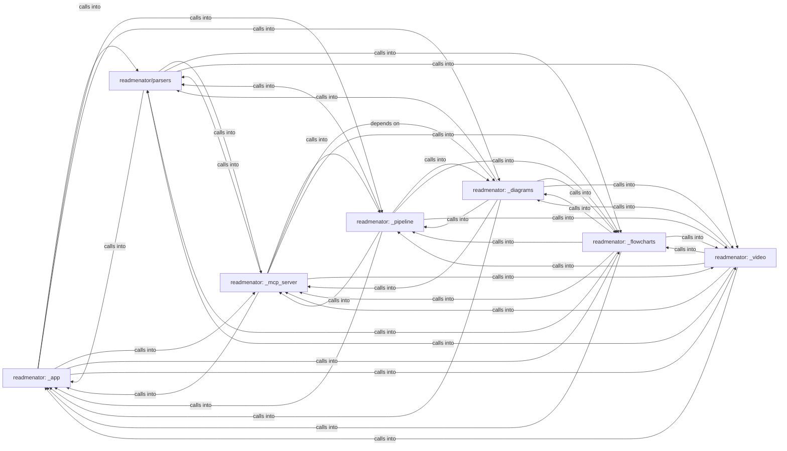

## Details

Static architecture map of 167 files (js, py, sh) in 7 components: readmenator: _app, readmenator/parsers, readmenator: _pipeline, readmenator: _diagrams, readmenator: _mcp_server, readmenator: _flowcharts, readmenator: _video. Structure is extracted statically without LLM calls; component prose may be enriched locally.

### readmenator: _app (1)

readmenator: _app groups 46 files (py) around Config, readmenatorApplication, __init__, ingest_receipts, _scan. Corpus analytics aggregations for the readmenator knowledge graph.

**Related Classes/Methods**:

- <a href="../readmenator/_config.py#L15-L1494">readmenator/_config.py::Config</a>
- <a href="../readmenator/_app.py">readmenator/_app.py::readmenatorApplication</a>
- <a href="../readmenator/_app.py#L57-L65">readmenator/_app.py::__init__</a>
- <a href="../readmenator/_app.py#L66-L94">readmenator/_app.py::ingest_receipts</a>
- <a href="../readmenator/_app.py#L95-L102">readmenator/_app.py::_scan</a>
- <a href="../readmenator/_app.py#L103-L112">readmenator/_app.py::_scan_with_content</a>
- <a href="../readmenator/_app.py#L113-L131">readmenator/_app.py::_resolve_imports</a>
- <a href="../readmenator/_app.py#L132-L162">readmenator/_app.py::_apply_project_config</a>

### readmenator/parsers (2)

readmenator/parsers groups 30 files (py) around Symbol, Node, Edge, SecurityFinding, pluralize_symbol_kind. Code Property Graph (CPG) generator emitting JSON-LD for AI agents.

**Related Classes/Methods**:

- <a href="../readmenator/_models.py#L18-L36">readmenator/_models.py::Symbol</a>
- <a href="../readmenator/_models.py#L37-L57">readmenator/_models.py::Node</a>
- <a href="../readmenator/_models.py#L58-L76">readmenator/_models.py::Edge</a>
- <a href="../readmenator/_models.py#L77-L100">readmenator/_models.py::SecurityFinding</a>
- <a href="../readmenator/_models.py#L101-L110">readmenator/_models.py::pluralize_symbol_kind</a>
- <a href="../readmenator/_models.py#L111-L129">readmenator/_models.py::CommunityResult</a>
- <a href="../readmenator/_models.py#L130-L150">readmenator/_models.py::AnalysisResult</a>
- <a href="../readmenator/_models.py#L151-L171">readmenator/_models.py::TaintPath</a>

### readmenator: _pipeline (3)

readmenator: _pipeline groups 25 files (py) around _read_small, _git_dir, _packed_ref, read_git_head, is_garbage_doc. Agent-friendly output generator for ReadMenator.

**Related Classes/Methods**:

- <a href="../readmenator/_gitmeta.py#L19-L37">readmenator/_gitmeta.py::_read_small</a>
- <a href="../readmenator/_gitmeta.py#L38-L58">readmenator/_gitmeta.py::_git_dir</a>
- <a href="../readmenator/_gitmeta.py#L59-L83">readmenator/_gitmeta.py::_packed_ref</a>
- <a href="../readmenator/_gitmeta.py#L84-L102">readmenator/_gitmeta.py::read_git_head</a>
- <a href="../readmenator/_purpose.py#L26-L42">readmenator/_purpose.py::is_garbage_doc</a>
- <a href="../readmenator/_purpose.py#L43-L65">readmenator/_purpose.py::clean_purpose</a>
- <a href="../readmenator/_purpose.py#L66-L77">readmenator/_purpose.py::escape_cell</a>
- <a href="../readmenator/_purpose.py#L78-L97">readmenator/_purpose.py::truncate_words</a>

### readmenator: _diagrams (4)

readmenator: _diagrams groups 20 files (py) around _toml_str, _toml_value, template_text, config_path, ensure_project_config. Injects KNOWLEDGE_BASE.md references into AI agent instruction files.

**Related Classes/Methods**:

- <a href="../readmenator/_project_config.py#L142-L153">readmenator/_project_config.py::_toml_str</a>
- <a href="../readmenator/_project_config.py#L154-L164">readmenator/_project_config.py::_toml_value</a>
- <a href="../readmenator/_project_config.py#L165-L299">readmenator/_project_config.py::template_text</a>
- <a href="../readmenator/_project_config.py#L300-L313">readmenator/_project_config.py::config_path</a>
- <a href="../readmenator/_project_config.py#L314-L346">readmenator/_project_config.py::ensure_project_config</a>
- <a href="../readmenator/_project_config.py#L347-L380">readmenator/_project_config.py::_mini_toml_parse</a>
- <a href="../readmenator/_project_config.py#L381-L408">readmenator/_project_config.py::_strip_toml_comment</a>
- <a href="../readmenator/_project_config.py#L409-L463">readmenator/_project_config.py::_mini_toml_value</a>

### readmenator: _mcp_server (5)

readmenator: _mcp_server groups 15 files (py) around EdgeKind, __str__, Morphism, weight, Category. Launcher shim that runs the readmenator CLI from a source checkout.

**Related Classes/Methods**:

- <a href="../readmenator/_category.py#L24-L37">readmenator/_category.py::EdgeKind</a>
- <a href="../readmenator/_category.py#L38-L56">readmenator/_category.py::__str__</a>
- <a href="../readmenator/_category.py#L57-L72">readmenator/_category.py::Morphism</a>
- <a href="../readmenator/_category.py#L73-L77">readmenator/_category.py::weight</a>
- <a href="../readmenator/_category.py#L78-L85">readmenator/_category.py::Category</a>
- <a href="../readmenator/_category.py#L86-L91">readmenator/_category.py::__init__</a>
- <a href="../readmenator/_category.py#L92-L94">readmenator/_category.py::add_object</a>
- <a href="../readmenator/_category.py#L95-L102">readmenator/_category.py::add_morphism</a>

### readmenator: _flowcharts (6)

readmenator: _flowcharts groups 14 files (py) around _receiver_text, SymbolDef, CallSite, ResolvedCall, _kind_to_node_type. Deterministic API reference model: extraction, cross-references, coverage.

**Related Classes/Methods**:

- <a href="../readmenator/_symindex.py#L42-L55">readmenator/_symindex.py::_receiver_text</a>
- <a href="../readmenator/_symindex.py#L56-L80">readmenator/_symindex.py::SymbolDef</a>
- <a href="../readmenator/_symindex.py#L81-L101">readmenator/_symindex.py::CallSite</a>
- <a href="../readmenator/_symindex.py#L102-L121">readmenator/_symindex.py::ResolvedCall</a>
- <a href="../readmenator/_symindex.py#L122-L131">readmenator/_symindex.py::_kind_to_node_type</a>
- <a href="../readmenator/_symindex.py#L132-L134">readmenator/_symindex.py::SymbolIndex</a>
- <a href="../readmenator/_symindex.py#L135-L143">readmenator/_symindex.py::__init__</a>
- <a href="../readmenator/_symindex.py#L144-L183">readmenator/_symindex.py::build</a>

### readmenator: _video (7)

readmenator: _video groups 13 files (py) around ImportResolver, __init__, _build_stem_index, _build_dir_index, resolve. Git history replay: read release snapshots from a repository.

**Related Classes/Methods**:

- <a href="../readmenator/_resolver.py#L18-L60">readmenator/_resolver.py::ImportResolver</a>
- <a href="../readmenator/_resolver.py#L61-L82">readmenator/_resolver.py::__init__</a>
- <a href="../readmenator/_resolver.py#L83-L92">readmenator/_resolver.py::_build_stem_index</a>
- <a href="../readmenator/_resolver.py#L93-L109">readmenator/_resolver.py::_build_dir_index</a>
- <a href="../readmenator/_resolver.py#L110-L162">readmenator/_resolver.py::resolve</a>
- <a href="../readmenator/_resolver.py#L163-L178">readmenator/_resolver.py::resolve_all</a>
- <a href="../readmenator/_resolver.py#L179-L198">readmenator/_resolver.py::_resolve_include_dirs</a>
- <a href="../readmenator/_resolver.py#L199-L216">readmenator/_resolver.py::_resolve_relative</a>
