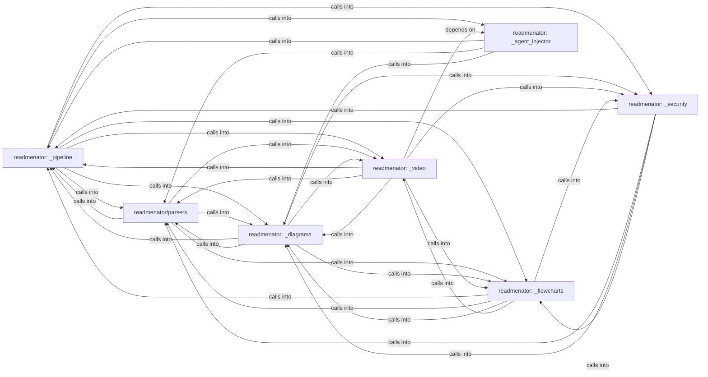

## Details

Static architecture map of 151 files (js, py) in 7 components: readmenator: _pipeline, readmenator/parsers, readmenator: _diagrams, readmenator: _video, readmenator: _flowcharts, readmenator: _security, readmenator: _agent_injector. Structure is extracted statically without LLM calls; component prose may be enriched locally.

### readmenator: _pipeline (1)

readmenator: _pipeline groups 44 files (py) around Config, escape_json_for_script, should_compress, compress_text, payload_script. Corpus analytics aggregations for the readmenator knowledge graph.

**Related Classes/Methods**:

- <a href="../readmenator/_config.py#L15-L1200">readmenator/_config.py::Config</a>
- <a href="../readmenator/_htmlpack.py#L49-L63">readmenator/_htmlpack.py::escape_json_for_script</a>
- <a href="../readmenator/_htmlpack.py#L64-L76">readmenator/_htmlpack.py::should_compress</a>
- <a href="../readmenator/_htmlpack.py#L77-L91">readmenator/_htmlpack.py::compress_text</a>
- <a href="../readmenator/_htmlpack.py#L92-L118">readmenator/_htmlpack.py::payload_script</a>
- <a href="../readmenator/_htmlpack.py#L119-L139">readmenator/_htmlpack.py::read_payload_script</a>
- <a href="../readmenator/_graphlayout.py#L40-L65">readmenator/_graphlayout.py::ForceAtlas2Settings</a>
- <a href="../readmenator/_graphlayout.py#L66-L72">readmenator/_graphlayout.py::_initial_positions</a>

### readmenator/parsers (2)

readmenator/parsers groups 37 files (py) around Symbol, Node, Edge, SecurityFinding, pluralize_symbol_kind. Dead code detection for the readmenator knowledge graph.

**Related Classes/Methods**:

- <a href="../readmenator/_models.py#L18-L36">readmenator/_models.py::Symbol</a>
- <a href="../readmenator/_models.py#L37-L57">readmenator/_models.py::Node</a>
- <a href="../readmenator/_models.py#L58-L76">readmenator/_models.py::Edge</a>
- <a href="../readmenator/_models.py#L77-L100">readmenator/_models.py::SecurityFinding</a>
- <a href="../readmenator/_models.py#L101-L110">readmenator/_models.py::pluralize_symbol_kind</a>
- <a href="../readmenator/_models.py#L111-L129">readmenator/_models.py::CommunityResult</a>
- <a href="../readmenator/_models.py#L130-L150">readmenator/_models.py::AnalysisResult</a>
- <a href="../readmenator/_models.py#L151-L171">readmenator/_models.py::TaintPath</a>

### readmenator: _diagrams (3)

readmenator: _diagrams groups 30 files (py) around readmenatorApplication, __init__, _scan, _scan_with_content, _resolve_imports. Launcher shim that runs the readmenator CLI from a source checkout.

**Related Classes/Methods**:

- <a href="../readmenator/_app.py">readmenator/_app.py::readmenatorApplication</a>
- <a href="../readmenator/_app.py#L55-L63">readmenator/_app.py::__init__</a>
- <a href="../readmenator/_app.py#L64-L71">readmenator/_app.py::_scan</a>
- <a href="../readmenator/_app.py#L72-L81">readmenator/_app.py::_scan_with_content</a>
- <a href="../readmenator/_app.py#L82-L100">readmenator/_app.py::_resolve_imports</a>
- <a href="../readmenator/_app.py#L101-L252">readmenator/_app.py::run</a>
- <a href="../readmenator/_app.py#L253-L279">readmenator/_app.py::check_freshness</a>
- <a href="../readmenator/_app.py#L280-L297">readmenator/_app.py::_maybe_refresh_pages</a>

### readmenator: _video (4)

readmenator: _video groups 14 files (py) around EdgeKind, __str__, Morphism, weight, Category. ReadMenator -- Zero-token polyglot codebase knowledge graph generator.

**Related Classes/Methods**:

- <a href="../readmenator/_category.py#L24-L37">readmenator/_category.py::EdgeKind</a>
- <a href="../readmenator/_category.py#L38-L56">readmenator/_category.py::__str__</a>
- <a href="../readmenator/_category.py#L57-L72">readmenator/_category.py::Morphism</a>
- <a href="../readmenator/_category.py#L73-L77">readmenator/_category.py::weight</a>
- <a href="../readmenator/_category.py#L78-L85">readmenator/_category.py::Category</a>
- <a href="../readmenator/_category.py#L86-L91">readmenator/_category.py::__init__</a>
- <a href="../readmenator/_category.py#L92-L94">readmenator/_category.py::add_object</a>
- <a href="../readmenator/_category.py#L95-L102">readmenator/_category.py::add_morphism</a>

### readmenator: _flowcharts (5)

readmenator: _flowcharts groups 12 files (py) around _receiver_text, SymbolDef, CallSite, ResolvedCall, _kind_to_node_type. Deterministic API reference model: extraction, cross-references, coverage.

**Related Classes/Methods**:

- <a href="../readmenator/_symindex.py#L42-L55">readmenator/_symindex.py::_receiver_text</a>
- <a href="../readmenator/_symindex.py#L56-L80">readmenator/_symindex.py::SymbolDef</a>
- <a href="../readmenator/_symindex.py#L81-L101">readmenator/_symindex.py::CallSite</a>
- <a href="../readmenator/_symindex.py#L102-L121">readmenator/_symindex.py::ResolvedCall</a>
- <a href="../readmenator/_symindex.py#L122-L131">readmenator/_symindex.py::_kind_to_node_type</a>
- <a href="../readmenator/_symindex.py#L132-L134">readmenator/_symindex.py::SymbolIndex</a>
- <a href="../readmenator/_symindex.py#L135-L143">readmenator/_symindex.py::__init__</a>
- <a href="../readmenator/_symindex.py#L144-L183">readmenator/_symindex.py::build</a>

### readmenator: _security (6)

readmenator: _security groups 6 files (py) around dominant_directory, _is_test_path, GraphAnalyzer, __init__, analyze. Graph analysis engine for the readmenator knowledge graph.

**Related Classes/Methods**:

- <a href="../readmenator/_analyzer.py#L22-L39">readmenator/_analyzer.py::dominant_directory</a>
- <a href="../readmenator/_analyzer.py#L40-L45">readmenator/_analyzer.py::_is_test_path</a>
- <a href="../readmenator/_analyzer.py#L46-L53">readmenator/_analyzer.py::GraphAnalyzer</a>
- <a href="../readmenator/_analyzer.py#L54-L61">readmenator/_analyzer.py::__init__</a>
- <a href="../readmenator/_analyzer.py#L62-L114">readmenator/_analyzer.py::analyze</a>
- <a href="../readmenator/_analyzer.py#L115-L128">readmenator/_analyzer.py::_build_adjacency</a>
- <a href="../readmenator/_analyzer.py#L129-L138">readmenator/_analyzer.py::_build_reverse_adjacency</a>
- <a href="../readmenator/_analyzer.py#L139-L160">readmenator/_analyzer.py::_compute_god_nodes</a>

### readmenator: _agent_injector (7)

readmenator: _agent_injector groups 5 files (py) around ReadmeInjector, __init__, inject, _extract_current_injection, _remove_old_injection. Injects KNOWLEDGE_BASE.md references into AI agent instruction files.

**Related Classes/Methods**:

- <a href="../readmenator/_readme_injector.py#L122-L132">readmenator/_readme_injector.py::ReadmeInjector</a>
- <a href="../readmenator/_readme_injector.py#L133-L191">readmenator/_readme_injector.py::__init__</a>
- <a href="../readmenator/_readme_injector.py#L192-L232">readmenator/_readme_injector.py::inject</a>
- <a href="../readmenator/_readme_injector.py#L233-L249">readmenator/_readme_injector.py::_extract_current_injection</a>
- <a href="../readmenator/_readme_injector.py#L250-L268">readmenator/_readme_injector.py::_remove_old_injection</a>
- <a href="../readmenator/_readme_injector.py#L269-L283">readmenator/_readme_injector.py::_strip_partial_anchor</a>
- <a href="../readmenator/_readme_injector.py#L284-L320">readmenator/_readme_injector.py::remove</a>
- <a href="../readmenator/_readme_injector.py#L321-L335">readmenator/_readme_injector.py::_find_readme</a>
