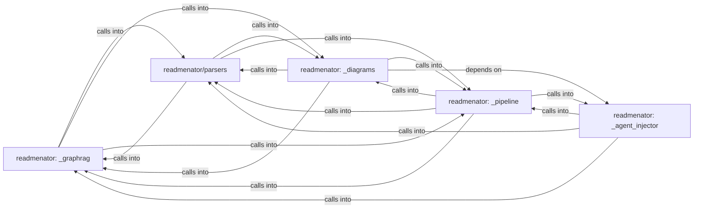

## Details

Static architecture map of 136 files (js, py) in 5 components: readmenator: _graphrag, readmenator/parsers, readmenator: _diagrams, readmenator: _pipeline, readmenator: _agent_injector. Structure is extracted statically without LLM calls; component prose may be enriched locally.

### readmenator: _graphrag (1)

readmenator: _graphrag groups 40 files (py) around Config, ImportResolver, __init__, _build_stem_index, _build_dir_index. Agent-friendly output generator for ReadMenator.

**Related Classes/Methods**:

- <a href="../readmenator/_config.py#L15-L1038">readmenator/_config.py::Config</a>
- <a href="../readmenator/_resolver.py#L18-L60">readmenator/_resolver.py::ImportResolver</a>
- <a href="../readmenator/_resolver.py#L61-L82">readmenator/_resolver.py::__init__</a>
- <a href="../readmenator/_resolver.py#L83-L92">readmenator/_resolver.py::_build_stem_index</a>
- <a href="../readmenator/_resolver.py#L93-L109">readmenator/_resolver.py::_build_dir_index</a>
- <a href="../readmenator/_resolver.py#L110-L162">readmenator/_resolver.py::resolve</a>
- <a href="../readmenator/_resolver.py#L163-L178">readmenator/_resolver.py::resolve_all</a>
- <a href="../readmenator/_resolver.py#L179-L198">readmenator/_resolver.py::_resolve_include_dirs</a>

### readmenator/parsers (2)

readmenator/parsers groups 32 files (py) around Symbol, Node, Edge, SecurityFinding, pluralize_symbol_kind. Hotspot, dependency cycle, and change impact analysis.

**Related Classes/Methods**:

- <a href="../readmenator/_models.py#L18-L36">readmenator/_models.py::Symbol</a>
- <a href="../readmenator/_models.py#L37-L57">readmenator/_models.py::Node</a>
- <a href="../readmenator/_models.py#L58-L76">readmenator/_models.py::Edge</a>
- <a href="../readmenator/_models.py#L77-L100">readmenator/_models.py::SecurityFinding</a>
- <a href="../readmenator/_models.py#L101-L110">readmenator/_models.py::pluralize_symbol_kind</a>
- <a href="../readmenator/_models.py#L111-L129">readmenator/_models.py::CommunityResult</a>
- <a href="../readmenator/_models.py#L130-L150">readmenator/_models.py::AnalysisResult</a>
- <a href="../readmenator/_models.py#L151-L171">readmenator/_models.py::TaintPath</a>

### readmenator: _diagrams (3)

readmenator: _diagrams groups 31 files (py) around EdgeKind, __str__, Morphism, weight, Category. Launcher shim that runs the readmenator CLI from a source checkout.

**Related Classes/Methods**:

- <a href="../readmenator/_category.py#L24-L37">readmenator/_category.py::EdgeKind</a>
- <a href="../readmenator/_category.py#L38-L56">readmenator/_category.py::__str__</a>
- <a href="../readmenator/_category.py#L57-L72">readmenator/_category.py::Morphism</a>
- <a href="../readmenator/_category.py#L73-L77">readmenator/_category.py::weight</a>
- <a href="../readmenator/_category.py#L78-L85">readmenator/_category.py::Category</a>
- <a href="../readmenator/_category.py#L86-L91">readmenator/_category.py::__init__</a>
- <a href="../readmenator/_category.py#L92-L94">readmenator/_category.py::add_object</a>
- <a href="../readmenator/_category.py#L95-L102">readmenator/_category.py::add_morphism</a>

### readmenator: _pipeline (4)

readmenator: _pipeline groups 25 files (py) around ForceAtlas2Settings, _initial_positions, forceatlas2_frames, _snapshot_steps, _fa2_numpy. Corpus analytics aggregations for the readmenator knowledge graph.

**Related Classes/Methods**:

- <a href="../readmenator/_graphlayout.py#L37-L62">readmenator/_graphlayout.py::ForceAtlas2Settings</a>
- <a href="../readmenator/_graphlayout.py#L63-L69">readmenator/_graphlayout.py::_initial_positions</a>
- <a href="../readmenator/_graphlayout.py#L70-L109">readmenator/_graphlayout.py::forceatlas2_frames</a>
- <a href="../readmenator/_graphlayout.py#L110-L115">readmenator/_graphlayout.py::_snapshot_steps</a>
- <a href="../readmenator/_graphlayout.py#L116-L162">readmenator/_graphlayout.py::_fa2_numpy</a>
- <a href="../readmenator/_graphlayout.py#L163-L217">readmenator/_graphlayout.py::_fa2_python</a>
- <a href="../readmenator/_graphlayout.py#L218-L262">readmenator/_graphlayout.py::fit_frames</a>
- <a href="../readmenator/_graphlayout.py#L263-L277">readmenator/_graphlayout.py::interpolate_frames</a>

### readmenator: _agent_injector (5)

readmenator: _agent_injector groups 5 files (py) around ReadmeInjector, __init__, inject, _extract_current_injection, _remove_old_injection. Injects KNOWLEDGE_BASE.md references into AI agent instruction files.

**Related Classes/Methods**:

- <a href="../readmenator/_readme_injector.py#L70-L77">readmenator/_readme_injector.py::ReadmeInjector</a>
- <a href="../readmenator/_readme_injector.py#L78-L87">readmenator/_readme_injector.py::__init__</a>
- <a href="../readmenator/_readme_injector.py#L88-L116">readmenator/_readme_injector.py::inject</a>
- <a href="../readmenator/_readme_injector.py#L117-L125">readmenator/_readme_injector.py::_extract_current_injection</a>
- <a href="../readmenator/_readme_injector.py#L126-L135">readmenator/_readme_injector.py::_remove_old_injection</a>
- <a href="../readmenator/_readme_injector.py#L136-L164">readmenator/_readme_injector.py::remove</a>
- <a href="../readmenator/_readme_injector.py#L165-L171">readmenator/_readme_injector.py::_find_readme</a>
- <a href="../readmenator/_readme_injector.py#L172-L182">readmenator/_readme_injector.py::_build_injection</a>
