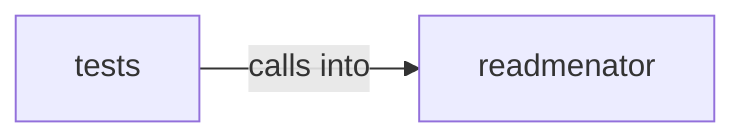

# readmenator: _agent_output

readmenator: _agent_output groups 19 files (py) around ImportResolver, __init__, _build_stem_index, _build_dir_index, resolve. Agent-friendly output generator for ReadMenator.

## readmenator (3.1)

readmenator groups 11 files (py) around ImportResolver, __init__, _build_stem_index, _build_dir_index, resolve. Agent-friendly output generator for ReadMenator.

## tests (3.2)

tests groups 8 files (py) around _node, _edge, _big_project, TestAgentOutputBudget, test_agent_output_pages_respect_line_cap_on_large_projects. Contract tests for agent-facing output quality: budgets, purposes, freshness, noise.

**Files**:

- readmenator/_agent_output.py
- readmenator/_analyzer.py
- readmenator/_cache.py
- readmenator/_folder_readme.py
- readmenator/_gh_wiki.py
- readmenator/_gitmeta.py
- readmenator/_memory.py
- readmenator/_purpose.py
- readmenator/_resolver.py
- readmenator/_security.py
- readmenator/_wiki.py
- tests/test_agent_friendliness.py
- tests/test_analyzer.py
- tests/test_cache.py
- tests/test_folder_readme.py
- tests/test_gh_wiki.py
- tests/test_resolver.py
- tests/test_security.py
- tests/test_wiki.py
