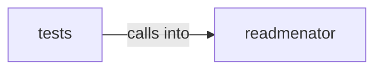

# readmenator: _apidocs

readmenator: _apidocs groups 14 files (py) around ApiParam, to_dict, ApiEntity, is_documented, to_dict. Deterministic API reference model: extraction, cross-references, coverage.

## readmenator (5.1)

readmenator groups 9 files (py) around ApiParam, to_dict, ApiEntity, is_documented, to_dict. Deterministic API reference model: extraction, cross-references, coverage.

## tests (5.2)

tests groups 5 files (py) around _project, TestDocstringParser, test_docstrings_google_sections, test_docstrings_numpy_sections, test_docstrings_rest_fields_and_directives. Contract tests for the docstring parser and the deterministic API reference.

**Files**:

- readmenator/_apidocs.py
- readmenator/_apidocs_page.py
- readmenator/_apidocs_render.py
- readmenator/_cpg.py
- readmenator/_docstrings.py
- readmenator/_documentation.py
- readmenator/_flowcharts.py
- readmenator/_pytypes.py
- readmenator/_uml.py
- tests/test_apidocs.py
- tests/test_cpg.py
- tests/test_documentation.py
- tests/test_flowcharts.py
- tests/test_uml.py
