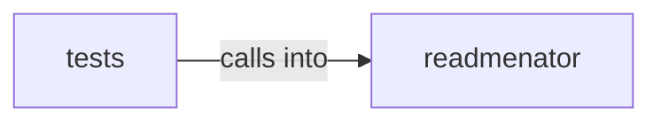

# readmenator: _app

readmenator: _app groups 46 files (py) around Config, readmenatorApplication, __init__, ingest_receipts, _scan. Corpus analytics aggregations for the readmenator knowledge graph.

## readmenator (1.1)

readmenator groups 24 files (py) around Config, readmenatorApplication, __init__, ingest_receipts, _scan. Corpus analytics aggregations for the readmenator knowledge graph.

## tests (1.2)

tests groups 22 files (py) around _node, _fixture, TestComponentSchemaContract, setUp, test_top_level_keys_match_schema. Contract tests for the component diagram exporter.

**Files**:

- readmenator/_analytics.py
- readmenator/_app.py
- readmenator/_concepts.py
- readmenator/_config.py
- readmenator/_cursorrules_generator.py
- readmenator/_dataflow.py
- readmenator/_dead_code.py
- readmenator/_docbranch.py
- readmenator/_embed.py
- readmenator/_exclusions.py
- readmenator/_explorer.py
- readmenator/_exporter.py
- readmenator/_hotspots.py
- readmenator/_hypotheses.py
- readmenator/_layer_rules.py
- readmenator/_linter.py
- readmenator/_provenance.py
- readmenator/_receipts.py
- readmenator/_refactorizer.py
- readmenator/_rule_gen.py
- readmenator/_scantext.py
- readmenator/_uncertainty.py
- readmenator/_watcher.py
- readmenator/_yaralite.py
- tests/test_components.py
- tests/test_concepts.py
- tests/test_config.py
- tests/test_cursorrules.py
- tests/test_dataflow.py
- tests/test_dead_code.py
- tests/test_diagrams.py
- tests/test_docbranch.py
- tests/test_exporter.py
- tests/test_gh_wiki.py
- tests/test_hotspots.py
- tests/test_htmlpack.py
- tests/test_integration.py
- tests/test_interactive_graph.py
- tests/test_layer_rules.py
- tests/test_linter.py
- tests/test_mcp_server.py
- tests/test_parsers.py
- tests/test_parsers_new.py
- tests/test_receipts.py
- tests/test_refactorizer.py
- tests/test_rule_gen.py
