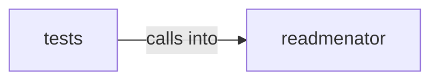

# readmenator: _diagrams

readmenator: _diagrams groups 15 files (py) around _toml_str, _toml_value, template_text, config_path, ensure_project_config. Edge bundle explorer: circle and sphere hierarchical edge bundling pages.

## readmenator (6.1)

readmenator groups 10 files (py) around _toml_str, _toml_value, template_text, config_path, ensure_project_config. Edge bundle explorer: circle and sphere hierarchical edge bundling pages.

## tests (6.2)

tests groups 5 files (py) around _node, _fixture, _script_json, TestBundleGraphPayloadContract, setUp. Contract tests for the edge bundle explorer (circle and sphere views).

**Files**:

- readmenator/_bundlegraph.py
- readmenator/_bundlegraph_page.py
- readmenator/_diagrams.py
- readmenator/_forcegraph.py
- readmenator/_forcegraph_page.py
- readmenator/_graphlayout.py
- readmenator/_htmlpack.py
- readmenator/_project_config.py
- readmenator/_sourceview.py
- readmenator/_viewer_ui.py
- tests/test_bundlegraph.py
- tests/test_graphlayout.py
- tests/test_layout_quality.py
- tests/test_project_config.py
- tests/test_sourceview.py
