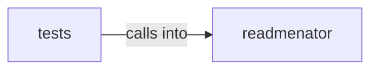

# readmenator: _diagrams

readmenator: _diagrams groups 20 files (py) around _toml_str, _toml_value, template_text, config_path, ensure_project_config. Injects KNOWLEDGE_BASE.md references into AI agent instruction files.

## readmenator (4.1)

readmenator groups 12 files (py) around _toml_str, _toml_value, template_text, config_path, ensure_project_config. Injects KNOWLEDGE_BASE.md references into AI agent instruction files.

## tests (4.2)

tests groups 8 files (py) around TestAgentInjectorInjectBehavior, setUp, tearDown, test_inject_into_agents_md_adds_kb_link, test_inject_into_claude_md_adds_kb_link. Contract tests for AI agent file injection.

**Files**:

- readmenator/_agent_injector.py
- readmenator/_bundlegraph.py
- readmenator/_bundlegraph_page.py
- readmenator/_diagrams.py
- readmenator/_forcegraph.py
- readmenator/_forcegraph_page.py
- readmenator/_graphlayout.py
- readmenator/_htmlpack.py
- readmenator/_project_config.py
- readmenator/_readme_injector.py
- readmenator/_sourceview.py
- readmenator/_viewer_ui.py
- tests/test_agent_injector.py
- tests/test_agent_output.py
- tests/test_bundlegraph.py
- tests/test_graphlayout.py
- tests/test_layout_quality.py
- tests/test_project_config.py
- tests/test_readme_injector.py
- tests/test_sourceview.py
