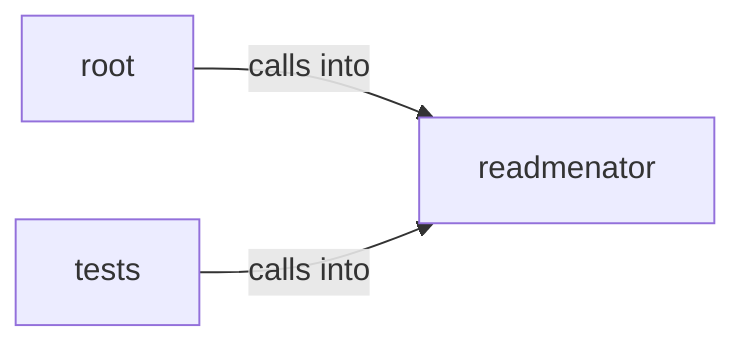

# readmenator: _diagrams

readmenator: _diagrams groups 30 files (py) around readmenatorApplication, __init__, _scan, _scan_with_content, _resolve_imports. Launcher shim that runs the readmenator CLI from a source checkout.

## readmenator (3.1)

readmenator groups 18 files (py) around readmenatorApplication, __init__, _scan, _scan_with_content, _resolve_imports. Command line entry point: argument parsing and subcommand dispatch.

## root (3.2)

root groups 1 files (py). Launcher shim that runs the readmenator CLI from a source checkout.

## tests (3.3)

tests groups 11 files (py) around _node, _edge, _big_project, TestAgentOutputBudget, test_agent_output_pages_respect_line_cap_on_large_projects. Contract tests for agent-facing output quality: budgets, purposes, freshness, noise.

**Files**:

- readmenator.py
- readmenator/__main__.py
- readmenator/_agent_output.py
- readmenator/_app.py
- readmenator/_cache.py
- readmenator/_components.py
- readmenator/_cursorrules_generator.py
- readmenator/_diagrams.py
- readmenator/_folder_readme.py
- readmenator/_gh_wiki.py
- readmenator/_gitmeta.py
- readmenator/_layers.py
- readmenator/_linter.py
- readmenator/_mcp_server.py
- readmenator/_memory.py
- readmenator/_purpose.py
- readmenator/_resolver.py
- readmenator/_watcher.py
- readmenator/_yaralite.py
- tests/test_agent_friendliness.py
- tests/test_cache.py
- tests/test_components.py
- tests/test_cursorrules.py
- tests/test_diagrams.py
- tests/test_folder_readme.py
- tests/test_gh_wiki.py
- tests/test_integration.py
- tests/test_linter.py
- tests/test_mcp_server.py
- tests/test_resolver.py
