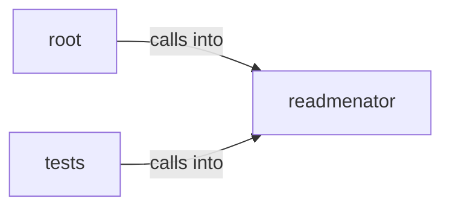

# readmenator: _diagrams

readmenator: _diagrams groups 29 files (py) around EdgeKind, __str__, Morphism, weight, Category. Launcher shim that runs the readmenator CLI from a source checkout.

## readmenator (3.1)

readmenator groups 18 files (py) around EdgeKind, __str__, Morphism, weight, Category. ReadMenator -- Zero-token polyglot codebase knowledge graph generator.

## root (3.2)

root groups 1 files (py). Launcher shim that runs the readmenator CLI from a source checkout.

## tests (3.3)

tests groups 10 files (py) around _node, _fixture, TestComponentSchemaContract, setUp, test_top_level_keys_match_schema. Contract tests for the component diagram exporter.

**Files**:

- readmenator.py
- readmenator/__init__.py
- readmenator/__main__.py
- readmenator/_app.py
- readmenator/_category.py
- readmenator/_components.py
- readmenator/_cursorrules_generator.py
- readmenator/_diagrams.py
- readmenator/_explain.py
- readmenator/_layers.py
- readmenator/_linter.py
- readmenator/_mcp_server.py
- readmenator/_ollama.py
- readmenator/_projections.py
- readmenator/_query.py
- readmenator/_rank.py
- readmenator/_video.py
- readmenator/_watcher.py
- readmenator/_yaralite.py
- tests/test_components.py
- tests/test_cursorrules.py
- tests/test_diagrams.py
- tests/test_integration.py
- tests/test_linter.py
- tests/test_mcp_server.py
- tests/test_ollama.py
- tests/test_query.py
- tests/test_ranking.py
- tests/test_video.py
