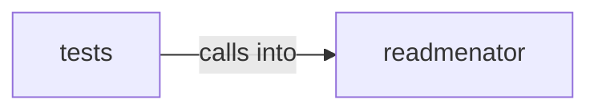

# readmenator: _graphlayout

readmenator: _graphlayout groups 13 files (py) around escape_json_for_script, should_compress, compress_text, payload_script, read_payload_script. Edge bundle explorer: circle and sphere hierarchical edge bundling pages.

## readmenator (5.1)

readmenator groups 8 files (py) around escape_json_for_script, should_compress, compress_text, payload_script, read_payload_script. Edge bundle explorer: circle and sphere hierarchical edge bundling pages.

## tests (5.2)

tests groups 5 files (py) around _node, _fixture, _script_json, TestBundleGraphPayloadContract, setUp. Contract tests for the edge bundle explorer (circle and sphere views).

**Files**:

- readmenator/_bundlegraph.py
- readmenator/_bundlegraph_page.py
- readmenator/_explorer.py
- readmenator/_forcegraph.py
- readmenator/_forcegraph_page.py
- readmenator/_graphlayout.py
- readmenator/_htmlpack.py
- readmenator/_sourceview.py
- tests/test_bundlegraph.py
- tests/test_graphlayout.py
- tests/test_htmlpack.py
- tests/test_layout_quality.py
- tests/test_sourceview.py
