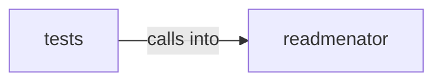

# readmenator: _graphrag

readmenator: _graphrag groups 18 files (py) around EdgeKind, __str__, Morphism, weight, Category. ReadMenator -- Zero-token polyglot codebase knowledge graph generator.

## readmenator (4.1)

readmenator groups 11 files (py) around EdgeKind, __str__, Morphism, weight, Category. ReadMenator -- Zero-token polyglot codebase knowledge graph generator.

## tests (4.2)

tests groups 7 files (py) around _node, _fixture, TestComponentSchemaContract, setUp, test_top_level_keys_match_schema. Contract tests for the component diagram exporter.

**Files**:

- readmenator/__init__.py
- readmenator/_category.py
- readmenator/_components.py
- readmenator/_concepts.py
- readmenator/_explain.py
- readmenator/_graphrag.py
- readmenator/_ollama.py
- readmenator/_projections.py
- readmenator/_query.py
- readmenator/_rank.py
- readmenator/_skill_installer.py
- tests/test_components.py
- tests/test_concepts.py
- tests/test_graphrag.py
- tests/test_memory.py
- tests/test_ollama.py
- tests/test_query.py
- tests/test_ranking.py
