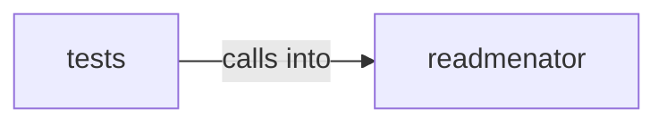

# readmenator: _graphrag

readmenator: _graphrag groups 40 files (py) around Config, ImportResolver, __init__, _build_stem_index, _build_dir_index. Agent-friendly output generator for ReadMenator.

## readmenator (1.1)

readmenator groups 20 files (py) around Config, ImportResolver, __init__, _build_stem_index, _build_dir_index. Agent-friendly output generator for ReadMenator.

## tests (1.2)

tests groups 20 files (py) around _node, _edge, _big_project, TestAgentOutputBudget, test_agent_output_pages_respect_line_cap_on_large_projects. Contract tests for agent-facing output quality: budgets, purposes, freshness, noise.

**Files**:

- readmenator/_agent_output.py
- readmenator/_analyzer.py
- readmenator/_cache.py
- readmenator/_concepts.py
- readmenator/_config.py
- readmenator/_dataflow.py
- readmenator/_dead_code.py
- readmenator/_gh_wiki.py
- readmenator/_gitmeta.py
- readmenator/_graphrag.py
- readmenator/_layer_rules.py
- readmenator/_memory.py
- readmenator/_purpose.py
- readmenator/_resolver.py
- readmenator/_rule_gen.py
- readmenator/_scanner.py
- readmenator/_security.py
- readmenator/_skill_installer.py
- readmenator/_taint.py
- readmenator/_wiki.py
- tests/test_agent_friendliness.py
- tests/test_analyzer.py
- tests/test_cache.py
- tests/test_concepts.py
- tests/test_config.py
- tests/test_dataflow.py
- tests/test_dead_code.py
- tests/test_gh_wiki.py
- tests/test_graphrag.py
- tests/test_layer_rules.py
- tests/test_memory.py
- tests/test_parsers.py
- tests/test_parsers_new.py
- tests/test_resolver.py
- tests/test_rule_gen.py
- tests/test_scanner.py
- tests/test_security.py
- tests/test_taint.py
- tests/test_taint_bdd.py
- tests/test_wiki.py
