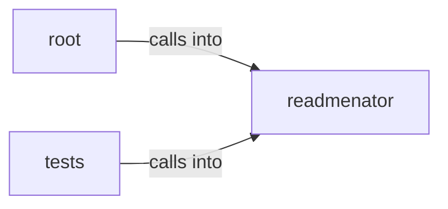

# readmenator: _mcp_server

readmenator: _mcp_server groups 15 files (py) around EdgeKind, __str__, Morphism, weight, Category. Launcher shim that runs the readmenator CLI from a source checkout.

## readmenator (5.1)

readmenator groups 10 files (py) around EdgeKind, __str__, Morphism, weight, Category. ReadMenator -- Zero-token polyglot codebase knowledge graph generator.

## root (5.2)

root groups 1 files (py). Launcher shim that runs the readmenator CLI from a source checkout.

## tests (5.3)

tests groups 4 files (py) around _fixture, TestGraphRagIndexContract, setUp, test_graphrag_entities_cover_files_symbols_externals, test_graphrag_relationships_are_typed. Contract tests for the zero-token GraphRAG index and retrieval.

**Files**:

- readmenator.py
- readmenator/__init__.py
- readmenator/__main__.py
- readmenator/_category.py
- readmenator/_explain.py
- readmenator/_graphrag.py
- readmenator/_mcp_server.py
- readmenator/_projections.py
- readmenator/_query.py
- readmenator/_rank.py
- readmenator/_uml.py
- tests/test_graphrag.py
- tests/test_query.py
- tests/test_ranking.py
- tests/test_uml.py
