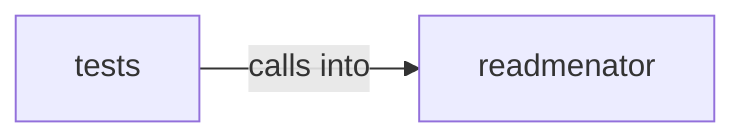

# readmenator: _pipeline

readmenator: _pipeline groups 17 files (py) around ReadmeInjector, __init__, inject, _extract_current_injection, _remove_old_injection. Injects KNOWLEDGE_BASE.md references into AI agent instruction files.

## readmenator (5.1)

readmenator groups 13 files (py) around ReadmeInjector, __init__, inject, _extract_current_injection, _remove_old_injection. Injects KNOWLEDGE_BASE.md references into AI agent instruction files.

## tests (5.2)

tests groups 4 files (py) around TestAgentInjectorInjectBehavior, setUp, tearDown, test_inject_into_agents_md_adds_kb_link, test_inject_into_claude_md_adds_kb_link. Contract tests for AI agent file injection.

**Files**:

- readmenator/_agent_injector.py
- readmenator/_analytics.py
- readmenator/_cpg.py
- readmenator/_documentation.py
- readmenator/_embed.py
- readmenator/_exclusions.py
- readmenator/_explorer.py
- readmenator/_exporter.py
- readmenator/_pipeline.py
- readmenator/_provenance.py
- readmenator/_readme_injector.py
- readmenator/_scantext.py
- readmenator/_uml.py
- tests/test_agent_injector.py
- tests/test_agent_output.py
- tests/test_interactive_graph.py
- tests/test_readme_injector.py
