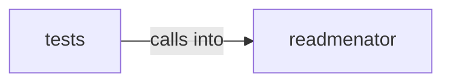

# readmenator: _pipeline

readmenator: _pipeline groups 44 files (py) around Config, escape_json_for_script, should_compress, compress_text, payload_script. Corpus analytics aggregations for the readmenator knowledge graph.

## readmenator (1.1)

readmenator groups 25 files (py) around Config, escape_json_for_script, should_compress, compress_text, payload_script. Corpus analytics aggregations for the readmenator knowledge graph.

## tests (1.2)

tests groups 19 files (py) around _node, _fixture, _script_json, TestBundleGraphPayloadContract, setUp. Contract tests for the edge bundle explorer (circle and sphere views).

**Files**:

- readmenator/_analytics.py
- readmenator/_bundlegraph.py
- readmenator/_bundlegraph_page.py
- readmenator/_config.py
- readmenator/_cpg.py
- readmenator/_dataflow.py
- readmenator/_documentation.py
- readmenator/_embed.py
- readmenator/_exclusions.py
- readmenator/_explorer.py
- readmenator/_exporter.py
- readmenator/_forcegraph.py
- readmenator/_forcegraph_page.py
- readmenator/_graphlayout.py
- readmenator/_hotspots.py
- readmenator/_htmlpack.py
- readmenator/_layer_rules.py
- readmenator/_ollama.py
- readmenator/_pipeline.py
- readmenator/_provenance.py
- readmenator/_rule_gen.py
- readmenator/_scantext.py
- readmenator/_skill_installer.py
- readmenator/_sourceview.py
- readmenator/_uml.py
- tests/test_bundlegraph.py
- tests/test_config.py
- tests/test_cpg.py
- tests/test_dataflow.py
- tests/test_documentation.py
- tests/test_exporter.py
- tests/test_graphlayout.py
- tests/test_hotspots.py
- tests/test_htmlpack.py
- tests/test_interactive_graph.py
- tests/test_layer_rules.py
- tests/test_layout_quality.py
- tests/test_memory.py
- tests/test_ollama.py
- tests/test_parsers.py
- tests/test_parsers_new.py
- tests/test_rule_gen.py
- tests/test_sourceview.py
- tests/test_uml.py
