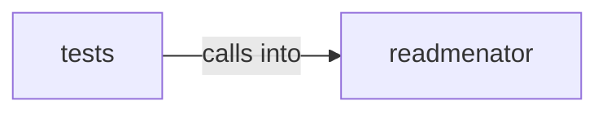

# readmenator: _security

readmenator: _security groups 6 files (py) around dominant_directory, _is_test_path, GraphAnalyzer, __init__, analyze. Graph analysis engine for the readmenator knowledge graph.

## readmenator (6.1)

readmenator groups 3 files (py) around dominant_directory, _is_test_path, GraphAnalyzer, __init__, analyze. Graph analysis engine for the readmenator knowledge graph.

## tests (6.2)

tests groups 3 files (py) around TestGraphAnalyzerContract, setUp, _make_node, _make_edge, test_analyze_empty_graph_returns_empty_result. Contract tests for the GraphAnalyzer.

**Files**:

- readmenator/_analyzer.py
- readmenator/_security.py
- readmenator/_wiki.py
- tests/test_analyzer.py
- tests/test_security.py
- tests/test_wiki.py
