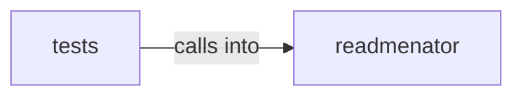

# readmenator: _video

readmenator: _video groups 13 files (py) around ImportResolver, __init__, _build_stem_index, _build_dir_index, resolve. Git history replay: read release snapshots from a repository.

## readmenator (7.1)

readmenator groups 6 files (py) around ImportResolver, __init__, _build_stem_index, _build_dir_index, resolve. Git history replay: read release snapshots from a repository.

## tests (7.2)

tests groups 7 files (py) around _git_available, _run_git, _write, TestGitHistoryReader, setUp. Contract tests for the git history reader used by the growth video act.

**Files**:

- readmenator/_githistory.py
- readmenator/_resolver.py
- readmenator/_scanner.py
- readmenator/_soundtrack.py
- readmenator/_taint.py
- readmenator/_video.py
- tests/test_githistory.py
- tests/test_resolver.py
- tests/test_scanner.py
- tests/test_soundtrack.py
- tests/test_taint.py
- tests/test_taint_bdd.py
- tests/test_video.py
