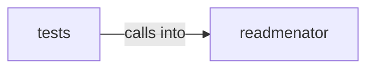

# readmenator: _video

readmenator: _video groups 14 files (py) around EdgeKind, __str__, Morphism, weight, Category. ReadMenator -- Zero-token polyglot codebase knowledge graph generator.

## readmenator (4.1)

readmenator groups 9 files (py) around EdgeKind, __str__, Morphism, weight, Category. ReadMenator -- Zero-token polyglot codebase knowledge graph generator.

## tests (4.2)

tests groups 5 files (py) around _node, TestConceptGraphContract, test_concept_nouns_map_to_file_sets, test_concept_verbs_come_from_structural_edges, test_concept_atomic_breakdown_splits_camelcase. test_concept_nouns_map_to_file_sets: Noun tokens become concepts mapping to file sets.

**Files**:

- readmenator/__init__.py
- readmenator/_category.py
- readmenator/_concepts.py
- readmenator/_explain.py
- readmenator/_graphrag.py
- readmenator/_projections.py
- readmenator/_query.py
- readmenator/_rank.py
- readmenator/_video.py
- tests/test_concepts.py
- tests/test_graphrag.py
- tests/test_query.py
- tests/test_ranking.py
- tests/test_video.py
