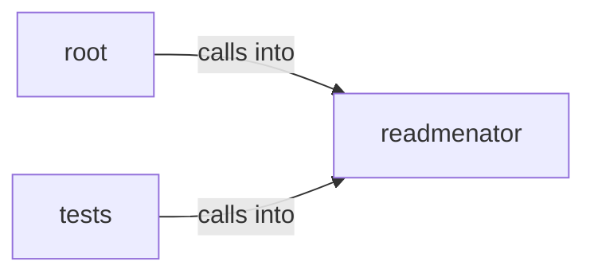

# readmenator: _video

readmenator: _video groups 35 files (py) around Config, readmenatorApplication, __init__, _scan, _scan_with_content. Launcher shim that runs the readmenator CLI from a source checkout.

## readmenator (1.1)

readmenator groups 15 files (py) around Config, readmenatorApplication, __init__, _scan, _scan_with_content. Command line entry point: argument parsing and subcommand dispatch.

## root (1.2)

root groups 1 files (py). Launcher shim that runs the readmenator CLI from a source checkout.

## tests (1.3)

tests groups 19 files (py) around TestConfigContract, test_config_is_immutable, test_config_defaults_are_sane, test_ignore_dirs_are_comprehensive, test_plural_map_covers_all_symbol_types. TestCodePropertyGraphContract: Contract: CodePropertyGraph generates valid JSON-LD CPG...

**Files**:

- readmenator.py
- readmenator/__main__.py
- readmenator/_app.py
- readmenator/_config.py
- readmenator/_cursorrules_generator.py
- readmenator/_dataflow.py
- readmenator/_dead_code.py
- readmenator/_hotspots.py
- readmenator/_layer_rules.py
- readmenator/_layers.py
- readmenator/_linter.py
- readmenator/_mcp_server.py
- readmenator/_refactorizer.py
- readmenator/_video.py
- readmenator/_watcher.py
- readmenator/_yaralite.py
- tests/test_config.py
- tests/test_cpg.py
- tests/test_cursorrules.py
- tests/test_dataflow.py
- tests/test_dead_code.py
- tests/test_diagrams.py
- tests/test_documentation.py
- tests/test_exporter.py
- tests/test_hotspots.py
- tests/test_htmlpack.py
- tests/test_integration.py
- tests/test_layer_rules.py
- tests/test_linter.py
- tests/test_mcp_server.py
- tests/test_parsers.py
- tests/test_parsers_new.py
- tests/test_refactorizer.py
- tests/test_uml.py
- tests/test_video.py
