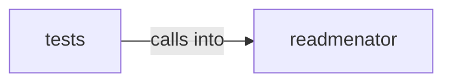

# readmenator/parsers

readmenator/parsers groups 37 files (py) around Symbol, Node, Edge, SecurityFinding, pluralize_symbol_kind. Architecture layer rule engine: forbidden and warning edges between layers.

## readmenator (1.1)

readmenator groups 28 files (py) around Symbol, Node, Edge, SecurityFinding, pluralize_symbol_kind. Architecture layer rule engine: forbidden and warning edges between layers.

## tests (1.2)

tests groups 9 files (py) around TestLayerRuleEngineContract, setUp, _make_node, test_empty_graph_returns_empty_violations, test_no_layers_returns_empty_violations. TestLayerRuleEngineContract: Contract: LayerRuleEngine detects architectural layer...

**Files**:

- readmenator/_layer_rules.py
- readmenator/_mermaid.py
- readmenator/_models.py
- readmenator/_rule_gen.py
- readmenator/_sarif.py
- readmenator/_scanner.py
- readmenator/_taint.py
- readmenator/parsers/__init__.py
- readmenator/parsers/_assembly.py
- readmenator/parsers/_base.py
- readmenator/parsers/_c.py
- readmenator/parsers/_csharp.py
- readmenator/parsers/_dart.py
- readmenator/parsers/_elixir.py
- readmenator/parsers/_gdscript.py
- readmenator/parsers/_go.py
- readmenator/parsers/_java.py
- readmenator/parsers/_javascript.py
- readmenator/parsers/_kotlin.py
- readmenator/parsers/_lua.py
- readmenator/parsers/_nim.py
- readmenator/parsers/_php.py
- readmenator/parsers/_python.py
- readmenator/parsers/_ruby.py
- readmenator/parsers/_rust.py
- readmenator/parsers/_scala.py
- readmenator/parsers/_shell.py
- readmenator/parsers/_swift.py
- tests/test_layer_rules.py
- tests/test_mermaid.py
- tests/test_models.py
- tests/test_parsers_property.py
- tests/test_rule_gen.py
- tests/test_sarif.py
- tests/test_scanner.py
- tests/test_taint.py
- tests/test_taint_bdd.py
