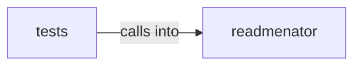

# readmenator/parsers

readmenator/parsers groups 30 files (py) around Symbol, Node, Edge, SecurityFinding, pluralize_symbol_kind. Code Property Graph (CPG) generator emitting JSON-LD for AI agents.

## readmenator (2.1)

readmenator groups 25 files (py) around Symbol, Node, Edge, SecurityFinding, pluralize_symbol_kind. Code Property Graph (CPG) generator emitting JSON-LD for AI agents.

## tests (2.2)

tests groups 5 files (py) around TestCodePropertyGraphContract, setUp, _make_node, _make_sym, test_generate_returns_valid_json. TestCodePropertyGraphContract: Contract: CodePropertyGraph generates valid JSON-LD CPG...

**Files**:

- readmenator/_cpg.py
- readmenator/_mermaid.py
- readmenator/_models.py
- readmenator/_sarif.py
- readmenator/parsers/__init__.py
- readmenator/parsers/_assembly.py
- readmenator/parsers/_base.py
- readmenator/parsers/_c.py
- readmenator/parsers/_csharp.py
- readmenator/parsers/_dart.py
- readmenator/parsers/_elixir.py
- readmenator/parsers/_gdscript.py
- readmenator/parsers/_go.py
- readmenator/parsers/_java.py
- readmenator/parsers/_javascript.py
- readmenator/parsers/_kotlin.py
- readmenator/parsers/_lua.py
- readmenator/parsers/_nim.py
- readmenator/parsers/_php.py
- readmenator/parsers/_python.py
- readmenator/parsers/_ruby.py
- readmenator/parsers/_rust.py
- readmenator/parsers/_scala.py
- readmenator/parsers/_shell.py
- readmenator/parsers/_swift.py
- tests/test_cpg.py
- tests/test_mermaid.py
- tests/test_models.py
- tests/test_parsers_property.py
- tests/test_sarif.py
