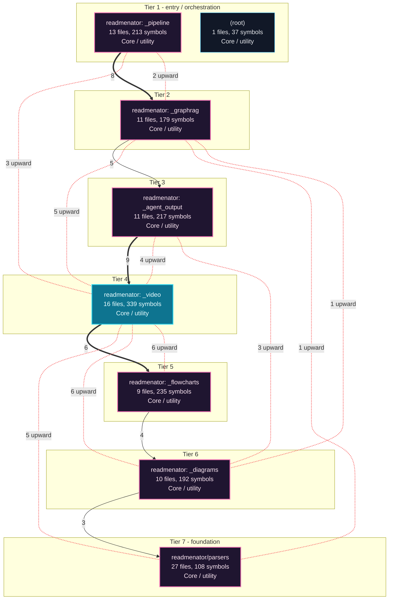
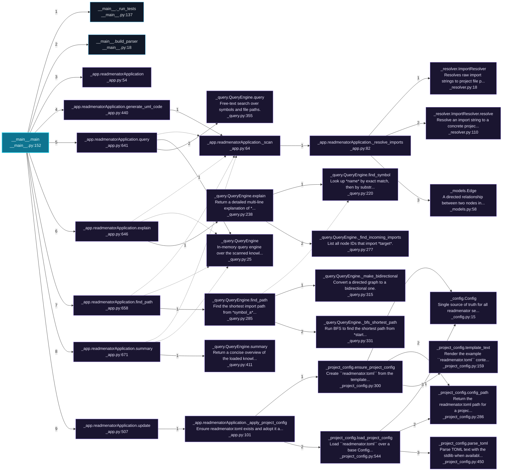
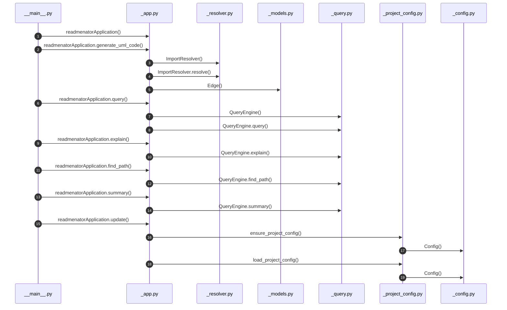
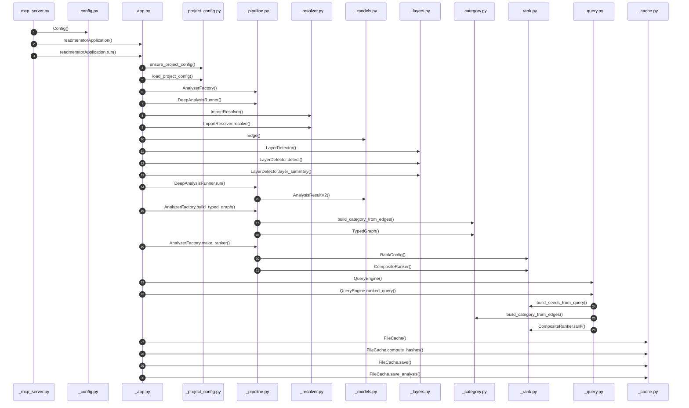
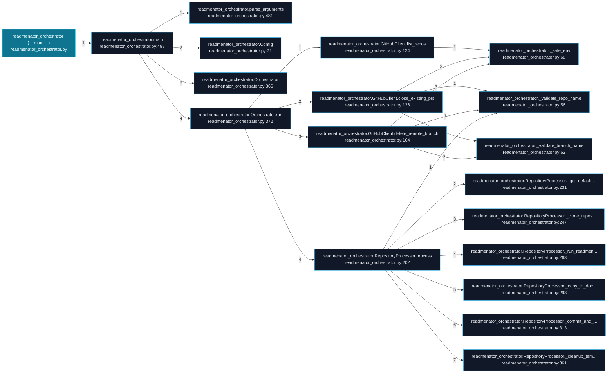

```mermaid
flowchart LR
    classDef default fill:#111827,stroke:#38bdf8,color:#e5e7eb;
    classDef entry fill:#0e7490,stroke:#22d3ee,color:#ecfeff,stroke-width:2px;
    classDef external fill:#1a1530,stroke:#a78bfa,color:#ede9fe;
    n_readmenator__mcp_server_py___main_["_mcp_server (__main__)<br/>_mcp_server.py"]:::entry
    n_readmenator__mcp_server_py__main["_mcp_server.main<br/>CLI entry point for #96;readmenator serve #lt;path#gt;#96;.<br/>_mcp_server.py:1074"]:::default
    n_readmenator__config_py__Config["_config.Config<br/>Single source of truth for all readmenator se...<br/>_config.py:15"]:::external
    n_readmenator__app_py__readmenatorApplication["_app.readmenatorApplication<br/>_app.py:54"]:::external
    n_readmenator__app_py__run["_app.readmenatorApplication.run<br/>_app.py:150"]:::external
    n_readmenator__app_py___apply_project_config["_app.readmenatorApplication._apply_project_config<br/>Ensure readmenator.toml exists and adopt it a...<br/>_app.py:101"]:::external
    n_readmenator__project_config_py__ensure_project_config["_project_config.ensure_project_config<br/>Create #96;#96;readmenator.toml#96;#96; from the template...<br/>_project_config.py:300"]:::external
    n_readmenator__project_config_py__load_project_config["_project_config.load_project_config<br/>Load #96;#96;readmenator.toml#96;#96; over a base Config...<br/>_project_config.py:544"]:::external
    n_readmenator__pipeline_py__AnalyzerFactory["_pipeline.AnalyzerFactory<br/>Lazy factory for all readmenator analyzer and...<br/>_pipeline.py:67"]:::external
    n_readmenator__pipeline_py__DeepAnalysisRunner["_pipeline.DeepAnalysisRunner<br/>Orchestrates the extended V2 analysis pipeline.<br/>_pipeline.py:484"]:::external
    n_readmenator__app_py___resolve_imports["_app.readmenatorApplication._resolve_imports<br/>_app.py:82"]:::external
    n_readmenator__resolver_py__ImportResolver["_resolver.ImportResolver<br/>Resolves raw import strings to project file p...<br/>_resolver.py:18"]:::external
    n_readmenator__resolver_py__resolve["_resolver.ImportResolver.resolve<br/>Resolve an import string to a concrete projec...<br/>_resolver.py:110"]:::external
    n_readmenator__models_py__Edge["_models.Edge<br/>A directed relationship between two nodes in...<br/>_models.py:58"]:::external
    n_readmenator__layers_py__LayerDetector["_layers.LayerDetector<br/>Detects architectural layers in a codebase.<br/>_layers.py:17"]:::external
    n_readmenator__layers_py__detect["_layers.LayerDetector.detect<br/>Assign each file node to an architectural layer.<br/>_layers.py:83"]:::external
    n_readmenator__layers_py___classify_file["_layers.LayerDetector._classify_file<br/>Classify a single file into an architectural...<br/>_layers.py:138"]:::external
    n_readmenator__layers_py__layer_summary["_layers.LayerDetector.layer_summary<br/>Count files per layer.<br/>_layers.py:189"]:::external
    n_readmenator__pipeline_py__run["_pipeline.DeepAnalysisRunner.run<br/>_pipeline.py:496"]:::external
    n_readmenator__models_py__AnalysisResultV2["_models.AnalysisResultV2<br/>Extended analysis result combining all new an...<br/>_models.py:284"]:::external
    n_readmenator__pipeline_py__build_typed_graph["_pipeline.AnalyzerFactory.build_typed_graph<br/>_pipeline.py:449"]:::external
    n_readmenator__category_py__build_category_from_edges["_category.build_category_from_edges<br/>Build a Category from lists of Edge objects.<br/>_category.py:236"]:::external
    n_readmenator__category_py__TypedGraph["_category.TypedGraph<br/>Weighted directed graph for PageRank computat...<br/>_category.py:181"]:::external
    n_readmenator__pipeline_py__make_ranker["_pipeline.AnalyzerFactory.make_ranker<br/>Create a CompositeRanker for the given typed...<br/>_pipeline.py:459"]:::external
    n_readmenator__rank_py__RankConfig["_rank.RankConfig<br/>Tuneable parameters for the ranking system.<br/>_rank.py:32"]:::external
    n_readmenator__rank_py__CompositeRanker["_rank.CompositeRanker<br/>Combines PPR, authority, test/doc coverage, a...<br/>_rank.py:411"]:::external
    n_readmenator__query_py__QueryEngine["_query.QueryEngine<br/>In-memory query engine over the scanned knowl...<br/>_query.py:25"]:::external
    n_readmenator__query_py__ranked_query["_query.QueryEngine.ranked_query<br/>Answer *query* with a ranked list of relevant...<br/>_query.py:73"]:::external
    n_readmenator__query_py___init_default_ranker["_query.QueryEngine._init_default_ranker<br/>Build a default CompositeRanker from the load...<br/>_query.py:64"]:::external
    n_readmenator__rank_py__build_seeds_from_query["_rank.build_seeds_from_query<br/>Build a PPR seed vector from a natural-langua...<br/>_rank.py:274"]:::external
    n_readmenator__query_py___estimate_test_coverage["_query.QueryEngine._estimate_test_coverage<br/>Estimate test coverage per file.<br/>_query.py:124"]:::external
    n_readmenator__query_py___estimate_doc_coverage["_query.QueryEngine._estimate_doc_coverage<br/>Estimate documentation coverage per file.<br/>_query.py:150"]:::external
    n_readmenator__rank_py__rank["_rank.CompositeRanker.rank<br/>Compute composite ranking for a query.<br/>_rank.py:438"]:::external
    n_readmenator__cache_py__FileCache["_cache.FileCache<br/>SHA256-based cache for incremental file scann...<br/>_cache.py:20"]:::external
    n_readmenator__cache_py__compute_hashes["_cache.FileCache.compute_hashes<br/>_cache.py:64"]:::external
    n_readmenator__cache_py__compute_hash["_cache.FileCache.compute_hash<br/>_cache.py:55"]:::external
    n_readmenator__cache_py__save["_cache.FileCache.save<br/>_cache.py:49"]:::external
    n_readmenator__cache_py__save_analysis["_cache.FileCache.save_analysis<br/>Save an analysis result to the semantic cache.<br/>_cache.py:95"]:::external
    n_readmenator__app_py___write_sidecar_outputs["_app.readmenatorApplication._write_sidecar_outputs<br/>_app.py:383"]:::external
    n_readmenator__app_py___maybe_write_memory["_app.readmenatorApplication._maybe_write_memory<br/>Regenerate MEMORY.md (preserving the session...<br/>_app.py:1796"]:::external
    n_readmenator__mcp_server_py___main_ -->|"1"| n_readmenator__mcp_server_py__main
    n_readmenator__mcp_server_py__main -->|"1"| n_readmenator__config_py__Config
    n_readmenator__mcp_server_py__main -->|"2"| n_readmenator__app_py__readmenatorApplication
    n_readmenator__mcp_server_py__main -->|"3"| n_readmenator__app_py__run
    n_readmenator__app_py__run -->|"1"| n_readmenator__app_py___apply_project_config
    n_readmenator__app_py___apply_project_config -->|"1"| n_readmenator__project_config_py__ensure_project_config
    n_readmenator__app_py___apply_project_config -->|"2"| n_readmenator__project_config_py__load_project_config
    n_readmenator__app_py___apply_project_config -->|"3"| n_readmenator__pipeline_py__AnalyzerFactory
    n_readmenator__app_py___apply_project_config -->|"4"| n_readmenator__pipeline_py__DeepAnalysisRunner
    n_readmenator__app_py__run -->|"2"| n_readmenator__app_py___resolve_imports
    n_readmenator__app_py___resolve_imports -->|"1"| n_readmenator__resolver_py__ImportResolver
    n_readmenator__app_py___resolve_imports -->|"2"| n_readmenator__resolver_py__resolve
    n_readmenator__app_py___resolve_imports -->|"3"| n_readmenator__models_py__Edge
    n_readmenator__app_py__run -->|"3"| n_readmenator__layers_py__LayerDetector
    n_readmenator__app_py__run -->|"4"| n_readmenator__layers_py__detect
    n_readmenator__layers_py__detect -->|"1"| n_readmenator__layers_py___classify_file
    n_readmenator__app_py__run -->|"5"| n_readmenator__layers_py__layer_summary
    n_readmenator__app_py__run -->|"6"| n_readmenator__pipeline_py__run
    n_readmenator__pipeline_py__run -->|"1"| n_readmenator__models_py__AnalysisResultV2
    n_readmenator__app_py__run -->|"7"| n_readmenator__pipeline_py__build_typed_graph
    n_readmenator__pipeline_py__build_typed_graph -->|"1"| n_readmenator__category_py__build_category_from_edges
    n_readmenator__pipeline_py__build_typed_graph -->|"2"| n_readmenator__category_py__TypedGraph
    n_readmenator__app_py__run -->|"8"| n_readmenator__pipeline_py__make_ranker
    n_readmenator__pipeline_py__make_ranker -->|"1"| n_readmenator__rank_py__RankConfig
    n_readmenator__pipeline_py__make_ranker -->|"2"| n_readmenator__rank_py__CompositeRanker
    n_readmenator__app_py__run -->|"9"| n_readmenator__query_py__QueryEngine
    n_readmenator__app_py__run -->|"10"| n_readmenator__query_py__ranked_query
    n_readmenator__query_py__ranked_query -->|"1"| n_readmenator__query_py___init_default_ranker
    n_readmenator__query_py__ranked_query -->|"2"| n_readmenator__rank_py__build_seeds_from_query
    n_readmenator__query_py__ranked_query -->|"3"| n_readmenator__category_py__build_category_from_edges
    n_readmenator__query_py__ranked_query -->|"4"| n_readmenator__query_py___estimate_test_coverage
    n_readmenator__query_py__ranked_query -->|"5"| n_readmenator__query_py___estimate_doc_coverage
    n_readmenator__query_py__ranked_query -->|"6"| n_readmenator__rank_py__rank
    n_readmenator__app_py__run -->|"11"| n_readmenator__cache_py__FileCache
    n_readmenator__app_py__run -->|"12"| n_readmenator__cache_py__compute_hashes
    n_readmenator__cache_py__compute_hashes -->|"1"| n_readmenator__cache_py__compute_hash
    n_readmenator__app_py__run -->|"13"| n_readmenator__cache_py__save
    n_readmenator__app_py__run -->|"14"| n_readmenator__cache_py__save_analysis
    n_readmenator__app_py__run -->|"15"| n_readmenator__app_py___write_sidecar_outputs
    n_readmenator__app_py__run -->|"16"| n_readmenator__app_py___maybe_write_memory
```

# ReadMenator Architecture and Execution Flows

[Back to index](index.md)

## Architecture Overview

8 components stacked in 7 dependency tiers (weighted Eades-Lin-Smyth ordering: arrows point from dependent to dependency, top to bottom). Labels are import counts, thick arrows the top quartile; 13 transitively implied edges are omitted. Dashed red arrows are upward dependencies: the smallest set of imports that closes every cycle and breaks the layering. Cyan components hold entry points. Interactive version: `readmenator-apidocs/index.html#/flows`.

Upward dependencies to fix first: `readmenator: _diagrams` -> `readmenator: _video` (6 imports); `readmenator: _flowcharts` -> `readmenator: _video` (6 imports); `readmenator: _video` -> `readmenator: _graphrag` (5 imports); `readmenator/parsers` -> `readmenator: _video` (5 imports); `readmenator: _video` -> `readmenator: _agent_output` (4 imports); `readmenator: _video` -> `readmenator: _pipeline` (3 imports); `readmenator: _diagrams` -> `readmenator: _agent_output` (3 imports); `readmenator: _graphrag` -> `readmenator: _pipeline` (2 imports); `readmenator/parsers` -> `readmenator: _graphrag` (1 imports); `readmenator: _diagrams` -> `readmenator: _graphrag` (1 imports)

---

## Execution Flows

Entry points are scored from `__main__` guards, `main` functions, entry-style names and files, and call-graph sources. Each flow walks resolved calls in call-site order (depth <= 4, <= 40 steps); numbers give the call order, dashed arrows revisit an already expanded callee, red arrows are recursion. Interactive version with zoom and per-node docs: `readmenator-apidocs/index.html#/flows`.

### `__main__.main`

`readmenator/__main__.py:152`, score 9: entry-style name `main`; defined in entry file `__main__.py`; called from the `__main__` guard.

Control flow:

```mermaid
flowchart TB
    classDef decision fill:#1e1b4b,stroke:#a78bfa,color:#ede9fe;
    classDef default fill:#111827,stroke:#38bdf8,color:#e5e7eb;
    classDef entry fill:#0e7490,stroke:#22d3ee,color:#ecfeff,stroke-width:2px;
    classDef muted fill:#111827,stroke:#475569,color:#94a3b8;
    n_s1(["start __main__.main"]):::entry
    n_s2{"'--test' in sys.argv?"}:::decision
    n_s3(["return after _run_tests()"]):::entry
    n_s4{{"for (flag, lang) in uml_lang_flags.items()"}}:::decision
    n_s5{"flag in sys.argv?"}:::decision
    n_s6["break"]:::default
    n_s7{"uml_codegen_flag?"}:::decision
    n_s8(["return after build_parser(), readmenatorApplication(), ge..."]):::entry
    n_s9{"len(sys.argv) #gt; 2 and sys.argv[1] != '--rebuild' and (not..."}:::decision
    n_s10["readmenatorApplication()"]:::default
    n_s11{"command == 'query'?<br/>and len(sys.argv) #gt;= 4"}:::decision
    n_s12(["return after query()"]):::entry
    n_s13{"command == 'explain'?<br/>and len(sys.argv) #gt;= 4"}:::decision
    n_s14(["return after explain()"]):::entry
    n_s15{"command == 'path'?<br/>and len(sys.argv) #gt;= 5"}:::decision
    n_s16(["return after find_path()"]):::entry
    n_s17{"command in 'summary' / 'sum' / 'info'?"}:::decision
    n_s18(["return after summary()"]):::entry
    n_s19{"command == 'update'?"}:::decision
    n_s20(["return after update()"]):::entry
    n_s21{"command == 'export'?"}:::decision
    n_s22(["return after export()"]):::entry
    n_s23{"command == 'graphml'?"}:::decision
    n_s24(["return after export_graphml()"]):::entry
    n_s25{"command == 'cypher'?"}:::decision
    n_s26(["return after export_cypher()"]):::entry
    n_s27{"command == 'obsidian'?"}:::decision
    n_s28(["return after export_obsidian()"]):::entry
    n_s29{"command == 'wiki'?"}:::decision
    n_s30(["return after export_wiki()<br/>Generate the navigable agent wiki for the tar..."]):::entry
    n_s31{"command == 'lint-wiki'?"}:::decision
    n_s32(["return after lint_wiki()<br/>Check wiki health and log reported issues."]):::entry
    n_s33{"command == 'watch'?"}:::decision
    n_s34(["return after watch()"]):::entry
    n_s35{"command == 'layers'?"}:::decision
    n_s36(["return after detect_layers()"]):::entry
    n_s37{"command == 'analyze'?"}:::decision
    n_s38["analyze()"]:::default
    n_s39{{"for q in result.suggested_questions"}}:::decision
    n_s40(["return"]):::entry
    n_s41{"command == 'audit'?"}:::decision
    n_s42(["return after audit()"]):::entry
    n_s43{"command == 'audit-deep'?"}:::decision
    n_s44(["return after audit_deep()"]):::entry
    n_s45{"command == 'export-sarif'?"}:::decision
    n_s46(["return after export_sarif()"]):::entry
    n_s47{"command == 'export-rules'?"}:::decision
    n_s48(["return after export_rules()"]):::entry
    n_s49{"command == 'uml'?"}:::decision
    n_s50["_scan(), render_mermaid_class_diagram()"]:::default
    n_s51{"uml_diagram?"}:::decision
    n_s52(["return"]):::entry
    n_s53{"command == 'serve'?"}:::decision
    n_s54(["return"]):::entry
    n_s55{"command == 'lint'?"}:::decision
    n_s56(["return after lint()"]):::entry
    n_s57{"command == 'strip-dead-code'?"}:::decision
    n_s58["strip_dead_code()"]:::default
    n_s59{{"for r in reports"}}:::decision
    n_s60(["return"]):::entry
    n_s61{"command == 'generate-rules'?"}:::decision
    n_s62(["return after generate_cursorrules()"]):::entry
    n_s63{"command == 'refactor-monolith'?"}:::decision
    n_s64["refactor_monolith()"]:::default
    n_s65{{"for plan in plans"}}:::decision
    n_s66{{"for action in plan.actions"}}:::decision
    n_s67(["return"]):::entry
    n_s68{"command == 'diagrams'?"}:::decision
    n_s69["export_diagrams()<br/>Export all five interactive system maps plus..."]:::default
    n_s70{{"for (kind, path) in sorted(written.items())"}}:::decision
    n_s71(["return"]):::entry
    n_s72{"command == 'diagram'?<br/>and len(sys.argv) #gt;= 4"}:::decision
    n_s73(["return after export_diagram()<br/>Export a single interactive system map as sta..."]):::entry
    n_s74{"command == 'pages'?"}:::decision
    n_s75["export_pages()<br/>Publish all system maps plus a gallery index..."]:::default
    n_s76{{"for (kind, path) in sorted(written.items())"}}:::decision
    n_s77(["return"]):::entry
    n_s78{"command == 'video'?"}:::decision
    n_s79["export_video()<br/>Render the cinematic overview video for the t..."]:::default
    n_s80{"out?"}:::decision
    n_s81(["return"]):::entry
    n_s82{"command == 'fresh'?"}:::decision
    n_s83["check_freshness()<br/>Compare the MANIFEST source fingerprint again..."]:::default
    n_s84{"command == 'gh-wiki'?"}:::decision
    n_s85["publish_github_wiki()<br/>Mirror the generated wiki, agent docs, and kn..."]:::default
    n_s86{"not result.pushed and (not result.output_dir)?"}:::decision
    n_s87(["return"]):::entry
    n_s88{"command == 'explorer'?"}:::decision
    n_s89(["return after serve_explorer()<br/>Serve the local explorer UI until interrupted."]):::entry
    n_s90{"command == 'forcegraph'?"}:::decision
    n_s91(["return after export_forcegraph()<br/>Export the force-graph explorer HTML document."]):::entry
    n_s92{"command == 'bundles'?"}:::decision
    n_s93(["return after export_bundlegraph()<br/>Export the edge bundle explorer HTML document..."]):::entry
    n_s94{"command == 'flows'?"}:::decision
    n_s95(["return after export_flows()<br/>Write the standalone interactive architecture..."]):::entry
    n_s96{"command == 'config'?"}:::decision
    n_s97(["return after ensure_project_config(), load_project_config...<br/>Create #96;#96;readmenator.toml#96;#96; from the template..."]):::entry
    n_s98{"command == 'apidocs'?"}:::decision
    n_s99["export_apidocs()<br/>Generate the API reference tree (Markdown, ap..."]:::default
    n_s100{{"for rel in sorted(written)"}}:::decision
    n_s101(["return"]):::entry
    n_s102{"command == 'doc-coverage'?"}:::decision
    n_s103["build_api_reference()<br/>Scan *target_dir* and build its API reference..."]:::default
    n_s104{"'--fail-under' in sys.argv?"}:::decision
    n_s105[/"try"/]:::default
    n_s106{{"for warning in reference.warnings"}}:::decision
    n_s107{"command == 'components'?"}:::decision
    n_s108["export_components()<br/>Export component diagrams (analysis.json + gr..."]:::default
    n_s109{{"for (kind, path) in sorted(written.items())"}}:::decision
    n_s110(["return"]):::entry
    n_s111{"command == 'analytics'?"}:::decision
    n_s112(["return after analytics()<br/>Compute the corpus analytics payload."]):::entry
    n_s113{"command == 'near'?<br/>and len(sys.argv) #gt;= 4"}:::decision
    n_s114(["return after near()<br/>Find semantically similar files for a query f..."]):::entry
    n_s115{"command == 'scan-text'?"}:::decision
    n_s116["scan_texts()<br/>Build scan-text blobs for every file in the p..."]:::default
    n_s117{{"for file_id in sorted(texts)"}}:::decision
    n_s118(["return"]):::entry
    n_s119{"command == 'validate-rules'?"}:::decision
    n_s120(["return after validate_yaralite()<br/>Validate the project YARA-lite rules file."]):::entry
    n_s121{"command == 'graphrag'?"}:::decision
    n_s122(["return after build_graphrag()<br/>Scan, analyse, and write the GraphRAG index f..."]):::entry
    n_s123{"command == 'ask'?<br/>and len(sys.argv) #gt;= 4"}:::decision
    n_s124{"'--budget' in sys.argv?"}:::decision
    n_s125{"position + 1 #lt; len(sys.argv) and sys.argv[position + 1].i..."}:::decision
    n_s126(["return after graphrag_search()<br/>Answer a question with GraphRAG retrieval ove..."]):::entry
    n_s127{"command == 'memory'?"}:::decision
    n_s128(["return after memory()<br/>Return MEMORY.md, generating it first when mi..."]):::entry
    n_s129{"command == 'remember'?<br/>and len(sys.argv) #gt;= 4"}:::decision
    n_s130{"'--kind' in sys.argv?"}:::decision
    n_s131{"position + 1 #lt; len(sys.argv)?"}:::decision
    n_s132[/"try"/]:::default
    n_s133["remember()<br/>Append a note to the preserved MEMORY.md sess..."]:::default
    n_s134(["return"]):::entry
    n_s135{"command == 'skills'?"}:::decision
    n_s136{"'--target' in sys.argv?"}:::decision
    n_s137{"position + 1 #lt; len(sys.argv)?"}:::decision
    n_s138["install_skills()<br/>Install the packaged agent skills into the pr..."]:::default
    n_s139{{"for path in written"}}:::decision
    n_s140(["return after available()"]):::entry
    n_s141{"command == 'provenance'?"}:::decision
    n_s142{{"for item in app.audit_provenance(target)"}}:::decision
    n_s143(["return"]):::entry
    n_s144{"command == '--rebuild'?"}:::decision
    n_s145{"'--no-video' in argset?"}:::decision
    n_s146["readmenatorApplication(), Config()<br/>Single source of truth for all readmenator se..."]:::default
    n_s147(["return after rebuild()"]):::entry
    n_s148{"command.startswith('--')?"}:::decision
    n_s149["error()"]:::default
    n_s150{"has_export_flags?"}:::decision
    n_s151["build_parser(), readmenatorApplication()"]:::default
    n_s152{"args.export_all or (args.json and args.html and args.svg)?"}:::decision
    n_s153["export()"]:::default
    n_s154{"args.json?"}:::decision
    n_s155["export_json()"]:::default
    n_s156{"args.html?"}:::decision
    n_s157["export_html()"]:::default
    n_s158{"args.svg?"}:::decision
    n_s159["export_svg()"]:::default
    n_s160{"args.graphml?"}:::decision
    n_s161(["end"]):::entry
    n_s162["truncated at FLOW_CFG_MAX_NODES=160"]:::muted
    n_s1 --> n_s2
    n_s2 -->|"yes"| n_s3
    n_s2 -->|"no"| n_s4
    n_s4 -->|"each"| n_s5
    n_s5 -->|"yes"| n_s6
    n_s5 -.->|"no"| n_s4
    n_s4 -->|"done"| n_s7
    n_s7 -->|"yes"| n_s8
    n_s7 -->|"no"| n_s9
    n_s9 -->|"yes"| n_s10
    n_s10 --> n_s11
    n_s11 -->|"yes"| n_s12
    n_s11 -->|"no"| n_s13
    n_s13 -->|"yes"| n_s14
    n_s13 -->|"no"| n_s15
    n_s15 -->|"yes"| n_s16
    n_s15 -->|"no"| n_s17
    n_s17 -->|"yes"| n_s18
    n_s17 -->|"no"| n_s19
    n_s19 -->|"yes"| n_s20
    n_s19 -->|"no"| n_s21
    n_s21 -->|"yes"| n_s22
    n_s21 -->|"no"| n_s23
    n_s23 -->|"yes"| n_s24
    n_s23 -->|"no"| n_s25
    n_s25 -->|"yes"| n_s26
    n_s25 -->|"no"| n_s27
    n_s27 -->|"yes"| n_s28
    n_s27 -->|"no"| n_s29
    n_s29 -->|"yes"| n_s30
    n_s29 -->|"no"| n_s31
    n_s31 -->|"yes"| n_s32
    n_s31 -->|"no"| n_s33
    n_s33 -->|"yes"| n_s34
    n_s33 -->|"no"| n_s35
    n_s35 -->|"yes"| n_s36
    n_s35 -->|"no"| n_s37
    n_s37 -->|"yes"| n_s38
    n_s38 --> n_s39
    n_s39 -.->|"each"| n_s39
    n_s39 -->|"done"| n_s40
    n_s37 -->|"no"| n_s41
    n_s41 -->|"yes"| n_s42
    n_s41 -->|"no"| n_s43
    n_s43 -->|"yes"| n_s44
    n_s43 -->|"no"| n_s45
    n_s45 -->|"yes"| n_s46
    n_s45 -->|"no"| n_s47
    n_s47 -->|"yes"| n_s48
    n_s47 -->|"no"| n_s49
    n_s49 -->|"yes"| n_s50
    n_s50 --> n_s51
    n_s51 -->|"yes"| n_s52
    n_s51 -->|"no"| n_s52
    n_s49 -->|"no"| n_s53
    n_s53 -->|"yes"| n_s54
    n_s53 -->|"no"| n_s55
    n_s55 -->|"yes"| n_s56
    n_s55 -->|"no"| n_s57
    n_s57 -->|"yes"| n_s58
    n_s58 --> n_s59
    n_s59 -.->|"each"| n_s59
    n_s59 -->|"done"| n_s60
    n_s57 -->|"no"| n_s61
    n_s61 -->|"yes"| n_s62
    n_s61 -->|"no"| n_s63
    n_s63 -->|"yes"| n_s64
    n_s64 --> n_s65
    n_s65 -->|"each"| n_s66
    n_s66 -.->|"each"| n_s66
    n_s66 -.->|"done"| n_s65
    n_s65 -->|"done"| n_s67
    n_s63 -->|"no"| n_s68
    n_s68 -->|"yes"| n_s69
    n_s69 --> n_s70
    n_s70 -.->|"each"| n_s70
    n_s70 -->|"done"| n_s71
    n_s68 -->|"no"| n_s72
    n_s72 -->|"yes"| n_s73
    n_s72 -->|"no"| n_s74
    n_s74 -->|"yes"| n_s75
    n_s75 --> n_s76
    n_s76 -.->|"each"| n_s76
    n_s76 -->|"done"| n_s77
    n_s74 -->|"no"| n_s78
    n_s78 -->|"yes"| n_s79
    n_s79 --> n_s80
    n_s80 -->|"yes"| n_s81
    n_s80 -->|"no"| n_s81
    n_s78 -->|"no"| n_s82
    n_s82 -->|"yes"| n_s83
    n_s82 -->|"no"| n_s84
    n_s84 -->|"yes"| n_s85
    n_s85 --> n_s86
    n_s86 -->|"yes"| n_s87
    n_s86 -->|"no"| n_s87
    n_s84 -->|"no"| n_s88
    n_s88 -->|"yes"| n_s89
    n_s88 -->|"no"| n_s90
    n_s90 -->|"yes"| n_s91
    n_s90 -->|"no"| n_s92
    n_s92 -->|"yes"| n_s93
    n_s92 -->|"no"| n_s94
    n_s94 -->|"yes"| n_s95
    n_s94 -->|"no"| n_s96
    n_s96 -->|"yes"| n_s97
    n_s96 -->|"no"| n_s98
    n_s98 -->|"yes"| n_s99
    n_s99 --> n_s100
    n_s100 -.->|"each"| n_s100
    n_s100 -->|"done"| n_s101
    n_s98 -->|"no"| n_s102
    n_s102 -->|"yes"| n_s103
    n_s103 --> n_s104
    n_s104 -->|"yes"| n_s105
    n_s105 --> n_s106
    n_s105 -->|"except (IndexError, ValueError)"| n_s106
    n_s104 -->|"no"| n_s106
    n_s106 -.->|"each"| n_s106
    n_s102 -->|"no"| n_s107
    n_s107 -->|"yes"| n_s108
    n_s108 --> n_s109
    n_s109 -.->|"each"| n_s109
    n_s109 -->|"done"| n_s110
    n_s107 -->|"no"| n_s111
    n_s111 -->|"yes"| n_s112
    n_s111 -->|"no"| n_s113
    n_s113 -->|"yes"| n_s114
    n_s113 -->|"no"| n_s115
    n_s115 -->|"yes"| n_s116
    n_s116 --> n_s117
    n_s117 -.->|"each"| n_s117
    n_s117 -->|"done"| n_s118
    n_s115 -->|"no"| n_s119
    n_s119 -->|"yes"| n_s120
    n_s119 -->|"no"| n_s121
    n_s121 -->|"yes"| n_s122
    n_s121 -->|"no"| n_s123
    n_s123 -->|"yes"| n_s124
    n_s124 -->|"yes"| n_s125
    n_s125 -->|"yes"| n_s126
    n_s125 -->|"no"| n_s126
    n_s124 -->|"no"| n_s126
    n_s123 -->|"no"| n_s127
    n_s127 -->|"yes"| n_s128
    n_s127 -->|"no"| n_s129
    n_s129 -->|"yes"| n_s130
    n_s130 -->|"yes"| n_s131
    n_s131 -->|"yes"| n_s132
    n_s131 -->|"no"| n_s132
    n_s130 -->|"no"| n_s132
    n_s132 --> n_s133
    n_s133 --> n_s134
    n_s132 -->|"except ValueError"| n_s134
    n_s129 -->|"no"| n_s135
    n_s135 -->|"yes"| n_s136
    n_s136 -->|"yes"| n_s137
    n_s137 -->|"yes"| n_s138
    n_s137 -->|"no"| n_s138
    n_s136 -->|"no"| n_s138
    n_s138 --> n_s139
    n_s139 -.->|"each"| n_s139
    n_s139 -->|"done"| n_s140
    n_s135 -->|"no"| n_s141
    n_s141 -->|"yes"| n_s142
    n_s142 -.->|"each"| n_s142
    n_s142 -->|"done"| n_s143
    n_s141 -->|"no"| n_s144
    n_s144 -->|"yes"| n_s145
    n_s145 -->|"yes"| n_s146
    n_s146 --> n_s147
    n_s145 -->|"no"| n_s147
    n_s144 -->|"no"| n_s148
    n_s148 -->|"no"| n_s149
    n_s83 --> n_s150
    n_s106 -->|"done"| n_s150
    n_s148 -->|"yes"| n_s150
    n_s149 --> n_s150
    n_s9 -->|"no"| n_s150
    n_s150 -->|"yes"| n_s151
    n_s151 --> n_s152
    n_s152 -->|"yes"| n_s153
    n_s152 -->|"no"| n_s154
    n_s154 -->|"yes"| n_s155
    n_s155 --> n_s156
    n_s154 -->|"no"| n_s156
    n_s156 -->|"yes"| n_s157
    n_s157 --> n_s158
    n_s156 -->|"no"| n_s158
    n_s158 -->|"yes"| n_s159
    n_s159 --> n_s160
    n_s158 -->|"no"| n_s160
    n_s153 --> n_s161
    n_s160 -->|"yes"| n_s161
    n_s160 -->|"no"| n_s161
    n_s150 -->|"no"| n_s161
    n_s1 -.-> n_s162
    linkStyle 5,39,61,69,70,75,82,109,118,122,131,161,165 stroke:#f87171,stroke-width:2px;
```

Call tree:

Cross-file sequence:

### `_mcp_server (__main__)`

`readmenator/_mcp_server.py:1090`, score 8: `if __name__ == "__main__"` guard.

Call tree:

Cross-file sequence:

### `readmenator_orchestrator (__main__)`

`readmenator_orchestrator.py:516`, score 8: `if __name__ == "__main__"` guard.

Call tree:

---
