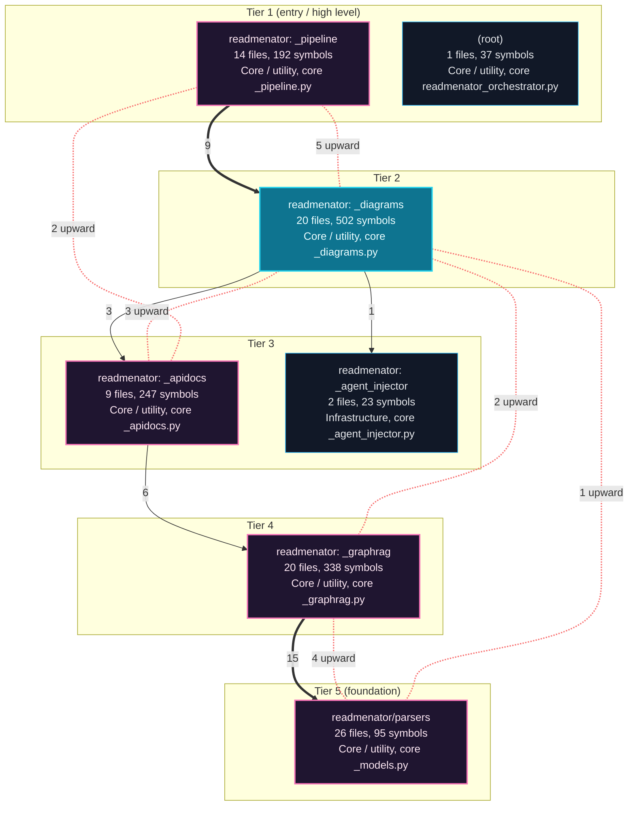
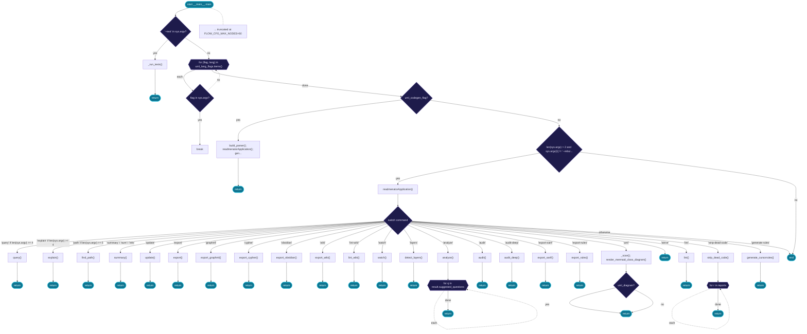
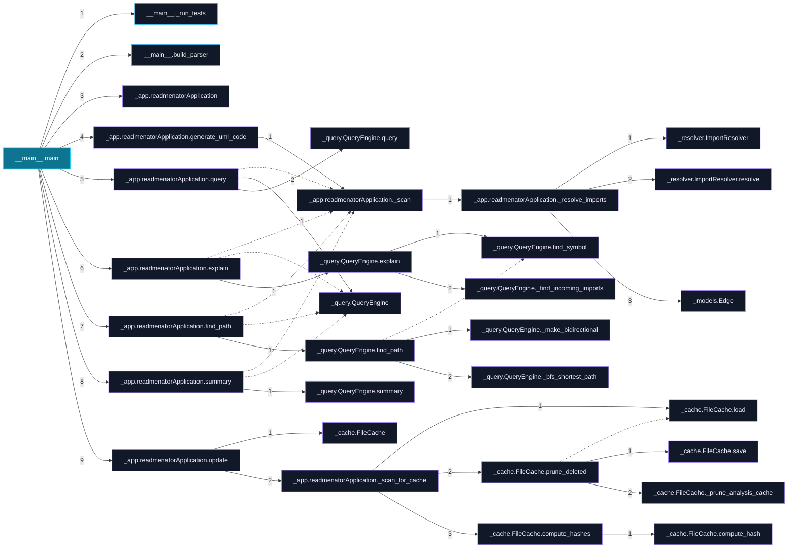
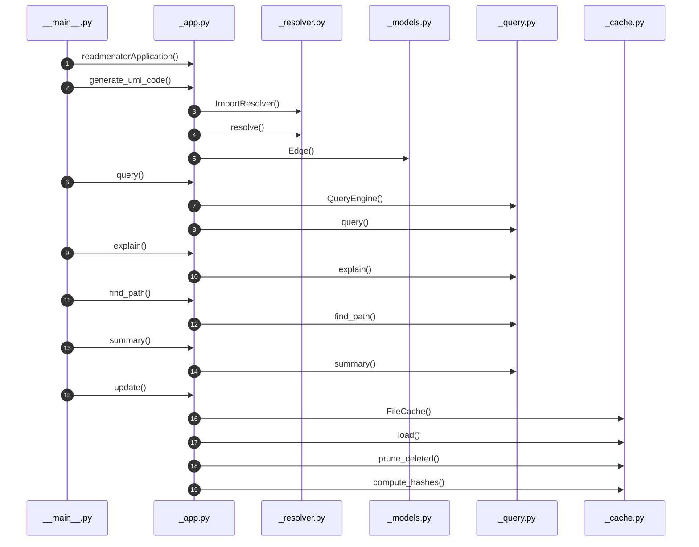
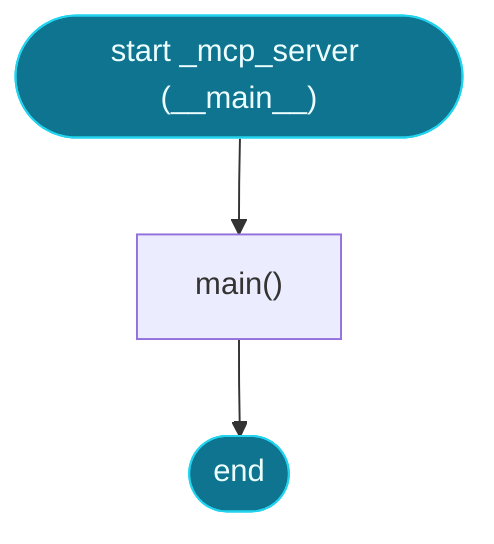
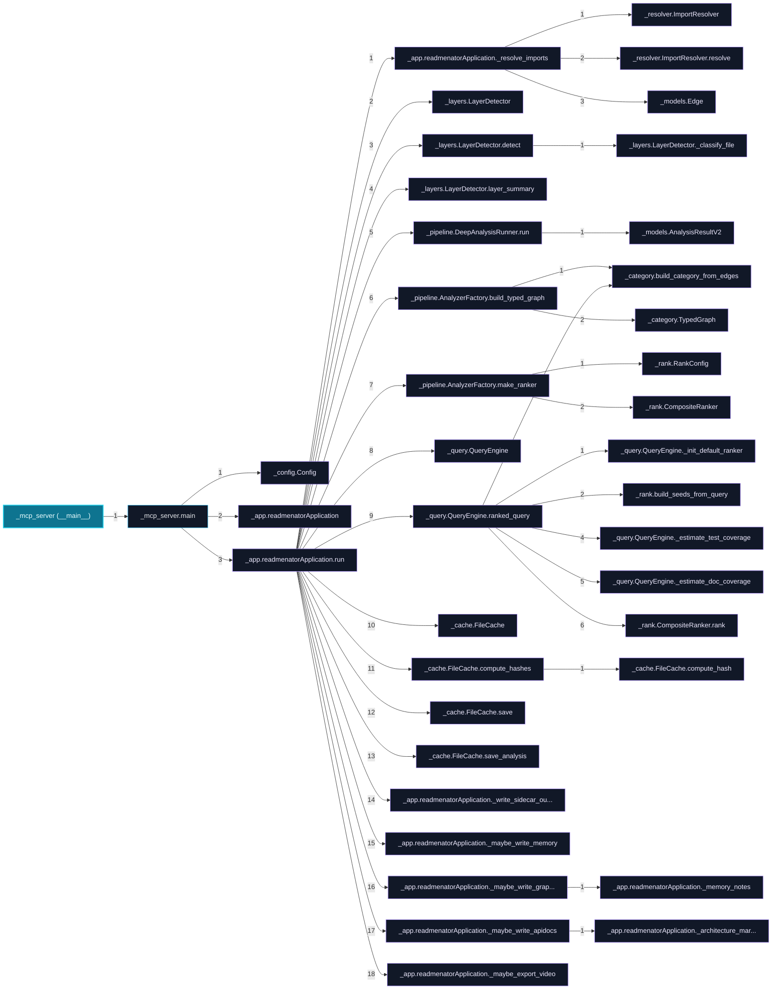
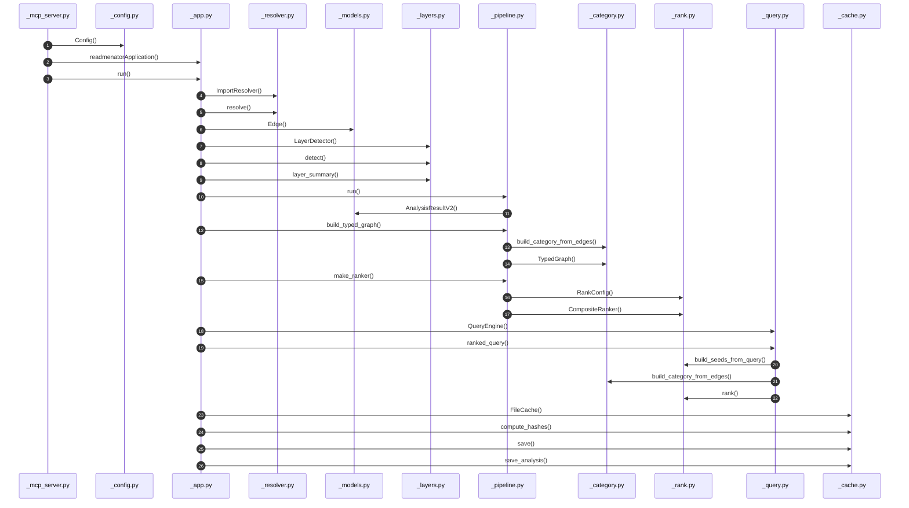
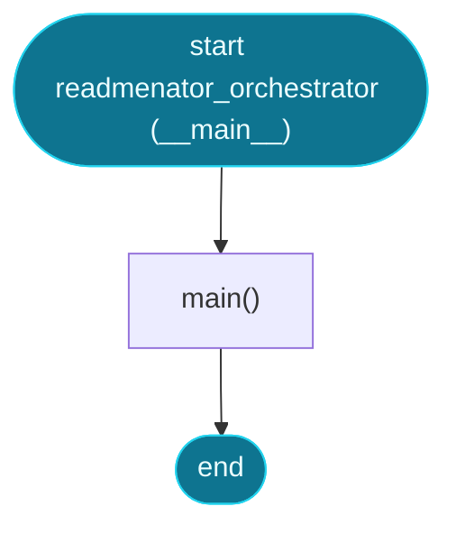
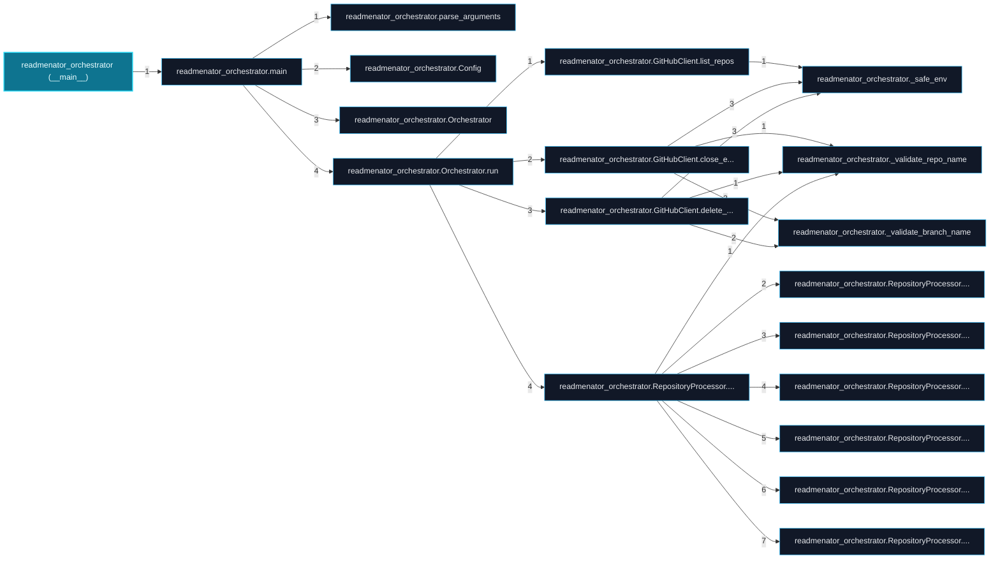

# ReadMenator Architecture and Execution Flows

[Back to index](index.md)

## Architecture Overview

7 components stacked in 5 dependency tiers (weighted Eades-Lin-Smyth ordering: arrows point from dependent to dependency, top to bottom). Labels are import counts, thick arrows the top quartile; 7 transitively implied edges are omitted. Dashed red arrows are upward dependencies: the smallest set of imports that closes every cycle and breaks the layering. Cyan components hold entry points.

Upward dependencies to fix first: `readmenator: _diagrams` -> `readmenator: _pipeline` (5 imports); `readmenator/parsers` -> `readmenator: _graphrag` (4 imports); `readmenator: _apidocs` -> `readmenator: _diagrams` (3 imports); `readmenator: _graphrag` -> `readmenator: _diagrams` (2 imports); `readmenator: _apidocs` -> `readmenator: _pipeline` (2 imports); `readmenator/parsers` -> `readmenator: _diagrams` (1 imports)

---

## Execution Flows

Entry points are scored from `__main__` guards, `main` functions, entry-style names and files, and call-graph sources. Each flow walks resolved calls in call-site order (depth <= 4, <= 40 steps); numbers give the call order, dotted arrows revisit an already expanded callee, red arrows are recursion.

### `__main__.main`

`readmenator/__main__.py:150`, score 9: entry-style name `main`; defined in entry file `__main__.py`; called from the `__main__` guard.

Control flow:

Call tree:

Cross-file sequence:

### `_mcp_server (__main__)`

`readmenator/_mcp_server.py:1090`, score 8: `if __name__ == "__main__"` guard.

Control flow:

Call tree:

Cross-file sequence:

### `readmenator_orchestrator (__main__)`

`readmenator_orchestrator.py:516`, score 8: `if __name__ == "__main__"` guard.

Control flow:

Call tree:

---
