# `readmenator.__main__`

> Source: [readmenator/__main__.py:1](../../readmenator/__main__.py#L1) | language `py` | coverage 33.3% | [API index](../index.md)

Command line entry point: argument parsing and subcommand dispatch.

## Contents

- **Functions:** [`build_parser`](#build_parser), [`main`](#main)

## Call Graph

Solid arrows stay in this module, dashed arrows leave it.

```mermaid
flowchart LR
    n_readmenator___main___py__main(["main"])
    n_readmenator___main___py__build_parser(["build_parser"])
    n_readmenator__app_py__readmenatorApplication___init__["_app.readmenatorApplication.__init__"]
    n_readmenator__app_py__readmenatorApplication_analytics["_app.readmenatorApplication.analytics"]
    n_readmenator__app_py__readmenatorApplication_analyze["_app.readmenatorApplication.analyze"]
    n_readmenator__app_py__readmenatorApplication_audit["_app.readmenatorApplication.audit"]
    n_readmenator__app_py__readmenatorApplication_audit_deep["_app.readmenatorApplication.audit_deep"]
    n_readmenator__app_py__readmenatorApplication_audit_provenance["_app.readmenatorApplication.audit_provenance"]
    n_readmenator__app_py__readmenatorApplication_build_api_reference["_app.readmenatorApplication.build_api_reference"]
    n_readmenator__app_py__readmenatorApplication_build_graphrag["_app.readmenatorApplication.build_graphrag"]
    n_readmenator__app_py__readmenatorApplication_check_freshness["_app.readmenatorApplication.check_freshness"]
    n_readmenator__app_py__readmenatorApplication_detect_layers["_app.readmenatorApplication.detect_layers"]
    n_readmenator__app_py__readmenatorApplication_explain["_app.readmenatorApplication.explain"]
    n_readmenator__app_py__readmenatorApplication_export["_app.readmenatorApplication.export"]
    n_readmenator__app_py__readmenatorApplication_export_apidocs["_app.readmenatorApplication.export_apidocs"]
    n_readmenator__app_py__readmenatorApplication_export_bundlegraph["_app.readmenatorApplication.export_bundlegraph"]
    n_readmenator__app_py__readmenatorApplication_export_components["_app.readmenatorApplication.export_components"]
    n_readmenator__app_py__readmenatorApplication_export_cypher["_app.readmenatorApplication.export_cypher"]
    n_readmenator__app_py__readmenatorApplication_export_diagram["_app.readmenatorApplication.export_diagram"]
    n_readmenator__app_py__readmenatorApplication_export_diagrams["_app.readmenatorApplication.export_diagrams"]
    n_readmenator__app_py__readmenatorApplication_export_flows["_app.readmenatorApplication.export_flows"]
    n_readmenator__app_py__readmenatorApplication_export_forcegraph["_app.readmenatorApplication.export_forcegraph"]
    n_readmenator__app_py__readmenatorApplication_export_graphml["_app.readmenatorApplication.export_graphml"]
    n_readmenator__app_py__readmenatorApplication_export_html["_app.readmenatorApplication.export_html"]
    n_readmenator__app_py__readmenatorApplication_export_json["_app.readmenatorApplication.export_json"]
    n_readmenator___main___py__main --> n_readmenator___main___py__build_parser
    n_readmenator___main___py__main -.-> n_readmenator__app_py__readmenatorApplication___init__
    n_readmenator___main___py__main -.-> n_readmenator__app_py__readmenatorApplication_analytics
    n_readmenator___main___py__main -.-> n_readmenator__app_py__readmenatorApplication_analyze
    n_readmenator___main___py__main -.-> n_readmenator__app_py__readmenatorApplication_audit
    n_readmenator___main___py__main -.-> n_readmenator__app_py__readmenatorApplication_audit_deep
    n_readmenator___main___py__main -.-> n_readmenator__app_py__readmenatorApplication_audit_provenance
    n_readmenator___main___py__main -.-> n_readmenator__app_py__readmenatorApplication_build_api_reference
    n_readmenator___main___py__main -.-> n_readmenator__app_py__readmenatorApplication_build_graphrag
    n_readmenator___main___py__main -.-> n_readmenator__app_py__readmenatorApplication_check_freshness
    n_readmenator___main___py__main -.-> n_readmenator__app_py__readmenatorApplication_detect_layers
    n_readmenator___main___py__main -.-> n_readmenator__app_py__readmenatorApplication_explain
    n_readmenator___main___py__main -.-> n_readmenator__app_py__readmenatorApplication_export
    n_readmenator___main___py__main -.-> n_readmenator__app_py__readmenatorApplication_export_apidocs
    n_readmenator___main___py__main -.-> n_readmenator__app_py__readmenatorApplication_export_bundlegraph
    n_readmenator___main___py__main -.-> n_readmenator__app_py__readmenatorApplication_export_components
    n_readmenator___main___py__main -.-> n_readmenator__app_py__readmenatorApplication_export_cypher
    n_readmenator___main___py__main -.-> n_readmenator__app_py__readmenatorApplication_export_diagram
    n_readmenator___main___py__main -.-> n_readmenator__app_py__readmenatorApplication_export_diagrams
    n_readmenator___main___py__main -.-> n_readmenator__app_py__readmenatorApplication_export_flows
    n_readmenator___main___py__main -.-> n_readmenator__app_py__readmenatorApplication_export_forcegraph
    n_readmenator___main___py__main -.-> n_readmenator__app_py__readmenatorApplication_export_graphml
    n_readmenator___main___py__main -.-> n_readmenator__app_py__readmenatorApplication_export_html
    n_readmenator___main___py__main -.-> n_readmenator__app_py__readmenatorApplication_export_json
```



## Functions

<a id="build_parser"></a>

### `build_parser`

`function` | [readmenator/__main__.py:18](../../readmenator/__main__.py#L18)

```python
def build_parser() -> argparse.ArgumentParser
```

**Returns:** `argparse.ArgumentParser`

*Called by:* [`main`](#main)

---

<a id="main"></a>

### `main`

`function` | [readmenator/__main__.py:151](../../readmenator/__main__.py#L151)

```python
def main() -> None
```

*Calls:* [`build_parser`](#build_parser), [`readmenatorApplication.__init__`](readmenator._app.py.md#readmenatorapplication-__init__), [`readmenatorApplication.analytics`](readmenator._app.py.md#readmenatorapplication-analytics), [`readmenatorApplication.analyze`](readmenator._app.py.md#readmenatorapplication-analyze), [`readmenatorApplication.audit`](readmenator._app.py.md#readmenatorapplication-audit), [`readmenatorApplication.audit_deep`](readmenator._app.py.md#readmenatorapplication-audit_deep), [`readmenatorApplication.audit_provenance`](readmenator._app.py.md#readmenatorapplication-audit_provenance), [`readmenatorApplication.build_api_reference`](readmenator._app.py.md#readmenatorapplication-build_api_reference), [`readmenatorApplication.build_graphrag`](readmenator._app.py.md#readmenatorapplication-build_graphrag), [`readmenatorApplication.check_freshness`](readmenator._app.py.md#readmenatorapplication-check_freshness), [`readmenatorApplication.detect_layers`](readmenator._app.py.md#readmenatorapplication-detect_layers), [`readmenatorApplication.explain`](readmenator._app.py.md#readmenatorapplication-explain) and 42 more

---
