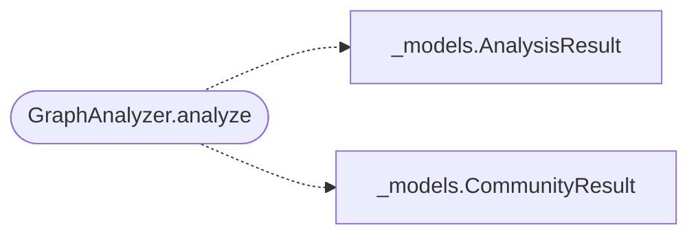

# `readmenator._analyzer`

> Source: [readmenator/_analyzer.py:1](../../readmenator/_analyzer.py#L1) | language `py` | coverage 100.0% | [API index](../index.md)

Graph analysis engine for the readmenator knowledge graph.

Provides community detection (Louvain-like greedy modularity), god
node identification (degree/PageRank centrality), surprising connection
discovery (cross-community bridges), and suggested exploration questions
derived from graph structure. All operations are deterministic and
token-free.

## Contents

- **Classes:** [`GraphAnalyzer`](#graphanalyzer)
- **Functions:** [`dominant_directory`](#dominant_directory)

## Call Graph

Solid arrows stay in this module, dashed arrows leave it.



## Classes

<a id="graphanalyzer"></a>

### `GraphAnalyzer`

`class` | [readmenator/_analyzer.py:46](../../readmenator/_analyzer.py#L46)

```python
class GraphAnalyzer
```

Deterministic graph analysis over scanned nodes and edges.

Builds an internal adjacency graph from import edges, then applies
community detection, centrality scoring, cross-community bridge
discovery, and question generation without any external API calls.

**Members**

| Member | Kind | Summary |
|---|---|---|
| [`__init__`](#graphanalyzer-__init__) | constructor | Initialise with application configuration. |
| [`analyze`](#graphanalyzer-analyze) | method | Run the full analysis pipeline and return structured results. |
| [`partition`](#graphanalyzer-partition) | method | Partition an arbitrary undirected id graph with deterministic Louvain. |

<a id="graphanalyzer-__init__"></a>

#### `GraphAnalyzer.__init__`

`constructor` | [readmenator/_analyzer.py:54](../../readmenator/_analyzer.py#L54)

```python
def __init__(self, config: Config)
```

Initialise with application configuration.

**Parameters**

| Name | Type | Default | Description |
|---|---|---|---|
| `config` | `Config` |  | Settings for thresholds and limits. |

*Called by:* [`AnalyzerFactory.analyzer`](readmenator._pipeline.py.md#analyzerfactory-analyzer)

<a id="graphanalyzer-analyze"></a>

#### `GraphAnalyzer.analyze`

`method` | [readmenator/_analyzer.py:62](../../readmenator/_analyzer.py#L62)

```python
def analyze(self, nodes: List[Node], edges: List[Edge], resolved_edges: Optional[List[Edge]] = None) -> AnalysisResult
```

Run the full analysis pipeline and return structured results.

**Parameters**

| Name | Type | Default | Description |
|---|---|---|---|
| `nodes` | `List[Node]` |  | Scanned file nodes. |
| `edges` | `List[Edge]` |  | Import edges from the scanner. |
| `resolved_edges` | `Optional[List[Edge]]` | `None` | Optional list of resolved-import edges (source and target are both project file IDs). |

**Returns:** `AnalysisResult` - An AnalysisResult with god nodes, communities, surprising
connections, and suggested questions.

*Calls:* [`AnalysisResult`](readmenator._models.py.md#analysisresult), [`CommunityResult`](readmenator._models.py.md#communityresult)

<a id="graphanalyzer-partition"></a>

#### `GraphAnalyzer.partition`

`method` | [readmenator/_analyzer.py:268](../../readmenator/_analyzer.py#L268)

```python
def partition(self, ids: List[str], adjacency: Dict[str, Set[str]]) -> Dict[str, int]
```

Partition an arbitrary undirected id graph with deterministic Louvain.

**Parameters**

| Name | Type | Default | Description |
|---|---|---|---|
| `ids` | `List[str]` |  | Node identifiers to partition. |
| `adjacency` | `Dict[str, Set[str]]` |  | Undirected adjacency between identifiers. |

**Returns:** `Dict[str, int]` - Mapping of identifier to community index.

---

## Functions

<a id="dominant_directory"></a>

### `dominant_directory`

`function` | [readmenator/_analyzer.py:22](../../readmenator/_analyzer.py#L22)

```python
def dominant_directory(file_ids: Set[str]) -> str
```

Return the most informative directory label for a set of files.

Highest file count wins; ties prefer the longest (most specific)
directory so that ``sandbox`` beats ``.``; remaining ties go
alphabetical. ``"."`` is reported as ``"root"``.

**Parameters**

| Name | Type | Default | Description |
|---|---|---|---|
| `file_ids` | `Set[str]` |  |  |

**Returns:** `str`

---
