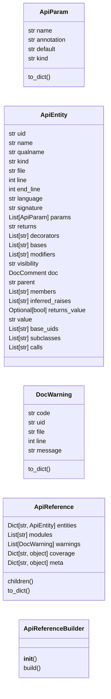
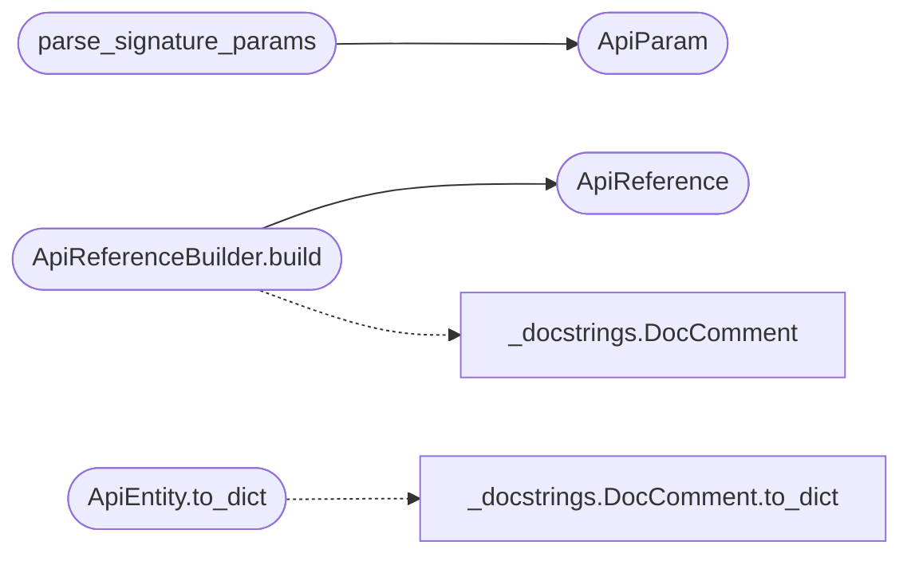

# `readmenator._apidocs`

> Source: [readmenator/_apidocs.py:1](../../readmenator/_apidocs.py#L1) | language `py` | coverage 100.0% | [API index](../index.md)

Deterministic API reference model: extraction, cross-references, coverage.

Builds a Sphinx / Doxygen style API reference from the scanned graph
with zero tokens. Python modules get a full ``ast`` pass (exact
signatures with annotations and defaults, decorators, nested classes,
properties, dataclass fields, ``__all__`` export lists, inferred raises
and return behaviour). Every other language reuses the parser symbols,
recovers the raw comment block above each declaration, nests members
into their enclosing type by brace or indentation span, and splits
signatures into typed parameters. Docstrings in any convention are
parsed by `[`readmenator._docstrings`](readmenator._docstrings.py.md)`. Cross-references cover class
hierarchies, call graphs (callers and callees via the symbol index),
and see-also targets; documentation coverage and stale-doc warnings
mirror Doxygen's ``WARN_IF_UNDOCUMENTED`` and ``WARN_IF_DOC_ERROR``.

## Contents

- **Classes:** [`ApiParam`](#apiparam), [`ApiEntity`](#apientity), [`DocWarning`](#docwarning), [`ApiReference`](#apireference), [`ApiReferenceBuilder`](#apireferencebuilder)
- **Functions:** [`parse_signature_params`](#parse_signature_params), [`is_vendored_path`](#is_vendored_path)
- **Constants:** [`KIND_MODULE`](#kind_module), [`CLASS_KINDS`](#class_kinds), [`CALLABLE_KINDS`](#callable_kinds), [`DATA_KINDS`](#data_kinds), [`CONTAINER_KINDS`](#container_kinds), [`WARN_UNDOCUMENTED`](#warn_undocumented), [`WARN_PARAM_MISSING`](#warn_param_missing), [`WARN_PARAM_UNKNOWN`](#warn_param_unknown), [`WARN_RETURN_MISSING`](#warn_return_missing), [`WARN_RAISE_MISSING`](#warn_raise_missing)

## Type Diagram



## Call Graph

Solid arrows stay in this module, dashed arrows leave it.



## Classes

<a id="apiparam"></a>

### `ApiParam`

`class` `dataclass` | [readmenator/_apidocs.py:76](../../readmenator/_apidocs.py#L76)

Decorators: `@dataclass`

```python
class ApiParam
```

One parameter of a callable signature.

**Attributes**

| Name | Type | Default | Description |
|---|---|---|---|
| [`name`](#apiparam-name) | `str` |  | Parameter name as written (``*args`` keeps its star). |
| [`annotation`](#apiparam-annotation) | `str` | `''` | Declared type text ("" when untyped). |
| [`default`](#apiparam-default) | `str` | `''` | Default value source text ("" when required). |
| [`kind`](#apiparam-kind) | `str` | `'positional'` | positional_only, positional, var_positional, keyword_only, var_keyword. |

**Members**

| Member | Kind | Summary |
|---|---|---|
| [`to_dict`](#apiparam-to_dict) | method | Serialise to a plain dict for JSON output. |

<a id="apiparam-to_dict"></a>

#### `ApiParam.to_dict`

`method` | [readmenator/_apidocs.py:91](../../readmenator/_apidocs.py#L91)

```python
def to_dict(self) -> Dict[str, str]
```

Serialise to a plain dict for JSON output.

**Returns:** `Dict[str, str]`

---

<a id="apientity"></a>

### `ApiEntity`

`class` `dataclass` | [readmenator/_apidocs.py:98](../../readmenator/_apidocs.py#L98)

Decorators: `@dataclass`

```python
class ApiEntity
```

One documented API element (module, type, callable, or data member).

**Attributes**

| Name | Type | Default | Description |
|---|---|---|---|
| [`uid`](#apientity-uid) | `str` |  | Stable identifier (`[`file`](#apientity-file)` for modules, ``file::Qual.name`` otherwise). |
| [`name`](#apientity-name) | `str` |  | Simple name. |
| [`qualname`](#apientity-qualname) | `str` |  | Dotted name inside its module. |
| [`kind`](#apientity-kind) | `str` |  | Entity kind (module, class, method, function, attribute, ...). |
| [`file`](#apientity-file) | `str` |  | Relative source file. |
| [`line`](#apientity-line) | `int` |  | One-based definition line. |
| [`end_line`](#apientity-end_line) | `int` | `0` | One-based last line of the definition span. |
| [`language`](#apientity-language) | `str` | `''` | Scanner language label. |
| [`signature`](#apientity-signature) | `str` | `''` | Display signature. |
| [`params`](#apientity-params) | `List[ApiParam]` | `field(default_factory=list)` | Signature parameters (receiver excluded). |
| [`returns`](#apientity-returns) | `str` | `''` | Declared return type text. |
| [`decorators`](#apientity-decorators) | `List[str]` | `field(default_factory=list)` | Decorator / attribute / annotation texts. |
| [`bases`](#apientity-bases) | `List[str]` | `field(default_factory=list)` | Base type names as written. |
| [`modifiers`](#apientity-modifiers) | `List[str]` | `field(default_factory=list)` | Declaration modifiers (static, abstract, async, ...). |
| [`visibility`](#apientity-visibility) | `str` | `'public'` | public, protected, or private. |
| [`doc`](#apientity-doc) | `DocComment` | `field(default_factory=DocComment)` | Parsed documentation. |
| [`parent`](#apientity-parent) | `str` | `''` | uid of the enclosing entity ("" for modules). |
| [`members`](#apientity-members) | `List[str]` | `field(default_factory=list)` | uids of directly contained entities. |
| [`inferred_raises`](#apientity-inferred_raises) | `List[str]` | `field(default_factory=list)` | Exception names raised in the body (Python). |
| [`returns_value`](#apientity-returns_value) | `Optional[bool]` | `None` | Whether the body returns a value (None when unknown). |
| [`value`](#apientity-value) | `str` | `''` | Source text of a constant or attribute default. |
| [`base_uids`](#apientity-base_uids) | `List[str]` | `field(default_factory=list)` | Resolved project uids for bases. |
| [`subclasses`](#apientity-subclasses) | `List[str]` | `field(default_factory=list)` | uids of project types deriving from this one. |
| [`calls`](#apientity-calls) | `List[str]` | `field(default_factory=list)` | uids this callable calls (resolved, deduplicated). |
| [`called_by`](#apientity-called_by) | `List[str]` | `field(default_factory=list)` | uids of callables that call this one. |

**Members**

| Member | Kind | Summary |
|---|---|---|
| [`is_documented`](#apientity-is_documented) | property | Return True when any documentation text was found. |
| [`to_dict`](#apientity-to_dict) | method | Serialise to a plain dict for JSON output. |

<a id="apientity-is_documented"></a>

#### `ApiEntity.is_documented`

`property` | [readmenator/_apidocs.py:156](../../readmenator/_apidocs.py#L156)

Decorators: `@property`

```python
def is_documented(self) -> bool
```

Return True when any documentation text was found.

**Returns:** `bool`

<a id="apientity-to_dict"></a>

#### `ApiEntity.to_dict`

`method` | [readmenator/_apidocs.py:160](../../readmenator/_apidocs.py#L160)

```python
def to_dict(self) -> Dict[str, object]
```

Serialise to a plain dict for JSON output.

**Returns:** `Dict[str, object]`

*Calls:* [`DocComment.to_dict`](readmenator._docstrings.py.md#doccomment-to_dict)

---

<a id="docwarning"></a>

### `DocWarning`

`class` `dataclass` | [readmenator/_apidocs.py:180](../../readmenator/_apidocs.py#L180)

Decorators: `@dataclass`

```python
class DocWarning
```

One documentation quality warning.

**Attributes**

| Name | Type | Default | Description |
|---|---|---|---|
| [`code`](#docwarning-code) | `str` |  | Stable rule code (DOC001 ... DOC005). |
| [`uid`](#docwarning-uid) | `str` |  | Entity the warning is about. |
| [`file`](#docwarning-file) | `str` |  | Relative source file. |
| [`line`](#docwarning-line) | `int` |  | One-based line. |
| [`message`](#docwarning-message) | `str` |  | Human-readable explanation. |

**Members**

| Member | Kind | Summary |
|---|---|---|
| [`to_dict`](#docwarning-to_dict) | method | Serialise to a plain dict for JSON output. |

<a id="docwarning-to_dict"></a>

#### `DocWarning.to_dict`

`method` | [readmenator/_apidocs.py:197](../../readmenator/_apidocs.py#L197)

```python
def to_dict(self) -> Dict[str, object]
```

Serialise to a plain dict for JSON output.

**Returns:** `Dict[str, object]`

---

<a id="apireference"></a>

### `ApiReference`

`class` `dataclass` | [readmenator/_apidocs.py:204](../../readmenator/_apidocs.py#L204)

Decorators: `@dataclass`

```python
class ApiReference
```

Complete API reference for one project.

**Attributes**

| Name | Type | Default | Description |
|---|---|---|---|
| [`entities`](#apireference-entities) | `Dict[str, ApiEntity]` | `field(default_factory=dict)` | Every entity keyed by uid, in deterministic order. |
| [`modules`](#apireference-modules) | `List[str]` | `field(default_factory=list)` | Module uids sorted by path. |
| [`warnings`](#apireference-warnings) | `List[DocWarning]` | `field(default_factory=list)` | Documentation quality warnings. |
| [`coverage`](#apireference-coverage) | `Dict[str, object]` | `field(default_factory=dict)` | Coverage statistics (overall, per kind, per module). |
| [`meta`](#apireference-meta) | `Dict[str, object]` | `field(default_factory=dict)` | Build metadata (counts, languages, truncation). |

**Members**

| Member | Kind | Summary |
|---|---|---|
| [`children`](#apireference-children) | method | Return direct members of *uid*, optionally filtered by kind, in source order. |
| [`to_dict`](#apireference-to_dict) | method | Serialise the whole reference for ``api.json``. |

<a id="apireference-children"></a>

#### `ApiReference.children`

`method` | [readmenator/_apidocs.py:221](../../readmenator/_apidocs.py#L221)

```python
def children(self, uid: str, kinds: Optional[Iterable[str]] = None) -> List[ApiEntity]
```

Return direct members of *uid*, optionally filtered by kind, in source order.

**Parameters**

| Name | Type | Default | Description |
|---|---|---|---|
| `uid` | `str` |  |  |
| `kinds` | `Optional[Iterable[str]]` | `None` |  |

**Returns:** `List[ApiEntity]`

<a id="apireference-to_dict"></a>

#### `ApiReference.to_dict`

`method` | [readmenator/_apidocs.py:232](../../readmenator/_apidocs.py#L232)

```python
def to_dict(self, schema_version: int) -> Dict[str, object]
```

Serialise the whole reference for ``api.json``.

**Parameters**

| Name | Type | Default | Description |
|---|---|---|---|
| `schema_version` | `int` |  |  |

**Returns:** `Dict[str, object]`

*Called by:* [`ApiDocsWriter.write`](readmenator._apidocs_render.py.md#apidocswriter-write)

---

<a id="apireferencebuilder"></a>

### `ApiReferenceBuilder`

`class` | [readmenator/_apidocs.py:772](../../readmenator/_apidocs.py#L772)

```python
class ApiReferenceBuilder
```

Builds an ApiReference from scanned nodes, edges, and file contents.

**Members**

| Member | Kind | Summary |
|---|---|---|
| [`__init__`](#apireferencebuilder-__init__) | constructor | Initialise with application configuration. |
| [`build`](#apireferencebuilder-build) | method | Build the full API reference. |

<a id="apireferencebuilder-__init__"></a>

#### `ApiReferenceBuilder.__init__`

`constructor` | [readmenator/_apidocs.py:775](../../readmenator/_apidocs.py#L775)

```python
def __init__(self, config: Config) -> None
```

Initialise with application configuration.

**Parameters**

| Name | Type | Default | Description |
|---|---|---|---|
| `config` | `Config` |  | Settings for privacy, private members, tests, and budgets. |

*Called by:* [`AnalyzerFactory.apidocs`](readmenator._pipeline.py.md#analyzerfactory-apidocs)

<a id="apireferencebuilder-build"></a>

#### `ApiReferenceBuilder.build`

`method` | [readmenator/_apidocs.py:796](../../readmenator/_apidocs.py#L796)

```python
def build(self, nodes: List[Node], edges: Optional[List[Edge]] = None, resolved_edges: Optional[List[Edge]] = None, content_map: Optional[Dict[str, str]] = None) -> ApiReference
```

Build the full API reference.

**Parameters**

| Name | Type | Default | Description |
|---|---|---|---|
| `nodes` | `List[Node]` |  | Scanned file nodes. |
| `edges` | `Optional[List[Edge]]` | `None` | Raw edges (``inherits`` and `[`calls`](#apientity-calls)` used for cross-refs). |
| `resolved_edges` | `Optional[List[Edge]]` | `None` | Resolved import edges (call resolution context). |
| `content_map` | `Optional[Dict[str, str]]` | `None` | File contents; enables exact Python extraction and raw comment recovery. Without it, parser symbols are used. |

**Returns:** `ApiReference` - Deterministic ApiReference with coverage and warnings.

*Calls:* [`ApiReference`](#apireference), [`DocComment`](readmenator._docstrings.py.md#doccomment)

---

## Functions

<a id="parse_signature_params"></a>

### `parse_signature_params`

`function` | [readmenator/_apidocs.py:685](../../readmenator/_apidocs.py#L685)

```python
def parse_signature_params(signature: str, name: str, language: str) -> Tuple[List[ApiParam], str]
```

Split a non-Python signature into parameters and a return type.

**Parameters**

| Name | Type | Default | Description |
|---|---|---|---|
| `signature` | `str` |  | Declaration snippet from the parser or the source line. |
| `name` | `str` |  | Declared symbol name (anchors the parameter list). |
| `language` | `str` |  | Scanner language label. |

**Returns:** `Tuple[List[ApiParam], str]` - Tuple of (parameters, return type text).

*Calls:* [`ApiParam`](#apiparam)

---

<a id="is_vendored_path"></a>

### `is_vendored_path`

`function` | [readmenator/_apidocs.py:759](../../readmenator/_apidocs.py#L759)

```python
def is_vendored_path(file_id: str, config: Config) -> bool
```

Return True for minified bundles and files under vendored third-party trees.

**Parameters**

| Name | Type | Default | Description |
|---|---|---|---|
| `file_id` | `str` |  | Relative file path. |
| `config` | `Config` |  | Settings with APIDOCS_SKIP_SUFFIXES and APIDOCS_EXCLUDE_DIRS. |

**Returns:** `bool`

*Called by:* [`ArchitectureDiagramBuilder.components`](readmenator._flowcharts.py.md#architecturediagrambuilder-components)

---

## Constants

<a id="kind_module"></a>

### `KIND_MODULE`

`constant` | [readmenator/_apidocs.py:32](../../readmenator/_apidocs.py#L32)

```python
KIND_MODULE = 'module'
```

---

<a id="class_kinds"></a>

### `CLASS_KINDS`

`constant` | [readmenator/_apidocs.py:33](../../readmenator/_apidocs.py#L33)

```python
CLASS_KINDS: Tuple[str, ...]
```

---

<a id="callable_kinds"></a>

### `CALLABLE_KINDS`

`constant` | [readmenator/_apidocs.py:37](../../readmenator/_apidocs.py#L37)

```python
CALLABLE_KINDS: Tuple[str, ...]
```

---

<a id="data_kinds"></a>

### `DATA_KINDS`

`constant` | [readmenator/_apidocs.py:41](../../readmenator/_apidocs.py#L41)

```python
DATA_KINDS: Tuple[str, ...] = ('attribute', 'variable', 'constant', 'field')
```

---

<a id="container_kinds"></a>

### `CONTAINER_KINDS`

`constant` | [readmenator/_apidocs.py:42](../../readmenator/_apidocs.py#L42)

```python
CONTAINER_KINDS: Tuple[str, ...]
```

---

<a id="warn_undocumented"></a>

### `WARN_UNDOCUMENTED`

`constant` | [readmenator/_apidocs.py:46](../../readmenator/_apidocs.py#L46)

```python
WARN_UNDOCUMENTED = 'DOC001'
```

---

<a id="warn_param_missing"></a>

### `WARN_PARAM_MISSING`

`constant` | [readmenator/_apidocs.py:47](../../readmenator/_apidocs.py#L47)

```python
WARN_PARAM_MISSING = 'DOC002'
```

---

<a id="warn_param_unknown"></a>

### `WARN_PARAM_UNKNOWN`

`constant` | [readmenator/_apidocs.py:48](../../readmenator/_apidocs.py#L48)

```python
WARN_PARAM_UNKNOWN = 'DOC003'
```

---

<a id="warn_return_missing"></a>

### `WARN_RETURN_MISSING`

`constant` | [readmenator/_apidocs.py:49](../../readmenator/_apidocs.py#L49)

```python
WARN_RETURN_MISSING = 'DOC004'
```

---

<a id="warn_raise_missing"></a>

### `WARN_RAISE_MISSING`

`constant` | [readmenator/_apidocs.py:50](../../readmenator/_apidocs.py#L50)

```python
WARN_RAISE_MISSING = 'DOC005'
```

---
