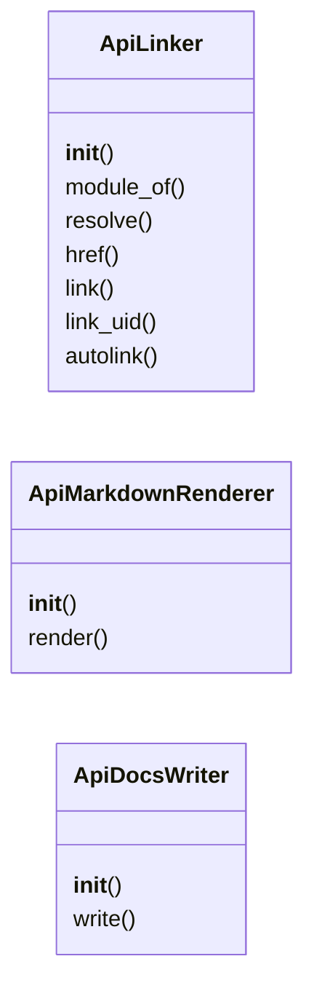
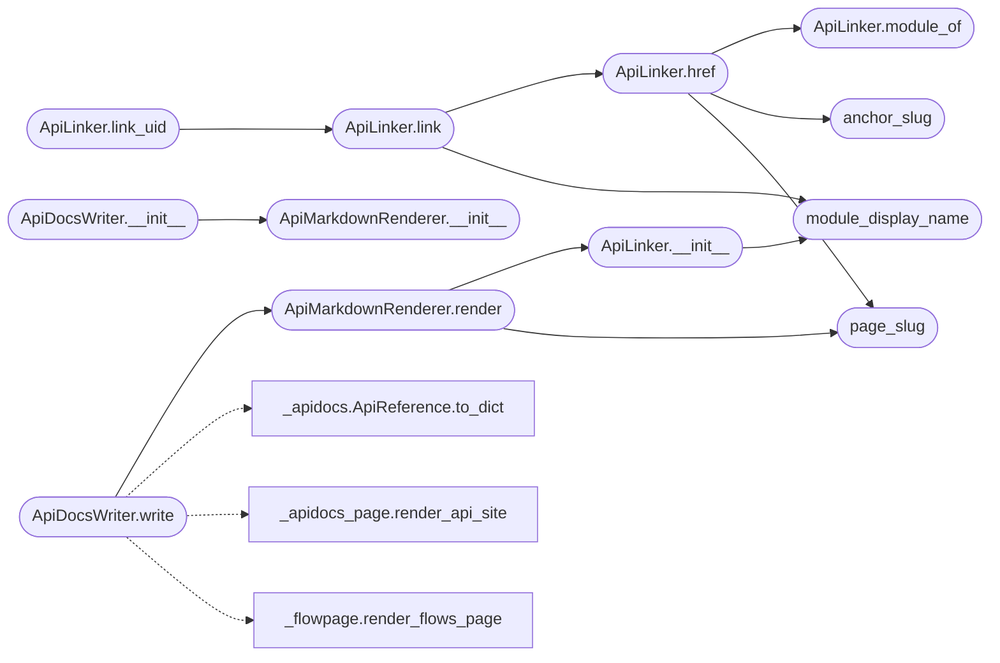

# `readmenator._apidocs_render`

> Source: [readmenator/_apidocs_render.py:1](../../readmenator/_apidocs_render.py#L1) | language `py` | coverage 100.0% | [API index](../index.md)

Markdown, JSON, and writer layer for the deterministic API reference.

Renders an ApiReference into a Sphinx / Doxygen style documentation
tree: an index with per-module coverage, one page per module (classes,
members, parameters merged from signatures and docstrings, returns,
raises, examples, admonitions, inheritance, call graphs as Mermaid,
callers and callees), a class hierarchy, an alphabetical general index,
a coverage report with stale-doc warnings, ``api.json``, and the
self-contained HTML browser from `[`readmenator._apidocs_page`](readmenator._apidocs_page.py.md)`.
Cross-references in prose (backticks, Sphinx roles, ``{@link}``) are
resolved to anchors. Everything is deterministic and offline.

## Contents

- **Classes:** [`ApiLinker`](#apilinker), [`ApiMarkdownRenderer`](#apimarkdownrenderer), [`ApiDocsWriter`](#apidocswriter)
- **Functions:** [`module_display_name`](#module_display_name), [`page_slug`](#page_slug), [`anchor_slug`](#anchor_slug)
- **Constants:** [`FENCE_LANGUAGES`](#fence_languages), [`KIND_TITLES`](#kind_titles)

## Type Diagram



## Call Graph

Solid arrows stay in this module, dashed arrows leave it.



## Classes

<a id="apilinker"></a>

### `ApiLinker`

`class` | [readmenator/_apidocs_render.py:100](../../readmenator/_apidocs_render.py#L100)

```python
class ApiLinker
```

Resolves names and entity uids to relative Markdown links.

**Members**

| Member | Kind | Summary |
|---|---|---|
| [`__init__`](#apilinker-__init__) | constructor | Index every entity by uid, qualname, and simple name. |
| [`module_of`](#apilinker-module_of) | method | Return the module entity that contains *entity*. |
| [`resolve`](#apilinker-resolve) | method | Resolve a written reference to an entity, preferring *context_file*. |
| [`href`](#apilinker-href) | method | Return the relative link to *entity* from a module page (or index when ""). |
| [`link`](#apilinker-link) | method | Return a Markdown link to *entity*. |
| [`link_uid`](#apilinker-link_uid) | method | Return a Markdown link to the entity with *uid* (plain code when unknown). |
| [`autolink`](#apilinker-autolink) | method | Turn backtick names, Sphinx roles, and ``{@link}`` tags into links. |

<a id="apilinker-__init__"></a>

#### `ApiLinker.__init__`

`constructor` | [readmenator/_apidocs_render.py:103](../../readmenator/_apidocs_render.py#L103)

```python
def __init__(self, reference: ApiReference) -> None
```

Index every entity by uid, qualname, and simple name.

**Parameters**

| Name | Type | Default | Description |
|---|---|---|---|
| `reference` | `ApiReference` |  | The API reference to link within. |

*Calls:* [`module_display_name`](#module_display_name)

*Called by:* [`ApiMarkdownRenderer.render`](#apimarkdownrenderer-render)

<a id="apilinker-module_of"></a>

#### `ApiLinker.module_of`

`method` | [readmenator/_apidocs_render.py:120](../../readmenator/_apidocs_render.py#L120)

```python
def module_of(self, entity: ApiEntity) -> ApiEntity
```

Return the module entity that contains *entity*.

**Parameters**

| Name | Type | Default | Description |
|---|---|---|---|
| `entity` | `ApiEntity` |  |  |

**Returns:** `ApiEntity`

*Called by:* [`ApiLinker.href`](#apilinker-href)

<a id="apilinker-resolve"></a>

#### `ApiLinker.resolve`

`method` | [readmenator/_apidocs_render.py:124](../../readmenator/_apidocs_render.py#L124)

```python
def resolve(self, name: str, context_file: str = '') -> Optional[ApiEntity]
```

Resolve a written reference to an entity, preferring *context_file*.

Accepts dotted Python paths (``pkg.mod.Class.method``), qualnames,
``Class#method`` / ``Class::method`` forms, and unique simple names.

**Parameters**

| Name | Type | Default | Description |
|---|---|---|---|
| `name` | `str` |  |  |
| `context_file` | `str` | `''` |  |

**Returns:** `Optional[ApiEntity]`

<a id="apilinker-href"></a>

#### `ApiLinker.href`

`method` | [readmenator/_apidocs_render.py:161](../../readmenator/_apidocs_render.py#L161)

```python
def href(self, entity: ApiEntity, from_module: str) -> str
```

Return the relative link to *entity* from a module page (or index when "").

**Parameters**

| Name | Type | Default | Description |
|---|---|---|---|
| `entity` | `ApiEntity` |  |  |
| `from_module` | `str` |  |  |

**Returns:** `str`

*Calls:* [`ApiLinker.module_of`](#apilinker-module_of), [`anchor_slug`](#anchor_slug), [`page_slug`](#page_slug)

*Called by:* [`ApiLinker.link`](#apilinker-link)

<a id="apilinker-link"></a>

#### `ApiLinker.link`

`method` | [readmenator/_apidocs_render.py:170](../../readmenator/_apidocs_render.py#L170)

```python
def link(self, entity: ApiEntity, from_module: str, label: str = '') -> str
```

Return a Markdown link to *entity*.

**Parameters**

| Name | Type | Default | Description |
|---|---|---|---|
| `entity` | `ApiEntity` |  |  |
| `from_module` | `str` |  |  |
| `label` | `str` | `''` |  |

**Returns:** `str`

*Calls:* [`ApiLinker.href`](#apilinker-href), [`module_display_name`](#module_display_name)

*Called by:* [`ApiLinker.link_uid`](#apilinker-link_uid)

<a id="apilinker-link_uid"></a>

#### `ApiLinker.link_uid`

`method` | [readmenator/_apidocs_render.py:175](../../readmenator/_apidocs_render.py#L175)

```python
def link_uid(self, uid: str, from_module: str) -> str
```

Return a Markdown link to the entity with *uid* (plain code when unknown).

**Parameters**

| Name | Type | Default | Description |
|---|---|---|---|
| `uid` | `str` |  |  |
| `from_module` | `str` |  |  |

**Returns:** `str`

*Calls:* [`ApiLinker.link`](#apilinker-link)

<a id="apilinker-autolink"></a>

#### `ApiLinker.autolink`

`method` | [readmenator/_apidocs_render.py:182](../../readmenator/_apidocs_render.py#L182)

```python
def autolink(self, text: str, from_module: str) -> str
```

Turn backtick names, Sphinx roles, and ``{@link}`` tags into links.

Fenced code blocks are left untouched.

**Parameters**

| Name | Type | Default | Description |
|---|---|---|---|
| `text` | `str` |  |  |
| `from_module` | `str` |  |  |

**Returns:** `str`

---

<a id="apimarkdownrenderer"></a>

### `ApiMarkdownRenderer`

`class` | [readmenator/_apidocs_render.py:218](../../readmenator/_apidocs_render.py#L218)

```python
class ApiMarkdownRenderer
```

Renders an ApiReference into Markdown pages.

**Members**

| Member | Kind | Summary |
|---|---|---|
| [`__init__`](#apimarkdownrenderer-__init__) | constructor | Initialise with application configuration. |
| [`render`](#apimarkdownrenderer-render) | method | Render every page. |

<a id="apimarkdownrenderer-__init__"></a>

#### `ApiMarkdownRenderer.__init__`

`constructor` | [readmenator/_apidocs_render.py:221](../../readmenator/_apidocs_render.py#L221)

```python
def __init__(self, config: Config) -> None
```

Initialise with application configuration.

**Parameters**

| Name | Type | Default | Description |
|---|---|---|---|
| `config` | `Config` |  | Settings for budgets and output layout. |

*Called by:* [`ApiDocsWriter.__init__`](#apidocswriter-__init__)

<a id="apimarkdownrenderer-render"></a>

#### `ApiMarkdownRenderer.render`

`method` | [readmenator/_apidocs_render.py:229](../../readmenator/_apidocs_render.py#L229)

```python
def render(self, reference: ApiReference, project_name: str) -> Dict[str, str]
```

Render every page.

**Parameters**

| Name | Type | Default | Description |
|---|---|---|---|
| `reference` | `ApiReference` |  | The API reference. |
| `project_name` | `str` |  | Display name of the project. |

**Returns:** `Dict[str, str]` - Mapping of relative output path to Markdown text.

*Calls:* [`ApiLinker.__init__`](#apilinker-__init__), [`page_slug`](#page_slug)

*Called by:* [`ApiDocsWriter.write`](#apidocswriter-write)

---

<a id="apidocswriter"></a>

### `ApiDocsWriter`

`class` | [readmenator/_apidocs_render.py:733](../../readmenator/_apidocs_render.py#L733)

```python
class ApiDocsWriter
```

Writes the API reference tree (Markdown, JSON, HTML) to disk.

**Members**

| Member | Kind | Summary |
|---|---|---|
| [`__init__`](#apidocswriter-__init__) | constructor | Initialise with application configuration. |
| [`write`](#apidocswriter-write) | method | Write every page and prune stale module pages. |

<a id="apidocswriter-__init__"></a>

#### `ApiDocsWriter.__init__`

`constructor` | [readmenator/_apidocs_render.py:736](../../readmenator/_apidocs_render.py#L736)

```python
def __init__(self, config: Config) -> None
```

Initialise with application configuration.

**Parameters**

| Name | Type | Default | Description |
|---|---|---|---|
| `config` | `Config` |  | Settings for the output directory and file names. |

*Calls:* [`ApiMarkdownRenderer.__init__`](#apimarkdownrenderer-__init__)

*Called by:* [`AnalyzerFactory.apidocs_writer`](readmenator._pipeline.py.md#analyzerfactory-apidocs_writer)

<a id="apidocswriter-write"></a>

#### `ApiDocsWriter.write`

`method` | [readmenator/_apidocs_render.py:745](../../readmenator/_apidocs_render.py#L745)

```python
def write(self, reference: ApiReference, project_root: str, project_name: str = '', architecture_markdown: str = '', flow_graphs: Optional[List[FlowGraph]] = None) -> Dict[str, str]
```

Write every page and prune stale module pages.

Refuses to write through a symlinked output directory.

**Parameters**

| Name | Type | Default | Description |
|---|---|---|---|
| `reference` | `ApiReference` |  | The API reference. |
| `project_root` | `str` |  | Project root directory. |
| `project_name` | `str` | `''` | Display name (defaults to the root directory name). |
| `architecture_markdown` | `str` | `''` | Optional architecture and execution-flow Markdown (written as ``architecture.md``). |
| `flow_graphs` | `Optional[List[FlowGraph]]` | `None` | Laid-out diagrams drawn in the HTML Flows tab and in the standalone FLOWS_OUTPUT page. |

**Returns:** `Dict[str, str]` - Mapping of relative output path to absolute written path.

**Raises**

- `OSError`: (raised in the body, not documented)

*Calls:* [`ApiReference.to_dict`](readmenator._apidocs.py.md#apireference-to_dict), [`render_api_site`](readmenator._apidocs_page.py.md#render_api_site), [`ApiMarkdownRenderer.render`](#apimarkdownrenderer-render), [`render_flows_page`](readmenator._flowpage.py.md#render_flows_page)

---

## Functions

<a id="module_display_name"></a>

### `module_display_name`

`function` | [readmenator/_apidocs_render.py:64](../../readmenator/_apidocs_render.py#L64)

```python
def module_display_name(entity: ApiEntity) -> str
```

Return the Sphinx-style display name of a module entity.

**Parameters**

| Name | Type | Default | Description |
|---|---|---|---|
| `entity` | `ApiEntity` |  |  |

**Returns:** `str`

*Called by:* [`ApiLinker.__init__`](#apilinker-__init__), [`ApiLinker.link`](#apilinker-link)

---

<a id="page_slug"></a>

### `page_slug`

`function` | [readmenator/_apidocs_render.py:75](../../readmenator/_apidocs_render.py#L75)

```python
def page_slug(module_uid: str) -> str
```

Return the deterministic page file stem for a module uid.

**Parameters**

| Name | Type | Default | Description |
|---|---|---|---|
| `module_uid` | `str` |  |  |

**Returns:** `str`

*Called by:* [`ApiLinker.href`](#apilinker-href), [`ApiMarkdownRenderer.render`](#apimarkdownrenderer-render)

---

<a id="anchor_slug"></a>

### `anchor_slug`

`function` | [readmenator/_apidocs_render.py:81](../../readmenator/_apidocs_render.py#L81)

```python
def anchor_slug(qualname: str) -> str
```

Return the HTML anchor id for an entity qualname.

**Parameters**

| Name | Type | Default | Description |
|---|---|---|---|
| `qualname` | `str` |  |  |

**Returns:** `str`

*Called by:* [`ApiLinker.href`](#apilinker-href)

---

## Constants

<a id="fence_languages"></a>

### `FENCE_LANGUAGES`

`constant` | [readmenator/_apidocs_render.py:39](../../readmenator/_apidocs_render.py#L39)

```python
FENCE_LANGUAGES: Dict[str, str]
```

---

<a id="kind_titles"></a>

### `KIND_TITLES`

`constant` | [readmenator/_apidocs_render.py:49](../../readmenator/_apidocs_render.py#L49)

```python
KIND_TITLES: Dict[str, str]
```

---
