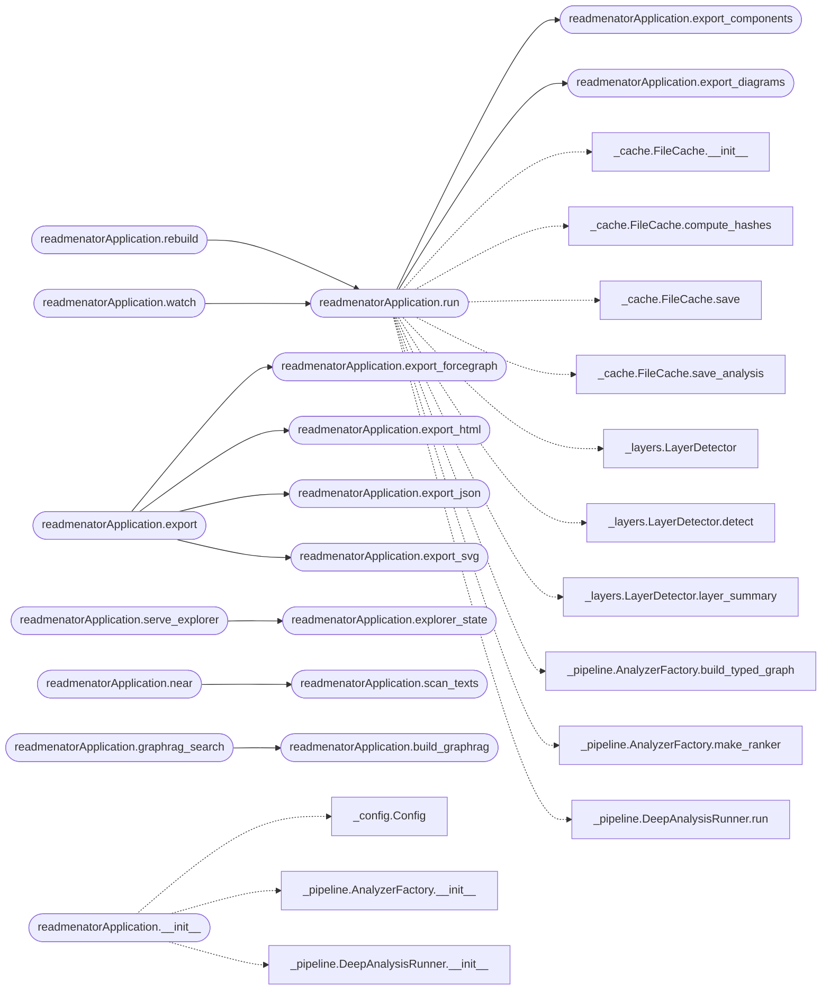

# `readmenator._app`

> Source: [readmenator/_app.py:1](../../readmenator/_app.py#L1) | language `py` | coverage 50.0% | [API index](../index.md)

Application orchestrator: scan, resolve, analyze, and write every output.

Thin facade over AnalyzerFactory that wires the scanner, analyzers, and
generators into the run, rebuild, update, query, and export commands.

## Contents

- **Classes:** [`readmenatorApplication`](#readmenatorapplication)

## Call Graph

Solid arrows stay in this module, dashed arrows leave it.



## Classes

<a id="readmenatorapplication"></a>

### `readmenatorApplication`

`class` | [readmenator/_app.py:54](../../readmenator/_app.py#L54)

```python
class readmenatorApplication
```

**Members**

| Member | Kind | Summary |
|---|---|---|
| [`__init__`](#readmenatorapplication-__init__) | constructor |  |
| [`run`](#readmenatorapplication-run) | method |  |
| [`check_freshness`](#readmenatorapplication-check_freshness) | method | Compare the MANIFEST source fingerprint against the current sources. |
| [`publish_github_wiki`](#readmenatorapplication-publish_github_wiki) | method | Mirror the generated wiki, agent docs, and knowledge base to the GitHub wiki. |
| [`generate_uml_code`](#readmenatorapplication-generate_uml_code) | method |  |
| [`update`](#readmenatorapplication-update) | method |  |
| [`query`](#readmenatorapplication-query) | method |  |
| [`explain`](#readmenatorapplication-explain) | method |  |
| [`find_path`](#readmenatorapplication-find_path) | method |  |
| [`summary`](#readmenatorapplication-summary) | method |  |
| [`rank_query`](#readmenatorapplication-rank_query) | method | Run a ranked query against the knowledge graph. |
| [`rebuild`](#readmenatorapplication-rebuild) | method |  |
| [`analyze`](#readmenatorapplication-analyze) | method |  |
| [`export_json`](#readmenatorapplication-export_json) | method |  |
| [`export_html`](#readmenatorapplication-export_html) | method |  |
| [`export_svg`](#readmenatorapplication-export_svg) | method |  |
| [`export`](#readmenatorapplication-export) | method |  |
| [`export_forcegraph`](#readmenatorapplication-export_forcegraph) | method | Export the force-graph explorer HTML document. |
| [`export_bundlegraph`](#readmenatorapplication-export_bundlegraph) | method | Export the edge bundle explorer HTML document (circle and sphere views). |
| [`export_components`](#readmenatorapplication-export_components) | method | Export component diagrams (analysis.json + graph LR markdown + index.html). |
| [`build_api_reference`](#readmenatorapplication-build_api_reference) | method | Scan *target_dir* and build its API reference without writing it. |
| [`export_apidocs`](#readmenatorapplication-export_apidocs) | method | Generate the API reference tree (Markdown, api.json, index.html). |
| [`export_flows`](#readmenatorapplication-export_flows) | method | Write the standalone interactive architecture and flow page into the maps directory. |
| [`explorer_state`](#readmenatorapplication-explorer_state) | method | Build explorer state for the local HTTP server. |
| [`serve_explorer`](#readmenatorapplication-serve_explorer) | method | Serve the local explorer UI until interrupted. |
| [`analytics`](#readmenatorapplication-analytics) | method | Compute the corpus analytics payload. |
| [`scan_texts`](#readmenatorapplication-scan_texts) | method | Build scan-text blobs for every file in the project. |
| [`near`](#readmenatorapplication-near) | method | Find semantically similar files for a query file or text. |
| [`audit_provenance`](#readmenatorapplication-audit_provenance) | method | Audit security findings by evidence provenance. |
| [`validate_yaralite`](#readmenatorapplication-validate_yaralite) | method | Validate the project YARA-lite rules file. |
| [`export_graphml`](#readmenatorapplication-export_graphml) | method |  |
| [`export_cypher`](#readmenatorapplication-export_cypher) | method |  |
| [`export_obsidian`](#readmenatorapplication-export_obsidian) | method |  |
| [`export_wiki`](#readmenatorapplication-export_wiki) | method | Generate the navigable agent wiki for the target project. |
| [`lint_wiki`](#readmenatorapplication-lint_wiki) | method | Check wiki health and log reported issues. |
| [`export_diagrams`](#readmenatorapplication-export_diagrams) | method | Export all five interactive system maps plus a gallery index. |
| [`export_diagram`](#readmenatorapplication-export_diagram) | method | Export a single interactive system map as standalone HTML. |
| [`export_pages`](#readmenatorapplication-export_pages) | method | Publish all system maps plus a gallery index as a static site. |
| [`export_video`](#readmenatorapplication-export_video) | method | Render the cinematic overview video for the target project. |
| [`memory`](#readmenatorapplication-memory) | method | Return MEMORY.md, generating it first when missing. |
| [`remember`](#readmenatorapplication-remember) | method | Append a note to the preserved MEMORY.md session log. |
| [`install_skills`](#readmenatorapplication-install_skills) | method | Install the packaged agent skills into the project. |
| [`build_graphrag`](#readmenatorapplication-build_graphrag) | method | Scan, analyse, and write the GraphRAG index for a project. |
| [`graphrag_search`](#readmenatorapplication-graphrag_search) | method | Answer a question with GraphRAG retrieval over the persisted index. |
| [`watch`](#readmenatorapplication-watch) | method |  |
| [`audit`](#readmenatorapplication-audit) | method |  |
| [`audit_deep`](#readmenatorapplication-audit_deep) | method |  |
| [`export_sarif`](#readmenatorapplication-export_sarif) | method |  |
| [`export_rules`](#readmenatorapplication-export_rules) | method |  |
| [`detect_layers`](#readmenatorapplication-detect_layers) | method |  |
| [`lint`](#readmenatorapplication-lint) | method |  |
| [`strip_dead_code`](#readmenatorapplication-strip_dead_code) | method |  |
| [`generate_cursorrules`](#readmenatorapplication-generate_cursorrules) | method |  |
| [`refactor_monolith`](#readmenatorapplication-refactor_monolith) | method |  |

<a id="readmenatorapplication-__init__"></a>

#### `readmenatorApplication.__init__`

`constructor` | [readmenator/_app.py:55](../../readmenator/_app.py#L55)

```python
def __init__(self, config: Optional[Config] = None)
```

**Parameters**

| Name | Type | Default | Description |
|---|---|---|---|
| `config` | `Optional[Config]` | `None` |  |

*Calls:* [`Config`](readmenator._config.py.md#config), [`AnalyzerFactory.__init__`](readmenator._pipeline.py.md#analyzerfactory-__init__), [`DeepAnalysisRunner.__init__`](readmenator._pipeline.py.md#deepanalysisrunner-__init__)

*Called by:* [`main`](readmenator.__main__.py.md#main), [`main`](readmenator._mcp_server.py.md#main)

<a id="readmenatorapplication-run"></a>

#### `readmenatorApplication.run`

`method` | [readmenator/_app.py:101](../../readmenator/_app.py#L101)

```python
def run(self, target_dir: str, resolve_imports: bool = True, run_analysis: bool = True, run_security: Optional[bool] = None, run_v2_analysis: Optional[bool] = None) -> None
```

**Parameters**

| Name | Type | Default | Description |
|---|---|---|---|
| `target_dir` | `str` |  |  |
| `resolve_imports` | `bool` | `True` |  |
| `run_analysis` | `bool` | `True` |  |
| `run_security` | `Optional[bool]` | `None` |  |
| `run_v2_analysis` | `Optional[bool]` | `None` |  |

*Calls:* [`readmenatorApplication.export_components`](#readmenatorapplication-export_components), [`readmenatorApplication.export_diagrams`](#readmenatorapplication-export_diagrams), [`FileCache.__init__`](readmenator._cache.py.md#filecache-__init__), [`FileCache.compute_hashes`](readmenator._cache.py.md#filecache-compute_hashes), [`FileCache.save`](readmenator._cache.py.md#filecache-save), [`FileCache.save_analysis`](readmenator._cache.py.md#filecache-save_analysis), [`LayerDetector`](readmenator._layers.py.md#layerdetector), [`LayerDetector.detect`](readmenator._layers.py.md#layerdetector-detect), [`LayerDetector.layer_summary`](readmenator._layers.py.md#layerdetector-layer_summary), [`AnalyzerFactory.build_typed_graph`](readmenator._pipeline.py.md#analyzerfactory-build_typed_graph), [`AnalyzerFactory.make_ranker`](readmenator._pipeline.py.md#analyzerfactory-make_ranker), [`DeepAnalysisRunner.run`](readmenator._pipeline.py.md#deepanalysisrunner-run) and 2 more

*Called by:* [`main`](readmenator.__main__.py.md#main), [`readmenatorApplication.rebuild`](#readmenatorapplication-rebuild), [`readmenatorApplication.watch`](#readmenatorapplication-watch), [`main`](readmenator._mcp_server.py.md#main)

<a id="readmenatorapplication-check_freshness"></a>

#### `readmenatorApplication.check_freshness`

`method` | [readmenator/_app.py:253](../../readmenator/_app.py#L253)

```python
def check_freshness(self, target_dir: str) -> Tuple[bool, str]
```

Compare the MANIFEST source fingerprint against the current sources.

**Parameters**

| Name | Type | Default | Description |
|---|---|---|---|
| `target_dir` | `str` |  | Project root directory. |

**Returns:** `Tuple[bool, str]` - Tuple of (fresh, human-readable reason).

*Calls:* [`source_fingerprint`](readmenator._cache.py.md#source_fingerprint)

*Called by:* [`main`](readmenator.__main__.py.md#main)

<a id="readmenatorapplication-publish_github_wiki"></a>

#### `readmenatorApplication.publish_github_wiki`

`method` | [readmenator/_app.py:316](../../readmenator/_app.py#L316)

```python
def publish_github_wiki(self, target_dir: str, dry_run: bool = False) -> WikiPublishResult
```

Mirror the generated wiki, agent docs, and knowledge base to the GitHub wiki.

**Parameters**

| Name | Type | Default | Description |
|---|---|---|---|
| `target_dir` | `str` |  | Project root directory with generated outputs. |
| `dry_run` | `bool` | `False` | Render pages into GH_WIKI_DRY_RUN_DIR without git calls. |

**Returns:** `WikiPublishResult` - WikiPublishResult with pages written and push status.

*Called by:* [`main`](readmenator.__main__.py.md#main)

<a id="readmenatorapplication-generate_uml_code"></a>

#### `readmenatorApplication.generate_uml_code`

`method` | [readmenator/_app.py:389](../../readmenator/_app.py#L389)

```python
def generate_uml_code(self, target_dir: str, language: str, output_path: Optional[str] = None) -> str
```

**Parameters**

| Name | Type | Default | Description |
|---|---|---|---|
| `target_dir` | `str` |  |  |
| `language` | `str` |  |  |
| `output_path` | `Optional[str]` | `None` |  |

**Returns:** `str`

*Called by:* [`main`](readmenator.__main__.py.md#main)

<a id="readmenatorapplication-update"></a>

#### `readmenatorApplication.update`

`method` | [readmenator/_app.py:456](../../readmenator/_app.py#L456)

```python
def update(self, target_dir: str, run_security: Optional[bool] = None) -> None
```

**Parameters**

| Name | Type | Default | Description |
|---|---|---|---|
| `target_dir` | `str` |  |  |
| `run_security` | `Optional[bool]` | `None` |  |

*Calls:* [`FileCache.__init__`](readmenator._cache.py.md#filecache-__init__), [`FileCache.has_changed_since_last_analysis`](readmenator._cache.py.md#filecache-has_changed_since_last_analysis), [`FileCache.load_analysis`](readmenator._cache.py.md#filecache-load_analysis), [`FileCache.save_analysis`](readmenator._cache.py.md#filecache-save_analysis), [`LayerDetector`](readmenator._layers.py.md#layerdetector), [`LayerDetector.detect`](readmenator._layers.py.md#layerdetector-detect), [`AnalysisResult`](readmenator._models.py.md#analysisresult), [`CommunityResult`](readmenator._models.py.md#communityresult), [`SecurityFinding`](readmenator._models.py.md#securityfinding), [`DeepAnalysisRunner.run`](readmenator._pipeline.py.md#deepanalysisrunner-run)

*Called by:* [`main`](readmenator.__main__.py.md#main)

<a id="readmenatorapplication-query"></a>

#### `readmenatorApplication.query`

`method` | [readmenator/_app.py:588](../../readmenator/_app.py#L588)

```python
def query(self, target_dir: str, question: str) -> str
```

**Parameters**

| Name | Type | Default | Description |
|---|---|---|---|
| `target_dir` | `str` |  |  |
| `question` | `str` |  |  |

**Returns:** `str`

*Calls:* [`QueryEngine.__init__`](readmenator._query.py.md#queryengine-__init__), [`QueryEngine.query`](readmenator._query.py.md#queryengine-query)

*Called by:* [`main`](readmenator.__main__.py.md#main)

<a id="readmenatorapplication-explain"></a>

#### `readmenatorApplication.explain`

`method` | [readmenator/_app.py:593](../../readmenator/_app.py#L593)

```python
def explain(self, target_dir: str, symbol_name: str) -> str
```

**Parameters**

| Name | Type | Default | Description |
|---|---|---|---|
| `target_dir` | `str` |  |  |
| `symbol_name` | `str` |  |  |

**Returns:** `str`

*Calls:* [`QueryEngine.__init__`](readmenator._query.py.md#queryengine-__init__), [`QueryEngine.explain`](readmenator._query.py.md#queryengine-explain)

*Called by:* [`main`](readmenator.__main__.py.md#main)

<a id="readmenatorapplication-find_path"></a>

#### `readmenatorApplication.find_path`

`method` | [readmenator/_app.py:605](../../readmenator/_app.py#L605)

```python
def find_path(self, target_dir: str, symbol_a: str, symbol_b: str) -> str
```

**Parameters**

| Name | Type | Default | Description |
|---|---|---|---|
| `target_dir` | `str` |  |  |
| `symbol_a` | `str` |  |  |
| `symbol_b` | `str` |  |  |

**Returns:** `str`

*Calls:* [`QueryEngine.__init__`](readmenator._query.py.md#queryengine-__init__), [`QueryEngine.find_path`](readmenator._query.py.md#queryengine-find_path)

*Called by:* [`main`](readmenator.__main__.py.md#main)

<a id="readmenatorapplication-summary"></a>

#### `readmenatorApplication.summary`

`method` | [readmenator/_app.py:618](../../readmenator/_app.py#L618)

```python
def summary(self, target_dir: str) -> str
```

**Parameters**

| Name | Type | Default | Description |
|---|---|---|---|
| `target_dir` | `str` |  |  |

**Returns:** `str`

*Calls:* [`QueryEngine.__init__`](readmenator._query.py.md#queryengine-__init__), [`QueryEngine.summary`](readmenator._query.py.md#queryengine-summary)

*Called by:* [`main`](readmenator.__main__.py.md#main)

<a id="readmenatorapplication-rank_query"></a>

#### `readmenatorApplication.rank_query`

`method` | [readmenator/_app.py:623](../../readmenator/_app.py#L623)

```python
def rank_query(self, target_dir: str, query: str, top_n: Optional[int] = None) -> RankedResult
```

Run a ranked query against the knowledge graph.

Uses Personalized PageRank seeded from query terms to produce
a relevance-ranked list of files with score decomposition.

**Parameters**

| Name | Type | Default | Description |
|---|---|---|---|
| `target_dir` | `str` |  | Project root directory. |
| `query` | `str` |  | Free-text query. |
| `top_n` | `Optional[int]` | `None` | Number of results. |

**Returns:** `RankedResult` - A RankedResult with scored items.

*Calls:* [`AnalyzerFactory.build_typed_graph`](readmenator._pipeline.py.md#analyzerfactory-build_typed_graph), [`AnalyzerFactory.make_ranker`](readmenator._pipeline.py.md#analyzerfactory-make_ranker), [`QueryEngine.__init__`](readmenator._query.py.md#queryengine-__init__), [`QueryEngine.ranked_query`](readmenator._query.py.md#queryengine-ranked_query)

<a id="readmenatorapplication-rebuild"></a>

#### `readmenatorApplication.rebuild`

`method` | [readmenator/_app.py:653](../../readmenator/_app.py#L653)

```python
def rebuild(self, target_dir: str, run_security: Optional[bool] = None) -> None
```

**Parameters**

| Name | Type | Default | Description |
|---|---|---|---|
| `target_dir` | `str` |  |  |
| `run_security` | `Optional[bool]` | `None` |  |

*Calls:* [`readmenatorApplication.run`](#readmenatorapplication-run)

*Called by:* [`main`](readmenator.__main__.py.md#main)

<a id="readmenatorapplication-analyze"></a>

#### `readmenatorApplication.analyze`

`method` | [readmenator/_app.py:656](../../readmenator/_app.py#L656)

```python
def analyze(self, target_dir: str) -> AnalysisResult
```

**Parameters**

| Name | Type | Default | Description |
|---|---|---|---|
| `target_dir` | `str` |  |  |

**Returns:** `AnalysisResult`

*Called by:* [`main`](readmenator.__main__.py.md#main)

<a id="readmenatorapplication-export_json"></a>

#### `readmenatorApplication.export_json`

`method` | [readmenator/_app.py:660](../../readmenator/_app.py#L660)

```python
def export_json(self, target_dir: str, output_path: Optional[str] = None) -> str
```

**Parameters**

| Name | Type | Default | Description |
|---|---|---|---|
| `target_dir` | `str` |  |  |
| `output_path` | `Optional[str]` | `None` |  |

**Returns:** `str`

*Called by:* [`main`](readmenator.__main__.py.md#main), [`readmenatorApplication.export`](#readmenatorapplication-export)

<a id="readmenatorapplication-export_html"></a>

#### `readmenatorApplication.export_html`

`method` | [readmenator/_app.py:677](../../readmenator/_app.py#L677)

```python
def export_html(self, target_dir: str, output_path: Optional[str] = None) -> str
```

**Parameters**

| Name | Type | Default | Description |
|---|---|---|---|
| `target_dir` | `str` |  |  |
| `output_path` | `Optional[str]` | `None` |  |

**Returns:** `str`

*Called by:* [`main`](readmenator.__main__.py.md#main), [`readmenatorApplication.export`](#readmenatorapplication-export)

<a id="readmenatorapplication-export_svg"></a>

#### `readmenatorApplication.export_svg`

`method` | [readmenator/_app.py:688](../../readmenator/_app.py#L688)

```python
def export_svg(self, target_dir: str, output_path: Optional[str] = None) -> str
```

**Parameters**

| Name | Type | Default | Description |
|---|---|---|---|
| `target_dir` | `str` |  |  |
| `output_path` | `Optional[str]` | `None` |  |

**Returns:** `str`

*Called by:* [`main`](readmenator.__main__.py.md#main), [`readmenatorApplication.export`](#readmenatorapplication-export)

<a id="readmenatorapplication-export"></a>

#### `readmenatorApplication.export`

`method` | [readmenator/_app.py:699](../../readmenator/_app.py#L699)

```python
def export(self, target_dir: str) -> None
```

**Parameters**

| Name | Type | Default | Description |
|---|---|---|---|
| `target_dir` | `str` |  |  |

*Calls:* [`readmenatorApplication.export_forcegraph`](#readmenatorapplication-export_forcegraph), [`readmenatorApplication.export_html`](#readmenatorapplication-export_html), [`readmenatorApplication.export_json`](#readmenatorapplication-export_json), [`readmenatorApplication.export_svg`](#readmenatorapplication-export_svg)

*Called by:* [`main`](readmenator.__main__.py.md#main)

<a id="readmenatorapplication-export_forcegraph"></a>

#### `readmenatorApplication.export_forcegraph`

`method` | [readmenator/_app.py:952](../../readmenator/_app.py#L952)

```python
def export_forcegraph(self, target_dir: str, output_path: Optional[str] = None) -> str
```

Export the force-graph explorer HTML document.

**Parameters**

| Name | Type | Default | Description |
|---|---|---|---|
| `target_dir` | `str` |  | Project root directory. |
| `output_path` | `Optional[str]` | `None` | Optional explicit output file path. |

**Returns:** `str` - Output path of the written HTML file.

*Calls:* [`LayerDetector`](readmenator._layers.py.md#layerdetector), [`LayerDetector.detect`](readmenator._layers.py.md#layerdetector-detect)

*Called by:* [`main`](readmenator.__main__.py.md#main), [`readmenatorApplication.export`](#readmenatorapplication-export)

<a id="readmenatorapplication-export_bundlegraph"></a>

#### `readmenatorApplication.export_bundlegraph`

`method` | [readmenator/_app.py:971](../../readmenator/_app.py#L971)

```python
def export_bundlegraph(self, target_dir: str, output_path: Optional[str] = None) -> str
```

Export the edge bundle explorer HTML document (circle and sphere views).

**Parameters**

| Name | Type | Default | Description |
|---|---|---|---|
| `target_dir` | `str` |  | Project root directory. |
| `output_path` | `Optional[str]` | `None` | Optional explicit output file path. |

**Returns:** `str` - Output path of the written HTML file.

*Calls:* [`LayerDetector`](readmenator._layers.py.md#layerdetector), [`LayerDetector.detect`](readmenator._layers.py.md#layerdetector-detect)

*Called by:* [`main`](readmenator.__main__.py.md#main)

<a id="readmenatorapplication-export_components"></a>

#### `readmenatorApplication.export_components`

`method` | [readmenator/_app.py:997](../../readmenator/_app.py#L997)

```python
def export_components(self, target_dir: str, output_dir: Optional[str] = None) -> Dict[str, str]
```

Export component diagrams (analysis.json + graph LR markdown + index.html).

**Parameters**

| Name | Type | Default | Description |
|---|---|---|---|
| `target_dir` | `str` |  | Project root directory. |
| `output_dir` | `Optional[str]` | `None` | Destination directory override. |

**Returns:** `Dict[str, str]` - Mapping of page identifier to written file path.

*Called by:* [`main`](readmenator.__main__.py.md#main), [`readmenatorApplication.run`](#readmenatorapplication-run)

<a id="readmenatorapplication-build_api_reference"></a>

#### `readmenatorApplication.build_api_reference`

`method` | [readmenator/_app.py:1133](../../readmenator/_app.py#L1133)

```python
def build_api_reference(self, target_dir: str) -> ApiReference
```

Scan *target_dir* and build its API reference without writing it.

**Parameters**

| Name | Type | Default | Description |
|---|---|---|---|
| `target_dir` | `str` |  | Project root directory. |

**Returns:** `ApiReference` - The deterministic API reference.

*Called by:* [`main`](readmenator.__main__.py.md#main)

<a id="readmenatorapplication-export_apidocs"></a>

#### `readmenatorApplication.export_apidocs`

`method` | [readmenator/_app.py:1145](../../readmenator/_app.py#L1145)

```python
def export_apidocs(self, target_dir: str) -> Dict[str, str]
```

Generate the API reference tree (Markdown, api.json, index.html).

**Parameters**

| Name | Type | Default | Description |
|---|---|---|---|
| `target_dir` | `str` |  | Project root directory. |

**Returns:** `Dict[str, str]` - Mapping of relative output path to written file path.

*Called by:* [`main`](readmenator.__main__.py.md#main)

<a id="readmenatorapplication-export_flows"></a>

#### `readmenatorApplication.export_flows`

`method` | [readmenator/_app.py:1167](../../readmenator/_app.py#L1167)

```python
def export_flows(self, target_dir: str) -> str
```

Write the standalone interactive architecture and flow page into the maps directory.

**Parameters**

| Name | Type | Default | Description |
|---|---|---|---|
| `target_dir` | `str` |  | Project root directory. |

**Returns:** `str` - Written file path.

*Called by:* [`main`](readmenator.__main__.py.md#main)

<a id="readmenatorapplication-explorer_state"></a>

#### `readmenatorApplication.explorer_state`

`method` | [readmenator/_app.py:1184](../../readmenator/_app.py#L1184)

```python
def explorer_state(self, target_dir: str)
```

Build explorer state for the local HTTP server.

**Parameters**

| Name | Type | Default | Description |
|---|---|---|---|
| `target_dir` | `str` |  | Project root directory. |

**Returns:** Precomputed explorer state with graph and analytics.

*Calls:* [`build_state`](readmenator._explorer.py.md#build_state), [`LayerDetector`](readmenator._layers.py.md#layerdetector), [`LayerDetector.detect`](readmenator._layers.py.md#layerdetector-detect)

*Called by:* [`readmenatorApplication.serve_explorer`](#readmenatorapplication-serve_explorer)

<a id="readmenatorapplication-serve_explorer"></a>

#### `readmenatorApplication.serve_explorer`

`method` | [readmenator/_app.py:1200](../../readmenator/_app.py#L1200)

```python
def serve_explorer(self, target_dir: str, open_browser: bool = False) -> str
```

Serve the local explorer UI until interrupted.

**Parameters**

| Name | Type | Default | Description |
|---|---|---|---|
| `target_dir` | `str` |  | Project root directory. |
| `open_browser` | `bool` | `False` | Open the URL in a browser when True. |

**Returns:** `str` - Base URL of the running server.

*Calls:* [`readmenatorApplication.explorer_state`](#readmenatorapplication-explorer_state)

*Called by:* [`main`](readmenator.__main__.py.md#main)

<a id="readmenatorapplication-analytics"></a>

#### `readmenatorApplication.analytics`

`method` | [readmenator/_app.py:1213](../../readmenator/_app.py#L1213)

```python
def analytics(self, target_dir: str) -> dict
```

Compute the corpus analytics payload.

**Parameters**

| Name | Type | Default | Description |
|---|---|---|---|
| `target_dir` | `str` |  | Project root directory. |

**Returns:** `dict` - Analytics dictionary with funnel and distributions.

*Calls:* [`LayerDetector`](readmenator._layers.py.md#layerdetector), [`LayerDetector.detect`](readmenator._layers.py.md#layerdetector-detect)

*Called by:* [`main`](readmenator.__main__.py.md#main)

<a id="readmenatorapplication-scan_texts"></a>

#### `readmenatorApplication.scan_texts`

`method` | [readmenator/_app.py:1230](../../readmenator/_app.py#L1230)

```python
def scan_texts(self, target_dir: str) -> dict
```

Build scan-text blobs for every file in the project.

**Parameters**

| Name | Type | Default | Description |
|---|---|---|---|
| `target_dir` | `str` |  | Project root directory. |

**Returns:** `dict` - Mapping of file identifier to scan-text blob.

*Called by:* [`main`](readmenator.__main__.py.md#main), [`readmenatorApplication.near`](#readmenatorapplication-near)

<a id="readmenatorapplication-near"></a>

#### `readmenatorApplication.near`

`method` | [readmenator/_app.py:1242](../../readmenator/_app.py#L1242)

```python
def near(self, target_dir: str, query: str, top_k: int = 0) -> list
```

Find semantically similar files for a query file or text.

**Parameters**

| Name | Type | Default | Description |
|---|---|---|---|
| `target_dir` | `str` |  | Project root directory. |
| `query` | `str` |  | File identifier or free text to compare. |
| `top_k` | `int` | `0` | Maximum neighbors to return. |

**Returns:** `list` - Neighbor list sorted by descending similarity.

*Calls:* [`readmenatorApplication.scan_texts`](#readmenatorapplication-scan_texts)

*Called by:* [`main`](readmenator.__main__.py.md#main)

<a id="readmenatorapplication-audit_provenance"></a>

#### `readmenatorApplication.audit_provenance`

`method` | [readmenator/_app.py:1256](../../readmenator/_app.py#L1256)

```python
def audit_provenance(self, target_dir: str) -> list
```

Audit security findings by evidence provenance.

**Parameters**

| Name | Type | Default | Description |
|---|---|---|---|
| `target_dir` | `str` |  | Project root directory. |

**Returns:** `list` - Provenance findings sorted by severity.

*Called by:* [`main`](readmenator.__main__.py.md#main)

<a id="readmenatorapplication-validate_yaralite"></a>

#### `readmenatorApplication.validate_yaralite`

`method` | [readmenator/_app.py:1279](../../readmenator/_app.py#L1279)

```python
def validate_yaralite(self, target_dir: str) -> dict
```

Validate the project YARA-lite rules file.

**Parameters**

| Name | Type | Default | Description |
|---|---|---|---|
| `target_dir` | `str` |  | Project root directory. |

**Returns:** `dict` - Validation payload with rule counts and errors.

*Calls:* [`validate_yaralite_rules`](readmenator._yaralite.py.md#validate_yaralite_rules)

*Called by:* [`main`](readmenator.__main__.py.md#main)

<a id="readmenatorapplication-export_graphml"></a>

#### `readmenatorApplication.export_graphml`

`method` | [readmenator/_app.py:1293](../../readmenator/_app.py#L1293)

```python
def export_graphml(self, target_dir: str, output_path: Optional[str] = None) -> str
```

**Parameters**

| Name | Type | Default | Description |
|---|---|---|---|
| `target_dir` | `str` |  |  |
| `output_path` | `Optional[str]` | `None` |  |

**Returns:** `str`

*Called by:* [`main`](readmenator.__main__.py.md#main)

<a id="readmenatorapplication-export_cypher"></a>

#### `readmenatorApplication.export_cypher`

`method` | [readmenator/_app.py:1304](../../readmenator/_app.py#L1304)

```python
def export_cypher(self, target_dir: str, output_path: Optional[str] = None) -> str
```

**Parameters**

| Name | Type | Default | Description |
|---|---|---|---|
| `target_dir` | `str` |  |  |
| `output_path` | `Optional[str]` | `None` |  |

**Returns:** `str`

*Called by:* [`main`](readmenator.__main__.py.md#main)

<a id="readmenatorapplication-export_obsidian"></a>

#### `readmenatorApplication.export_obsidian`

`method` | [readmenator/_app.py:1320](../../readmenator/_app.py#L1320)

```python
def export_obsidian(self, target_dir: str, output_dir: Optional[str] = None) -> int
```

**Parameters**

| Name | Type | Default | Description |
|---|---|---|---|
| `target_dir` | `str` |  |  |
| `output_dir` | `Optional[str]` | `None` |  |

**Returns:** `int`

*Called by:* [`main`](readmenator.__main__.py.md#main)

<a id="readmenatorapplication-export_wiki"></a>

#### `readmenatorApplication.export_wiki`

`method` | [readmenator/_app.py:1335](../../readmenator/_app.py#L1335)

```python
def export_wiki(self, target_dir: str, output_dir: Optional[str] = None) -> str
```

Generate the navigable agent wiki for the target project.

**Parameters**

| Name | Type | Default | Description |
|---|---|---|---|
| `target_dir` | `str` |  | Project root directory. |
| `output_dir` | `Optional[str]` | `None` | Optional override for the wiki output directory. |

**Returns:** `str` - Path of the wiki directory that was written.

*Calls:* [`LayerDetector`](readmenator._layers.py.md#layerdetector), [`LayerDetector.detect`](readmenator._layers.py.md#layerdetector-detect), [`DeepAnalysisRunner.run`](readmenator._pipeline.py.md#deepanalysisrunner-run)

*Called by:* [`main`](readmenator.__main__.py.md#main)

<a id="readmenatorapplication-lint_wiki"></a>

#### `readmenatorApplication.lint_wiki`

`method` | [readmenator/_app.py:1359](../../readmenator/_app.py#L1359)

```python
def lint_wiki(self, target_dir: str) -> List[str]
```

Check wiki health and log reported issues.

**Parameters**

| Name | Type | Default | Description |
|---|---|---|---|
| `target_dir` | `str` |  | Project root directory. |

**Returns:** `List[str]` - List of issue descriptions, empty when healthy.

*Called by:* [`main`](readmenator.__main__.py.md#main)

<a id="readmenatorapplication-export_diagrams"></a>

#### `readmenatorApplication.export_diagrams`

`method` | [readmenator/_app.py:1377](../../readmenator/_app.py#L1377)

```python
def export_diagrams(self, target_dir: str, output_dir: Optional[str] = None, full: bool = False) -> Dict[str, str]
```

Export all five interactive system maps plus a gallery index.

**Parameters**

| Name | Type | Default | Description |
|---|---|---|---|
| `target_dir` | `str` |  | Project root directory. |
| `output_dir` | `Optional[str]` | `None` | Destination directory for map files. |
| `full` | `bool` | `False` | True includes every file with a grown canvas, False truncates. |

**Returns:** `Dict[str, str]` - Mapping of diagram kind to written file path.

*Calls:* [`DocsSitePublisher.__init__`](readmenator._diagrams.py.md#docssitepublisher-__init__), [`DocsSitePublisher.publish`](readmenator._diagrams.py.md#docssitepublisher-publish), [`LayerDetector`](readmenator._layers.py.md#layerdetector), [`LayerDetector.detect`](readmenator._layers.py.md#layerdetector-detect)

*Called by:* [`main`](readmenator.__main__.py.md#main), [`readmenatorApplication.run`](#readmenatorapplication-run)

<a id="readmenatorapplication-export_diagram"></a>

#### `readmenatorApplication.export_diagram`

`method` | [readmenator/_app.py:1445](../../readmenator/_app.py#L1445)

```python
def export_diagram(self, target_dir: str, kind: str, output_path: Optional[str] = None, full: bool = False) -> str
```

Export a single interactive system map as standalone HTML.

**Parameters**

| Name | Type | Default | Description |
|---|---|---|---|
| `target_dir` | `str` |  | Project root directory. |
| `kind` | `str` |  | Diagram kind identifier. |
| `output_path` | `Optional[str]` | `None` | Destination file path. |
| `full` | `bool` | `False` | True includes every file with a grown canvas, False truncates. |

**Returns:** `str` - Rendered HTML document that was written.

*Calls:* [`LayerDetector`](readmenator._layers.py.md#layerdetector), [`LayerDetector.detect`](readmenator._layers.py.md#layerdetector-detect)

*Called by:* [`main`](readmenator.__main__.py.md#main)

<a id="readmenatorapplication-export_pages"></a>

#### `readmenatorApplication.export_pages`

`method` | [readmenator/_app.py:1484](../../readmenator/_app.py#L1484)

```python
def export_pages(self, target_dir: str, output_dir: Optional[str] = None, full: bool = False) -> Dict[str, str]
```

Publish all system maps plus a gallery index as a static site.

**Parameters**

| Name | Type | Default | Description |
|---|---|---|---|
| `target_dir` | `str` |  | Project root directory. |
| `output_dir` | `Optional[str]` | `None` | Destination directory for the static site. |
| `full` | `bool` | `False` | True includes every file with a grown canvas, False truncates. |

**Returns:** `Dict[str, str]` - Mapping of published page identifier to written file path.

*Calls:* [`LayerDetector`](readmenator._layers.py.md#layerdetector), [`LayerDetector.detect`](readmenator._layers.py.md#layerdetector-detect)

*Called by:* [`main`](readmenator.__main__.py.md#main)

<a id="readmenatorapplication-export_video"></a>

#### `readmenatorApplication.export_video`

`method` | [readmenator/_app.py:1529](../../readmenator/_app.py#L1529)

```python
def export_video(self, target_dir: str, output_path: Optional[str] = None) -> Optional[str]
```

Render the cinematic overview video for the target project.

**Parameters**

| Name | Type | Default | Description |
|---|---|---|---|
| `target_dir` | `str` |  | Project root directory. |
| `output_path` | `Optional[str]` | `None` | Destination mp4 path. |

**Returns:** `Optional[str]` - Written file path, or None when video is disabled or skipped.

*Calls:* [`LayerDetector`](readmenator._layers.py.md#layerdetector), [`LayerDetector.detect`](readmenator._layers.py.md#layerdetector-detect), [`DeepAnalysisRunner.run`](readmenator._pipeline.py.md#deepanalysisrunner-run)

*Called by:* [`main`](readmenator.__main__.py.md#main)

<a id="readmenatorapplication-memory"></a>

#### `readmenatorApplication.memory`

`method` | [readmenator/_app.py:1756](../../readmenator/_app.py#L1756)

```python
def memory(self, target_dir: str) -> str
```

Return MEMORY.md, generating it first when missing.

**Parameters**

| Name | Type | Default | Description |
|---|---|---|---|
| `target_dir` | `str` |  | Project root directory. |

**Returns:** `str` - Memory document text.

*Calls:* [`LayerDetector`](readmenator._layers.py.md#layerdetector), [`LayerDetector.detect`](readmenator._layers.py.md#layerdetector-detect), [`DeepAnalysisRunner.run`](readmenator._pipeline.py.md#deepanalysisrunner-run)

*Called by:* [`main`](readmenator.__main__.py.md#main)

<a id="readmenatorapplication-remember"></a>

#### `readmenatorApplication.remember`

`method` | [readmenator/_app.py:1779](../../readmenator/_app.py#L1779)

```python
def remember(self, target_dir: str, note: str, kind: str = 'note') -> str
```

Append a note to the preserved MEMORY.md session log.

**Parameters**

| Name | Type | Default | Description |
|---|---|---|---|
| `target_dir` | `str` |  | Project root directory. |
| `note` | `str` |  | Single-line note. |
| `kind` | `str` | `'note'` | One of MEMORY_NOTE_KINDS. |

**Returns:** `str` - The stored log line.

*Called by:* [`main`](readmenator.__main__.py.md#main)

<a id="readmenatorapplication-install_skills"></a>

#### `readmenatorApplication.install_skills`

`method` | [readmenator/_app.py:1793](../../readmenator/_app.py#L1793)

```python
def install_skills(self, target_dir: str, target: Optional[str] = None) -> List[Path]
```

Install the packaged agent skills into the project.

**Parameters**

| Name | Type | Default | Description |
|---|---|---|---|
| `target_dir` | `str` |  | Project root directory. |
| `target` | `Optional[str]` | `None` | Optional destination directory (default SKILLS_TARGET_DIR). |

**Returns:** `List[Path]` - SKILL.md paths written.

*Called by:* [`main`](readmenator.__main__.py.md#main)

<a id="readmenatorapplication-build_graphrag"></a>

#### `readmenatorApplication.build_graphrag`

`method` | [readmenator/_app.py:1805](../../readmenator/_app.py#L1805)

```python
def build_graphrag(self, target_dir: str) -> GraphRagIndex
```

Scan, analyse, and write the GraphRAG index for a project.

**Parameters**

| Name | Type | Default | Description |
|---|---|---|---|
| `target_dir` | `str` |  | Project root directory. |

**Returns:** `GraphRagIndex` - The freshly built GraphRagIndex (also written to GRAPHRAG_OUTPUT_DIR).

*Calls:* [`LayerDetector`](readmenator._layers.py.md#layerdetector), [`LayerDetector.detect`](readmenator._layers.py.md#layerdetector-detect), [`DeepAnalysisRunner.run`](readmenator._pipeline.py.md#deepanalysisrunner-run)

*Called by:* [`main`](readmenator.__main__.py.md#main), [`readmenatorApplication.graphrag_search`](#readmenatorapplication-graphrag_search)

<a id="readmenatorapplication-graphrag_search"></a>

#### `readmenatorApplication.graphrag_search`

`method` | [readmenator/_app.py:1829](../../readmenator/_app.py#L1829)

```python
def graphrag_search(self, target_dir: str, query: str, mode: str = 'auto', budget_tokens: int = 0) -> RagContext
```

Answer a question with GraphRAG retrieval over the persisted index.

Loads GRAPHRAG_OUTPUT_DIR/index.json and builds it first when missing.

**Parameters**

| Name | Type | Default | Description |
|---|---|---|---|
| `target_dir` | `str` |  | Project root directory. |
| `query` | `str` |  | Natural-language question. |
| `mode` | `str` | `'auto'` | ``auto``, ``local``, or ``global``. |
| `budget_tokens` | `int` | `0` | Context budget (0 = GRAPHRAG_CONTEXT_BUDGET_TOKENS). |

**Returns:** `RagContext` - RagContext whose markdown is ready to paste into an agent prompt.

*Calls:* [`readmenatorApplication.build_graphrag`](#readmenatorapplication-build_graphrag), [`GraphRagSearcher.__init__`](readmenator._graphrag.py.md#graphragsearcher-__init__), [`GraphRagSearcher.search`](readmenator._graphrag.py.md#graphragsearcher-search)

*Called by:* [`main`](readmenator.__main__.py.md#main)

<a id="readmenatorapplication-watch"></a>

#### `readmenatorApplication.watch`

`method` | [readmenator/_app.py:1850](../../readmenator/_app.py#L1850)

```python
def watch(self, target_dir: str) -> None
```

**Parameters**

| Name | Type | Default | Description |
|---|---|---|---|
| `target_dir` | `str` |  |  |

*Calls:* [`readmenatorApplication.run`](#readmenatorapplication-run), [`DirectoryWatcher.__init__`](readmenator._watcher.py.md#directorywatcher-__init__), [`DirectoryWatcher.start`](readmenator._watcher.py.md#directorywatcher-start)

*Called by:* [`main`](readmenator.__main__.py.md#main)

<a id="readmenatorapplication-audit"></a>

#### `readmenatorApplication.audit`

`method` | [readmenator/_app.py:1860](../../readmenator/_app.py#L1860)

```python
def audit(self, target_dir: str) -> List[SecurityFinding]
```

**Parameters**

| Name | Type | Default | Description |
|---|---|---|---|
| `target_dir` | `str` |  |  |

**Returns:** `List[SecurityFinding]`

*Called by:* [`main`](readmenator.__main__.py.md#main)

<a id="readmenatorapplication-audit_deep"></a>

#### `readmenatorApplication.audit_deep`

`method` | [readmenator/_app.py:1867](../../readmenator/_app.py#L1867)

```python
def audit_deep(self, target_dir: str) -> AnalysisResultV2
```

**Parameters**

| Name | Type | Default | Description |
|---|---|---|---|
| `target_dir` | `str` |  |  |

**Returns:** `AnalysisResultV2`

*Calls:* [`LayerDetector`](readmenator._layers.py.md#layerdetector), [`LayerDetector.detect`](readmenator._layers.py.md#layerdetector-detect), [`DeepAnalysisRunner.run`](readmenator._pipeline.py.md#deepanalysisrunner-run)

*Called by:* [`main`](readmenator.__main__.py.md#main)

<a id="readmenatorapplication-export_sarif"></a>

#### `readmenatorApplication.export_sarif`

`method` | [readmenator/_app.py:1887](../../readmenator/_app.py#L1887)

```python
def export_sarif(self, target_dir: str, output_path: Optional[str] = None) -> str
```

**Parameters**

| Name | Type | Default | Description |
|---|---|---|---|
| `target_dir` | `str` |  |  |
| `output_path` | `Optional[str]` | `None` |  |

**Returns:** `str`

*Called by:* [`main`](readmenator.__main__.py.md#main)

<a id="readmenatorapplication-export_rules"></a>

#### `readmenatorApplication.export_rules`

`method` | [readmenator/_app.py:1897](../../readmenator/_app.py#L1897)

```python
def export_rules(self, target_dir: str, output_dir: Optional[str] = None) -> int
```

**Parameters**

| Name | Type | Default | Description |
|---|---|---|---|
| `target_dir` | `str` |  |  |
| `output_dir` | `Optional[str]` | `None` |  |

**Returns:** `int`

*Called by:* [`main`](readmenator.__main__.py.md#main)

<a id="readmenatorapplication-detect_layers"></a>

#### `readmenatorApplication.detect_layers`

`method` | [readmenator/_app.py:1908](../../readmenator/_app.py#L1908)

```python
def detect_layers(self, target_dir: str) -> dict
```

**Parameters**

| Name | Type | Default | Description |
|---|---|---|---|
| `target_dir` | `str` |  |  |

**Returns:** `dict`

*Calls:* [`LayerDetector`](readmenator._layers.py.md#layerdetector), [`LayerDetector.detect`](readmenator._layers.py.md#layerdetector-detect), [`LayerDetector.layer_summary`](readmenator._layers.py.md#layerdetector-layer_summary)

*Called by:* [`main`](readmenator.__main__.py.md#main)

<a id="readmenatorapplication-lint"></a>

#### `readmenatorApplication.lint`

`method` | [readmenator/_app.py:1918](../../readmenator/_app.py#L1918)

```python
def lint(self, target_dir: str) -> List[LinterViolation]
```

**Parameters**

| Name | Type | Default | Description |
|---|---|---|---|
| `target_dir` | `str` |  |  |

**Returns:** `List[LinterViolation]`

*Calls:* [`LayerDetector`](readmenator._layers.py.md#layerdetector), [`LayerDetector.detect`](readmenator._layers.py.md#layerdetector-detect), [`ArchitectureLinter.__init__`](readmenator._linter.py.md#architecturelinter-__init__), [`ArchitectureLinter.lint`](readmenator._linter.py.md#architecturelinter-lint)

*Called by:* [`main`](readmenator.__main__.py.md#main)

<a id="readmenatorapplication-strip_dead_code"></a>

#### `readmenatorApplication.strip_dead_code`

`method` | [readmenator/_app.py:1931](../../readmenator/_app.py#L1931)

```python
def strip_dead_code(self, target_dir: str) -> List[DeadCodeReport]
```

**Parameters**

| Name | Type | Default | Description |
|---|---|---|---|
| `target_dir` | `str` |  |  |

**Returns:** `List[DeadCodeReport]`

*Calls:* [`DeadCodeStripper.__init__`](readmenator._dead_code.py.md#deadcodestripper-__init__), [`DeadCodeStripper.identify`](readmenator._dead_code.py.md#deadcodestripper-identify)

*Called by:* [`main`](readmenator.__main__.py.md#main)

<a id="readmenatorapplication-generate_cursorrules"></a>

#### `readmenatorApplication.generate_cursorrules`

`method` | [readmenator/_app.py:1941](../../readmenator/_app.py#L1941)

```python
def generate_cursorrules(self, target_dir: str) -> str
```

**Parameters**

| Name | Type | Default | Description |
|---|---|---|---|
| `target_dir` | `str` |  |  |

**Returns:** `str`

*Calls:* [`CursorRulesGenerator.__init__`](readmenator._cursorrules_generator.py.md#cursorrulesgenerator-__init__), [`CursorRulesGenerator.generate`](readmenator._cursorrules_generator.py.md#cursorrulesgenerator-generate), [`LayerDetector`](readmenator._layers.py.md#layerdetector), [`LayerDetector.detect`](readmenator._layers.py.md#layerdetector-detect), [`ArchitectureLinter.__init__`](readmenator._linter.py.md#architecturelinter-__init__), [`ArchitectureLinter.lint`](readmenator._linter.py.md#architecturelinter-lint)

*Called by:* [`main`](readmenator.__main__.py.md#main)

<a id="readmenatorapplication-refactor_monolith"></a>

#### `readmenatorApplication.refactor_monolith`

`method` | [readmenator/_app.py:1956](../../readmenator/_app.py#L1956)

```python
def refactor_monolith(self, target_dir: str) -> List[RefactoringPlan]
```

**Parameters**

| Name | Type | Default | Description |
|---|---|---|---|
| `target_dir` | `str` |  |  |

**Returns:** `List[RefactoringPlan]`

*Calls:* [`MonolithRefactorizer.__init__`](readmenator._refactorizer.py.md#monolithrefactorizer-__init__), [`MonolithRefactorizer.analyze`](readmenator._refactorizer.py.md#monolithrefactorizer-analyze), [`MonolithRefactorizer.generate_script`](readmenator._refactorizer.py.md#monolithrefactorizer-generate_script)

*Called by:* [`main`](readmenator.__main__.py.md#main)

---
