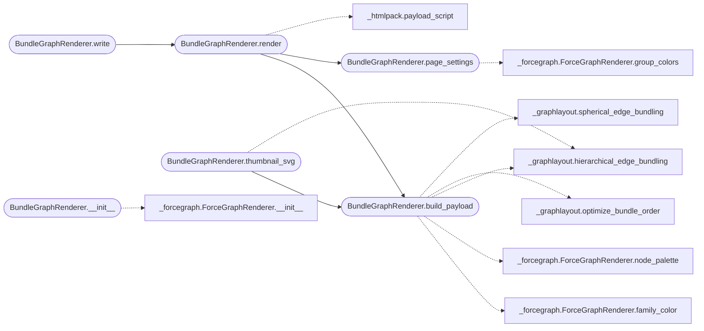

# `readmenator._bundlegraph`

> Source: [readmenator/_bundlegraph.py:1](../../readmenator/_bundlegraph.py#L1) | language `py` | coverage 100.0% | [API index](../index.md)

Edge bundle explorer: circle and sphere hierarchical edge bundling pages.

Turns the force-graph payload (file nodes with community, layer,
language, PageRank, purpose; file-to-file dependency edges) into a
compact bundle payload. Leaf positions come from _graphlayout: a circle
grouped by community for the 2D view (hierarchical_edge_bundling) and a
sphere of community caps for the 3D view (spherical_edge_bundling). The
page in _bundlegraph_page.py routes every edge through the community
hubs itself, so the bundling strength stays adjustable in the browser.
The page is self-contained: no CDN, no fonts, no network.

## Contents

- **Classes:** [`BundleGraphRenderer`](#bundlegraphrenderer)
- **Constants:** [`BUNDLE_RELATIONS`](#bundle_relations), [`UNASSIGNED_KEY`](#unassigned_key), [`COORD_DIGITS`](#coord_digits)

## Call Graph

Solid arrows stay in this module, dashed arrows leave it.



## Classes

<a id="bundlegraphrenderer"></a>

### `BundleGraphRenderer`

`class` | [readmenator/_bundlegraph.py:49](../../readmenator/_bundlegraph.py#L49)

```python
class BundleGraphRenderer
```

Builds the bundle payload and renders the edge bundle explorer page.

**Members**

| Member | Kind | Summary |
|---|---|---|
| [`__init__`](#bundlegraphrenderer-__init__) | constructor | Initialise with application configuration. |
| [`build_payload`](#bundlegraphrenderer-build_payload) | method | Derive the bundle payload from a force-graph payload. |
| [`page_settings`](#bundlegraphrenderer-page_settings) | method | Collect the page settings serialized into the HTML. |
| [`render`](#bundlegraphrenderer-render) | method | Render the standalone edge bundle explorer HTML document. |
| [`write`](#bundlegraphrenderer-write) | method | Write the edge bundle explorer HTML document. |
| [`thumbnail_svg`](#bundlegraphrenderer-thumbnail_svg) | method | Render a small circular bundle preview as inline SVG. |

<a id="bundlegraphrenderer-__init__"></a>

#### `BundleGraphRenderer.__init__`

`constructor` | [readmenator/_bundlegraph.py:52](../../readmenator/_bundlegraph.py#L52)

```python
def __init__(self, config: Config) -> None
```

Initialise with application configuration.

**Parameters**

| Name | Type | Default | Description |
|---|---|---|---|
| `config` | `Config` |  | Settings for bundling, camera, labels, and palettes. |

*Calls:* [`ForceGraphRenderer.__init__`](readmenator._forcegraph.py.md#forcegraphrenderer-__init__)

*Called by:* [`AnalyzerFactory.bundlegraph`](readmenator._pipeline.py.md#analyzerfactory-bundlegraph)

<a id="bundlegraphrenderer-build_payload"></a>

#### `BundleGraphRenderer.build_payload`

`method` | [readmenator/_bundlegraph.py:61](../../readmenator/_bundlegraph.py#L61)

```python
def build_payload(self, force_payload: Dict[str, List[Dict[str, Any]]]) -> Dict[str, Any]
```

Derive the bundle payload from a force-graph payload.

Communities start in analyzer order (largest first) and files
without a community form a trailing unassigned group. With
BUNDLEGRAPH_ORDER_OPTIMIZE the group order and member order are
then optimized to shorten bundles (optimize_bundle_order: 2-opt
group order, center-out hubs, barycentric sweeps) and members
inside each sphere cap face their neighbours. Edges are distinct
directed file pairs.

**Parameters**

| Name | Type | Default | Description |
|---|---|---|---|
| `force_payload` | `Dict[str, List[Dict[str, Any]]]` |  | Payload from ForceGraphRenderer.build_payload. |

**Returns:** `Dict[str, Any]` - Dictionary with nodes, groups, and edges for the page.

*Calls:* [`ForceGraphRenderer.family_color`](readmenator._forcegraph.py.md#forcegraphrenderer-family_color), [`ForceGraphRenderer.node_palette`](readmenator._forcegraph.py.md#forcegraphrenderer-node_palette), [`hierarchical_edge_bundling`](readmenator._graphlayout.py.md#hierarchical_edge_bundling), [`optimize_bundle_order`](readmenator._graphlayout.py.md#optimize_bundle_order), [`spherical_edge_bundling`](readmenator._graphlayout.py.md#spherical_edge_bundling)

*Called by:* [`BundleGraphRenderer.render`](#bundlegraphrenderer-render), [`BundleGraphRenderer.thumbnail_svg`](#bundlegraphrenderer-thumbnail_svg)

<a id="bundlegraphrenderer-page_settings"></a>

#### `BundleGraphRenderer.page_settings`

`method` | [readmenator/_bundlegraph.py:182](../../readmenator/_bundlegraph.py#L182)

```python
def page_settings(self, force_payload: Dict[str, List[Dict[str, Any]]], explorer_href: Optional[str], live_api: bool = False) -> Dict[str, Any]
```

Collect the page settings serialized into the HTML.

**Parameters**

| Name | Type | Default | Description |
|---|---|---|---|
| `force_payload` | `Dict[str, List[Dict[str, Any]]]` |  | Force-graph payload (for layer and language colors). |
| `explorer_href` | `Optional[str]` |  | Relative link to the force-graph explorer, or None. |
| `live_api` | `bool` | `False` | True when served by a live server with api/source. |

**Returns:** `Dict[str, Any]` - JSON-serializable settings for bundling, camera, labels, and palettes.

*Calls:* [`ForceGraphRenderer.group_colors`](readmenator._forcegraph.py.md#forcegraphrenderer-group_colors)

*Called by:* [`BundleGraphRenderer.render`](#bundlegraphrenderer-render)

<a id="bundlegraphrenderer-render"></a>

#### `BundleGraphRenderer.render`

`method` | [readmenator/_bundlegraph.py:226](../../readmenator/_bundlegraph.py#L226)

```python
def render(self, force_payload: Dict[str, List[Dict[str, Any]]], title: str = 'Edge Bundles', home_href: Optional[str] = 'index.html', explorer_href: Optional[str] = None, live_api: bool = False) -> str
```

Render the standalone edge bundle explorer HTML document.

**Parameters**

| Name | Type | Default | Description |
|---|---|---|---|
| `force_payload` | `Dict[str, List[Dict[str, Any]]]` |  | Payload from ForceGraphRenderer.build_payload. |
| `title` | `str` | `'Edge Bundles'` | Document title shown in the header. |
| `home_href` | `Optional[str]` | `'index.html'` | Optional gallery home link; omitted when None. |
| `explorer_href` | `Optional[str]` | `None` | Optional link to the force-graph explorer page. |
| `live_api` | `bool` | `False` | True when served by a live server with api/source. |

**Returns:** `str` - Complete HTML document as a string.

*Calls:* [`BundleGraphRenderer.build_payload`](#bundlegraphrenderer-build_payload), [`BundleGraphRenderer.page_settings`](#bundlegraphrenderer-page_settings), [`payload_script`](readmenator._htmlpack.py.md#payload_script)

*Called by:* [`BundleGraphRenderer.write`](#bundlegraphrenderer-write)

<a id="bundlegraphrenderer-write"></a>

#### `BundleGraphRenderer.write`

`method` | [readmenator/_bundlegraph.py:265](../../readmenator/_bundlegraph.py#L265)

```python
def write(self, output_path: str | Path, force_payload: Dict[str, List[Dict[str, Any]]], title: str = 'Edge Bundles', home_href: Optional[str] = 'index.html', explorer_href: Optional[str] = None) -> str
```

Write the edge bundle explorer HTML document.

**Parameters**

| Name | Type | Default | Description |
|---|---|---|---|
| `output_path` | `str \| Path` |  | Destination HTML file path. |
| `force_payload` | `Dict[str, List[Dict[str, Any]]]` |  | Payload from ForceGraphRenderer.build_payload. |
| `title` | `str` | `'Edge Bundles'` | Document title shown in the header. |
| `home_href` | `Optional[str]` | `'index.html'` | Gallery home link relative to the page; None omits it. |
| `explorer_href` | `Optional[str]` | `None` | Force-graph explorer link relative to the page. |

**Returns:** `str` - Rendered HTML content that was written.

*Calls:* [`BundleGraphRenderer.render`](#bundlegraphrenderer-render)

<a id="bundlegraphrenderer-thumbnail_svg"></a>

#### `BundleGraphRenderer.thumbnail_svg`

`method` | [readmenator/_bundlegraph.py:291](../../readmenator/_bundlegraph.py#L291)

```python
def thumbnail_svg(self, force_payload: Dict[str, List[Dict[str, Any]]]) -> str
```

Render a small circular bundle preview as inline SVG.

The busiest edges (by endpoint PageRank) are drawn as bundled
B-splines in their source color; only numbers and escaped colors
reach the markup.

**Parameters**

| Name | Type | Default | Description |
|---|---|---|---|
| `force_payload` | `Dict[str, List[Dict[str, Any]]]` |  | Payload from ForceGraphRenderer.build_payload. |

**Returns:** `str` - SVG markup, or an empty string when there are no files.

*Calls:* [`BundleGraphRenderer.build_payload`](#bundlegraphrenderer-build_payload), [`hierarchical_edge_bundling`](readmenator._graphlayout.py.md#hierarchical_edge_bundling)

---

## Constants

<a id="bundle_relations"></a>

### `BUNDLE_RELATIONS`

`constant` | [readmenator/_bundlegraph.py:30](../../readmenator/_bundlegraph.py#L30)

```python
BUNDLE_RELATIONS = ('resolved_imports', 'imports', 'calls', 'inherits')
```

---

<a id="unassigned_key"></a>

### `UNASSIGNED_KEY`

`constant` | [readmenator/_bundlegraph.py:32](../../readmenator/_bundlegraph.py#L32)

```python
UNASSIGNED_KEY = 'unassigned'
```

---

<a id="coord_digits"></a>

### `COORD_DIGITS`

`constant` | [readmenator/_bundlegraph.py:34](../../readmenator/_bundlegraph.py#L34)

```python
COORD_DIGITS = 5
```

---
