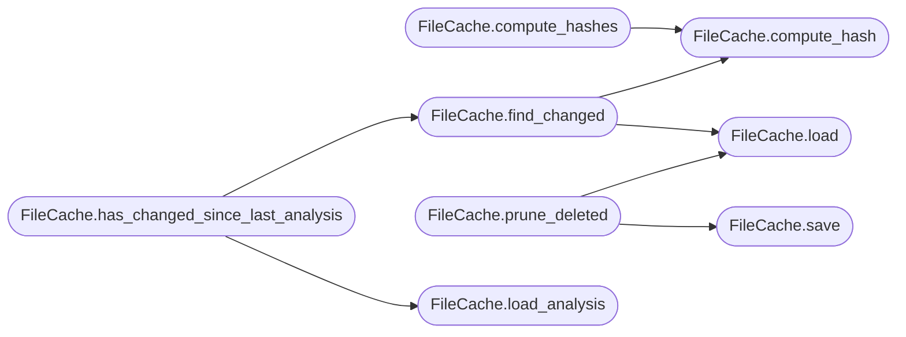

# `readmenator._cache`

> Source: [readmenator/_cache.py:1](../../readmenator/_cache.py#L1) | language `py` | coverage 50.0% | [API index](../index.md)

File-content hash cache for incremental scanning and analysis caching.

Computes SHA256 digests of file contents and persists them to disk
so that subsequent scans can skip unchanged files. Also supports
caching of analysis results (security findings, v2 analysis, etc.)
for faster incremental rebuilds.

## Contents

- **Classes:** [`FileCache`](#filecache)
- **Functions:** [`source_fingerprint`](#source_fingerprint)

## Call Graph

Solid arrows stay in this module, dashed arrows leave it.



## Classes

<a id="filecache"></a>

### `FileCache`

`class` | [readmenator/_cache.py:20](../../readmenator/_cache.py#L20)

```python
class FileCache
```

SHA256-based cache for incremental file scanning and analysis.

Stores a JSON mapping of relative file paths to their content
hashes inside the project's cache directory. On subsequent runs,
files whose hash matches the cached value are skipped.

Also caches analysis results so that unchanged files reuse
previously-computed security findings, taint paths, etc.

**Members**

| Member | Kind | Summary |
|---|---|---|
| [`__init__`](#filecache-__init__) | constructor |  |
| [`load`](#filecache-load) | method |  |
| [`save`](#filecache-save) | method |  |
| [`compute_hash`](#filecache-compute_hash) | method |  |
| [`compute_hashes`](#filecache-compute_hashes) | method |  |
| [`find_changed`](#filecache-find_changed) | method |  |
| [`prune_deleted`](#filecache-prune_deleted) | method |  |
| [`save_analysis`](#filecache-save_analysis) | method | Save an analysis result to the semantic cache. |
| [`load_analysis`](#filecache-load_analysis) | method | Load a previously cached analysis result. |
| [`clear_analysis`](#filecache-clear_analysis) | method | Clear analysis cache, optionally for a specific key only. |
| [`has_changed_since_last_analysis`](#filecache-has_changed_since_last_analysis) | method | Check if any file has changed since the last analysis cache. |

<a id="filecache-__init__"></a>

#### `FileCache.__init__`

`constructor` | [readmenator/_cache.py:31](../../readmenator/_cache.py#L31)

```python
def __init__(self, config: Config, project_root: str)
```

**Parameters**

| Name | Type | Default | Description |
|---|---|---|---|
| `config` | `Config` |  |  |
| `project_root` | `str` |  |  |

*Called by:* [`readmenatorApplication.run`](readmenator._app.py.md#readmenatorapplication-run), [`readmenatorApplication.update`](readmenator._app.py.md#readmenatorapplication-update)

<a id="filecache-load"></a>

#### `FileCache.load`

`method` | [readmenator/_cache.py:38](../../readmenator/_cache.py#L38)

```python
def load(self) -> Dict[str, str]
```

**Returns:** `Dict[str, str]`

*Called by:* [`FileCache.find_changed`](#filecache-find_changed), [`FileCache.prune_deleted`](#filecache-prune_deleted)

<a id="filecache-save"></a>

#### `FileCache.save`

`method` | [readmenator/_cache.py:49](../../readmenator/_cache.py#L49)

```python
def save(self, hashes: Dict[str, str]) -> None
```

**Parameters**

| Name | Type | Default | Description |
|---|---|---|---|
| `hashes` | `Dict[str, str]` |  |  |

*Called by:* [`readmenatorApplication.run`](readmenator._app.py.md#readmenatorapplication-run), [`FileCache.prune_deleted`](#filecache-prune_deleted)

<a id="filecache-compute_hash"></a>

#### `FileCache.compute_hash`

`method` | [readmenator/_cache.py:55](../../readmenator/_cache.py#L55)

```python
def compute_hash(self, file_path: Path) -> str
```

**Parameters**

| Name | Type | Default | Description |
|---|---|---|---|
| `file_path` | `Path` |  |  |

**Returns:** `str`

*Called by:* [`FileCache.compute_hashes`](#filecache-compute_hashes), [`FileCache.find_changed`](#filecache-find_changed)

<a id="filecache-compute_hashes"></a>

#### `FileCache.compute_hashes`

`method` | [readmenator/_cache.py:64](../../readmenator/_cache.py#L64)

```python
def compute_hashes(self, file_paths: Dict[str, Path]) -> Dict[str, str]
```

**Parameters**

| Name | Type | Default | Description |
|---|---|---|---|
| `file_paths` | `Dict[str, Path]` |  |  |

**Returns:** `Dict[str, str]`

*Calls:* [`FileCache.compute_hash`](#filecache-compute_hash)

*Called by:* [`readmenatorApplication.run`](readmenator._app.py.md#readmenatorapplication-run)

<a id="filecache-find_changed"></a>

#### `FileCache.find_changed`

`method` | [readmenator/_cache.py:72](../../readmenator/_cache.py#L72)

```python
def find_changed(self, file_paths: Dict[str, Path]) -> Set[str]
```

**Parameters**

| Name | Type | Default | Description |
|---|---|---|---|
| `file_paths` | `Dict[str, Path]` |  |  |

**Returns:** `Set[str]`

*Calls:* [`FileCache.compute_hash`](#filecache-compute_hash), [`FileCache.load`](#filecache-load)

*Called by:* [`FileCache.has_changed_since_last_analysis`](#filecache-has_changed_since_last_analysis)

<a id="filecache-prune_deleted"></a>

#### `FileCache.prune_deleted`

`method` | [readmenator/_cache.py:84](../../readmenator/_cache.py#L84)

```python
def prune_deleted(self, current_file_ids: Set[str]) -> None
```

**Parameters**

| Name | Type | Default | Description |
|---|---|---|---|
| `current_file_ids` | `Set[str]` |  |  |

*Calls:* [`FileCache.load`](#filecache-load), [`FileCache.save`](#filecache-save)

<a id="filecache-save_analysis"></a>

#### `FileCache.save_analysis`

`method` | [readmenator/_cache.py:95](../../readmenator/_cache.py#L95)

```python
def save_analysis(self, key: str, data: Dict[str, Any]) -> None
```

Save an analysis result to the semantic cache.

**Parameters**

| Name | Type | Default | Description |
|---|---|---|---|
| `key` | `str` |  | Cache key (e.g. "security", "analysis_v2", "taint"). |
| `data` | `Dict[str, Any]` |  | Serializable analysis data. |

*Called by:* [`readmenatorApplication.run`](readmenator._app.py.md#readmenatorapplication-run), [`readmenatorApplication.update`](readmenator._app.py.md#readmenatorapplication-update)

<a id="filecache-load_analysis"></a>

#### `FileCache.load_analysis`

`method` | [readmenator/_cache.py:118](../../readmenator/_cache.py#L118)

```python
def load_analysis(self, key: str) -> Optional[Dict[str, Any]]
```

Load a previously cached analysis result.

**Parameters**

| Name | Type | Default | Description |
|---|---|---|---|
| `key` | `str` |  | Cache key. |

**Returns:** `Optional[Dict[str, Any]]` - Cached data dict, or None if not found or expired.

*Called by:* [`readmenatorApplication.update`](readmenator._app.py.md#readmenatorapplication-update), [`FileCache.has_changed_since_last_analysis`](#filecache-has_changed_since_last_analysis)

<a id="filecache-clear_analysis"></a>

#### `FileCache.clear_analysis`

`method` | [readmenator/_cache.py:135](../../readmenator/_cache.py#L135)

```python
def clear_analysis(self, key: Optional[str] = None) -> None
```

Clear analysis cache, optionally for a specific key only.

**Parameters**

| Name | Type | Default | Description |
|---|---|---|---|
| `key` | `Optional[str]` | `None` | If given, only clears this key. Otherwise clears all. |

<a id="filecache-has_changed_since_last_analysis"></a>

#### `FileCache.has_changed_since_last_analysis`

`method` | [readmenator/_cache.py:166](../../readmenator/_cache.py#L166)

```python
def has_changed_since_last_analysis(self, file_paths: Dict[str, Path]) -> bool
```

Check if any file has changed since the last analysis cache.

Returns True if there are no cached hashes (first run) or if
any file hash differs from the cached value.

**Parameters**

| Name | Type | Default | Description |
|---|---|---|---|
| `file_paths` | `Dict[str, Path]` |  |  |

**Returns:** `bool`

*Calls:* [`FileCache.find_changed`](#filecache-find_changed), [`FileCache.load_analysis`](#filecache-load_analysis)

*Called by:* [`readmenatorApplication.update`](readmenator._app.py.md#readmenatorapplication-update)

---

## Functions

<a id="source_fingerprint"></a>

### `source_fingerprint`

`function` | [readmenator/_cache.py:179](../../readmenator/_cache.py#L179)

```python
def source_fingerprint(project_root: str, file_ids: Iterable[str]) -> str
```

Return one SHA256 over the sorted paths and contents of scanned sources.

Generated documents embed this value; recomputing it later answers
"do the docs still describe these sources?" exactly, independent of
git commits (docs generated before a commit stay fresh after it).

**Parameters**

| Name | Type | Default | Description |
|---|---|---|---|
| `project_root` | `str` |  | Project root directory. |
| `file_ids` | `Iterable[str]` |  | Project-relative source paths that were scanned. |

**Returns:** `str` - Hex digest; missing, unreadable, or symlinked files hash as empty.

*Called by:* [`readmenatorApplication.check_freshness`](readmenator._app.py.md#readmenatorapplication-check_freshness), [`ComponentDiagramBuilder.build`](readmenator._components.py.md#componentdiagrambuilder-build)

---
