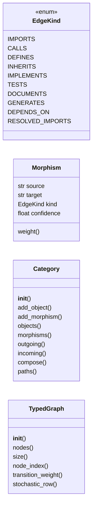
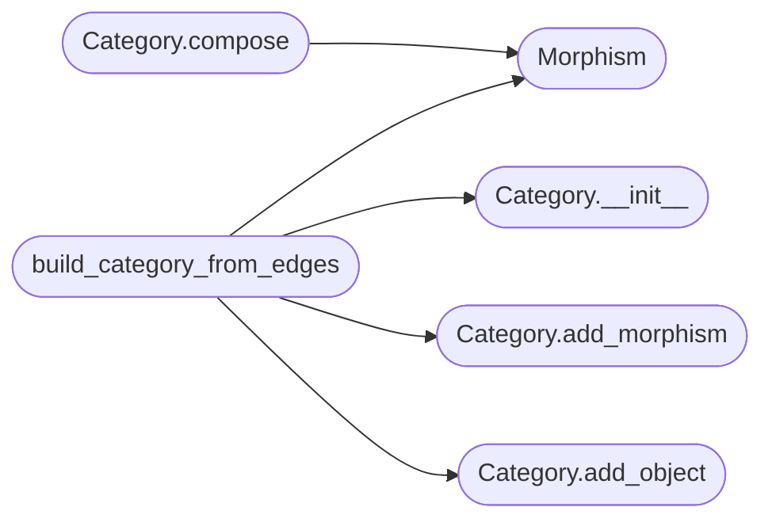

# `readmenator._category`

> Source: [readmenator/_category.py:1](../../readmenator/_category.py#L1) | language `py` | coverage 50.0% | [API index](../index.md)

Category theory model for the readmenator code graph.

Defines typed morphisms (edges with semantic kind), objects (file nodes),
and a Category class for algebraic path composition. Every edge in
the knowledge graph carries an EdgeKind that survives through to
ranking computations.

The gain from category theory is that ReadMenator can answer queries
by transformation, not just proximity:

- "What code implements this concept?"  -> documents -> defines
- "What breaks if I change this node?"  -> composition of reverse edges
- "What tests validate this abstraction?" -> defines <- tests
- "How do I get from public API to impl?" -> composite paths

## Contents

- **Classes:** [`Morphism`](#morphism), [`Category`](#category), [`TypedGraph`](#typedgraph)
- **Enums:** [`EdgeKind`](#edgekind)
- **Functions:** [`build_category_from_edges`](#build_category_from_edges)
- **Constants:** [`EDGE_WEIGHTS`](#edge_weights)

## Type Diagram



## Call Graph

Solid arrows stay in this module, dashed arrows leave it.



## Classes

<a id="morphism"></a>

### `Morphism`

`class` `dataclass` | [readmenator/_category.py:57](../../readmenator/_category.py#L57)

Decorators: `@dataclass(frozen=True)`

```python
class Morphism
```

A typed directed edge between two code artifacts.

**Attributes**

| Name | Type | Default | Description |
|---|---|---|---|
| [`source`](#morphism-source) | `str` |  | Node ID of the source artifact. |
| [`target`](#morphism-target) | `str` |  | Node ID of the target artifact. |
| [`kind`](#morphism-kind) | `EdgeKind` |  | Semantic type of the relationship. |
| [`confidence`](#morphism-confidence) | `float` | `1.0` | Confidence score from static analysis (0.0 to 1.0). |

**Members**

| Member | Kind | Summary |
|---|---|---|
| [`weight`](#morphism-weight) | property | Effective weight for ranking = semantic weight * confidence. |

<a id="morphism-weight"></a>

#### `Morphism.weight`

`property` | [readmenator/_category.py:73](../../readmenator/_category.py#L73)

Decorators: `@property`

```python
def weight(self) -> float
```

Effective weight for ranking = semantic weight * confidence.

**Returns:** `float`

---

<a id="category"></a>

### `Category`

`class` | [readmenator/_category.py:78](../../readmenator/_category.py#L78)

```python
class Category
```

A category of code artifacts with typed morphisms.

Objects are node IDs (file paths or symbol identifiers).
Morphisms are typed directed edges. Composition follows
compatible source/target chains respecting edge-kind semantics.

**Members**

| Member | Kind | Summary |
|---|---|---|
| [`__init__`](#category-__init__) | constructor |  |
| [`add_object`](#category-add_object) | method |  |
| [`add_morphism`](#category-add_morphism) | method |  |
| [`objects`](#category-objects) | property |  |
| [`morphisms`](#category-morphisms) | property |  |
| [`outgoing`](#category-outgoing) | method |  |
| [`incoming`](#category-incoming) | method |  |
| [`compose`](#category-compose) | method | Compose two morphisms if target of a matches source of b. |
| [`paths`](#category-paths) | method | Find all composition paths from source to target up to max_depth. |

<a id="category-__init__"></a>

#### `Category.__init__`

`constructor` | [readmenator/_category.py:86](../../readmenator/_category.py#L86)

```python
def __init__(self) -> None
```

*Called by:* [`build_category_from_edges`](#build_category_from_edges), [`apply_view`](readmenator._projections.py.md#apply_view), [`file_pagerank`](readmenator._rank.py.md#file_pagerank)

<a id="category-add_object"></a>

#### `Category.add_object`

`method` | [readmenator/_category.py:92](../../readmenator/_category.py#L92)

```python
def add_object(self, obj_id: str) -> None
```

**Parameters**

| Name | Type | Default | Description |
|---|---|---|---|
| `obj_id` | `str` |  |  |

*Called by:* [`build_category_from_edges`](#build_category_from_edges), [`apply_view`](readmenator._projections.py.md#apply_view), [`file_pagerank`](readmenator._rank.py.md#file_pagerank)

<a id="category-add_morphism"></a>

#### `Category.add_morphism`

`method` | [readmenator/_category.py:95](../../readmenator/_category.py#L95)

```python
def add_morphism(self, m: Morphism) -> None
```

**Parameters**

| Name | Type | Default | Description |
|---|---|---|---|
| `m` | `Morphism` |  |  |

*Called by:* [`build_category_from_edges`](#build_category_from_edges), [`apply_view`](readmenator._projections.py.md#apply_view), [`file_pagerank`](readmenator._rank.py.md#file_pagerank)

<a id="category-objects"></a>

#### `Category.objects`

`property` | [readmenator/_category.py:103](../../readmenator/_category.py#L103)

Decorators: `@property`

```python
def objects(self) -> Set[str]
```

**Returns:** `Set[str]`

<a id="category-morphisms"></a>

#### `Category.morphisms`

`property` | [readmenator/_category.py:107](../../readmenator/_category.py#L107)

Decorators: `@property`

```python
def morphisms(self) -> List[Morphism]
```

**Returns:** `List[Morphism]`

<a id="category-outgoing"></a>

#### `Category.outgoing`

`method` | [readmenator/_category.py:110](../../readmenator/_category.py#L110)

```python
def outgoing(self, obj_id: str) -> List[Morphism]
```

**Parameters**

| Name | Type | Default | Description |
|---|---|---|---|
| `obj_id` | `str` |  |  |

**Returns:** `List[Morphism]`

*Called by:* [`explain_rank`](readmenator._explain.py.md#explain_rank)

<a id="category-incoming"></a>

#### `Category.incoming`

`method` | [readmenator/_category.py:113](../../readmenator/_category.py#L113)

```python
def incoming(self, obj_id: str) -> List[Morphism]
```

**Parameters**

| Name | Type | Default | Description |
|---|---|---|---|
| `obj_id` | `str` |  |  |

**Returns:** `List[Morphism]`

<a id="category-compose"></a>

#### `Category.compose`

`method` | [readmenator/_category.py:116](../../readmenator/_category.py#L116)

```python
def compose(self, a: Morphism, b: Morphism) -> Optional[Morphism]
```

Compose two morphisms if target of a matches source of b.

Returns a new Morphism with composite kind, or None if
the kinds are incompatible.

**Parameters**

| Name | Type | Default | Description |
|---|---|---|---|
| `a` | `Morphism` |  |  |
| `b` | `Morphism` |  |  |

**Returns:** `Optional[Morphism]`

*Calls:* [`Morphism`](#morphism)

<a id="category-paths"></a>

#### `Category.paths`

`method` | [readmenator/_category.py:133](../../readmenator/_category.py#L133)

```python
def paths(self, source: str, target: str, max_depth: int = 10) -> List[List[Morphism]]
```

Find all composition paths from source to target up to max_depth.

**Parameters**

| Name | Type | Default | Description |
|---|---|---|---|
| `source` | `str` |  |  |
| `target` | `str` |  |  |
| `max_depth` | `int` | `10` |  |

**Returns:** `List[List[Morphism]]`

---

<a id="typedgraph"></a>

### `TypedGraph`

`class` | [readmenator/_category.py:181](../../readmenator/_category.py#L181)

```python
class TypedGraph
```

Weighted directed graph for PageRank computations.

Converts a Category into a stochastic transition matrix suitable
for eigenvalue computation, preserving edge kind weights.

**Members**

| Member | Kind | Summary |
|---|---|---|
| [`__init__`](#typedgraph-__init__) | constructor |  |
| [`nodes`](#typedgraph-nodes) | property |  |
| [`size`](#typedgraph-size) | property |  |
| [`node_index`](#typedgraph-node_index) | method |  |
| [`transition_weight`](#typedgraph-transition_weight) | method | Sum of weights of all morphisms from source to target. |
| [`stochastic_row`](#typedgraph-stochastic_row) | method | Return dict of target -> probability for the row of *source*. |

<a id="typedgraph-__init__"></a>

#### `TypedGraph.__init__`

`constructor` | [readmenator/_category.py:188](../../readmenator/_category.py#L188)

```python
def __init__(self, category: Category) -> None
```

**Parameters**

| Name | Type | Default | Description |
|---|---|---|---|
| `category` | `Category` |  |  |

*Called by:* [`AnalyzerFactory.build_typed_graph`](readmenator._pipeline.py.md#analyzerfactory-build_typed_graph), [`file_pagerank`](readmenator._rank.py.md#file_pagerank)

<a id="typedgraph-nodes"></a>

#### `TypedGraph.nodes`

`property` | [readmenator/_category.py:203](../../readmenator/_category.py#L203)

Decorators: `@property`

```python
def nodes(self) -> List[str]
```

**Returns:** `List[str]`

<a id="typedgraph-size"></a>

#### `TypedGraph.size`

`property` | [readmenator/_category.py:207](../../readmenator/_category.py#L207)

Decorators: `@property`

```python
def size(self) -> int
```

**Returns:** `int`

<a id="typedgraph-node_index"></a>

#### `TypedGraph.node_index`

`method` | [readmenator/_category.py:210](../../readmenator/_category.py#L210)

```python
def node_index(self, node_id: str) -> int
```

**Parameters**

| Name | Type | Default | Description |
|---|---|---|---|
| `node_id` | `str` |  |  |

**Returns:** `int`

<a id="typedgraph-transition_weight"></a>

#### `TypedGraph.transition_weight`

`method` | [readmenator/_category.py:213](../../readmenator/_category.py#L213)

```python
def transition_weight(self, source: str, target: str) -> float
```

Sum of weights of all morphisms from source to target.

**Parameters**

| Name | Type | Default | Description |
|---|---|---|---|
| `source` | `str` |  |  |
| `target` | `str` |  |  |

**Returns:** `float`

<a id="typedgraph-stochastic_row"></a>

#### `TypedGraph.stochastic_row`

`method` | [readmenator/_category.py:221](../../readmenator/_category.py#L221)

```python
def stochastic_row(self, source: str) -> Dict[str, float]
```

Return dict of target -> probability for the row of *source*.

Probabilities sum to 1.0 if source has outgoing edges.
Returns empty dict for dangling nodes.

**Parameters**

| Name | Type | Default | Description |
|---|---|---|---|
| `source` | `str` |  |  |

**Returns:** `Dict[str, float]`

*Called by:* [`global_pagerank`](readmenator._rank.py.md#global_pagerank), [`hits`](readmenator._rank.py.md#hits), [`personalized_pagerank`](readmenator._rank.py.md#personalized_pagerank)

---

## Enums

<a id="edgekind"></a>

### `EdgeKind`

`enum` | [readmenator/_category.py:24](../../readmenator/_category.py#L24)

```python
class EdgeKind(str, Enum)
```

Bases: `str`, `Enum`

Semantic type of a morphism between two code artifacts.

**Attributes**

| Name | Type | Default | Description |
|---|---|---|---|
| [`IMPORTS`](#edgekind-imports) |  | `'imports'` |  |
| [`CALLS`](#edgekind-calls) |  | `'calls'` |  |
| [`DEFINES`](#edgekind-defines) |  | `'defines'` |  |
| [`INHERITS`](#edgekind-inherits) |  | `'inherits'` |  |
| [`IMPLEMENTS`](#edgekind-implements) |  | `'implements'` |  |
| [`TESTS`](#edgekind-tests) |  | `'tests'` |  |
| [`DOCUMENTS`](#edgekind-documents) |  | `'documents'` |  |
| [`GENERATES`](#edgekind-generates) |  | `'generates'` |  |
| [`DEPENDS_ON`](#edgekind-depends_on) |  | `'depends_on'` |  |
| [`RESOLVED_IMPORTS`](#edgekind-resolved_imports) |  | `'resolved_imports'` |  |

---

## Functions

<a id="build_category_from_edges"></a>

### `build_category_from_edges`

`function` | [readmenator/_category.py:236](../../readmenator/_category.py#L236)

```python
def build_category_from_edges(edges: List['Edge'], resolved_edges: Optional[List['Edge']] = None, node_ids: Optional[Set[str]] = None) -> Category
```

Build a Category from lists of Edge objects.

Maps Edge.relation strings to EdgeKind where possible.
Unrecognised relation strings are mapped to DEPENDS_ON.

**Parameters**

| Name | Type | Default | Description |
|---|---|---|---|
| `edges` | `List['Edge']` |  | Raw import edges from the scanner. |
| `resolved_edges` | `Optional[List['Edge']]` | `None` | Optional resolved-import edges. |
| `node_ids` | `Optional[Set[str]]` | `None` | Optional set of valid node IDs to include. |

**Returns:** `Category` - A populated Category instance.

*Calls:* [`Category.__init__`](#category-__init__), [`Category.add_morphism`](#category-add_morphism), [`Category.add_object`](#category-add_object), [`Morphism`](#morphism)

*Called by:* [`AnalyzerFactory.build_typed_graph`](readmenator._pipeline.py.md#analyzerfactory-build_typed_graph), [`QueryEngine.ranked_query`](readmenator._query.py.md#queryengine-ranked_query)

---

## Constants

<a id="edge_weights"></a>

### `EDGE_WEIGHTS`

`constant` | [readmenator/_category.py:42](../../readmenator/_category.py#L42)

```python
EDGE_WEIGHTS: Dict[EdgeKind, float]
```

---
