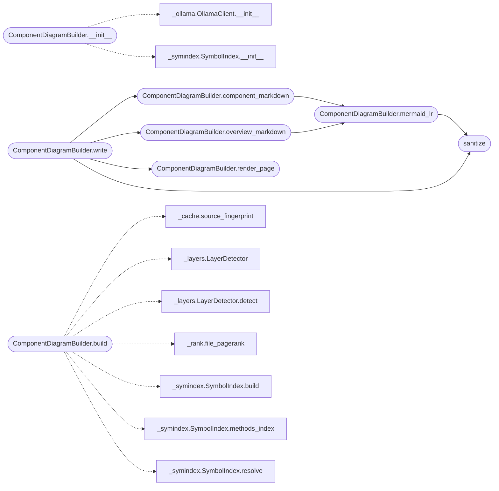

# `readmenator._components`

> Source: [readmenator/_components.py:1](../../readmenator/_components.py#L1) | language `py` | coverage 100.0% | [API index](../index.md)

Component architecture diagrams, token-free by default.

Builds an ``analysis.json`` (metadata, description, files,
methods_index, components with key entities and file methods,
component relations with method-level key edges and call sites)
from the readmenator scan, plus ``graph LR`` Mermaid overviews,
per-component markdown pages, and an offline interactive index.html
with the layered diagram. Structure is always deterministic static
analysis; prose descriptions may optionally be enriched through a
local Ollama daemon, with deterministic fallback.

## Contents

- **Classes:** [`ComponentDiagramBuilder`](#componentdiagrambuilder)
- **Functions:** [`sanitize`](#sanitize)

## Call Graph

Solid arrows stay in this module, dashed arrows leave it.



## Classes

<a id="componentdiagrambuilder"></a>

### `ComponentDiagramBuilder`

`class` | [readmenator/_components.py:57](../../readmenator/_components.py#L57)

```python
class ComponentDiagramBuilder
```

Builds component-diagram analysis from readmenator topology.

**Members**

| Member | Kind | Summary |
|---|---|---|
| [`__init__`](#componentdiagrambuilder-__init__) | constructor | Initialise with application configuration. |
| [`build`](#componentdiagrambuilder-build) | method | Build the full analysis document. |
| [`mermaid_lr`](#componentdiagrambuilder-mermaid_lr) | method | Render the ``graph LR`` overview diagram. |
| [`overview_markdown`](#componentdiagrambuilder-overview_markdown) | method | Render the overview page (diagram plus component details). |
| [`component_markdown`](#componentdiagrambuilder-component_markdown) | method | Render one expandable component's detail page. |
| [`write`](#componentdiagrambuilder-write) | method | Write analysis.json, the overview, component pages, and index.html. |
| [`render_page`](#componentdiagrambuilder-render_page) | method | Render the standalone interactive diagram page. |
| [`thumbnail_svg`](#componentdiagrambuilder-thumbnail_svg) | method | Render a small dagre-style preview as inline SVG. |

<a id="componentdiagrambuilder-__init__"></a>

#### `ComponentDiagramBuilder.__init__`

`constructor` | [readmenator/_components.py:60](../../readmenator/_components.py#L60)

```python
def __init__(self, config: Config) -> None
```

Initialise with application configuration.

**Parameters**

| Name | Type | Default | Description |
|---|---|---|---|
| `config` | `Config` |  | Settings for component budgets and Ollama enrichment. |

*Calls:* [`OllamaClient.__init__`](readmenator._ollama.py.md#ollamaclient-__init__), [`SymbolIndex.__init__`](readmenator._symindex.py.md#symbolindex-__init__)

*Called by:* [`AnalyzerFactory.components`](readmenator._pipeline.py.md#analyzerfactory-components)

<a id="componentdiagrambuilder-build"></a>

#### `ComponentDiagramBuilder.build`

`method` | [readmenator/_components.py:70](../../readmenator/_components.py#L70)

```python
def build(self, nodes: List[Node], edges: List[Edge], resolved_edges: Optional[List[Edge]] = None, analysis: Optional[AnalysisResult] = None, project_root: str = '.', content_map: Optional[Dict[str, str]] = None) -> Dict[str, Any]
```

Build the full analysis document.

**Parameters**

| Name | Type | Default | Description |
|---|---|---|---|
| `nodes` | `List[Node]` |  | Scanned file nodes. |
| `edges` | `List[Edge]` |  | Raw import edges. |
| `resolved_edges` | `Optional[List[Edge]]` | `None` | Optional resolved-import edges. |
| `analysis` | `Optional[AnalysisResult]` | `None` | Optional community analysis (components source). |
| `project_root` | `str` | `'.'` | Project root for the source-tree hash. |
| `content_map` | `Optional[Dict[str, str]]` | `None` | Optional file contents for call-site lines. |

**Returns:** `Dict[str, Any]` - JSON-serializable component/relation analysis document.

*Calls:* [`source_fingerprint`](readmenator._cache.py.md#source_fingerprint), [`LayerDetector`](readmenator._layers.py.md#layerdetector), [`LayerDetector.detect`](readmenator._layers.py.md#layerdetector-detect), [`file_pagerank`](readmenator._rank.py.md#file_pagerank), [`SymbolIndex.build`](readmenator._symindex.py.md#symbolindex-build), [`SymbolIndex.methods_index`](readmenator._symindex.py.md#symbolindex-methods_index), [`SymbolIndex.resolve`](readmenator._symindex.py.md#symbolindex-resolve)

<a id="componentdiagrambuilder-mermaid_lr"></a>

#### `ComponentDiagramBuilder.mermaid_lr`

`method` | [readmenator/_components.py:165](../../readmenator/_components.py#L165)

```python
def mermaid_lr(self, components: List[Dict[str, Any]], relations: List[Dict[str, Any]], docs_ref: str = '.') -> str
```

Render the ``graph LR`` overview diagram.

**Parameters**

| Name | Type | Default | Description |
|---|---|---|---|
| `components` | `List[Dict[str, Any]]` |  | Component records from build(). |
| `relations` | `List[Dict[str, Any]]` |  | Relation records from build(). |
| `docs_ref` | `str` | `'.'` | Base href for per-component detail pages. |

**Returns:** `str` - Fenced Mermaid block with nodes, labeled edges, and clicks.

*Calls:* [`sanitize`](#sanitize)

*Called by:* [`ComponentDiagramBuilder.component_markdown`](#componentdiagrambuilder-component_markdown), [`ComponentDiagramBuilder.overview_markdown`](#componentdiagrambuilder-overview_markdown)

<a id="componentdiagrambuilder-overview_markdown"></a>

#### `ComponentDiagramBuilder.overview_markdown`

`method` | [readmenator/_components.py:199](../../readmenator/_components.py#L199)

```python
def overview_markdown(self, analysis: Dict[str, Any], docs_ref: str = '.', rel_prefix: str = '..') -> str
```

Render the overview page (diagram plus component details).

**Parameters**

| Name | Type | Default | Description |
|---|---|---|---|
| `analysis` | `Dict[str, Any]` |  | Document from build(). |
| `docs_ref` | `str` | `'.'` | Base href for per-component detail pages. |
| `rel_prefix` | `str` | `'..'` | Relative path from the output directory to the project root, so source file links resolve locally. |

**Returns:** `str` - Markdown text with the diagram, details, and related entities.

*Calls:* [`ComponentDiagramBuilder.mermaid_lr`](#componentdiagrambuilder-mermaid_lr)

*Called by:* [`ComponentDiagramBuilder.write`](#componentdiagrambuilder-write)

<a id="componentdiagrambuilder-component_markdown"></a>

#### `ComponentDiagramBuilder.component_markdown`

`method` | [readmenator/_components.py:247](../../readmenator/_components.py#L247)

```python
def component_markdown(self, component: Dict[str, Any]) -> str
```

Render one expandable component's detail page.

**Parameters**

| Name | Type | Default | Description |
|---|---|---|---|
| `component` | `Dict[str, Any]` |  | Component record with nested components. |

**Returns:** `str` - Markdown with a nested diagram and sub-component details.

*Calls:* [`ComponentDiagramBuilder.mermaid_lr`](#componentdiagrambuilder-mermaid_lr)

*Called by:* [`ComponentDiagramBuilder.write`](#componentdiagrambuilder-write)

<a id="componentdiagrambuilder-write"></a>

#### `ComponentDiagramBuilder.write`

`method` | [readmenator/_components.py:275](../../readmenator/_components.py#L275)

```python
def write(self, analysis: Dict[str, Any], output_dir: str | Path, project_root: Optional[str] = None) -> Dict[str, str]
```

Write analysis.json, the overview, component pages, and index.html.

**Parameters**

| Name | Type | Default | Description |
|---|---|---|---|
| `analysis` | `Dict[str, Any]` |  | Document from build(). |
| `output_dir` | `str \| Path` |  | Destination directory. |
| `project_root` | `Optional[str]` | `None` | Optional project root used to prefix source file links so they resolve when browsing locally. |

**Returns:** `Dict[str, str]` - Mapping of page identifier to written file path.

*Calls:* [`ComponentDiagramBuilder.component_markdown`](#componentdiagrambuilder-component_markdown), [`ComponentDiagramBuilder.overview_markdown`](#componentdiagrambuilder-overview_markdown), [`ComponentDiagramBuilder.render_page`](#componentdiagrambuilder-render_page), [`sanitize`](#sanitize)

<a id="componentdiagrambuilder-render_page"></a>

#### `ComponentDiagramBuilder.render_page`

`method` | [readmenator/_components.py:611](../../readmenator/_components.py#L611)

```python
def render_page(self, analysis: Dict[str, Any], title: str = 'Component Diagrams', home_href: Optional[str] = None, rel_prefix: str = '..', link_files: bool = True) -> str
```

Render the standalone interactive diagram page.

Offline layered left-to-right SVG with enriched boxes, labeled
arrows, hover descriptions, click-to-component, pan/zoom, PNG
export, and a light/dark theme toggle. Zero external requests.

**Parameters**

| Name | Type | Default | Description |
|---|---|---|---|
| `analysis` | `Dict[str, Any]` |  | Document from build(). |
| `title` | `str` | `'Component Diagrams'` | Document title shown in the header. |
| `home_href` | `Optional[str]` | `None` | Optional gallery home link; omitted when None. |
| `rel_prefix` | `str` | `'..'` | Relative path from the page directory to the project root for source file links. |
| `link_files` | `bool` | `True` | False renders source references as plain text (for site copies where sources are not published). |

**Returns:** `str` - Complete HTML document as a string.

*Called by:* [`ComponentDiagramBuilder.write`](#componentdiagrambuilder-write)

<a id="componentdiagrambuilder-thumbnail_svg"></a>

#### `ComponentDiagramBuilder.thumbnail_svg`

`method` | [readmenator/_components.py:738](../../readmenator/_components.py#L738)

```python
def thumbnail_svg(self, components: List[Dict[str, Any]], relations: List[Dict[str, Any]]) -> str
```

Render a small dagre-style preview as inline SVG.

Only numbers and escaped colors reach the markup, so the
fragment is safe to embed in the gallery card.

**Parameters**

| Name | Type | Default | Description |
|---|---|---|---|
| `components` | `List[Dict[str, Any]]` |  | Component records from build(). |
| `relations` | `List[Dict[str, Any]]` |  | Relation records from build(). |

**Returns:** `str` - SVG markup, or an empty string when there are no components.

---

## Functions

<a id="sanitize"></a>

### `sanitize`

`function` | [readmenator/_components.py:45](../../readmenator/_components.py#L45)

```python
def sanitize(name: str) -> str
```

Replace non-alphanumerics with underscores for Mermaid node ids.

**Parameters**

| Name | Type | Default | Description |
|---|---|---|---|
| `name` | `str` |  | Component or relation label. |

**Returns:** `str` - Valid Mermaid identifier (non-alphanumerics as underscores).

*Called by:* [`ComponentDiagramBuilder.mermaid_lr`](#componentdiagrambuilder-mermaid_lr), [`ComponentDiagramBuilder.write`](#componentdiagrambuilder-write)

---
