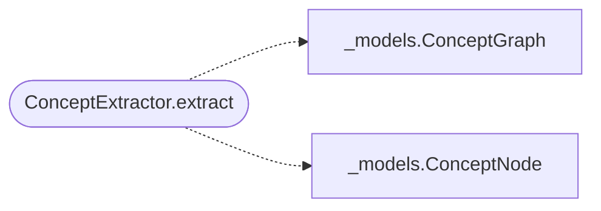

# `readmenator._concepts`

> Source: [readmenator/_concepts.py:1](../../readmenator/_concepts.py#L1) | language `py` | coverage 100.0% | [API index](../index.md)

Deterministic semantic concept graph over the structural knowledge graph.

Implements the second-brain parameters as an extra layer: nouns become
concept nodes, verbs become typed edges, every sentence is decomposed
atomically into individual tokens, and each noun maps to a file set.
Zero tokens, zero network, fully deterministic.

## Contents

- **Classes:** [`ConceptExtractor`](#conceptextractor)
- **Functions:** [`verb_for_relation`](#verb_for_relation)

## Call Graph

Solid arrows stay in this module, dashed arrows leave it.



## Classes

<a id="conceptextractor"></a>

### `ConceptExtractor`

`class` | [readmenator/_concepts.py:38](../../readmenator/_concepts.py#L38)

```python
class ConceptExtractor
```

Builds a ConceptGraph from scanned nodes and structural edges.

**Members**

| Member | Kind | Summary |
|---|---|---|
| [`__init__`](#conceptextractor-__init__) | constructor | Store configuration for concept extraction budgets. |
| [`extract`](#conceptextractor-extract) | method | Build concepts and verb relations from structural topology. |

<a id="conceptextractor-__init__"></a>

#### `ConceptExtractor.__init__`

`constructor` | [readmenator/_concepts.py:41](../../readmenator/_concepts.py#L41)

```python
def __init__(self, config: Config) -> None
```

Store configuration for concept extraction budgets.

**Parameters**

| Name | Type | Default | Description |
|---|---|---|---|
| `config` | `Config` |  |  |

*Called by:* [`AnalyzerFactory.concepts`](readmenator._pipeline.py.md#analyzerfactory-concepts)

<a id="conceptextractor-extract"></a>

#### `ConceptExtractor.extract`

`method` | [readmenator/_concepts.py:47](../../readmenator/_concepts.py#L47)

```python
def extract(self, nodes: List[Node], edges: List[Edge], resolved_edges: Optional[List[Edge]] = None) -> ConceptGraph
```

Build concepts and verb relations from structural topology.

**Parameters**

| Name | Type | Default | Description |
|---|---|---|---|
| `nodes` | `List[Node]` |  |  |
| `edges` | `List[Edge]` |  |  |
| `resolved_edges` | `Optional[List[Edge]]` | `None` |  |

**Returns:** `ConceptGraph`

*Calls:* [`ConceptGraph`](readmenator._models.py.md#conceptgraph), [`ConceptNode`](readmenator._models.py.md#conceptnode)

---

## Functions

<a id="verb_for_relation"></a>

### `verb_for_relation`

`function` | [readmenator/_concepts.py:33](../../readmenator/_concepts.py#L33)

```python
def verb_for_relation(relation: str) -> str
```

Return the verb label for a structural edge relation.

**Parameters**

| Name | Type | Default | Description |
|---|---|---|---|
| `relation` | `str` |  |  |

**Returns:** `str`

---
