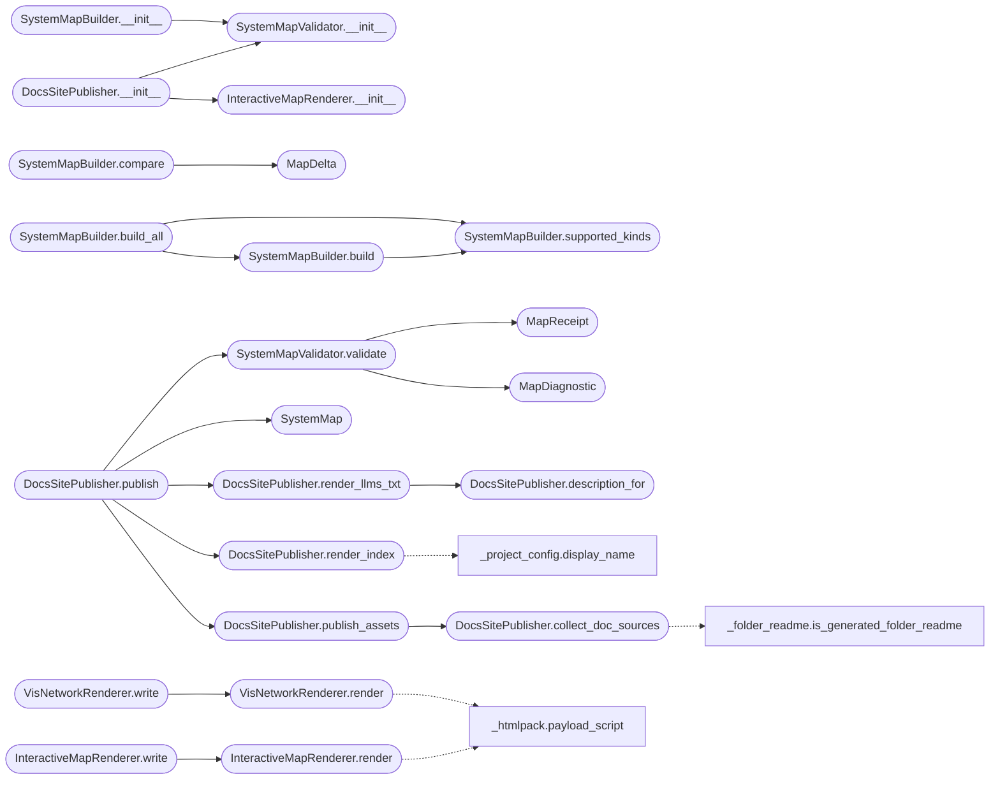

# `readmenator._diagrams`

> Source: [readmenator/_diagrams.py:1](../../readmenator/_diagrams.py#L1) | language `py` | coverage 100.0% | [API index](../index.md)

Self-contained interactive system maps for the knowledge graph.

Builds typed intermediate representations for five diagram kinds
(architecture, workflow, sequence, dataflow, lifecycle) from scanned
nodes and edges, validates each map deterministically, and renders a
single self-contained HTML document with inline SVG, search, focus,
reach tracing, route probing, role comparison, guided views,
presentation stage, themes, presets, keyboard access, deep links,
finite motion, and client-side export.

## Contents

- **Classes:** [`MapNode`](#mapnode), [`MapEdge`](#mapedge), [`MapView`](#mapview), [`SystemMap`](#systemmap), [`MapDiagnostic`](#mapdiagnostic), [`MapReceipt`](#mapreceipt), [`MapDelta`](#mapdelta), [`SystemMapValidator`](#systemmapvalidator), [`SystemMapBuilder`](#systemmapbuilder), [`InteractiveMapRenderer`](#interactivemaprenderer), [`VisNetworkRenderer`](#visnetworkrenderer), [`DocsSitePublisher`](#docssitepublisher)

## Type Diagram

```mermaid
classDiagram
    direction LR
    class MapNode
    MapNode : str node_id
    MapNode : str label
    MapNode : str role
    MapNode : str group
    MapNode : str detail
    MapNode : int x
    MapNode : int y
    MapNode : str language
    MapNode : str doc
    MapNode : List[Dict[str, str]] symbols
    MapNode : int symbol_total
    MapNode : int community
    MapNode : str community_label
    class MapEdge
    MapEdge : str source
    MapEdge : str target
    MapEdge : str label
    MapEdge : str kind
    class MapView
    MapView : str view_id
    MapView : str title
    MapView : List[str] focus
    MapView : str description
    class SystemMap
    SystemMap : str kind
    SystemMap : str title
    SystemMap : List[MapNode] nodes
    SystemMap : List[MapEdge] edges
    SystemMap : List[MapView] views
    SystemMap : Dict[str, str] meta
    class MapDiagnostic
    MapDiagnostic : str rule
    MapDiagnostic : str subject
    MapDiagnostic : str evidence
    MapDiagnostic : str repair
    class MapReceipt
    MapReceipt : bool passed
    MapReceipt : List[str] checks
    MapReceipt : List[MapDiagnostic] errors
    MapReceipt : List[MapDiagnostic] warnings
    class MapDelta
    MapDelta : str kind
    MapDelta : List[str] added
    MapDelta : List[str] removed
    MapDelta : List[str] changed
    MapDelta : List[str] moved
    MapDelta : List[str] rerouted
    class SystemMapValidator
    SystemMapValidator : __init__()
    SystemMapValidator : validate()
    class SystemMapBuilder
    SystemMapBuilder : __init__()
    SystemMapBuilder : supported_kinds()
    SystemMapBuilder : build()
    SystemMapBuilder : build_all()
    SystemMapBuilder : compare()
    class InteractiveMapRenderer
    InteractiveMapRenderer : __init__()
    InteractiveMapRenderer : render()
    InteractiveMapRenderer : write()
    class VisNetworkRenderer
    VisNetworkRenderer : __init__()
    VisNetworkRenderer : render()
    VisNetworkRenderer : write()
    class DocsSitePublisher
    DocsSitePublisher : __init__()
    DocsSitePublisher : description_for()
    DocsSitePublisher : publish()
    DocsSitePublisher : collect_doc_sources()
    DocsSitePublisher : publish_assets()
    DocsSitePublisher : render_llms_txt()
    DocsSitePublisher : render_index()
```



## Call Graph

Solid arrows stay in this module, dashed arrows leave it.



## Classes

<a id="mapnode"></a>

### `MapNode`

`class` `dataclass` | [readmenator/_diagrams.py:90](../../readmenator/_diagrams.py#L90)

Decorators: `@dataclass`

```python
class MapNode
```

Single authored node in a system map.

**Attributes**

| Name | Type | Default | Description |
|---|---|---|---|
| [`node_id`](#mapnode-node_id) | `str` |  | Stable identifier derived from the file path. |
| [`label`](#mapnode-label) | `str` |  | Short display label. |
| [`role`](#mapnode-role) | `str` |  | Semantic role used for color and lens comparison. |
| [`group`](#mapnode-group) | `str` |  | Lane or layer grouping used for layout. |
| [`detail`](#mapnode-detail) | `str` | `''` | Supporting detail shown in the passport panel. |
| [`x`](#mapnode-x) | `int` | `0` | Deterministic horizontal canvas coordinate. |
| [`y`](#mapnode-y) | `int` | `0` | Deterministic vertical canvas coordinate. |
| [`language`](#mapnode-language) | `str` | `''` | Programming language of the source file. |
| [`doc`](#mapnode-doc) | `str` | `''` | File-level documentation string. |
| [`symbols`](#mapnode-symbols) | `List[Dict[str, str]]` | `field(default_factory=list)` | Symbol records with name, kind, line, signature, doc. |
| [`symbol_total`](#mapnode-symbol_total) | `int` | `0` | Total symbol count before per-node truncation. |
| [`community`](#mapnode-community) | `int` | `-1` |  |
| [`community_label`](#mapnode-community_label) | `str` | `''` |  |

---

<a id="mapedge"></a>

### `MapEdge`

`class` `dataclass` | [readmenator/_diagrams.py:123](../../readmenator/_diagrams.py#L123)

Decorators: `@dataclass`

```python
class MapEdge
```

Single authored directed relationship in a system map.

**Attributes**

| Name | Type | Default | Description |
|---|---|---|---|
| [`source`](#mapedge-source) | `str` |  | Source node identifier. |
| [`target`](#mapedge-target) | `str` |  | Target node identifier. |
| [`label`](#mapedge-label) | `str` | `''` | Semantic relationship label. |
| [`kind`](#mapedge-kind) | `str` | `'imports'` | Relationship kind used for styling. |

---

<a id="mapview"></a>

### `MapView`

`class` `dataclass` | [readmenator/_diagrams.py:140](../../readmenator/_diagrams.py#L140)

Decorators: `@dataclass`

```python
class MapView
```

Single guided chapter over authored topology.

**Attributes**

| Name | Type | Default | Description |
|---|---|---|---|
| [`view_id`](#mapview-view_id) | `str` |  | Stable chapter identifier usable in deep links. |
| [`title`](#mapview-title) | `str` |  | Chapter title. |
| [`focus`](#mapview-focus) | `List[str]` | `field(default_factory=list)` | Ordered node identifiers highlighted by the chapter. |
| [`description`](#mapview-description) | `str` | `''` | Supporting explanation for the chapter. |

---

<a id="systemmap"></a>

### `SystemMap`

`class` `dataclass` | [readmenator/_diagrams.py:157](../../readmenator/_diagrams.py#L157)

Decorators: `@dataclass`

```python
class SystemMap
```

Typed intermediate representation of one diagram.

**Attributes**

| Name | Type | Default | Description |
|---|---|---|---|
| [`kind`](#systemmap-kind) | `str` |  | Diagram kind identifier. |
| [`title`](#systemmap-title) | `str` |  | Human-readable diagram title. |
| [`nodes`](#systemmap-nodes) | `List[MapNode]` | `field(default_factory=list)` | Authored nodes with deterministic coordinates. |
| [`edges`](#systemmap-edges) | `List[MapEdge]` | `field(default_factory=list)` | Authored directed relationships. |
| [`views`](#systemmap-views) | `List[MapView]` | `field(default_factory=list)` | Guided chapters over the topology. |
| [`meta`](#systemmap-meta) | `Dict[str, str]` | `field(default_factory=dict)` | Generation metadata for receipts and exports. |

---

<a id="mapdiagnostic"></a>

### `MapDiagnostic`

`class` `dataclass` | [readmenator/_diagrams.py:178](../../readmenator/_diagrams.py#L178)

Decorators: `@dataclass`

```python
class MapDiagnostic
```

Single machine-readable validation diagnostic.

**Attributes**

| Name | Type | Default | Description |
|---|---|---|---|
| [`rule`](#mapdiagnostic-rule) | `str` |  | Stable rule code. |
| [`subject`](#mapdiagnostic-subject) | `str` |  | Identifier of the offending subject. |
| [`evidence`](#mapdiagnostic-evidence) | `str` |  | Measured evidence describing the failure. |
| [`repair`](#mapdiagnostic-repair) | `str` |  | Supported repair control for the failure. |

---

<a id="mapreceipt"></a>

### `MapReceipt`

`class` `dataclass` | [readmenator/_diagrams.py:195](../../readmenator/_diagrams.py#L195)

Decorators: `@dataclass`

```python
class MapReceipt
```

Deterministic validation receipt for a system map.

**Attributes**

| Name | Type | Default | Description |
|---|---|---|---|
| [`passed`](#mapreceipt-passed) | `bool` |  | True when zero errors were found. |
| [`checks`](#mapreceipt-checks) | `List[str]` | `field(default_factory=list)` | Names of checks that were executed. |
| [`errors`](#mapreceipt-errors) | `List[MapDiagnostic]` | `field(default_factory=list)` | Error diagnostics blocking delivery. |
| [`warnings`](#mapreceipt-warnings) | `List[MapDiagnostic]` | `field(default_factory=list)` | Non-blocking advisory diagnostics. |

---

<a id="mapdelta"></a>

### `MapDelta`

`class` `dataclass` | [readmenator/_diagrams.py:212](../../readmenator/_diagrams.py#L212)

Decorators: `@dataclass`

```python
class MapDelta
```

Before and after comparison between two maps of the same kind.

**Attributes**

| Name | Type | Default | Description |
|---|---|---|---|
| [`kind`](#mapdelta-kind) | `str` |  | Diagram kind that was compared. |
| [`added`](#mapdelta-added) | `List[str]` | `field(default_factory=list)` | Node identifiers present only in the head map. |
| [`removed`](#mapdelta-removed) | `List[str]` | `field(default_factory=list)` | Node identifiers present only in the base map. |
| [`changed`](#mapdelta-changed) | `List[str]` | `field(default_factory=list)` | Node identifiers with altered role, group, or label. |
| [`moved`](#mapdelta-moved) | `List[str]` | `field(default_factory=list)` | Node identifiers with altered coordinates. |
| [`rerouted`](#mapdelta-rerouted) | `List[str]` | `field(default_factory=list)` | Edge pairs present only in one of the two maps. |

---

<a id="systemmapvalidator"></a>

### `SystemMapValidator`

`class` | [readmenator/_diagrams.py:232](../../readmenator/_diagrams.py#L232)

```python
class SystemMapValidator
```

Deterministic validator for system map intermediate representations.

**Members**

| Member | Kind | Summary |
|---|---|---|
| [`__init__`](#systemmapvalidator-__init__) | constructor | Initialise the validator with application configuration. |
| [`validate`](#systemmapvalidator-validate) | method | Validate a system map and return a deterministic receipt. |

<a id="systemmapvalidator-__init__"></a>

#### `SystemMapValidator.__init__`

`constructor` | [readmenator/_diagrams.py:235](../../readmenator/_diagrams.py#L235)

```python
def __init__(self, config: Config) -> None
```

Initialise the validator with application configuration.

**Parameters**

| Name | Type | Default | Description |
|---|---|---|---|
| `config` | `Config` |  | Central settings for map size limits. |

*Called by:* [`DocsSitePublisher.__init__`](#docssitepublisher-__init__), [`SystemMapBuilder.__init__`](#systemmapbuilder-__init__), [`AnalyzerFactory.diagram_validator`](readmenator._pipeline.py.md#analyzerfactory-diagram_validator)

<a id="systemmapvalidator-validate"></a>

#### `SystemMapValidator.validate`

`method` | [readmenator/_diagrams.py:264](../../readmenator/_diagrams.py#L264)

```python
def validate(self, system_map: SystemMap) -> MapReceipt
```

Validate a system map and return a deterministic receipt.

**Parameters**

| Name | Type | Default | Description |
|---|---|---|---|
| `system_map` | `SystemMap` |  | Map intermediate representation to validate. |

**Returns:** `MapReceipt` - Validation receipt with executed checks and diagnostics.

*Calls:* [`MapDiagnostic`](#mapdiagnostic), [`MapReceipt`](#mapreceipt)

*Called by:* [`DocsSitePublisher.publish`](#docssitepublisher-publish)

---

<a id="systemmapbuilder"></a>

### `SystemMapBuilder`

`class` | [readmenator/_diagrams.py:456](../../readmenator/_diagrams.py#L456)

```python
class SystemMapBuilder
```

Builds deterministic system maps from the scanned knowledge graph.

**Members**

| Member | Kind | Summary |
|---|---|---|
| [`__init__`](#systemmapbuilder-__init__) | constructor | Initialise the builder with application configuration. |
| [`supported_kinds`](#systemmapbuilder-supported_kinds) | method | Return the supported diagram kind identifiers. |
| [`build`](#systemmapbuilder-build) | method | Build one deterministic system map of the requested kind. |
| [`build_all`](#systemmapbuilder-build_all) | method | Build all five diagram kinds deterministically. |
| [`compare`](#systemmapbuilder-compare) | method | Compare two maps of the same kind as before, delta, and after. |

<a id="systemmapbuilder-__init__"></a>

#### `SystemMapBuilder.__init__`

`constructor` | [readmenator/_diagrams.py:485](../../readmenator/_diagrams.py#L485)

```python
def __init__(self, config: Config) -> None
```

Initialise the builder with application configuration.

**Parameters**

| Name | Type | Default | Description |
|---|---|---|---|
| `config` | `Config` |  | Central settings for layout geometry and limits. |

*Calls:* [`SystemMapValidator.__init__`](#systemmapvalidator-__init__)

*Called by:* [`AnalyzerFactory.diagram_builder`](readmenator._pipeline.py.md#analyzerfactory-diagram_builder)

<a id="systemmapbuilder-supported_kinds"></a>

#### `SystemMapBuilder.supported_kinds`

`method` | [readmenator/_diagrams.py:494](../../readmenator/_diagrams.py#L494)

```python
def supported_kinds(self) -> List[str]
```

Return the supported diagram kind identifiers.

**Returns:** `List[str]` - Ordered list of the configured diagram kinds.

*Called by:* [`SystemMapBuilder.build`](#systemmapbuilder-build), [`SystemMapBuilder.build_all`](#systemmapbuilder-build_all)

<a id="systemmapbuilder-build"></a>

#### `SystemMapBuilder.build`

`method` | [readmenator/_diagrams.py:515](../../readmenator/_diagrams.py#L515)

```python
def build(self, nodes: Sequence[Node], edges: Sequence[Edge], resolved_edges: Optional[Sequence[Edge]] = None, layers: Optional[Dict[str, str]] = None, findings: Optional[Sequence[SecurityFinding]] = None, analysis: Optional[AnalysisResult] = None, kind: str = 'architecture', full: Optional[bool] = None) -> SystemMap
```

Build one deterministic system map of the requested kind.

**Parameters**

| Name | Type | Default | Description |
|---|---|---|---|
| `nodes` | `Sequence[Node]` |  | Scanned file nodes. |
| `edges` | `Sequence[Edge]` |  | Raw import edges. |
| `resolved_edges` | `Optional[Sequence[Edge]]` | `None` | Project-internal resolved import edges. |
| `layers` | `Optional[Dict[str, str]]` | `None` | Mapping of file identifier to architectural layer. |
| `findings` | `Optional[Sequence[SecurityFinding]]` | `None` | Security findings used for sensitivity marking. |
| `analysis` | `Optional[AnalysisResult]` | `None` | Graph analysis used for centrality ranking. |
| `kind` | `str` | `'architecture'` | Diagram kind identifier. |
| `full` | `Optional[bool]` | `None` | True includes every file with a grown canvas, None honors config. |

**Returns:** `SystemMap` - Validated system map intermediate representation.

*Calls:* [`SystemMapBuilder.supported_kinds`](#systemmapbuilder-supported_kinds)

*Called by:* [`SystemMapBuilder.build_all`](#systemmapbuilder-build_all)

<a id="systemmapbuilder-build_all"></a>

#### `SystemMapBuilder.build_all`

`method` | [readmenator/_diagrams.py:574](../../readmenator/_diagrams.py#L574)

```python
def build_all(self, nodes: Sequence[Node], edges: Sequence[Edge], resolved_edges: Optional[Sequence[Edge]] = None, layers: Optional[Dict[str, str]] = None, findings: Optional[Sequence[SecurityFinding]] = None, analysis: Optional[AnalysisResult] = None, full: Optional[bool] = None) -> Dict[str, SystemMap]
```

Build all five diagram kinds deterministically.

**Parameters**

| Name | Type | Default | Description |
|---|---|---|---|
| `nodes` | `Sequence[Node]` |  | Scanned file nodes. |
| `edges` | `Sequence[Edge]` |  | Raw import edges. |
| `resolved_edges` | `Optional[Sequence[Edge]]` | `None` | Project-internal resolved import edges. |
| `layers` | `Optional[Dict[str, str]]` | `None` | Mapping of file identifier to architectural layer. |
| `findings` | `Optional[Sequence[SecurityFinding]]` | `None` | Security findings used for sensitivity marking. |
| `analysis` | `Optional[AnalysisResult]` | `None` | Graph analysis used for centrality ranking. |
| `full` | `Optional[bool]` | `None` | True includes every file with a grown canvas, None honors config. |

**Returns:** `Dict[str, SystemMap]` - Mapping of diagram kind to system map.

*Calls:* [`SystemMapBuilder.build`](#systemmapbuilder-build), [`SystemMapBuilder.supported_kinds`](#systemmapbuilder-supported_kinds)

<a id="systemmapbuilder-compare"></a>

#### `SystemMapBuilder.compare`

`method` | [readmenator/_diagrams.py:605](../../readmenator/_diagrams.py#L605)

```python
def compare(self, base: SystemMap, head: SystemMap) -> MapDelta
```

Compare two maps of the same kind as before, delta, and after.

**Parameters**

| Name | Type | Default | Description |
|---|---|---|---|
| `base` | `SystemMap` |  | Baseline system map. |
| `head` | `SystemMap` |  | Revised system map. |

**Returns:** `MapDelta` - Deterministic delta with added, removed, changed, moved, rerouted facts.

*Calls:* [`MapDelta`](#mapdelta)

---

<a id="interactivemaprenderer"></a>

### `InteractiveMapRenderer`

`class` | [readmenator/_diagrams.py:1522](../../readmenator/_diagrams.py#L1522)

```python
class InteractiveMapRenderer
```

Renders a system map as one self-contained interactive HTML document.

**Members**

| Member | Kind | Summary |
|---|---|---|
| [`__init__`](#interactivemaprenderer-__init__) | constructor | Initialise the renderer with application configuration. |
| [`render`](#interactivemaprenderer-render) | method | Render a system map as a self-contained HTML document. |
| [`write`](#interactivemaprenderer-write) | method | Render a system map and write it to a relative output path. |

<a id="interactivemaprenderer-__init__"></a>

#### `InteractiveMapRenderer.__init__`

`constructor` | [readmenator/_diagrams.py:1525](../../readmenator/_diagrams.py#L1525)

```python
def __init__(self, config: Config) -> None
```

Initialise the renderer with application configuration.

**Parameters**

| Name | Type | Default | Description |
|---|---|---|---|
| `config` | `Config` |  | Central settings for preset, theme, and share size. |

*Called by:* [`DocsSitePublisher.__init__`](#docssitepublisher-__init__), [`AnalyzerFactory.diagram_renderer`](readmenator._pipeline.py.md#analyzerfactory-diagram_renderer)

<a id="interactivemaprenderer-render"></a>

#### `InteractiveMapRenderer.render`

`method` | [readmenator/_diagrams.py:1554](../../readmenator/_diagrams.py#L1554)

```python
def render(self, system_map: SystemMap) -> str
```

Render a system map as a self-contained HTML document.

**Parameters**

| Name | Type | Default | Description |
|---|---|---|---|
| `system_map` | `SystemMap` |  | Validated system map intermediate representation. |

**Returns:** `str` - Complete standalone HTML document with inline SVG and scripting.

*Calls:* [`payload_script`](readmenator._htmlpack.py.md#payload_script)

*Called by:* [`InteractiveMapRenderer.write`](#interactivemaprenderer-write)

<a id="interactivemaprenderer-write"></a>

#### `InteractiveMapRenderer.write`

`method` | [readmenator/_diagrams.py:1649](../../readmenator/_diagrams.py#L1649)

```python
def write(self, system_map: SystemMap, output_path: str) -> str
```

Render a system map and write it to a relative output path.

**Parameters**

| Name | Type | Default | Description |
|---|---|---|---|
| `system_map` | `SystemMap` |  | System map intermediate representation. |
| `output_path` | `str` |  | Destination file path. |

**Returns:** `str` - Rendered HTML document that was written.

*Calls:* [`InteractiveMapRenderer.render`](#interactivemaprenderer-render)

---

<a id="visnetworkrenderer"></a>

### `VisNetworkRenderer`

`class` | [readmenator/_diagrams.py:2233](../../readmenator/_diagrams.py#L2233)

```python
class VisNetworkRenderer
```

Renders a system map as a physics-driven vis.js network document.

Fetches the configured vis-network bundle from a CDN at view time,
so pages need network access. Nodes stay draggable with live
physics; use the inline renderer when fully offline output matters.

**Members**

| Member | Kind | Summary |
|---|---|---|
| [`__init__`](#visnetworkrenderer-__init__) | constructor | Initialise the renderer with application configuration. |
| [`render`](#visnetworkrenderer-render) | method | Render a system map as a vis.js network HTML document. |
| [`write`](#visnetworkrenderer-write) | method | Render a vis.js map and write it to a relative output path. |

<a id="visnetworkrenderer-__init__"></a>

#### `VisNetworkRenderer.__init__`

`constructor` | [readmenator/_diagrams.py:2241](../../readmenator/_diagrams.py#L2241)

```python
def __init__(self, config: Config) -> None
```

Initialise the renderer with application configuration.

**Parameters**

| Name | Type | Default | Description |
|---|---|---|---|
| `config` | `Config` |  | Central settings for CDN bundle and physics. |

*Called by:* [`AnalyzerFactory.vis_renderer`](readmenator._pipeline.py.md#analyzerfactory-vis_renderer)

<a id="visnetworkrenderer-render"></a>

#### `VisNetworkRenderer.render`

`method` | [readmenator/_diagrams.py:2249](../../readmenator/_diagrams.py#L2249)

```python
def render(self, system_map: SystemMap) -> str
```

Render a system map as a vis.js network HTML document.

**Parameters**

| Name | Type | Default | Description |
|---|---|---|---|
| `system_map` | `SystemMap` |  | Validated system map intermediate representation. |

**Returns:** `str` - HTML document driving a draggable physics network.

*Calls:* [`payload_script`](readmenator._htmlpack.py.md#payload_script)

*Called by:* [`VisNetworkRenderer.write`](#visnetworkrenderer-write)

<a id="visnetworkrenderer-write"></a>

#### `VisNetworkRenderer.write`

`method` | [readmenator/_diagrams.py:2375](../../readmenator/_diagrams.py#L2375)

```python
def write(self, system_map: SystemMap, output_path: str) -> str
```

Render a vis.js map and write it to a relative output path.

**Parameters**

| Name | Type | Default | Description |
|---|---|---|---|
| `system_map` | `SystemMap` |  | System map intermediate representation. |
| `output_path` | `str` |  | Destination file path. |

**Returns:** `str` - Rendered HTML document that was written.

*Calls:* [`VisNetworkRenderer.render`](#visnetworkrenderer-render)

---

<a id="docssitepublisher"></a>

### `DocsSitePublisher`

`class` | [readmenator/_diagrams.py:3225](../../readmenator/_diagrams.py#L3225)

```python
class DocsSitePublisher
```

Publishes validated system maps as a static documentation site.

Writes one standalone map document per diagram kind plus a gallery
index page, ready to serve as project documentation or a static
hosting root. All output is self-contained with zero external
requests and relative links only.

**Members**

| Member | Kind | Summary |
|---|---|---|
| [`__init__`](#docssitepublisher-__init__) | constructor | Initialise the publisher with application configuration. |
| [`description_for`](#docssitepublisher-description_for) | method | Return the gallery description for a diagram kind. |
| [`publish`](#docssitepublisher-publish) | method | Publish maps and a gallery index into a documentation directory. |
| [`collect_doc_sources`](#docssitepublisher-collect_doc_sources) | method | Collect generated markdown sources for the static site. |
| [`publish_assets`](#docssitepublisher-publish_assets) | method | Copy overview video and markdown docs into the static site. |
| [`render_llms_txt`](#docssitepublisher-render_llms_txt) | method | Render an llms.txt entry point so agents can navigate the site as text. |
| [`render_index`](#docssitepublisher-render_index) | method | Render the gallery index page for published maps. |

<a id="docssitepublisher-__init__"></a>

#### `DocsSitePublisher.__init__`

`constructor` | [readmenator/_diagrams.py:3242](../../readmenator/_diagrams.py#L3242)

```python
def __init__(self, config: Config) -> None
```

Initialise the publisher with application configuration.

**Parameters**

| Name | Type | Default | Description |
|---|---|---|---|
| `config` | `Config` |  | Central settings for pages layout and map limits. |

*Calls:* [`InteractiveMapRenderer.__init__`](#interactivemaprenderer-__init__), [`SystemMapValidator.__init__`](#systemmapvalidator-__init__)

*Called by:* [`readmenatorApplication.export_diagrams`](readmenator._app.py.md#readmenatorapplication-export_diagrams), [`AnalyzerFactory.diagram_publisher`](readmenator._pipeline.py.md#analyzerfactory-diagram_publisher)

<a id="docssitepublisher-description_for"></a>

#### `DocsSitePublisher.description_for`

`method` | [readmenator/_diagrams.py:3252](../../readmenator/_diagrams.py#L3252)

```python
def description_for(self, kind: str) -> str
```

Return the gallery description for a diagram kind.

**Parameters**

| Name | Type | Default | Description |
|---|---|---|---|
| `kind` | `str` |  | Diagram kind identifier. |

**Returns:** `str` - Human-readable gallery description.

*Called by:* [`DocsSitePublisher.render_llms_txt`](#docssitepublisher-render_llms_txt)

<a id="docssitepublisher-publish"></a>

#### `DocsSitePublisher.publish`

`method` | [readmenator/_diagrams.py:3266](../../readmenator/_diagrams.py#L3266)

```python
def publish(self, maps: Dict[str, SystemMap], project_name: str, output_dir: str, stats: Optional[Dict[str, int]] = None, renderer: Optional[object] = None, project_root: Optional[str] = None, video_rel: Optional[str] = None, doc_entries: Optional[List[Dict[str, str]]] = None, extra_cards: Optional[List[Dict[str, str]]] = None) -> Dict[str, str]
```

Publish maps and a gallery index into a documentation directory.

**Parameters**

| Name | Type | Default | Description |
|---|---|---|---|
| `maps` | `Dict[str, SystemMap]` |  | Mapping of diagram kind to system map. |
| `project_name` | `str` |  | Display name used for index titles. |
| `output_dir` | `str` |  | Destination directory for the static site. |
| `stats` | `Optional[Dict[str, int]]` | `None` | Optional project counters shown in the gallery header. |
| `renderer` | `Optional[object]` | `None` | Map renderer with a write method, defaults to offline. |
| `project_root` | `Optional[str]` | `None` | Optional project root used to collect video and docs. |
| `video_rel` | `Optional[str]` | `None` | Optional precomputed video href relative to the index. |
| `doc_entries` | `Optional[List[Dict[str, str]]]` | `None` | Optional precomputed doc entries with name and href. |
| `extra_cards` | `Optional[List[Dict[str, str]]]` | `None` | Optional extra gallery cards (kind, title, href, description, meta) appended after the map cards. |

**Returns:** `Dict[str, str]` - Mapping of published page identifier to written file path.

*Calls:* [`DocsSitePublisher.publish_assets`](#docssitepublisher-publish_assets), [`DocsSitePublisher.render_index`](#docssitepublisher-render_index), [`DocsSitePublisher.render_llms_txt`](#docssitepublisher-render_llms_txt), [`SystemMap`](#systemmap), [`SystemMapValidator.validate`](#systemmapvalidator-validate)

*Called by:* [`readmenatorApplication.export_diagrams`](readmenator._app.py.md#readmenatorapplication-export_diagrams)

<a id="docssitepublisher-collect_doc_sources"></a>

#### `DocsSitePublisher.collect_doc_sources`

`method` | [readmenator/_diagrams.py:3360](../../readmenator/_diagrams.py#L3360)

```python
def collect_doc_sources(self, project_root: str) -> List[Path]
```

Collect generated markdown sources for the static site.

**Parameters**

| Name | Type | Default | Description |
|---|---|---|---|
| `project_root` | `str` |  | Project root directory to scan for docs. |

**Returns:** `List[Path]` - Sorted list of markdown file paths capped by configuration.

*Calls:* [`is_generated_folder_readme`](readmenator._folder_readme.py.md#is_generated_folder_readme)

*Called by:* [`DocsSitePublisher.publish_assets`](#docssitepublisher-publish_assets)

<a id="docssitepublisher-publish_assets"></a>

#### `DocsSitePublisher.publish_assets`

`method` | [readmenator/_diagrams.py:3386](../../readmenator/_diagrams.py#L3386)

```python
def publish_assets(self, project_root: str, output_dir: str) -> Dict[str, object]
```

Copy overview video and markdown docs into the static site.

**Parameters**

| Name | Type | Default | Description |
|---|---|---|---|
| `project_root` | `str` |  | Project root holding generated artifacts. |
| `output_dir` | `str` |  | Static site root receiving copied assets. |

**Returns:** `Dict[str, object]` - Mapping with video_rel, doc_entries, and written paths.

*Calls:* [`DocsSitePublisher.collect_doc_sources`](#docssitepublisher-collect_doc_sources)

*Called by:* [`DocsSitePublisher.publish`](#docssitepublisher-publish)

<a id="docssitepublisher-render_llms_txt"></a>

#### `DocsSitePublisher.render_llms_txt`

`method` | [readmenator/_diagrams.py:3555](../../readmenator/_diagrams.py#L3555)

```python
def render_llms_txt(self, project_name: str, maps: Dict[str, SystemMap], stats: Dict[str, int], href_prefix: str, doc_entries: Optional[List[Dict[str, str]]] = None) -> str
```

Render an llms.txt entry point so agents can navigate the site as text.

Follows the llms.txt convention: an H1 title, a blockquote summary,
then H2 sections of markdown links. Agent-oriented markdown comes
first because it is cheaper to read than the HTML maps.

**Parameters**

| Name | Type | Default | Description |
|---|---|---|---|
| `project_name` | `str` |  | Display name used for the title. |
| `maps` | `Dict[str, SystemMap]` |  | Mapping of published diagram kind to system map. |
| `stats` | `Dict[str, int]` |  | Project counters summarized in the blockquote. |
| `href_prefix` | `str` |  | Relative prefix pointing at the map directory. |
| `doc_entries` | `Optional[List[Dict[str, str]]]` | `None` | Published markdown docs with name and href. |

**Returns:** `str` - Plain markdown text for llms.txt.

*Calls:* [`DocsSitePublisher.description_for`](#docssitepublisher-description_for)

*Called by:* [`DocsSitePublisher.publish`](#docssitepublisher-publish)

<a id="docssitepublisher-render_index"></a>

#### `DocsSitePublisher.render_index`

`method` | [readmenator/_diagrams.py:3634](../../readmenator/_diagrams.py#L3634)

```python
def render_index(self, project_name: str, maps: Dict[str, SystemMap], stats: Dict[str, int], href_prefix: Optional[str] = None, video_rel: Optional[str] = None, doc_entries: Optional[List[Dict[str, str]]] = None, poster_rel: Optional[str] = None, extra_cards: Optional[List[Dict[str, str]]] = None) -> str
```

Render the gallery index page for published maps.

**Parameters**

| Name | Type | Default | Description |
|---|---|---|---|
| `project_name` | `str` |  | Display name used for index titles. |
| `maps` | `Dict[str, SystemMap]` |  | Mapping of published diagram kind to system map. |
| `stats` | `Dict[str, int]` |  | Project counters shown in the gallery header. |
| `href_prefix` | `Optional[str]` | `None` | Relative prefix pointing at the map directory. |
| `video_rel` | `Optional[str]` | `None` | Optional video href relative to the index. |
| `doc_entries` | `Optional[List[Dict[str, str]]]` | `None` | Optional doc entries with name, href, preview, lines, chars. |
| `poster_rel` | `Optional[str]` | `None` | Optional poster image href for the video player. |
| `extra_cards` | `Optional[List[Dict[str, str]]]` | `None` | Optional extra gallery cards appended after maps. |

**Returns:** `str` - Complete standalone HTML gallery document.

*Calls:* [`display_name`](readmenator._project_config.py.md#display_name)

*Called by:* [`DocsSitePublisher.publish`](#docssitepublisher-publish)

---
