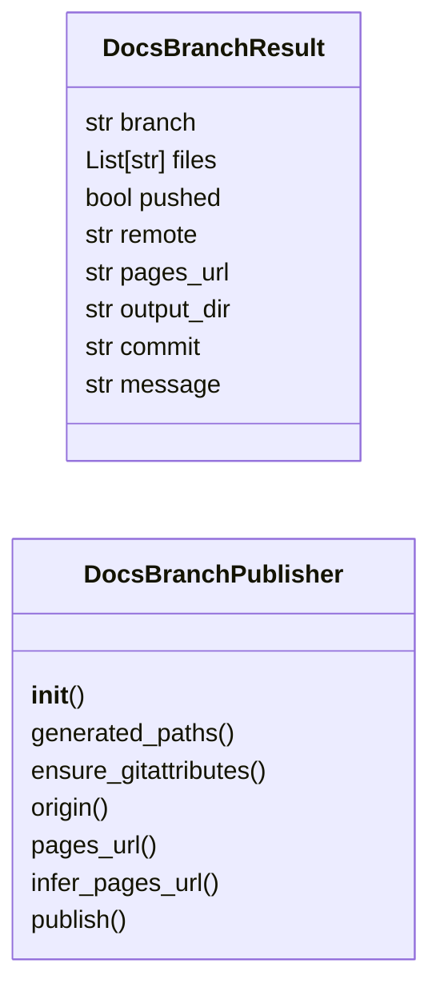
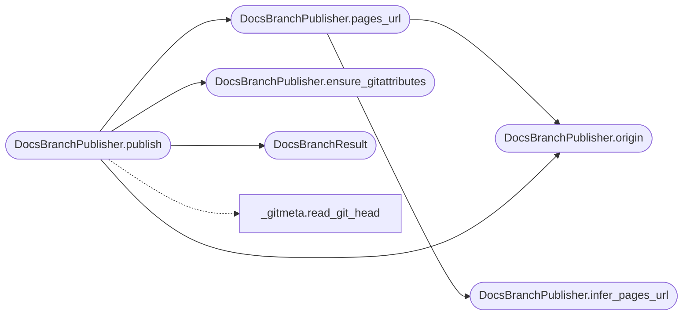

# `readmenator._docbranch`

> Source: [readmenator/_docbranch.py:1](../../readmenator/_docbranch.py#L1) | language `py` | coverage 100.0% | [API index](../index.md)

Documentation branch publisher: artifacts live in their own git branch.

Generated artifacts (maps, site, video, agent docs, wiki) change the
language GitHub reports for a project -- a C repository can show up as
"HTML" once the generated pages are committed. Two fixes ship here:

1. `[`ensure_gitattributes`](#docsbranchpublisher-ensure_gitattributes)` marks every generated output directory as
   ``linguist-generated`` so language statistics always describe the
   source tree, no matter where artifacts live.
2. `[`publish`](#docsbranchpublisher-publish)` stages the static site (``readmenator . pages`` output)
   into an orphan git branch (`[`DOC_BRANCH_NAME`](readmenator._config.py.md#config-doc_branch_name)`) and pushes it, so
   GitHub Pages can deploy "from branch" and the main branch stays free
   of generated artifacts entirely.

The Pages URL is inferred from the origin remote (``github.com/user/repo``
-> ``https://user.github.io/repo/``), overridable via `[`DOC_PAGES_URL`](readmenator._config.py.md#config-doc_pages_url)`,
and is what the README injection links so following a link from the
README lands on the deployed documentation instead of a dead repo path.
Git is driven with argument lists only (no shell), bounded timeouts, and
an injectable runner for tests.

## Contents

- **Classes:** [`DocsBranchResult`](#docsbranchresult), [`DocsBranchPublisher`](#docsbranchpublisher)

## Type Diagram



## Call Graph

Solid arrows stay in this module, dashed arrows leave it.



## Classes

<a id="docsbranchresult"></a>

### `DocsBranchResult`

`class` `dataclass` | [readmenator/_docbranch.py:48](../../readmenator/_docbranch.py#L48)

Decorators: `@dataclass`

```python
class DocsBranchResult
```

Outcome of a documentation branch publish.

**Attributes**

| Name | Type | Default | Description |
|---|---|---|---|
| [`branch`](#docsbranchresult-branch) | `str` | `''` | Branch name the site was committed to. |
| [`files`](#docsbranchresult-files) | `List[str]` | `field(default_factory=list)` | Site files staged (relative to the branch root). |
| [`pushed`](#docsbranchresult-pushed) | `bool` | `False` | Whether the commit was pushed to the remote. |
| [`remote`](#docsbranchresult-remote) | `str` | `''` | Remote URL used ("" in dry runs without a remote). |
| [`pages_url`](#docsbranchresult-pages_url) | `str` | `''` | Inferred or configured Pages URL ("" when unknown). |
| [`output_dir`](#docsbranchresult-output_dir) | `str` | `''` | Directory holding the staged site. |
| [`commit`](#docsbranchresult-commit) | `str` | `''` | Source commit the snapshot was generated from. |
| [`message`](#docsbranchresult-message) | `str` | `''` | Human-readable status line. |

---

<a id="docsbranchpublisher"></a>

### `DocsBranchPublisher`

`class` | [readmenator/_docbranch.py:72](../../readmenator/_docbranch.py#L72)

```python
class DocsBranchPublisher
```

Stages the static site into a dedicated git branch for Pages.

**Members**

| Member | Kind | Summary |
|---|---|---|
| [`__init__`](#docsbranchpublisher-__init__) | constructor | Store configuration and the subprocess runner (injectable for tests). |
| [`generated_paths`](#docsbranchpublisher-generated_paths) | method | Return project-relative output paths that count as generated. |
| [`ensure_gitattributes`](#docsbranchpublisher-ensure_gitattributes) | method | Add or refresh the linguist-generated block in .gitattributes. |
| [`origin`](#docsbranchpublisher-origin) | method | Return the origin remote URL ("" when unknown). |
| [`pages_url`](#docsbranchpublisher-pages_url) | method | Configured Pages URL, else the one inferred from the origin remote. |
| [`infer_pages_url`](#docsbranchpublisher-infer_pages_url) | staticmethod | Infer a GitHub/GitLab Pages URL from a remote URL. |
| [`publish`](#docsbranchpublisher-publish) | method | Stage the static site into the docs branch and optionally push. |

<a id="docsbranchpublisher-__init__"></a>

#### `DocsBranchPublisher.__init__`

`constructor` | [readmenator/_docbranch.py:75](../../readmenator/_docbranch.py#L75)

```python
def __init__(self, config: Config, runner: Optional[Runner] = None) -> None
```

Store configuration and the subprocess runner (injectable for tests).

**Parameters**

| Name | Type | Default | Description |
|---|---|---|---|
| `config` | `Config` |  | DOC_*/GITATTRIBUTES_* settings and output directories. |
| `runner` | `Optional[Runner]` | `None` | Callable compatible with ``subprocess.run``. |

*Called by:* [`AnalyzerFactory.docbranch`](readmenator._pipeline.py.md#analyzerfactory-docbranch)

<a id="docsbranchpublisher-generated_paths"></a>

#### `DocsBranchPublisher.generated_paths`

`method` | [readmenator/_docbranch.py:85](../../readmenator/_docbranch.py#L85)

```python
def generated_paths(self) -> List[str]
```

Return project-relative output paths that count as generated.

**Returns:** `List[str]`

<a id="docsbranchpublisher-ensure_gitattributes"></a>

#### `DocsBranchPublisher.ensure_gitattributes`

`method` | [readmenator/_docbranch.py:119](../../readmenator/_docbranch.py#L119)

```python
def ensure_gitattributes(self, project_root: str) -> bool
```

Add or refresh the linguist-generated block in .gitattributes.

**Parameters**

| Name | Type | Default | Description |
|---|---|---|---|
| `project_root` | `str` |  | Project root directory. |

**Returns:** `bool` - True when the file was created or changed, False when intact.

*Called by:* [`DocsBranchPublisher.publish`](#docsbranchpublisher-publish)

<a id="docsbranchpublisher-origin"></a>

#### `DocsBranchPublisher.origin`

`method` | [readmenator/_docbranch.py:162](../../readmenator/_docbranch.py#L162)

```python
def origin(self, project_root: str) -> str
```

Return the origin remote URL ("" when unknown).

**Parameters**

| Name | Type | Default | Description |
|---|---|---|---|
| `project_root` | `str` |  |  |

**Returns:** `str`

*Called by:* [`DocsBranchPublisher.pages_url`](#docsbranchpublisher-pages_url), [`DocsBranchPublisher.publish`](#docsbranchpublisher-publish)

<a id="docsbranchpublisher-pages_url"></a>

#### `DocsBranchPublisher.pages_url`

`method` | [readmenator/_docbranch.py:170](../../readmenator/_docbranch.py#L170)

```python
def pages_url(self, project_root: str) -> str
```

Configured Pages URL, else the one inferred from the origin remote.

**Parameters**

| Name | Type | Default | Description |
|---|---|---|---|
| `project_root` | `str` |  |  |

**Returns:** `str`

*Calls:* [`DocsBranchPublisher.infer_pages_url`](#docsbranchpublisher-infer_pages_url), [`DocsBranchPublisher.origin`](#docsbranchpublisher-origin)

*Called by:* [`DocsBranchPublisher.publish`](#docsbranchpublisher-publish)

<a id="docsbranchpublisher-infer_pages_url"></a>

#### `DocsBranchPublisher.infer_pages_url`

`staticmethod` | [readmenator/_docbranch.py:178](../../readmenator/_docbranch.py#L178)

Decorators: `@staticmethod`

```python
def infer_pages_url(remote: str) -> str
```

Infer a GitHub/GitLab Pages URL from a remote URL.

**Parameters**

| Name | Type | Default | Description |
|---|---|---|---|
| `remote` | `str` |  | Remote URL (https, ssh, or git@ forms). |

**Returns:** `str` - Pages URL with a trailing slash, or "" when not inferable.

*Called by:* [`DocsBranchPublisher.pages_url`](#docsbranchpublisher-pages_url)

<a id="docsbranchpublisher-publish"></a>

#### `DocsBranchPublisher.publish`

`method` | [readmenator/_docbranch.py:229](../../readmenator/_docbranch.py#L229)

```python
def publish(self, project_root: str, push: bool = True, dry_run: bool = False) -> DocsBranchResult
```

Stage the static site into the docs branch and optionally push.

**Parameters**

| Name | Type | Default | Description |
|---|---|---|---|
| `project_root` | `str` |  | Project root holding `[`DIAGRAM_PAGES_DIR`](readmenator._config.py.md#config-diagram_pages_dir)`. |
| `push` | `bool` | `True` | Push the branch to the remote (ignored in dry runs). |
| `dry_run` | `bool` | `False` | Stage into DOC_DRY_RUN_DIR without any git calls. |

**Returns:** `DocsBranchResult` - DocsBranchResult describing what was staged and pushed.

*Calls:* [`DocsBranchPublisher.ensure_gitattributes`](#docsbranchpublisher-ensure_gitattributes), [`DocsBranchPublisher.origin`](#docsbranchpublisher-origin), [`DocsBranchPublisher.pages_url`](#docsbranchpublisher-pages_url), [`DocsBranchResult`](#docsbranchresult), [`read_git_head`](readmenator._gitmeta.py.md#read_git_head)

---
