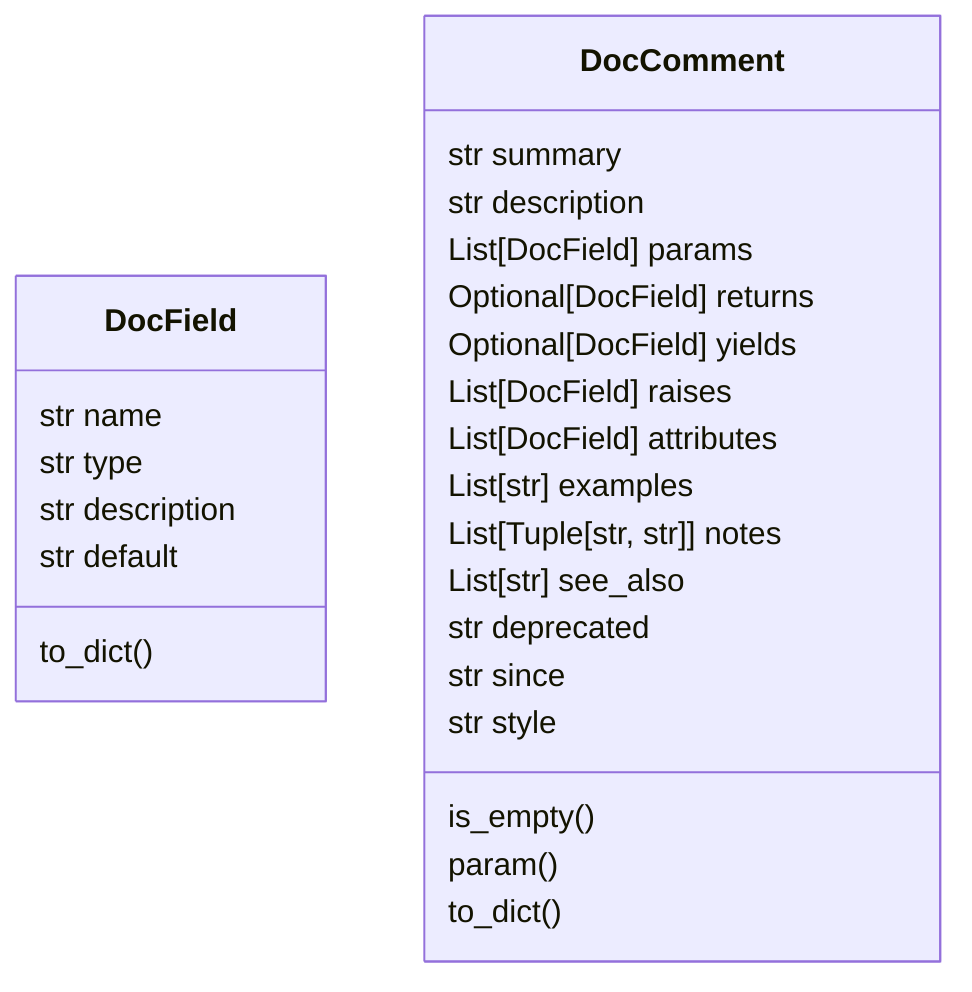
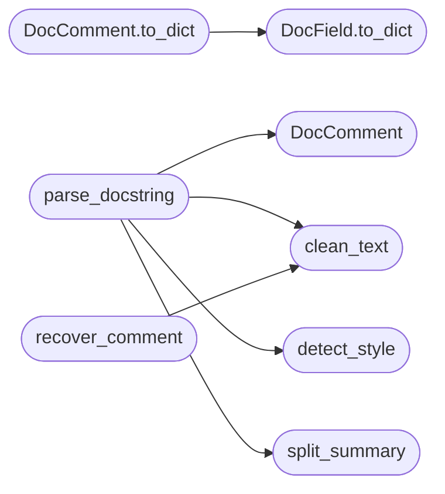

# `readmenator._docstrings`

> Source: [readmenator/_docstrings.py:1](../../readmenator/_docstrings.py#L1) | language `py` | coverage 100.0% | [API index](../index.md)

Multi-style docstring parser for the deterministic API reference.

Parses Google, NumPy, reStructuredText (Sphinx), Javadoc / JSDoc /
PHPDoc / KDoc / Doxygen tag blocks, C# XML documentation comments, and
Rustdoc markdown sections into one structured DocComment. Also recovers
raw comment blocks above a declaration in any supported language while
preserving line structure. Pure regex and string handling, zero tokens.

## Contents

- **Classes:** [`DocField`](#docfield), [`DocComment`](#doccomment)
- **Functions:** [`clean_text`](#clean_text), [`detect_style`](#detect_style), [`split_summary`](#split_summary), [`parse_docstring`](#parse_docstring), [`recover_comment`](#recover_comment)
- **Constants:** [`STYLE_PLAIN`](#style_plain), [`STYLE_GOOGLE`](#style_google), [`STYLE_NUMPY`](#style_numpy), [`STYLE_REST`](#style_rest), [`STYLE_TAGS`](#style_tags), [`STYLE_XML`](#style_xml), [`STYLE_RUSTDOC`](#style_rustdoc)

## Type Diagram



## Call Graph

Solid arrows stay in this module, dashed arrows leave it.



## Classes

<a id="docfield"></a>

### `DocField`

`class` `dataclass` | [readmenator/_docstrings.py:135](../../readmenator/_docstrings.py#L135)

Decorators: `@dataclass`

```python
class DocField
```

One documented item: a parameter, return value, exception, or attribute.

**Attributes**

| Name | Type | Default | Description |
|---|---|---|---|
| [`name`](#docfield-name) | `str` | `''` | Parameter, attribute, or exception name ("" for returns). |
| [`type`](#docfield-type) | `str` | `''` | Declared type text from the docstring ("" when absent). |
| [`description`](#docfield-description) | `str` | `''` | Free-text description. |
| [`default`](#docfield-default) | `str` | `''` | Default value text when the style declares one. |

**Members**

| Member | Kind | Summary |
|---|---|---|
| [`to_dict`](#docfield-to_dict) | method | Serialise to a plain dict for JSON output. |

<a id="docfield-to_dict"></a>

#### `DocField.to_dict`

`method` | [readmenator/_docstrings.py:150](../../readmenator/_docstrings.py#L150)

```python
def to_dict(self) -> Dict[str, str]
```

Serialise to a plain dict for JSON output.

**Returns:** `Dict[str, str]`

*Called by:* [`DocComment.to_dict`](#doccomment-to_dict)

---

<a id="doccomment"></a>

### `DocComment`

`class` `dataclass` | [readmenator/_docstrings.py:161](../../readmenator/_docstrings.py#L161)

Decorators: `@dataclass`

```python
class DocComment
```

Structured documentation recovered from one docstring or comment block.

**Attributes**

| Name | Type | Default | Description |
|---|---|---|---|
| [`summary`](#doccomment-summary) | `str` | `''` | First sentence or brief line. |
| [`description`](#doccomment-description) | `str` | `''` | Remaining free text (Markdown-compatible). |
| [`params`](#doccomment-params) | `List[DocField]` | `field(default_factory=list)` | Documented parameters in source order. |
| [`returns`](#doccomment-returns) | `Optional[DocField]` | `None` | Documented return value, if any. |
| [`yields`](#doccomment-yields) | `Optional[DocField]` | `None` | Documented generator yield, if any. |
| [`raises`](#doccomment-raises) | `List[DocField]` | `field(default_factory=list)` | Documented exceptions or error conditions. |
| [`attributes`](#doccomment-attributes) | `List[DocField]` | `field(default_factory=list)` | Documented attributes, properties, or fields. |
| [`examples`](#doccomment-examples) | `List[str]` | `field(default_factory=list)` | Example code blocks (verbatim). |
| [`notes`](#doccomment-notes) | `List[Tuple[str, str]]` | `field(default_factory=list)` | Labelled admonitions as (label, text) pairs. |
| [`see_also`](#doccomment-see_also) | `List[str]` | `field(default_factory=list)` | Cross-reference targets. |
| [`deprecated`](#doccomment-deprecated) | `str` | `''` | Deprecation message ("" when not deprecated). |
| [`since`](#doccomment-since) | `str` | `''` | Version the entity appeared in. |
| [`style`](#doccomment-style) | `str` | `STYLE_PLAIN` | Detected docstring style. |

**Members**

| Member | Kind | Summary |
|---|---|---|
| [`is_empty`](#doccomment-is_empty) | property | Return True when no documentation text was recovered. |
| [`param`](#doccomment-param) | method | Return the documented parameter called *name* (stars ignored). |
| [`to_dict`](#doccomment-to_dict) | method | Serialise to a plain dict for JSON output. |

<a id="doccomment-is_empty"></a>

#### `DocComment.is_empty`

`property` | [readmenator/_docstrings.py:195](../../readmenator/_docstrings.py#L195)

Decorators: `@property`

```python
def is_empty(self) -> bool
```

Return True when no documentation text was recovered.

**Returns:** `bool`

<a id="doccomment-param"></a>

#### `DocComment.param`

`method` | [readmenator/_docstrings.py:203](../../readmenator/_docstrings.py#L203)

```python
def param(self, name: str) -> Optional[DocField]
```

Return the documented parameter called *name* (stars ignored).

**Parameters**

| Name | Type | Default | Description |
|---|---|---|---|
| `name` | `str` |  |  |

**Returns:** `Optional[DocField]`

<a id="doccomment-to_dict"></a>

#### `DocComment.to_dict`

`method` | [readmenator/_docstrings.py:211](../../readmenator/_docstrings.py#L211)

```python
def to_dict(self) -> Dict[str, object]
```

Serialise to a plain dict for JSON output.

**Returns:** `Dict[str, object]`

*Calls:* [`DocField.to_dict`](#docfield-to_dict)

*Called by:* [`ApiEntity.to_dict`](readmenator._apidocs.py.md#apientity-to_dict)

---

## Functions

<a id="clean_text"></a>

### `clean_text`

`function` | [readmenator/_docstrings.py:230](../../readmenator/_docstrings.py#L230)

```python
def clean_text(text: str) -> str
```

Dedent *text* like ``inspect.cleandoc`` and strip blank edges.

**Parameters**

| Name | Type | Default | Description |
|---|---|---|---|
| `text` | `str` |  | Raw docstring or comment body. |

**Returns:** `str` - Normalised text with tabs expanded and common indentation removed.

*Called by:* [`parse_docstring`](#parse_docstring), [`recover_comment`](#recover_comment)

---

<a id="detect_style"></a>

### `detect_style`

`function` | [readmenator/_docstrings.py:254](../../readmenator/_docstrings.py#L254)

```python
def detect_style(text: str) -> str
```

Classify the docstring convention used by *text*.

**Parameters**

| Name | Type | Default | Description |
|---|---|---|---|
| `text` | `str` |  | Cleaned docstring. |

**Returns:** `str` - One of the STYLE_* constants.

*Called by:* [`parse_docstring`](#parse_docstring)

---

<a id="split_summary"></a>

### `split_summary`

`function` | [readmenator/_docstrings.py:293](../../readmenator/_docstrings.py#L293)

```python
def split_summary(text: str) -> Tuple[str, str]
```

Split free text into a one-sentence summary and the remainder.

The summary is the first paragraph when it holds one sentence,
otherwise the first sentence of it; the rest becomes the description.

**Parameters**

| Name | Type | Default | Description |
|---|---|---|---|
| `text` | `str` |  | Free-text documentation. |

**Returns:** `Tuple[str, str]` - Tuple of (summary, description).

*Called by:* [`parse_docstring`](#parse_docstring)

---

<a id="parse_docstring"></a>

### `parse_docstring`

`function` | [readmenator/_docstrings.py:809](../../readmenator/_docstrings.py#L809)

```python
def parse_docstring(text: str) -> DocComment
```

Parse *text* in any supported convention into a DocComment.

**Parameters**

| Name | Type | Default | Description |
|---|---|---|---|
| `text` | `str` |  | Raw docstring or recovered comment body (markers stripped). |

**Returns:** `DocComment` - Structured documentation; empty when *text* is blank.

*Calls:* [`DocComment`](#doccomment), [`clean_text`](#clean_text), [`detect_style`](#detect_style), [`split_summary`](#split_summary)

---

<a id="recover_comment"></a>

### `recover_comment`

`function` | [readmenator/_docstrings.py:910](../../readmenator/_docstrings.py#L910)

```python
def recover_comment(content_lines: List[str], line: int, language: str, lookback: int) -> str
```

Recover the raw documentation comment directly above a declaration.

Walks upwards from the one-based *line*, skipping attribute and
decorator lines, and collects one contiguous comment block in any
of ``///``, ``//!``, ``//``, ``/** */``, ``/* */``, ``#``, ``##``,
``--``, ``;``, or Elixir ``@doc`` forms. Line structure is preserved
so tag and section grammars can be parsed afterwards.

**Parameters**

| Name | Type | Default | Description |
|---|---|---|---|
| `content_lines` | `List[str]` |  | File content split into lines. |
| `line` | `int` |  | One-based declaration line. |
| `language` | `str` |  | Scanner language label (file extension without dot). |
| `lookback` | `int` |  | Maximum number of lines to scan upwards. |

**Returns:** `str` - Comment body without markers, or "" when none is adjacent.

*Calls:* [`clean_text`](#clean_text)

---

## Constants

<a id="style_plain"></a>

### `STYLE_PLAIN`

`constant` | [readmenator/_docstrings.py:16](../../readmenator/_docstrings.py#L16)

```python
STYLE_PLAIN = 'plain'
```

---

<a id="style_google"></a>

### `STYLE_GOOGLE`

`constant` | [readmenator/_docstrings.py:17](../../readmenator/_docstrings.py#L17)

```python
STYLE_GOOGLE = 'google'
```

---

<a id="style_numpy"></a>

### `STYLE_NUMPY`

`constant` | [readmenator/_docstrings.py:18](../../readmenator/_docstrings.py#L18)

```python
STYLE_NUMPY = 'numpy'
```

---

<a id="style_rest"></a>

### `STYLE_REST`

`constant` | [readmenator/_docstrings.py:19](../../readmenator/_docstrings.py#L19)

```python
STYLE_REST = 'rest'
```

---

<a id="style_tags"></a>

### `STYLE_TAGS`

`constant` | [readmenator/_docstrings.py:20](../../readmenator/_docstrings.py#L20)

```python
STYLE_TAGS = 'tags'
```

---

<a id="style_xml"></a>

### `STYLE_XML`

`constant` | [readmenator/_docstrings.py:21](../../readmenator/_docstrings.py#L21)

```python
STYLE_XML = 'xml'
```

---

<a id="style_rustdoc"></a>

### `STYLE_RUSTDOC`

`constant` | [readmenator/_docstrings.py:22](../../readmenator/_docstrings.py#L22)

```python
STYLE_RUSTDOC = 'rustdoc'
```

---
