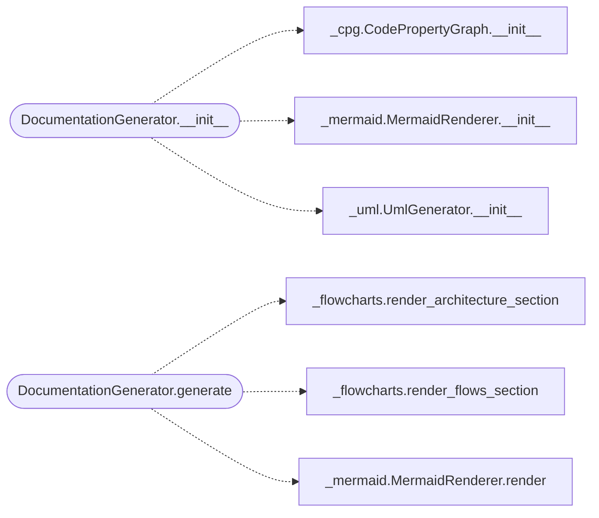

# `readmenator._documentation`

> Source: [readmenator/_documentation.py:1](../../readmenator/_documentation.py#L1) | language `py` | coverage 75.0% | [API index](../index.md)

KNOWLEDGE_BASE.md generator: the human-facing architecture reference.

Renders the dashboard, layers, communities, CPG, taint, hotspots, cycles,
security audit, Mermaid graph, and per-file reference sections.

## Contents

- **Classes:** [`DocumentationGenerator`](#documentationgenerator)

## Call Graph

Solid arrows stay in this module, dashed arrows leave it.



## Classes

<a id="documentationgenerator"></a>

### `DocumentationGenerator`

`class` | [readmenator/_documentation.py:36](../../readmenator/_documentation.py#L36)

```python
class DocumentationGenerator
```

Builds the KNOWLEDGE_BASE.md document from scanned nodes and edges.

Delegates graph rendering to MermaidRenderer and handles the
Markdown layout: header metadata, Mermaid block, statistics dashboard,
god nodes, community analysis, surprising connections, architecture
layers, security audit, taint analysis, hotspots, dependency cycles,
change impact, architecture violations, suggested rules, CPG block,
ranking metadata, orphans, query recipes, and per-language architecture
sections with pluralised symbol kind headings.

**Members**

| Member | Kind | Summary |
|---|---|---|
| [`__init__`](#documentationgenerator-__init__) | constructor |  |
| [`generate`](#documentationgenerator-generate) | method | Render KNOWLEDGE_BASE.md. |

<a id="documentationgenerator-__init__"></a>

#### `DocumentationGenerator.__init__`

`constructor` | [readmenator/_documentation.py:48](../../readmenator/_documentation.py#L48)

```python
def __init__(self, config: Config) -> None
```

**Parameters**

| Name | Type | Default | Description |
|---|---|---|---|
| `config` | `Config` |  |  |

*Calls:* [`CodePropertyGraph.__init__`](readmenator._cpg.py.md#codepropertygraph-__init__), [`MermaidRenderer.__init__`](readmenator._mermaid.py.md#mermaidrenderer-__init__), [`UmlGenerator.__init__`](readmenator._uml.py.md#umlgenerator-__init__)

*Called by:* [`AnalyzerFactory.generator`](readmenator._pipeline.py.md#analyzerfactory-generator)

<a id="documentationgenerator-generate"></a>

#### `DocumentationGenerator.generate`

`method` | [readmenator/_documentation.py:99](../../readmenator/_documentation.py#L99)

```python
def generate(self, nodes: List[Node], edges: List[Edge], resolved_edges: Optional[List[Edge]] = None, analysis: Optional[AnalysisResult] = None, layers: Optional[Dict[str, str]] = None, findings: Optional[List[SecurityFinding]] = None, analysis_v2: Optional[AnalysisResultV2] = None, ranked: Optional[RankedResult] = None, content_map: Optional[Dict[str, str]] = None) -> str
```

Render KNOWLEDGE_BASE.md.

**Parameters**

| Name | Type | Default | Description |
|---|---|---|---|
| `nodes` | `List[Node]` |  | Scanned file nodes. |
| `edges` | `List[Edge]` |  | Raw edges. |
| `resolved_edges` | `Optional[List[Edge]]` | `None` | Resolved import edges. |
| `analysis` | `Optional[AnalysisResult]` | `None` | Community and centrality analysis. |
| `layers` | `Optional[Dict[str, str]]` | `None` | File-to-layer mapping. |
| `findings` | `Optional[List[SecurityFinding]]` | `None` | Security findings. |
| `analysis_v2` | `Optional[AnalysisResultV2]` | `None` | Deep analysis results. |
| `ranked` | `Optional[RankedResult]` | `None` | Ranked context result. |
| `content_map` | `Optional[Dict[str, str]]` | `None` | File contents (enables execution-flow control-flow charts). |

**Returns:** `str` - The Markdown document.

*Calls:* [`render_architecture_section`](readmenator._flowcharts.py.md#render_architecture_section), [`render_flows_section`](readmenator._flowcharts.py.md#render_flows_section), [`MermaidRenderer.render`](readmenator._mermaid.py.md#mermaidrenderer-render)

---
