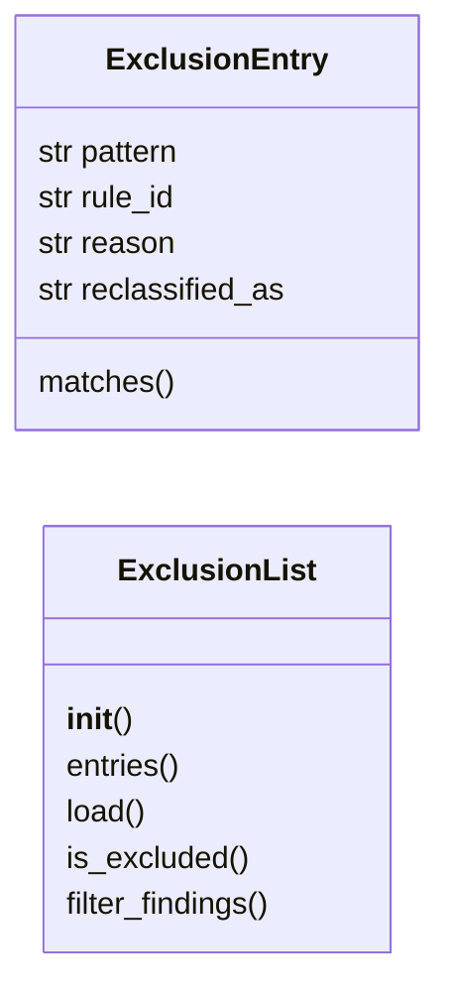
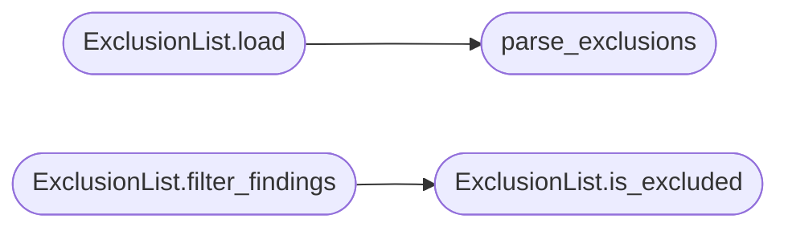

# `readmenator._exclusions`

> Source: [readmenator/_exclusions.py:1](../../readmenator/_exclusions.py#L1) | language `py` | coverage 100.0% | [API index](../index.md)

False-positive exclusion list for readmenator findings.

The `exclusions.yaml` corpus blocklist records paths cleared through
investigation with a reason, so known-clean patterns are skipped on
future runs instead of being re-investigated.

## Contents

- **Classes:** [`ExclusionEntry`](#exclusionentry), [`ExclusionList`](#exclusionlist)
- **Functions:** [`parse_exclusions`](#parse_exclusions)

## Type Diagram



## Call Graph

Solid arrows stay in this module, dashed arrows leave it.



## Classes

<a id="exclusionentry"></a>

### `ExclusionEntry`

`class` `dataclass` | [readmenator/_exclusions.py:19](../../readmenator/_exclusions.py#L19)

Decorators: `@dataclass`

```python
class ExclusionEntry
```

A single exclusion record from the blocklist file.

**Attributes**

| Name | Type | Default | Description |
|---|---|---|---|
| [`pattern`](#exclusionentry-pattern) | `str` |  |  |
| [`rule_id`](#exclusionentry-rule_id) | `str` | `'*'` |  |
| [`reason`](#exclusionentry-reason) | `str` | `''` |  |
| [`reclassified_as`](#exclusionentry-reclassified_as) | `str` | `''` |  |

**Members**

| Member | Kind | Summary |
|---|---|---|
| [`matches`](#exclusionentry-matches) | method | Return True when this entry suppresses the finding. |

<a id="exclusionentry-matches"></a>

#### `ExclusionEntry.matches`

`method` | [readmenator/_exclusions.py:27](../../readmenator/_exclusions.py#L27)

```python
def matches(self, file_path: str, rule_id: str) -> bool
```

Return True when this entry suppresses the finding.

**Parameters**

| Name | Type | Default | Description |
|---|---|---|---|
| `file_path` | `str` |  | Finding file path to test. |
| `rule_id` | `str` |  | Finding rule identifier to test. |

**Returns:** `bool` - True when both the path glob and rule match.

---

<a id="exclusionlist"></a>

### `ExclusionList`

`class` | [readmenator/_exclusions.py:44](../../readmenator/_exclusions.py#L44)

```python
class ExclusionList
```

Loads and applies the YAML exclusion blocklist.

**Members**

| Member | Kind | Summary |
|---|---|---|
| [`__init__`](#exclusionlist-__init__) | constructor | Initialise with application configuration. |
| [`entries`](#exclusionlist-entries) | property | Return the loaded exclusion entries. |
| [`load`](#exclusionlist-load) | method | Load exclusions from the project blocklist file. |
| [`is_excluded`](#exclusionlist-is_excluded) | method | Return True when a finding is suppressed by the blocklist. |
| [`filter_findings`](#exclusionlist-filter_findings) | method | Remove excluded findings from a finding list. |

<a id="exclusionlist-__init__"></a>

#### `ExclusionList.__init__`

`constructor` | [readmenator/_exclusions.py:47](../../readmenator/_exclusions.py#L47)

```python
def __init__(self, config: Config) -> None
```

Initialise with application configuration.

**Parameters**

| Name | Type | Default | Description |
|---|---|---|---|
| `config` | `Config` |  | Settings for the exclusions file path and flag. |

*Called by:* [`AnalyzerFactory.exclusions`](readmenator._pipeline.py.md#analyzerfactory-exclusions)

<a id="exclusionlist-entries"></a>

#### `ExclusionList.entries`

`property` | [readmenator/_exclusions.py:58](../../readmenator/_exclusions.py#L58)

Decorators: `@property`

```python
def entries(self) -> List[ExclusionEntry]
```

Return the loaded exclusion entries.

**Returns:** `List[ExclusionEntry]`

<a id="exclusionlist-load"></a>

#### `ExclusionList.load`

`method` | [readmenator/_exclusions.py:62](../../readmenator/_exclusions.py#L62)

```python
def load(self, project_root: str | Path) -> List[ExclusionEntry]
```

Load exclusions from the project blocklist file.

**Parameters**

| Name | Type | Default | Description |
|---|---|---|---|
| `project_root` | `str \| Path` |  | Project directory containing the rules dir. |

**Returns:** `List[ExclusionEntry]` - Loaded exclusion entries (empty when disabled or missing).

*Calls:* [`parse_exclusions`](#parse_exclusions)

<a id="exclusionlist-is_excluded"></a>

#### `ExclusionList.is_excluded`

`method` | [readmenator/_exclusions.py:86](../../readmenator/_exclusions.py#L86)

```python
def is_excluded(self, file_path: str, rule_id: str) -> bool
```

Return True when a finding is suppressed by the blocklist.

**Parameters**

| Name | Type | Default | Description |
|---|---|---|---|
| `file_path` | `str` |  | Finding file path. |
| `rule_id` | `str` |  | Finding rule identifier. |

**Returns:** `bool` - True when any entry matches.

*Called by:* [`ExclusionList.filter_findings`](#exclusionlist-filter_findings)

<a id="exclusionlist-filter_findings"></a>

#### `ExclusionList.filter_findings`

`method` | [readmenator/_exclusions.py:98](../../readmenator/_exclusions.py#L98)

```python
def filter_findings(self, findings: List) -> List
```

Remove excluded findings from a finding list.

**Parameters**

| Name | Type | Default | Description |
|---|---|---|---|
| `findings` | `List` |  | Findings with file_path and rule_id attributes. |

**Returns:** `List` - Findings not matched by any exclusion entry.

*Calls:* [`ExclusionList.is_excluded`](#exclusionlist-is_excluded)

---

## Functions

<a id="parse_exclusions"></a>

### `parse_exclusions`

`function` | [readmenator/_exclusions.py:114](../../readmenator/_exclusions.py#L114)

```python
def parse_exclusions(text: str) -> List[ExclusionEntry]
```

Parse the minimal exclusions YAML into entries.

**Parameters**

| Name | Type | Default | Description |
|---|---|---|---|
| `text` | `str` |  | Raw YAML content with `exclusions:` list items. |

**Returns:** `List[ExclusionEntry]` - Parsed exclusion entries.

*Called by:* [`ExclusionList.load`](#exclusionlist-load)

---
