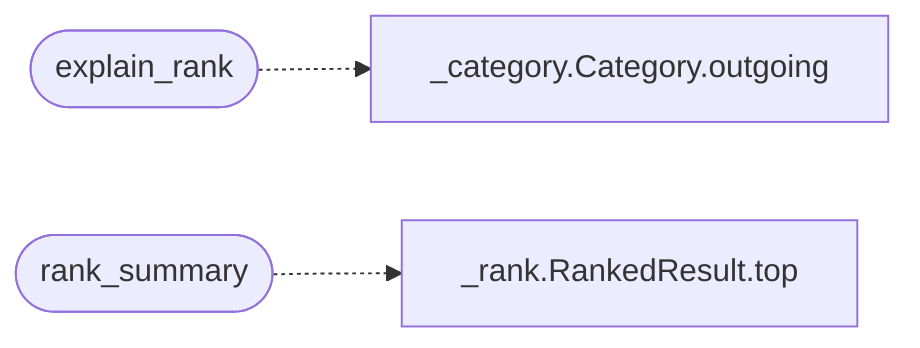

# `readmenator._explain`

> Source: [readmenator/_explain.py:1](../../readmenator/_explain.py#L1) | language `py` | coverage 100.0% | [API index](../index.md)

Score explanation and path decomposition for the ranking system.

Provides human-readable explanations of why a particular node ranks
where it does, including score breakdown, strongest paths from seeds,
and quality signal summary.

## Contents

- **Functions:** [`explain_rank`](#explain_rank), [`rank_summary`](#rank_summary)

## Call Graph

Solid arrows stay in this module, dashed arrows leave it.



## Functions

<a id="explain_rank"></a>

### `explain_rank`

`function` | [readmenator/_explain.py:16](../../readmenator/_explain.py#L16)

```python
def explain_rank(node_id: str, ranked: RankedResult, category: Optional[Category] = None) -> Optional[str]
```

Return a detailed breakdown of why *node_id* has its rank.

Includes score decomposition, seed paths, and quality signals.

**Parameters**

| Name | Type | Default | Description |
|---|---|---|---|
| `node_id` | `str` |  | The node to explain. |
| `ranked` | `RankedResult` |  | The RankedResult containing scores. |
| `category` | `Optional[Category]` | `None` | Optional Category for enriched path details. |

**Returns:** `Optional[str]` - Formatted explanation string, or None if node_id not found.

*Calls:* [`Category.outgoing`](readmenator._category.py.md#category-outgoing)

---

<a id="rank_summary"></a>

### `rank_summary`

`function` | [readmenator/_explain.py:140](../../readmenator/_explain.py#L140)

```python
def rank_summary(ranked: RankedResult, top_n: int = 5) -> str
```

Return a short summary of the top-N ranked results.

**Parameters**

| Name | Type | Default | Description |
|---|---|---|---|
| `ranked` | `RankedResult` |  |  |
| `top_n` | `int` | `5` |  |

**Returns:** `str`

*Calls:* [`RankedResult.top`](readmenator._rank.py.md#rankedresult-top)

---
