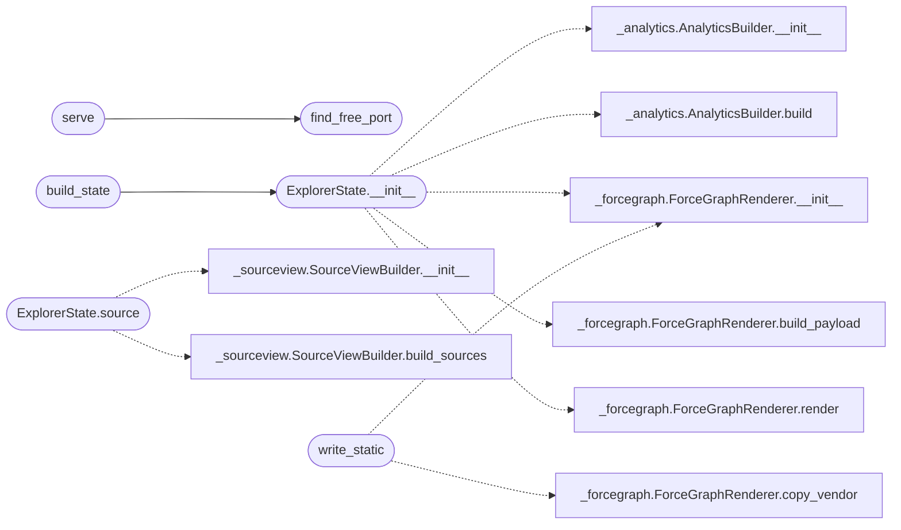

# `readmenator._explorer`

> Source: [readmenator/_explorer.py:1](../../readmenator/_explorer.py#L1) | language `py` | coverage 100.0% | [API index](../index.md)

Stdlib explorer HTTP server for the readmenator knowledge graph.

A zero-dependency http.server process serving the force-graph UI plus
JSON APIs for graph, analytics, samples, and rules. Used by
`readmenator <dir> explorer` for local interactive exploration.

## Contents

- **Classes:** [`ExplorerState`](#explorerstate)
- **Functions:** [`find_free_port`](#find_free_port), [`serve`](#serve), [`build_state`](#build_state), [`write_static`](#write_static)

## Call Graph

Solid arrows stay in this module, dashed arrows leave it.



## Classes

<a id="explorerstate"></a>

### `ExplorerState`

`class` | [readmenator/_explorer.py:23](../../readmenator/_explorer.py#L23)

```python
class ExplorerState
```

Holds the precomputed payloads served by the explorer.

**Members**

| Member | Kind | Summary |
|---|---|---|
| [`__init__`](#explorerstate-__init__) | constructor | Initialise explorer state and precompute payloads. |
| [`samples`](#explorerstate-samples) | method | Return a compact per-file sample listing. |
| [`source`](#explorerstate-source) | method | Return the bounded source text for one file. |

<a id="explorerstate-__init__"></a>

#### `ExplorerState.__init__`

`constructor` | [readmenator/_explorer.py:26](../../readmenator/_explorer.py#L26)

```python
def __init__(self, config: Config, nodes: List[Node], edges: List[Edge], resolved_edges: Optional[List[Edge]] = None, analysis: Optional[AnalysisResult] = None, findings: Optional[List[SecurityFinding]] = None, layers: Optional[Dict[str, str]] = None, content_map: Optional[Dict[str, str]] = None) -> None
```

Initialise explorer state and precompute payloads.

**Parameters**

| Name | Type | Default | Description |
|---|---|---|---|
| `config` | `Config` |  | Application configuration. |
| `nodes` | `List[Node]` |  | Scanned file nodes. |
| `edges` | `List[Edge]` |  | Import edges. |
| `resolved_edges` | `Optional[List[Edge]]` | `None` | Optional resolved-import edges. |
| `analysis` | `Optional[AnalysisResult]` | `None` | Optional community analysis. |
| `findings` | `Optional[List[SecurityFinding]]` | `None` | Optional security findings. |
| `layers` | `Optional[Dict[str, str]]` | `None` | Optional file-to-layer mapping. |
| `content_map` | `Optional[Dict[str, str]]` | `None` | Optional file contents for the source viewer. |

*Calls:* [`AnalyticsBuilder.__init__`](readmenator._analytics.py.md#analyticsbuilder-__init__), [`AnalyticsBuilder.build`](readmenator._analytics.py.md#analyticsbuilder-build), [`ForceGraphRenderer.__init__`](readmenator._forcegraph.py.md#forcegraphrenderer-__init__), [`ForceGraphRenderer.build_payload`](readmenator._forcegraph.py.md#forcegraphrenderer-build_payload), [`ForceGraphRenderer.render`](readmenator._forcegraph.py.md#forcegraphrenderer-render)

*Called by:* [`build_state`](#build_state)

<a id="explorerstate-samples"></a>

#### `ExplorerState.samples`

`method` | [readmenator/_explorer.py:64](../../readmenator/_explorer.py#L64)

```python
def samples(self) -> List[Dict[str, Any]]
```

Return a compact per-file sample listing.

**Returns:** `List[Dict[str, Any]]`

<a id="explorerstate-source"></a>

#### `ExplorerState.source`

`method` | [readmenator/_explorer.py:80](../../readmenator/_explorer.py#L80)

```python
def source(self, file_id: str) -> Dict[str, Any]
```

Return the bounded source text for one file.

**Parameters**

| Name | Type | Default | Description |
|---|---|---|---|
| `file_id` | `str` |  | Relative file identifier. |

**Returns:** `Dict[str, Any]` - Mapping with text, line count, and truncation flag.

*Calls:* [`SourceViewBuilder.__init__`](readmenator._sourceview.py.md#sourceviewbuilder-__init__), [`SourceViewBuilder.build_sources`](readmenator._sourceview.py.md#sourceviewbuilder-build_sources)

---

## Functions

<a id="find_free_port"></a>

### `find_free_port`

`function` | [readmenator/_explorer.py:169](../../readmenator/_explorer.py#L169)

```python
def find_free_port(preferred: int) -> int
```

Find a free TCP port, preferring the configured value.

**Parameters**

| Name | Type | Default | Description |
|---|---|---|---|
| `preferred` | `int` |  | Preferred port number to bind. |

**Returns:** `int` - Preferred port when free, otherwise an OS-assigned port.

*Called by:* [`serve`](#serve)

---

<a id="serve"></a>

### `serve`

`function` | [readmenator/_explorer.py:188](../../readmenator/_explorer.py#L188)

```python
def serve(state: ExplorerState, host: str = '127.0.0.1', port: int = 8421, open_browser: bool = False) -> str
```

Serve the explorer state until interrupted.

**Parameters**

| Name | Type | Default | Description |
|---|---|---|---|
| `state` | `ExplorerState` |  | Precomputed explorer payloads. |
| `host` | `str` | `'127.0.0.1'` | Bind address for the HTTP server. |
| `port` | `int` | `8421` | Preferred port number. |
| `open_browser` | `bool` | `False` | Open the URL in a browser when True. |

**Returns:** `str` - Base URL of the running server.

*Calls:* [`find_free_port`](#find_free_port)

---

<a id="build_state"></a>

### `build_state`

`function` | [readmenator/_explorer.py:221](../../readmenator/_explorer.py#L221)

```python
def build_state(config: Config, nodes: List[Node], edges: List[Edge], resolved_edges: Optional[List[Edge]] = None, analysis: Optional[AnalysisResult] = None, findings: Optional[List[SecurityFinding]] = None, layers: Optional[Dict[str, str]] = None, content_map: Optional[Dict[str, str]] = None) -> ExplorerState
```

Build explorer state without starting the server.

**Parameters**

| Name | Type | Default | Description |
|---|---|---|---|
| `config` | `Config` |  | Application configuration. |
| `nodes` | `List[Node]` |  | Scanned file nodes. |
| `edges` | `List[Edge]` |  | Import edges. |
| `resolved_edges` | `Optional[List[Edge]]` | `None` | Optional resolved-import edges. |
| `analysis` | `Optional[AnalysisResult]` | `None` | Optional community analysis. |
| `findings` | `Optional[List[SecurityFinding]]` | `None` | Optional security findings. |
| `layers` | `Optional[Dict[str, str]]` | `None` | Optional file-to-layer mapping. |
| `content_map` | `Optional[Dict[str, str]]` | `None` | Optional file contents for the source viewer. |

**Returns:** `ExplorerState` - Precomputed explorer state.

*Calls:* [`ExplorerState.__init__`](#explorerstate-__init__)

*Called by:* [`readmenatorApplication.explorer_state`](readmenator._app.py.md#readmenatorapplication-explorer_state)

---

<a id="write_static"></a>

### `write_static`

`function` | [readmenator/_explorer.py:249](../../readmenator/_explorer.py#L249)

```python
def write_static(state: ExplorerState, output_dir: str | Path, filename: str = 'explorer.html') -> Path
```

Write the explorer HTML to a static file.

**Parameters**

| Name | Type | Default | Description |
|---|---|---|---|
| `state` | `ExplorerState` |  | Precomputed explorer payloads. |
| `output_dir` | `str \| Path` |  | Directory receiving the HTML file. |
| `filename` | `str` | `'explorer.html'` | Output HTML filename. |

**Returns:** `Path` - Path of the written HTML file.

*Calls:* [`ForceGraphRenderer.__init__`](readmenator._forcegraph.py.md#forcegraphrenderer-__init__), [`ForceGraphRenderer.copy_vendor`](readmenator._forcegraph.py.md#forcegraphrenderer-copy_vendor)

---
