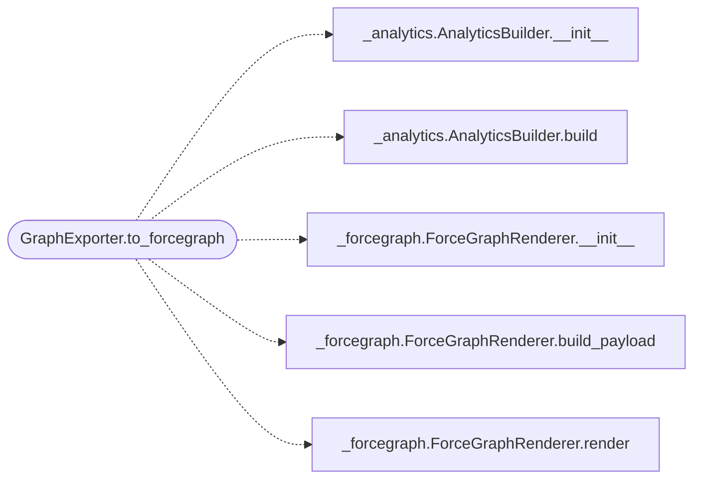

# `readmenator._exporter`

> Source: [readmenator/_exporter.py:1](../../readmenator/_exporter.py#L1) | language `py` | coverage 100.0% | [API index](../index.md)

Multi-format exporter for the readmenator knowledge graph.

Produces JSON (GraphRAG-ready node-link format), interactive HTML
(vis.js standalone), and static SVG (matplotlib-based) outputs from
the scanned nodes, edges, and optional analysis results.

## Contents

- **Classes:** [`GraphExporter`](#graphexporter)

## Call Graph

Solid arrows stay in this module, dashed arrows leave it.



## Classes

<a id="graphexporter"></a>

### `GraphExporter`

`class` | [readmenator/_exporter.py:28](../../readmenator/_exporter.py#L28)

```python
class GraphExporter
```

Exports the knowledge graph to JSON, HTML, and SVG formats.

Each method is self-contained and produces a single file. No
external network calls are made; the HTML file embeds vis.js
from a CDN reference for offline-compatible rendering.

**Members**

| Member | Kind | Summary |
|---|---|---|
| [`__init__`](#graphexporter-__init__) | constructor | Initialise with application configuration. |
| [`to_json`](#graphexporter-to_json) | method | Export the graph as a node-link JSON string. |
| [`to_html`](#graphexporter-to_html) | method | Generate a standalone interactive HTML graph page. |
| [`to_svg`](#graphexporter-to_svg) | method | Generate a static SVG representation of the graph. |
| [`to_graphml`](#graphexporter-to_graphml) | method | Export the graph as GraphML (Gephi/yEd compatible). |
| [`to_cypher`](#graphexporter-to_cypher) | method | Export the graph as native Cypher CREATE statements. |
| [`to_obsidian`](#graphexporter-to_obsidian) | method | Export the graph as an Obsidian vault with wikilinks. |
| [`to_forcegraph`](#graphexporter-to_forcegraph) | method | Generate the force-graph explorer HTML document. |

<a id="graphexporter-__init__"></a>

#### `GraphExporter.__init__`

`constructor` | [readmenator/_exporter.py:36](../../readmenator/_exporter.py#L36)

```python
def __init__(self, config: Config)
```

Initialise with application configuration.

**Parameters**

| Name | Type | Default | Description |
|---|---|---|---|
| `config` | `Config` |  | Settings for export styling and limits. |

*Called by:* [`AnalyzerFactory.exporter`](readmenator._pipeline.py.md#analyzerfactory-exporter)

<a id="graphexporter-to_json"></a>

#### `GraphExporter.to_json`

`method` | [readmenator/_exporter.py:44](../../readmenator/_exporter.py#L44)

```python
def to_json(self, nodes: List[Node], edges: List[Edge], resolved_edges: Optional[List[Edge]] = None, analysis: Optional[AnalysisResult] = None, findings: Optional[List[SecurityFinding]] = None, concept_graph: Optional[ConceptGraph] = None) -> str
```

Export the graph as a node-link JSON string.

**Parameters**

| Name | Type | Default | Description |
|---|---|---|---|
| `nodes` | `List[Node]` |  | Scanned file nodes. |
| `edges` | `List[Edge]` |  | Import edges. |
| `resolved_edges` | `Optional[List[Edge]]` | `None` | Optional resolved-import edges. |
| `analysis` | `Optional[AnalysisResult]` | `None` | Optional analysis results for metadata. |
| `findings` | `Optional[List[SecurityFinding]]` | `None` | Optional security audit findings. |
| `concept_graph` | `Optional[ConceptGraph]` | `None` |  |

**Returns:** `str` - JSON string with nodes, edges, and optional analysis/findings metadata.

<a id="graphexporter-to_html"></a>

#### `GraphExporter.to_html`

`method` | [readmenator/_exporter.py:183](../../readmenator/_exporter.py#L183)

```python
def to_html(self, nodes: List[Node], edges: List[Edge], resolved_edges: Optional[List[Edge]] = None, analysis: Optional[AnalysisResult] = None, findings: Optional[List[SecurityFinding]] = None) -> str
```

Generate a standalone interactive HTML graph page.

Uses vis.js loaded from CDN. Supports click-to-inspect nodes,
search filtering, and community-based coloring.

**Parameters**

| Name | Type | Default | Description |
|---|---|---|---|
| `nodes` | `List[Node]` |  | Scanned file nodes. |
| `edges` | `List[Edge]` |  | Import edges. |
| `resolved_edges` | `Optional[List[Edge]]` | `None` | Optional resolved-import edges. |
| `analysis` | `Optional[AnalysisResult]` | `None` | Optional analysis results for community coloring. |
| `findings` | `Optional[List[SecurityFinding]]` | `None` |  |

**Returns:** `str` - Complete HTML document as a string.

<a id="graphexporter-to_svg"></a>

#### `GraphExporter.to_svg`

`method` | [readmenator/_exporter.py:482](../../readmenator/_exporter.py#L482)

```python
def to_svg(self, nodes: List[Node], edges: List[Edge], resolved_edges: Optional[List[Edge]] = None, analysis: Optional[AnalysisResult] = None) -> str
```

Generate a static SVG representation of the graph.

Uses a simple force-directed layout without external dependencies.
For graphs with more than SVG_MAX_NODES, returns a plain SVG
with a truncation message.

**Parameters**

| Name | Type | Default | Description |
|---|---|---|---|
| `nodes` | `List[Node]` |  | Scanned file nodes. |
| `edges` | `List[Edge]` |  | Import edges. |
| `resolved_edges` | `Optional[List[Edge]]` | `None` | Optional resolved-import edges. |
| `analysis` | `Optional[AnalysisResult]` | `None` | Optional analysis results for community coloring. |

**Returns:** `str` - SVG document as a string.

<a id="graphexporter-to_graphml"></a>

#### `GraphExporter.to_graphml`

`method` | [readmenator/_exporter.py:696](../../readmenator/_exporter.py#L696)

```python
def to_graphml(self, nodes: List[Node], edges: List[Edge], resolved_edges: Optional[List[Edge]] = None, analysis: Optional[AnalysisResult] = None) -> str
```

Export the graph as GraphML (Gephi/yEd compatible).

**Parameters**

| Name | Type | Default | Description |
|---|---|---|---|
| `nodes` | `List[Node]` |  | Scanned file nodes. |
| `edges` | `List[Edge]` |  | Import edges. |
| `resolved_edges` | `Optional[List[Edge]]` | `None` | Optional resolved-import edges. |
| `analysis` | `Optional[AnalysisResult]` | `None` | Optional analysis results for community data. |

**Returns:** `str` - GraphML XML string.

<a id="graphexporter-to_cypher"></a>

#### `GraphExporter.to_cypher`

`method` | [readmenator/_exporter.py:773](../../readmenator/_exporter.py#L773)

```python
def to_cypher(self, nodes: List[Node], edges: List[Edge], resolved_edges: Optional[List[Edge]] = None, analysis: Optional[AnalysisResult] = None, findings: Optional[List[SecurityFinding]] = None, concept_graph: Optional[ConceptGraph] = None) -> str
```

Export the graph as native Cypher CREATE statements.

Generates Neo4j/Memgraph-compatible Cypher for direct graph
database ingestion. Each file node becomes a ``(:File)`` node,
import dependencies become ``(:File)-[:IMPORTS]->(:File)``
relationships. Optional security findings are attached as node
properties and standalone ``(:SecurityFinding)`` nodes.

**Parameters**

| Name | Type | Default | Description |
|---|---|---|---|
| `nodes` | `List[Node]` |  | Scanned file nodes. |
| `edges` | `List[Edge]` |  | Import edges. |
| `resolved_edges` | `Optional[List[Edge]]` | `None` | Optional resolved-import edges. |
| `analysis` | `Optional[AnalysisResult]` | `None` | Optional analysis results for community metadata. |
| `findings` | `Optional[List[SecurityFinding]]` | `None` | Optional security finding nodes. |
| `concept_graph` | `Optional[ConceptGraph]` | `None` |  |

**Returns:** `str` - String of Cypher CREATE statements.

<a id="graphexporter-to_obsidian"></a>

#### `GraphExporter.to_obsidian`

`method` | [readmenator/_exporter.py:895](../../readmenator/_exporter.py#L895)

```python
def to_obsidian(self, nodes: List[Node], edges: List[Edge], output_dir: str, analysis: Optional[AnalysisResult] = None, concept_graph: Optional[ConceptGraph] = None) -> int
```

Export the graph as an Obsidian vault with wikilinks.

Each file node becomes a markdown note. Community hub notes
aggregate related files. Concept notes implement the second-brain
noun/verb layer with [[wikilinks]] to every mapped file. All notes
use [[wikilinks]] for Obsidian graph navigation.

**Parameters**

| Name | Type | Default | Description |
|---|---|---|---|
| `nodes` | `List[Node]` |  | Scanned file nodes. |
| `edges` | `List[Edge]` |  | Import edges. |
| `output_dir` | `str` |  | Directory to write the Obsidian notes. |
| `analysis` | `Optional[AnalysisResult]` | `None` | Optional analysis results for community hubs. |
| `concept_graph` | `Optional[ConceptGraph]` | `None` | Optional semantic noun/verb layer. |

**Returns:** `int` - Number of notes written.

<a id="graphexporter-to_forcegraph"></a>

#### `GraphExporter.to_forcegraph`

`method` | [readmenator/_exporter.py:1020](../../readmenator/_exporter.py#L1020)

```python
def to_forcegraph(self, nodes: List[Node], edges: List[Edge], resolved_edges: Optional[List[Edge]] = None, analysis: Optional[AnalysisResult] = None, layers: Optional[Dict[str, str]] = None, findings: Optional[List[SecurityFinding]] = None, analytics: Optional[Dict] = None) -> str
```

Generate the force-graph explorer HTML document.

Delegates payload construction and rendering to
ForceGraphRenderer with heterogeneous nodes, stable family
colors, log2 sizing, and community hull overlays.

**Parameters**

| Name | Type | Default | Description |
|---|---|---|---|
| `nodes` | `List[Node]` |  | Scanned file nodes. |
| `edges` | `List[Edge]` |  | Import edges. |
| `resolved_edges` | `Optional[List[Edge]]` | `None` | Optional resolved-import edges. |
| `analysis` | `Optional[AnalysisResult]` | `None` | Optional community analysis. |
| `layers` | `Optional[Dict[str, str]]` | `None` | Optional file-to-layer mapping. |
| `findings` | `Optional[List[SecurityFinding]]` | `None` | Optional security findings. |
| `analytics` | `Optional[Dict]` | `None` | Optional precomputed analytics payload. |

**Returns:** `str` - Complete HTML document as a string.

*Calls:* [`AnalyticsBuilder.__init__`](readmenator._analytics.py.md#analyticsbuilder-__init__), [`AnalyticsBuilder.build`](readmenator._analytics.py.md#analyticsbuilder-build), [`ForceGraphRenderer.__init__`](readmenator._forcegraph.py.md#forcegraphrenderer-__init__), [`ForceGraphRenderer.build_payload`](readmenator._forcegraph.py.md#forcegraphrenderer-build_payload), [`ForceGraphRenderer.render`](readmenator._forcegraph.py.md#forcegraphrenderer-render)

---
