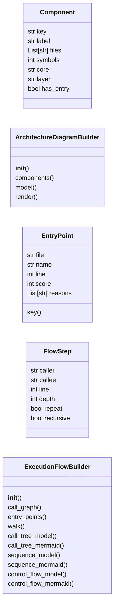
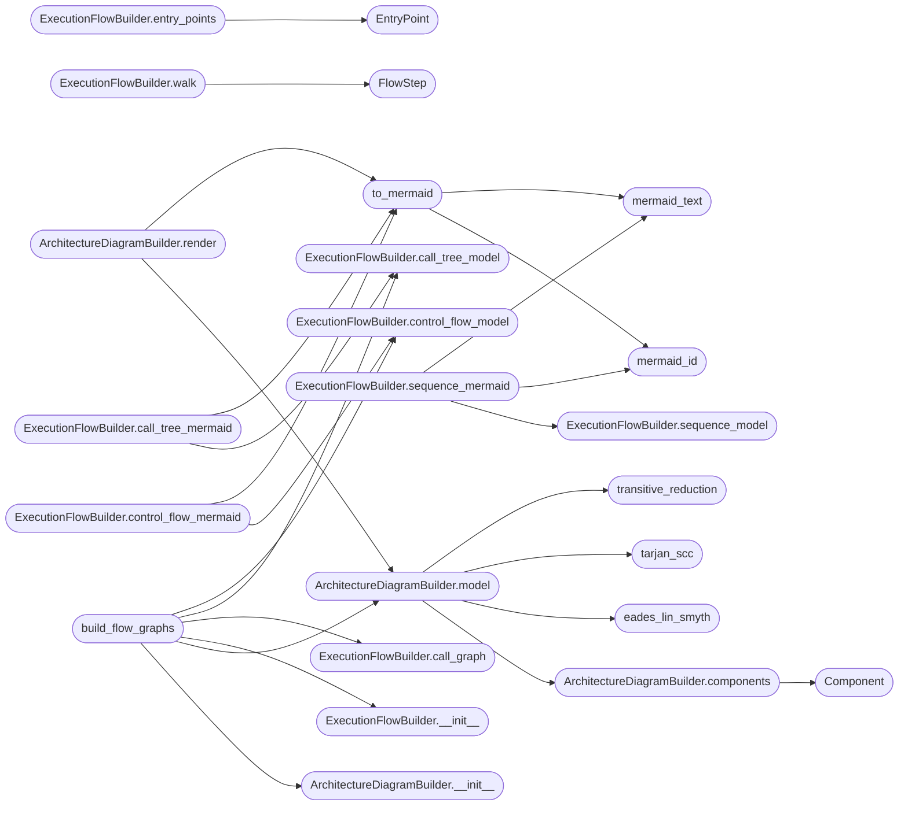

# `readmenator._flowcharts`

> Source: [readmenator/_flowcharts.py:1](../../readmenator/_flowcharts.py#L1) | language `py` | coverage 100.0% | [API index](../index.md)

Architecture and execution-flow Mermaid diagrams from static structure.

Two deterministic, zero-token generators:

* ArchitectureDiagramBuilder aggregates files into components (analyzer
  communities, falling back to directories), builds the weighted
  component dependency graph, condenses strongly connected components
  (Tarjan) so cycles are explicit, removes transitively implied edges
  (transitive reduction on the condensation DAG), places components in
  architectural-layer lanes ordered by longest-path rank, and renders a
  ``flowchart TB`` whose edge thickness and labels carry import weight
  and whose cycle edges are highlighted.
* ExecutionFlowBuilder scores entry points (``__main__`` guards,
  ``main`` functions, CLI and server files, call-graph sources), walks
  the resolved call graph in call-site order to produce an execution
  call tree, renders a control-flow flowchart (decisions, loops, try
  blocks, returns) for Python entry functions from ``ast``, and a
  cross-file ``sequenceDiagram`` of the same walk.

## Contents

- **Classes:** [`Component`](#component), [`ArchitectureDiagramBuilder`](#architecturediagrambuilder), [`EntryPoint`](#entrypoint), [`FlowStep`](#flowstep), [`ExecutionFlowBuilder`](#executionflowbuilder)
- **Functions:** [`mermaid_id`](#mermaid_id), [`mermaid_text`](#mermaid_text), [`tarjan_scc`](#tarjan_scc), [`transitive_reduction`](#transitive_reduction), [`eades_lin_smyth`](#eades_lin_smyth), [`to_mermaid`](#to_mermaid), [`build_flow_graphs`](#build_flow_graphs), [`render_architecture_section`](#render_architecture_section), [`render_flows_section`](#render_flows_section)
- **Constants:** [`LAYER_ORDER`](#layer_order), [`LAYER_TITLES`](#layer_titles)

## Type Diagram



## Call Graph

Solid arrows stay in this module, dashed arrows leave it.



## Classes

<a id="component"></a>

### `Component`

`class` `dataclass` | [readmenator/_flowcharts.py:237](../../readmenator/_flowcharts.py#L237)

Decorators: `@dataclass`

```python
class Component
```

One architectural component (a group of files).

**Attributes**

| Name | Type | Default | Description |
|---|---|---|---|
| [`key`](#component-key) | `str` |  | Stable component key. |
| [`label`](#component-label) | `str` |  | Display label. |
| [`files`](#component-files) | `List[str]` | `field(default_factory=list)` | Member file ids (sorted). |
| [`symbols`](#component-symbols) | `int` | `0` | Total symbol count of member files. |
| [`core`](#component-core) | `str` | `''` | Member file with the most symbols. |
| [`layer`](#component-layer) | `str` | `'utility'` | Dominant architectural layer. |
| [`has_entry`](#component-has_entry) | `bool` | `False` | Whether an entry-point file belongs to the component. |

---

<a id="architecturediagrambuilder"></a>

### `ArchitectureDiagramBuilder`

`class` | [readmenator/_flowcharts.py:259](../../readmenator/_flowcharts.py#L259)

```python
class ArchitectureDiagramBuilder
```

Builds a layered, cycle-aware, transitively reduced component diagram.

**Members**

| Member | Kind | Summary |
|---|---|---|
| [`__init__`](#architecturediagrambuilder-__init__) | constructor | Initialise with application configuration. |
| [`components`](#architecturediagrambuilder-components) | method | Group files into components with dominant layers. |
| [`model`](#architecturediagrambuilder-model) | method | Build the tiered architecture diagram as a FlowGraph. |
| [`render`](#architecturediagrambuilder-render) | method | Render the tiered architecture as Mermaid (see model()). |

<a id="architecturediagrambuilder-__init__"></a>

#### `ArchitectureDiagramBuilder.__init__`

`constructor` | [readmenator/_flowcharts.py:262](../../readmenator/_flowcharts.py#L262)

```python
def __init__(self, config: Config) -> None
```

Initialise with application configuration.

**Parameters**

| Name | Type | Default | Description |
|---|---|---|---|
| `config` | `Config` |  | Settings for component budgets and test exclusion. |

*Called by:* [`build_flow_graphs`](#build_flow_graphs), [`render_architecture_section`](#render_architecture_section)

<a id="architecturediagrambuilder-components"></a>

#### `ArchitectureDiagramBuilder.components`

`method` | [readmenator/_flowcharts.py:270](../../readmenator/_flowcharts.py#L270)

```python
def components(self, nodes: List[Node], analysis: Optional[AnalysisResult], layers: Optional[Dict[str, str]]) -> List[Component]
```

Group files into components with dominant layers.

**Parameters**

| Name | Type | Default | Description |
|---|---|---|---|
| `nodes` | `List[Node]` |  | Scanned file nodes. |
| `analysis` | `Optional[AnalysisResult]` |  | Optional analyzer communities. |
| `layers` | `Optional[Dict[str, str]]` |  | Optional file-to-layer mapping. |

**Returns:** `List[Component]` - Components sorted by size descending, then key.

*Calls:* [`is_vendored_path`](readmenator._apidocs.py.md#is_vendored_path), [`Component`](#component)

*Called by:* [`ArchitectureDiagramBuilder.model`](#architecturediagrambuilder-model)

<a id="architecturediagrambuilder-model"></a>

#### `ArchitectureDiagramBuilder.model`

`method` | [readmenator/_flowcharts.py:335](../../readmenator/_flowcharts.py#L335)

```python
def model(self, nodes: List[Node], resolved_edges: Optional[List[Edge]], analysis: Optional[AnalysisResult] = None, layers: Optional[Dict[str, str]] = None) -> Tuple[Optional[FlowGraph], Dict[str, object]]
```

Build the tiered architecture diagram as a FlowGraph.

Components are ordered with the weighted Eades-Lin-Smyth
feedback-arc-set heuristic, so the dependency direction most
imports agree on points downwards. Edges against that order are
the minimal set that creates cycles ("upward" dependencies).
Tiers are longest-path levels over the remaining acyclic edges,
and implied forward edges are removed by transitive reduction.
Each component node lists its size, dominant layer, key files
(most imported first) and carries every member file with its
purpose for the viewer panel.

**Parameters**

| Name | Type | Default | Description |
|---|---|---|---|
| `nodes` | `List[Node]` |  | Scanned file nodes. |
| `resolved_edges` | `Optional[List[Edge]]` |  | Resolved import edges. |
| `analysis` | `Optional[AnalysisResult]` | `None` | Optional analyzer communities. |
| `layers` | `Optional[Dict[str, str]]` | `None` | Optional file-to-layer mapping. |

**Returns:** `Tuple[Optional[FlowGraph], Dict[str, object]]` - Tuple of (graph or None when empty, stats with components,
edges, reduced edge count, upward edges, cycles, tiers).

*Calls:* [`ArchitectureDiagramBuilder.components`](#architecturediagrambuilder-components), [`eades_lin_smyth`](#eades_lin_smyth), [`tarjan_scc`](#tarjan_scc), [`transitive_reduction`](#transitive_reduction), [`FlowEdge`](readmenator._flowlayout.py.md#flowedge), [`FlowGraph`](readmenator._flowlayout.py.md#flowgraph), [`FlowNode`](readmenator._flowlayout.py.md#flownode)

*Called by:* [`ArchitectureDiagramBuilder.render`](#architecturediagrambuilder-render), [`build_flow_graphs`](#build_flow_graphs)

<a id="architecturediagrambuilder-render"></a>

#### `ArchitectureDiagramBuilder.render`

`method` | [readmenator/_flowcharts.py:476](../../readmenator/_flowcharts.py#L476)

```python
def render(self, nodes: List[Node], resolved_edges: Optional[List[Edge]], analysis: Optional[AnalysisResult] = None, layers: Optional[Dict[str, str]] = None) -> Tuple[str, Dict[str, object]]
```

Render the tiered architecture as Mermaid (see model()).

**Parameters**

| Name | Type | Default | Description |
|---|---|---|---|
| `nodes` | `List[Node]` |  |  |
| `resolved_edges` | `Optional[List[Edge]]` |  |  |
| `analysis` | `Optional[AnalysisResult]` | `None` |  |
| `layers` | `Optional[Dict[str, str]]` | `None` |  |

**Returns:** `Tuple[str, Dict[str, object]]`

*Calls:* [`ArchitectureDiagramBuilder.model`](#architecturediagrambuilder-model), [`to_mermaid`](#to_mermaid)

*Called by:* [`render_architecture_section`](#render_architecture_section)

---

<a id="entrypoint"></a>

### `EntryPoint`

`class` `dataclass` | [readmenator/_flowcharts.py:499](../../readmenator/_flowcharts.py#L499)

Decorators: `@dataclass`

```python
class EntryPoint
```

A scored execution entry point.

**Attributes**

| Name | Type | Default | Description |
|---|---|---|---|
| [`file`](#entrypoint-file) | `str` |  | Relative file id. |
| [`name`](#entrypoint-name) | `str` |  | Callable name ("" for a module-level ``__main__`` block). |
| [`line`](#entrypoint-line) | `int` |  | One-based definition (or guard) line. |
| [`score`](#entrypoint-score) | `int` |  | Heuristic entry score. |
| [`reasons`](#entrypoint-reasons) | `List[str]` | `field(default_factory=list)` | Human-readable evidence. |

**Members**

| Member | Kind | Summary |
|---|---|---|
| [`key`](#entrypoint-key) | property | Return the call-graph key of this entry point. |

<a id="entrypoint-key"></a>

#### `EntryPoint.key`

`property` | [readmenator/_flowcharts.py:517](../../readmenator/_flowcharts.py#L517)

Decorators: `@property`

```python
def key(self) -> str
```

Return the call-graph key of this entry point.

**Returns:** `str`

---

<a id="flowstep"></a>

### `FlowStep`

`class` `dataclass` | [readmenator/_flowcharts.py:523](../../readmenator/_flowcharts.py#L523)

Decorators: `@dataclass`

```python
class FlowStep
```

One step of an execution walk.

**Attributes**

| Name | Type | Default | Description |
|---|---|---|---|
| [`caller`](#flowstep-caller) | `str` |  | Caller key (``file::name``). |
| [`callee`](#flowstep-callee) | `str` |  | Callee key. |
| [`line`](#flowstep-line) | `int` |  | Call-site line in the caller file. |
| [`depth`](#flowstep-depth) | `int` |  | Depth from the entry point (1 = direct call). |
| [`repeat`](#flowstep-repeat) | `bool` | `False` | True when the callee was already expanded earlier. |
| [`recursive`](#flowstep-recursive) | `bool` | `False` | True when the callee is on the current call stack. |

---

<a id="executionflowbuilder"></a>

### `ExecutionFlowBuilder`

`class` | [readmenator/_flowcharts.py:543](../../readmenator/_flowcharts.py#L543)

```python
class ExecutionFlowBuilder
```

Detects entry points and renders their execution flows as Mermaid.

**Members**

| Member | Kind | Summary |
|---|---|---|
| [`__init__`](#executionflowbuilder-__init__) | constructor | Initialise with application configuration. |
| [`call_graph`](#executionflowbuilder-call_graph) | method | Build the ordered call graph keyed by ``file::name``. |
| [`entry_points`](#executionflowbuilder-entry_points) | method | Score candidate entry points and return the strongest ones. |
| [`walk`](#executionflowbuilder-walk) | method | Depth-first walk in call-site order, bounded by depth and steps. |
| [`call_tree_model`](#executionflowbuilder-call_tree_model) | method | Build the execution call tree of one entry point. |
| [`call_tree_mermaid`](#executionflowbuilder-call_tree_mermaid) | method | Render an execution call tree as ``flowchart LR``. |
| [`sequence_model`](#executionflowbuilder-sequence_model) | method | Build the cross-file sequence of one walk (None when it never leaves the entry file). |
| [`sequence_mermaid`](#executionflowbuilder-sequence_mermaid) | method | Render the cross-file part of a walk as ``sequenceDiagram``. |
| [`control_flow_model`](#executionflowbuilder-control_flow_model) | method | Build the control-flow flowchart of a Python entry function (or ``__main__`` block). |
| [`control_flow_mermaid`](#executionflowbuilder-control_flow_mermaid) | method | Render a Python entry function (or ``__main__`` block) as a Mermaid flowchart. |

<a id="executionflowbuilder-__init__"></a>

#### `ExecutionFlowBuilder.__init__`

`constructor` | [readmenator/_flowcharts.py:546](../../readmenator/_flowcharts.py#L546)

```python
def __init__(self, config: Config) -> None
```

Initialise with application configuration.

**Parameters**

| Name | Type | Default | Description |
|---|---|---|---|
| `config` | `Config` |  | Settings for entry-point, depth, and step budgets. |

*Called by:* [`build_flow_graphs`](#build_flow_graphs), [`render_flows_section`](#render_flows_section)

<a id="executionflowbuilder-call_graph"></a>

#### `ExecutionFlowBuilder.call_graph`

`method` | [readmenator/_flowcharts.py:564](../../readmenator/_flowcharts.py#L564)

```python
def call_graph(self, nodes: List[Node], edges: List[Edge], resolved_edges: Optional[List[Edge]], content_map: Optional[Dict[str, str]]) -> Tuple[Dict[str, List[Tuple[int, str]]], Dict[str, SymbolDef], List[ResolvedCall]]
```

Build the ordered call graph keyed by ``file::name``.

**Parameters**

| Name | Type | Default | Description |
|---|---|---|---|
| `nodes` | `List[Node]` |  |  |
| `edges` | `List[Edge]` |  |  |
| `resolved_edges` | `Optional[List[Edge]]` |  |  |
| `content_map` | `Optional[Dict[str, str]]` |  |  |

**Returns:** `Tuple[Dict[str, List[Tuple[int, str]]], Dict[str, SymbolDef], List[ResolvedCall]]` - Tuple of (caller -> ordered (line, callee) list, definitions by
key, all resolved calls).

*Calls:* [`PythonReceiverTypes.__init__`](readmenator._pytypes.py.md#pythonreceivertypes-__init__), [`PythonReceiverTypes.accepts`](readmenator._pytypes.py.md#pythonreceivertypes-accepts), [`PythonReceiverTypes.owner_of`](readmenator._pytypes.py.md#pythonreceivertypes-owner_of), [`PythonReceiverTypes.resolve_method`](readmenator._pytypes.py.md#pythonreceivertypes-resolve_method), [`SymbolIndex.__init__`](readmenator._symindex.py.md#symbolindex-__init__), [`SymbolIndex.build`](readmenator._symindex.py.md#symbolindex-build), [`SymbolIndex.resolve`](readmenator._symindex.py.md#symbolindex-resolve)

*Called by:* [`build_flow_graphs`](#build_flow_graphs), [`render_flows_section`](#render_flows_section)

<a id="executionflowbuilder-entry_points"></a>

#### `ExecutionFlowBuilder.entry_points`

`method` | [readmenator/_flowcharts.py:645](../../readmenator/_flowcharts.py#L645)

```python
def entry_points(self, nodes: List[Node], graph: Dict[str, List[Tuple[int, str]]], defs: Dict[str, SymbolDef], content_map: Optional[Dict[str, str]]) -> List[EntryPoint]
```

Score candidate entry points and return the strongest ones.

**Parameters**

| Name | Type | Default | Description |
|---|---|---|---|
| `nodes` | `List[Node]` |  | Scanned file nodes. |
| `graph` | `Dict[str, List[Tuple[int, str]]]` |  | Ordered call graph from call_graph(). |
| `defs` | `Dict[str, SymbolDef]` |  | Definitions keyed by ``file::name``. |
| `content_map` | `Optional[Dict[str, str]]` |  | File contents (enables ``__main__`` guard detection). |

**Returns:** `List[EntryPoint]` - Entry points sorted by score descending, capped by FLOW_MAX_ENTRYPOINTS.

*Calls:* [`EntryPoint`](#entrypoint)

*Called by:* [`build_flow_graphs`](#build_flow_graphs), [`render_flows_section`](#render_flows_section)

<a id="executionflowbuilder-walk"></a>

#### `ExecutionFlowBuilder.walk`

`method` | [readmenator/_flowcharts.py:723](../../readmenator/_flowcharts.py#L723)

```python
def walk(self, graph: Dict[str, List[Tuple[int, str]]], start: str) -> List[FlowStep]
```

Depth-first walk in call-site order, bounded by depth and steps.

**Parameters**

| Name | Type | Default | Description |
|---|---|---|---|
| `graph` | `Dict[str, List[Tuple[int, str]]]` |  | Ordered call graph. |
| `start` | `str` |  | Entry key. |

**Returns:** `List[FlowStep]` - Steps in execution order; repeated callees are not re-expanded.

*Calls:* [`FlowStep`](#flowstep)

*Called by:* [`build_flow_graphs`](#build_flow_graphs), [`render_flows_section`](#render_flows_section)

<a id="executionflowbuilder-call_tree_model"></a>

#### `ExecutionFlowBuilder.call_tree_model`

`method` | [readmenator/_flowcharts.py:779](../../readmenator/_flowcharts.py#L779)

```python
def call_tree_model(self, entry: EntryPoint, steps: List[FlowStep], defs: Optional[Dict[str, SymbolDef]] = None) -> FlowGraph
```

Build the execution call tree of one entry point.

Nodes carry ``Owner.method``, the defining file and line, and the
first sentence of the docstring; edges are numbered in call order,
dashed when the callee was already expanded, red for recursion.

**Parameters**

| Name | Type | Default | Description |
|---|---|---|---|
| `entry` | `EntryPoint` |  |  |
| `steps` | `List[FlowStep]` |  |  |
| `defs` | `Optional[Dict[str, SymbolDef]]` | `None` |  |

**Returns:** `FlowGraph`

*Calls:* [`FlowEdge`](readmenator._flowlayout.py.md#flowedge), [`FlowGraph`](readmenator._flowlayout.py.md#flowgraph), [`FlowNode`](readmenator._flowlayout.py.md#flownode)

*Called by:* [`ExecutionFlowBuilder.call_tree_mermaid`](#executionflowbuilder-call_tree_mermaid), [`build_flow_graphs`](#build_flow_graphs)

<a id="executionflowbuilder-call_tree_mermaid"></a>

#### `ExecutionFlowBuilder.call_tree_mermaid`

`method` | [readmenator/_flowcharts.py:827](../../readmenator/_flowcharts.py#L827)

```python
def call_tree_mermaid(self, entry: EntryPoint, steps: List[FlowStep], defs: Optional[Dict[str, SymbolDef]] = None) -> str
```

Render an execution call tree as ``flowchart LR``.

**Parameters**

| Name | Type | Default | Description |
|---|---|---|---|
| `entry` | `EntryPoint` |  |  |
| `steps` | `List[FlowStep]` |  |  |
| `defs` | `Optional[Dict[str, SymbolDef]]` | `None` |  |

**Returns:** `str`

*Calls:* [`ExecutionFlowBuilder.call_tree_model`](#executionflowbuilder-call_tree_model), [`to_mermaid`](#to_mermaid)

*Called by:* [`render_flows_section`](#render_flows_section)

<a id="executionflowbuilder-sequence_model"></a>

#### `ExecutionFlowBuilder.sequence_model`

`method` | [readmenator/_flowcharts.py:831](../../readmenator/_flowcharts.py#L831)

```python
def sequence_model(self, entry: EntryPoint, steps: List[FlowStep], defs: Optional[Dict[str, SymbolDef]] = None) -> Optional[FlowGraph]
```

Build the cross-file sequence of one walk (None when it never leaves the entry file).

**Parameters**

| Name | Type | Default | Description |
|---|---|---|---|
| `entry` | `EntryPoint` |  |  |
| `steps` | `List[FlowStep]` |  |  |
| `defs` | `Optional[Dict[str, SymbolDef]]` | `None` |  |

**Returns:** `Optional[FlowGraph]`

*Calls:* [`FlowGraph`](readmenator._flowlayout.py.md#flowgraph)

*Called by:* [`ExecutionFlowBuilder.sequence_mermaid`](#executionflowbuilder-sequence_mermaid), [`build_flow_graphs`](#build_flow_graphs)

<a id="executionflowbuilder-sequence_mermaid"></a>

#### `ExecutionFlowBuilder.sequence_mermaid`

`method` | [readmenator/_flowcharts.py:862](../../readmenator/_flowcharts.py#L862)

```python
def sequence_mermaid(self, entry: EntryPoint, steps: List[FlowStep], defs: Optional[Dict[str, SymbolDef]] = None) -> str
```

Render the cross-file part of a walk as ``sequenceDiagram``.

**Parameters**

| Name | Type | Default | Description |
|---|---|---|---|
| `entry` | `EntryPoint` |  |  |
| `steps` | `List[FlowStep]` |  |  |
| `defs` | `Optional[Dict[str, SymbolDef]]` | `None` |  |

**Returns:** `str`

*Calls:* [`ExecutionFlowBuilder.sequence_model`](#executionflowbuilder-sequence_model), [`mermaid_id`](#mermaid_id), [`mermaid_text`](#mermaid_text)

*Called by:* [`render_flows_section`](#render_flows_section)

<a id="executionflowbuilder-control_flow_model"></a>

#### `ExecutionFlowBuilder.control_flow_model`

`method` | [readmenator/_flowcharts.py:877](../../readmenator/_flowcharts.py#L877)

```python
def control_flow_model(self, content: str, entry: EntryPoint, project_names: Set[str], defs: Optional[Dict[str, SymbolDef]] = None, call_graph: Optional[Dict[str, List[Tuple[int, str]]]] = None) -> Optional[FlowGraph]
```

Build the control-flow flowchart of a Python entry function (or ``__main__`` block).

**Parameters**

| Name | Type | Default | Description |
|---|---|---|---|
| `content` | `str` |  |  |
| `entry` | `EntryPoint` |  |  |
| `project_names` | `Set[str]` |  |  |
| `defs` | `Optional[Dict[str, SymbolDef]]` | `None` |  |
| `call_graph` | `Optional[Dict[str, List[Tuple[int, str]]]]` | `None` |  |

**Returns:** `Optional[FlowGraph]`

*Called by:* [`ExecutionFlowBuilder.control_flow_mermaid`](#executionflowbuilder-control_flow_mermaid), [`build_flow_graphs`](#build_flow_graphs), [`render_flows_section`](#render_flows_section)

<a id="executionflowbuilder-control_flow_mermaid"></a>

#### `ExecutionFlowBuilder.control_flow_mermaid`

`method` | [readmenator/_flowcharts.py:921](../../readmenator/_flowcharts.py#L921)

```python
def control_flow_mermaid(self, content: str, entry: EntryPoint, project_names: Set[str]) -> str
```

Render a Python entry function (or ``__main__`` block) as a Mermaid flowchart.

**Parameters**

| Name | Type | Default | Description |
|---|---|---|---|
| `content` | `str` |  |  |
| `entry` | `EntryPoint` |  |  |
| `project_names` | `Set[str]` |  |  |

**Returns:** `str`

*Calls:* [`ExecutionFlowBuilder.control_flow_model`](#executionflowbuilder-control_flow_model), [`to_mermaid`](#to_mermaid)

---

## Functions

<a id="mermaid_id"></a>

### `mermaid_id`

`function` | [readmenator/_flowcharts.py:67](../../readmenator/_flowcharts.py#L67)

```python
def mermaid_id(text: str, prefix: str = 'n') -> str
```

Return a Mermaid-safe identifier for *text*.

**Parameters**

| Name | Type | Default | Description |
|---|---|---|---|
| `text` | `str` |  |  |
| `prefix` | `str` | `'n'` |  |

**Returns:** `str`

*Called by:* [`ExecutionFlowBuilder.sequence_mermaid`](#executionflowbuilder-sequence_mermaid), [`to_mermaid`](#to_mermaid)

---

<a id="mermaid_text"></a>

### `mermaid_text`

`function` | [readmenator/_flowcharts.py:72](../../readmenator/_flowcharts.py#L72)

```python
def mermaid_text(text: str, limit: int = 0) -> str
```

Escape *text* for a quoted Mermaid label, optionally truncating it.

**Parameters**

| Name | Type | Default | Description |
|---|---|---|---|
| `text` | `str` |  |  |
| `limit` | `int` | `0` |  |

**Returns:** `str`

*Called by:* [`ExecutionFlowBuilder.sequence_mermaid`](#executionflowbuilder-sequence_mermaid), [`to_mermaid`](#to_mermaid)

---

<a id="tarjan_scc"></a>

### `tarjan_scc`

`function` | [readmenator/_flowcharts.py:80](../../readmenator/_flowcharts.py#L80)

```python
def tarjan_scc(vertices: List[str], adjacency: Dict[str, Set[str]]) -> List[List[str]]
```

Return strongly connected components (iterative Tarjan, deterministic order).

**Parameters**

| Name | Type | Default | Description |
|---|---|---|---|
| `vertices` | `List[str]` |  | Vertex ids (visited in sorted order). |
| `adjacency` | `Dict[str, Set[str]]` |  | Directed successor sets. |

**Returns:** `List[List[str]]` - Components as sorted vertex lists, ordered by their smallest vertex.

*Called by:* [`ArchitectureDiagramBuilder.model`](#architecturediagrambuilder-model)

---

<a id="transitive_reduction"></a>

### `transitive_reduction`

`function` | [readmenator/_flowcharts.py:134](../../readmenator/_flowcharts.py#L134)

```python
def transitive_reduction(adjacency: Dict[str, Set[str]]) -> Dict[str, Set[str]]
```

Return the transitive reduction of a DAG.

An edge ``u -> v`` is dropped when ``v`` stays reachable from ``u``
through another successor, so the diagram keeps only direct
architectural dependencies.

**Parameters**

| Name | Type | Default | Description |
|---|---|---|---|
| `adjacency` | `Dict[str, Set[str]]` |  | Successor sets of an acyclic graph. |

**Returns:** `Dict[str, Set[str]]` - Reduced successor sets (same vertices).

*Called by:* [`ArchitectureDiagramBuilder.model`](#architecturediagrambuilder-model)

---

<a id="eades_lin_smyth"></a>

### `eades_lin_smyth`

`function` | [readmenator/_flowcharts.py:185](../../readmenator/_flowcharts.py#L185)

```python
def eades_lin_smyth(vertices: List[str], weight: Dict[Tuple[str, str], int]) -> List[str]
```

Order vertices so that heavy dependencies point forward (weighted ELS heuristic).

Eades, Lin and Smyth (1993): repeatedly peel sinks to the back and
sources to the front; otherwise move the vertex with the largest
(outgoing - incoming) weight to the front. Edges that point
backwards in the result form a small feedback arc set. Ties break
on the vertex key, so the order is deterministic.

**Parameters**

| Name | Type | Default | Description |
|---|---|---|---|
| `vertices` | `List[str]` |  | Vertex keys. |
| `weight` | `Dict[Tuple[str, str], int]` |  | Directed edge weights keyed by (source, target). |

**Returns:** `List[str]` - Vertices from highest level (dependents) to lowest (dependencies).

*Called by:* [`ArchitectureDiagramBuilder.model`](#architecturediagrambuilder-model)

---

<a id="to_mermaid"></a>

### `to_mermaid`

`function` | [readmenator/_flowcharts.py:1170](../../readmenator/_flowcharts.py#L1170)

```python
def to_mermaid(graph: FlowGraph, direction: str = 'TB') -> str
```

Convert a FlowGraph into Mermaid ``flowchart`` source.

Architecture lanes become subgraphs per rank; upward edges are
declared reversed (so Mermaid keeps the tiers in order) and drawn
red together with back edges.

**Parameters**

| Name | Type | Default | Description |
|---|---|---|---|
| `graph` | `FlowGraph` |  |  |
| `direction` | `str` | `'TB'` |  |

**Returns:** `str`

*Calls:* [`mermaid_id`](#mermaid_id), [`mermaid_text`](#mermaid_text), [`RankedItem.label`](readmenator._rank.py.md#rankeditem-label)

*Called by:* [`ArchitectureDiagramBuilder.render`](#architecturediagrambuilder-render), [`ExecutionFlowBuilder.call_tree_mermaid`](#executionflowbuilder-call_tree_mermaid), [`ExecutionFlowBuilder.control_flow_mermaid`](#executionflowbuilder-control_flow_mermaid), [`render_flows_section`](#render_flows_section)

---

<a id="build_flow_graphs"></a>

### `build_flow_graphs`

`function` | [readmenator/_flowcharts.py:1231](../../readmenator/_flowcharts.py#L1231)

```python
def build_flow_graphs(config: Config, nodes: List[Node], edges: List[Edge], resolved_edges: Optional[List[Edge]], content_map: Optional[Dict[str, str]], analysis: Optional[AnalysisResult] = None, layers: Optional[Dict[str, str]] = None) -> List[FlowGraph]
```

Build and lay out every architecture and execution-flow diagram.

**Parameters**

| Name | Type | Default | Description |
|---|---|---|---|
| `config` | `Config` |  |  |
| `nodes` | `List[Node]` |  |  |
| `edges` | `List[Edge]` |  |  |
| `resolved_edges` | `Optional[List[Edge]]` |  |  |
| `content_map` | `Optional[Dict[str, str]]` |  |  |
| `analysis` | `Optional[AnalysisResult]` | `None` |  |
| `layers` | `Optional[Dict[str, str]]` | `None` |  |

**Returns:** `List[FlowGraph]` - Laid-out graphs: the tiered architecture first, then per entry
point its control flow, call tree, and cross-file sequence.

*Calls:* [`ArchitectureDiagramBuilder.__init__`](#architecturediagrambuilder-__init__), [`ArchitectureDiagramBuilder.model`](#architecturediagrambuilder-model), [`ExecutionFlowBuilder.__init__`](#executionflowbuilder-__init__), [`ExecutionFlowBuilder.call_graph`](#executionflowbuilder-call_graph), [`ExecutionFlowBuilder.call_tree_model`](#executionflowbuilder-call_tree_model), [`ExecutionFlowBuilder.control_flow_model`](#executionflowbuilder-control_flow_model), [`ExecutionFlowBuilder.entry_points`](#executionflowbuilder-entry_points), [`ExecutionFlowBuilder.sequence_model`](#executionflowbuilder-sequence_model), [`ExecutionFlowBuilder.walk`](#executionflowbuilder-walk), [`LayoutMetrics`](readmenator._flowlayout.py.md#layoutmetrics), [`layout_flow`](readmenator._flowlayout.py.md#layout_flow), [`layout_sequence`](readmenator._flowlayout.py.md#layout_sequence)

*Called by:* [`CinematicVideoRenderer.collect`](readmenator._video.py.md#cinematicvideorenderer-collect)

---

<a id="render_architecture_section"></a>

### `render_architecture_section`

`function` | [readmenator/_flowcharts.py:1287](../../readmenator/_flowcharts.py#L1287)

```python
def render_architecture_section(config: Config, nodes: List[Node], resolved_edges: Optional[List[Edge]], analysis: Optional[AnalysisResult], layers: Optional[Dict[str, str]]) -> List[str]
```

Return Markdown lines for the Architecture Overview section.

**Parameters**

| Name | Type | Default | Description |
|---|---|---|---|
| `config` | `Config` |  |  |
| `nodes` | `List[Node]` |  |  |
| `resolved_edges` | `Optional[List[Edge]]` |  |  |
| `analysis` | `Optional[AnalysisResult]` |  |  |
| `layers` | `Optional[Dict[str, str]]` |  |  |

**Returns:** `List[str]`

*Calls:* [`ArchitectureDiagramBuilder.__init__`](#architecturediagrambuilder-__init__), [`ArchitectureDiagramBuilder.render`](#architecturediagrambuilder-render)

*Called by:* [`DocumentationGenerator.generate`](readmenator._documentation.py.md#documentationgenerator-generate)

---

<a id="render_flows_section"></a>

### `render_flows_section`

`function` | [readmenator/_flowcharts.py:1319](../../readmenator/_flowcharts.py#L1319)

```python
def render_flows_section(config: Config, nodes: List[Node], edges: List[Edge], resolved_edges: Optional[List[Edge]], content_map: Optional[Dict[str, str]]) -> List[str]
```

Return Markdown lines for the Execution Flows section.

**Parameters**

| Name | Type | Default | Description |
|---|---|---|---|
| `config` | `Config` |  |  |
| `nodes` | `List[Node]` |  |  |
| `edges` | `List[Edge]` |  |  |
| `resolved_edges` | `Optional[List[Edge]]` |  |  |
| `content_map` | `Optional[Dict[str, str]]` |  |  |

**Returns:** `List[str]`

*Calls:* [`ExecutionFlowBuilder.__init__`](#executionflowbuilder-__init__), [`ExecutionFlowBuilder.call_graph`](#executionflowbuilder-call_graph), [`ExecutionFlowBuilder.call_tree_mermaid`](#executionflowbuilder-call_tree_mermaid), [`ExecutionFlowBuilder.control_flow_model`](#executionflowbuilder-control_flow_model), [`ExecutionFlowBuilder.entry_points`](#executionflowbuilder-entry_points), [`ExecutionFlowBuilder.sequence_mermaid`](#executionflowbuilder-sequence_mermaid), [`ExecutionFlowBuilder.walk`](#executionflowbuilder-walk), [`to_mermaid`](#to_mermaid)

*Called by:* [`DocumentationGenerator.generate`](readmenator._documentation.py.md#documentationgenerator-generate)

---

## Constants

<a id="layer_order"></a>

### `LAYER_ORDER`

`constant` | [readmenator/_flowcharts.py:37](../../readmenator/_flowcharts.py#L37)

```python
LAYER_ORDER: Tuple[str, ...]
```

---

<a id="layer_titles"></a>

### `LAYER_TITLES`

`constant` | [readmenator/_flowcharts.py:40](../../readmenator/_flowcharts.py#L40)

```python
LAYER_TITLES: Dict[str, str]
```

---
