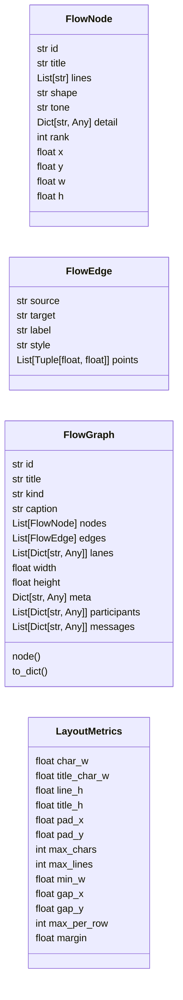
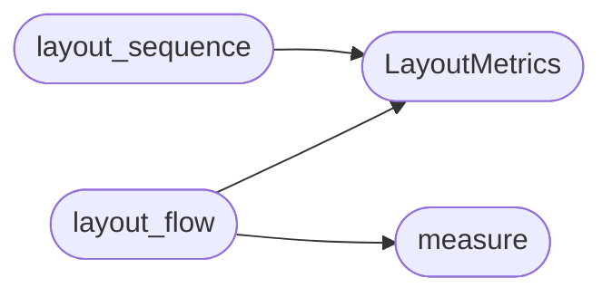

# `readmenator._flowlayout`

> Source: [readmenator/_flowlayout.py:1](../../readmenator/_flowlayout.py#L1) | language `py` | coverage 100.0% | [API index](../index.md)

Flow graph model and deterministic layered layout (Sugiyama style).

Every architecture and execution-flow diagram is first built as a
FlowGraph (nodes with a title, wrapped detail lines, shape, tone and a
detail payload; typed edges). layout_flow() then places it:

1. Ranks: explicit ranks when the builder provides them (architecture
   tiers), otherwise longest-path ranks over the DAG left after removing
   DFS back edges.
2. Order: barycentric up/down sweeps reduce crossings.
3. Wrapping: a rank wider than `[`max_per_row`](#layoutmetrics-max_per_row)` is folded into several
   rows, so no diagram degenerates into a thin strip.
4. Coordinates: every row is placed under the barycenter of its parents,
   overlaps are pushed apart, rows are stacked by their real heights.
5. Routing: forward edges are vertical cubic curves; back edges (loops,
   recursion, upward dependencies) leave on the right and bend around.

Sizes come from monospace text metrics, so the same coordinates drive
the SVG viewer and the PIL video frames. Pure Python, deterministic.

## Contents

- **Classes:** [`FlowNode`](#flownode), [`FlowEdge`](#flowedge), [`FlowGraph`](#flowgraph), [`LayoutMetrics`](#layoutmetrics)
- **Functions:** [`measure`](#measure), [`layout_flow`](#layout_flow), [`layout_sequence`](#layout_sequence)
- **Constants:** [`SHAPES`](#shapes), [`TONES`](#tones), [`EDGE_STYLES`](#edge_styles), [`BRANCH_LABELS`](#branch_labels), [`TRUNK_LABELS`](#trunk_labels)

## Type Diagram



## Call Graph

Solid arrows stay in this module, dashed arrows leave it.



## Classes

<a id="flownode"></a>

### `FlowNode`

`class` `dataclass` | [readmenator/_flowlayout.py:36](../../readmenator/_flowlayout.py#L36)

Decorators: `@dataclass`

```python
class FlowNode
```

One diagram node.

**Attributes**

| Name | Type | Default | Description |
|---|---|---|---|
| [`id`](#flownode-id) | `str` |  | Stable node id. |
| [`title`](#flownode-title) | `str` |  | Bold first line. |
| [`lines`](#flownode-lines) | `List[str]` | `field(default_factory=list)` | Detail lines (wrapped by layout). |
| [`shape`](#flownode-shape) | `str` | `'box'` | One of SHAPES. |
| [`tone`](#flownode-tone) | `str` | `'default'` | One of TONES (color family). |
| [`detail`](#flownode-detail) | `Dict[str, Any]` | `field(default_factory=dict)` | Free payload for the viewer side panel (file, line, doc, href, ...). |
| [`rank`](#flownode-rank) | `int` | `-1` | Explicit rank, or -1 to compute. |
| [`x`](#flownode-x) | `float` | `0.0` | Center x after layout. |
| [`y`](#flownode-y) | `float` | `0.0` | Center y after layout. |
| [`w`](#flownode-w) | `float` | `0.0` | Width after layout. |
| [`h`](#flownode-h) | `float` | `0.0` | Height after layout. |

---

<a id="flowedge"></a>

### `FlowEdge`

`class` `dataclass` | [readmenator/_flowlayout.py:67](../../readmenator/_flowlayout.py#L67)

Decorators: `@dataclass`

```python
class FlowEdge
```

One directed diagram edge.

**Attributes**

| Name | Type | Default | Description |
|---|---|---|---|
| [`source`](#flowedge-source) | `str` |  | Source node id. |
| [`target`](#flowedge-target) | `str` |  | Target node id. |
| [`label`](#flowedge-label) | `str` | `''` | Short label ("" for none). |
| [`style`](#flowedge-style) | `str` | `'solid'` | One of EDGE_STYLES. |
| [`points`](#flowedge-points) | `List[Tuple[float, float]]` | `field(default_factory=list)` | Cubic Bezier control points after layout (start, c1, c2, end). |

---

<a id="flowgraph"></a>

### `FlowGraph`

`class` `dataclass` | [readmenator/_flowlayout.py:86](../../readmenator/_flowlayout.py#L86)

Decorators: `@dataclass`

```python
class FlowGraph
```

A complete diagram.

**Attributes**

| Name | Type | Default | Description |
|---|---|---|---|
| [`id`](#flowgraph-id) | `str` |  | Stable diagram id. |
| [`title`](#flowgraph-title) | `str` |  | Heading. |
| [`kind`](#flowgraph-kind) | `str` |  | architecture, control, calltree, or sequence. |
| [`caption`](#flowgraph-caption) | `str` | `''` | One-paragraph reading guide. |
| [`nodes`](#flowgraph-nodes) | `List[FlowNode]` | `field(default_factory=list)` | Nodes in insertion order. |
| [`edges`](#flowgraph-edges) | `List[FlowEdge]` | `field(default_factory=list)` | Edges in insertion order. |
| [`lanes`](#flowgraph-lanes) | `List[Dict[str, Any]]` | `field(default_factory=list)` | Horizontal bands as dicts (title, y, h) after layout. |
| [`width`](#flowgraph-width) | `float` | `0.0` | Layout width. |
| [`height`](#flowgraph-height) | `float` | `0.0` | Layout height. |
| [`meta`](#flowgraph-meta) | `Dict[str, Any]` | `field(default_factory=dict)` | Free metadata (entry point, reasons, stats). |
| [`participants`](#flowgraph-participants) | `List[Dict[str, Any]]` | `field(default_factory=list)` | Sequence diagram participants (kind == sequence). |
| [`messages`](#flowgraph-messages) | `List[Dict[str, Any]]` | `field(default_factory=list)` | Sequence diagram messages (kind == sequence). |

**Members**

| Member | Kind | Summary |
|---|---|---|
| [`node`](#flowgraph-node) | method | Return the node with *node_id*. |
| [`to_dict`](#flowgraph-to_dict) | method | Serialise the laid-out diagram for the HTML viewer. |

<a id="flowgraph-node"></a>

#### `FlowGraph.node`

`method` | [readmenator/_flowlayout.py:117](../../readmenator/_flowlayout.py#L117)

```python
def node(self, node_id: str) -> Optional[FlowNode]
```

Return the node with *node_id*.

**Parameters**

| Name | Type | Default | Description |
|---|---|---|---|
| `node_id` | `str` |  |  |

**Returns:** `Optional[FlowNode]`

<a id="flowgraph-to_dict"></a>

#### `FlowGraph.to_dict`

`method` | [readmenator/_flowlayout.py:124](../../readmenator/_flowlayout.py#L124)

```python
def to_dict(self) -> Dict[str, Any]
```

Serialise the laid-out diagram for the HTML viewer.

**Returns:** `Dict[str, Any]`

---

<a id="layoutmetrics"></a>

### `LayoutMetrics`

`class` `dataclass` | [readmenator/_flowlayout.py:146](../../readmenator/_flowlayout.py#L146)

Decorators: `@dataclass(frozen=True)`

```python
class LayoutMetrics
```

Text and spacing metrics shared by the layout, the SVG viewer, and the video.

**Attributes**

| Name | Type | Default | Description |
|---|---|---|---|
| [`char_w`](#layoutmetrics-char_w) | `float` | `6.6` | Width of one monospace character of detail text. |
| [`title_char_w`](#layoutmetrics-title_char_w) | `float` | `7.6` | Width of one title character. |
| [`line_h`](#layoutmetrics-line_h) | `float` | `15.0` | Height of one detail line. |
| [`title_h`](#layoutmetrics-title_h) | `float` | `18.0` | Height of the title line. |
| [`pad_x`](#layoutmetrics-pad_x) | `float` | `12.0` | Horizontal padding inside a node. |
| [`pad_y`](#layoutmetrics-pad_y) | `float` | `9.0` | Vertical padding inside a node. |
| [`max_chars`](#layoutmetrics-max_chars) | `int` | `38` | Wrap width of detail lines in characters. |
| [`max_lines`](#layoutmetrics-max_lines) | `int` | `3` | Maximum detail lines per node. |
| [`min_w`](#layoutmetrics-min_w) | `float` | `96.0` | Minimum node width. |
| [`gap_x`](#layoutmetrics-gap_x) | `float` | `34.0` | Gap between nodes in a row. |
| [`gap_y`](#layoutmetrics-gap_y) | `float` | `54.0` | Gap between rows. |
| [`max_per_row`](#layoutmetrics-max_per_row) | `int` | `5` | Rank width before wrapping into another row. |
| [`margin`](#layoutmetrics-margin) | `float` | `24.0` | Outer margin. |

---

## Functions

<a id="measure"></a>

### `measure`

`function` | [readmenator/_flowlayout.py:195](../../readmenator/_flowlayout.py#L195)

```python
def measure(node: FlowNode, metrics: LayoutMetrics) -> None
```

Set the node's wrapped lines and its width and height from text metrics.

**Parameters**

| Name | Type | Default | Description |
|---|---|---|---|
| `node` | `FlowNode` |  |  |
| `metrics` | `LayoutMetrics` |  |  |

*Called by:* [`layout_flow`](#layout_flow)

---

<a id="layout_flow"></a>

### `layout_flow`

`function` | [readmenator/_flowlayout.py:260](../../readmenator/_flowlayout.py#L260)

```python
def layout_flow(graph: FlowGraph, metrics: Optional[LayoutMetrics] = None, direction: str = 'TB') -> FlowGraph
```

Lay out *graph* in place and return it.

**Parameters**

| Name | Type | Default | Description |
|---|---|---|---|
| `graph` | `FlowGraph` |  | Diagram to place. |
| `metrics` | `Optional[LayoutMetrics]` | `None` | Text and spacing metrics. |
| `direction` | `str` | `'TB'` | TB (ranks top to bottom) or LR (ranks left to right). |

**Returns:** `FlowGraph` - The same graph with node coordinates, edge control points, lanes, and size.

*Calls:* [`LayoutMetrics`](#layoutmetrics), [`measure`](#measure)

*Called by:* [`build_flow_graphs`](readmenator._flowcharts.py.md#build_flow_graphs)

---

<a id="layout_sequence"></a>

### `layout_sequence`

`function` | [readmenator/_flowlayout.py:414](../../readmenator/_flowlayout.py#L414)

```python
def layout_sequence(graph: FlowGraph, metrics: Optional[LayoutMetrics] = None) -> FlowGraph
```

Place sequence participants as columns and messages as rows.

**Parameters**

| Name | Type | Default | Description |
|---|---|---|---|
| `graph` | `FlowGraph` |  | Diagram with `[`participants`](#flowgraph-participants)` ({id, t}) and `[`messages`](#flowgraph-messages)` ({s, t, l, d}). |
| `metrics` | `Optional[LayoutMetrics]` | `None` | Text metrics. |

**Returns:** `FlowGraph` - The graph with participant x / box width and message y filled in.

*Calls:* [`LayoutMetrics`](#layoutmetrics)

*Called by:* [`build_flow_graphs`](readmenator._flowcharts.py.md#build_flow_graphs)

---

## Constants

<a id="shapes"></a>

### `SHAPES`

`constant` | [readmenator/_flowlayout.py:28](../../readmenator/_flowlayout.py#L28)

```python
SHAPES: Tuple[str, ...] = ('box', 'decision', 'loop', 'terminal', 'stop', 'component', 'io', 'note')
```

---

<a id="tones"></a>

### `TONES`

`constant` | [readmenator/_flowlayout.py:29](../../readmenator/_flowlayout.py#L29)

```python
TONES: Tuple[str, ...] = ('default', 'entry', 'external', 'cycle', 'decision', 'stop', 'muted', 'hub')
```

---

<a id="edge_styles"></a>

### `EDGE_STYLES`

`constant` | [readmenator/_flowlayout.py:30](../../readmenator/_flowlayout.py#L30)

```python
EDGE_STYLES: Tuple[str, ...] = ('solid', 'heavy', 'dashed', 'back', 'upward')
```

---

<a id="branch_labels"></a>

### `BRANCH_LABELS`

`constant` | [readmenator/_flowlayout.py:31](../../readmenator/_flowlayout.py#L31)

```python
BRANCH_LABELS: Set[str] = {'yes', 'each'}
```

---

<a id="trunk_labels"></a>

### `TRUNK_LABELS`

`constant` | [readmenator/_flowlayout.py:32](../../readmenator/_flowlayout.py#L32)

```python
TRUNK_LABELS: Set[str] = {'no', 'done', 'otherwise', ''}
```

---
