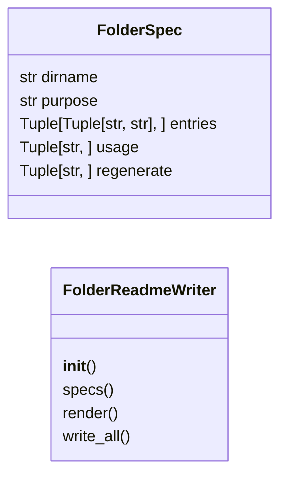
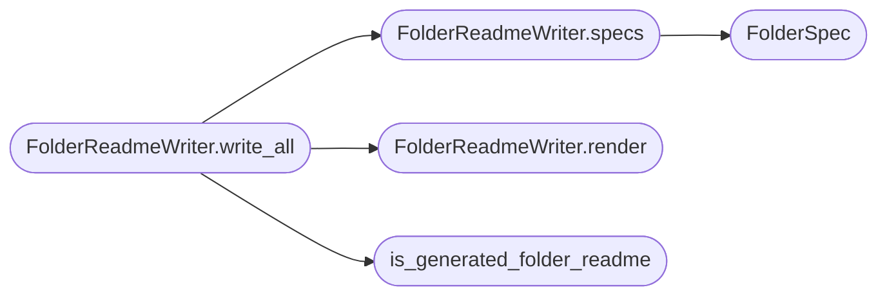

# `readmenator._folder_readme`

> Source: [readmenator/_folder_readme.py:1](../../readmenator/_folder_readme.py#L1) | language `py` | coverage 100.0% | [API index](../index.md)

Per-folder README.md files for every generated readmenator-* directory.

Each output folder gets a README explaining what the folder is for, what
every file in it is (only entries that actually exist are listed), how
humans and agents use it, and how to regenerate it. Files carry
FOLDER_README_MARKER on their first line; a README without the marker is
the user's own and is never overwritten. Consumers that glob Markdown
(site docs, GitHub wiki, agent inventory, component pruning) skip
generated folder READMEs through is_generated_folder_readme.

## Contents

- **Classes:** [`FolderSpec`](#folderspec), [`FolderReadmeWriter`](#folderreadmewriter)
- **Functions:** [`is_generated_folder_readme`](#is_generated_folder_readme)
- **Constants:** [`MARKER_SCAN_BYTES`](#marker_scan_bytes)

## Type Diagram



## Call Graph

Solid arrows stay in this module, dashed arrows leave it.



## Classes

<a id="folderspec"></a>

### `FolderSpec`

`class` `dataclass` | [readmenator/_folder_readme.py:27](../../readmenator/_folder_readme.py#L27)

Decorators: `@dataclass(frozen=True)`

```python
class FolderSpec
```

Description of one generated output folder.

**Attributes**

| Name | Type | Default | Description |
|---|---|---|---|
| [`dirname`](#folderspec-dirname) | `str` |  | Folder name relative to the project root. |
| [`purpose`](#folderspec-purpose) | `str` |  | One paragraph stating what the folder is for. |
| [`entries`](#folderspec-entries) | `Tuple[Tuple[str, str], ...]` |  | (glob pattern, description) pairs; only matching entries are listed. |
| [`usage`](#folderspec-usage) | `Tuple[str, ...]` |  | Bullet lines telling humans and agents how to use the folder. |
| [`regenerate`](#folderspec-regenerate) | `Tuple[str, ...]` |  | Shell commands that rebuild the folder. |

---

<a id="folderreadmewriter"></a>

### `FolderReadmeWriter`

`class` | [readmenator/_folder_readme.py:65](../../readmenator/_folder_readme.py#L65)

```python
class FolderReadmeWriter
```

Writes README.md into each generated readmenator-* folder that exists.

**Members**

| Member | Kind | Summary |
|---|---|---|
| [`__init__`](#folderreadmewriter-__init__) | constructor | Initialise with application configuration. |
| [`specs`](#folderreadmewriter-specs) | method | Return the folder descriptions built from Config names. |
| [`render`](#folderreadmewriter-render) | method | Render the README text for one folder. |
| [`write_all`](#folderreadmewriter-write_all) | method | Write the README of every generated folder that exists. |

<a id="folderreadmewriter-__init__"></a>

#### `FolderReadmeWriter.__init__`

`constructor` | [readmenator/_folder_readme.py:68](../../readmenator/_folder_readme.py#L68)

```python
def __init__(self, config: Config) -> None
```

Initialise with application configuration.

**Parameters**

| Name | Type | Default | Description |
|---|---|---|---|
| `config` | `Config` |  | Settings naming every output folder and file. |

*Called by:* [`AnalyzerFactory.folder_readme`](readmenator._pipeline.py.md#analyzerfactory-folder_readme)

<a id="folderreadmewriter-specs"></a>

#### `FolderReadmeWriter.specs`

`method` | [readmenator/_folder_readme.py:76](../../readmenator/_folder_readme.py#L76)

```python
def specs(self) -> List[FolderSpec]
```

Return the folder descriptions built from Config names.

**Returns:** `List[FolderSpec]` - One FolderSpec per generated output folder, in reading order.

*Calls:* [`FolderSpec`](#folderspec)

*Called by:* [`FolderReadmeWriter.write_all`](#folderreadmewriter-write_all)

<a id="folderreadmewriter-render"></a>

#### `FolderReadmeWriter.render`

`method` | [readmenator/_folder_readme.py:272](../../readmenator/_folder_readme.py#L272)

```python
def render(self, spec: FolderSpec, folder: Path) -> str
```

Render the README text for one folder.

**Parameters**

| Name | Type | Default | Description |
|---|---|---|---|
| `spec` | `FolderSpec` |  | Folder description. |
| `folder` | `Path` |  | Existing folder on disk (entries are listed only when present). |

**Returns:** `str` - Markdown README text starting with the marker line.

*Called by:* [`FolderReadmeWriter.write_all`](#folderreadmewriter-write_all)

<a id="folderreadmewriter-write_all"></a>

#### `FolderReadmeWriter.write_all`

`method` | [readmenator/_folder_readme.py:307](../../readmenator/_folder_readme.py#L307)

```python
def write_all(self, project_root: str) -> List[str]
```

Write the README of every generated folder that exists.

Symlinked folders or targets and READMEs without the marker are left untouched.

**Parameters**

| Name | Type | Default | Description |
|---|---|---|---|
| `project_root` | `str` |  | Project root directory. |

**Returns:** `List[str]` - Sorted paths of README files written or already current.

*Calls:* [`FolderReadmeWriter.render`](#folderreadmewriter-render), [`FolderReadmeWriter.specs`](#folderreadmewriter-specs), [`is_generated_folder_readme`](#is_generated_folder_readme)

---

## Functions

<a id="is_generated_folder_readme"></a>

### `is_generated_folder_readme`

`function` | [readmenator/_folder_readme.py:45](../../readmenator/_folder_readme.py#L45)

```python
def is_generated_folder_readme(path: Path, config: Config) -> bool
```

Return True when path is a README written by FolderReadmeWriter.

**Parameters**

| Name | Type | Default | Description |
|---|---|---|---|
| `path` | `Path` |  | Candidate file path. |
| `config` | `Config` |  | Application configuration. |

**Returns:** `bool` - True for a regular file named FOLDER_README_FILENAME whose head holds the marker.

*Called by:* [`DocsSitePublisher.collect_doc_sources`](readmenator._diagrams.py.md#docssitepublisher-collect_doc_sources), [`FolderReadmeWriter.write_all`](#folderreadmewriter-write_all), [`GitHubWikiPublisher.collect_sources`](readmenator._gh_wiki.py.md#githubwikipublisher-collect_sources)

---

## Constants

<a id="marker_scan_bytes"></a>

### `MARKER_SCAN_BYTES`

`constant` | [readmenator/_folder_readme.py:23](../../readmenator/_folder_readme.py#L23)

```python
MARKER_SCAN_BYTES = 512
```

---
