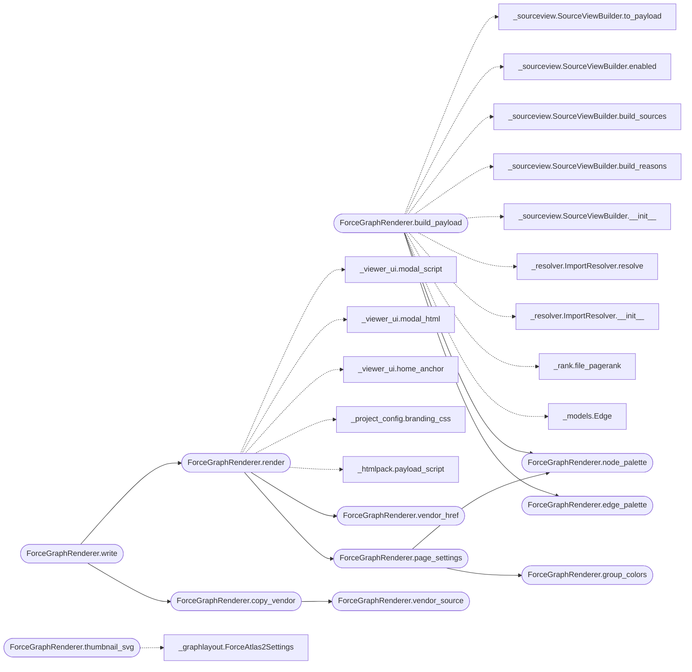

# `readmenator._forcegraph`

> Source: [readmenator/_forcegraph.py:1](../../readmenator/_forcegraph.py#L1) | language `py` | coverage 100.0% | [API index](../index.md)

Force-graph explorer for the readmenator knowledge graph.

Builds a heterogeneous node-link payload (files, communities, layers,
externals) and renders a standalone HTML document on top of the
vasturiano force-graph library. The 2D engine ships vendored beside
the page so it works offline and via file://; the CDN copy is only a
fallback and the 3D engine loads on demand. The page itself lives in
_forcegraph_page.py; this module builds its payload and settings.
Visual language (theme tokens, cards, chips, toolbar) matches the
system-maps gallery.

## Contents

- **Classes:** [`ForceGraphRenderer`](#forcegraphrenderer)
- **Functions:** [`family_color_from_name`](#family_color_from_name), [`node_value`](#node_value)

## Call Graph

Solid arrows stay in this module, dashed arrows leave it.



## Classes

<a id="forcegraphrenderer"></a>

### `ForceGraphRenderer`

`class` | [readmenator/_forcegraph.py:82](../../readmenator/_forcegraph.py#L82)

```python
class ForceGraphRenderer
```

Builds force-graph payloads and renders the explorer HTML.

**Members**

| Member | Kind | Summary |
|---|---|---|
| [`__init__`](#forcegraphrenderer-__init__) | constructor | Initialise with application configuration. |
| [`node_palette`](#forcegraphrenderer-node_palette) | method | Return the node-type color palette from configuration. |
| [`edge_palette`](#forcegraphrenderer-edge_palette) | method | Return the edge-relation color palette from configuration. |
| [`vendor_source`](#forcegraphrenderer-vendor_source) | method | Return the path of the vendored 2D engine shipped in the package. |
| [`vendor_href`](#forcegraphrenderer-vendor_href) | method | Return the relative vendor script href used beside the page. |
| [`build_payload`](#forcegraphrenderer-build_payload) | method | Build a heterogeneous graph payload for the explorer. |
| [`render`](#forcegraphrenderer-render) | method | Render the standalone force-graph explorer HTML document. |
| [`group_colors`](#forcegraphrenderer-group_colors) | method | Return stable colors for the layer and language groupings in a payload. |
| [`page_settings`](#forcegraphrenderer-page_settings) | method | Collect the explorer page settings serialized into the HTML. |
| [`family_color`](#forcegraphrenderer-family_color) | method | Return the configured stable hash color for a group name. |
| [`thumbnail_svg`](#forcegraphrenderer-thumbnail_svg) | method | Render a small ForceAtlas2 preview of the file graph as inline SVG. |
| [`write`](#forcegraphrenderer-write) | method | Write the explorer HTML plus the vendored engine beside it. |
| [`copy_vendor`](#forcegraphrenderer-copy_vendor) | method | Copy the vendored 2D engine next to an exported page. |

<a id="forcegraphrenderer-__init__"></a>

#### `ForceGraphRenderer.__init__`

`constructor` | [readmenator/_forcegraph.py:85](../../readmenator/_forcegraph.py#L85)

```python
def __init__(self, config: Config) -> None
```

Initialise with application configuration.

**Parameters**

| Name | Type | Default | Description |
|---|---|---|---|
| `config` | `Config` |  | Settings for palette, physics, hulls, and CDN URLs. |

*Called by:* [`BundleGraphRenderer.__init__`](readmenator._bundlegraph.py.md#bundlegraphrenderer-__init__), [`ExplorerState.__init__`](readmenator._explorer.py.md#explorerstate-__init__), [`write_static`](readmenator._explorer.py.md#write_static), [`GraphExporter.to_forcegraph`](readmenator._exporter.py.md#graphexporter-to_forcegraph), [`AnalyzerFactory.forcegraph`](readmenator._pipeline.py.md#analyzerfactory-forcegraph)

<a id="forcegraphrenderer-node_palette"></a>

#### `ForceGraphRenderer.node_palette`

`method` | [readmenator/_forcegraph.py:93](../../readmenator/_forcegraph.py#L93)

```python
def node_palette(self) -> Dict[str, str]
```

Return the node-type color palette from configuration.

**Returns:** `Dict[str, str]`

*Called by:* [`BundleGraphRenderer.build_payload`](readmenator._bundlegraph.py.md#bundlegraphrenderer-build_payload), [`ForceGraphRenderer.build_payload`](#forcegraphrenderer-build_payload), [`ForceGraphRenderer.page_settings`](#forcegraphrenderer-page_settings)

<a id="forcegraphrenderer-edge_palette"></a>

#### `ForceGraphRenderer.edge_palette`

`method` | [readmenator/_forcegraph.py:97](../../readmenator/_forcegraph.py#L97)

```python
def edge_palette(self) -> Dict[str, str]
```

Return the edge-relation color palette from configuration.

**Returns:** `Dict[str, str]`

*Called by:* [`ForceGraphRenderer.build_payload`](#forcegraphrenderer-build_payload)

<a id="forcegraphrenderer-vendor_source"></a>

#### `ForceGraphRenderer.vendor_source`

`method` | [readmenator/_forcegraph.py:101](../../readmenator/_forcegraph.py#L101)

```python
def vendor_source(self) -> Path
```

Return the path of the vendored 2D engine shipped in the package.

**Returns:** `Path`

*Called by:* [`ForceGraphRenderer.copy_vendor`](#forcegraphrenderer-copy_vendor)

<a id="forcegraphrenderer-vendor_href"></a>

#### `ForceGraphRenderer.vendor_href`

`method` | [readmenator/_forcegraph.py:109](../../readmenator/_forcegraph.py#L109)

```python
def vendor_href(self) -> str
```

Return the relative vendor script href used beside the page.

**Returns:** `str`

*Called by:* [`ForceGraphRenderer.render`](#forcegraphrenderer-render)

<a id="forcegraphrenderer-build_payload"></a>

#### `ForceGraphRenderer.build_payload`

`method` | [readmenator/_forcegraph.py:114](../../readmenator/_forcegraph.py#L114)

```python
def build_payload(self, nodes: List[Node], edges: List[Edge], resolved_edges: Optional[List[Edge]] = None, analysis: Optional[AnalysisResult] = None, layers: Optional[Dict[str, str]] = None, findings: Optional[List[SecurityFinding]] = None, content_map: Optional[Dict[str, str]] = None) -> Dict[str, List[Dict[str, Any]]]
```

Build a heterogeneous graph payload for the explorer.

**Parameters**

| Name | Type | Default | Description |
|---|---|---|---|
| `nodes` | `List[Node]` |  | Scanned file nodes. |
| `edges` | `List[Edge]` |  | Raw import edges. |
| `resolved_edges` | `Optional[List[Edge]]` | `None` | Optional resolved-import edges. |
| `analysis` | `Optional[AnalysisResult]` | `None` | Optional community and god-node analysis. |
| `layers` | `Optional[Dict[str, str]]` | `None` | Optional file-to-layer mapping. |
| `findings` | `Optional[List[SecurityFinding]]` | `None` | Optional security findings for node weights. |
| `content_map` | `Optional[Dict[str, str]]` | `None` | Optional file contents for the source viewer. |

**Returns:** `Dict[str, List[Dict[str, Any]]]` - Dictionary with nodes and edges lists for the frontend.

*Calls:* [`ForceGraphRenderer.edge_palette`](#forcegraphrenderer-edge_palette), [`ForceGraphRenderer.node_palette`](#forcegraphrenderer-node_palette), [`Edge`](readmenator._models.py.md#edge), [`file_pagerank`](readmenator._rank.py.md#file_pagerank), [`ImportResolver.__init__`](readmenator._resolver.py.md#importresolver-__init__), [`ImportResolver.resolve`](readmenator._resolver.py.md#importresolver-resolve), [`SourceViewBuilder.__init__`](readmenator._sourceview.py.md#sourceviewbuilder-__init__), [`SourceViewBuilder.build_reasons`](readmenator._sourceview.py.md#sourceviewbuilder-build_reasons), [`SourceViewBuilder.build_sources`](readmenator._sourceview.py.md#sourceviewbuilder-build_sources), [`SourceViewBuilder.enabled`](readmenator._sourceview.py.md#sourceviewbuilder-enabled), [`SourceViewBuilder.to_payload`](readmenator._sourceview.py.md#sourceviewbuilder-to_payload)

*Called by:* [`ExplorerState.__init__`](readmenator._explorer.py.md#explorerstate-__init__), [`GraphExporter.to_forcegraph`](readmenator._exporter.py.md#graphexporter-to_forcegraph)

<a id="forcegraphrenderer-render"></a>

#### `ForceGraphRenderer.render`

`method` | [readmenator/_forcegraph.py:359](../../readmenator/_forcegraph.py#L359)

```python
def render(self, payload: Dict[str, List[Dict[str, Any]]], analytics: Optional[Dict[str, Any]] = None, title: str = 'Force Graph', home_href: Optional[str] = 'index.html', live_api: bool = False) -> str
```

Render the standalone force-graph explorer HTML document.

**Parameters**

| Name | Type | Default | Description |
|---|---|---|---|
| `payload` | `Dict[str, List[Dict[str, Any]]]` |  | Heterogeneous graph payload from build_payload. |
| `analytics` | `Optional[Dict[str, Any]]` | `None` | Optional analytics payload for the side panel. |
| `title` | `str` | `'Force Graph'` | Document title shown in the header. |
| `home_href` | `Optional[str]` | `'index.html'` | Optional gallery home link; omitted when None. |
| `live_api` | `bool` | `False` | True when the page is served by the explorer HTTP server, so the source drawer may probe api/source for files without embedded text. Static exports keep False so Pages-style hosting never fires a doomed fetch (404). |

**Returns:** `str` - Complete HTML document as a string.

*Calls:* [`ForceGraphRenderer.page_settings`](#forcegraphrenderer-page_settings), [`ForceGraphRenderer.vendor_href`](#forcegraphrenderer-vendor_href), [`payload_script`](readmenator._htmlpack.py.md#payload_script), [`branding_css`](readmenator._project_config.py.md#branding_css), [`home_anchor`](readmenator._viewer_ui.py.md#home_anchor), [`modal_html`](readmenator._viewer_ui.py.md#modal_html), [`modal_script`](readmenator._viewer_ui.py.md#modal_script)

*Called by:* [`ExplorerState.__init__`](readmenator._explorer.py.md#explorerstate-__init__), [`GraphExporter.to_forcegraph`](readmenator._exporter.py.md#graphexporter-to_forcegraph), [`ForceGraphRenderer.write`](#forcegraphrenderer-write)

<a id="forcegraphrenderer-group_colors"></a>

#### `ForceGraphRenderer.group_colors`

`method` | [readmenator/_forcegraph.py:413](../../readmenator/_forcegraph.py#L413)

```python
def group_colors(self, payload: Dict[str, List[Dict[str, Any]]]) -> Dict[str, Dict[str, str]]
```

Return stable colors for the layer and language groupings in a payload.

**Parameters**

| Name | Type | Default | Description |
|---|---|---|---|
| `payload` | `Dict[str, List[Dict[str, Any]]]` |  | Heterogeneous graph payload from build_payload. |

**Returns:** `Dict[str, Dict[str, str]]` - Mapping of grouping mode to {group key: CSS color}.

*Called by:* [`BundleGraphRenderer.page_settings`](readmenator._bundlegraph.py.md#bundlegraphrenderer-page_settings), [`ForceGraphRenderer.page_settings`](#forcegraphrenderer-page_settings)

<a id="forcegraphrenderer-page_settings"></a>

#### `ForceGraphRenderer.page_settings`

`method` | [readmenator/_forcegraph.py:436](../../readmenator/_forcegraph.py#L436)

```python
def page_settings(self, payload: Dict[str, List[Dict[str, Any]]], live_api: bool = False) -> Dict[str, Any]
```

Collect the explorer page settings serialized into the HTML.

**Parameters**

| Name | Type | Default | Description |
|---|---|---|---|
| `payload` | `Dict[str, List[Dict[str, Any]]]` |  | Heterogeneous graph payload from build_payload. |
| `live_api` | `bool` | `False` | True when served by the explorer HTTP server. |

**Returns:** `Dict[str, Any]` - JSON-serializable settings for physics, hit-testing, 3D view, and palettes.

*Calls:* [`ForceGraphRenderer.group_colors`](#forcegraphrenderer-group_colors), [`ForceGraphRenderer.node_palette`](#forcegraphrenderer-node_palette)

*Called by:* [`ForceGraphRenderer.render`](#forcegraphrenderer-render)

<a id="forcegraphrenderer-family_color"></a>

#### `ForceGraphRenderer.family_color`

`method` | [readmenator/_forcegraph.py:512](../../readmenator/_forcegraph.py#L512)

```python
def family_color(self, name: str) -> str
```

Return the configured stable hash color for a group name.

**Parameters**

| Name | Type | Default | Description |
|---|---|---|---|
| `name` | `str` |  | Group label to hash. |

**Returns:** `str` - CSS hsl() color string.

*Called by:* [`BundleGraphRenderer.build_payload`](readmenator._bundlegraph.py.md#bundlegraphrenderer-build_payload)

<a id="forcegraphrenderer-thumbnail_svg"></a>

#### `ForceGraphRenderer.thumbnail_svg`

`method` | [readmenator/_forcegraph.py:540](../../readmenator/_forcegraph.py#L540)

```python
def thumbnail_svg(self, payload: Dict[str, List[Dict[str, Any]]]) -> str
```

Render a small ForceAtlas2 preview of the file graph as inline SVG.

Only numeric coordinates and escaped colors reach the markup, so the
fragment is safe to embed in the gallery card.

**Parameters**

| Name | Type | Default | Description |
|---|---|---|---|
| `payload` | `Dict[str, List[Dict[str, Any]]]` |  | Heterogeneous graph payload from build_payload. |

**Returns:** `str` - SVG markup, or an empty string when the payload has no files.

*Calls:* [`ForceAtlas2Settings`](readmenator._graphlayout.py.md#forceatlas2settings), [`fit_frames`](readmenator._graphlayout.py.md#fit_frames), [`forceatlas2_frames`](readmenator._graphlayout.py.md#forceatlas2_frames)

<a id="forcegraphrenderer-write"></a>

#### `ForceGraphRenderer.write`

`method` | [readmenator/_forcegraph.py:580](../../readmenator/_forcegraph.py#L580)

```python
def write(self, output_path: str | Path, payload: Dict[str, List[Dict[str, Any]]], analytics: Optional[Dict[str, Any]] = None, title: str = 'Force Graph', home_href: Optional[str] = 'index.html') -> str
```

Write the explorer HTML plus the vendored engine beside it.

**Parameters**

| Name | Type | Default | Description |
|---|---|---|---|
| `output_path` | `str \| Path` |  | Destination HTML file path. |
| `payload` | `Dict[str, List[Dict[str, Any]]]` |  | Heterogeneous graph payload from build_payload. |
| `analytics` | `Optional[Dict[str, Any]]` | `None` | Optional analytics payload for the side panel. |
| `title` | `str` | `'Force Graph'` | Document title shown in the header. |
| `home_href` | `Optional[str]` | `'index.html'` | Gallery home link relative to the page; None omits it. |

**Returns:** `str` - Rendered HTML content that was written.

*Calls:* [`ForceGraphRenderer.copy_vendor`](#forcegraphrenderer-copy_vendor), [`ForceGraphRenderer.render`](#forcegraphrenderer-render)

<a id="forcegraphrenderer-copy_vendor"></a>

#### `ForceGraphRenderer.copy_vendor`

`method` | [readmenator/_forcegraph.py:607](../../readmenator/_forcegraph.py#L607)

```python
def copy_vendor(self, dest_dir: str | Path) -> Optional[Path]
```

Copy the vendored 2D engine next to an exported page.

**Parameters**

| Name | Type | Default | Description |
|---|---|---|---|
| `dest_dir` | `str \| Path` |  | Directory holding the explorer HTML file. |

**Returns:** `Optional[Path]` - Vendored script path, or None when the source is missing.

*Calls:* [`ForceGraphRenderer.vendor_source`](#forcegraphrenderer-vendor_source)

*Called by:* [`write_static`](readmenator._explorer.py.md#write_static), [`ForceGraphRenderer.write`](#forcegraphrenderer-write)

---

## Functions

<a id="family_color_from_name"></a>

### `family_color_from_name`

`function` | [readmenator/_forcegraph.py:41](../../readmenator/_forcegraph.py#L41)

```python
def family_color_from_name(name: str, sat_base: int = 55, sat_span: int = 12, light_base: int = 58, light_span: int = 10) -> str
```

Derive a stable, visually-distinct HSL color from a label.

**Parameters**

| Name | Type | Default | Description |
|---|---|---|---|
| `name` | `str` |  | Community or layer label to hash. |
| `sat_base` | `int` | `55` | Minimum saturation percent. |
| `sat_span` | `int` | `12` | Saturation variation range. |
| `light_base` | `int` | `58` | Minimum lightness percent. |
| `light_span` | `int` | `10` | Lightness variation range. |

**Returns:** `str` - CSS hsl() color string stable across runs.

---

<a id="node_value"></a>

### `node_value`

`function` | [readmenator/_forcegraph.py:69](../../readmenator/_forcegraph.py#L69)

```python
def node_value(symbols: int, degree: int) -> float
```

Scale a node value with log2 dampening.

**Parameters**

| Name | Type | Default | Description |
|---|---|---|---|
| `symbols` | `int` |  | Symbol count for the file. |
| `degree` | `int` |  | Connection degree for the file. |

**Returns:** `float` - Dampened node size value with a minimum of 1.

---
