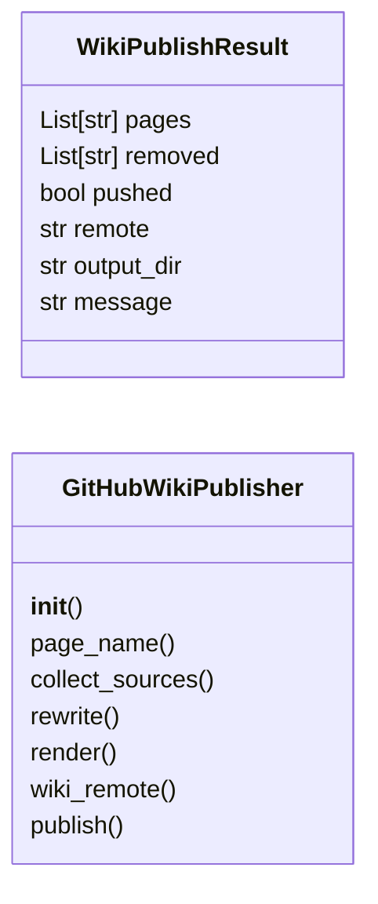
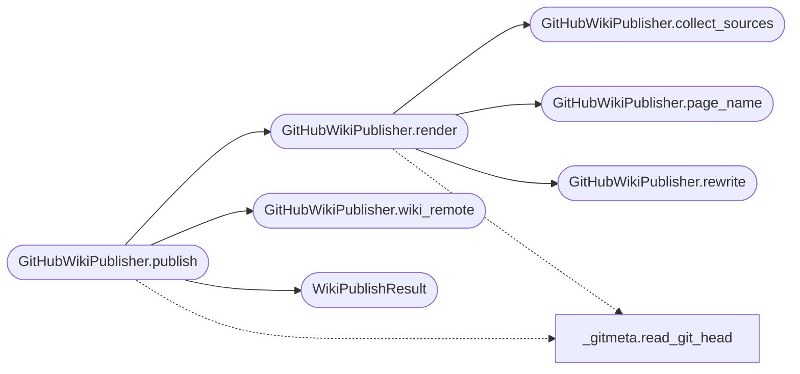

# `readmenator._gh_wiki`

> Source: [readmenator/_gh_wiki.py:1](../../readmenator/_gh_wiki.py#L1) | language `py` | coverage 100.0% | [API index](../index.md)

GitHub wiki publisher: mirrors generated knowledge into the repository wiki.

Turns the readmenator wiki, agent docs, recipes, and KNOWLEDGE_BASE.md
into flat GitHub wiki pages (Home, _Sidebar, _Footer), rewrites relative
markdown links to wiki page names, and turns backticked project paths
into commit-pinned source permalinks. Publishing clones
``<repo>.wiki.git``, replaces only pages it generated before (tracked in
a state file), commits, and pushes. It runs after every rebuild of a git
checkout (GH_WIKI_ENABLED), never during analysis, and shells out with argument lists only (no shell).

## Contents

- **Classes:** [`WikiPublishResult`](#wikipublishresult), [`GitHubWikiPublisher`](#githubwikipublisher)

## Type Diagram



## Call Graph

Solid arrows stay in this module, dashed arrows leave it.



## Classes

<a id="wikipublishresult"></a>

### `WikiPublishResult`

`class` `dataclass` | [readmenator/_gh_wiki.py:39](../../readmenator/_gh_wiki.py#L39)

Decorators: `@dataclass`

```python
class WikiPublishResult
```

Outcome of a GitHub wiki publish.

**Attributes**

| Name | Type | Default | Description |
|---|---|---|---|
| [`pages`](#wikipublishresult-pages) | `List[str]` | `field(default_factory=list)` | Wiki page file names written. |
| [`removed`](#wikipublishresult-removed) | `List[str]` | `field(default_factory=list)` | Previously generated page files deleted as stale. |
| [`pushed`](#wikipublishresult-pushed) | `bool` | `False` | Whether a commit was pushed to the wiki remote. |
| [`remote`](#wikipublishresult-remote) | `str` | `''` | Wiki remote URL used, empty in dry runs without a remote. |
| [`output_dir`](#wikipublishresult-output_dir) | `str` | `''` | Directory holding the rendered pages. |
| [`message`](#wikipublishresult-message) | `str` | `''` | Human-readable status line. |

---

<a id="githubwikipublisher"></a>

### `GitHubWikiPublisher`

`class` | [readmenator/_gh_wiki.py:59](../../readmenator/_gh_wiki.py#L59)

```python
class GitHubWikiPublisher
```

Renders and publishes generated documentation to a GitHub wiki.

**Members**

| Member | Kind | Summary |
|---|---|---|
| [`__init__`](#githubwikipublisher-__init__) | constructor | Store configuration and the subprocess runner (injectable for tests). |
| [`page_name`](#githubwikipublisher-page_name) | method | Map a generated markdown path to its flat GitHub wiki page name. |
| [`collect_sources`](#githubwikipublisher-collect_sources) | method | List project-relative markdown sources to publish, sorted. |
| [`rewrite`](#githubwikipublisher-rewrite) | method | Rewrite relative doc links to wiki pages and paths to source permalinks. |
| [`render`](#githubwikipublisher-render) | method | Render every wiki page, including sidebar and footer. |
| [`wiki_remote`](#githubwikipublisher-wiki_remote) | method | Resolve the wiki remote from config, ``gh``, or the git origin. |
| [`publish`](#githubwikipublisher-publish) | method | Render pages and push them to the GitHub wiki (or a local folder). |

<a id="githubwikipublisher-__init__"></a>

#### `GitHubWikiPublisher.__init__`

`constructor` | [readmenator/_gh_wiki.py:62](../../readmenator/_gh_wiki.py#L62)

```python
def __init__(self, config: Config, runner: Optional[Runner] = None) -> None
```

Store configuration and the subprocess runner (injectable for tests).

**Parameters**

| Name | Type | Default | Description |
|---|---|---|---|
| `config` | `Config` |  | Central settings for paths, page names, and git options. |
| `runner` | `Optional[Runner]` | `None` | Callable compatible with ``subprocess.run``. |

*Called by:* [`AnalyzerFactory.gh_wiki`](readmenator._pipeline.py.md#analyzerfactory-gh_wiki)

<a id="githubwikipublisher-page_name"></a>

#### `GitHubWikiPublisher.page_name`

`method` | [readmenator/_gh_wiki.py:72](../../readmenator/_gh_wiki.py#L72)

```python
def page_name(self, rel_path: str) -> str
```

Map a generated markdown path to its flat GitHub wiki page name.

**Parameters**

| Name | Type | Default | Description |
|---|---|---|---|
| `rel_path` | `str` |  | Project-relative markdown path. |

**Returns:** `str` - Wiki page name without extension.

*Called by:* [`GitHubWikiPublisher.render`](#githubwikipublisher-render)

<a id="githubwikipublisher-collect_sources"></a>

#### `GitHubWikiPublisher.collect_sources`

`method` | [readmenator/_gh_wiki.py:96](../../readmenator/_gh_wiki.py#L96)

```python
def collect_sources(self, project_root: str) -> List[str]
```

List project-relative markdown sources to publish, sorted.

**Parameters**

| Name | Type | Default | Description |
|---|---|---|---|
| `project_root` | `str` |  | Project root holding generated outputs. |

**Returns:** `List[str]` - Relative POSIX paths of regular, non-symlink markdown files.

*Called by:* [`GitHubWikiPublisher.render`](#githubwikipublisher-render)

<a id="githubwikipublisher-rewrite"></a>

#### `GitHubWikiPublisher.rewrite`

`method` | [readmenator/_gh_wiki.py:129](../../readmenator/_gh_wiki.py#L129)

```python
def rewrite(self, text: str, rel_path: str, names: Dict[str, str], project_root: str, blob_base: str) -> str
```

Rewrite relative doc links to wiki pages and paths to source permalinks.

**Parameters**

| Name | Type | Default | Description |
|---|---|---|---|
| `text` | `str` |  | Markdown content of one source document. |
| `rel_path` | `str` |  | Project-relative path of that document. |
| `names` | `Dict[str, str]` |  | Mapping of published relative paths to page names. |
| `project_root` | `str` |  | Project root used to check that paths exist. |
| `blob_base` | `str` |  | Commit-pinned blob URL prefix, empty to skip. |

**Returns:** `str` - Markdown ready for the GitHub wiki.

*Called by:* [`GitHubWikiPublisher.render`](#githubwikipublisher-render)

<a id="githubwikipublisher-render"></a>

#### `GitHubWikiPublisher.render`

`method` | [readmenator/_gh_wiki.py:179](../../readmenator/_gh_wiki.py#L179)

```python
def render(self, project_root: str, remote: str = '') -> Dict[str, str]
```

Render every wiki page, including sidebar and footer.

**Parameters**

| Name | Type | Default | Description |
|---|---|---|---|
| `project_root` | `str` |  | Project root holding generated outputs. |
| `remote` | `str` | `''` | Main repository remote used for source permalinks. |

**Returns:** `Dict[str, str]` - Mapping of wiki file name to markdown content.

*Calls:* [`GitHubWikiPublisher.collect_sources`](#githubwikipublisher-collect_sources), [`GitHubWikiPublisher.page_name`](#githubwikipublisher-page_name), [`GitHubWikiPublisher.rewrite`](#githubwikipublisher-rewrite), [`read_git_head`](readmenator._gitmeta.py.md#read_git_head)

*Called by:* [`GitHubWikiPublisher.publish`](#githubwikipublisher-publish)

<a id="githubwikipublisher-wiki_remote"></a>

#### `GitHubWikiPublisher.wiki_remote`

`method` | [readmenator/_gh_wiki.py:249](../../readmenator/_gh_wiki.py#L249)

```python
def wiki_remote(self, project_root: str) -> str
```

Resolve the wiki remote from config, ``gh``, or the git origin.

**Parameters**

| Name | Type | Default | Description |
|---|---|---|---|
| `project_root` | `str` |  | Project root of the main repository. |

**Returns:** `str` - The ``.wiki.git`` remote URL, or empty string when unknown.

*Called by:* [`GitHubWikiPublisher.publish`](#githubwikipublisher-publish)

<a id="githubwikipublisher-publish"></a>

#### `GitHubWikiPublisher.publish`

`method` | [readmenator/_gh_wiki.py:313](../../readmenator/_gh_wiki.py#L313)

```python
def publish(self, project_root: str, dry_run: bool = False) -> WikiPublishResult
```

Render pages and push them to the GitHub wiki (or a local folder).

**Parameters**

| Name | Type | Default | Description |
|---|---|---|---|
| `project_root` | `str` |  | Project root holding generated outputs. |
| `dry_run` | `bool` | `False` | Render into GH_WIKI_DRY_RUN_DIR without any git calls. |

**Returns:** `WikiPublishResult` - WikiPublishResult describing what was written and pushed.

*Calls:* [`GitHubWikiPublisher.render`](#githubwikipublisher-render), [`GitHubWikiPublisher.wiki_remote`](#githubwikipublisher-wiki_remote), [`WikiPublishResult`](#wikipublishresult), [`read_git_head`](readmenator._gitmeta.py.md#read_git_head)

---
