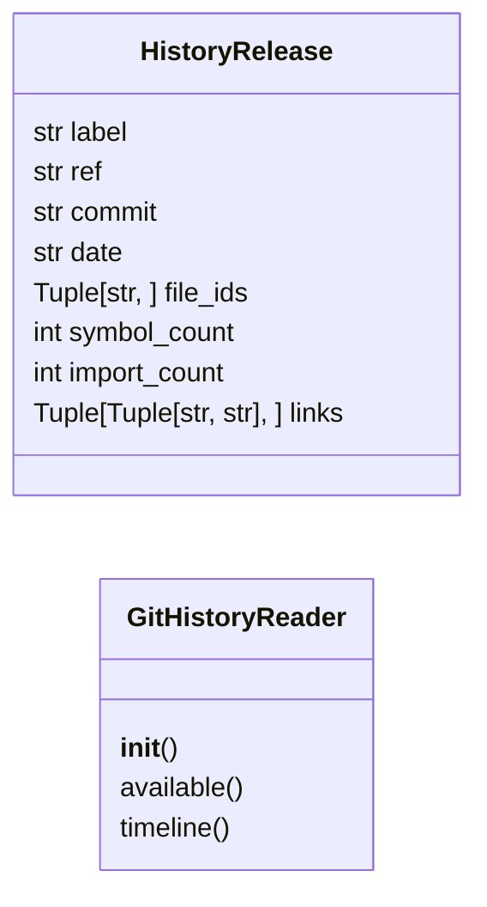
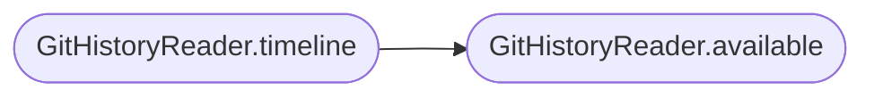

# `readmenator._githistory`

> Source: [readmenator/_githistory.py:1](../../readmenator/_githistory.py#L1) | language `py` | coverage 100.0% | [API index](../index.md)

Git history replay: read release snapshots from a repository.

The video needs the growth story of a project, not only its final
shape. This module walks the git history of a checkout, materialises the
tracked source tree at every release tag, parses it with the very same
scanner used for the working copy, and resolves the internal import
graph of that release. The result is an ordered timeline the video can
play back as a timelapse: every release becomes a frame where the files
and the dependency edges that already existed are visible.

Read-only by construction: every git invocation is a plumbing command
with an explicit argument list (never a shell), a timeout, and no
network access. Repositories without git, without tags, or without a
reachable history simply produce an empty timeline.

## Contents

- **Classes:** [`HistoryRelease`](#historyrelease), [`GitHistoryReader`](#githistoryreader)

## Type Diagram



## Call Graph

Solid arrows stay in this module, dashed arrows leave it.



## Classes

<a id="historyrelease"></a>

### `HistoryRelease`

`class` `dataclass` | [readmenator/_githistory.py:43](../../readmenator/_githistory.py#L43)

Decorators: `@dataclass(frozen=True)`

```python
class HistoryRelease
```

One point of the repository timeline.

**Attributes**

| Name | Type | Default | Description |
|---|---|---|---|
| [`label`](#historyrelease-label) | `str` |  | Human version label (``v1.2.0``, ``genesis``). |
| [`ref`](#historyrelease-ref) | `str` |  | Raw git ref the snapshot came from. |
| [`commit`](#historyrelease-commit) | `str` |  | Commit sha of the snapshot. |
| [`date`](#historyrelease-date) | `str` |  | ISO date of the snapshot. |
| [`file_ids`](#historyrelease-file_ids) | `Tuple[str, ...]` |  | Source files tracked at that point, sorted. |
| [`symbol_count`](#historyrelease-symbol_count) | `int` |  | Symbols parsed from that tree. |
| [`import_count`](#historyrelease-import_count) | `int` |  | Project-internal import edges resolved at that point. |
| [`links`](#historyrelease-links) | `Tuple[Tuple[str, str], ...]` |  | Directed internal import pairs ``(importer, imported)``. |

---

<a id="githistoryreader"></a>

### `GitHistoryReader`

`class` | [readmenator/_githistory.py:67](../../readmenator/_githistory.py#L67)

```python
class GitHistoryReader
```

Read release snapshots from a git repository (read-only).

**Parameters**

| Name | Type | Default | Description |
|---|---|---|---|
| `config` |  |  | Settings; the history budgets live in it. |
| `runner` |  |  | Optional callable replacing ``subprocess.run``, used by tests to inject a fake git. |

**Members**

| Member | Kind | Summary |
|---|---|---|
| [`__init__`](#githistoryreader-__init__) | constructor | Initialise the reader with configuration and optional runner. |
| [`available`](#githistoryreader-available) | method | Return ``True`` when the target looks like a readable git checkout. |
| [`timeline`](#githistoryreader-timeline) | method | Build the ordered release timeline of a repository. |

<a id="githistoryreader-__init__"></a>

#### `GitHistoryReader.__init__`

`constructor` | [readmenator/_githistory.py:76](../../readmenator/_githistory.py#L76)

```python
def __init__(self, config: Config, runner: Optional[Any] = None) -> None
```

Initialise the reader with configuration and optional runner.

**Parameters**

| Name | Type | Default | Description |
|---|---|---|---|
| `config` | `Config` |  |  |
| `runner` | `Optional[Any]` | `None` |  |

<a id="githistoryreader-available"></a>

#### `GitHistoryReader.available`

`method` | [readmenator/_githistory.py:81](../../readmenator/_githistory.py#L81)

```python
def available(self, project_root: str) -> bool
```

Return ``True`` when the target looks like a readable git checkout.

**Parameters**

| Name | Type | Default | Description |
|---|---|---|---|
| `project_root` | `str` |  | Directory that may hold the repository. |

**Returns:** `bool` - Whether history can be read from that directory.

*Called by:* [`GitHistoryReader.timeline`](#githistoryreader-timeline)

<a id="githistoryreader-timeline"></a>

#### `GitHistoryReader.timeline`

`method` | [readmenator/_githistory.py:100](../../readmenator/_githistory.py#L100)

```python
def timeline(self, project_root: str) -> List[HistoryRelease]
```

Build the ordered release timeline of a repository.

The first commit comes first (named after its tag when it carries
one), then every tag ordered by its creation date, then HEAD when
it is ahead of the last tag.

When the timeline exceeds the snapshot budget the surviving
releases are spread evenly between the first and the last entry,
so the growth story keeps running from the beginning without
jumping from the first release to a distant one.

**Parameters**

| Name | Type | Default | Description |
|---|---|---|---|
| `project_root` | `str` |  | Repository root to read. |

**Returns:** `List[HistoryRelease]` - Snapshots in chronological order; empty when history is unavailable.

*Calls:* [`GitHistoryReader.available`](#githistoryreader-available)

---
