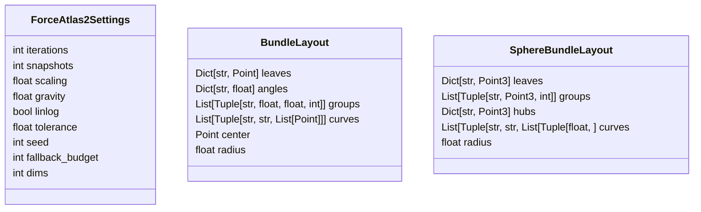
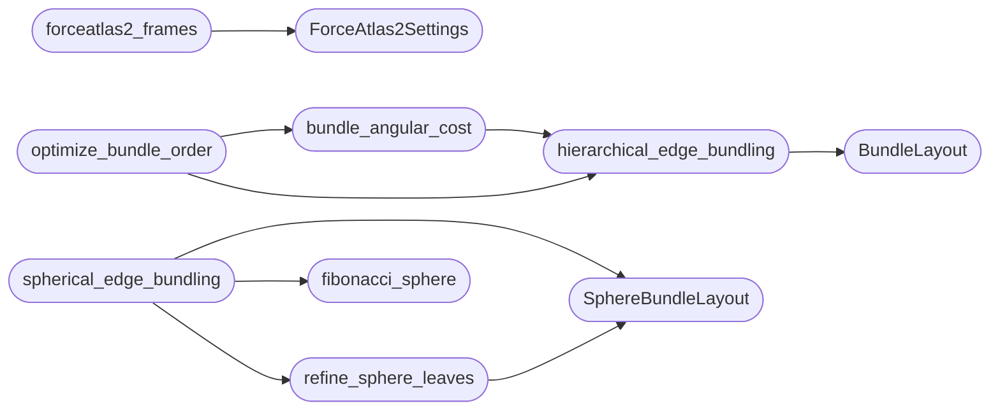

# `readmenator._graphlayout`

> Source: [readmenator/_graphlayout.py:1](../../readmenator/_graphlayout.py#L1) | language `py` | coverage 100.0% | [API index](../index.md)

Deterministic graph layout algorithms for animated renders.

Implements two layout families used by the cinematic video:

- ForceAtlas2 (Jacomy et al., 2014): degree-weighted repulsion,
  LinLog attraction, degree-weighted gravity, and the adaptive global
  speed driven by swing and traction. Snapshots are recorded during
  the run so the convergence itself can be animated.
- Hierarchical edge bundling (Holten, 2006): leaves placed on a circle
  grouped by community, every edge routed through the community
  hierarchy as a control polygon, straightened by the bundling
  strength beta, and sampled as a uniform cubic B-spline.
- Spherical edge bundling: the same hierarchy on a unit sphere, each
  community owning a cap of Fibonacci lattice points sized by its
  member count, hubs inside the sphere and the root at its center.
- Crossing reduction for both: group order by weighted adjacency with
  2-opt, center-out hub seeding, barycentric member sweeps on the
  circle, and neighbour-facing point assignment inside sphere caps.

ForceAtlas2 runs in two or three dimensions (settings.dims).

numpy is used when available for the O(n^2) force pass; a pure Python
path keeps the module dependency-free (the iteration budget shrinks
to keep the fallback fast). Results are deterministic for a given
seed and input ordering.

## Contents

- **Classes:** [`ForceAtlas2Settings`](#forceatlas2settings), [`BundleLayout`](#bundlelayout), [`SphereBundleLayout`](#spherebundlelayout)
- **Functions:** [`forceatlas2_frames`](#forceatlas2_frames), [`fit_frames`](#fit_frames), [`interpolate_frames`](#interpolate_frames), [`hierarchical_edge_bundling`](#hierarchical_edge_bundling), [`fibonacci_sphere`](#fibonacci_sphere), [`spherical_edge_bundling`](#spherical_edge_bundling), [`normalize_cloud`](#normalize_cloud), [`bundle_angular_cost`](#bundle_angular_cost), [`optimize_bundle_order`](#optimize_bundle_order), [`refine_sphere_leaves`](#refine_sphere_leaves)

## Type Diagram



## Call Graph

Solid arrows stay in this module, dashed arrows leave it.



## Classes

<a id="forceatlas2settings"></a>

### `ForceAtlas2Settings`

`class` `dataclass` | [readmenator/_graphlayout.py:40](../../readmenator/_graphlayout.py#L40)

Decorators: `@dataclass(frozen=True)`

```python
class ForceAtlas2Settings
```

Tuneables for ForceAtlas2.

**Attributes**

| Name | Type | Default | Description |
|---|---|---|---|
| [`iterations`](#forceatlas2settings-iterations) | `int` | `300` | Total simulation steps. |
| [`snapshots`](#forceatlas2settings-snapshots) | `int` | `60` | Number of recorded intermediate layouts (>= 2). |
| [`scaling`](#forceatlas2settings-scaling) | `float` | `2.0` | Repulsion constant kr. |
| [`gravity`](#forceatlas2settings-gravity) | `float` | `1.0` | Gravity constant kg (pulls every node to the origin). |
| [`linlog`](#forceatlas2settings-linlog) | `bool` | `True` | Use log(1 + d) attraction for tighter clusters. |
| [`tolerance`](#forceatlas2settings-tolerance) | `float` | `1.0` | Swing tolerance of the adaptive speed. |
| [`seed`](#forceatlas2settings-seed) | `int` | `7` | Random seed for the initial positions. |
| [`fallback_budget`](#forceatlas2settings-fallback_budget) | `int` | `20000000` | Max n^2 * iterations for the pure Python path. |
| [`dims`](#forceatlas2settings-dims) | `int` | `2` | Layout dimensions (2 or 3). |

---

<a id="bundlelayout"></a>

### `BundleLayout`

`class` `dataclass` | [readmenator/_graphlayout.py:281](../../readmenator/_graphlayout.py#L281)

Decorators: `@dataclass(frozen=True)`

```python
class BundleLayout
```

Radial hierarchical edge bundling result.

**Attributes**

| Name | Type | Default | Description |
|---|---|---|---|
| [`leaves`](#bundlelayout-leaves) | `Dict[str, Point]` |  | Leaf positions on the outer circle. |
| [`angles`](#bundlelayout-angles) | `Dict[str, float]` |  | Leaf angles in radians. |
| [`groups`](#bundlelayout-groups) | `List[Tuple[str, float, float, int]]` |  | Group arcs as (label, start angle, end angle, member count). |
| [`curves`](#bundlelayout-curves) | `List[Tuple[str, str, List[Point]]]` |  | One sampled polyline per edge as (source, target, points). |
| [`center`](#bundlelayout-center) | `Point` |  | Circle center. |
| [`radius`](#bundlelayout-radius) | `float` |  | Outer radius. |

---

<a id="spherebundlelayout"></a>

### `SphereBundleLayout`

`class` `dataclass` | [readmenator/_graphlayout.py:461](../../readmenator/_graphlayout.py#L461)

Decorators: `@dataclass(frozen=True)`

```python
class SphereBundleLayout
```

Spherical hierarchical edge bundling result.

**Attributes**

| Name | Type | Default | Description |
|---|---|---|---|
| [`leaves`](#spherebundlelayout-leaves) | `Dict[str, Point3]` |  | Leaf positions on the sphere surface. |
| [`groups`](#spherebundlelayout-groups) | `List[Tuple[str, Point3, int]]` |  | Group caps as (label, unit center, member count). |
| [`hubs`](#spherebundlelayout-hubs) | `Dict[str, Point3]` |  | Group hub positions inside the sphere. |
| [`curves`](#spherebundlelayout-curves) | `List[Tuple[str, str, List[Tuple[float, ...]]]]` |  | One sampled 3D polyline per edge as (source, target, points). |
| [`radius`](#spherebundlelayout-radius) | `float` |  | Sphere radius. |

---

## Functions

<a id="forceatlas2_frames"></a>

### `forceatlas2_frames`

`function` | [readmenator/_graphlayout.py:73](../../readmenator/_graphlayout.py#L73)

```python
def forceatlas2_frames(ids: Sequence[str], edges: Sequence[Tuple[str, str]], settings: Optional[ForceAtlas2Settings] = None) -> List[Dict[str, Tuple[float, ...]]]
```

Run ForceAtlas2 and return evenly spaced layout snapshots.

**Parameters**

| Name | Type | Default | Description |
|---|---|---|---|
| `ids` | `Sequence[str]` |  | Node identifiers (order defines determinism). |
| `edges` | `Sequence[Tuple[str, str]]` |  | Undirected (a, b) pairs; unknown ids and self loops are ignored. |
| `settings` | `Optional[ForceAtlas2Settings]` | `None` | Algorithm settings; defaults when None. |

**Returns:** `List[Dict[str, Tuple[float, ...]]]` - Snapshots from the seeded start to the converged layout; each
maps node id to raw coordinates ((x, y), or (x, y, z) when
settings.dims is 3). Empty for no nodes.

*Calls:* [`ForceAtlas2Settings`](#forceatlas2settings)

*Called by:* [`ForceGraphRenderer.thumbnail_svg`](readmenator._forcegraph.py.md#forcegraphrenderer-thumbnail_svg), [`CinematicVideoRenderer.emergence_frames`](readmenator._video.py.md#cinematicvideorenderer-emergence_frames), [`CinematicVideoRenderer.orbit_positions`](readmenator._video.py.md#cinematicvideorenderer-orbit_positions)

---

<a id="fit_frames"></a>

### `fit_frames`

`function` | [readmenator/_graphlayout.py:221](../../readmenator/_graphlayout.py#L221)

```python
def fit_frames(frames: List[Dict[str, Point]], box: Tuple[float, float, float, float], margin: float, trim: float = 0.0) -> List[Dict[str, Point]]
```

Map raw snapshots into a pixel box using the final layout's bounds.

Earlier snapshots share the final camera, so the animation shows the
graph contracting into place. Coordinates are clamped to the box.

**Parameters**

| Name | Type | Default | Description |
|---|---|---|---|
| `frames` | `List[Dict[str, Point]]` |  | Raw snapshots from forceatlas2_frames. |
| `box` | `Tuple[float, float, float, float]` |  | Target (x0, y0, x1, y1) pixel box. |
| `margin` | `float` |  | Inner margin in pixels. |
| `trim` | `float` | `0.0` | Fraction of outliers ignored on each side when fitting. |

**Returns:** `List[Dict[str, Point]]` - Snapshots in pixel coordinates.

*Called by:* [`ForceGraphRenderer.thumbnail_svg`](readmenator._forcegraph.py.md#forcegraphrenderer-thumbnail_svg), [`CinematicVideoRenderer.emergence_frames`](readmenator._video.py.md#cinematicvideorenderer-emergence_frames)

---

<a id="interpolate_frames"></a>

### `interpolate_frames`

`function` | [readmenator/_graphlayout.py:266](../../readmenator/_graphlayout.py#L266)

```python
def interpolate_frames(frames: List[Dict[str, Point]], t: float) -> Dict[str, Point]
```

Linear interpolation between snapshots for a progress t in [0, 1].

**Parameters**

| Name | Type | Default | Description |
|---|---|---|---|
| `frames` | `List[Dict[str, Point]]` |  |  |
| `t` | `float` |  |  |

**Returns:** `Dict[str, Point]`

---

<a id="hierarchical_edge_bundling"></a>

### `hierarchical_edge_bundling`

`function` | [readmenator/_graphlayout.py:374](../../readmenator/_graphlayout.py#L374)

```python
def hierarchical_edge_bundling(groups: Dict[str, List[str]], edges: Sequence[Tuple[str, str]], center: Point, radius: float, beta: float = 0.85, samples: int = 24, group_gap: float = 0.04, inner_ratio: float = 0.55) -> BundleLayout
```

Lay leaves on a circle by group and bundle edges through the hierarchy.

**Parameters**

| Name | Type | Default | Description |
|---|---|---|---|
| `groups` | `Dict[str, List[str]]` |  | Ordered mapping of group label to member ids. |
| `edges` | `Sequence[Tuple[str, str]]` |  | (source, target) pairs between members. |
| `center` | `Point` |  | Circle center in pixels. |
| `radius` | `float` |  | Outer radius in pixels. |
| `beta` | `float` | `0.85` | Bundling strength in [0, 1] (1 = fully bundled). |
| `samples` | `int` | `24` | Points per sampled curve. |
| `group_gap` | `float` | `0.04` | Angular gap between groups in radians. |
| `inner_ratio` | `float` | `0.55` | Radius ratio of the group control points. |

**Returns:** `BundleLayout` - BundleLayout with leaf positions, group arcs, and sampled curves.

*Calls:* [`BundleLayout`](#bundlelayout)

*Called by:* [`BundleGraphRenderer.build_payload`](readmenator._bundlegraph.py.md#bundlegraphrenderer-build_payload), [`BundleGraphRenderer.thumbnail_svg`](readmenator._bundlegraph.py.md#bundlegraphrenderer-thumbnail_svg), [`bundle_angular_cost`](#bundle_angular_cost), [`optimize_bundle_order`](#optimize_bundle_order), [`CinematicVideoRenderer.bundle_layout`](readmenator._video.py.md#cinematicvideorenderer-bundle_layout)

---

<a id="fibonacci_sphere"></a>

### `fibonacci_sphere`

`function` | [readmenator/_graphlayout.py:429](../../readmenator/_graphlayout.py#L429)

```python
def fibonacci_sphere(count: int) -> List[Point3]
```

Return count nearly uniform unit vectors on a golden-angle spiral.

**Parameters**

| Name | Type | Default | Description |
|---|---|---|---|
| `count` | `int` |  | Number of points. |

**Returns:** `List[Point3]` - Unit vectors ordered from the north pole to the south pole.

*Called by:* [`spherical_edge_bundling`](#spherical_edge_bundling)

---

<a id="spherical_edge_bundling"></a>

### `spherical_edge_bundling`

`function` | [readmenator/_graphlayout.py:516](../../readmenator/_graphlayout.py#L516)

```python
def spherical_edge_bundling(groups: Dict[str, List[str]], edges: Sequence[Tuple[str, str]], radius: float = 1.0, beta: float = 0.85, samples: int = 24, inner_ratio: float = 0.55, refine_sweeps: int = 0, affinity_edges: Optional[Sequence[Tuple[str, str]]] = None) -> SphereBundleLayout
```

Lay leaves on a sphere in community caps and bundle edges through the hierarchy.

Leaves occupy a Fibonacci lattice with one point per member. The
lattice is split recursively: the groups are cut into two runs of
nearly equal total size, the points are sorted along their axis of
largest spread and cut at the same count, and each half recurses.
Every community therefore owns one contiguous cap whose area matches
its size exactly. Inside a cap the points nearest its mean direction
go to the members listed first (callers list hubs first). Each hub
sits at the cap's mean direction scaled by inner_ratio; the root is
the sphere center.

**Parameters**

| Name | Type | Default | Description |
|---|---|---|---|
| `groups` | `Dict[str, List[str]]` |  | Ordered mapping of group label to member ids. |
| `edges` | `Sequence[Tuple[str, str]]` |  | (source, target) pairs between members. |
| `radius` | `float` | `1.0` | Sphere radius. |
| `beta` | `float` | `0.85` | Bundling strength in [0, 1]. |
| `samples` | `int` | `24` | Points per sampled curve. |
| `inner_ratio` | `float` | `0.55` | Radius ratio of the group hubs. |
| `refine_sweeps` | `int` | `0` | When > 0, members are reassigned inside their cap to face their neighbours (refine_sphere_leaves) before curves are sampled. |
| `affinity_edges` | `Optional[Sequence[Tuple[str, str]]]` | `None` | Edges used for refinement (defaults to *edges*). |

**Returns:** `SphereBundleLayout` - SphereBundleLayout with leaf positions, caps, hubs, and curves.

*Calls:* [`SphereBundleLayout`](#spherebundlelayout), [`fibonacci_sphere`](#fibonacci_sphere), [`refine_sphere_leaves`](#refine_sphere_leaves)

*Called by:* [`BundleGraphRenderer.build_payload`](readmenator._bundlegraph.py.md#bundlegraphrenderer-build_payload), [`CinematicVideoRenderer.sphere_layout`](readmenator._video.py.md#cinematicvideorenderer-sphere_layout)

---

<a id="normalize_cloud"></a>

### `normalize_cloud`

`function` | [readmenator/_graphlayout.py:586](../../readmenator/_graphlayout.py#L586)

```python
def normalize_cloud(points: Dict[str, Tuple[float, ...]], quantile: float = 0.85, max_radius: float = 1.3) -> Dict[str, Point3]
```

Center a 3D point cloud, scale a radius quantile to 1, and pull outliers in.

Force layouts push isolated files far from the core; scaling by the
full extent would shrink the core to a dot. Points beyond radius 1
are compressed smoothly (tanh) so none lies past max_radius.

**Parameters**

| Name | Type | Default | Description |
|---|---|---|---|
| `points` | `Dict[str, Tuple[float, ...]]` |  | Raw 3D positions. |
| `quantile` | `float` | `0.85` | Fraction of points that end up inside the unit sphere. |
| `max_radius` | `float` | `1.3` | Hard bound on the radius after compression (> 1). |

**Returns:** `Dict[str, Point3]` - Normalized positions (empty for no points).

*Called by:* [`CinematicVideoRenderer.orbit_positions`](readmenator._video.py.md#cinematicvideorenderer-orbit_positions)

---

<a id="bundle_angular_cost"></a>

### `bundle_angular_cost`

`function` | [readmenator/_graphlayout.py:654](../../readmenator/_graphlayout.py#L654)

```python
def bundle_angular_cost(groups: Dict[str, List[str]], edges: Sequence[Tuple[str, str]], group_gap: float = 0.04) -> float
```

Total angular length of all edges for a circular group layout.

Shorter total angular length means shorter bundles and fewer
crossings in hierarchical edge bundling.

**Parameters**

| Name | Type | Default | Description |
|---|---|---|---|
| `groups` | `Dict[str, List[str]]` |  | Ordered group label to ordered member ids. |
| `edges` | `Sequence[Tuple[str, str]]` |  | (source, target) pairs. |
| `group_gap` | `float` | `0.04` | Angular gap between groups in radians. |

**Returns:** `float` - Sum over edges of the angular distance between their endpoints.

*Calls:* [`hierarchical_edge_bundling`](#hierarchical_edge_bundling)

*Called by:* [`optimize_bundle_order`](#optimize_bundle_order)

---

<a id="optimize_bundle_order"></a>

### `optimize_bundle_order`

`function` | [readmenator/_graphlayout.py:702](../../readmenator/_graphlayout.py#L702)

```python
def optimize_bundle_order(groups: Dict[str, List[str]], edges: Sequence[Tuple[str, str]], sweeps: int = 6, passes: int = 8, group_gap: float = 0.04) -> Dict[str, List[str]]
```

Reorder groups and members to shorten bundled edges (fewer crossings).

Three deterministic stages, each accepted only when it lowers the
total angular edge length (bundle_angular_cost):

1. Group order: the first group stays first; the rest are chained
   greedily by inter-group edge weight, then refined with 2-opt
   reversals on the weighted arc-center distance.
2. Center-out seeding: inside each group the first-listed members
   (hubs, by caller rank) move to the middle of their arc.
3. Barycentric sweeps: each member is placed at the circular mean
   of its neighbours' angles projected onto its own arc, the
   classic crossing-reduction heuristic (Sugiyama-style) applied
   to the radial layout; members without neighbours keep their slot.

**Parameters**

| Name | Type | Default | Description |
|---|---|---|---|
| `groups` | `Dict[str, List[str]]` |  | Ordered group label to ranked member ids. |
| `edges` | `Sequence[Tuple[str, str]]` |  | (source, target) pairs between members. |
| `sweeps` | `int` | `6` | Barycentric refinement sweeps. |
| `passes` | `int` | `8` | 2-opt passes over the group order. |
| `group_gap` | `float` | `0.04` | Angular gap between groups in radians. |

**Returns:** `Dict[str, List[str]]` - A new ordered mapping with the same groups and members.

*Calls:* [`bundle_angular_cost`](#bundle_angular_cost), [`hierarchical_edge_bundling`](#hierarchical_edge_bundling)

*Called by:* [`BundleGraphRenderer.build_payload`](readmenator._bundlegraph.py.md#bundlegraphrenderer-build_payload), [`CinematicVideoRenderer.ordered_groups`](readmenator._video.py.md#cinematicvideorenderer-ordered_groups)

---

<a id="refine_sphere_leaves"></a>

### `refine_sphere_leaves`

`function` | [readmenator/_graphlayout.py:804](../../readmenator/_graphlayout.py#L804)

```python
def refine_sphere_leaves(layout: SphereBundleLayout, groups: Dict[str, List[str]], edges: Sequence[Tuple[str, str]], sweeps: int = 4) -> SphereBundleLayout
```

Reassign leaves inside each cap so members face their neighbours.

Every cap keeps exactly its lattice points; members are visited by
descending degree and take the free point closest to the mean
direction of their neighbours (cap center for isolated members).
A sweep is kept only when the total chord length of all edges drops.

**Parameters**

| Name | Type | Default | Description |
|---|---|---|---|
| `layout` | `SphereBundleLayout` |  | Result of spherical_edge_bundling. |
| `groups` | `Dict[str, List[str]]` |  | Group label to member ids (same as the layout input). |
| `edges` | `Sequence[Tuple[str, str]]` |  | (source, target) pairs. |
| `sweeps` | `int` | `4` | Maximum refinement sweeps. |

**Returns:** `SphereBundleLayout` - A new SphereBundleLayout with reassigned leaves (curves unchanged).

*Calls:* [`SphereBundleLayout`](#spherebundlelayout)

*Called by:* [`spherical_edge_bundling`](#spherical_edge_bundling)

---
